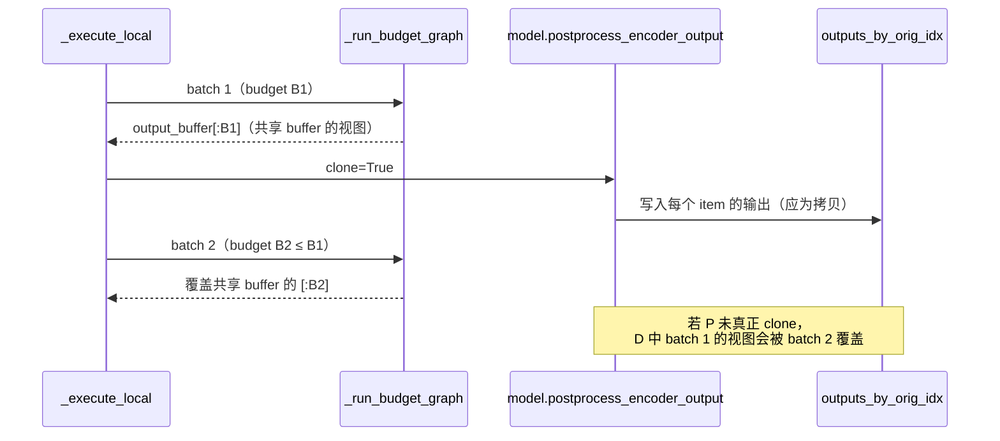

# PR #65351: [Multimodal][Perf] Share encoder CUDA graph capture buffers across token budgets

> **Author**: @shen-shanshan | **State**: OPEN（Draft） | **Date**: 2026-11-03
> **Branch**: `vit-cg` → `main` | **Labels**: nvidia
> **Changes**: +218 -1 lines across 2 files | **ROCm 相关性**: 部分相关（平台无关的 `vllm/v1/worker/encoder_cudagraph.py`，在 ROCm 上即 HIP graph；端到端验证全部在 MI355X 上完成）
> 本报告分两部分：§1–6 为 PR 详细总结，§7–8 为 ROCm review 意见。

---

## 1. 总结 (Summary)

`EncoderCudaGraphManager` 为每个 token budget 都分配一套独立的输入/输出 capture buffer。本 PR 让同一 path、同一 capture-axis key 下的各 budget 共享一份 buffer：最大 budget 先 capture 并持有完整 buffer，较小 budget 只记录其 leading-dim 前缀视图。由于 budget 按 2 的幂分布，持久 capture buffer 显存约减半（作者在 MI355X 上测得 Qwen3-VL-2B 974.1 → 488.0 MiB，DeepSeek-V4.1-Flash 每 rank 724.1 → 362.8 MiB），省下的显存转给 KV cache。

## 2. 背景与动机 (Background & Motivation)

- ViT CUDA graph（RFC #38175）按一组 token budget（如 64 … 16384）各 capture 一张图，每张图需要固定地址的输入 buffer（`pixel_values`、rotary cos/sin、`cu_seqlens` 等）和输出 buffer。budget 是 2 的幂时，所有 budget 的 buffer 总和约为最大 budget 的 2 倍。
- 同一 path 的图在一个 manager 内是串行 replay 的，replay 前会重写输入 buffer，因此理论上它们可以共用同一块显存；这是一项纯显存优化，不改变计算。
- 作者明确排除了用 `WorkspaceManager`：其 `get_persistent` 资源会活过 `EncoderCudaGraphManager.clear()`，而 V1 的 `profile_cudagraph_memory` 正是 capture 到一个临时 manager 再 clear，持久资源会扭曲显存估计。

## 3. 代码修改分析 (Code Change Analysis)

### 3.1 修改的模块

| 文件 | 改动 |
|------|------|
| `vllm/v1/worker/encoder_cudagraph.py` (+107/-1) | 新增 `SharedBufferSlot`、`BudgetGraphMetadata.shared_keys`、`_shared_buffers` 字典、`_get_shared_buffer()`；capture 时 `buffer_keys` 输入与输出 buffer 走共享逻辑；capture 结束后按使用者数量收敛 `shared_keys`；replay 缺少共享 key 时抛错；`clear()` 释放共享 buffer |
| `tests/v1/cudagraph/test_encoder_cudagraph.py` (+111) | 新增 `TestEncoderCudaGraphSharedBuffers`（5 个 GPU 用例）与两个 mock 模型；两个 manager 构造 helper 补 `_shared_buffers = {}` |

### 3.2 架构 / 流程图

```mermaid
flowchart TD
    A[capture 开始] --> B[按 path 遍历<br/>budget 从大到小]
    B --> C[对每个 axis_keys 调用<br/>_capture_budget_graph]
    C --> D[model.prepare_encoder_cudagraph_capture_inputs]
    D --> E{key 在 buffer_keys 中?}
    E -- 否 --> H[保留本 budget 独立 buffer]
    E -- 是 --> F[_get_shared_buffer<br/>slot=(path, axis_keys, key)]
    F --> G{可共享?<br/>非 CPU / 非 0 维 / 连续<br/>dtype、device、trailing dims 相同<br/>leading dim 不更大}
    G -- 否 --> H
    G -- slot 首次出现（最大 budget） --> I[该 tensor 成为共享 buffer]
    G -- slot 已存在 --> J[shared 前缀视图<br/>copy_ 本 budget 的 dummy 数据]
    I --> K[eager 预热 forward]
    J --> K
    H --> K
    K --> L[输出 buffer 同样走 slot=(path, axis_keys, None)]
    L --> M[torch.cuda.graph capture]
    M --> N[全部 capture 完：<br/>使用者 > 1 的 key 才保留在 shared_keys]
```



### 3.3 关键实现细节

- **共享槽位**：`SharedBufferSlot = (path, axis_keys, key)`，输出 buffer 的 key 为 `None`。不同 path、不同 axis key 永不共享，因此双路径编码器（Step3-VL、DeepSeek-OCR）的 global/local 输出不会互相别名。
- **`_get_shared_buffer()`**（`encoder_cudagraph.py:394-422`）：slot 首次出现时，输入直接把模型给出的 tensor 设为共享 buffer，输出则 `empty_like` 新建；之后的 budget 返回 `shared[: like.shape[0]]`。CPU tensor、0 维 tensor、非连续 tensor、trailing dims 不同的 tensor 返回 `None`，保留原先的独立 buffer。
- **capture 顺序**：`capture()` 已经是每个 path 内 `sorted(budgets, reverse=True)`、axis_keys 在内层循环，所以每个 slot 第一个见到的一定是最大 budget。
- **`shared_keys` 收敛**（`:282-295`）：capture 全部完成后，用 `Counter` 统计每个 slot 被多少张图使用，只有 >1 的 key 才保留，例如只有一个 budget 时不会触发 guard。
- **replay guard**（`:521-525`）：replay 时若某个共享 key 没有提供值，直接 `RuntimeError`，而不是沿用 capture 时的内容（共享后该内容已被其他 budget 改写）。
- **`clear()`** 同时清空 `_shared_buffers`，buffer 生命周期与图绑定。

## 4. 涉及的技术原理 (Technical Principles)

- **CUDA/HIP graph 的固定地址约束**：graph replay 读写的是 capture 时记录的指针，输入必须在 replay 前就地写入同一块显存，输出也写到固定 buffer。只要两张图从不并发 replay，并且每次 replay 前都重写输入，它们就可以共用同一块显存；在 ROCm 上 `torch.cuda.graph` 映射到 hipGraph，语义相同。
- **budget 分桶**：编码器把一批图片的 token 数向上取整到最近的 budget，选对应的图 replay；padding 部分由 `_copy_padded_buffer`（先 zero 再拷贝）或模型自定义的 `padding_logics` 填充。2 的幂序列 b, 2b, …, 2^k·b 的总和约为 2^(k+1)·b，所以只保留最大一份约省一半。
- **输出别名与 clone 契约**：`_run_budget_graph` 返回的是 `output_buffer` 本身。`_execute_local` 在一次 `execute()` 内依次跑多个 batch，并把每个 item 的结果累积在 `outputs_by_orig_idx` 里，直到所有 batch 结束才返回。因此每个 batch 的结果必须在下一次 replay 之前拷贝出来，这由 `postprocess_encoder_output(..., clone=True)` 负责。共享输出 buffer 后，这个契约的覆盖范围从"同一 budget 的下一次 replay"扩大到"同一 path 任意 budget 的下一次 replay"。

## 5. 评论区讨论亮点 (Discussion Highlights)

PR 刚以 Draft 形式创建（2026-11-03），暂无 issue 评论、review 或 inline 评论。PR 描述本身给出了安全性论证（同 path 图不并发、replay 前重填输入、`_execute_local` 以 `clone=True` 拷出输出）以及不用 `WorkspaceManager` 的理由。

## 6. 风险与潜在问题 (Risk Analysis)

| 风险 | 严重程度 | 说明 |
|------|---------|------|
| 正确性：输出 buffer 共享依赖每个模型都真正执行 clone | High | 见 §7 "Step3-VL 不 clone 的输出视图会被后续 batch 覆盖" |
| 正确性：输入 buffer 共享依赖 replay 全量重写 | Low | 已核对所有 in-tree `padding_logics` 都会整体覆盖目标 buffer；replay guard 兜住缺失 key 的情况 |
| 测试覆盖：单次 `execute()` 内多 batch 的场景 | Medium | 新测试每次 `execute()` 只有一个 item，见 §7 |
| 测试覆盖：端到端只覆盖 Qwen3-VL 与 DeepSeek-V4.1 | Medium | 共 10+ 个实现 `SupportsEncoderCudaGraph` 的模型，双路径模型未跑 |
| 性能 | Low | 纯显存优化，无额外 kernel；capture 时多一次小 buffer `copy_` |
| 可维护性 | Low | 新增"共享 key 必须在 replay 提供"的隐式契约，已有 guard 与注释 |

---

## 7. Review 意见 (Findings)

| 意见类型 | 🔴 | ⚠️ | 📝 |
|---------|----|----|----|
| 正确性 | 1 | 0 | 0 |
| 测试 | 0 | 1 | 1 |
| 注释/文档 | 0 | 1 | 1 |
| 兼容性 | 0 | 0 | 1 |

**🔴【正确性】Step3-VL 不 clone 的输出视图会被后续 batch 覆盖** `[已验证]`
- **问题**：PR 的安全性论证依赖"`_execute_local` 以 `clone=True` 在下一次 replay 前拷出输出"。但 `vllm/model_executor/models/step3_vl.py:938` 的 `postprocess_encoder_output` 在图片没有 local patch（`num_patches == 0`）时执行 `merged[idx] = parts[0]`，`parts[0]` 是 `global_part[i].reshape(...)`，即 `global` path `output_buffer` 的视图，`clone` 参数被忽略。其他实现（默认的 `scatter_output_slices`、DeepSeek-OCR、DeepSeek-VL2、ERNIE-4.5-VL、DeepSeek-V4.1 `vl_cudagraph.py`）都会产生新 tensor（`.clone()`、`torch.cat` 或高级索引），只有 Step3-VL 这一分支返回视图。
- **触发输入**：Step3-VL 开启 encoder CUDA graph，一次 `execute()` 拆成 ≥2 个 batch，例如 `encoder_cudagraph_max_vision_items_per_batch=2`、一个 prompt 带 3 张不切 patch 的小图。batch 1（2 张图）走 global budget B1，batch 2（1 张图）走更小的 budget B2。PR 前 B2 有独立输出 buffer；PR 后 B2 写的是共享 buffer 的 `[:B2]`，恰好覆盖 `outputs_by_orig_idx` 里 batch 1 第 1 张图的视图，该图静默得到第 3 张图的 embedding。（main 上两个 batch 落在同一 budget 时已有同样问题，本 PR 把它扩大到同一 path 的所有 budget。）
- **影响**：多图请求中部分图片的视觉 embedding 被替换，输出错误且无任何报错；`use_dp` 路径同样受影响，因为 `_dp_gather` 在 `_execute_local` 全部结束后才拼接。
- **行动**：作者应当让 Step3-VL 遵守 `clone` 契约（例如 `parts[0].clone() if clone else parts[0]`），最好作为本 PR 的一部分修复；同时更正 PR 描述中"dual-path encoders (Step3-VL, DeepSeek-OCR) are unaffected"的表述。也可以考虑在 manager 侧加防御，但模型侧修复成本更低。

**⚠️【测试】新测试没有覆盖"一次 execute 内多个 budget"的场景** `[已验证]`
- **问题**：`test_interleaved_budget_replay_matches_unshared_capture`（测试文件 `:875-886`）每次 `execute()` 只传一张图，并在下一次 replay 前立即比较 `out[0]`。共享输出 buffer 真正新增的风险，即同一次 `execute()` 内后一个 batch 覆盖前一个 batch 尚未消费的输出，没有被测到。上面的 Step3-VL 问题正是这类回归。
- **影响**：任何模型的 `postprocess_encoder_output` 将来漏掉 clone，都不会被这组测试发现。
- **行动**：建议作者增加一个用例：一次 `execute()` 传入足够多、大小不一的图，使其拆成落在不同 budget 的多个 batch（例如 max_batch_size=2、3 张不同尺寸的图），与不共享的 reference manager 逐 item `torch.equal`；可额外加一个"postprocess 不 clone"的 mock 模型，断言结果仍然正确或明确失败。

**⚠️【注释/文档】PR 描述的安全性论证不完整** `[已验证]`
- **问题**：Details 中"`_execute_local` clones the output (`clone=True`) before the next replay"把 clone 当成已保证的事实，但 `clone` 只是传给模型的参数，是否执行由各模型实现决定；`interfaces.py:1934` 的协议 docstring 也没有说明 `clone=True` 时禁止返回 output buffer 的视图。
- **影响**：后续新增模型时容易再次漏掉，而共享后的后果是跨 budget 的静默覆盖。
- **行动**：建议作者在 `SupportsEncoderCudaGraph.postprocess_encoder_output` 的 docstring 里写明"`clone=True` 时返回值不得别名 `outputs` 中的 tensor"，并在 `encoder_cudagraph.py` 共享注释（`:192-194`）中提及这一前提。

**📝【测试】性能/显存数字依赖未提交的 harness** `[已验证]`
- **问题**：显存与 KV 容量数字、5 种顺序的逐位比对都来自 `harness.py`/`compare.py`，这两个脚本不在 PR 内，也没有链接。数字本身与机制吻合（2 的幂约减半），但外部无法复现，按惯例记为 unverified。
- **行动**：建议作者把 harness 以 gist 形式附上，或在 PR 描述中说明可复现方式。

**📝【兼容性】双路径和 capture-axis 模型未做端到端验证** `[推测]`
- **问题**：端到端只跑了 Qwen3-VL-2B 和 DeepSeek-V4.1-Flash（单 path、无 capture axis）。Gemma4（capture axes）、Step3-VL / DeepSeek-OCR（双 path）、Kimi-K2.5、LFM2-VL 等只靠单测的 mock 模型覆盖。已核对这些模型的 `padding_logics` 都会整体重写目标 buffer，输入共享本身看不出问题。
- **行动**：建议 review 时追问是否至少在一个双 path 模型（修复 Step3-VL 后）上跑一次多图请求的 A/B。

**📝【注释/文档】`nvidia` 标签与实际验证平台不符** `[已验证]`
- **问题**：PR 被打上 `nvidia` 标签，但改动平台无关且只在 MI355X（ROCm）上验证过，NVIDIA 只有 CI 单测。
- **行动**：建议作者把标签改为 `multi-modality` 一类的通用标签，或补上 `rocm`，避免路由给错误的 reviewer。

## 8. 结论 (Verdict)

🔴 **BLOCK**：输入 buffer 共享的设计成立（capture 顺序、slot 划分、使用者收敛、replay guard 都已核对），但输出 buffer 共享依赖每个模型的 `postprocess_encoder_output` 都真正 clone，而 Step3-VL 在无 local patch 时返回 output buffer 视图，单次 `execute()` 拆成多个 batch 时会静默覆盖前面图片的 embedding。修复只需一行，加上一个多 batch 用例后即可转为 LGTM。

## 9. 英文 Review 评论 (Copy-Paste English Comments)

**C1** `vllm/v1/worker/encoder_cudagraph.py:366-370` — 🔴 blocking

```text
Sharing the output buffer relies on every postprocess_encoder_output actually copying its result when clone=True, and Step3-VL does not. In step3_vl.py:938, an image with num_patches == 0 gets `merged[idx] = parts[0]`, which is a view of the "global" output_buffer. _execute_local keeps those views in outputs_by_orig_idx until every batch is done, so when one execute() splits into batches with different global budgets (e.g. max_vision_items_per_batch=2 and 3 small images), the second batch now writes into the shared buffer's prefix and silently replaces the first image's embedding. Before this PR that only happened when both batches hit the same budget. Could you make Step3-VL honor clone (e.g. `parts[0].clone() if clone else parts[0]`) in this PR, and update the description's note that dual-path encoders are unaffected?
```

**C2** `tests/v1/cudagraph/test_encoder_cudagraph.py:875-886` — ⚠️ comment

```text
This test calls execute() with one item at a time and compares the result before the next replay, so it can't catch the new risk that comes with sharing the output buffer: a later batch in the same execute() overwriting an earlier batch's output before it is consumed. Could you add a case where a single execute() splits into batches on different budgets (e.g. _MAX_BATCH items of one size plus an extra smaller item) and compare every item against the unshared reference? A mock model whose postprocess returns views when clone=True would make the contract explicit.
```

**C3** `vllm/v1/worker/encoder_cudagraph.py:192-195` — ⚠️ comment

```text
The safety argument here also depends on postprocess_encoder_output never returning a view of the graph output when clone=True, but that is only a parameter passed to each model, and the SupportsEncoderCudaGraph docstring doesn't state it. Consider mentioning that requirement in this comment and in the protocol docstring in interfaces.py, since after this change a missed clone corrupts outputs across budgets instead of only within one budget.
```
