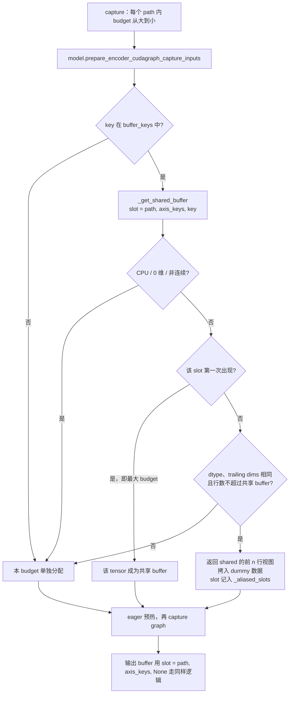
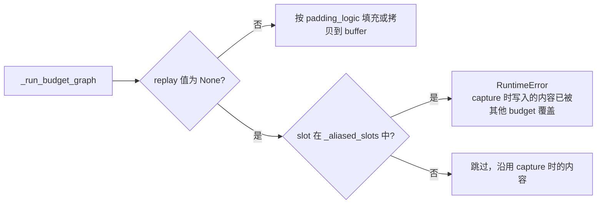
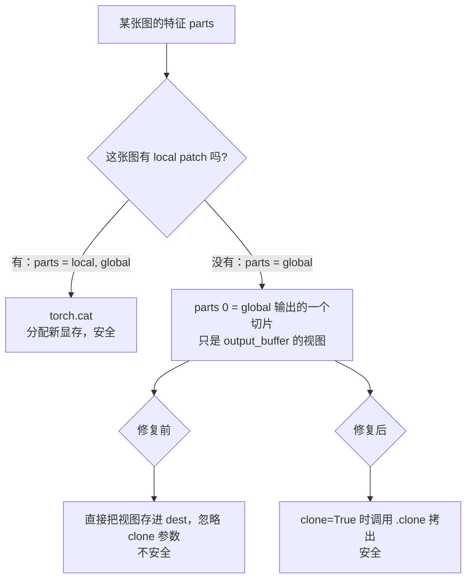
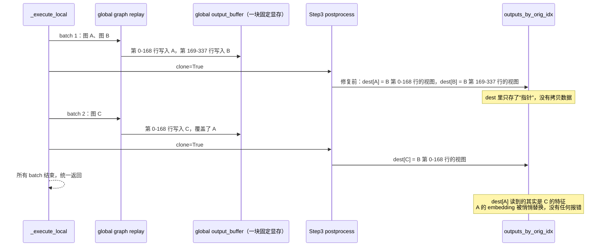
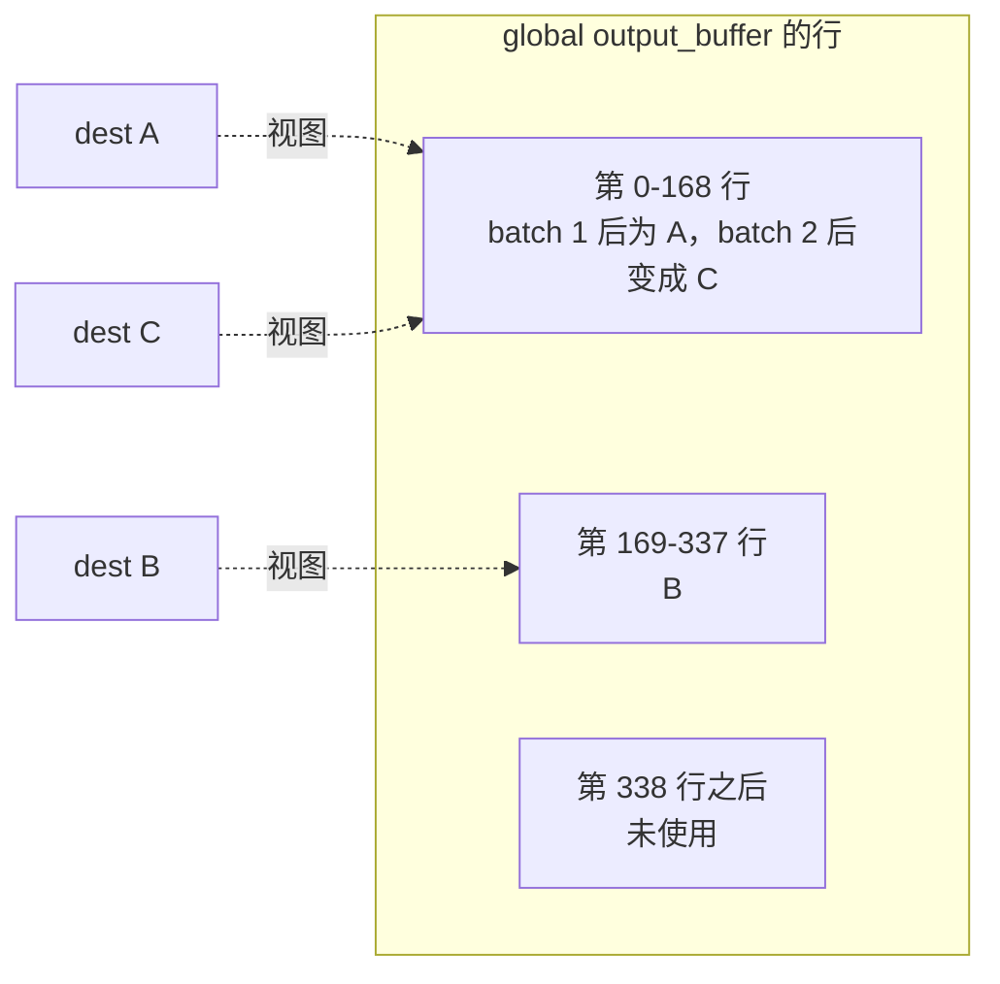

# PR #65351: [Multimodal][CG] Share encoder CUDA graph capture buffers across token budgets

> **Author**: @shen-shanshan | **State**: OPEN | **Date**: 2026-11-03
> **Branch**: `vit-cg` → `main` | **Labels**: documentation, rocm, nvidia
> **Changes**: +136 -4 lines across 5 files | **ROCm 相关性**: 部分相关（平台无关的 encoder CUDA graph 管理器，在 ROCm 上对应 HIP graph；端到端验证全部在 MI355X 上完成）
> 本报告分两部分：§1–6 为 PR 详细总结，§7–8 为 ROCm review 意见。本次是对 head `6150200c` 的复审。上一轮（head `9ef59a38`）提出的三条意见都已处理：Step3-VL 修复、多 batch 测试、双路径和 capture-axis 模型的端到端验证。
> 应用户要求，§4.2 用图解释 Step3-VL 问题的原理，§5.2 对比本 PR 与 #65084。

---

## 1. 总结 (Summary)

`EncoderCudaGraphManager` 原来为每个 token budget 各分配一套 capture 输入/输出 buffer。本 PR 让同一 path、同一组 capture-axis key 下的较小 budget 改用最大 budget buffer 的前缀视图。budget 按 2 的幂分档，所以常驻显存约减半（MI355X 实测：Qwen3-VL-2B 974→488 MiB，DSv4.1-Flash 每 rank 724→363 MiB，Gemma4 1356→540 MiB，Step3-VL 1019→430 MiB），省下的显存转给 KV cache。

同时修复了 Step3-VL 的 `postprocess_encoder_output`：不带 local patch 的图片返回的是 graph 输出 buffer 的视图，同一次 `execute()` 里后续 batch 的 replay 会把它覆盖掉。复审时我在 main 上复现了这个 bug，它不是共享 buffer 才引入的；共享输出 buffer 会扩大它的触发范围。

## 2. 背景与动机 (Background & Motivation)

- ViT CUDA graph（RFC #38175）为每个 token budget（如 64、128、…、16384）各 capture 一个 graph。每个 graph 需要地址固定的输入 buffer（`pixel_values`、rotary cos/sin、`cu_seqlens` 等）和输出 buffer。budget 按 2 的幂分档时，所有 buffer 的总和约为最大一份的 2 倍。
- 同一 path 下的 graph 在一个 manager 里串行 replay，每次 replay 前都会重写输入，所以这些 graph 可以共用同一块显存。这是一项纯显存优化，计算结果不变。
- 上一轮 review 发现，共享输出 buffer 依赖每个模型都遵守 `clone=True` 的约定，而 Step3-VL 没有遵守。本轮的修改补上了 Step3-VL 的修复、协议 docstring 和设计文档中对该约定的说明，以及一次 `execute()` 跨多个 budget 的单测。
- 社区里有一个同时期的同类 PR #65084（@Isotr0py，2026-11-02）。它做了同样的 buffer 共享，还把默认 budget 表改成细分档位。作者在 #65084 的评论区已经注意到两者重合，对比见 §5.2。

## 3. 代码修改分析 (Code Change Analysis)

### 3.1 修改的模块

| 文件 | 改动 |
|------|------|
| `vllm/v1/worker/encoder_cudagraph.py` (+64/-1) | 新增 `SharedBufferSlot`、`_shared_buffers`、`_aliased_slots` 和 `_get_shared_buffer()`。capture 时，`buffer_keys` 中的输入和输出 buffer 走共享逻辑；replay 时，如果已共享的 key 缺值就报错；`clear()` 同时释放共享状态 |
| `vllm/model_executor/models/step3_vl.py` (+5/-1) | 只有一个 part（无 local patch）时，按 `clone` 参数决定是否 clone |
| `vllm/model_executor/models/interfaces.py` (+4) | 协议 docstring 写明 `clone=True` 时返回值不得别名 `outputs` |
| `docs/design/cuda_graphs_multimodal.md` (+4/-2) | 新增 "Shared capture buffers" 一段，replay 步骤 4 和 `postprocess_encoder_output` 的说明补充 clone 约定 |
| `tests/v1/cudagraph/test_encoder_cudagraph.py` (+59) | 一个"共享 vs 不共享、单次 execute 跨 64→16 两个 budget"的测试，加一个 Step3-VL clone 回归测试 |

### 3.2 架构 / 流程图

capture 阶段的共享逻辑：



replay 阶段的保护逻辑：



### 3.3 关键实现细节

- **共享粒度**：slot 为 `(path, axis_keys, key)`，输出 buffer 的 key 是 `None`。不同 path 之间、不同 axis key 之间永远不共享，所以 Step3-VL 的 `global` 和 `local` 两条路径互不影响。
- **共享条件**：只处理 `buffer_keys` 中的 key，并且必须是 GPU 上、连续、非 0 维的 tensor，dtype 和 trailing dims 与共享 buffer 一致，行数不超过它。CPU 上的 `max_seqlen` 这类在 capture 时就把值固定进 graph 的标量不参与共享。
- **最大 budget 先登记**：`capture()` 本来就是每个 path 内按 `sorted(budgets, reverse=True)` 的顺序 capture，所以每个 slot 第一次见到的一定是最大 budget。输入直接使用模型返回的 tensor，输出则新建 `empty_like`。
- **`_aliased_slots` 保护**：只有真正发放过视图的 slot 才会被保护，避免只有最大 budget 自己在用的 buffer 被误报。
- **Step3-VL 修复**：`parts` 长度大于 1 时，`torch.cat` 本身就会产生新 tensor；只有一个 part 时，按 `clone` 参数决定是否 `.clone()`。

## 4. 涉及的技术原理 (Technical Principles)

### 4.1 CUDA/HIP graph 的固定地址，以及 `clone` 约定

- graph replay 读写的是 capture 时记录下的指针。输出 buffer 的地址是固定的，每次 replay 都会写到同一块显存上。
- `_run_budget_graph` 返回的就是 `output_buffer` 本身，不是拷贝。
- `_execute_local` 会把一次 `execute()` 的图片分成若干个 batch 依次 replay，把每个 item 的结果先存进 `outputs_by_orig_idx`，**等所有 batch 都跑完才统一返回**。所以每个 batch 的结果必须在下一次 replay 之前拷出来。这件事由 `postprocess_encoder_output(..., clone=True)` 负责，具体由各模型自己实现。
- PyTorch 的切片（`output[a:b]`）、`reshape` 和 `view` 都不复制数据，只是指向同一块显存的另一个视图。`torch.cat`、高级索引和 `.clone()` 则会分配新的显存。

### 4.2 图解：Step3-VL 的问题场景，以及为什么要修

**Step3-VL 的输出拆分方式。** Step3-VL 有两条 encoder 路径：`global` 路径为每张图输出固定 169 个 token；`local` 路径只给大图的切片输出 token。`postprocess_encoder_output` 会把每张图的 local 和 global 特征拼起来：



小图（不切 patch）恰好走的是那条"直接返回视图"的分支。

**问题怎么发生。** 以一次 `execute()` 带 3 张小图、每个 batch 最多 2 张图为例。实测时我设置了 `encoder_cudagraph_max_vision_items_per_batch=2`；默认配置下，budget-cliff deferral 也可能把图片拆到不同 batch。



从显存布局看，`dest[A]` 和 `dest[C]` 指向同一段显存：



**为什么 main 上已经有这个 bug，而共享会让它更容易触发。**

| 场景 | batch 1 / batch 2 replay 的 graph | 输出 buffer 是否同一块 | A 是否被覆盖 |
|---|---|---|---|
| main，两个 batch 落在同一 budget（如都是 global 338） | 同一个 graph | 是 | **会**（实测 2/11 个 item 被污染） |
| main，两个 batch 落在不同 budget（338 / 169） | 不同 graph | 否，各自一块 | 不会（运气好） |
| 共享 buffer（本 PR 或 #65084），未修复 Step3 | 不同 graph，但共用前缀 | **是**（169 是 338 的前缀） | **会**（#65084 实测 6/11 个 item） |
| 本 PR（已修复 Step3） | 任意 | 任意 | 不会（0/11） |

也就是说，共享前只有"恰好落在同一 budget"才会出事；共享后同一 path 上的任意 budget 都共用这块显存，出事的条件从偶然变成了常见。

**为什么在模型里修，而不是在 manager 里一律 clone。** manager 并不知道模型的 postprocess 有没有产生新 tensor。其他模型（默认的 `scatter_output_slices(clone=True)`、DeepSeek-OCR、DeepSeek-VL2、ERNIE、DSv4.1）都已经返回新 tensor，如果 manager 再统一 clone 一次，所有模型都要多付一次整块拷贝。约定本来就是"`clone=True` 时由模型负责拷贝"，所以只需要修复违反约定的那一处，再把约定写进协议 docstring。

### 4.3 实测证据（MI355X，Step3-VL-10B，`max_vision_items_per_batch=2`）

判断方法：把同一张图放进一次多 item 的 `execute()` 得到一个结果，再把它单独 `execute()` 一次（单独执行不可能被后续 batch 覆盖），比较两者的相对误差 ‖a−b‖/‖b‖。拿到结果后立即 clone，避免视图被后续的运行改写。

| 代码版本 | 多 item 中被污染的 item（相对误差 > 0.1） | 污染的最大相对误差 | 未污染 item 的误差（不同 budget graph 带来的 bf16 噪声） |
|---|---|---|---|
| main（`dd4e40142a`） | 2 / 11（execute #2 的两个 batch 都 replay global 338） | 0.62 | ≤ 0.033 |
| #65084（head `78aa5ca8`，未改 step3） | 6 / 11（多个 batch 都 replay global 169 的共享前缀） | 1.34 | ≤ 1e-4 |
| 本 PR（head `6150200c`） | **0 / 11** | — | ≤ 0.033 |

还有一点值得注意：把"共享"和"不共享"两个 manager 互相比较，**发现不了**这个 bug。main 和 #65084 都满足"共享 vs 不共享 ≤ 0.031"，因为当两边都落在同一 budget 时，会以相同方式被覆盖。必须以单独执行的结果作为参照才能发现。

## 5. 评论区讨论亮点 (Discussion Highlights)

### 5.1 本 PR

暂时还没有实质性的 review 评论。fork PR 不会触发 Claude 的自动 review，只有 mergify 的文档预览链接。PR 描述已包含安全性论证、clone 约定，以及在四个模型上的 A/B 数据。

### 5.2 与 #65084 的区别

作者已在 #65084 下留言注意到两者重合。另一位贡献者（@vorapolsiloai）在 MI355X 上用 MiniMax-M3 测了 #65084：在默认 budget 下，27 个 budget 共享 buffer 后的 graph 显存与 main 的 10 个 budget 持平（16.85 vs 16.86 GiB），吞吐变化在噪声范围内（+0.7%）。

| 维度 | 本 PR #65351 | #65084 |
|---|---|---|
| 目标 | 降低 capture buffer 显存 | 降低 capture buffer 显存，并利用"多一档几乎不占显存"把默认 budget 表细分（25 档，减少 padding 浪费） |
| 默认 budget 表 | 不变（2 的幂） | 细分：1024 以下每倍频 4 档，以上 2 档（Step3-VL：17 → 44 个 graph，capture 时间增加） |
| 共享的输入范围 | 只共享 `buffer_keys` 中的 key | capture 返回的所有 key |
| 0 维 / CPU 标量 | 不共享 | 按对象身份共享（包括 CPU 上的 `max_seqlen`。CPU 标量在 capture 时就固定进 graph，所以目前无害；但如果将来 graph 读 GPU 上的 0 维标量，而 replay 又不重写它，就会读到其他 budget 的值） |
| 连续性检查 | 有 | 没有（`full[:n]` 是连续的，这一点影响不大） |
| replay 缺值保护 | 有（`_aliased_slots`） | 没有 |
| Step3-VL clone 修复 | **有** | **没有，实测 6/11 个 item 被污染** |
| clone 约定的文档 | 协议 docstring 和设计文档都有 | 没有 |
| 测试 | +59 行；覆盖单次 execute 跨 64→16 两个 budget | +247 行；覆盖 budget 表、前缀共享、不兼容回退、多次 execute 交替，但每次 execute 都只有一个 batch，覆盖不到跨 batch 覆盖的问题 |
| Step3-VL 实测 capture buffer | 1018.7 → 430.1 MiB（17 个 graph） | 1671.2（不共享时的视图总和）→ 430.1 MiB（44 个 graph） |

**结论：#65084 有 Step3-VL 这个问题，而且更容易触发。** 它同样共享输出 buffer、同样依赖 `clone=True`、没有改 `step3_vl.py`。细分档位之后，Step3-VL 的 global 路径常常被拆成多个单图 batch，全部 replay 同一个 169 budget，因此实测污染比例（6/11）比 main（2/11）更高。无论哪个 PR 先合入，Step3-VL 的修复都需要一起进入 main。

## 6. 风险与潜在问题 (Risk Analysis)

| 风险 | 严重程度 | 说明 |
|------|---------|------|
| 正确性：输出 buffer 共享依赖所有模型遵守 clone 约定 | Low | 已核对所有 in-tree 实现，Step3-VL 已修复，约定也已写入文档；将来新增模型仍可能违反 |
| 正确性：输入 buffer 共享依赖 replay 全量重写 | Low | `_aliased_slots` 保护会对缺值直接报错 |
| 与 #65084 重复或冲突 | Medium | 见 §7 "与 #65084 重合" |
| Step3-VL 的 bug 修复和性能优化捆绑在一起 | Medium | 见 §7 "Step3-VL 修复应单独成 PR" |
| 测试覆盖 | Low | 单测已覆盖跨 budget 的 execute；没有覆盖"多个 batch 落在同一 budget"（main 上的触发形态），但 Step3 的单测直接检查了约定本身 |
| 性能 | Low | 纯显存优化；capture 时多几次小 buffer 拷贝 |

---

## 7. Review 意见 (Findings)

| 意见类型 | 🔴 | ⚠️ | 📝 |
|---------|----|----|----|
| 正确性 | 0 | 1 | 0 |
| 设计 | 0 | 1 | 0 |
| 测试 | 0 | 0 | 1 |
| 注释/文档 | 0 | 0 | 2 |

上一轮的 🔴（Step3-VL 不 clone 的视图被后续 batch 覆盖）已经修复，并在 MI355X 上复现和验证过，不再阻塞。

**⚠️【正确性】Step3-VL 修复针对的是 main 上已有的 bug，建议拆成独立的 Bugfix PR** `[已验证]`
- **问题**：`step3_vl.py:938-942` 修复的问题不依赖 buffer 共享。在 main（`dd4e40142a`）上，只要一次 `execute()` 的两个 batch 落在同一个 global budget，同样会出错。实测（Step3-VL-10B，`encoder_cudagraph_max_vision_items_per_batch=2`，3 图请求）中，execute #2 的两个 batch 都 replay global 338，有 2 个 item 的相对误差达到 0.62 和 0.50。
- **影响**：如果这个修复只随本 PR 合入，那么本 PR 被搁置、或者 #65084 先合入时，main 上的 Step3-VL 多图请求会继续静默地得到错误的 embedding。#65084 下更严重（6/11 个 item）。
- **行动**：建议作者把 Step3-VL 的两行修复加上回归测试，单独提一个 `[Bugfix][Model] Step3-VL` PR 优先合入；并在本 PR 和 #65084 的描述里引用它。

**⚠️【设计】与 #65084 重合，需要和 @Isotr0py 协调** `[已验证]`
- **问题**：两个 PR 都改了 `encoder_cudagraph.py` 中 `_capture_budget_graph` 和 `clear()` 的同一段代码，思路相同。#65084 还附带了 budget 表细分和 MiniMax-M3 的端到端数据，但缺少本 PR 的 replay 缺值保护、clone 约定文档、跨 batch 测试和 Step3 修复。
- **影响**：如果两个 PR 并行推进，maintainer 会面对重复的 review 和合并冲突；其中一个合入后，另一个需要重做。
- **行动**：建议作者在 #65084 下给出 §5.2 的对比和 §4.3 的实测数据，提议的方向是：以其中一个 PR 为主，把另一个的增量（保护逻辑、clone 文档、跨 batch 测试，或者 budget 表细分）合并过去。

**📝【测试】A/B 必须以单独执行为参照** `[已验证]`
- **问题**：PR 描述里的 "`execute()` A/B" 是拿共享 manager 和不共享的 manager 互相比较。当两个 batch 落在同一 budget 时，不共享的一侧也会以同样方式被覆盖，所以这种比较发现不了 main 上的这类问题（main 和 #65084 都满足"共享 vs 不共享 ≤ 0.031"）。
- **影响**：PR 描述中关于"可以发现跨 batch 覆盖"的说法偏强。
- **行动**：建议作者在 Validation 部分补充"与单独执行对比（相对误差）"的结果（main 2/11、#65084 6/11、本 PR 0/11），并说明为什么单纯的 A/B 不够。

**📝【注释/文档】标签** `[已验证]`
- **问题**：PR 带有 `nvidia` 标签，但改动是平台无关的，只在 MI355X 上验证过。
- **行动**：建议作者去掉 `nvidia` 标签，或者在描述中说明 NVIDIA 只跑了 CI 单测。

**📝【注释/文档】Step3-VL 的默认配置触发条件** `[推测]`
- **问题**：本轮实测通过设置 `max_vision_items_per_batch=2` 强制拆分 batch。在默认配置下（Step3 的 `max_batch_size` 约为 96），拆分主要来自 budget-cliff deferral，即在小图之后到来、带大量 local patch 的大图被推迟到下一个 batch。这条路径没有实测。
- **行动**：建议作者在 Bugfix PR 里说明默认配置下的触发条件，或者补一个不改配置的复现。

## 8. 结论 (Verdict)

⚠️ **NEEDS WORK**：buffer 共享本身的设计和实现成立。上一轮的 🔴 已修复，并在 MI355X 上被真实模型复现和证伪，没有新的阻塞性问题。剩下两项是流程上的处理：Step3-VL 的修复针对的是 main 上已有的 bug，应该单独成 PR 并尽早合入；同时需要和 #65084 协调，避免重复工作。

## 9. 英文 Review 评论 (Copy-Paste English Comments)

**C1** `vllm/model_executor/models/step3_vl.py:938-942` — ⚠️ comment

```text
This fixes a bug that already exists on main, independent of buffer sharing. On main, when one execute() runs two batches on the same global budget, the second replay overwrites the first batch's no-patch image views. I reproduced it on MI355X with Step3-VL-10B, encoder_cudagraph_max_vision_items_per_batch=2 and a 3-image prompt: two items differ from their single-item result by 0.62 and 0.50 relative L2. With #65084's sharing and no Step3 fix, 6 of 11 multi-item outputs are corrupted. Could you split these lines and the regression test into a standalone [Bugfix] PR so they land regardless of which sharing PR goes in?
```

**C2** `vllm/v1/worker/encoder_cudagraph.py:338-352` — ⚠️ comment

```text
This overlaps with #65084, which shares the same capture buffers and also subdivides the default budget table. #65084 does not touch step3_vl.py, has no guard for replays that omit a shared key, and its tests never split one execute() into several batches. Could you coordinate with @Isotr0py on a single path forward, e.g. land one PR and port the other's increments (the replay guard, the clone contract docs and the multi-batch test, or the budget table)?
```

**C3** `tests/v1/cudagraph/test_encoder_cudagraph.py:769-800` — 📝 comment

```text
Comparing shared against unshared capture can't catch the main-branch form of this bug: when two batches hit the same budget, the unshared reference is overwritten the same way. The end-to-end harness only exposed it when each item was compared with the same item run alone. Consider mentioning this in the PR description, and if you keep an end-to-end check, compare against single-item execution as well.
```
