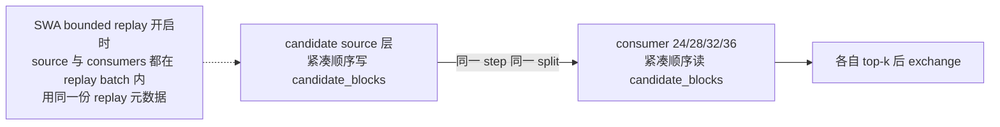

# PR #65555: [ROCm][DSv4.1] Score the sparse-indexer prefill on ShardQ token slices

> **Author**: @AMD-yanfeiwang | **State**: OPEN（非 draft） | **Date**: 2026-11-04（最近一次更新 2026-11-24，merge main）
> **Branch**: `AMD-yanfeiwang:rocm-dsv41-indexer-row-shard` → `main` | **Labels**: rocm, DSv4.1, deepseek
> **Changes**: +533 -48 lines across 10 files | **ROCm 相关性**: 完全相关（DSv4.1 ROCm 稀疏 indexer prefill，触及 `rocm_aiter_mla_sparse.py` / `rocm_paged_mxfp4_indexer.py` 两个 ROCm 算子文件与共享的 `mla/indexer.py`）
> **CI**: 未运行——pre-run-check 失败（无 `ready` label / 作者阈值），pre-commit 与 Buildkite 全部 skipped；仅 DCO / Mergify / PR-title 检查存在。本报告不引用任何测试通过结论。
> 本报告分两部分：§1–6 为 PR 详细总结，§7–8 为 ROCm review 意见。

---

## 1. 总结 (Summary)

在 ROCm 上让 DeepSeek-V4.1 的稀疏 indexer prefill 沿用 `sparse_mla_shard_q`（#63956）的 zigzag token 切分：每个 TP rank 只对自己那一片 prefill token 计算 indexer logits/top-k（包括两级候选层：candidate source 与 consumers），随后用 `all_gatherv` 把 int32 top-k 收集并 `index_copy_` 回 token 顺序；**attention 本身仍保持按 head 切分**。FP8 indexer 算子与 MXFP4 indexer 算子（dense + gather 两种 consumer）都接入，MXFP4 builder 改为在重编号后的 query range 上规划 chunk，并用 chunk 自带的 `req_start` 代替二分查找定位首请求。PR 首个 commit 与 #66052 完全相同（共享 builder 的 host buffer 竞争修复）。

## 2. 背景与动机 (Background & Motivation)

- #63956 引入 ShardQ（Ulysses 风格的 token 切分稀疏 MLA prefill），同时**移除了**旧的 indexer 行切分；但 DeepSeek-V4/V4.1 的 attention 不经过 `MLAAttention`，所以 #63956 之后 DSv4.1 在两个平台上都没有 prefill indexer 切分。本 PR 在 ROCm 上用 ShardQ 的切分把它补回来。
- 不做“完整 ShardQ”（attention 也按 token 切）的理由：ROCm 稀疏 MLA 不 pad head，token 切 attention 主要只增加每个压缩层两次 q/out all-to-all（RCCL，symmetric memory 仅 CUDA），通信量远大于 top-k 交换；留作 follow-up。
- 与 #56944（ROCm 自有行切分 + AllReduce(MAX)，不覆盖 MXFP4 与候选层）是**替代设计**，二者都改 FP8 算子的 prefill 循环，只能落一个。
- PR 声称（MI355X，DeepSeek-V4.1-Flash，单 prompt TTFT）：TP4 recipe 配置 1M −19.7%、TP2 1M −8.9%、TP4 FP8 + `--no-swa-bounded-replay` 1M −47.6%；2K–16K 在 ±1 ms 内，32K 左右持平，64K 起获益；GSM8K / passkey 无变化。以上数字来自 PR 描述中的表格，未附启动/测量命令 `[unverified]`。

## 3. 代码修改分析 (Code Change Analysis)

### 3.1 修改的模块

| 模块 | 改动 |
|------|------|
| `vllm/v1/attention/backends/mla/indexer.py`（共享，CUDA/ROCm 都用） | commit 1（=#66052）：去掉复用的 `CpuGpuBuffer`，新增 `upload_shardq_indices()` 每步用新 host 内存上传；commit 2/3：`DeepseekV32IndexerPrefillChunkMetadata.req_start`、`DeepseekV32IndexerPrefillMetadata.shardq_split / shardq_query_start_loc_cpu / shardq_rows` |
| `vllm/v1/attention/ops/rocm_aiter_mla_sparse.py`（FP8 indexer 算子） | 新增 `_gathers_shardq_topk` / `reserve_shardq_exchange` / `exchange_shardq_topk`；prefill 循环改读 `q_fp8[indices]` / `weights[indices]`；循环后交换 top-k；profiling 分支预留交换内存 |
| `vllm/v1/attention/ops/rocm_paged_mxfp4_indexer.py`（MXFP4 indexer 算子） | `_layer()` 在 ShardQ 下按 `shardq_gather_indices` 收集 q/scale/weights；两个算子在 prefill 之后、decode 之前调用 `exchange_shardq_topk`；profiling 预留 |
| `vllm/v1/attention/backends/mla/rocm_paged_mxfp4_indexer.py`（MXFP4 builder） | `plan_prefill_chunks` 用 `chunk.req_start` 取代 `bisect`；`build()` 在 ShardQ 下用重编号 query range（CPU + 再次 H2D 的 device 副本）规划 |
| `vllm/models/deepseek_v41/amd/rocm.py` | `_indexer_shardq_enabled()` 门控：`sparse_mla_shard_q` 且 TP>1、无 DCP/PCP、mixed cudagraph 非 FULL；满足时给 indexer K cache 置 `use_shardq = gather_shardq_topk = True` |
| `vllm/config/attention.py` | `sparse_mla_shard_q` docstring 增加 ROCm DSv4.1 说明 |
| 测试（4 个文件） | 新 `test_rocm_dsv41_indexer_shardq.py`（FP8 算子，2/4 路）、`test_prefill_shardq_split_matches_replicated`（MXFP4 dense/gather）、`test_prefill_plans_on_shardq_query_ranges`（CPU builder）、`test_indexer_upload_survives_next_build`（#66052 部分） |

### 3.2 架构 / 流程图

单个 prefill step 内某一 indexer 层（TP=4）的数据流：

```mermaid
flowchart TD
    A[Builder: build_shardq_split<br/>zigzag 切分 prefill token] --> B[upload_shardq_indices<br/>gather 索引 = decode 恒等前缀 + 本 rank token]
    B --> C[重编号 query_start_loc<br/>chunk 在紧凑空间上规划<br/>chunk.req_start 记录首请求]
    C --> D{indexer 算子}
    D -->|FP8| E[prefill_q = q_fp8&#91;indices&#93;<br/>逐 chunk logits + top-k<br/>写到紧凑行 start..start+local]
    D -->|MXFP4| F[_layer: q/scale/weights 全部按 indices 收集<br/>dense / gather prefill 写紧凑行]
    E --> G[exchange_shardq_topk]
    F --> G
    G --> H[all_gatherv 各 rank 的紧凑行<br/>sizes = num_tokens_per_rank]
    H --> I[index_copy_ 到 rows = token_ids + num_decode_tokens<br/>恢复 token 顺序]
    I --> J[decode 路径写行 0..ndt<br/>不与交换区域重叠]
    J --> K[head 切分的稀疏 MLA attention<br/>读完整 token 顺序 top-k]
```



候选层的一致性（不交换 candidate）：



### 3.3 关键实现细节

- **索引数学（已逐项核对）**：`ShardQSplit.token_ids` 是 `zigzag_split` 的 `argsort` 结果（int64，相对 decode 之后的首个 token），按 rank 分组；gather 索引为 `arange(split.num_decode_tokens) ++ (local_token_ids + num_decode_tokens)`（int32）。prefill chunk 的 `token_start/token_end` 位于该紧凑空间，FP8 与 MXFP4 都用同一空间索引 q、weights、`candidate_blocks` 与 `topk_indices_buffer`。交换时 `local = topk[start : start + sizes[rank]]`（`start = split.num_decode_tokens`），`all_gatherv` 按 rank 顺序拼接，恰好与 `split.token_ids` 的分组顺序一致，`index_copy_(0, token_ids + start, gathered)` 把每一行写回原位且每行恰写一次。
- **decode 前缀**：builder 已有 `assert num_decode_tokens <= split.num_decode_tokens`，gather 索引前缀是恒等映射，所以 indexer 自身 decode 行（≤ ShardQ decode 行）读写的都是原始行；ShardQ 判为 decode、indexer 判为 prefill 的短请求行在所有 rank 上就地重复计算，不参与交换。
- **执行顺序**：两类算子都在 prefill 之后、decode 之前交换；decode 只写 `[0, ndt)`，与交换区 `[split.ndt, …)` 不重叠。MXFP4 的 decode 行切分（#66047）只在无 prefill 的 step 启用，二者不会同时生效。
- **集体通信对称性**：交换的门控是 `split is not None and gather_shardq_topk`，二者在各 rank 上由同一 scheduler 输出确定；交换调用位于 chunk 循环之外（某 rank 没有 chunk 也会调用）。`build_shardq_split` 在任一 rank 分不到 token 时返回 None，因此不会出现零长度参与方。
- **`req_start`**：`build_prefill_chunk_metadata` 传入的 `start_idx` 是含 decode 偏移的绝对请求下标；重编号后某请求在本 rank 可能为空（多个相同的 query_start），`bisect_right` 会落到空请求之后，`req_start` 修正了这一点。
- **`shardq_rows` 缓存**：931ed048ea 把 `token_ids + start` 的 device 副本挂在本 step 的 prefill 元数据上，同组后续层复用。
- **profiling**：`reserve_shardq_exchange` 对 q、weights（MXFP4 还有 q_scale）与 `topk_indices_buffer` 各 `empty_like` 一份并同时存活，覆盖运行时收集副本 + `all_gatherv` 输出的峰值。
- **CUDA 路径**：交换/预留只在两个 ROCm 算子里调用；共享 builder 只是多存三个字段 + `req_start`（CUDA 消费者不读）；commit 1 的行为变化属于 #66052 的范围。CUDA 行为未改变 `[已验证]`。

## 4. 涉及的技术原理 (Technical Principles)

- **DSA 稀疏 indexer**：每个 query token 用轻量 MQA（FP8 或 MXFP4 K cache）对其全部（压缩后）上下文打分，取 top-k（V4.1 为 512）个 KV 位置供稀疏 MLA 使用。prefill 的开销与 `T × context` 成正比，1M 上下文时成为 TTFT 主项。
- **ShardQ / zigzag 切分**：每个请求切成 `2·tp` 段，rank r 拿第 r 段和第 `2tp−1−r` 段，使因果注意力下各 rank 的工作量均衡。本 PR 只把 indexer 打分按此切分，attention 仍按 head 切，所以只需要一次 top-k 的 `all_gatherv`（`T × 512 × 4B`）而不是 q/out 两次 all-to-all。
- **DSv4.1 两级候选**：candidate source（层 20）先选候选块写 `candidate_blocks`，consumers（24/28/32/36）只在候选块内打分（dense 掩码或 gather 紧凑打分）。只要 source 与 consumers 使用同一 step 同一切分，candidate 行可以一直保持紧凑顺序，无需交换。
- **SWA bounded replay（CDNA4 默认）**：最后一个 KV source 层之后的层只在每个请求最后 128 个 token 的 replay batch 上运行，因此 replay 层 indexer 的 ShardQ 是在 replay batch 的元数据上独立判定的；收益主要来自 ratio-2 indexer。
- **异步调度与 pinned buffer**：下一步元数据在本步 non-blocking H2D 尚未执行时就会构建，复用的 pinned buffer 会被覆盖——这是 #66052 修复的竞争。

## 5. 评论区讨论亮点 (Discussion Highlights)

- **@okorzh-amd**（11-11）整理了相关 PR 关系：#66052 为依赖（其 head 即本 PR 第一个 commit）；#56944 为替代方案（同一 FP8 prefill 循环，行切分 + AllReduce(MAX)，MXFP4 与候选层保持复制）；#66071 为替代/冲突（CUDA DSv4.1 token 切分 ShardQ，`indexer.py` 文本冲突，其 `model_state.py` 让 replay builder `use_shardq=False`，在 ROCm 上只会让 replay 层保持复制，仍一致）；#66047 为冲突（同一 MXFP4 函数的 decode 行切分，行区间不相交，rebase 后可组合）；#63956 已合并。另有两条针对 `rocm_aiter_mla_sparse.py` 与 `rocm_paged_mxfp4_indexer.py` 的 inline 评论，均已 Resolved（内容在抓取文本中不可见），931ed048ea “Upload the ShardQ exchange rows once per step” 疑似对其中一条的回应。
- **相关 PR 现状（来自页面时间线）**：#66047 已 Merged，且已通过 merge main 并入本分支；#66071 已 Closed；#66052 Open；新出现 #67219（[Perf][DSv4.1] Compose ShardQ with the candidate-only indexer prefill，Open）与 #67208（[ROCm][Perf][GLM-5.3-Flash] Shard the kpool indexer prefill across TP，Draft），二者都引用本 PR，可能复用或冲突于同一套交换逻辑；ROCm/aiter#8190（gfx950 `paged_mxfp4_mqa_logits` 间歇性错误 logits 修复）也引用本 PR。
- 无 maintainer 的设计性评论；多次 needs-rebase，作者以 merge main 方式解决（3 个 merge commit，冲突解决已核对，仅涉及测试与 docstring/builder 初始化）。

## 6. 风险与潜在问题 (Risk Analysis)

| 风险 | 严重程度 | 说明 |
|------|---------|------|
| 混合 decode+prefill 的 ShardQ step 没有算子级测试 | Medium | 见 §7 ⚠️【测试】；索引数学经静态核对正确，但 `start` 偏移/恒等前缀从未被测试覆盖 |
| CI 完全未运行 | Medium | 见 §7 ⚠️【测试】；涉及 Tier-1 ROCm 算子文件 |
| 默认开启，ROCm 上的收益阈值与 CUDA 不同 | Medium | 见 §7 ⚠️【性能】；1024 token 起即启用，但单 prompt 盈亏点约 32K |
| 与 #66052 / #56944 / #67219 的合并顺序 | Medium | 见 §7 ⚠️【设计】 |
| `req_start` 默认 0 的静默回退 | Low | 见 §7 📝 |
| 每步重复 H2D 重编号 query range | Low | 见 §7 📝 |
| 批不变（batch-invariant）模式下 top-k 顺序随批形状变化 | Low | 见 §7 📝 `[推测]` |
| CUDA 回归 | Low | 新逻辑只在 ROCm 算子中调用，共享 builder 仅新增字段 |

---

## 7. Review 意见 (Findings)

| 类型 | 🔴 | ⚠️ | 📝 |
|------|----|----|----|
| 测试 | — | 2 | — |
| 性能 | — | 1 | 1 |
| 设计 | — | 1 | 1 |
| 可维护性 | — | — | 1 |

静态核对结论（无需作者行动）：`exchange_shardq_topk` 的 `start` / `sizes` / `rows` 与 `zigzag_split` 分组顺序一致；FP8 与 MXFP4 的 decode 行均不受 gather 影响；交换在 decode 之前且区间不重叠；候选源/消费者在 replay 与非 replay 两种情况下使用同一元数据；交换调用对各 rank 对称；CUDA 行为不变。未发现 🔴 级问题。

---

**⚠️【测试】算子级测试只覆盖纯 prefill（`num_decode_tokens = 0`），混合 step 的偏移逻辑未被测试** `[已验证]`

- **问题**: `tests/kernels/attention/test_rocm_dsv41_indexer_shardq.py:186` 与 `tests/kernels/attention/test_rocm_paged_mxfp4_indexer.py:831` 都构造 `ShardQSplit(0, token_ids, counts)`，元数据 `num_decodes=0 / num_decode_tokens=0`；CPU builder 测试同样 `num_decodes=0`。而实际服务中最常见的 ShardQ step 是“decode（含 DSpark 的 1+5 spec 行）+ 长 prefill”的混合 step：此时 gather 索引带恒等前缀、`exchange_shardq_topk` 的 `start = split.num_decode_tokens > 0`、indexer 自己的 `num_decode_tokens` 可能小于 ShardQ 的（短 extend 被 ShardQ 当作 decode）、MXFP4 的 `_layer()` 让 decode 路径读的是**收集后的** q。这些分支都没有被任何测试执行；`all_gatherv` 也被替换为返回参考行的假函数。
- **影响**: 静态核对显示当前数学是对的，但这正是将来最容易被改坏、且一旦错位就是静默错误 top-k（输出变差但不崩溃）的地方；现有测试对它没有任何保护。
- **行动**: 建议作者为两个算子测试增加 `num_decode_tokens > 0` 的参数化（例如 4 个 decode 请求 × next_n=6，外加一个长度介于 indexer 与 ShardQ 阈值之间的短 extend），并断言 decode 行在交换后保持不变、prefill 行回到正确位置。

**⚠️【测试】CI 未运行，Tier-1 ROCm 算子改动没有任何 AMD CI 结果** `[已验证]`

- **问题**: pre-run-check 失败（无 `ready` label），pre-commit 与 Buildkite 全部 skipped。`.buildkite/test-amd.yaml` 的 kernels/attention 作业会收集新测试，但本 PR 没有触发过它；PR 描述中“Existing … pass”是作者在单卡 MI355X 上的本地结果。
- **影响**: 改动触及 `rocm_aiter_mla_sparse.py`（DSv3.2 / GLM-5 在 ROCm 上同样走这个 FP8 算子）与共享 `mla/indexer.py`；若有导入顺序、mypy 或 pre-commit 问题，或其他模型的 ROCm 测试回归，目前都无法发现。
- **行动**: 建议 review 时请 maintainer 加 `ready` label，跑通 pre-commit 与 AMD kernels/attention 作业（含新增的 `test_rocm_dsv41_indexer_shardq.py`），并至少跑一次 DSv3.2 的 ROCm sparse indexer 测试确认没有回归。

**⚠️【性能】ROCm 沿用 CUDA 的 `sparse_mla_shard_q_min_tokens=1024` 默认值，但自身数据显示盈亏点约 32K；中等批次的证据较弱** `[已验证]`（影响 `[推测]`）

- **问题**: `vllm/models/deepseek_v41/amd/rocm.py:98-107` 在 TP>1 时默认开启。ROCm 版本的机制与 CUDA 不同：只切 indexer，attention 不切，每个 indexer 层额外付一次 `[prefill_tokens, 512]` int32 的 RCCL `all_gatherv` + `index_copy_` + q/weights 收集。PR 自己的表格显示 2K–16K 在 ±1 ms 内、32K 约持平、64K 起才有收益；批量短 prompt 只给出“±10% 噪声内、无一致方向”。没有 TP8 数据，也没有贴出启动与测量命令。
- **影响**: 大多数服务 step 处在 1K–32K token 区间，默认开启在那里最好也只是持平；在 TP8（每 rank 切片更小、通信占比更高）或更高并发下是否会变慢，目前没有证据。
- **行动**: 建议作者补一组 serving 级测量（例如 TP4/TP8、4K–16K prompt 的并发扫描，报告吞吐与 TTFT 的 p50/p99，并附命令），或者为 ROCm DSv4.1 设置独立的最小 token 阈值（例如接近实测盈亏点），而不是直接继承 CUDA 的 1024。

**⚠️【设计】与 #66052 / #56944 / #67219 的合并顺序需要先定下来** `[已验证]`

- **问题**: ① 首个 commit 4a1c8a826f 与 #66052 的 122c86d15a 完全相同（range-diff `=`），但 #66052 还有后续测试 commit b6eb97eb6e，它把同一个测试重写为 `test_indexer_build_survives_next_build`（通过 builder 的 `build()` 测试）。无论哪个后合，`tests/v1/attention/test_shardq.py` 都会冲突。② #56944 是同一 FP8 prefill 循环的替代设计（PR 描述也承认只能合一个）。③ #67219（Open）与 #67208（Draft）都引用本 PR，涉及同一套 ShardQ indexer prefill 逻辑；#66071 已 Closed，其冲突暂时不存在。
- **影响**: 先合本 PR 会让 #66052 只剩测试改动且与本 PR 的测试冲突；同时合入两个设计会让 FP8 循环出现两套切分。
- **行动**: 建议先合 #66052，本 PR rebase 时丢弃 4a1c8a826f 及其测试（采用 #66052 的版本）；建议 review 时请 AMD maintainer 明确关闭或改造 #56944，并确认 #67219 是叠加在本 PR 之上还是与它竞争。

**📝【可维护性】`req_start` 默认值 0 让 `plan_prefill_chunks` 在漏传时静默规划错误** `[已验证]`

- **问题**: `vllm/v1/attention/backends/mla/indexer.py:429` `req_start: int = 0`；`rocm_paged_mxfp4_indexer.py:233` 去掉 `bisect` 后完全依赖它。目前生产中唯一的构造点 `build_prefill_chunk_metadata`（:2122）会传值，但任何新的构造点（或测试 helper）忘传时都会用请求 0 的 query range/上下文去规划，不会报错。
- **行动**: 建议作者去掉默认值（所有构造点改为关键字传参），或在 `plan_prefill_chunks` 里加一条廉价的断言 `query_start_loc[first] <= t0 <= query_start_loc[first + chunk.num_reqs]`。

**📝【性能】重编号后的 query range 在同一 step 内被 H2D 上传两次** `[已验证]`

- **问题**: 基类 builder 已经执行 `query_start_loc = async_tensor_h2d(query_start_loc_cpu, self.device)`（indexer.py:1625），但只保存了 CPU 副本；MXFP4 builder 在 `rocm_paged_mxfp4_indexer.py:569-571` 再上传一次（每次都新分配 pinned 暂存区）。
- **行动**: 建议作者把 device 副本也挂到 `DeepseekV32IndexerPrefillMetadata` 上（与 `shardq_query_start_loc_cpu` 并列），MXFP4 builder 直接复用。

**📝【设计】prefill ShardQ 门控没有像 decode 行切分那样排除 `VLLM_BATCH_INVARIANT`** `[推测]`

- **问题**: `DeepseekV41RocmMxfp4IndexerMetadataBuilder` 的 decode 行切分在 `VLLM_BATCH_INVARIANT` 下关闭（`rocm_paged_mxfp4_indexer.py:602`），而 `_indexer_shardq_enabled` 没有这个条件；PR 描述自己也说明“行内 top-k 顺序取决于批形状”，同一请求是否走 ShardQ 又取决于同批的其他请求是否把 step 推过 1024 token。
- **行动**: 建议作者确认批不变模式是否需要逐位一致；若需要，在 `_indexer_shardq_enabled` 中同样排除 `VLLM_BATCH_INVARIANT`，以和 decode 行切分保持一致。

## 8. 结论 (Verdict)

**⚠️ NEEDS WORK**

设计取舍清晰（只切 indexer、用一次 top-k `all_gatherv` 代替两次 all-to-all），索引数学、执行顺序、候选层一致性与集体通信对称性经静态核对都是正确的，CUDA 路径不受影响。需要补的是：混合 decode+prefill step 的算子级测试、实际跑一次 CI（含 AMD kernels/attention），以及针对 ROCm 默认开启阈值的 serving 级证据；合并前还应与 #66052 / #56944 确定顺序。

## 9. 英文 Review 评论 (Copy-Paste English Comments)

**C1** `tests/kernels/attention/test_rocm_dsv41_indexer_shardq.py:186` — ⚠️ comment

```text
Both new op tests (this one and test_prefill_shardq_split_matches_replicated in test_rocm_paged_mxfp4_indexer.py) build ShardQSplit(0, ...) with num_decode_tokens=0, so the mixed decode+prefill step is never exercised. That is the common serving case under DSpark: the gather indices carry an identity prefix, exchange_shardq_topk starts at split.num_decode_tokens > 0, the indexer's own decode count can be smaller than ShardQ's, and the MXFP4 decode path reads the gathered q. The math looks right to me, but a mistake there would silently misplace top-k rows. Could you add a case with decode rows (e.g. a few next_n=6 decodes plus a short extend between the two thresholds) and assert the decode rows are untouched after the exchange?
```

**C2** `vllm/models/deepseek_v41/amd/rocm.py:98-107` — ⚠️ comment

```text
This turns the split on by default for every TP>1 DSv4.1 ROCm deployment, using the CUDA-tuned sparse_mla_shard_q_min_tokens=1024. On ROCm only the indexer is sharded, so every indexer layer pays an extra [tokens, 512] int32 RCCL all_gatherv plus index_copy. Your own table puts the break-even around 32K tokens, and the batched short-prompt result is "within ±10% noise". Could you add a serving-level measurement at the step sizes most traffic hits (e.g. TP4 and TP8, 4K–16K prompts across a concurrency sweep, with commands), or give ROCm its own threshold closer to the measured break-even?
```

**C3** `vllm/v1/attention/backends/mla/rocm_paged_mxfp4_indexer.py:233` — 📝 nit

```text
Now that the bisect is gone, plan_prefill_chunks fully trusts chunk.req_start, and that field defaults to 0. A future constructor or test helper that forgets it would plan request 0's ranges with no error. Consider dropping the default, or adding a cheap check here such as query_start_loc[first] <= t0 <= query_start_loc[first + chunk.num_reqs].
```

**C4** `vllm/v1/attention/backends/mla/rocm_paged_mxfp4_indexer.py:569-571` — 📝 nit

```text
The base builder already uploads the renumbered query_start_loc (indexer.py, right after upload_shardq_indices) but keeps only the CPU copy, so this re-uploads it through a fresh pinned staging buffer every step. Consider also storing the device tensor on DeepseekV32IndexerPrefillMetadata next to shardq_query_start_loc_cpu and reusing it here.
```

## 10. 英文总结评论 (Overall Review Summary)

```text
Sharding only the indexer and all-gathering the int32 top-k is a reasonable fit for ROCm, and I traced the index math: the gather and exchange offsets match zigzag_split's rank order, decode rows never overlap the exchanged range, and candidate rows stay consistent between source and consumers. The CUDA path is unchanged. Before merge, please add op tests for mixed decode+prefill steps (all current tests use num_decode_tokens=0), get CI and the AMD attention jobs running, and back the default-on 1024-token threshold with serving-level data or a ROCm-specific threshold. Landing #66052 first, then rebasing, avoids the test_shardq.py conflict.
```
