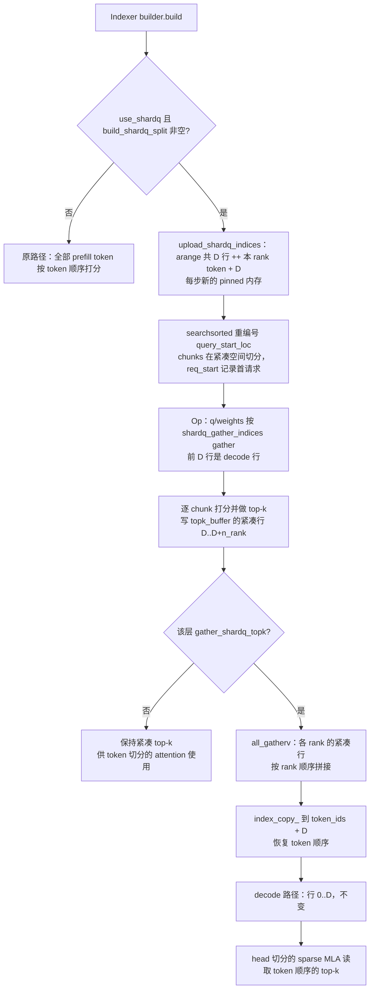
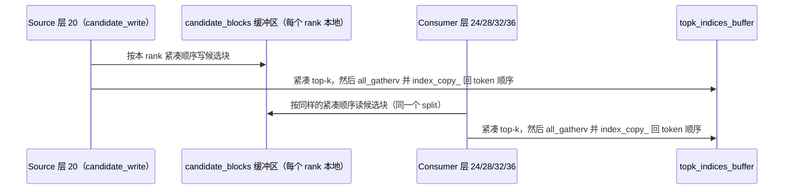
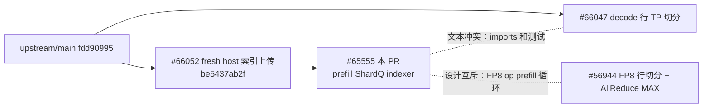

# PR #65555: [ROCm][DSv4.1] Score the sparse-indexer prefill on ShardQ token slices

> **Author**: @AMD-yanfeiwang | **State**: OPEN | **Date**: 2026-11-04（最后推送 2026-11-06）
> **Branch**: `AMD-yanfeiwang:rocm-dsv41-indexer-row-shard` → `main` | **Labels**: rocm, deepseek, DSv4.1
> **Changes**: +486 -48 lines across 10 files（含依赖 PR #66052 的提交）| **ROCm 相关性**: 完全相关（DeepSeek-V4.1 ROCm 稀疏 indexer prefill 路径）
> **CI 状态**: 未获取（本次未拉取 checks，CI 结果未知）
> 本报告分两部分：§1–6 为 PR 详细总结，§7–8 为 ROCm review 意见。

---

## 1. 总结 (Summary)

本 PR 让 ROCm 上 DeepSeek-V4.1 的稀疏 indexer prefill 沿用上游 ShardQ（#63956）的 zigzag 按 token 切分：TP>1 时每个 rank 只为自己那一份 prefill token 打分（包括 ratio-2 indexer、两级候选的 candidate source 和 consumer 层），然后用 `all_gatherv` 把各 rank 的 int32 top-k 行收集回来，再 `index_copy_` 回 token 顺序。attention 本身仍按 head 切分，不做 ShardQ 的 q/out all-to-all。FP8 indexer op（`rocm_aiter_sparse_attn_indexer`）和 MXFP4 paged indexer op（dense/gather 两种）都接入了这套流程。PR 的第一个提交就是 #66052（ShardQ host 索引缓冲区的异步调度竞争修复），本 PR 依赖它。

## 2. 背景与动机 (Background & Motivation)

- 上游 #63956 把 TP 下 DSA prefill 从“按 head 切”改成 ShardQ（按 token 切、Ulysses 风格），并删除了原来的 indexer 行切分（`indexer_tp_shard_min_rows` 已废弃）。但 ShardQ 只覆盖经过 `MLAAttention` 的模型，DeepSeek-V4/V4.1 的 attention 不走这条路，所以 DSv4.1 在 #63956 之后**两个平台上都没有 prefill indexer 切分了**，每个 TP rank 都要把全部 prefill token 打一遍分。
- 1M 上下文时 indexer prefill 的代价是 O(T×context)，各 rank 重复计算浪费很大。本 PR 只在 ROCm 上把它恢复：indexer 部分复用 ShardQ 的 split，attention 仍按 head 切。
- 作者在 “Why not full ShardQ” 中解释了原因：ROCm sparse MLA 不 pad head，ShardQ 的收益主要来自 padding 浪费的消除；而 RCCL 上没有 symmetric memory，每个压缩层要多两次 all-to-all，代价比 top-k 交换大得多。
- 和 #56944 的关系：#56944 用自己的行切分加 AllReduce(MAX) 来切 FP8 op 的 prefill 行，不覆盖候选层和 MXFP4。本 PR 基于更新的 ShardQ split，覆盖范围更大。两者都改 FP8 op 的 prefill 循环，只能合入一个。

## 3. 代码修改分析 (Code Change Analysis)

### 3.1 修改的模块

| 模块 | 改动 |
|------|------|
| `vllm/models/deepseek_v41/amd/rocm.py` (+18/-1) | 新增 `_indexer_shardq_enabled()` 门控（`sparse_mla_shard_q` 开启、TP>1、无 DCP/PCP、mixed cudagraph 不是 FULL），满足时给 indexer 的 `k_cache` 设置 `use_shardq` 和 `gather_shardq_topk` |
| `vllm/v1/attention/backends/mla/indexer.py` (+34/-31) | ①（#66052）用 `upload_shardq_indices()` 每步分配新的 host 内存上传 gather indices 和重编号的 query 范围，替代复用的 `CpuGpuBuffer`；② prefill metadata 新增 `shardq_split`、`shardq_query_start_loc_cpu`；③ chunk metadata 新增 `req_start` |
| `vllm/v1/attention/backends/mla/rocm_paged_mxfp4_indexer.py` (+8/-4) | `plan_prefill_chunks` 改用 `chunk.req_start` 定位首个请求（去掉 `bisect`）；ShardQ 下按重编号后的 query 范围做规划 |
| `vllm/v1/attention/ops/rocm_aiter_mla_sparse.py` (+55/-4) | 新增 `_gathers_shardq_topk`、`reserve_shardq_exchange`（profiling 时预留显存）、`exchange_shardq_topk`（`all_gatherv` + `index_copy_`）；FP8 op 的 prefill 按 `shardq_gather_indices` 取 q/weights，循环结束后做交换 |
| `vllm/v1/attention/ops/rocm_paged_mxfp4_indexer.py` (+19) | `_layer()` 在 ShardQ 下 gather q/q_scale/weights；两个 MXFP4 op 在 prefill 后调用交换，profiling 分支做预留 |
| `vllm/config/attention.py` (+3/-1) | `sparse_mla_shard_q` 文档补充 ROCm DSv4.1 的语义 |
| tests（4 个文件） | 新增 FP8 op ShardQ 测试；MXFP4 新增 `test_prefill_shardq_split_matches_replicated`；plan 测试适配 `req_start`；`test_shardq.py` 新增异步上传竞争测试（#66052） |

### 3.2 架构 / 流程图

单个 indexer 层在 ShardQ prefill step 中的数据流（每个 TP rank 执行相同的流程）：



两级候选层的行布局（candidate 从不交换）：



与同批 PR 的关系：



### 3.3 关键实现细节

- **门控**：`_indexer_shardq_enabled()` 与上游 `SparseMLAAttentionImpl.use_shardq` 的条件基本一致（少了 HiSparse 判断，见 §7），只作用于 `DeepseekV41ROCMAiterMLAAttention`。因为非 kv-source 的 index source 共享 kv-source 的 `k_cache`，同一个 metadata key 下所有层的标志一致。
- **紧凑布局**：`indices = arange(D) ++ (local_token_ids + D)`，D 是 `split.num_decode_tokens`。如果 indexer 自己的 decode 阈值把一些 split 视为 decode 的短请求算成 prefill，这些行在每个 rank 上都会计算，且不参与交换（`assert num_decode_tokens <= split.num_decode_tokens`）。
- **交换**：`local = topk[D : D+sizes[rank], :width]`，`all_gatherv(local.contiguous(), sizes)`，然后 `topk[:, :width].index_copy_(0, token_ids + D, gathered)`。`token_ids` 按 rank 分组且组内升序，正好对应 `all_gatherv` 的拼接顺序。我用 CPU 复刻了 zigzag split 和这段逻辑，在 D>0、width 小于 buffer 宽度、TP=2/4/8 的 200 组随机输入下，交换后都和复制计算的结果逐行一致。
- **集合通信路径**：在 `CudaCommunicator.all_gatherv` 中，aiter 自定义 AG 只用于 FULL cudagraph 的 uniform batch，而本门控排除了 FULL mixed，所以 prefill 一定走 pynccl/RCCL 的 `ncclBroadcast` 组。sizes 全部相等时会退化为 `all_gather`。
- **Chunk 规划修复**：短请求在某个 rank 上可能没有 token，这时重编号后的 `query_start_loc` 会出现相等的边界，`bisect_right` 会跳过这个空请求，导致首请求错位。现在改用 chunk 自带的 `req_start`（唯一构造点 `build_prefill_chunk_metadata` 传入的是绝对请求下标）。整个 chunk 都没有本地 token 时，`range(0, chunk_m, …)` 为空，不会生成 0 行的 chunk。
- **显存**：profiling 分支对 sharded 层额外预留 `empty_like(q, q_scale, weights, topk_buffer)`，按整 batch 的上界算，覆盖实际的紧凑 gather 加交换缓冲。
- **#66052（作为本 PR 第一个提交）**：异步调度下，下一步的 build 可能早于本步 non-blocking H2D 实际执行，复用 pinned 缓冲会被覆盖，所以改为每步分配新的 host 内存。`test_indexer_upload_survives_next_build` 用 `torch.cuda._sleep` 构造了这个时序。

## 4. 涉及的技术原理 (Technical Principles)

- **DSA / 稀疏 indexer**：DeepSeek V3.2/V4 的 Lightning Indexer 为每个 query token 在压缩 KV 上打分，再取 top-k（V4.1 是 512）作为 sparse MLA 的 KV 索引。prefill 的代价是 O(T_q × T_kv)，1M 上下文时占 TTFT 的很大比例。V4.1 另有两级候选：source 层（20）先选候选块，consumer 层（24/28/32/36）只在候选池里打分。
- **ShardQ / Ulysses 序列切分**：TP 下 attention 本来按 head 切，但每个 rank 的 indexer 都要处理全部 token。ShardQ 把每个请求切成 2×TP 段，rank r 拿第 r 段和第 2TP-1-r 段（zigzag），以平衡 causal 计算量。上游 CUDA 让 attention 也按 token 切（两次 all-to-all）。本 PR 在 ROCm 上只切 indexer，最后 all-gather top-k。
- **all_gatherv / RCCL**：可变长度的 all-gather 用 `ncclGroupStart` 加 N 次 `ncclBroadcast` 实现。int32 的 top-k 行（512×4B 每 token）通信量远小于 q/out 的 all-to-all。
- **异步调度与 pinned 内存竞争**：MRV2 异步调度时，CPU 在构建第 N+1 步 metadata 时 GPU 还在执行第 N 步。复用的 pinned buffer 如果被改写，未执行的 non-blocking H2D 会读到新数据。
- **SWA bounded replay（CDNA4 默认）**：最后一个 kv-source 层之后的层在 prefill 时只处理每个请求最后 window（128）个 token。replay 子 batch 有自己的 metadata 和 split，所以收益主要来自前面的 ratio-2 indexer 层。

## 5. 评论区讨论亮点 (Discussion Highlights)

- 目前没有实质性的人工 review。两条 `claude[bot]` review 只是说明“fork PR 自动 review 已禁用”。
- `mergify[bot]`（2026-11-05）报告过合并冲突。作者 11-06 rebase 后 PR 显示可合并。本地验证：PR head 现在可以干净地合入 `upstream/main`（fdd90995）。
- PR 描述自己说明了与 #56944 的设计互斥，以及对 #66052 的依赖。这两点需要 maintainer 确定合入顺序。

## 6. 风险与潜在问题 (Risk Analysis)

| 风险 | 严重程度 | 说明 |
|------|---------|------|
| 测试只用 mock 集合通信和纯 prefill batch | Medium | 见 §7 ⚠️【测试】，真实 RCCL 交换和 decode+prefill 混合 step 没有自动化覆盖 |
| 默认开启且不区分架构 | Medium | 见 §7 ⚠️【兼容性】，gfx942 / FP8 路径只靠 MI355X 验证 |
| 与 #66047 同时合入 | Medium | 文本冲突（imports 和测试），语义组合（prefill 交换后接 decode 交换）没有测试，见 §7 📝 |
| 与 #56944 设计互斥 | Low | 只能合一个，需要 maintainer 决定 |
| 每层每步额外的 H2D 和 gather | Low | 见 §7 📝【性能】 |
| 性能数字不可追溯 | Low | 部分数字是在最终 head 之前测的，见 §7 📝 |
| 门控与上游重复 | Low | 两处门控可能演化不一致，见 §7 📝【可维护性】 |

---

## 7. Review 意见 (Findings)

| 类型 | 🔴 | ⚠️ | 📝 |
|------|----|----|----|
| 测试 | — | 1 | — |
| 兼容性 | — | 1 | — |
| 可维护性 | — | — | 3 |
| 性能 | — | — | 1 |
| 注释/文档 | — | — | 1 |

---

**⚠️【测试】交换路径只用 mock 验证，混合 decode+prefill step 和 builder 到 op 的整合没有覆盖** `[已验证]`

- **问题**: 两个新 kernel 测试（`tests/kernels/attention/test_rocm_dsv41_indexer_shardq.py:186-211`、`tests/kernels/attention/test_rocm_paged_mxfp4_indexer.py:687-757`）都把 `get_tp_group` 换成了假的 `all_gatherv`，后者直接返回**参考结果**里按 `token_ids` 排好的行（`return ref[len(gathered) - 1][token_ids]`）。所以“交换后整个 buffer 等于参考结果”这一断言只验证了 `index_copy_` 的行映射，没有验证各 rank 实际算出的行被正确拼接。此外：① 所有新测试都是 `num_decodes=0` / `ShardQSplit(0, …)`，D>0 的偏移（`start = split.num_decode_tokens`）以及 indexer decode 数小于 split decode 数的情况没有测到；② chunk 是测试自己构造的，`upload_shardq_indices`、`req_start`、重编号的 `query_start_loc` 和 op 之间没有端到端测试；③ 没有多进程 RCCL 测试（`tests/v1/attention/test_shardq.py` 已经有 spawn 多进程的模板可以参考）。
- **影响**: 混合 step（decode 行在前加上长 prefill）是线上最常见的情形，任何偏移错误都会把 top-k 写到错误的行，造成静默精度下降，不会报错。现在只有 PR 描述里的 GSM8K / passkey 端到端结果能兜住。我用 CPU 复刻验证了 D>0 时的映射逻辑是对的，但这不能替代仓库内的回归测试。
- **行动**: 建议作者 ① 在至少一个新测试里加入 D>0 的 decode 行，并加一个 split decode 数大于 indexer decode 数的用例；② 让假的 `all_gatherv` 返回各 rank 真实的 `local`（先跑完所有 rank 再统一拼接），或者参考 `test_shardq.py` 加一个 2 进程的 RCCL 测试；③ 补一个从 `DeepseekV32IndexerMetadataBuilder.build` 到 op 的小规模整合测试。

**⚠️【兼容性】ShardQ indexer 默认对所有 ROCm 架构开启，但只在 MI355X（gfx950）上验证过** `[已验证]`（gfx942 上是否有问题 `[推测]`）

- **问题**: `vllm/models/deepseek_v41/amd/rocm.py:86-95` 的门控只看 `sparse_mla_shard_q`（默认 True）、TP、DCP/PCP 和 cudagraph 模式，不区分架构。在 gfx942（MI300X/MI325X）上，DSv4.1 会通过 `SparseAttnIndexer.forward_hip` 或 `--monokernel` 的 `Gfx942SparseAttnIndexer`（prefill 时回落到同一个 FP8 op）进入 ShardQ prefill。PR 的 Validation 只有 MI355X 的数据，FP8 路径只测了 TP4。
- **影响**: 改动本身是架构无关的 Python 代码（gather、RCCL all_gatherv、index_copy_），出现数值问题的可能性不大。但这是**默认开启**的新路径，在 MI300X 的 TP8 部署中，RCCL 拓扑、`top_k_per_row_prefill` 回退分支、gfx942 上 fnuz FP8 q 的 gather 都没有验证过。如果出问题，用户需要自己知道去关 `sparse_mla_shard_q=false`。
- **行动**: 建议作者补一组 gfx942（MI300X/MI325X）TP8 的 GSM8K 和 1M TTFT 数据；如果短期内做不到，建议先把门控限制在 gfx950（`_ON_GFX950`），并在 PR 描述里说明 kill-switch 的用法。

**📝【可维护性】ROCm 门控是上游门控的手工复制，并且少了 HiSparse 条件** `[已验证]`

- **问题**: `_indexer_shardq_enabled()`（`rocm.py:86-95`）与 `SparseMLAAttentionImpl.__init__` 中的 `use_shardq` 条件（`sparse_mla_attention.py:772-780`）几乎逐行相同，但少了 `hisparse_config is None`。目前 DSv4.1 的 ROCm 路径没有 HiSparse（已 grep 确认），所以现在不会触发。
- **影响**: 上游以后给 ShardQ 加新的排除条件（比如 DBO、新的 CP 模式）时，ROCm 这份副本很容易漏改，ShardQ 会在不支持的配置下被静默启用。
- **行动**: 建议作者把共同的条件提取到 `vllm/v1/attention/ops/shardq.py` 的一个 helper（例如 `shardq_config_enabled(vllm_config)`），两处都调用它；至少补上 HiSparse 条件，或者加注释说明为什么不需要。

**📝【性能】每层每步重复 H2D 上传交换行索引，MXFP4 builder 也重复上传 query 范围** `[已验证]`（开销大小 `[推测]`）

- **问题**: `exchange_shardq_topk` 在每个 sharded indexer 层都执行一次 `async_tensor_h2d(split.token_ids + start)`（`rocm_aiter_mla_sparse.py:1338`），每次都要分配 pinned 内存、拷贝 int64 数据并发起 H2D；同一步内所有层的这份数据完全相同。`RocmMxfp4IndexerMetadataBuilder.build` 也再次上传了 base builder 已经上传过的重编号 `query_start_loc`（`rocm_paged_mxfp4_indexer.py:450`）。FP8 op 的 `q_fp8[indices]` 还会把用不到的 decode 行一起 gather。
- **影响**: 每层每步多一次小 H2D 和 host 分配（最多 32K×8B）。对 1M prefill 的 TTFT 影响很小，但在 256K 以下 ShardQ 收益只有 2–5% 的区间可能占到可测量的比例。
- **行动**: 建议作者在 builder 里把 `token_ids + num_decode_tokens` 的 device 张量（int64）和重编号后的 device `query_start_loc` 一次性存进 `DeepseekV32IndexerPrefillMetadata`，op 和 MXFP4 builder 直接复用。

**📝【可维护性】依赖 #66052，与 #66047 有文本冲突，与 #56944 设计互斥** `[已验证]`

- **问题**: 本 PR 第一个提交 `be5437ab2f` 就是 #66052 的 head，内容完全一致。在本地克隆中，先合 #66047 再合本 PR，会在 `vllm/v1/attention/backends/mla/rocm_paged_mxfp4_indexer.py` 的 imports（本 PR 删除了 `bisect`，#66047 增加了 `replace`/`envs`/`cdiv`/`get_tensor_model_parallel_rank`）和 `tests/kernels/attention/test_rocm_paged_mxfp4_indexer.py`（`_forward_context`、`_decode_metadata` 签名、新测试位置）产生冲突。语义上两者可以组合：prefill 交换先执行，decode 交换后执行，各 rank 的调用顺序一致；#66047 的 `_decode_rank_rows` 切的是本 PR gather 后的 q，而 gather 后 q 的前 D 行仍是 decode 行。但这个组合没有测试。本 PR 单独合入当前 `upstream/main` 是干净的。
- **影响**: 合入顺序不当会产生冲突，或在冲突解决时引入 import/签名错误。两种 decode/prefill 切分同时存在时，mixed step 的行为没有被验证。
- **行动**: 建议 review 时与 maintainer 确定合入顺序（#66052，然后本 PR 和 #66047 中的一个，再 rebase 另一个），并在后合入的 PR 里补一个 decode 切分和 prefill ShardQ 同时开启的 mixed step 测试；同时请作者和 #56944 的作者确认只保留一种 FP8 prefill 切分方案。

**📝【可维护性】`req_start` 默认值为 0，漏传时会静默选错首请求** `[已验证]`

- **问题**: `DeepseekV32IndexerPrefillChunkMetadata.req_start: int = 0`（`indexer.py:427`）。`plan_prefill_chunks` 已经去掉了 `bisect` 兜底，完全信任这个字段。目前唯一的构造点 `build_prefill_chunk_metadata` 会正确传入。
- **影响**: 以后新增的构造点（比如 PCP 或新 builder）如果忘了传，有 decode 前缀的 step 会从第 0 个请求开始规划，导致 `context_lens`/`row_ends` 错位，造成静默错误。
- **行动**: 建议作者去掉默认值（改为必填字段），或者在 `plan_prefill_chunks` 里加一个廉价断言，例如 `query_start_loc[first] <= t0 < query_start_loc[first + chunk.num_reqs]`（对空请求按非严格不等式处理）。

**📝【注释/文档】性能数字无法追溯，部分数字不是在最终 head 上测的** `[已验证]`

- **问题**: PR 描述中的 TTFT 表（例如 TP4 1M −19.7%，FP8 无 replay −53.3%）没有附带命令、日志或脚本链接。作者也注明 256K 行和 TP2 行“是在 chunk-planning 修复之前测的”。本次 review 无法核实这些数字，按 `[unverified]` 处理。数字的趋势在机制上说得通：indexer prefill 计算量降到约 1/TP，交换只传 int32 top-k。
- **影响**: 不影响正确性，但 maintainer 无法复现，也无法判断 256K 以下的收益（2–5%）是否超出噪声。
- **行动**: 建议作者附上 benchmark 命令（含 `--no-swa-bounded-replay`、`indexer_kv_dtype`、DSpark 配置）和原始输出，并在最终 head 上重测 256K 和 TP2 两行。

> 其他已检查但未发现问题的点：交换只在默认流上执行（indexer_op 在 `_sparse_indexer_and_attn` 中串行调用，没有 aux stream 和 RCCL 并发）；各 rank 的 split 只取决于 common metadata，集合通信调用对称；replay 子 batch 有自己的 split，source 和 consumer 在同一个 forward context 中，紧凑顺序一致；整 chunk 无本地 token 时不会生成 0 行 chunk；短上下文跳过路径（`fill_short_context_topk_indices`）直接写 token 顺序，不受影响；aiter 自定义 AG 只在 FULL graph 下启用，prefill 交换不会走它。AMD CI 的 `test-amd.yaml` 会跑整个 `kernels/attention` 目录，新测试会被收录。

## 8. 结论 (Verdict)

⚠️ **NEEDS WORK**：核心的紧凑布局、交换映射和 `req_start` 修复经过源码追踪和 CPU 复刻验证，都是正确的，没有发现必须阻塞的问题。但这是 ROCm DSv4.1 TP>1 默认开启的新路径，仓库内测试只用 mock 集合通信，覆盖的是纯 prefill batch，且只在 gfx950 上验证过。建议补上混合 step / 真实 RCCL 测试，并处理 gfx942 的验证或门控后再合入。合入顺序需要与 #66052、#66047、#56944 协调。

## 9. 英文 Review 评论 (Copy-Paste English Comments)

**C1** `tests/kernels/attention/test_rocm_dsv41_indexer_shardq.py:186-196` — ⚠️ comment

```text
The fake all_gatherv here returns the reference rows (ref[...][token_ids]) rather than the
locals each rank actually produced, so the "whole buffer matches after the exchange" assert
only checks the index_copy_ row mapping. Also, every new test uses num_decode_tokens=0
(ShardQSplit(0, ...)), so the D-row offset in exchange_shardq_topk and the case where the
indexer counts fewer decodes than the split are not covered, and the chunks are hand-built
rather than coming from upload_shardq_indices / req_start in the builder. Could you add a
mixed decode+prefill case (D > 0), make the fake gather concatenate the real per-rank
locals, and ideally add a 2-process RCCL test along the lines of tests/v1/attention/test_shardq.py?
The same applies to test_prefill_shardq_split_matches_replicated in test_rocm_paged_mxfp4_indexer.py.
```

**C2** `vllm/models/deepseek_v41/amd/rocm.py:609-613` — ⚠️ comment

```text
This turns the ShardQ indexer on by default for every ROCm arch whenever TP > 1, including
gfx942 (the FP8 op path and the --monokernel Gfx942SparseAttnIndexer, whose prefill falls
back to the same op), but the validation in the description is MI355X only. The change is
mostly arch-agnostic Python, but since this is a new default path, could you add a
gfx942 TP8 accuracy/TTFT data point, or limit the gate to gfx950 for now and mention
sparse_mla_shard_q=false as the kill switch in the description?
```

**C3** `vllm/models/deepseek_v41/amd/rocm.py:86-95` — 📝 nit

```text
_indexer_shardq_enabled duplicates the use_shardq condition in SparseMLAAttentionImpl
(sparse_mla_attention.py) but drops the hisparse_config is None check. DSv4.1 on ROCm
doesn't use HiSparse today, so this is not a bug yet, but the two copies will drift when
upstream adds new exclusions. Consider moving the shared config predicate into
vllm/v1/attention/ops/shardq.py and calling it from both places.
```

**C4** `vllm/v1/attention/ops/rocm_aiter_mla_sparse.py:1338` — 📝 nit

```text
exchange_shardq_topk re-uploads split.token_ids + start (pinned alloc + H2D) for every
sharded indexer layer in every step, although it is identical for the whole step; the MXFP4
builder likewise re-uploads the renumbered query_start_loc the base builder already
uploaded. Consider building the device row indices (int64) and the renumbered
query_start_loc once in DeepseekV32IndexerMetadataBuilder.build and storing them on the
prefill metadata, so the ops just reuse them.
```
