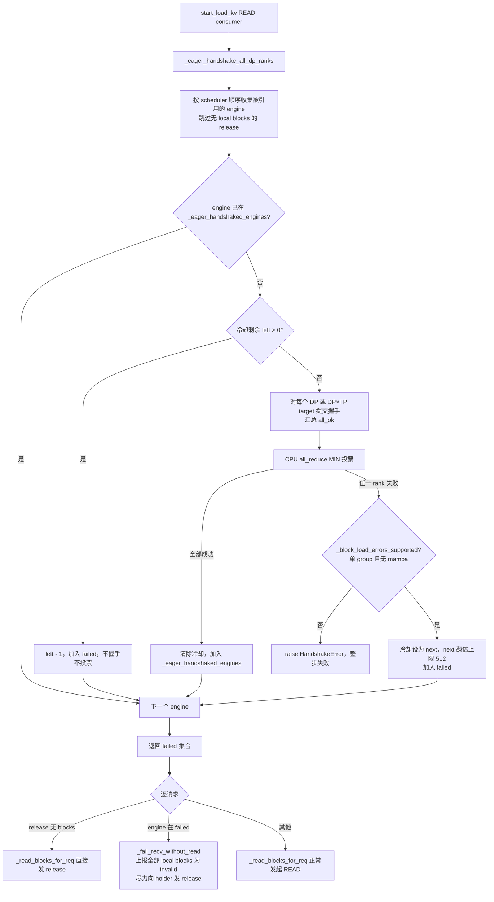

# PR #65690: [Bugfix][ROCm][MoRIIO] READ: fail only the requests of a failed handshake, not the decode engine

> **Author**: @amd-weisun | **State**: OPEN | **Date**: 2026-11-04
> **Branch**: `amd-weisun:moriio-handshake-failure` → `main` | **Labels**: bug, rocm, kv-connector
> **Changes**: +425 -54 lines across 6 files | **ROCm 相关性**: 完全相关（MoRIIO KV connector READ 路径，ROCm 专属）
> 本报告分两部分：§1–6 为 PR 详细总结，§7–8 为 ROCm review 意见。
>
> **复审说明（2026-11-25）**：head 仍为 `6ac4157`，与 2026-11-20 的 review 相同。本次复审新增一条 ⚠️：PR 描述中的故障注入验证结果早于冷却提交，与当前 head 的行为不符。同时重新核对了合入环境：#60852 已合入 main，与本 PR 三方合并无文本冲突；#63855、#66008、#65923、#65712、#63856 仍为 Open；CI 仍未运行。

---

## 1. 总结 (Summary)

在 MoRIIO READ（decode 拉取）模式下，decode→prefill 的 eager 握手一旦失败，`_eager_handshake_all_dp_ranks` 会在 TP 投票后抛 `HandshakeError`，异常穿出 `execute_model` 杀死整个 decode `EngineCore`。本 PR 把投票结果改为返回失败的 prefill engine 集合：这些 engine 的请求通过 `get_block_ids_with_load_errors` 上报为 load error（按 `kv_load_failure_policy` 失败或重算），并尽力通知 prefill 释放块；失败 engine 进入按“引用次数”计数的指数退避（1→512），期间不再握手。另外还有三处相关修复：只有单 KV cache group 且无 recurrent state 时才按块上报错误，否则在 forward 之前失败；serving 层拒绝的请求如果无法路由 release 就不再进入 `_reqs_need_recv`（否则 `build_connector_meta` 抛异常杀引擎）；删除从未被读取的 worker 字段 `_reqs_to_send`（gap 9）。

## 2. 背景与动机 (Background & Motivation)

- 对应 MoRIIO RAS RFC（ROCm/mori#759）的 gap 4（READ 侧）和 gap 9，并符合 #63336 提出的回收规则：握手失败时没有任何 READ 被提交，所以不需要先证明 DMA 已经停止就可以释放 prefill 的块。
- 原有 eager 握手是为了防止 TP worker 在握手阶段分叉导致 forward 中的 TP 集合通信挂死；投票（CPU `all_reduce(MIN)`）保证所有 TP worker 对同一 engine 得出相同结论。本 PR 保留这一点，只把“全体抛异常”改为“全体跳过这些请求”。
- 作者在 MI355X 单节点（xGMI）和双节点（RDMA）上做了故障注入验证，结果表格见 PR 描述（行为验证，不是性能数字；单测通过数 886 为作者自述，未在本 review 中复现）。
- @okorzh-amd 在 review 中指出：失败 engine 每次被引用都会同步重新握手，与 #63856 的 61 s 重试上限叠加后，DP8 prefill 每步可能卡约 8 分钟。作者因此加入了按引用计数的指数退避（056aa8f、91c6370）。

## 3. 代码修改分析 (Code Change Analysis)

### 3.1 修改的模块

| 文件 | 改动 |
|------|------|
| `moriio/moriio_connector.py` (+164/-54) | 新增 `_can_route_read_release()`；scheduler `request_finished` 在 READ 预调度 abort 时先检查能否路由；worker 新增 `_single_kv_cache_group`、`_handshake_cooldowns`、属性 `_block_load_errors_supported`、`_read_notify_ports()`（从 `_read_blocks_for_req` 抽出）、`_fail_recv_without_read()`；`_eager_handshake_all_dp_ranks` 返回失败集合并跳过 release；`start_load_kv` 对失败 engine 的请求走 `_fail_recv_without_read`，release 直接发送；删除 `_reqs_to_send`；producer 侧 `_pending_unmapped_acks` 记录首次出现时间，超过 `defer_timeout` 丢弃 |
| `moriio/moriio_common.py` (+4) | `HANDSHAKE_FAILURE_COOLDOWN = 1`、`MAX_HANDSHAKE_FAILURE_COOLDOWN = 512` |
| `tests/.../moriio/test_moriio_read_tp.py` (+163) | 失败握手只失败自己的请求；TP 投票使本 rank 也跳过并进入冷却后重试；release 不握手不计冷却；多 group / hybrid 时仍失败整步 |
| `tests/.../moriio/test_moriio_tp_ack.py` (+55/-10) | 按“单 group”参数化既有用例；新增未匹配 release ack 超过 `defer_timeout` 后丢弃 |
| `tests/.../moriio/test_moriio_hma_scheduler.py` (+38) | 预调度 abort 只在可路由时进入 `_reqs_need_recv`（5 种参数缺失情形） |
| `tests/.../moriio/test_moriio_hetero_tp_write.py` (+1) | 假 worker 补 `_single_kv_cache_group` |

### 3.2 架构 / 流程图



### 3.3 关键实现细节

- **投票一致性**：冷却状态只在投票之后、根据所有 rank 相同的投票结果更新；冷却递减只依赖 scheduler 下发的 metadata，所以所有 TP worker 调用 `all_reduce` 的次数和顺序一致，不会出现集合通信错位（已逐行核对）。
- **失败请求处理**：`_fail_recv_without_read` 把请求的全部 local blocks 加入 `_invalid_block_ids`，与已有的 RDMA 失败路径 `_record_failed_recv` 口径一致；release 端口由新抽出的 `_read_notify_ports` 计算，与正常 READ 完成时发的 release 相同。`send_notify` 只依赖 ZMQ DEALER，不依赖握手建立的 session。
- **多 group 判定**：`_block_load_errors_supported = _single_kv_cache_group and not _has_mamba`。scheduler 的 `_handle_invalid_blocks` 在 `len(kv_cache_groups) > 1` 时会 `raise RuntimeError`（已核对），所以 HMA 下的 sliding-window 模型以前是在 forward 之后才失败，现在在 forward 之前失败；引擎仍会退出，作者在 Limitations 中说明了这一点（#65923 在本 PR 基础上补齐）。
- **预调度 abort 的 release**：`_can_route_read_release` 复刻了 `ReqMeta.add_new_req` 的地址解析契约（`transfer_id` / `remote_engine_id` / `remote_block_ids` 必须存在，地址来自 request_id 内嵌 zmq 地址或显式 host + 两个端口）。不可路由时只打 warning，由 prefill 的 deferred-send 超时回收。
- **release ack 过期**：producer 侧 `_pending_unmapped_acks` 改为 `(ack, first_seen)`，超过 `defer_timeout`（READ 的 release 超时，默认 60 s）仍未匹配就丢弃。PR 描述的 Claims 中没有提到这一项。

## 4. 涉及的技术原理 (Technical Principles)

- **MoRIIO READ 模式**：decode 在 `start_load_kv` 中通过 MoRI-IO session 从 prefill 显存 RDMA/XGMI 读取 KV，读完后向 prefill 的 notify 端口发 release，prefill 才释放块。READ 模式下 scheduler 把加载视为同步（`load_kv_async=False`），请求直接进入 RUNNING，所以 forward 前必须等所有 READ 落地（`_await_reads_issued_this_step`）。
- **同步加载失败的恢复**：worker 通过 `get_block_ids_with_load_errors` 报告失败的块，scheduler 在 `update_from_output` 中按 `kv_load_failure_policy` 处理：`fail` 让请求以错误结束，`recompute` 把 `num_computed_tokens` 回退到第一个坏块之前并在 decode 本地重算。块 ID 只在单个 KV cache group 内唯一，所以多 group 时这条路径不可用。
- **TP 投票与集合通信**：decode 的 forward 包含 TP 集合通信，所有 TP worker 必须同时进入。只要某个 worker 因握手阻塞或单独抛异常，其他 worker 就会在集合通信里等到 NCCL/RCCL 超时。CPU 组上的 `all_reduce(MIN)` 同时充当屏障和一致性投票。
- **按引用计数的退避**：用墙钟计时会让不同 TP worker 在不同时刻做出不同决定，需要再投票；按“引用该 engine 的步数”计数，所有 worker 看到相同的 metadata，就能在不额外通信的情况下得出相同结论。

## 5. 评论区讨论亮点 (Discussion Highlights)

- @okorzh-amd：失败 engine 每次被引用都会在 `start_load_kv` 中同步重新握手；叠加 #63856 每个 target 约 61 s 的上限，以及单线程 `_handshake_initiation_executor` 串行执行，DP8 prefill 每步可能卡约 8 分钟，整批健康请求一起等待。建议按引用次数暂时直接失败该 engine 的请求。作者采纳，实现了从 1 开始翻倍、上限 512 的引用计数冷却，成功握手后清零。
- @okorzh-amd 建议标题写清楚改了什么，作者已改名。
- @okorzh-amd 汇总关联 PR：#65923 堆叠在本 PR 之上（包含本 PR head，补齐多 group / hybrid 的逐请求恢复）；#63856 是依赖（让死掉的对端变成失败而不是挂起）；#63855 在 `start_load_kv` 有 1 处冲突；#63854 是配套（版本不匹配抛 `HandshakeError`，本 PR 将其变为逐请求失败并按冷却重试）；#65712 是 WRITE 侧同类“过期未匹配通知”的兄弟实现。
- CI：CI 未运行（无 `ready` label，pre-run-check 失败，pre-commit 与 Buildkite 均被跳过）。DCO 通过。mergify 曾在 11-10、11-13 两次提示冲突。2026-11-25 复审时对 `upstream/main`（`5cc69fe699`，已包含 #60852）逐文件做三方合并，6 个文件均无文本冲突；#60852 改的是 WRITE 侧的预提交取消路径，本 PR 新增的 `_can_route_read_release` 分支位于其后的 READ 分支，二者互不影响。
- 同批 PR 交叉核对（本 review 在本地 ref 上核对）：
  - **#63855**（kudomcho，gap 6）：真实文本冲突，在 `start_load_kv` 中。#63855 删除了 READ 路径上的懒握手回退与忙等循环，而本 PR 在同一循环中加入了 release 与 failed-engine 分支，后合入者需要手工合并。
  - **#66008**（decode 为 READ 块续租）：语义冲突。本 PR 以“从未读取”为由删除 worker 的 `_reqs_to_send`（在 main 上确实只写不读），而 #66008 把 `_reqs_to_send` 改造成 producer 侧的 READ 租约到期表（`_reap_expired_read_leases` 读取它）。两者同时改这几行，会以文本冲突暴露，不会静默出错，但需要协调谁先合入。
  - **#65712**：同一“未匹配通知过期”模式的两种不同策略，见 §7 📝。
  - **#63856 / #63854 / #64756**：与本 PR 无文本冲突。#64756 保证监听方不因坏消息退出；#63856 给发起方加接收超时；两者合入后本 PR 的失败路径才能覆盖“对端无响应”的情形（作者在 Limitations 中已说明）。

## 6. 风险与潜在问题 (Risk Analysis)

| 风险 | 严重程度 | 说明 |
|------|---------|------|
| 失败粒度是整个 prefill engine（所有 DP rank），健康 DP rank 的请求也被失败并进入冷却 | Medium | 见 §7 ⚠️【设计】 |
| CI 未运行，新测试尚未在 MI355 MoRIIO step 上跑过 | Medium | 需要 `ready` 或 `/amd-ci run` |
| 描述中的 e2e 验证早于冷却提交，与 head 行为不符 | Medium | 见 §7 ⚠️【测试】 |
| 与 #63855（文本）和 #66008（`_reqs_to_send`）冲突 | Medium | 见 §5 与 §7 📝 |
| 冷却按引用计数，低流量下已恢复的对端仍可能被跳过很长时间；冷却期日志写“handshake failed”但实际没有握手 | Low | 见 §7 📝 |
| release ack 过期是 Claims 未列出的行为变化，策略与 #65712 不一致 | Low | 见 §7 📝 |
| `_can_route_read_release` 与 `add_new_req` 是两份地址解析契约 | Low | 见 §7 📝 |
| 多 group / hybrid 模型握手失败时引擎仍退出 | Low | 作者已在 Limitations 说明，由 #65923 跟进 |

---

## 7. Review 意见 (Findings)

| 类型 | 🔴 | ⚠️ | 📝 |
|------|----|----|----|
| 设计 | — | 1 | 2 |
| 注释/文档 | — | — | 1 |
| 可维护性 | — | — | 1 |
| 测试 | — | 1 | 1 |

总体评价：核心改动方向正确，相对 main（任何握手失败都杀死 decode 引擎）是明确的改进。TP 投票与冷却状态的一致性、release 端口计算、`send_notify` 不依赖 session、单 group 判定与 scheduler `_handle_invalid_blocks` 的限制都已核对无误。下列意见集中在失败粒度、与同批 PR 的协调，以及描述中未列出的行为变化。

**⚠️【设计】失败按整个 prefill engine 记录，一个 DP rank 握手失败会让同一 prefill 实例所有 DP rank 的请求都失败，并一起进入最长 512 次引用的冷却** `[已验证]`

- **问题**: `_eager_handshake_all_dp_ranks` 对一个 engine 的所有 target（每个 DP rank，flexible 模式下每个 DP×TP）汇总成一个 `all_ok`，投票失败后把整个 `remote_engine_id`（`host:handshake_port`）加入 `failed` 并设置冷却（`moriio_connector.py:3483-3497`，冷却期判断在 `3390-3395`）。`start_load_kv` 按 engine 判断（`3542-3543`），而每个请求实际只读自己的 `meta.remote_dp_rank`（`_read_blocks_for_req` 用 `get_engine_name_with_dp(dst_engine_id, remote_dp_rank)` 取 session）。已经握手成功的 DP rank 的 session 会写进 `_remote_agents`，但 engine 不会进入 `_eager_handshaked_engines`，所以这些 rank 的请求同样被失败。
- **影响**: 触发输入：prefill 为 DP8（`remote_dp_size=8`），其中一个 DP rank 的握手端口不可用（例如它的监听线程因坏消息退出，即 #64756 修复的 main 上的 bug，或两节点之间该端口被防火墙拦截）。此后每个路由到这个 prefill 实例的请求都会失败（`kv_load_failure_policy=fail` 时用户直接看到错误，`recompute` 时在 decode 上本地完整重算），只要该 rank 一直不可达，冷却就会翻倍到 512 次引用，而其余 7 个健康 rank 本可以正常服务。
- **行动**: 建议作者把失败粒度细化到 target：投票可以对一个按 target 排列的 0/1 向量做 `all_reduce(MIN)`（顺序由 scheduler metadata 决定，各 rank 一致），冷却也按 `(engine, dp_rank)` 记录，`start_load_kv` 只失败 `remote_dp_rank` 落在失败 target 上的请求。如果这次不改，建议在 Limitations 中写明这一粒度，并在日志里给出具体失败的 DP rank。

**⚠️【测试】PR 描述中的故障注入结果早于冷却提交，与当前 head 的行为不符** `[已验证]`

- **问题**: Validation 表写的是“Handshake fails once, kv_load_failure_policy=fail → That request fails; decode stays healthy; the handshake is retried and the next 4 requests return 200”，双节点表也写“That request fails; the next 4 return 200”。但当前 head 中 `HANDSHAKE_FAILURE_COOLDOWN = 1`（`moriio_common.py:492`）：第一次握手失败后，冷却设为 `(1, 2)`，**下一个引用该 engine 的步**会走 `left > 0` 分支直接失败（`moriio_connector.py:3390-3396`），不会握手，再下一步才重试。PR 自己的单测 `test_tp_vote_fails_an_engine_another_rank_could_not_reach` 也断言了这一行为（冷却步的 blocks 进入 `_invalid_block_ids`）。所以按当前代码，“next 4 requests return 200”应该是“紧接着的那一个请求（或那一步中所有路由到该 engine 的请求）也失败，之后才恢复”。这些 e2e 结果是在冷却提交 056aa8f / 91c6370（11-13 之后，回应 @okorzh-amd 的意见）之前跑的，作者没有在 head 上重跑。同一处的测试 docstring（`test_moriio_read_tp.py:589`，“the failed engine is retried next step”）也已过时。
- **影响**: 不影响正确性，但 reviewer 会按描述理解“一次失败只损失一个请求”。实际上一次瞬时失败会失败两步，而高并发时每一步可能包含该 prefill 实例的几十个新请求；在 `kv_load_failure_policy=fail` 下，这些请求都会直接返回错误。另外，描述里的 e2e 证据没有覆盖当前 head 的冷却与“release 不握手”（6ac4157）这两处行为变化。
- **行动**: 建议作者在当前 head 上重跑单节点和双节点故障注入并更新两张表，明确写出冷却带来的额外失败；同时修正 `test_failed_handshake_fails_only_its_requests` 的 docstring。如果认为第二步也失败的代价过高，可以考虑冷却从 0 开始（第一次失败后下一步立即重试，第二次失败才开始跳过），但这需要和 @okorzh-amd 的“避免每步卡住”诉求权衡。

**📝【设计】与同批 PR 的冲突：#63855 在 `start_load_kv` 有文本冲突，#66008 会重新使用本 PR 删除的 `_reqs_to_send`** `[已验证]`

- **问题**: ① #63855 删除了 READ 路径的懒握手回退与忙等循环，本 PR 在同一循环中新增 release 与 failed-engine 分支（`git merge-tree` 显示 2 处冲突）。在本 PR 之后，懒握手回退实际上已不可达（所有带 blocks 且未失败的 engine 都会进入 `_eager_handshaked_engines`），与 #63855 的方向一致。② 本 PR 删除 `_reqs_to_send`（在 main 上确实只写不读），而 #66008 把它改造成 producer 侧的 READ 租约到期表。③ #65923 包含本 PR 的 head，必须在本 PR 之后合入。
- **行动**: 建议作者在 PR 描述中写明与 #63855、#66008 的合入顺序；如果本 PR 先合，可以顺带删掉已不可达的懒握手回退，减少 #63855 的冲突面。

**📝【设计】冷却按引用计数，低流量时已恢复的对端仍会被跳过；冷却期间的错误日志写的是“handshake failed”，实际并未握手** `[已验证]`

- **问题**: 冷却只在引用该 engine 的步中递减，与墙钟无关。一个 prefill 短暂不可达、失败几次后冷却达到 64 或更高，即使它几秒后恢复，接下来的这么多次引用仍会直接失败。冷却期间每个请求都会经过 `_fail_recv_without_read`，日志写 “MoRIIO handshake with %s failed”（`moriio_connector.py:4464`），但这一步实际没有尝试握手；进入冷却时也没有日志说明剩余次数。
- **行动**: 建议作者在冷却分支单独记录一条日志（engine、剩余引用次数），并把 `_fail_recv_without_read` 的消息区分“本步握手失败”和“处于冷却期”；可以考虑给冷却加一个墙钟上限，但需要保证各 TP rank 一致（例如由 scheduler 下发时间戳）。

**📝【注释/文档】release ack 按 `defer_timeout` 过期是 Claims 未列出的行为变化，且与 #65712 的同类实现策略不同** `[已验证]`

- **问题**: 5d3d52c 让 producer 丢弃超过 `defer_timeout` 仍未匹配的 release ack（`moriio_connector.py:3037-3038`），PR 描述的 Claims 和 Details 都没有提到这一项。#65712 对 WRITE consumer 的 `write_done` 采用固定 60 s TTL 加 4096 条上限，并特意说明“不依赖可能被调低的 `defer_timeout`”；本 PR 则依赖 `defer_timeout` 且没有数量上限。两种做法都有理由（`defer_timeout` 本身就是 READ release 超时），但同一个 connector 里同一种模式用两套策略。
- **行动**: 建议作者在 Claims 中补上这一项并说明为什么用 `defer_timeout`，并与 #65712 的作者统一过期策略（至少统一是否设上限）。

**📝【可维护性】`_can_route_read_release` 与 `ReqMeta.add_new_req` 是同一路由契约的两份实现** `[已验证]`

- **问题**: `moriio_connector.py:534-549` 手工复刻了 `moriio_common.py` 中 `add_new_req` 的地址解析规则（内嵌 zmq 地址或 host + 两个端口，必需键 `transfer_id` / `remote_engine_id` / `remote_block_ids`）。以后 `add_new_req` 增加必需键或改变解析方式时，这里很容易漏改，又会回到“`build_connector_meta` 抛异常杀死引擎”的问题。
- **行动**: 建议作者把 `add_new_req` 中的地址解析抽成一个返回 `None` 或地址元组的共用函数，两处共用；或者至少在两处互相加注释引用。

**📝【测试】描述中的单测命令与当前目录结构不符；CI 尚未运行** `[已验证]`

- **问题**: 描述写的是 `pytest tests/v1/kv_connector/unit/test_moriio_*.py`（886 passed），但测试已在 #66480 移到 `tests/v1/kv_connector/unit/moriio/`，本 PR 改的也是该目录下的文件。CI 未运行（无 `ready` label，pre-run-check 失败），新测试尚未在 MI355 MoRIIO 单测 step 中运行。
- **行动**: 建议作者用当前路径重跑并更新数字，并请 maintainer 加 `ready` 或触发 `/amd-ci run`，让 MI355 MoRIIO step 跑过一次再合入。

## 8. 结论 (Verdict)

**⚠️ NEEDS WORK**

把“握手失败杀死 decode 引擎”改为“只失败相关请求”方向正确，TP 一致性和 release 路由都经得起核对。合入前建议把失败粒度从整个 prefill engine 细化到 DP rank（至少在描述中说明这一限制），在当前 head 上重跑故障注入并更新验证表（冷却会让下一步也失败），补上 release ack 过期这一未列出的行为变化，并与 #63855、#66008 协调合入顺序；同时需要让 AMD CI 实际跑一次。

## 9. 英文 Review 评论 (Copy-Paste English Comments)

**C1** `vllm/distributed/kv_transfer/kv_connector/v1/moriio/moriio_connector.py:3483-3497` — ⚠️ comment

```text
The vote and the cooldown are per remote engine, but each request reads only from its own remote_dp_rank. If one DP rank of a DP8 prefill cannot be reached (for example, its handshake listener died, or the port is blocked between nodes), every request routed to that prefill instance fails. The cooldown then keeps doubling to 512 references, even though the other 7 ranks are healthy and their sessions are already in _remote_agents. Could you vote on a per-target 0/1 vector (its order comes from scheduler metadata, so it matches on every rank), key the cooldown by (engine, dp_rank), and fail only the requests whose remote_dp_rank failed? If not, please list this limitation and log the failing DP rank.
```

**C2** `vllm/distributed/kv_transfer/kv_connector/v1/moriio/moriio_common.py:490-493` — ⚠️ comment

```text
The fault-injection tables in the description predate the cooldown commits. With HANDSHAKE_FAILURE_COOLDOWN = 1, the step right after a failed handshake hits the cooldown branch and fails that engine's requests without handshaking. test_tp_vote_fails_an_engine_another_rank_could_not_reach asserts exactly this. So "that request fails; the next 4 return 200" no longer describes the head: the next reference fails too, and under load that can be a whole step's worth of requests. Could you rerun the single-node and two-node scenarios on the current head and update both tables? The docstring of test_failed_handshake_fails_only_its_requests ("retried next step") is stale as well.
```

**C3** `vllm/distributed/kv_transfer/kv_connector/v1/moriio/moriio_connector.py:3037-3038` — 📝 comment

```text
Dropping unmatched release acks after defer_timeout changes behavior, but Claims and Details do not mention it. #65712 does the same thing for WRITE write_done notifications with a fixed 60 s TTL and a 4096-entry cap, and says explicitly that it does not rely on defer_timeout because users may set it low. Could you add this to the description and explain why defer_timeout is the right bound here? It would also help to align with #65712 on a single expiry policy, at least on whether to cap the buffer.
```

**C4** `vllm/distributed/kv_transfer/kv_connector/v1/moriio/moriio_connector.py:4464-4465` — 📝 comment

```text
During the cooldown, every skipped request logs "MoRIIO handshake with %s failed" at error level, but no handshake was attempted in that step. Entering the cooldown also logs nothing, so an operator cannot tell how long the engine will be skipped. Could you log once when an engine enters the cooldown, with the engine and the references left, and word this message differently for cooldown skips?
```

**C5** `vllm/distributed/kv_transfer/kv_connector/v1/moriio/moriio_connector.py:534-549` — 📝 comment

```text
This duplicates the routing rules of ReqMeta.add_new_req: the embedded zmq address, or remote_host plus both ports, and the required transfer_id, remote_engine_id and remote_block_ids. If add_new_req gains a required key later and this check is not updated, an unroutable release reaches build_connector_meta again and kills the engine. Could you factor the address resolution out of add_new_req into a helper that returns None when the release cannot be routed, and call it from both places?
```

## 10. 英文总结评论 (Overall Review Summary)

```text
Thanks, this is a clear improvement: a failed READ handshake now fails only the affected requests, not the decode engine, and the TP vote and reference-counted cooldown stay consistent across ranks. Before merging, I'd ask to narrow failures from the whole prefill engine to the failing DP rank (or document it), to rerun the fault-injection scenarios on the current head, since the cooldown also fails the next reference, to describe the new release-ack expiry, and to sequence this with #63855 and #66008. CI has not run yet. Approve after these changes.
```
