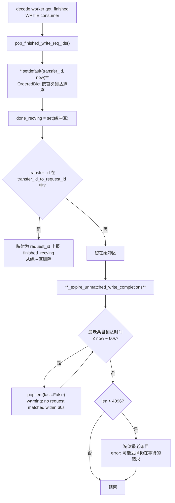

# PR #65712: [Bugfix][MoRIIO] Expire write_done notifications no request matches

> **Author**: @amirakb89 | **State**: OPEN | **Date**: 2026-11-04
> **Branch**: `fix/moriio-unmatched-write-done-expiry` → `main` | **Labels**: bug, documentation, kv-connector, needs-rebase
> **Changes**: +160 -14 lines across 3 files | **ROCm 相关性**: 完全相关（MoRIIO KV connector，ROCm/MORI 专属的 PD 分离传输路径）
> 本报告分两部分：§1–6 为 PR 详细总结，§7–8 为 ROCm review 意见。

---

## 1. 总结 (Summary)

MoRIIO WRITE（PUSH）模式下，decode worker 会把"映射还没到"的 `write_done` 通知缓存在 `_unmatched_write_completions` 里，每步重试匹配；但缓存只在匹配成功时才移除。如果某个 `write_done` 永远不会被匹配（PR 举的例子是：请求在等待 KV 时被客户端 abort，映射被删掉），它就会一直留在缓冲区里，每步被扫描两次。本 PR 把这个 `set` 改成记录首次到达时间的 `OrderedDict`：超过 60 s 仍未匹配的条目被丢弃并告警，条目数超过 4096 时从最老的开始淘汰并报 error。TTL 是独立常量，不复用 `defer_timeout`。

## 2. 背景与动机 (Background & Motivation)

- 对应 ROCm/mori#759 中的一项泄漏。缓冲区存在的原因是：prefill 的 `write_done` 可能比 decode worker 在 `start_load_kv` 里拿到 `transfer_id → request_id` 映射早一步到达，所以不能像 NIXL（#58875）那样直接丢弃未知 id。
- 作者的根因链路：decode 分配并通知 prefill → 客户端在 `WAITING_FOR_REMOTE_KVS` 时 abort → `request_finished` 删除映射 → prefill 写完发 `write_done` → 永远匹配不上。
- PR 描述自己承认 "Not in scope"：abort 请求的 decode block 在 main 上同样会泄漏，由 #59058（保留 abort 后的映射）修复；#59058 合入后，这类 `write_done` 会正常匹配，本 PR 只兜底"真正的孤儿"。**#59058 已于 2026-11-20 合入 main（c3310a8890）**，这直接改变了本 PR 的动机，见 §7。
- 验证：1P1D Qwen3-8B TP1，2×MI355X + Pollara 400，`defer_timeout=20`，abort 4 个请求后 main 上缓冲区一直是 4，PR 上每个条目在到达后 60 s 被丢弃；后续 15 个正常请求都成功。缓冲区大小来自一个不在 PR 里的日志探针。单测：新增 3 个用例，全目录 919 passed。

## 3. 代码修改分析 (Code Change Analysis)

### 3.1 修改的模块

| 文件 | 改动 |
|------|------|
| `moriio/moriio_connector.py` (+61 -12) | 新常量 `_UNMATCHED_WRITE_COMPLETION_TTL_S = 60.0`、`_MAX_UNMATCHED_WRITE_COMPLETIONS = 4096`；`_unmatched_write_completions` 从 `set[str]` 改为 `OrderedDict[TransferId, float]`（值为首次到达的 `monotonic` 时间，`setdefault` 保证重复消息不刷新时间）；新增 `_expire_unmatched_write_completions`，TTL 过期计 warning，超上限淘汰计 error，分别累计计数 |
| `docs/features/moriio_connector_usage.md` (+1 -1) | WRITE 模式 notify_port 的 Completion 说明中加入保留策略 |
| `tests/.../test_moriio_write_done_routing.py` (+98 -1) | 3 个用例：早到的 `write_done` 在 30 s 后映射到达仍能匹配；无人匹配的条目在 TTL 后丢弃且重复消息不重置时间；超过上限时淘汰最老的 |

### 3.2 架构 / 流程图



### 3.3 关键实现细节

- **单调性**：所有条目都用同一个 `time.monotonic()` 时间戳按插入顺序进入 `OrderedDict`，所以只需从头部弹出即可完成 TTL 过期，复杂度与过期条目数成正比。
- **重复消息**：#64693 之后 wrapper 会对已终态的 transfer 去重，但旧式纯字符串完成消息仍可能重复进入；`setdefault` 保证重复消息不会延长条目寿命（作者已把测试改为直接往 `done_write_cache_req_ids` 追加，以绕过 wrapper 去重）。
- **TTL 与 `defer_timeout` 解耦**：`defer_timeout` 是 prefill 侧的参数，设得很小时会误丢"映射晚到一步"的合法完成，所以单独用固定 60 s。合法的早到窗口约一个 step。
- **计数与日志分级**：TTL 过期是 warning（真正的孤儿）；超上限淘汰是 error（可能误伤仍在等待的请求，那个请求将永远完不成）。

## 4. 涉及的技术原理 (Technical Principles)

- **WRITE（PUSH）模式完成通知**：decode 分配 block 后通过 ZMQ 把 block id 发给 prefill，prefill 逐层 RDMA WRITE 到 decode 显存，最后发 `write_done`；decode worker 收到后通过 `finished_recving` 让 scheduler 把请求从 `WAITING_FOR_REMOTE_KVS` 转为可运行。
- **映射与竞态**：`transfer_id → request_id` 映射由 decode scheduler 在 `update_state_after_alloc` 中建立，随 metadata 下发给 worker。prefill 的 `write_done` 走独立的 ZMQ 通道，可能比 worker 拿到这一步的 metadata 更早，所以 worker 需要一个"未匹配"缓冲区。
- **有界缓冲**：对外部输入驱动、只靠"匹配"才能出队的结构，都需要 TTL 或容量上限兜底，否则任何协议异常都会变成永久泄漏和每步线性开销。同文件的 `_unmatched_write_failures` 已有 4096 上限（#57705）。

## 5. 评论区讨论亮点 (Discussion Highlights)

- **Codex：测试绕过真实构造函数**。三个新用例都用 `MoRIIOConnectorWorker.__new__` 并注入私有属性，违反 `tests/AGENTS.md`（要求真实构造、不得注入私有状态，用户可见的修复要有入口级回归测试）。页面上看不到作者对此的回复。
- **Codex：保留策略需要写进文档**。作者在 586835b 中把 TTL 改为独立常量（不再扩展 `defer_timeout` 的含义），并更新了使用文档。
- **okorzh-amd：rebase 后"重复消息"步骤测不到东西**。#64693 之后 wrapper 会丢弃已终态 transfer 的 `write_done`，第二条消息根本到不了缓冲区，测试在把 `setdefault` 换成普通赋值时也能通过。作者在 0e2fa79 中改为直接追加到 `done_write_cache_req_ids`。
- **okorzh-amd：日志措辞**。超上限淘汰时仍写 "within defer_timeout"；作者把过期与淘汰拆成两条日志、两个计数器，后者升为 error。
- **okorzh-amd：相关 PR**。#59058（EXTENDS，保留 abort 后的映射）、#60852（与 `get_finished` 冲突）、#66008（同一段注释的小冲突，已因改用独立常量而消失）、#57705 / #64693 已合入。

## 6. 风险与潜在问题 (Risk Analysis)

| 风险 | 严重程度 | 说明 |
|------|---------|------|
| #59058 合入后动机、文档、e2e 对照失效 | Medium | 见 §7 ⚠️【设计】 |
| rebase 后 main 上 #59058 的测试会因 `set` 注入而失败 | Medium | 见 §7 ⚠️【测试】 |
| 与 #60852 / #64154 的语义冲突（集合运算作用在 `OrderedDict` 上） | Low | 见 §7 📝【兼容性】 |
| 误丢仍在等待的合法完成 | Low | 只有超过 4096 上限才可能发生；TTL 60 s 远大于一个 step 的竞态窗口；已有 error 日志 |
| 本批次中多套"未匹配通知"的保留策略不一致 | Low | 见 §7 📝【设计】 |
| 性能 | Low | 每步仍为 O(缓冲区大小)，但缓冲区现在有上界，比 main 更好 |

---

## 7. Review 意见 (Findings)

| 类型 | 🔴 | ⚠️ | 📝 |
|------|----|----|----|
| 设计 | — | 1 | 1 |
| 测试 | — | 1 | 1 |
| 兼容性 | — | — | 1 |

整体看：实现本身是正确的。TTL 过期依赖的插入顺序与时间单调性成立，`setdefault` 正确保持首次到达时间，上限淘汰从最老的开始，早到的合法完成在 60 s 内仍能匹配。问题在于 PR 的前提已经被今天合入的 #59058 改变，而 rebase 会让 main 上的现有测试失败。

---

**⚠️【设计】#59058 已合入，PR 描述、文档和代码注释里的"abort 后孤儿"场景在 main 上已不再产生** `[已验证]`

- **问题**: #59058（c3310a8890，2026-11-20 合入）让 WRITE consumer 在请求 abort 后保留 `transfer_id` 映射（`_write_recvs_in_flight`），`write_done` 到达后正常匹配并在 `update_connector_output` 里再解除映射；main 上的 `test_moriio_unmap.py::test_write_consumer_abort_while_waiting` 断言此后 `_unmatched_write_completions` 为空。本 PR 的根因说明、e2e 对照组（"main：缓冲区保持 4"，在 decode be47189 上测得，该提交不包含 #59058）、文档新增句子（`docs/features/moriio_connector_usage.md:133` 的 "for example because the client aborted while the request waited for its KV"）、常量注释（`moriio_connector.py:143-145`）以及测试 docstring 都还以这个场景为例。
- **影响**: 合入后文档会误导运维：在当前 main 上看到 "dropped N write_done" 告警时，原因不会是 abort，而是别的协议异常（重复/错投的完成、映射提前删除的其他路径）。PR 也就从"修复已观测到的泄漏"变成了纵深防御，审阅者需要知道这一点来判断价值。
- **行动**: 建议作者 rebase 后说明在当前 main 上还有哪些路径会产生孤儿 `write_done`（如果有，最好补一个能复现的用例）；同时更新文档、常量注释和测试 docstring，不再以 abort 为例；并把 PR 描述中的 e2e 对照改为基于包含 #59058 的 main，或注明其已过时。

**⚠️【测试】rebase 后 main 上 #59058 的测试会失败，而 connector 文件的合并不会报冲突** `[已验证]`

- **问题**: main 上的 `tests/v1/kv_connector/unit/moriio/test_moriio_unmap.py` 在 `_worker()` 里直接注入 `worker._unmatched_write_completions = set()`，再通过真实 scheduler 调用 `worker.get_finished()`。本 PR 把这条路径改成 `self._unmatched_write_completions.setdefault(transfer_id, now)`（`moriio_connector.py:3003`）以及 `_expire_unmatched_write_completions` 中的 `pending.values()` / `popitem(last=False)`。三方合并显示 `moriio_connector.py` 可以干净合并（唯一冲突在本 PR 测试文件的 import），所以这个问题只会在 rebase 后跑测试时暴露：`set` 没有 `setdefault`，`test_write_consumer_abort_while_waiting` 的三个参数化用例都会抛 `AttributeError`。另外 `pre-run-check` 失败（无 `ready` label），pre-commit 与 Buildkite 均被跳过，CI 未在本 PR 上运行。
- **影响**: 如果 rebase 后不跑全目录单测就合入，main 上的 MoRIIO 单测 step 会变红。
- **行动**: 作者应当在 rebase 时把 `test_moriio_unmap.py` 的 `_worker()` 改为 `OrderedDict()`（并补上两个计数器属性），或者更好地让该 helper 走真实构造函数；随后重跑 `tests/v1/kv_connector/unit/moriio` 全目录，并请 maintainer 触发 AMD MoRIIO 单测 step。

**📝【兼容性】与 #60852、#64154 存在语义冲突：两者都对该缓冲区做集合运算** `[已验证]`

- **问题**: #60852 在同一函数里写了 `self._unmatched_write_completions - self._reported_write_transfers`，#64154 写了 `self._unmatched_write_completions -= fenced`。缓冲区变成 `OrderedDict` 后，这两处都会抛 `TypeError`（`dict` 不支持与 `set` 做 `-` / `-=`）。三方合并在两者之间分别有 3 处和 5 处文本冲突，所以后合入的一方大概率会注意到，但需要按新的数据结构改写这些表达式，而不是只解决文本冲突。
- **影响**: 如果只按文本解决冲突，WRITE consumer 的 `get_finished` 会在每步抛异常，decode 引擎直接失败。
- **行动**: 建议作者在 PR 描述的相关 PR 列表里补上 #64154，并写明"集合运算需改为按 key 删除"；同时与 #60852、#64154 的作者约定合并顺序。

**📝【设计】本批次中三套"未匹配通知"的保留策略不一致** `[已验证]`

- **问题**: 本 PR 对 decode WRITE 的未匹配 `write_done` 用固定 60 s TTL + 4096 上限，并刻意不复用 `defer_timeout`；#65690 对 prefill READ 的未匹配 release（`_pending_unmapped_acks`）按 `defer_timeout` 过期；#66008（同作者）对过期租约的记忆只设 4096 上限、没有 TTL。三者处理的都是"控制面通知比映射早到或晚到"的同一类问题。
- **影响**: 运维面对三种不同的超时语义和日志措辞，调 `defer_timeout` 时只会影响其中一部分；后续维护者也难以判断哪个才是有意为之。
- **行动**: 建议作者在本 PR 或 #66008 中把这类保留常量集中到 `MoRIIOConstants`，并在文档里统一说明，或者至少在 #65690 的 review 中指出与本 PR 选择不同的原因。

**📝【测试】新用例全部绕过真实构造函数，Codex 的意见没有回应** `[已验证]`

- **问题**: `_write_consumer()` 用 `MoRIIOConnectorWorker.__new__` 并通过 `vars(worker).update(...)` 注入私有属性，`clock` fixture 把整个模块的 `time` 换成只有 `monotonic` 的对象。`tests/AGENTS.md` 明确要求用真实构造、不注入私有状态。上面 ⚠️ 中 `test_moriio_unmap.py` 会坏，正是因为它也采用了注入私有状态的写法：数据结构一变，测试就跟不上。
- **行动**: 建议作者把至少一个用例改为基于 main 上 #59058 已有的真实 scheduler 驱动框架（`create_scheduler` + `_step`）：构造一个不属于任何请求的 `write_done`，推进时钟，断言它在 TTL 后被清除且没有请求被误完成。

## 8. 结论 (Verdict)

**⚠️ NEEDS WORK**

缓冲区改造本身正确、简洁，日志分级也合理。但 #59058 今天合入后，PR 声明修复的 abort 场景在 main 上已不再产生孤儿，文档和注释需要改写，PR 的价值需要重新说明。同时 rebase 后 main 上 `test_moriio_unmap.py` 会因注入 `set()` 而失败，必须一并修改并重跑单测。

## 9. 英文 Review 评论 (Copy-Paste English Comments)

**C1** `docs/features/moriio_connector_usage.md:133` — ⚠️ comment

```text
#59058 landed on main today (c3310a8890). A WRITE consumer now keeps the transfer mapping after an abort, and the late write_done matches and frees the blocks; `test_write_consumer_abort_while_waiting` on main asserts that `_unmatched_write_completions` ends up empty. So the abort example here, in the constant comment and in the test docstring no longer produces an orphan on main. The "main" arm of the e2e table (decode be47189) predates that fix. Could you rebase, say which paths still produce unmatched write_dones on current main, and update the docs and comments to match?
```

**C2** `vllm/distributed/kv_transfer/kv_connector/v1/moriio/moriio_connector.py:3001-3004` — ⚠️ comment

```text
After rebasing, `tests/v1/kv_connector/unit/moriio/test_moriio_unmap.py` from #59058 will fail. Its `_worker()` helper injects `_unmatched_write_completions = set()` and then drives `get_finished()` through a real scheduler, and `set` has no `setdefault`, `values()` or `popitem(last=False)`. The connector file merges without a textual conflict, so this only shows up when the tests run. Could you update that helper (`OrderedDict()` plus the two counters, or better, real construction) and rerun the whole `tests/v1/kv_connector/unit/moriio` directory? CI hasn't run on this PR yet.
```

**C3** `vllm/distributed/kv_transfer/kv_connector/v1/moriio/moriio_connector.py:1923-1925` — 📝 suggestion

```text
Heads-up for the merge order: #60852 computes `self._unmatched_write_completions - self._reported_write_transfers`, and #64154 does `self._unmatched_write_completions -= fenced`. Both raise TypeError once this is an OrderedDict, which would break `get_finished` on every WRITE consumer step. Whichever PR lands second needs to rewrite those expressions as key deletions, not just resolve the textual conflict. Could you add #64154 to the related-PR list and note this?
```

## 10. 英文总结评论 (Overall Review Summary)

```text
The change is correct: entries expire oldest-first by first arrival, a repeated write_done doesn't reset its clock, and an early completion still matches within the 60 s window. However, #59058 landed today, so the abort case no longer produces orphans on main. Please rebase, explain which paths still leak, and update the docs and comments. After rebasing, test_moriio_unmap.py from #59058 will fail because it injects a set into this buffer, so please fix it and rerun the MoRIIO unit tests. Approve once those are addressed.
```
