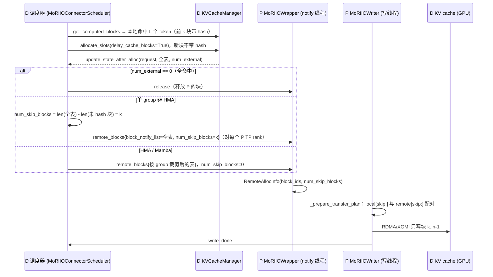

# PR #65822: [Perf][KV Connector][ROCm] MoRIIO WRITE: skip blocks the decoder prefix cache already holds

> **Author**: @whx-sjtu | **State**: OPEN | **Date**: 2026-11-05
> **Branch**: `whx/moriio-write-skip-local-prefix-hit` → `main` | **Labels**: rocm, kv-connector
> **Changes**: +100 -2 lines across 5 files | **ROCm 相关性**: 完全相关（MoRIIO KV connector，AMD ROCm 专属 PD 分离传输）
> **CI 状态**: 未知（本次未拉取 checks）| **与 main 的关系**: merge-base `a2bcb5657a`，落后 upstream/main 266 个 commit；三方合并无冲突，期间 moriio 目录仅有 docstring 反引号风格改动（#65158）
> 本报告分两部分：§1–6 为 PR 详细总结，§7–8 为 ROCm review 意见。

---

## 1. 总结 (Summary)

MoRIIO 的 WRITE（PUSH）模式下，decode 端（D）在本地 prefix cache 命中 `L` 个 token 后，仍把**整张** block table 发给 prefill 端（P），P 从第 0 块开始逐块配对写入，于是把 D 已经持有、且可能正被其他请求读取的共享缓存块又重写了一遍。本 PR 让 D 额外发送 `num_skip_blocks`（D 侧 block table 中“已带 hash 的前导块”数量），P 在生成传输计划时把本地表与远端表都从 `skip` 处切片，只写剩余后缀。改动仅对单 KV cache group（非 HMA、非 Mamba）的 WRITE 路径生效，线协议双向兼容。

## 2. 背景与动机 (Background & Motivation)

- 在 agentic/多轮对话负载里，相邻请求共享极长前缀（PR 的 workload 平均输入约 155K token），D 侧 prefix cache 命中率很高。NIXL push 和 Mooncake 在 D 侧都只把“未 hash 的后缀块”（`get_unhashed_block_ids_all_groups()`）交给对端，MoRIIO WRITE 此前没有这一优化，P 的写线程把大部分时间花在重复写 D 已有的 KV 上。
- PR 描述中的度量（来自作者的 MI355X 1P1D 实验，见 §7 关于数字溯源的说明）：每请求每个 P rank 写入量 1,650 MB → 130 MB；P 写线程忙碌率 79% → 32%；3600 s、并发 48 的 agentic replay 吞吐 35,639 → 38,741 tok/s/GPU（+8.7%），p90 interactivity 157.8 → 149.6（−5.2%，作者解释为一个 D 承担了更大的 decode batch，因此不主张 1P1D 的 Pareto 改进）。
- 作者说明与 #62190、#48471 不重复：后两者只改 READ 模式。
- 设计取舍：不采用 NIXL/Mooncake 的“只发后缀 + P 尾部对齐”，而是“D 仍发整表 + 额外发 skip 数，P 头部切片”，理由是 `compute_block_transfer_offsets` 按 zip 配对、不检查对齐，若 D 只发后缀，旧版 P 会把自己的前导块配给 D 的后缀块；另外 D 的表尾可能带 lookahead 块，尾部对齐不可靠。

## 3. 代码修改分析 (Code Change Analysis)

### 3.1 修改的模块

| 文件 | 改动 |
|------|------|
| `vllm/distributed/kv_transfer/kv_connector/v1/moriio/moriio_connector.py` (+10) | `send_notify_block` 新增 `num_skip_blocks` 参数，非零时写入 `remote_blocks` 消息；`update_state_after_alloc` 的 WRITE/D 侧单 group 分支计算 `num_skip_blocks = len(全表) - len(未 hash 块)` 并透传 |
| `vllm/distributed/kv_transfer/kv_connector/v1/moriio/moriio_engine.py` (+4 −2) | `MoRIIOWrapper._handle_remote_blocks_message` 解析 `num_skip_blocks`（缺省 0）；`MoRIIOWriter._prepare_transfer_plan` 对本地/远端 block 列表都做 `[skip:]` 切片 |
| `vllm/distributed/kv_transfer/kv_connector/v1/moriio/moriio_common.py` (+2) | `RemoteAllocInfo` 新增字段 `num_skip_blocks: int = 0` |
| `tests/v1/kv_connector/unit/test_moriio_hma_scheduler.py` (+51) | 新增 `test_plain_write_notify_skips_blocks_of_the_local_prefix_hit`（3 组参数）；既有 hybrid 用例补 `num_skip_blocks=0` 断言 |
| `tests/v1/kv_connector/unit/test_moriio_kv_layout.py` (+33) | 新增 `test_write_skips_blocks_the_consumer_prefix_cache_already_holds`：校验 P 侧把切片后的列表交给 `_compute_block_transfer_offsets` |

### 3.2 架构 / 流程图

WRITE 模式 D→P 通知与 P 写入（改动点加粗）：



P 侧传输计划的决策逻辑：

```mermaid
flowchart TD
    A[写任务到达 _prepare_transfer_plan] --> B[_check_peer_block_size<br/>P/D block_size 不同则报错]
    B --> C{offsets 已缓存?}
    C -- 是 --> H[复用 offsets]
    C -- 否 --> D[skip = request_info.num_skip_blocks]
    D --> E[local = task.local_block_ids[group][skip:]<br/>remote = request_info.block_ids[group][skip:]]
    E --> F{has_mamba?}
    F -- 是 --> F1[remote 截断到 len(local)]
    F -- 否 --> G
    F1 --> G{整块拷贝可行?}
    G -- 是 --> G1[_compute_block_transfer_offsets]
    G -- 否（异构 TP / head 布局不同） --> G2[_compute_head_slice_transfer_offsets]
    G1 --> H
    G2 --> H
```

### 3.3 关键实现细节

- **skip 的计算**（`moriio_connector.py:1291-1304`）：只在 `not (_has_mamba or _is_hma_required)` 分支计算，即所有 transfer group 都是 full attention（或关闭了 HMA）的模型；`block_notify_list` 仍是 group 0 的整表。
- **线协议**：`send_notify_block` 仅在 `num_skip_blocks` 非零时加 key（`moriio_connector.py:954-955`），P 侧 `int(data.get("num_skip_blocks", 0))`（`moriio_engine.py:1096`）。新 D + 旧 P：旧 P 忽略该 key，退化为全量写；旧 D + 新 P：key 缺失即 0。双向兼容。
- **P 侧切片**（`moriio_engine.py:451-453`）：对 `_compute_block_transfer_offsets` 与 `_compute_head_slice_transfer_offsets` 两个分支都生效；offsets 按 `(layer, geometry, target_rank)` 缓存在 `RemoteAllocInfo.transfer_offsets`，一个请求只算一次。
- **不改动**：READ 模式、Mamba 状态块写入（`_prepare_mamba_transfer_plans`）、完成计数/write_done 协议、端口计算、mori API 使用均未改变；无新 env var、无新配置项。

## 4. 涉及的技术原理 (Technical Principles)

- **PD 分离与 MoRIIO WRITE 模式**：WRITE（PUSH）下，D 先为请求分配 block 并把 block id 通过 ZMQ 通知 P，P 在 prefill 最后一个 chunk 逐层把 KV 用 RDMA/XGMI 直接写进 D 的显存，写完发 `write_done`，D 的请求从 `WAITING_FOR_REMOTE_KVS` 进入运行。每条写操作的地址由 `(local_block_id, remote_block_id)` 配对计算，因此两张表必须按“同一 token 位置”对齐。
- **vLLM prefix cache 的 hash 语义**：block 在“内容已经计算完毕并被 commit”时才通过 `cache_blocks` 打上 hash；prefix 命中总是前导连续块（链式 hash）。异步加载（`load_kv_async=True`）时 `allocate_slots(..., delay_cache_blocks=True)` 不会给新分配的块打 hash，因此 hook 时刻“带 hash 的块 = 本地命中块”。单 group 时 `UnitaryKVCacheCoordinator` 断言 `hash_block_size == block_size` 且对齐粒度为 `block_size`，不存在“块内部分命中”（fine-grained partial hit 只在 Mamba align 模式的 Hybrid coordinator 中启用）。
- **引用计数保证命中块不被驱逐**：命中块被 `allocate_new_computed_blocks` 计入本请求的引用，在请求释放前不会进入 free 队列被驱逐/重置 hash，因此 D 通知 P 到 P 写完这段时间内，被跳过的块内容不会被换掉。
- **NIXL push / Mooncake 的做法**：D 侧用 `blocks.get_unhashed_block_ids_all_groups()` 只交出未 hash 的后缀块，P 尾部对齐。本 PR 用相同的 hash 判据，只是把“切片”放到 P 侧、用计数传递，以保持与旧版本对端的兼容。
- **异构 TP / MLA**：block id 是逻辑编号，与 TP 切分无关；P 对每个 TP rank、每个 write target 使用同一个 skip。MLA（单 group latent cache）同样适用；P/D block_size 不一致会被 `_check_peer_block_size` 直接拒绝。

## 5. 评论区讨论亮点 (Discussion Highlights)

- 截至本次数据快照，PR 没有人工 review 或实质讨论；唯一一条是 `claude[bot]` 的提示（fork PR，自动 review 被禁用，需要 maintainer 评论 `@claude review` 触发）。
- PR 描述自述了“revert-red”验证：用 main 的 `moriio_common.py / moriio_connector.py / moriio_engine.py` 跑新测试会失败 5 个（共 163 个）；把 skip 计成 `(N - E) // B` 会让 `[1-8]` 参数（整块裁剪后的加载）失败。
- PR 描述勾选了“AI assistance was used”。

## 6. 风险与潜在问题 (Risk Analysis)

| 风险 | 严重程度 | 说明 |
|------|---------|------|
| 性能数字来自与提交代码不同的构建 | Medium | 见 §7 ⚠️【性能】 |
| 正确性前提从“P 覆盖写”变为“信任 D 的缓存块”，缺少端到端精度验证 | Medium | 见 §7 ⚠️【测试】 |
| skip 计数依赖两个隐式不变式（异步加载不打 hash；单 group 无部分命中） | Low | 当前成立，见 §7 📝【正确性】 |
| P 侧对 `num_skip_blocks` 不做边界校验 | Low | 当前不可达，见 §7 📝【设计】 |
| HMA / Mamba / SWA 混合模型不受益，且仍会重写 D 的共享前缀块 | Low | 范围已在 PR 中声明，见 §7 📝【设计】 |
| 版本兼容（新旧 P/D 混部） | Low | 已核实双向兼容：旧端退化为全量写 |
| CI 覆盖 | Low | 新测试是 CPU 单测；`test_moriio_kv_layout.py` 要求 ROCm + mori，只在 AMD 队列（`.buildkite/test-amd.yaml` 的 `test_moriio_*.py`）运行；本次未拉取 CI 结果 |

---

## 7. Review 意见 (Findings)

本地复现：用 `git archive` 导出 PR head 到临时目录，在 ROCm venv 下运行 `pytest --noconftest tests/v1/kv_connector/unit/test_moriio_hma_scheduler.py tests/v1/kv_connector/unit/test_moriio_kv_layout.py`，**163 passed**（与 PR 描述的 163 个一致）。

mori 集成清单逐项结论：注册、配置面、端口偏移、tensor 注册、HIP 守卫、导入回退均未改动；本 PR 没有新增 mori 符号（无需对照 mori 上游）；线协议新增的 `num_skip_blocks` 是可选 key，新旧对端双向兼容 `[已验证]`；资源方面只减少写入量，没有新增 buffer 或后台线程。

| 类型 | 🔴 | ⚠️ | 📝 |
|------|----|----|----|
| 性能 | — | 1 | — |
| 测试 | — | 1 | — |
| 正确性 | — | — | 1 |
| 设计 | — | — | 2 |

---

**⚠️【性能】GPU 吞吐与写入量数据测的不是本 PR 的代码，且无法复现** `[已验证]`（数字本身 `[unverified]`）

- **问题**: PR 描述的 `<details>` 写明：“The GPU runs below used that `(N - E) // B` count”，基线是 `main @ 2173d7121 + #63483`，而本分支的计数方式是“带 hash 的前导块数”（`moriio_connector.py:1302-1304`），基于 `a2bcb5657a`。写入量（1,650 MB → 130 MB、955/1,027 块被跳过、写线程忙碌率 79% → 32%）来自另一组 900 s、并发 64、加了 per-request observer 的插桩构建。作者论证两种计数在当前 main 上相等：在单 group 路径下 `N - E = num_computed_tokens`，即块对齐的本地命中长度。我核对后认为这个论证在 unitary coordinator 下基本成立，但这仍是推导，不是对提交代码的测量。另外 p90 interactivity 实际下降 5.2%（157.8 → 149.6）；服务端启动命令、MoRIIO 配置（`qp_per_transfer` 等）和模型 checkpoint 都没有给出。数字一致性粗算：1,650 MB × 72/1,027 ≈ 116 MB，与报告的 130 MB 同量级，可以认为大体自洽。
- **影响**: “+8.7% tok/s/GPU”是读者最先看到的数字，但它对应的代码与待合入代码不同，且依赖 MiniMax-M3.1-Flash + DSpark + nvfp4 KV + MultiConnector 这一特定 ROCm 配置，别人无法复现；interactivity 的下降也可能让 maintainer 质疑净收益。
- **行动**: 建议作者在 PR head `2029713aac` 上至少重跑一次短时（如 900 s）的非插桩对比，或补一个简单的计数器（如 debug 日志统计每请求跳过的块数）证明新计数与旧计数在实际负载下相等；并补充 server 启动命令与 MoRIIO 配置。在此之前，Claims 中的数字应注明“measured with an equivalent earlier variant”。

**⚠️【测试】正确性前提改为“信任 D 的缓存块”，但没有端到端精度验证，单测只验证切片参数** `[已验证]`

- **问题**: 改动前，P 会覆盖写全部块，即使 D 的缓存块有问题也会被“修正”；改动后，跳过块的正确性完全依赖 D 自己的 prefix cache 内容。PR 明确写了“No accuracy eval: skipped blocks are D's cached copies of this KV”。新增的两个测试中，`test_write_skips_blocks_the_consumer_prefix_cache_already_holds`（`test_moriio_kv_layout.py:444-474`）把 `_compute_block_transfer_offsets` mock 掉，只断言传入的列表是 `[12]` / `[42, 43]`；`test_plain_write_notify_skips_blocks_of_the_local_prefix_hit` 用手工 `set_block_hash` 构造 hash 状态，不经过真实的 `allocate_slots(delay_cache_blocks=True)`。两者都没有覆盖异构 TP 的 head-slice 分支（`_compute_head_slice_transfer_offsets` 同样接收切片后的列表），也没有一个测试在真实调度器下证明“hook 时刻带 hash 的块恰好是本地命中块”。
- **影响**: 如果某个场景下 D 的“带 hash 前导块”与 P 需要写的范围不一致（例如未来调度器提前 cache 块、或 D 的缓存块来自一次失败但仍被缓存的传输），结果是静默的 KV 错误，单测不会报警，只能通过精度掉点发现。
- **行动**: 建议作者补一个小规模精度对比（例如 1P1D、D 开 prefix caching、带共享前缀的多轮 gsm8k 或 lm_eval，对比本 PR 与 main），并补一个用真实 `KVCacheManager`（单 group、`delay_cache_blocks=True`）驱动 `update_state_after_alloc` 的调度器单测，断言 `num_skip_blocks == 本地命中块数`；head-slice 分支也可以加一条参数化用例。

**📝【正确性】skip 计数依赖两个隐式不变式，建议写进注释或加断言** `[已验证]`

- **问题**: `num_skip_blocks = len(block_notify_list) - len(get_unhashed_block_ids_all_groups()[0])`（`moriio_connector.py:1302-1304`）等于“本地命中块数”，需要同时满足：(1) WRITE 消费端走异步加载，`get_num_new_matched_tokens` 在 `num_external_tokens > 0` 时返回 `True`（`moriio_connector.py` WRITE 分支），从而 `allocate_slots(delay_cache_blocks=True)` 不给外部块打 hash。同文件 READ 分支的注释正好说明了反例：“READ is synchronous, so allocate_slots may hash destination blocks before this hook runs”。(2) 单 group 使用 `UnitaryKVCacheCoordinator`，它断言 `hash_block_size == block_size`、对齐粒度为 `block_size`，不会出现块内部分 hash 的尾块；fine-grained partial hit 只在 Mamba align 的 Hybrid coordinator 中启用，而该路径 skip 恒为 0。我核对过这两点，当前都成立。另外“带 hash 块一定是前导连续块”依赖链式 hash 与 `trim_null_head`，同样成立。
- **影响**: 当前不触发。但若将来有人把 WRITE 改成同步加载、或为非 Mamba 模型启用部分 hash 命中，skip 会把 P 必须写的块也算进去，D 会以未写入的 KV 继续 decode，而且没有任何报错。
- **行动**: 建议作者在计数处注释这两个前提，或加一个廉价断言，例如 `assert num_skip_blocks * block_size <= request.num_computed_tokens + block_size`，或改为直接用本地命中长度计算（`num_local_computed_tokens // block_size`），让计数与 hash 状态解耦。

**📝【设计】P 侧不校验 `num_skip_blocks`，越界时会静默退化为空写并照常报 `write_done`** `[已验证]`（触发条件 `[推测]`）

- **问题**: `_handle_remote_blocks_message` 直接 `int(data.get("num_skip_blocks", 0))`（`moriio_engine.py:1096`），`_prepare_transfer_plan` 直接 `[skip:]` 切片（`moriio_engine.py:451-453`）。`validate_transfer_block_ids` 明确允许“shorter or empty local list”，因此 skip ≥ 本地块数时生成空传输计划，P 照常 `_mark_write_done`；负数 skip 会变成“从尾部数”的切片。
- **影响**: 按当前 D 侧的计算方式不可达（skip ≤ 命中块数 < 表长）。但这是跨进程、跨版本的线协议字段，一旦对端实现有 bug，D 会收到 `write_done` 而实际没有写入任何数据，表现为静默的输出错误，而不是传输失败。
- **行动**: 建议作者在 P 侧解析时校验 `0 <= num_skip_blocks < len(block_ids[0])`，不满足就记 warning 并回退为 0（全量写，最多浪费带宽），而不是信任对端。

**📝【设计】HMA / Mamba / SWA 混合模型仍走全量写，PR 动机中的“覆盖共享块”问题在这些路径上依然存在** `[已验证]`

- **问题**: `self._has_mamba or self._is_hma_required` 分支固定 `num_skip_blocks = 0`（`moriio_connector.py:1291-1298`）。PR 动机第 3 点指出全量写会重写 D 上“其他请求可能正在读的共享缓存块”，这个问题对 Gemma/gpt-oss 一类 SWA 混合模型、以及 Mamba/KDA 混合模型仍然存在；PR 只用 “Single-group WRITE only” 一句话声明了范围。
- **影响**: 不影响本 PR 的正确性；这些模型拿不到写入量优化，共享前缀块也仍会在其他请求读取时被重写（内容理论上相同，但 P/D 数值不一定逐位一致）。
- **行动**: 建议作者在该分支加 TODO 注释说明为什么暂不支持（需要按 group 计算 skip，且 SWA 组的前导块是 null 块），并在 PR 描述里给出后续计划。

## 8. 结论 (Verdict)

**⚠️ NEEDS WORK**

改动小，思路与 NIXL push / Mooncake 一致。我核对了以下几点，均无问题：skip 的计数在当前调度器语义下等于本地命中块数；P/D block_size 不一致会被拒绝；异构 TP 与 MLA 下按逻辑块号切片是正确的；被跳过的块由引用计数保护，不会在传输期间被驱逐；新旧版本对端双向兼容。没有发现阻塞性 bug。需要补的是证据：性能数字来自不同的计数实现和不同的基线，正确性前提从“P 覆盖写”转为“信任 D 的缓存”，但没有任何精度验证。建议补一次在 PR head 上的短时复测和一次小规模精度对比，再加上计数不变式的注释或断言，即可合入。

## 9. 英文 Review 评论 (Copy-Paste English Comments)

**C1** `vllm/distributed/kv_transfer/kv_connector/v1/moriio/moriio_engine.py:451-453` — ⚠️ comment

```text
The headline numbers (+8.7% tok/s/GPU, 1,650 MB -> 130 MB per request and P rank) were, per the PR body, measured with the earlier `(N - E) // B` skip count on main @ 2173d7121 + #63483, and the write-volume numbers come from a separate instrumented build. The argument that both counts are equal on the single-group path looks right to me, but it is still a derivation rather than a measurement of the code being merged. Could you either rerun a short (e.g. 900 s) non-instrumented comparison on this head, or add a debug counter showing the skipped-block count matches the old formula on the real workload? It would also help to include the server launch commands / MoRIIO config, and to note the p90 interactivity drop (157.8 -> 149.6) next to the throughput gain.
```

**C2** `tests/v1/kv_connector/unit/test_moriio_kv_layout.py:444-474` — ⚠️ comment

```text
With this change, the correctness of the skipped range relies on D's own prefix-cache blocks instead of being overwritten by P, but both new tests mock the interesting parts: this one mocks `_compute_block_transfer_offsets` and only checks the sliced lists, and the scheduler test hand-sets block hashes instead of going through `allocate_slots(delay_cache_blocks=True)`. Could you add (1) a scheduler test driven by a real single-group `KVCacheManager` asserting `num_skip_blocks` equals the local hit block count, and (2) a case for the head-slice (heterogeneous TP) branch, which also consumes the sliced lists? A small 1P1D accuracy comparison against main with prefix caching enabled on D (e.g. multi-turn gsm8k) would also make the "no accuracy eval needed" claim much easier to accept.
```

**C3** `vllm/distributed/kv_transfer/kv_connector/v1/moriio/moriio_connector.py:1300-1304` — ⚠️ comment

```text
This count equals the local prefix-hit block count only because (a) WRITE consumer loads are async, so `allocate_slots(..., delay_cache_blocks=True)` leaves the external blocks unhashed (the READ branch in this file notes the opposite for synchronous loads), and (b) the unitary coordinator forbids sub-block partial hash hits. Both hold today, but if either changes, the skip would silently cover blocks P must still write. Could you document these preconditions here, or derive the count from the local hit length (e.g. `num_local_computed_tokens // block_size`) or add a cheap sanity assert so the invariant is enforced rather than implicit?
```
