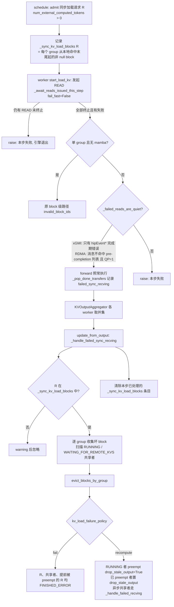

# PR #65923: [ROCm][MORI IO]Moriio hybrid load failure

> **Author**: @amd-weisun | **State**: OPEN | **Date**: 2026-11-05
> **Branch**: `amd-weisun:moriio-hybrid-load-failure` → `main` | **Labels**: rocm, cpu, kv-connector, mrv2, scheduler, kv-cache-manager
> **Changes**: +918 -73 lines across 17 files（含 #65690 的 12 个提交；本 PR 自身 9 个提交为 14 个文件 +530 -56）| **ROCm 相关性**: 部分相关（MoRIIO connector 为 ROCm 专属；scheduler / KVCacheManager / outputs / KV connector 基类 / MRv2 与 CPU worker 为全后端共享路径）
> 本报告分两部分：§1–6 为 PR 详细总结，§7–8 为 ROCm review 意见。

---

## 1. 总结 (Summary)

在有多个 KV cache group 的模型上（包括带 recurrent state 的 hybrid 模型，如 Kimi-Linear 的 KDA + MLA），同步 KV 加载（`load_kv_async=False`）失败时，main 上没有任何恢复通道：`invalid_block_ids` 在多 group 下直接 `RuntimeError`，`failed_recving` 只处理 `WAITING_FOR_REMOTE_KVS` 的异步请求。MoRIIO READ 模式是同步加载，因此一次 READ 失败会让 decode 引擎整体退出。本 PR 新增请求级字段 `KVConnectorTransferResults.failed_sync_recving` / `KVConnectorOutput.failed_sync_recving`：scheduler 在 admit 同步加载请求时记录该次加载写入的每个 group 的 block，失败上报后逐 group 从 prefix cache 驱逐这些 block，并按 `kv_load_failure_policy` 把该请求及共享这些 block 的请求 preempt 后重算或直接 fail。MoRIIO READ 侧只在“能证明 DMA 已停止”时才走请求级恢复，否则仍让本步失败。

## 2. 背景与动机 (Background & Motivation)

- 对应 ROCm/mori#759 的 gap 8：hybrid 模型上一次 MoRIIO READ 失败就会杀掉 decode 引擎（`MoRIIO hybrid READ failed ... HMA load-error recovery is unsupported`）。
- NIXL（#35264）和 Mooncake（#56855）对 hybrid 加载失败的做法是把整个请求放进 `failed_recving`，这依赖它们都是异步加载。MoRIIO WRITE 模式也是异步，已经走这条路。READ 模式是同步加载，失败被发现时请求已是 `RUNNING`、block 已进入 prefix cache、forward 已经用了不完整的 KV，因此需要单独的字段和处理流程。
- PR 叠在 #65690（READ 握手失败时只 fail 该握手的请求）之上。#65690 在多 group 布局下仍会 raise，本 PR 把这些 raise 改为上报 `failed_sync_recving`。
- 作者在描述中列出相关 PR：#56733（hybrid 同步失败的 preempt-and-evict 草稿，被本 PR 覆盖）、#53298（单 group block 级 rewind，同一 scheduler 区域）、#63336（MoRIIO 释放 block 前要求 DMA 停止）。okorzh-amd 另补充了 #54733、#42461 两个替代方案，以及与 #63855 的冲突。

## 3. 代码修改分析 (Code Change Analysis)

### 3.1 修改的模块

| 模块 | 改动（只列本 PR 自身提交，#65690 部分见 #65690 的 review） |
|------|------|
| `vllm/distributed/kv_transfer/kv_connector/v1/base.py` (+6) | `KVConnectorTransferResults.failed_sync_recving` 新字段及语义注释 |
| `vllm/v1/outputs.py` (+3) | `KVConnectorOutput.failed_sync_recving`，`is_empty()` 同步更新 |
| `vllm/distributed/kv_transfer/kv_connector/utils.py` (+3) | `KVOutputAggregator.aggregate` 对各 worker 的 `failed_sync_recving` 取并集（不需要所有 worker 都报告） |
| `vllm/distributed/kv_transfer/kv_connector/v1/multi_connector.py` (+1) | 转发子 connector 的 `failed_sync_recving` |
| `vllm/v1/worker/gpu/kv_connector.py`、`vllm/v1/worker/cpu/kv_connector.py` (+1/+1) | MRv2 与 CPU worker 把 transfer results 的新字段写入 `KVConnectorOutput` |
| `vllm/v1/core/kv_cache_manager.py` (+23) | `get_block_ids_from_token`（按每个 manager 的 block size 切片，排除 null block，cross-attn 不切）与 `evict_blocks_by_group`（经各 group 自己的 block pool 驱逐） |
| `vllm/v1/core/sched/scheduler.py` (+112 -1) | `_sync_kv_load_blocks` 字典；同步加载 admit 时记录；`update_from_output` 调用 `_handle_failed_sync_recving` 并在本步输出处理后清除记录；`_handle_invalid_blocks` 的报错文案更新 |
| `moriio/moriio_connector.py` (+83 -25) | `_failed_sync_recving` 集合；`_record_failed_recv` 与 `_fail_recv_without_read` 在多 group 下改报请求级失败；`_await_reads_issued_this_step` 统一 `fail_fast=False`，新增 `_failed_reads_are_quiet` 闸门与 `_qp_per_transfer`（读 `MORI_IO_QP_PER_TRANSFER`）；移除 eager handshake 在多 group 下的 `HandshakeError` |
| 测试（+170 scheduler 侧，moriio 侧约 +150） | `test_kv_load_failure_recovery.py` 新增 5 组多 group 同步失败用例；moriio 测试覆盖闸门、QP 环境变量覆盖与 `_record_failed_recv` 分支 |

### 3.2 架构 / 流程图



### 3.3 关键实现细节

- **记录时机**：`schedule()` 在 `num_external_computed_tokens > 0`（即同步加载）时调用 `get_block_ids_from_token(request_id, num_new_local_computed_tokens)`。起点之前的 mamba block 是 prefix-cache checkpoint，不算坏块；null block 排除，避免 SWA 请求被误判为共享。
- **清除时机**：`update_from_output` 在处理完失败后，删除 `_sync_kv_load_blocks` 中出现在本步 `num_scheduled_tokens` 里的条目（review 后改为只遍历待处理条目，而不是整个 batch）。
- **async scheduling 下的提前 preempt**：失败输出到达前，请求可能已被下一次 `schedule()` preempt。PR 对这类请求同样驱逐 block，并把 `drop_stale_output` 置真；fail 策略下直接 fail。我核对了 `defer_block_free`：consumer 侧且 `max_concurrent_batches > 1` 时它开启，提前 preempt 释放的 block 以 fence N 进入 deferred 队列，在 `update_from_output(N)` 开头才回到 pool，紧接着就执行失败处理，因此这些 block 不会在处理前被其他请求重新分配，共享扫描也不会误伤。
- **驱逐**：无论策略都会驱逐（单 group 的 `_handle_invalid_blocks` 在 recompute 下不驱逐，因为那里是原地重算；这里是整请求 preempt，需要驱逐）。
- **MoRIIO 闸门 `_failed_reads_are_quiet`**：xGMI 只有当所有失败消息都含 `hipEventSynchronize failed` / `hipEventQuery failed`（完成期失败）时才放行；RDMA 在失败消息不含 `_MORI_PRE_COMPLETION_FAILURES` 中任一子串且实际 QP 数为 1 时放行。`_qp_per_transfer` 复刻 mori `env::Override` 的语义：`MORI_IO_QP_PER_TRANSFER` 能解析为正整数时覆盖配置值（我核对了 mori v1.2.3.post1 `include/mori/io/env.hpp` 与 `src/io/rdma/backend_impl.cpp:1506`）。
- **握手失败**：`_fail_recv_without_read` 在多 group 下改报 `failed_sync_recving`，eager handshake 投票失败不再 raise `HandshakeError`。握手失败时没有发起 READ，因此总是可以恢复。

## 4. 涉及的技术原理 (Technical Principles)

- **同步与异步 KV 加载**：异步加载的请求停在 `WAITING_FOR_REMOTE_KVS`，KV 到齐后才进入 forward，失败时只需重置这个等待中的请求。同步加载在 admit 当步就进入 `RUNNING`，`start_load_kv` 在 forward 之前阻塞等待 READ 完成，加载失败时 forward 已经用上了不完整的 KV。block 在 allocate 时就进了 prefix cache，同步或下一步 admit 的请求可能已经命中这些坏 block。
- **多 KV cache group（HMA）**：full attention、SWA、mamba/linear attention 各自是一个 group，block ID 只在 group 内有意义，因此扁平的 `invalid_block_ids` 无法映射回请求。recurrent state 也不能从部分前缀续算，只能整请求重算。
- **RDMA 失败语义**：同一 QP 上第一个错误 CQE 之后，后续 WR 以 flush 状态完成，不会再发生 DMA；多 QP 时其他 QP 可能仍在写。在 post 阶段失败（`ibv_post_send` 部分成功、SQ 满、EP degraded、端口 down 或 async event）时，之前已 post 的 WR 可能仍在途。只有确认没有任何 DMA 还在写，释放这些 block 给其他请求才安全。
- **async scheduling 的 stale output**：step N 的输出到达前，step N+1 已经调度。被 preempt 的请求在途的输出需要 drain（`num_stale_output_tokens`），`drop_stale_output=True` 表示丢弃而不是投递这部分输出。

## 5. 评论区讨论亮点 (Discussion Highlights)

- **okorzh-amd（QP 数）**：原来的闸门只看 vLLM 自己的 `qp_per_transfer`，但 mori 会用 `MORI_IO_QP_PER_TRANSFER` 覆盖它，设置为 4 时闸门仍认为是 1，会在多 QP 仍可能写入时释放 block。作者改为复刻 `env::Override` 的解析，并补充了 `test_read_failure_gate_uses_the_qp_count_mori_runs`。我对照 mori v1.2.3.post1 核实，修复正确。
- **okorzh-amd（性能 nit）**：原实现每步都遍历整个 batch 来清除条目，作者已改为只遍历待处理条目。
- **okorzh-amd（关联 PR 梳理）**：#54733、#42461 是同一缺口的替代方案（两者也都向 `KVConnectorTransferResults` 加字段；若 #42461 也合入，会出现两条请求级同步失败通道）；#56733 被本 PR 覆盖；#53298 与本 PR 改同一 scheduler 区域和测试文件；#63855 会把 READ 推迟到后续 step，失败到达时 `_sync_kv_load_blocks` 条目已被清除，失败会被忽略（见 §7 第 2 条）。
- 作者在描述中明确提示：core 改动约 150 行，主要是 `_handle_failed_sync_recving`，希望 reviewer 重点看这部分。目前没有 core/scheduler maintainer 的 review。
- **与本批次其他 PR 的关系（本次核对）**：
  - **#65690**：本 PR 是它的 ancestor-stacked 后续，GitHub 上的 diff 包含 #65690 的全部 12 个提交。本 PR 撤销了 #65690 在 eager handshake 投票中为多 group 布局新增的 `HandshakeError`，因此必须先合入 #65690。
  - **#66008**：只改 moriio 文件，不碰 scheduler。我在临时 clone 中试合并，`moriio_connector.py` 有 3 处冲突、`test_moriio_tp_ack.py` 有 1 处。根源基本来自 #65690：它删除了 worker 的 `_reqs_to_send`，而 #66008 把这个字典复用为 READ lease 表。#65690 单独与 #66008 合并也有 4 处同类冲突。语义上，#66008 在 READ 发起时做最后一次 lease 续期，本 PR 失败时照常发送 release，两者没有逻辑矛盾。
  - **upstream/main**（2026-11-20）：本地试合并无冲突。但 mergify 在 11-19 仍报告冲突，需要作者 rebase 后确认。

## 6. 风险与潜在问题 (Risk Analysis)

| 风险 | 严重程度 | 说明 |
|------|---------|------|
| RDMA 闸门采用 pre-completion 消息的 denylist，遇到未知或新消息时会放行（fail-open） | Medium | 见 §7 ⚠️【正确性】denylist |
| scheduler 找不到记录时把失败当作 warning 忽略，请求继续在坏 KV 上运行 | Medium | 见 §7 ⚠️【设计】忽略路径；#63855 会放大这个问题 |
| 共享 scheduler / KVCacheManager 改动未经任何 CI，PR 描述残留占位符，diff 混入 #65690 | Medium | 见 §7 ⚠️【可维护性】 |
| 其他 connector（NIXL、Mooncake、LMCache、Offloading 等）回归 | Low | 不设置新字段时 `_handle_failed_sync_recving` 不会被调用；唯一新增开销是同步加载 admit 时记录 block（见 §7 📝【性能】） |
| 共享扫描只覆盖 RUNNING / WAITING_FOR_REMOTE_KVS | Low | 见 §7 📝【正确性】 |
| PP 下按 request id 记录可能被覆盖 | Low | 作者已在 Known limitations 中说明，MoRIIO 不受影响 |
| 测试覆盖缺口：aggregator 并集、MultiConnector 转发、异步共享者分支、`defer_block_free` 场景 | Low | 见 §7 📝【测试】 |
| 数值正确性 | Low | 作者报告恢复后首 token logprob 与直接 serve 一致（距离 0.0），以及 1273 个单测通过；这些结果来自作者本地，没有日志链接，`[unverified]` |

---

## 7. Review 意见 (Findings)

| 类型 | 🔴 | ⚠️ | 📝 |
|------|----|----|----|
| 正确性 | — | 1 | 1 |
| 设计 | — | 1 | — |
| 可维护性 | — | 1 | — |
| 性能 | — | — | 1 |
| 注释/文档 | — | — | 1 |
| 测试 | — | — | 1 |

总体评价：core 侧的机制是对的。按 group 和 pool 驱逐、排除 null block、跳过加载起点之前的 mamba checkpoint、提前被 preempt 的请求、stale output 的 drain 顺序，我都对照 scheduler 代码核对过，没有发现问题。`defer_block_free` 保证提前 preempt 释放的 block 在失败处理前不会被复用。MRv2、CPU worker、aggregator 和 MultiConnector 都转发了新字段，V1 runner 已不在 main 上，没有遗漏的出口。不设置新字段的 connector（NIXL、Mooncake、UMBP、Offloading 等）行为不变。没有能写出具体触发输入的阻塞级问题。下列意见集中在：MoRIIO 闸门的方向（fail-open）、core API 对“未知失败”的处理、CI 与 PR 卫生。

**⚠️【正确性】RDMA 闸门用 pre-completion 失败消息的 denylist 判断“DMA 已停止”，遇到未列出的消息会放行并释放可能仍在被写入的 block** `[已验证]`
- **问题**：`moriio_connector.py:557-564` 的 `_MORI_PRE_COMPLETION_FAILURES` 列出 6 个子串，`_failed_reads_are_quiet`（`:3248-3272`）在 RDMA 下只要失败消息不命中其中任何一个，且 QP 数为 1，就返回 True。xGMI 分支用的是 allowlist（只认 `hipEvent*` 完成期消息），RDMA 分支却反过来用 denylist。对照 mori 源码：(a) 当前 mori main（09aa23b）的 post 路径中，`"submission ledger is not initialized for signaled WR tracking"`（`src/io/rdma/common.cpp`，前面的 batch 可能已经 post）不在列表里；(b) `"verbs async event"` 和 `"... submission rejected"` 两条消息由 mori f8e3239（#670）引入，而这个提交不在 vLLM 固定的 v1.2.3.post1 中，说明这份列表跟随 mori 版本漂移；(c) 完成期失败的消息来自 `ibv_wc_status_str`（`CqeFailureAdvice`），是一个有限集合，适合做 allowlist。
- **影响**：触发条件是 RDMA、`qp_per_transfer=1`（默认）、hybrid 布局，且 mori 返回的 post 阶段失败消息不在列表中（mori 改了措辞、新增失败类型，或上面的 ledger 消息）。此时请求会被 preempt 或 fail，block 被释放并可能分配给其他请求，而已 post 的 WR 仍可能写入这些 block，造成其他请求的 KV 被静默破坏。这正是本 PR 想用闸门防止的情况，只是失败方向反了。
- **行动**：建议作者把 RDMA 分支改为 fail-closed：只有当每个失败消息都能识别为完成期失败（例如以 `ibv_wc_status_str` 的取值开头，像 xGMI 分支那样做 allowlist）时才放行，其余一律走 raise。或者至少在 mori 提供“完成期失败”标志（ROCm/mori#759 gap 1）之前，把 denylist 与固定的 mori 版本对齐，并加一个“未识别消息 → 不放行”的单测。

**⚠️【设计】core 中“没有同步加载记录”的失败被 warning 后忽略，请求继续在不完整的 KV 上运行（fail-open），而且 #63855 会让这条路径变成常态** `[已验证]`（#63855 的部分基于其 PR 描述）
- **问题**：`scheduler.py:3920-3927` 中，`failed_sync_recving` 里的请求如果不在 `_sync_kv_load_blocks` 中（加载不在本步，或本步已清除），只打一条 warning 就 `continue`，请求保持 RUNNING。作者在 Known limitations 中承认 MoRIIO 已有这种情况：hybrid READ 没有 external token、只读 recurrent state 时不会被记录。#63855 把握手未完成的 READ 停放到后续 step 再发起，这些 READ 的失败到达时条目已经被清除，会全部落入这条忽略路径（okorzh-amd 在评论中也指出了这一点）。
- **影响**：connector 明确报告“这个请求的 KV 是坏的”，core 却让请求继续生成，输出静默错误，只留下一条 warning。这是新公共 API 的默认语义，以后所有使用它的 connector 都会继承这个 fail-open 行为。
- **行动**：建议作者把“无记录”分支改为 fail-closed：如果请求仍然存活，按 `kv_load_failure_policy` 用它当前持有的全部 block 走同样的驱逐和 preempt/fail 流程，或者至少直接 fail。在 base.py 的字段注释中写明晚到的报告如何处理，并在 PR 中说明与 #63855 的合入顺序和适配方案。

**⚠️【可维护性】共享 scheduler / KVCacheManager 改动没有经过任何 CI；PR 描述有占位符残留；diff 混入了 #65690** `[已验证]`
- **问题**：CI 未运行（无 `ready` label，pre-run-check 失败，pre-commit 与 Buildkite 均被跳过）。DCO 通过。本 PR 改了 `scheduler.py`、`kv_cache_manager.py`、`outputs.py`、connector 基类，以及 MRv2 和 CPU worker，影响所有后端，但 `tests/v1/core/test_scheduler.py` 和 kv_connector 单测只在作者本地跑过（描述中的 “1273 passed” 无法溯源）。PR 描述中 `Stacked on #65690:` 后面是空的，验证表里还留着 `Unchanged from #<PR1>` 占位符。GitHub 上显示的 17 个文件 / +918 包含了 #65690 的 12 个提交。mergify 在 11-19 报告冲突（我本地对 2026-11-20 的 upstream/main 试合并无冲突）。
- **影响**：core reviewer 难以区分哪些改动属于本 PR；共享路径的回归只有 GPU CI 才能发现。
- **行动**：作者应当修正描述中的占位符，并写清楚 “review only commits after 6ac4157894”。#65690 合入后 rebase，请 maintainer 加 `ready` 跑一次 CPU/GPU 的 `tests/v1/core` 与 `tests/v1/kv_connector/unit`，并邀请 scheduler / KV cache manager 的 code owner review `_handle_failed_sync_recving`。

**📝【性能】所有同步加载的 connector 都要支付记录开销，但目前只有 MoRIIO 会读取这份记录** `[已验证]`
- **问题**：`scheduler.py:1615-1619` 对每个 `num_external_computed_tokens > 0` 的 admit 都调用 `get_block_ids_from_token`，为每个 group 构建一个 O(请求 block 数) 的列表。ExampleConnector、DecodeBenchConnector、LMCache 等同步加载的 connector，以及单 group 的 MoRIIO（仍走 `invalid_block_ids`）都会付这笔开销，`update_from_output` 每步还要遍历一次这个字典。
- **影响**：开销很小（只在 admit 时发生，没有 GPU 同步），但它与描述中“Connectors that do not set the field are unaffected”的说法不完全一致。
- **行动**：建议作者用 connector 的能力标志（例如 `reports_failed_sync_recving` 类属性）或 `len(kv_cache_groups) > 1` 来门控记录逻辑，或者在描述中如实说明这项开销。

**📝【正确性】共享扫描只覆盖 RUNNING 与 WAITING_FOR_REMOTE_KVS 两种状态** `[推测]`
- **问题**：`_handle_failed_sync_recving` 只检查这两种状态的请求。按 scheduler 自己的注释，暂停中的 streaming session（`WAITING_FOR_STREAMING_REQ`）仍持有 block；`kv_both` 角色下，已经结束但延迟释放 block、正在把 KV 发给远端的请求也持有 block。这两类请求如果命中了坏 prefix，不会被处理。
- **影响**：可达性未确认（需要 streaming 输入或 kv_both 与 READ hybrid 同时使用），一旦命中，就是坏 KV 被续用，或被发送到远端。
- **行动**：建议 review 时追问作者：这两类请求是否可能命中同步加载刚缓存的 block；如果可能，至少对它们执行 fail，或者在注释中说明为什么排除。

**📝【注释/文档】`failed_sync_recving` 的契约写的是 “recomputes the request from scratch”，对非 MoRIIO 的 connector 不一定成立** `[已验证]`
- **问题**：`base.py:100-105` 的注释承诺 scheduler 会从头重算请求。实际上请求被 preempt 后重新 admit 时，仍会调用 `get_num_new_matched_tokens`，MoRIIO 是因为已经清除了 `do_remote_prefill` 才不会再次远端加载。另外，“Report a request in the same step that loaded it” 是硬性要求（否则会走上一条的忽略路径），注释里没有说明违反这条要求的后果。
- **影响**：其他 connector 实现这个字段时可能会重复发起同一次失败的加载，或者在晚一步报告时失败被静默丢弃。
- **行动**：建议作者在注释中写明：重新 admit 时由 connector 决定是否再次加载；必须在同一步报告；晚到的报告会被如何处理。

**📝【测试】部分新代码路径缺少单测** `[已验证]`
- **问题**：新增的 scheduler 测试覆盖了单请求、共享 RUNNING 请求、无记录忽略、提前 preempt 和 DCP 切片。没有覆盖的有：`KVOutputAggregator` 对非 rank 0 worker 上报的 `failed_sync_recving` 取并集；`MultiConnector` 转发；共享者处于 `WAITING_FOR_REMOTE_KVS` 时走 `_handle_failed_recving` 的分支（两种策略）；`defer_block_free=True`（consumer 加 async scheduling）下提前 preempt 的 block 驱逐与不被复用。
- **影响**：多 TP 下只有一个 worker 失败是 MoRIIO 的主要场景，aggregator 的并集逻辑一旦回归就会让失败被静默丢弃。
- **行动**：建议作者为上述四点各补一个小单测。

## 8. 结论 (Verdict)

**⚠️ NEEDS WORK**

core 机制设计合理，按 group 驱逐、提前 preempt、stale output 的处理都经核对无误，对其他 connector 没有功能影响。合入前建议：把 MoRIIO RDMA 闸门改为 fail-closed（allowlist 完成期失败）；把 core 中“无记录”的失败从 warning 忽略改为 fail-closed，并说明与 #63855 如何配合；修正 PR 描述占位符，在 #65690 之后 rebase，跑通 CI，并请 scheduler owner review。

## 9. 英文 Review 评论 (Copy-Paste English Comments)

**C1** `vllm/distributed/kv_transfer/kv_connector/v1/moriio/moriio_connector.py:3248-3272` — ⚠️ comment

```text
On RDMA this gate fails open: any failure message that does not match _MORI_PRE_COMPLETION_FAILURES is treated as "DMA stopped" when QP=1, and the blocks are then freed for reuse. The list already drifts from MoRI: "verbs async event" and "submission rejected" come from mori #670, which is not in the pinned v1.2.3.post1. Current mori main also has another post-time error, "submission ledger is not initialized for signaled WR tracking", that the list does not match. The xGMI branch uses an allowlist. Could RDMA do the same, recovering only when every failed status carries a CQE status string (ibv_wc_status_str) and failing the step otherwise? A test with an unknown message would lock this in.
```

**C2** `vllm/v1/core/sched/scheduler.py:3920-3927` — ⚠️ comment

```text
When a reported failed_sync_recving request has no recorded load, it is only logged and keeps running on KV the connector just said is bad. That makes the new API fail-open by default. The PR already notes one MoRIIO case (a hybrid READ with no external tokens), and #63855 defers READs to later steps, so all of their failures would land here. Could this branch fail closed instead: if the request is still alive, evict its current blocks and preempt or fail it per kv_load_failure_policy, or at least fail it? Please also document in base.py what happens to a late report.
```

**C3** `vllm/v1/core/sched/scheduler.py:1615-1619` — comment

```text
This records blocks for every synchronous load, from any connector (ExampleConnector, LMCache, single-group MoRIIO, ...), even though only multi-group MoRIIO reads the record. The cost is small, an O(blocks) list per group at admission plus a dict walk per step, but it does not match "Connectors that do not set the field are unaffected". Would you gate it on a connector capability flag or on len(kv_cache_groups) > 1? Separately, could you add tests for KVOutputAggregator unioning failed_sync_recving from a non-zero rank, for MultiConnector forwarding, and for the WAITING_FOR_REMOTE_KVS sharer branch?
```

**C4** `vllm/distributed/kv_transfer/kv_connector/v1/base.py:100-105` — comment

```text
The contract says the scheduler "recomputes the request from scratch", but on re-admission the scheduler still calls get_num_new_matched_tokens. MoRIIO avoids reloading only because it has already cleared do_remote_prefill. Could you state that the connector decides whether to reload on re-admission, that the report must arrive in the same step as the load, and what happens otherwise? Also, the description still has the "#<PR1>" placeholder and an empty "Stacked on #65690:". Please say which commits to review.
```

## 10. 英文总结评论 (Overall Review Summary)

```text
The request-level channel for failed synchronous loads is well built. Per-group eviction, early preemption under async scheduling, and stale-output handling all check out, and connectors that don't set the field keep their behavior. Before merge: make the MoRIIO RDMA quiet-DMA gate fail closed, recovering only on recognized completion errors, since the denylist misses some post-time errors and drifts across MoRI versions. Make the scheduler fail closed for reports without a recorded load, and say how this works with #63855. Fix the description placeholders, rebase after #65690, and run CI with a scheduler owner reviewing. Changes needed before merge.
```
