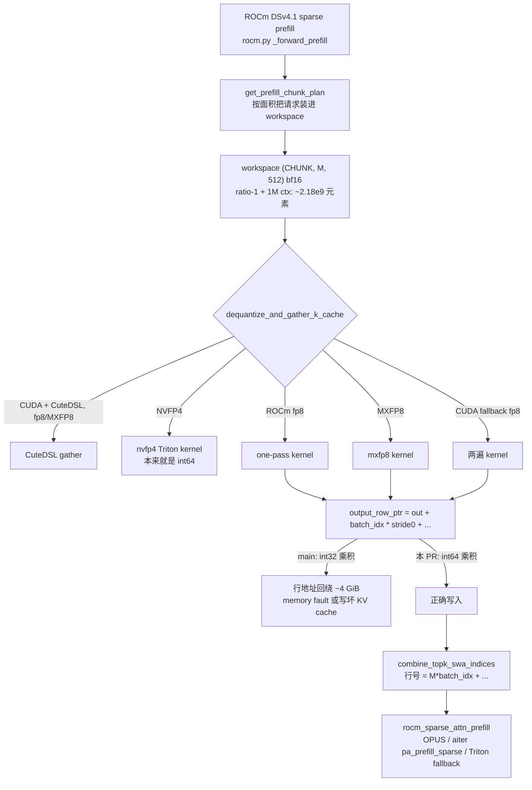

# PR #65926: [Bugfix][DSv4.1] Use int64 row offsets in the K-cache gather kernels

> **Author**: @tuukkjs | **State**: OPEN | **Date**: 2026-11-05
> **Branch**: `tuukkjs:fix/dsv41-gather-int64-offsets` → `main` | **Labels**: bug, deepseek
> **Changes**: +64 -3 lines across 2 files | **ROCm 相关性**: 完全相关（修改的是 CUDA/ROCm 共享的 Triton gather kernel，但在 CUDA 上 fp8/MXFP8 默认走 CuteDSL，这些 Triton kernel 只作为 fallback；ROCm 上 DSv4.1 的 sparse-MLA prefill 每次都走这里；问题在 MI355X 上复现）
> **CI**: 未获取（fetch 脚本没有拿到 check-run 详情，CI 状态未知）
> 本报告分两部分：§1–6 为 PR 详细总结，§7–8 为 ROCm review 意见。

---

## 1. 总结 (Summary)

DeepSeek-V4.1 的 K-cache dequant + gather Triton kernel（fp8 两遍版、fp8 one-pass 版、MXFP8 版）用 `batch_idx * out_stride0` 计算每个请求在 bf16 workspace 里的起始偏移。`batch_idx` 来自 `tl.program_id(0)`（int32），而 `out_stride0 < 2^31` 时 Triton 把它特化成 int32，所以乘积是 int32 运算。一旦一个 prefill chunk 的 workspace 超过 2^31 个元素，后面几个请求的行就会回绕到 workspace 前约 4 GiB 的地址上，在 MI355X 上表现为启动阶段 `HSA_STATUS_ERROR_MEMORY_FAULT`。本 PR 把三个 kernel 里的这一项改成 `batch_idx.to(tl.int64) * out_stride0`，并新增一个在独立进程里跑、写入超过 2^31 元素位置的回归测试。

## 2. 背景与动机 (Background & Motivation)

- 对应 issue #65925。复现：`DeepSeek-V4.1-Flash-1017`，8×MI355X，TP8，`VLLM_ROCM_USE_AITER=1`，DSpark `num_speculative_tokens=5` + `enable_adaptive_verification=true`。base 3/3 次启动在 adaptive cost profiling 阶段 memory fault；本 PR 2/2 次正常启动，GSM8K（250 题，5-shot）0.920，关掉 adaptive 的 base 为 0.932。
- **触发规模**：ROCm prefill 的 gather workspace 形状为 `(PREFILL_CHUNK_SIZE, M, 512)` bf16，`M = ceil(max_model_len / compress_ratio) + window_size + max_num_batched_tokens`（见 `vllm/models/deepseek_v41/amd/rocm.py:1260-1271`）。compress-ratio-1 的层在默认 1M `max_model_len` 下约 2.18e9 元素 > 2^31。adaptive verification 的启动 profile 会把 511 个 8K 上下文请求装进一个 chunk（`out=(511, 8335, 512)`），最后 7 个请求的行回绕。
- **普通流量也会命中**：作者用 host 端 shape 日志观测到，约 140 个以上请求共享一个 ~30K token 的缓存 prompt 时会产生 `(140, 30159, 512)` 的 chunk，回绕的行**落在了 KV cache 分配里**，在他们的运行中没有可见的输出变化。这意味着 main 上该 bug 不仅能导致崩溃，还可能**静默写坏 KV cache**，修复的价值高于"启动崩溃"本身。
- 另一位 reviewer（@frida-andersson）在 MI325X（gfx942）上独立验证：三个 case 在 main 上都 fault，本 PR 上都通过。
- mergify 在 11-07 报过 merge conflict；作者 11-09 已 rebase，我用当前 main（`2026-11-10 02:42 UTC`）做三方合并，**无冲突**。

## 3. 代码修改分析 (Code Change Analysis)

### 3.1 修改的模块

| 文件 | 改动 |
|------|------|
| `vllm/models/deepseek_v41/common/ops/cache_utils.py` | `_dequantize_and_gather_k_kernel`（:271-273）、`_dequantize_and_gather_k_one_pass_kernel`（:377-379）、`_dequantize_and_gather_k_mxfp8_kernel`（:468-470）三处 `output_row_ptr` 的 `batch_idx` 先转 int64 再乘 `out_stride0` |
| `tests/kernels/test_compressor_kv_cache.py` | 新增 `test_v41_gather_rows_past_int32_elements`（:588-639），参数化 `fp8 / fp8_one_pass / mxfp8`，用 `create_new_process_for_each_test("spawn")` 隔离 GPU fault |

### 3.2 架构 / 流程图



### 3.3 关键实现细节

- 只把 `batch_idx` 转 int64，`(offset + i) * out_stride1` 仍是 int32。这一项是安全的：`offset + i < out.shape[1]`，`out.shape[1] * out_stride1 ≤ out_stride0`（contiguous workspace 的 view）。若 `out_stride0 ≥ 2^31`，Triton 不会再把它特化成 int32，乘积会自动是 int64。
- `block_table_row_ptr = block_table_ptr + batch_idx * max_blocks_per_seq` 仍是 int32，但 block table 的大小远小于 2^31，不受影响。
- 下游消费者：`combine_topk_swa_indices` 产出的是**行号**（`M * batch_idx + ...`，最大约 4.3M），不是元素偏移；`rocm_sparse_attn_prefill` 的 vLLM Triton fallback 用 `_sparse_kv_row_offset`（`slot.to(tl.int64) * stride`），aiter `pa_prefill_sparse` 的 `_sparse_attn_prefill_kernel` 也用 `slot.to(tl.int64)`（本地已装的 aiter 中核对过）。gfx950 OPUS 路径是 C++ kernel，无法本地核对，但作者的端到端 511 请求 chunk 已经跑通。
- 测试构造：64 个请求，每个请求的行数 `rows = 2^31 // (63*512) + 1`，保证最后一个请求的起点超过 2^31 元素、单请求 stride 仍在 int32 内；所有请求 gather 同一个已缓存 block，断言最后一个请求的行与第一个请求逐位相等。`out` 约 4.4 GB。

## 4. 涉及的技术原理 (Technical Principles)

- **Triton 整数特化**：Triton 对标量整型参数按值特化，`< 2^31` 的 stride 会以 i32 传入，`tl.program_id` 也是 i32，两者相乘不会自动提升到 i64。对 >2 GiB 元素的张量，惯用做法是在乘之前 `.to(tl.int64)`，DSv4.1 的其它 kernel（如 `physical_block_idx.to(tl.int64) * block_stride`、`query_quant.py` 里的 `program_id(0).to(tl.int64)`）已经是这种写法。
- **ROCm prefill gather workspace**：DSv4.1 在 ROCm 上不是直接从 paged cache 做 sparse attention，而是先把每个请求的压缩 KV 行（前 `N` 行）和 SWA 窗口（后面的行）dequant 到 bf16 workspace，再用行号索引做 sparse prefill。compress-ratio-1 的层没有压缩，所以 `N ≈ max_model_len`，workspace 随上下文长度线性增长。
- **为什么只有部分配置会崩**：回绕后的地址是否被映射取决于 allocator 布局，所以 TP4 在作者的运行中能启动，而 TP8 稳定崩溃；未崩溃时写到别的分配上就是静默数据损坏。

## 5. 评论区讨论亮点 (Discussion Highlights)

- @frida-andersson 在 MI325X 上独立复现并确认修复："all three cases fault with `HSA_STATUS_ERROR_MEMORY_FAULT` on main (`a2bcb5657`) and pass with this PR (`08fea6c`). LGTM"。这补上了 PR 自身只在 gfx950 上验证的缺口。
- 后两个 commit 是对测试的调整：先把测试放进独立进程（GPU fault 会 abort 整个进程，影响同文件其它用例），再改成在所有平台上都用 `spawn`。
- 没有其它实质性讨论；Claude bot 因 fork PR 未运行。

## 6. 风险与潜在问题 (Risk Analysis)

| 风险 | 严重程度 | 说明 |
|------|---------|------|
| 正确性 | Low | 改动是纯粹的整型提升，小于 2^31 的偏移结果不变；下游消费者已核对为 int64 |
| 性能 | Low | 每行多一次 int64 乘法，作者未做 benchmark；相对 512 维 dequant 可忽略 |
| 兼容性 | Low | CUDA fp8/MXFP8 默认走 CuteDSL，不受影响；NVFP4 本来就是 int64 |
| 测试覆盖 | Low | 新测试能在修复前失败、修复后通过（作者有前后对比），已在 AMD CI 的 kernels 步骤里 |
| 可维护性 | Low | DSv4.0 的同名 kernel 仍是 int32，见 §7 |

---

## 7. Review 意见 (Findings)

> 说明：本次执行 PR 代码被权限策略拒绝，所有结论均基于静态阅读和对 aiter 已安装源码的核对，没有在本地跑测试。

| 意见类型 | 数量 |
|---------|------|
| 📝 建议/备注 | 3 |

**📝【可维护性】DSv4.0 的同一组 gather kernel 仍用 int32 计算行偏移** `[已验证]`
- **问题**：`vllm/models/deepseek_v4/common/ops/cache_utils.py:317-319` 仍是 `out_ptr + batch_idx * out_stride0 + ...`。作者的理由是 DSv4.0 没有 compress-ratio-1 层，正常配置下 workspace 小于 2^31 元素。按 `(4, M, 512)` 估算，ratio-4 层在 1M 上下文下约 5.5e8 元素，确实有余量；要溢出需要 `max_num_batched_tokens` 达到约 78 万这种不常见的配置。
- **影响**：目前不会触发，但两份几乎一样的 kernel 已经分叉，将来有人调大 chunk 或 workspace 时容易重新踩坑。
- **行动**：建议作者在 DSv4.0 的同一行也做同样的一行改动（代价同样可以忽略），或者至少在 PR 描述里说明为什么不改。这不阻塞合入。

**📝【注释/文档】静默写坏 KV cache 的场景值得在 PR 描述的开头强调** `[已验证]`
- **问题**：PR 描述的 Overview 只提到启动崩溃；"约 140 个共享前缀请求时回绕行落在 KV cache 分配里"这一点在 Details 末尾。
- **影响**：读者可能低估这个修复的优先级。对于 1M 上下文 + prefix caching 的 ROCm 部署，main 上可能存在没有报错的 KV 损坏。
- **行动**：建议作者把这一点挪到 Overview，方便维护者判断是否需要进入 release 或 backport。

**📝【测试】测试只校验了最后一个请求的前 64 行，没有校验 workspace 之外是否被写** `[已验证]`
- **问题**：测试只断言 `out[-1, :block_size] == out[0, :block_size]`（`test_compressor_kv_cache.py:637-639`）。
- **影响**：对于本次回归已经足够：修复前最后一个请求的行保持全 0，断言失败；回绕写入通常还会触发 memory fault。没有更多风险。
- **行动**：无需修改；这里只是记录这个测试的检测能力边界。

## 8. 结论 (Verdict)

✅ **LGTM**。根因定位准确（有 `AMD_SERIALIZE_KERNEL=3` 的 dispatch 日志佐证），修复是最小且正确的整型提升，覆盖了全部三个 int32 kernel；下游消费者已是 int64；有能在修复前失败的回归测试，并有 gfx942 上的独立验证；与当前 main 无冲突。剩下的只是 DSv4.0 同款 kernel 的防御性对齐建议。

## 9. 英文 Review 评论 (Copy-Paste English Comments)

**C1** `vllm/models/deepseek_v41/common/ops/cache_utils.py:271-273` — 📝 comment

```text
LGTM. Widening batch_idx before the multiply is the right fix: (offset + i) * out_stride1 stays below out_stride0 for the contiguous workspace view, and the downstream sparse-prefill consumers (the in-tree Triton fallback and aiter pa_prefill_sparse) already compute row offsets in int64, so nothing after the gather wraps.
One small follow-up: vllm/models/deepseek_v4/common/ops/cache_utils.py:317-319 still has the same int32 `batch_idx * out_stride0` expression. I agree DSv4.0's workspace stays below 2^31 elements at normal settings, but since the two copies are otherwise identical, would you consider applying the same one-line change there too, so they don't drift apart and a future workspace-size change cannot reintroduce this?
```

**C2** `vllm/models/deepseek_v41/common/ops/cache_utils.py:377-379` — 📝 comment

```text
The prefix-caching case in the Details section (a ~140-request burst sharing a ~30K-token prompt, where the wrapped rows landed in the KV-cache allocation with no visible error) seems more important than the startup crash: on main it means silent KV-cache corruption for 1M-context ROCm deployments with prefix caching. Could you move that to the Overview, so maintainers can weigh it for the next release?
```

## 10. 英文总结评论 (Overall Review Summary)

```text
Thanks for tracking this down; the dispatch log pins the root cause, and widening the row offset to int64 in all three DSv4.1 gather kernels is the minimal, correct fix. Downstream consumers already use int64, and the new regression test fails before the fix. Two optional follow-ups: apply the same one-line change to the identical DSv4.0 copy in deepseek_v4 cache_utils.py so the twins don't drift, and move the silent prefix-caching KV corruption case into the Overview, since it matters more than the startup crash. LGTM.
```
