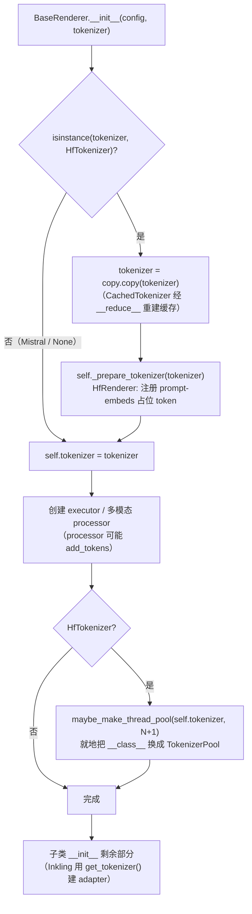
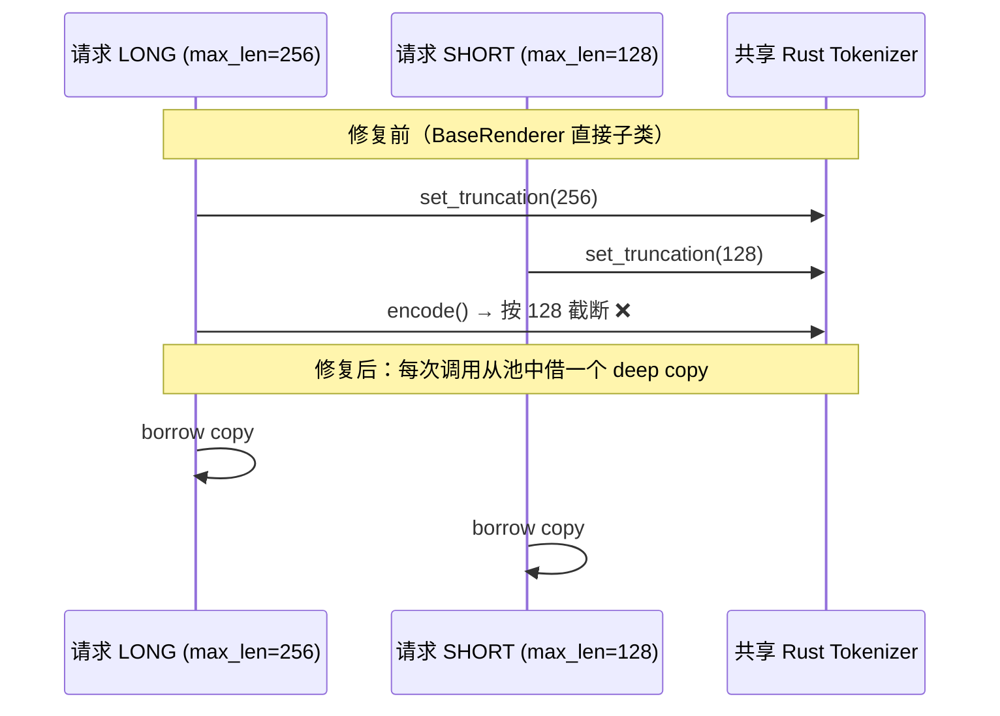

# PR #65932: [Bugfix][Frontend] Pool HF fast tokenizers in BaseRenderer so concurrent truncation stays per request

> **Author**: @haishuok0525 | **State**: MERGED（2026-11-12，squash 为 `cfe069c9e2`） | **Date**: 2026-11-05
> **Branch**: `fix-renderer-tokenizer-pool` → `main` | **Labels**: bug, ready, verified, kimi
> **Changes**: +244 -15 lines across 4 files | **ROCm 相关性**: 不相关（平台无关的前端 renderer 代码；作者在 MI300 上做验证，且 DeepSeek V4/V4.1 renderer 是 AMD 上的重点服务路径，但改动本身不涉及任何 ROCm 代码）
> 本报告分两部分：§1–6 为 PR 详细总结，§7–8 为 review 意见。

---

## 1. 总结 (Summary)

`HfRenderer` 早就为每个 renderer worker 准备了一份独立的 tokenizer 副本（`maybe_make_thread_pool`），但直接继承 `BaseRenderer` 的 renderer（Cohere、DeepSeek V3.2、DeepSeek V4/V4.1、Inkling、Kimi K3）一直共用同一个 HF fast tokenizer。`--renderer-num-workers > 1` 时，并发请求的 `truncate_prompt_tokens` 会互相覆盖，请求会被**静默**截断到别的请求的长度。本 PR 把"复制 + 池化"挪进 `BaseRenderer.__init__`，让所有 renderer 都有这层保护；`HfRenderer` 只保留一个 `_prepare_tokenizer` 钩子来注册 prompt-embeds 占位 token。另外修了 Kimi K3 的原生 chat 模板检查：tokenizer 被池化后，这个检查会被绕过。

## 2. 背景与动机 (Background & Motivation)

- 相关 issue #64034。之前的 #64036 和 #64412 被关闭，理由是 `tokenizers >= 0.23.2` 已经不再抛 `RuntimeError: Already borrowed`。
- 作者指出：报错消失不代表竞态消失。在当前支持的依赖版本（transformers 5.22.0、tokenizers 0.23.3）上，竞态还在，只是从"抛异常"变成了"返回错误的 token 数"，因此更难发现。
- 作者给出的数据（来自 PR 描述，本 review 没有复现）：
  - 端到端 `vllm serve`，2000 个请求 × 并发 64：`deepseek_v32` 模式在 main 上分别有 3 个和 11 个请求截断错误，本 PR 为 0；`kimi_k3` 模式在 main 上分别为 5 和 0，本 PR 为 0；`HfRenderer`（对照组）始终为 0。
  - renderer 级压测：DeepseekV32/KimiK3 Renderer 有 316–357 / 2000 个请求出错，耗时 9.4–10.2 s；本 PR 之后为 0 个错误，耗时 2.6–3.2 s，约快 3.6 倍（原因是不再争用同一个 backend）。

## 3. 代码修改分析 (Code Change Analysis)

### 3.1 修改的模块

| 文件 | 改动 |
|------|------|
| `vllm/renderers/base.py` (+24) | `__init__` 开头：对 `HfTokenizer` 先 `copy.copy`，再调用 `_prepare_tokenizer` 钩子；`__init__` 末尾（多模态 processor 创建之后）调用 `maybe_make_thread_pool(tokenizer, renderer_num_workers + 1)`；新增空的 `_prepare_tokenizer` 钩子 |
| `vllm/renderers/hf.py` (+5 -13) | 删掉 `HfRenderer.__init__` 里自己做的 copy、占位 token 注册和池化；改为重写 `_prepare_tokenizer`，在 `enable_prompt_embeds` 时注册占位 token |
| `vllm/renderers/kimi_k3.py` (+9 -2) | `_apply_chat_template` 判断"是否原生 chat encoding"时，如果 tokenizer 已被池化（`ThreadSafeHFTokenizerMixin`），改为检查 `__bases__[0]`，也就是被包装的那个类 |
| `tests/renderers/test_tokenizer_pool.py` (+206) | 新增回归测试，共 5 个用例，3 个按 7 种 renderer 参数化 |

### 3.2 架构 / 流程图





### 3.3 关键实现细节

- **执行顺序是本 PR 的关键**，经过 claude[bot] 三轮指出问题后才定下来：先 copy → 再执行 `_prepare_tokenizer` → 中间创建 MM processor → 最后才池化。
  - 池化必须放在最后。MOSS-Audio 之类的模型会在创建 processor 时 `add_tokens`，而 `add_tokens` 不经过池，只改外层对象；池化放在最后，这些新 token 才会被 deep copy 进池里。
  - prompt-embeds 占位 token 要在 copy **之后**、池化之前注册。`CachedTokenizer` 的 `max_token_id` 在 `copy.copy` 重建时就算好了，所以不包含占位 id，越界检查仍然能拦住用户传入的占位 id。池化又是就地换 `__class__`，对象身份不变，`_PROMPT_EMBEDS_PLACEHOLDER_TOKEN_ID_CACHE`（WeakKeyDictionary）在请求时仍能命中。
- `maybe_make_thread_pool` 只处理 `TokenizersBackend`，已经池化过的会跳过；`PythonBackend`、`MistralTokenizer` 和 `skip_tokenizer_init=True` 都不受影响。
- 池里放 `renderer_num_workers + 1` 份 deep copy，与原来 `HfRenderer` 的大小一致。池空时会临时再 deep copy 一份，不会阻塞。
- Kimi K3：`TokenizerPool` 重写了 `apply_chat_template` 来把调用转发到池中副本，导致 `type(tokenizer).apply_chat_template is PreTrainedTokenizerBase.apply_chat_template` 永远为假，"必须使用原生 chat encoding"的校验失效。这个问题是 CI（`computer-cpu-reasoning-plus-renderers`）在与 #66257 交互时暴露的。修法是取 `__bases__[0]`，即被包装的类。
- Cohere renderer 自己还会再 `copy.copy` 一次，这是多余的，但不影响正确性。

## 4. 涉及的技术原理 (Technical Principles)

- **HF fast tokenizer 的截断是有状态的**：`TokenizersBackend._batch_encode_plus` 先调用 `set_truncation_and_padding(...)`，把 `max_length` 写进 Rust `Tokenizer` 对象，再调用 `encode`。这是两次独立调用，不是原子操作。tokenizers 0.23.2 之后 backend 改成了 `RwLock`，不再报 "Already borrowed"，但两次调用之间仍可能被别的线程插入，覆盖掉截断设置。
- **池化方式（`maybe_make_thread_pool`）**：用动态子类 `TokenizerPool` 就地替换 `tokenizer.__class__`，把公开的编码、解码和 chat 模板方法都改成"从 `queue.Queue` 借一份 deep copy → 调用 → 归还"。可变操作（`add_tokens`、`add_special_tokens`）和 `_tokenizer` 属性**不**经过这个池，所以池化后的修改到不了池中副本，这也是执行顺序那么重要的原因。
- **renderer 线程池**：`BaseRenderer._executor` 有 `renderer_num_workers` 个线程，异步的 tokenize / detokenize / chat 模板都在这里跑。默认值是 1，只有显式调大时才会触发并发竞态。
- **`CachedTokenizer` 与 `copy.copy`**：`get_cached_tokenizer` 生成的子类定义了 `__reduce__`，所以 `copy.copy` 会重新调用 `get_cached_tokenizer`，重新快照 `vocab`、`len` 和 `max_token_id`。`TokenizersBackend` 本身没有 `__copy__`，这是浅拷贝，Rust backend 对象仍是共享的（已在 transformers 5.22.0 上核实）。

## 5. 评论区讨论亮点 (Discussion Highlights)

- **@noooop**：建议把重复的复制和池化代码挪到 `BaseRenderer.__init__` 开头统一处理。作者照做（a1c505e），并引入了 `_prepare_tokenizer` 钩子。
- **claude[bot] 一共指出三个由执行顺序引起的回归，作者都确认并修复了：**
  1. 🟡 prompt-embeds 占位 token 的 id 缓存挂在 HfRenderer 自己的 copy 上；BaseRenderer 再 copy 一次后缓存查不到，于是第一个 chat 请求会在 live tokenizer 上重新执行 `add_special_tokens`。修复：bea254e，后来改由 2dd96a4 一并解决。
  2. 🔴 占位 token 先加进 backend，然后 `copy.copy` 重建 `CachedTokenizer`，导致 `max_token_id` 把占位 id 算了进去。用户可以直接传这个 id 绕过越界检查，例如 SmolVLM：49280 vs 49279。修复：2dd96a4，并新增 `test_prompt_embeds_placeholder_stays_out_of_vocabulary`。
  3. 🔴 池化放在 `create_processor` 之前，MOSS-Audio 加的音频占位 token 进不了池中副本。修复：bdc82af，把池化移到 `__init__` 末尾，并新增 `test_tokens_added_by_mm_processor_reach_pooled_tokenizer`。
- **作者自查**：发现与 #66257 的交互导致 Kimi K3 原生模板检查失效，CI 也暴露了这个问题，修复于 7e8f70b1。其余 CI 红灯（B200 `Address already in use`、H100 NVFP4 数值、H200 OCR、CPU offloading 阈值）作者逐一说明与 renderer 无关。
- **结果**：claude[bot] 最终复审 "no new bugs"，@noooop 批准后合入。

## 6. 风险与潜在问题 (Risk Analysis)

| 风险 | 严重程度 | 说明 |
|------|---------|------|
| 正确性：init 之后修改 tokenizer 到不了池 | 低 | 这是钩子约定（docstring 已写明）。已核对：现有直接子类在 `super().__init__` 之后都不修改 tokenizer |
| 正确性：Kimi K3 依赖 `__bases__[0]` | 低 | 取决于 `TokenizerPool` 的基类顺序，见 §7 备注 |
| 性能 / 内存 | 低 | DSv3.2/V4/V4.1、Kimi K3、Inkling、Cohere 现在各持有 N+1 份 tokenizer deep copy（默认 N=1，即 2 份），与 HfRenderer 一致；多 API server 进程时按进程数线性增加。作者实测吞吐提升约 3.6 倍 |
| 兼容性 | 低 | 只影响 `TokenizersBackend`；Mistral 和 `PythonBackend` 不受影响 |
| 测试覆盖 | 低 | 7 种 renderer × 竞态、MM add_tokens、占位 token 三类场景都有覆盖；竞态测试用 Event 固定执行顺序，不依赖 sleep |
| 可维护性 | 低 | 执行顺序的约束只写在注释里，以后新增子类时容易踩坑 |

---

## 7. Review 意见 (Findings)

非 ROCm 相关，已跳过 ROCm 专项规则，只做通用检查（文档、测试、可维护性）。另外核实了共享 renderer 代码的正确性：执行顺序、`CachedTokenizer` 重建、各直接子类在 `super().__init__` 之后的行为都没有发现问题。

| 意见类型 | 数量 |
|---------|------|
| 📝【可维护性】 | 1 |
| 📝【注释/文档】 | 2 |

**📝【可维护性】Kimi K3 用 `tokenizer_cls.__bases__[0]` 找被包装的类，依赖 `TokenizerPool` 的基类顺序** `[已验证]`
- **问题**：`vllm/renderers/kimi_k3.py:174-180` 默认 `TokenizerPool(tokenizer.__class__, ThreadSafeHFTokenizerMixin)` 的第一个基类就是被包装的类。这个约定定义在 `vllm/tokenizers/hf.py` 的 `maybe_make_thread_pool` 里，两处之间没有任何显式关联。目前全仓库只有这一处这样用。
- **影响**：如果以后有人调整 `TokenizerPool` 的基类顺序，或者在外面再包一层，`__bases__[0]` 会变成 mixin 或者其他类，"必须原生 chat encoding"的校验就会静默失效（这次 CI 正是这样暴露问题的）。当前代码行为正确。
- **行动**：建议作者（或后续 PR）在 `tokenizers/hf.py` 里暴露一个小 helper，例如在 `TokenizerPool` 上记录 `_wrapped_cls`，或提供 `unwrap_tokenizer_class()`，让调用方不必依赖基类顺序。

**📝【注释/文档】PR 描述（即 squash commit message）没有覆盖最终实现的两处改动** `[已验证]`
- **问题**：
  - 描述 Details 段写的是"在 `__init__` 末尾对 shallow copy 池化"，没有提 `_prepare_tokenizer` 钩子。实际上，copy 在 `__init__` 开头，钩子紧随其后，池化在末尾。
  - 描述完全没有提 `kimi_k3.py` 的改动（为修复与 #66257 的交互而加）。
  - Validation 里的数据是早期 head 测的，之后又经过了 4 轮执行顺序调整。作者在评论里说明过"same results"，但描述正文没有更新。
- **影响**：PR 已经合并，squash 后的 commit message 会误导以后翻 `git log` 的人，尤其是 Kimi K3 那处看起来和标题无关的改动。
- **行动**：已合并，无需返工。如果有后续 PR（例如上一条的 helper），建议在描述里补上一句说明。

**📝【注释/文档】`base.py:120` 注释"cached tokenizer is never modified"只对类替换成立** `[已验证]`
- **问题**：`copy.copy` 对 `TokenizersBackend` 是浅拷贝（transformers 5.22.0 没有定义 `__copy__`），Rust `_tokenizer` 仍与调用方传入的 cached tokenizer 共享。所以 `_prepare_tokenizer` 注册占位 token、MM processor 调 `add_tokens` 时，仍会改动原 cached tokenizer 的 backend。注释真正能保证的只是"原对象的 `__class__` 不会被换成 `TokenizerPool`"。
- **影响**：不是本 PR 引入的回归：HfRenderer 原来就是这样，直接子类以前更是直接改原对象。但这条注释会让后来的人以为可以放心在 `_prepare_tokenizer` 里做任意修改。
- **行动**：建议把注释改得更准确，例如 "so pooling never swaps the class of the cached tokenizer passed in; the backend is still shared"。

## 8. 结论 (Verdict)

✅ **LGTM**（已合并）。根因分析准确，修复方式就是复用 `HfRenderer` 已经验证过的池化机制，执行顺序在三轮 bot review 后也是正确的。回归测试用 Event 固定竞态顺序，在 main 上能确定性复现失败。剩下的只有一处可维护性改进和两处文档/注释的准确性问题，都不阻塞合入。

## 9. 英文 Review 评论 (Copy-Paste English Comments)

**C1** `vllm/renderers/kimi_k3.py:174-180` — ⚠️ comment

```text
This works today, but it relies on TokenizerPool listing the wrapped class as its first base, which is defined in vllm/tokenizers/hf.py and not referenced here. If the pool's bases are ever reordered or another wrapper is layered on top, __bases__[0] stops being the real tokenizer class and the native-chat-encoding check silently passes again, which is exactly how CI caught this. Consider recording the wrapped class on TokenizerPool (e.g. a `_wrapped_cls` attribute) or adding a small `unwrap_tokenizer_class()` helper in tokenizers/hf.py, and using it here.
```

**C2** `vllm/renderers/base.py:120-123` — ⚠️ comment

```text
Small precision note on this comment: copy.copy is a shallow copy for TokenizersBackend (no __copy__ in transformers 5.22.0), so the Rust backend is still shared with the cached tokenizer. Tokens added in _prepare_tokenizer or by a multimodal processor therefore still reach the caller's tokenizer; what the copy guarantees is that pooling never swaps the caller's __class__. This matches the previous HfRenderer behavior, so it is not a regression, but could you reword the comment so future _prepare_tokenizer overrides do not assume full isolation?
```

## 10. 英文总结评论 (Overall Review Summary)

```text
Nice fix. Moving the per-worker tokenizer pool into BaseRenderer gives every HF-backed renderer per-request truncation, and the final ordering (copy, prepare hook, multimodal processor, then pool) keeps the prompt-embeds placeholder out of the vocabulary and lets processor-added tokens reach the pooled copies. The event-ordered regression test reproduces the race deterministically. Two optional follow-ups: replace the Kimi K3 __bases__[0] lookup with an explicit unwrap helper in tokenizers/hf.py, and clarify that the copy in BaseRenderer is shallow, so the backend is still shared. Approve.
```
