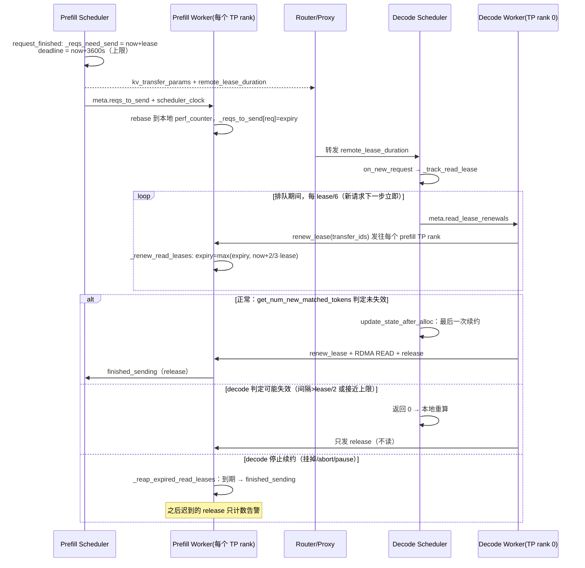

# PR #66008: [Bugfix][MoRIIO] Let decode renew READ block leases on prefill

> **Author**: @amirakb89 | **State**: OPEN | **Date**: 2026-11-05
> **Branch**: `fix/moriio-read-block-lease` → `main` | **Labels**: bug, documentation, kv-connector, needs-rebase
> **Changes**: +787 -43 lines across 9 files | **ROCm 相关性**: 完全相关（MoRIIO KV connector，ROCm/MORI 专属的 PD 分离传输路径）
> 本报告分两部分：§1–6 为 PR 详细总结，§7–8 为 ROCm review 意见。

---

## 1. 总结 (Summary)

MoRIIO READ（PULL）模式下，prefill 在请求结束 `defer_timeout`（默认 60 s）后就会释放该请求的 KV block，不管 decode 有没有读完。如果请求在 decode 的等待队列里排了更久，decode 会去读已经被 prefill 复用的 block，输出静默出错。本 PR 参考 NIXL 的 KV lease 设计，把这个固定超时改成由 decode 续约的租约：prefill 在 `kv_transfer_params` 中声明 `remote_lease_duration`，decode 从 `on_new_request` 开始每 `lease/6` 续约一次（每次续到 2/3 个 lease），分配时再发最后一次续约以覆盖读取；租约过期由 prefill worker 释放 block，scheduler 侧只保留 1 h 的上限。decode 侧判断租约可能已失效时（续约间隔 > lease/2，或接近 1 h 上限）改为本地重算，只向 prefill 发 release。

## 2. 背景与动机 (Background & Motivation)

- 对应 ROCm/mori#759 的 Gap 2（READ block 被提前释放）和 Gap 9（prefill worker 的 `_reqs_to_send` 在 main 上从未被填充）。在 main 上，READ prefill 的 scheduler 在 `request_finished` 后 `monotonic + defer_timeout` 就把 deferred send 回收，相当于"60 s 内不读就丢"。
- decode 端排队时间超过 60 s 在高负载下并不罕见（decode KV 满、`--max-num-seqs` 受限、pause 等）。一旦超时，prefill 释放的 block 会被新的 prefill 请求覆盖，decode 随后的 RDMA READ 读到别人的 KV，且没有任何报错。
- 作者用 2×8 MI355X + Pollara 400 RoCE 复现：`defer_timeout=6`、prefill 限 256 block、decode `--max-num-seqs 1`，main 上 4 个请求里 1 个输出 mismatch，本 PR TP=1/TP=2 全部 match。作者明确说明 GPU 实验跑在 review-fix 提交（paused decode、lapse check、first renewal）之前，这几处只有单测覆盖。
- 设计参考 NIXL 的 `nixl_kv_cache_lease.md`（续约到 2/3 lease、每 lease/6 续约一次）。相关 PR：#56465（另一种做法：持有 block 直到 ACK、不续约，作者和 okorzh-amd 都标为 ALTERNATIVE）、#64785（MoRIIO 指标，冲突）、#64574（按 owner TP size 算端口偏移，与续约公式一致）。

## 3. 代码修改分析 (Code Change Analysis)

### 3.1 修改的模块

| 文件 | 改动 |
|------|------|
| `moriio/moriio_connector.py` (+289 -24) | Scheduler：decode 侧 `_track_read_lease` / `_read_lease_has_lapsed` / `_package_read_lease_renewals`、lapsed 请求只 release 不读；prefill 侧 `request_finished` 返回 `remote_lease_duration`，READ 的 scheduler deadline 改为 1 h 上限；`has_pending_push_work` 对 READ 只看本步 final renewal。Worker：prefill 侧 `_renew_read_leases` / `_reap_expired_read_leases`、按 scheduler 时钟 rebase `_reqs_to_send`、过期后迟到的 release 只计数不再上报；decode 侧 TP rank 0 的 `_send_read_lease_renewals` |
| `moriio/moriio_engine.py` (+49 -11) | `MoRIIOWrapper` 新增 `renew_lease` 消息处理（非 producer 或格式错误时只告警，不让 listener 退出）、`send_lease_renewal`（`zmq.NOBLOCK`，失败 `warning_once`）、`pop_renewed_lease_transfer_ids`；抽出 `_notify_socket` |
| `moriio/moriio_common.py` (+30 -4) | 新常量 `READ_LEASE_RENEWALS_PER_LEASE=6`、`READ_LEASE_EXTENSION_FRACTION=2/3`；新 `ReadLeaseTarget`（frozen dataclass，作 dict key）；metadata 新增 `scheduler_clock`、`read_lease_renewals` |
| `examples/.../moriio_toy_proxy_server.py` (+5) | 把 prefill 返回的 `remote_lease_duration` 转发给 decode |
| `docs/features/moriio_connector_usage.md` (+1 -1) | READ 模式 notify_port 用途中加入 lease 说明、路由器必须转发该字段 |
| `tests/.../test_moriio_read_lease.py`（新增 386 行） | 14 个用例：过期释放、release 释放、1 h 上限、续约节奏、pause 后本地重算、lapse 不被续约"复活"、abort 停止续约、TP rank 0 向每个 prefill TP rank 续约等 |
| `tests/.../test_moriio_{connector,hma_scheduler,tp_ack}.py` | fake wrapper / fake scheduler 补齐新属性 |

### 3.2 架构 / 流程图

租约生命周期（正常路径 + 失效路径）：



### 3.3 关键实现细节

- **时钟域**：scheduler 用 `perf_counter` 记录 `now + defer_timeout`，worker 在 `start_load_kv` 里用 `worker_now - metadata.scheduler_clock` 做 rebase，避免跨节点 TP worker 的 `perf_counter` 不同源；scheduler 上限仍用 `monotonic`。
- **续约节奏**：`_package_read_lease_renewals` 用全局 `_last_read_lease_renewal`，按所有 tracked lease 的最小 duration 计算间隔；新加入的请求放在 `_unrenewed_read_leases`，下一步立即续约（因为 prefill 的 lease 从 `request_finished` 开始计，admission 延迟会吃掉一部分）。每次续约前先 `_read_lease_has_lapsed`，已失效的不再续约（80a6e36 修复的"pause 后续约复活"问题）。
- **失效判定**（decode 侧，`_read_lease_has_lapsed`）：`renewal_gap < lease·(2/3 − 1/6) = lease/2` 且 `held < 3600 − min(lease, 1800)` 才认为安全。prefill 每次续约延长 `2/3·lease`，所以 decode 留了 `lease/6` 的余量给最后一次续约和读取。
- **端口路由**：续约发往 `notify_port + get_port_offset(remote_dp_rank, tp_rank, remote_tp_size)`，与现有 `_read_blocks` 里 release 的端口计算一致（同样未做 `fold_local_rank`，所以多 pod 行为也与 release 一致）。prefill 的 notify listener 会通过 `_forward_to_stages` 把消息转给后续 PP stage，因此 PP>1 也能收到续约。
- **兼容**：只有 prefill 声明了 `remote_lease_duration` 才续约（旧 prefill 的 listener 遇到未知消息类型会抛 `MoRIIOError` 导致线程退出）。旧 decode / 路由器丢字段时，prefill worker 仍在 `defer_timeout` 后释放，行为等同 main。
- **pause**：`has_pending_push_work` 对 READ 只看 `_final_read_lease_renewals`，排队请求不再让引擎保持忙碌，所以 pause / sleep / checkpoint_prepare 能完成；暂停期间不续约，恢复后靠失效判定转为本地重算。

## 4. 涉及的技术原理 (Technical Principles)

- **PD 分离 READ（PULL）模式**：prefill 算完 KV 后保留 block，把 block id 通过 `kv_transfer_params` 交给 decode；decode 分配本地 block 后用 RDMA READ 从 prefill 显存拉取，读完再通过 ZMQ notify 发 release，prefill 收到后释放 block。block 的生命周期跨两个独立调度器，必须有超时兜底，也必须保证兜底不早于读取。
- **租约（lease）**：分布式系统中"持有者定期续约、过期自动回收"的经典模式。它解决的是"对端挂掉时资源不泄漏"与"对端还活着时资源不被提前回收"的矛盾。安全性取决于两侧对过期时间的判断：续约方必须比被续约方更保守（本 PR 中 decode 认为 lease/2 后可能失效，而 prefill 每次续到 2/3 lease 后才回收）。
- **静默数据损坏**：RDMA READ 只按 (address, length) 读远端显存，不校验内容属于哪个请求。block 被复用后读出的是别的 prompt 的 KV，模型照常生成，输出看起来合法但答非所问，所以这类 bug 只能靠生命周期协议防住。
- **ZMQ DEALER + NOBLOCK**：DEALER 在 connect 后会在本地排队消息直到达到 HWM；`NOBLOCK` 时达到 HWM 会抛 `EAGAIN`。续约是 fire-and-forget，没有 ACK，decode 只知道"我发了"，不知道"prefill 收到了"。

## 5. 评论区讨论亮点 (Discussion Highlights)

- **okorzh-amd：pause 永远完成不了**。初版 `has_pending_push_work` 在 READ decode 有排队租约时返回 True；`keep` / `wait` 模式下排队请求永远不会被分配，`pause_generation`、`sleep`、`checkpoint_prepare` 都无法完成。作者在 1fa7fc9 改为只看本步 final renewal，并加了 fail-closed 失效判定；随后 Codex 指出 pause 后的周期续约会刷新 `renewed_at`、把已失效的 lease "复活"，作者在 80a6e36 改为续约前先检查失效。
- **okorzh-amd：测试没有钉住 scheduler 侧修复**。旧测试把 deadline 往回拨 2×3600 s，在 `defer_timeout` 和 1 h 下都会被回收。作者让 clock fixture 同时驱动 `time.monotonic`，并断言 2×lease 后仍持有、1 h 后才回收。
- **okorzh-amd：与 #64785 指标冲突**。#64785 在 scheduler 的回收块里计数 `vllm:moriio_num_kv_expired_reqs`；本 PR 之后 READ 租约过期在 worker 侧释放，scheduler 块只在 1 h 上限触发，该计数器对 READ 基本恒为 0。作者确认了这一点，但本 PR 在最后一个提交里去掉了自己的过期计数器，没有给出替代方案。
- **okorzh-amd：相关 PR 梳理**。#56465 是同一问题的另一种做法（持有到 ACK、不续约）；两者同时合入时，worker 的租约过期会以 `finished_sending` 上报，绕过 #56465 的持有逻辑。
- Codex 的几条行内评论在 HTML 抓取中被折叠为 "Resolved"，内容不可见；从提交信息看，涉及"续约复活已失效 lease"和"WRITE 模式不触碰 lease 状态"两点，均已修复。

## 6. 风险与潜在问题 (Risk Analysis)

| 风险 | 严重程度 | 说明 |
|------|---------|------|
| 与今日合入 main 的 #59058 冲突 | Medium | 见 §7 ⚠️【测试】需 rebase |
| 端到端验证早于 review-fix 提交、CI 未运行 | Medium | 见 §7 ⚠️【测试】 |
| 续约无 ACK，decode 的失效判定只看"发出时间" | Low | 见 §7 📝【设计】 |
| decode 从 admission 而非 prefill `request_finished` 计时 | Low | 见 §7 📝【设计】；仅在 admission 延迟加首次续约前停顿超过一个 lease 时有窗口 |
| 与 #64785、#65690、#56465 的交互 | Low | 见 §7 📝【设计】 |
| prefill 每步全量反转映射表 | Low | 见 §7 📝【性能】 |
| 兼容性：旧版本 / 不转发字段的路由器 | Low | 回退为 main 行为（`defer_timeout` 后释放），文档已写明；不会比 main 更差 |
| 测试覆盖 | Low | 14 个单测覆盖各个修复点，作者称每个 revert 都能让测试失败；但未覆盖真实多节点下的续约投递 |

---

## 7. Review 意见 (Findings)

| 类型 | 🔴 | ⚠️ | 📝 |
|------|----|----|----|
| 测试 | — | 2 | — |
| 设计 | — | — | 3 |
| 性能 | — | — | 1 |

整体看：协议本身是对的。我逐项核对了两侧的阈值（decode 在 lease/2 后判失效，prefill 每次续到 2/3 lease）、端口计算（与 release 路径一致，PP 通过 `_forward_to_stages` 转发）、时钟 rebase、TP 多 rank 的 `finished_sending` 聚合（某个 rank 过期后迟到的 release 会被 `_expired_read_leases` 吞掉，不会重复上报），都没有发现会导致读到复用 block 的路径。意见集中在 rebase、验证证据和几处设计上的余量。

---

**⚠️【测试】与今日合入 main 的 #59058 冲突，rebase 后需重新确认 decode 侧 `request_finished` / `update_state_after_alloc` 的分支顺序** `[已验证]`

- **问题**: #59058（Preserve WRITE receive mappings after consumer abort，c3310a8890，2026-11-20 合入）改写了 consumer 侧的 `update_state_after_alloc`（新增 `_write_recvs_in_flight`）和 `request_finished`（WRITE 在途请求保留映射，rejection cleanup 提前 `return False, None`）。用三方合并核对，本 PR 在这两处（`moriio_connector.py:1217-1222` 与 `:1802-1804`）与 main 各有一个冲突块；PR 已带 `needs-rebase` label。
- **影响**: 冲突是机械性的：main 新增的提前 return 只对 WRITE 在途请求（`_write_recvs_in_flight`）生效，READ 请求不会走到，所以 READ 租约清理放在 consumer 分支里的哪个位置都不受影响。但 rebase 前 PR 无法合入，现有单测也是在旧 base 上通过的，需要在新 base 上重新确认。
- **行动**: 建议作者 rebase 到当前 main，保持 READ 租约清理在 consumer 分支里无条件执行，并在新 base 上重跑 `tests/v1/kv_connector/unit/moriio` 全目录。

**⚠️【测试】端到端验证早于 review-fix 提交，且 CI 未运行** `[已验证]`

- **问题**: PR 描述明确说 GPU 复现实验"predates the review-fix commits (paused decode, lapse check, first renewal), which are covered by unit tests only"。而这三处恰好改变了主路径行为：失效判定会让 decode 在某些情况下放弃读取、转为本地重算；首次续约时机也变了。CI 方面，`pre-run-check` 失败（无 `ready` label），pre-commit 与 Buildkite 均被跳过，CI 实际未运行，所以描述中提到的 MI355 DPX MoRIIO 单测 step 也没有在本 PR 上跑过。表格里的 match/mismatch 结果没有附日志，属于无法溯源的数字。
- **影响**: 失效判定误判（例如 decode 单步耗时较长、`defer_timeout` 被设得较小）只会导致多余的本地重算，不会出错，但会表现为吞吐下降和大量 "may have lapsed" 告警；这类行为只有真机长队列场景能暴露。
- **行动**: 建议作者在 rebase 后的分支上，用描述中的同一复现配置（`defer_timeout=6`、256 block、`--max-num-seqs 1`）重跑一次 TP=1 和 TP=2，附上 prefill/decode 日志（含 lease 相关告警数量），并请 maintainer 触发 AMD MoRIIO 单测 step。

**📝【设计】续约是 fire-and-forget，decode 的 fail-closed 判定基于"发出时间"而不是"prefill 已收到"** `[已验证]`

- **问题**: `_package_read_lease_renewals`（`moriio_connector.py:1715`）在把续约写进 metadata 时就更新 `_read_lease_renewed_at`；真正的发送在 worker 的 `send_lease_renewal`（`moriio_engine.py:1289-1296`）里用 `zmq.NOBLOCK`，失败只 `warning_once`，scheduler 并不知道。即使发送成功，ZMQ 也可能在控制网络抖动时把消息积压在本地队列里。
- **影响**: 控制面（ZMQ，通常走前端以太网）与数据面（RDMA，走后端 NIC）分离的部署中，如果续约连续丢失或延迟超过约 40 s，prefill 会按期释放 block，而 decode 仍认为租约有效并发起 RDMA READ，又回到本 PR 要修的静默错误。prefill 端只会打一条 "may have read reused blocks" 告警。NIXL 的同类设计也没有 ACK，所以这是协议层面的已知取舍，不是实现 bug。
- **行动**: 建议作者至少在文档或注释中写明这一假设；如果代价可接受，可以让 worker 在发送失败时回报 scheduler（例如不更新该 target 的 `renewed_at`），或由 prefill 在 release 的回执里带上"租约已过期"的标记，让 decode 侧能检测并计数。

**📝【设计】decode 从 `on_new_request` 起计时，没有计入 prefill `request_finished` 到 decode admission 之间的延迟** `[已验证]`

- **问题**: prefill 的初始过期时间是 `request_finished + lease`；decode 的 `_read_lease_tracked_at` / `_read_lease_renewed_at` 都从 `_track_read_lease`（`moriio_connector.py:1001-1002`）开始计时。decode 的首次续约在 admission 后的下一步发出；如果"`request_finished` → decode admission 的延迟"加上"admission 后到首次续约前的停顿（例如 decode 恰好被 pause）"超过一个 lease，prefill 已经释放 block。此时只要停顿本身小于 lease/2，decode 的失效判定仍会认为租约有效，照常读取。
- **影响**: 不 pause 时需要 admission 延迟本身超过一个 lease（默认 60 s）；有 pause 时，延迟加 pause 超过 lease、且 pause 小于 30 s 即可触发。正常 proxy 路径下 admission 延迟是亚秒级，几乎不会出现；前端积压或路由器重试时存在理论窗口。
- **行动**: 建议作者考虑让 prefill 在 `kv_transfer_params` 中带上剩余 lease（或由路由器记录转发延迟），decode 据此扣减；或者至少在注释中说明这一假设。

**📝【设计】与本批次其他 MoRIIO PR 的交互** `[已验证]`

- **问题**: ① #64785 在 scheduler 回收块里统计过期请求，本 PR 之后 READ 过期发生在 worker（`_reap_expired_read_leases`），该计数器对 READ 基本为 0；本 PR 自己的 `_num_late_read_releases` 只进日志。② #65690（READ：release 不依赖 eager handshake）把 `_pending_unmapped_acks` 改成 `(ack, first_seen)` 元组，并改写同一个 producer `get_finished` 的 ACK 循环，而本 PR 正好在这个循环里插入 `_expired_read_leases` 检查（`moriio_connector.py:3174`）和 `_renew_read_leases` 调用。两者三方合并有 4 个冲突块，后合入的一方需要按元组格式改写这段检查。③ #56465 是同一问题的另一种实现，两者不应同时合入。④ #63855 删除了 READ 的 lazy handshake 回退路径，与本 PR 三方合并无冲突；它合入后，"最后一次续约后读取被推迟到后续步"的路径也随之消失，对本 PR 是利好。
- **影响**: 冲突本身是机械性的，但 ① 会让 READ 的过期在指标上不可见，运维只能靠日志发现租约过期。
- **行动**: 建议作者与 #64785 作者约定，由 worker 侧把过期租约数和迟到 release 数通过 KV connector stats 上报；并在 PR 描述里注明与 #65690 的合并顺序。

**📝【性能】prefill worker 在有未释放租约时，每步全量反转 `transfer_id_to_request_id`** `[已验证]`

- **问题**: `_reap_expired_read_leases`（`moriio_connector.py:3258-3260`）在 `_reqs_to_send` 非空时每个 `get_finished` 都会构造 `{req: tid for tid, req in transfer_id_to_request_id.items()}`，并扫描全部 `_reqs_to_send`。READ prefill 在高并发下这两个表都可能有数千项，而且只要有请求在等待 decode 读取，`_reqs_to_send` 就几乎总是非空。
- **影响**: 每步多出 O(N) 的 Python 字典开销，跑在 prefill worker 的关键路径上；规模不大时可以忽略，长队列场景下会叠加到每一步。
- **行动**: 建议作者在 `_reqs_to_send` 里直接存 `(expiry, transfer_id)`，或者用 scheduler 下发的 `request_id_to_transfer_id`，避免每步反转映射表。

## 8. 结论 (Verdict)

**⚠️ NEEDS WORK**

租约协议设计清楚，两侧阈值留有余量，pause、abort、1 h 上限、PP 转发、TP 聚合等边界我都核对过，没有发现会导致读到复用 block 的实现缺陷。需要先 rebase 解决与今日合入的 #59058 的冲突，并在 rebase 后的代码上补一次真机复现（当前 GPU 结果早于改变主路径行为的 review-fix 提交），同时让 AMD MoRIIO 单测 step 实际跑过。📝 项可以后续跟进。

## 9. 英文 Review 评论 (Copy-Paste English Comments)

**C1** `vllm/distributed/kv_transfer/kv_connector/v1/moriio/moriio_connector.py:1802-1804` — ⚠️ comment

```text
#59058 landed on main today and rewrote the consumer side of `request_finished` (a WRITE receive still in flight keeps its mapping, and rejection cleanup returns early) and of `update_state_after_alloc`. A trial merge conflicts here and at the lease hand-off in `update_state_after_alloc`. The conflicts look mechanical, because the new early return only applies to WRITE receives, but the PR can't merge until it is rebased, and the unit tests passed on the old base. Could you rebase, keep the READ lease cleanup unconditional in the consumer branch, and rerun `tests/v1/kv_connector/unit/moriio`?
```

**C2** `vllm/distributed/kv_transfer/kv_connector/v1/moriio/moriio_connector.py:1023-1029` — ⚠️ comment

```text
The description says the GPU reproduction predates the review-fix commits (paused decode, lapse check, first renewal). The lapse check in particular changes the main path, because decode now drops the read and recomputes when it decides the lease may have lapsed. CI hasn't run on this PR either (pre-run-check failed, so Buildkite was skipped). After rebasing, could you rerun the same reproduction (defer_timeout=6, 256 prefill blocks, --max-num-seqs 1) at TP=1 and TP=2 on this branch, attach the logs including how many "may have lapsed" warnings fired, and get the AMD MoRIIO unit-test step triggered?
```

**C3** `vllm/distributed/kv_transfer/kv_connector/v1/moriio/moriio_engine.py:1289-1296` — 📝 suggestion

```text
Renewals are fire-and-forget. A NOBLOCK failure is only logged once, and the scheduler has already recorded the renewal time in `_package_read_lease_renewals`, so decode's fail-closed check reflects when a renewal was sent, not whether prefill received it. If renewals are lost or queued on the control network for longer than about 2/3 of a lease while RDMA still works, prefill frees the blocks and decode still reads them. NIXL makes the same trade-off, but it would help to document the assumption here. Consider reporting send failures back so the renewal time isn't advanced for that target.
```

**C4** `vllm/distributed/kv_transfer/kv_connector/v1/moriio/moriio_connector.py:3258-3260` — 📝 suggestion

```text
While any READ lease is pending, this inverts the whole `transfer_id_to_request_id` map and scans every `_reqs_to_send` entry on each `get_finished` call. Under a long decode queue both tables can hold thousands of entries, and this runs on the prefill worker every step. Storing `(expiry, transfer_id)` in `_reqs_to_send` would avoid rebuilding the inverse map each step.
```

## 10. 英文总结评论 (Overall Review Summary)

```text
The lease protocol looks sound to me. Decode treats a lease as possibly lapsed after half a lease, prefill extends it by two thirds of a lease, the renewal ports match the release path, and late releases after expiry are not reported twice across TP ranks. Before merging: please rebase onto main, which conflicts with #59058 in request_finished and update_state_after_alloc, and rerun the GPU reproduction on the rebased branch, since the current results predate the lapse-check and pause fixes. AMD MoRIIO unit tests also haven't run. Approve once that validation is in.
```
