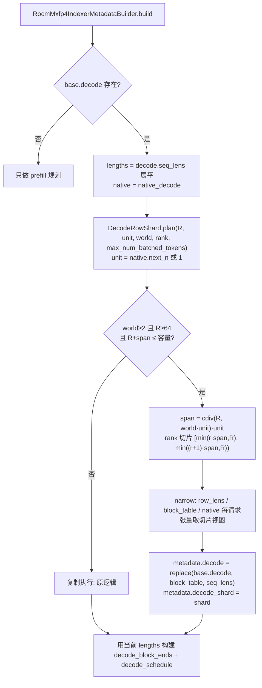
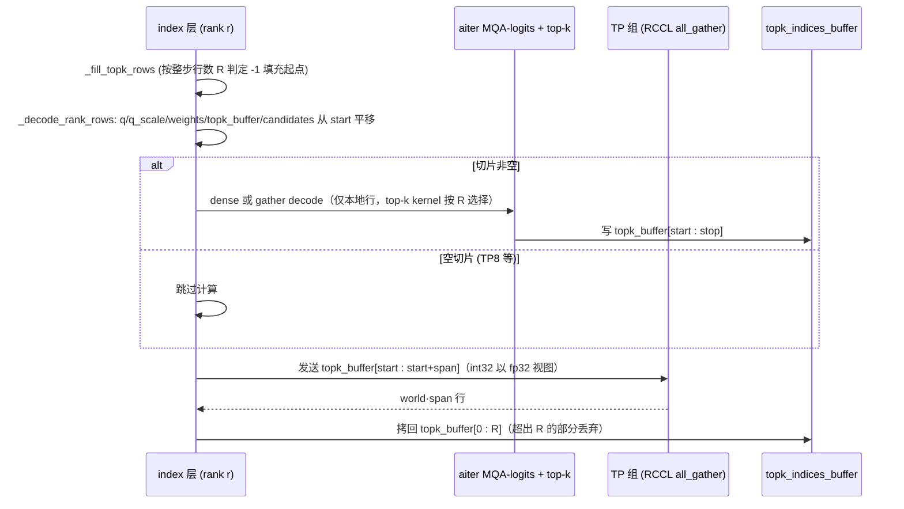
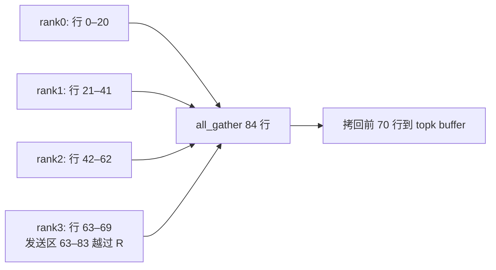

# PR #66047: [ROCm][Perf][DSv4.1] Shard the sparse-indexer decode rows across TP

> **Author**: @okorzh-amd | **State**: OPEN | **Date**: 2026-11-06
> **Branch**: `okorzh/dsv41-rocm-decode-indexer-rowshard` → `main` | **Labels**: rocm, deepseek
> **Changes**: +266 -27 lines across 4 files | **ROCm 相关性**: 完全相关（DeepSeek-V4.1 在 MI355X/gfx950 上的 aiter paged MXFP4 稀疏 indexer，ROCm 专属路径）
> 本报告分两部分：§1–6 为 PR 详细总结，§7–8 为 ROCm review 意见。
> 审查基线：PR head `9c896087f4`，merge-base `e336407a3d`；对照当前 `upstream/main`（`fdd90995db`）。CI 状态未获取，**CI 结果未知**。

---

## 1. 总结 (Summary)

在 MI355X 上，DeepSeek-V4.1 的 paged MXFP4 稀疏 indexer（#58671）在 TP>1 时每个 TP rank 都对**全部** decode 行重复打分、重复算出相同的 top-512 索引。本 PR 在 decode 行数 ≥ 64 时把 decode 行切成等长的连续切片，每个 TP rank 只对自己的切片跑 indexer（dense / gather 两条 decode 路径都改为在切片视图上运行），然后每个 index 层做一次 TP all-gather，把 int32 top-k 行拼回完整的 `topk_indices_buffer`。门控全自动、不新增 env var，只作用于 DeepSeek-V4.1 的 ROCm MXFP4 indexer builder；TP1、<64 行的 decode step、DeepSeek-V4 单级 indexer 与 prefill 行均不变。

## 2. 背景与动机 (Background & Motivation)

- **冗余计算**：DSv4.1 的 8 个 index 层（含 ratio-2 层、candidate source、candidate consumers）在 TP 组内是复制执行的——indexer 权重与 KV 缓存在每个 rank 都完整存在，因此每个 rank 对同样的 R 行算出同样的结果。高并发 decode（C256/C512，FULL graph 最多 1,008 行）下 indexer 成为可观的单步开销（PR 自报 C512 下 2.47 ms/step）。
- **对标**：这是 CUDA 侧 #58536（draft，opt-in，按请求交错分行，面向 DeepGEMM varlen 路径）和 #63921 NVIDIA `latency_specialized` decode 中 row-sharded dense indexer 的 ROCm 对应实现。
- **与相关 PR 的关系**（PR 描述 + 本地 git 核对）：
  - #63956（已合入）删除了通用的 indexer prefill 行切分（`PrefillRowShard` 与 base builder 的 `tp_size`），因此本 PR 改从 `parallel_config.tensor_parallel_size` 读取 TP 度。
  - #65555（open，同批次）把 prefill 切到 ShardQ token 切片；本 PR 起初叠在它之上开发，但现在声称独立。本地 3-way merge：两者在 `rocm_paged_mxfp4_indexer.py`（import 行）和 `test_rocm_paged_mxfp4_indexer.py`（相邻新增测试）有 5 处**纯文本冲突**，语义上兼容——#65555 的 `_layer()` 用 `shardq_gather_indices` 重排 Q，而该索引以全部 decode 行开头（#66052 的 `upload_shardq_indices` 中 `np.arange(num_decode_tokens)` 在前可佐证），因此本 PR 依赖的"decode 行位于 [0, R)"不变量在 ShardQ 下仍成立。
  - #66052（open，同批次）只改 `vllm/v1/attention/backends/mla/indexer.py` 与 `tests/v1/attention/test_shardq.py`，与本 PR 无文件重叠，也无直接语义耦合。
  - #63888（已合入）的 `-1` fill skip：本 PR 修改了它的判定口径（见 §3.3）。
  - #63890（open）：AITER 小尺寸 all-gather，只支持 float——这是本 PR 把 int32 以 fp32 字节发送的原因。
- **staleness**：PR 落后 main 172 个 commit；其间只有 #65158（docstring 改单反引号）触及本 PR 的文件，`git merge-tree` 显示与当前 main 自动合并、无冲突，本 PR 新增行也不含双反引号 docstring。

## 3. 代码修改分析 (Code Change Analysis)

### 3.1 修改的模块

| 模块 | 改动 |
|------|------|
| `vllm/v1/attention/backends/mla/rocm_paged_mxfp4_indexer.py` (+72/-9) | 新增 `DecodeRowShard`（`plan` 计算切片、`narrow` 收窄 row 长度 / block table / native 每请求张量）；`RocmMxfp4IndexerMetadata` 加 `decode_shard` 字段；`build()` 在 decode 段规划并收窄切片，用本地行重建 `metadata.decode`、block ends 与 decode schedule；`DeepseekV41RocmMxfp4IndexerMetadataBuilder.__init__` 在 TP>1 且非 batch-invariant 时启用 |
| `vllm/v1/attention/ops/rocm_paged_mxfp4_indexer.py` (+56/-13) | `_topk` 新增 `step_rows` 参数以按整步行数选 top-k kernel；`_fill_topk_rows` 改按整步行数判定；`_dense_decode` / `_gather_decode` 支持空切片提前返回；新增 `_decode_step_rows`、`_decode_rank_rows`（把 q/q_scale/weights/topk_buffer/candidates 平移到切片起点）、`_exchange_decode_rows`（TP all-gather + 拷回 [0, R)）；两个 indexer 入口在 decode 段接入 |
| `tests/kernels/attention/test_rocm_paged_mxfp4_indexer.py` (+101/-1) | GPU 测试 `test_decode_row_shard_matches_replicated`：单 GPU 扮演所有 rank，fake `all_gather` 收集真实发送，3 类 index 层 × {below-gate, native-padded, flat-padded} × TP{2,4,8}，按行排序后与 TP1 比对 |
| `tests/v1/attention/test_rocm_paged_mxfp4_indexer_plan.py` (+37/-4) | CPU 测试：`DecodeRowShard.plan` 的门控/覆盖/对齐/容量；`_fill_topk_rows` 新增 "TP4 下 147 行 step 的 rank 0" 用例 |

### 3.2 架构 / 流程图

**Builder 侧：每步的切片规划（所有输入均为 TP 组共享的 host 状态）**



**Op 侧：每个 index 层的 decode 段**



**行划分示例（TP4，R=70，native next_n=7）**



### 3.3 关键实现细节

- **等长 span**：`span = cdiv(R, world*unit)*unit`，每个 rank 发送同样形状，all-gather 形状只由（padded）R 决定，可被 FULL CUDA graph 捕获并回放。最后一个 rank 的发送区可能越过 R（混合步的 prefill 行或未用行），门控要求 `R + span ≤ max_num_batched_tokens`（即 `topk_indices_buffer` 行数，`vllm/models/deepseek_v4/amd/model.py:1125` 与 `amd/mtp.py:182` 均按此分配，已核对），且只拷回 [0, R)。
- **unit**：AV 关闭的 native 步取 `next_n`，保证同一请求的 next_n 行落在同一 rank，dense launch 仍可一次读 KV 服务多行；AV 打开或 ragged 步取 1。本地 python 复算（TP 2/4/8 × unit 1/2/4/7/8 × R 64–2048）确认切片无缝覆盖 [0, R) 且 start/stop 对 unit 对齐。
- **空切片**：rank·span ≥ R 的 rank 跳过计算但仍参加 gather。本地复算显示 TP8 在 unit≥2 时较常见（如 R=70/unit 7 有 3 个空 rank），TP4 在 unit 8（k=7）、R=72 也会出现。空切片下 `build_schedule` 因 `batch < MIN_DYNAMIC_BATCH(4)` 返回 None（核对 aiter 0.1.28.post1 源码），不会出错。
- **top-k kernel 选择**：`_topk(..., step_rows)` 让最终索引的 top-k 仍按整步 R 选择 vLLM / aiter kernel（`_vllm_topk`: rows<128 且 k<2048），与复制执行一致；`_fill_topk_rows` 同样按 R 判定，修正了 #63888 的 fill skip 在切片下会按本地行数误判的问题（PR 的 147 行 / rank0 / 37 行用例）。
- **candidate 行 rank-local**：candidate source 写 `candidates[start:stop]`，consumer 只读同一切片，candidate 不参与 gather。
- **门控**：仅 `DeepseekV41RocmMxfp4IndexerMetadataBuilder`；`tensor_parallel_size > 1` 且 `VLLM_BATCH_INVARIANT` 关闭；DCP/PCP 本就被该 builder 拒绝；DeepSeek-V4 的 `RocmMxfp4IndexerMetadataBuilder` 保持 world=1。
- **all-gather 路径**：`get_tp_group().all_gather(..., 0)` → ROCm 上 `CudaCommunicator.all_gather` 显式走基类 `all_gather_into_tensor`（RCCL），按字节复制（已核对 `cuda_communicator.py:496-502`）。

## 4. 涉及的技术原理 (Technical Principles)

- **DeepSeek-V4.1 两级稀疏 indexer**：每个 index 层用 MXFP4 量化的 Q/K 计算 MQA logits，再对每个 query 行取 top-512 个 KV 位置交给 sparse MLA。两级结构中 candidate source 层先选出候选块池，candidate consumer 层只在池内打分（gather 路径）或对全上下文打分后按池掩码（dense 路径）。
- **TP 下 indexer 的复制执行**：indexer 头数不按 TP 切分，KV 缓存每个 rank 完整持有，所以不同 rank 的计算完全冗余；按行切分 + all-gather 是把"计算 × TP"换成"一次小通信（每行 2 KiB）"。
- **FULL CUDA graph 约束**：FULL graph 按 padded 行数捕获一次、反复回放，因此切片计划只能依赖 host 侧形状（padded R、TP 度、配置），不能依赖上下文长度或 device 数据；所有 TP rank 必须对"是否 gather"达成一致，否则集合通信会挂死。本 PR 的门控输入满足这一点。
- **breakable cudagraph 与 eager 段**：`@eager_break_during_capture` 在 FULL 模式下照常被捕获；在非 FULL（混合 prefill+decode 步）模式下作为 eager 段运行，此时每层的 all-gather 都要付 host 侧开销（PR 自报约 57 µs/次）。
- **性能数字溯源**：PR 中所有性能数字（indexer 时间 2.47→1.03–1.05 ms、E2E +1–2%、微基准表）均来自 AMD 内部 agentic replay harness 与 torch profiler，未附日志/trace，**无法独立核实**；E2E 部分作者自己给出的 95% CI 均跨 0，表述是诚实的。

## 5. 评论区讨论亮点 (Discussion Highlights)

- 截至审查时无任何人工 review 或 inline 评论；唯一的 review 是 claude[bot] 提示 "PR 来自 fork，自动 review 被禁用"。
- PR 描述本身包含了大量自我审查信息：11/12 变异测试被捕获（存活的变异体正是"按切片行数选 top-k kernel"）；明确承认 builder 接线无单元测试、真实多 GPU gather 不在 CI 中、混合步 eager gather 成本可能是 C64 TTFT p50 +1.4% 的来源、`supports_draft_decode_metadata_update` 目前靠 SWA builder 关闭兜底等。这些自述在 §7 中被逐条核对。

## 6. 风险与潜在问题 (Risk Analysis)

| 风险 | 严重程度 | 说明 |
|------|---------|------|
| draft decode 元数据原地更新与收窄后的 indexer 元数据不兼容，目前靠其它 builder 关闭兜底 | Medium | 见 §7 ⚠️【正确性】草稿元数据更新 |
| 混合步（eager）每层一次 all-gather 的 host 开销抵消收益 | Medium | 见 §7 ⚠️【性能】混合步 |
| builder 接线、真实多 GPU gather、TP8/空切片端到端均无 CI 覆盖；CI 状态未知 | Medium | 见 §7 ⚠️【测试】 |
| TP 组内各 rank 对门控不一致导致集合通信挂死 | Low | 已核对门控输入均为共享 host 状态，当前无触发路径 |
| 64 行门槛与 TP 度无关，TP2 中等上下文可能小幅回退 | Low | 见 §7 📝【性能】门槛 |
| int32 以 fp32 视图通过 all-gather | Low | 当前 RCCL 字节复制安全；见 §7 📝【兼容性】 |
| 与 #65555 的文本冲突 | Low | 仅 import 行与相邻测试，语义兼容 |

---

## 7. Review 意见 (Findings)

| 类型 | 🔴 | ⚠️ | 📝 |
|------|----|----|----|
| 正确性 | — | 1 | — |
| 性能 | — | 1 | 2 |
| 测试 | — | 1 | — |
| 一致性/设计 | — | — | 1 |
| 兼容性 | — | — | 1 |
| 注释/文档 | — | — | 1 |

---

**⚠️【正确性】indexer builder 仍声明支持草稿 decode 元数据原地更新，但切片后的 `metadata.decode` 已不满足其前提** `[已验证]`

- **问题**: `DeepseekV32IndexerMetadataBuilder.__init__` 在 `dcp_world_size == 1` 时把 `supports_draft_decode_metadata_update` 设为 True（`indexer.py:1175`），本 PR 的 ROCm 子类没有改写它。而本 PR 在 `rocm_paged_mxfp4_indexer.py:479-486` 用 `replace(base.decode, block_table=..., seq_lens=lengths[:, None])` 把 `decode` 收窄成本 rank 的切片，其余字段（`decode_lens`、`indices`、`per_req_decode_lens` 等）仍是全步大小。`update_draft_decode_metadata`（`indexer.py:1874-1885`）断言 `decode.seq_lens.numel() == metadata.num_decode_tokens`，并把整步 block table / seq_lens 原地写回 `decode`，既不会重算切片，也不会更新 `decode_row_lens` / `decode_native` / `decode_schedule`。今天之所以不出问题，只是因为同模型的 `DeepseekV41ROCMAiterSparseSWAMetadataBuilder` 设置了 `supports_draft_decode_metadata_update = False`（`models/deepseek_v41/amd/rocm.py:353`），而 speculator 要求所有 group 都支持（`speculator.py:427-441`）。
- **影响**: 那段 SWA 注释写明这是临时关闭（"Keep fused multi-step decode disabled until update_draft_decode_metadata() also refreshes the ROCm-specific ragged SWA indices"）。一旦打开，在 TP≥2、草稿模型含 index 层（ROCm 的 `deepseek_v4/amd/mtp.py` 会为 MTP 层分配 `topk_indices_buffer`）且草稿步 decode 行数 ≥ 64 时，会触发断言失败；关闭断言时则用收窄后的视图写入整步数据，得到错误索引。这是一个隐式的跨文件依赖，打开 SWA 能力的人很难想到它。
- **行动**: 建议作者在 `decode_shard_world > 1` 时显式设置 `self.supports_draft_decode_metadata_update = False`（或覆写 `update_draft_decode_metadata`，在其中重新规划切片），并加一行注释说明原因，让这层依赖在本文件内自洽。

**⚠️【性能】混合步（eager）也启用切片，每层多一次 eager all-gather，作者自己的数据指向 TTFT 回退** `[已验证]`（成本数字为 PR 自报，未核实）

- **问题**: 门控只看 decode 行数（`rocm_paged_mxfp4_indexer.py:472-478`），不区分本步是否含 prefill。混合步不走 FULL graph，`@eager_break_during_capture` 让 indexer 作为 eager 段运行，所以每个 index 层的 `_exchange_decode_rows` 都是一次 eager RCCL all-gather 加一次拷回。PR 自报：每次 eager gather 约 57 µs host CPU，每个这样的步约 8 次（约 0.46 ms）；C256/C512 下 24–28% 的 ≥64 token 前向是 eager 混合步；C512 profile 中混合步 indexer GPU 时间下降，但 wall time 没有下降；C64 TTFT p50 +1.4%（p 0.045）。
- **影响**: 在 prefill 占比高的负载（长输入 agentic、chunked prefill 与大批 decode 混跑）下，切片的收益可能被 host 侧 gather 开销抵消，甚至表现为 TTFT 回退。本 PR 的 E2E 数据无法区分这部分的净效果。
- **行动**: 建议作者评估"本步含 prefill token（`base.prefill is not None`）时不切片"的变体。这个条件同样是 TP 组共享的 host 状态，不影响 FULL graph（纯 decode 步）的收益；如果保留现状，作者应当在代码注释中写明这一权衡，并给出混合步单独的 A/B 数字。

**⚠️【测试】builder 接线、真实多 GPU gather 与空切片端到端均无 CI 覆盖；CI 状态未知** `[已验证]`

- **问题**: ① 新 GPU 测试通过 `_decode_metadata` 手工构造元数据，不经过 `RocmMxfp4IndexerMetadataBuilder.build()`，所以 TP 度/rank 读取、`metadata.decode` 的 `replace`、本地 `decode_block_ends` / `decode_schedule` 构建（`rocm_paged_mxfp4_indexer.py:472-503`）都没有单元测试（PR 自述）。② 真实 RCCL gather 只在一次性脚本中验证过（TP2/TP4），不属于 CI。③ 本地复算显示空切片在 TP8（unit≥2）和 TP4（unit 8，例如 R=72、k=7、AV off）都会出现，但服务端验证只有 TP4 + AV on（unit 1，不会出现空切片）。④ 本次没有获取 CI 结果，新测试所在的 `(MI355 DPX) Attention Kernels` / `V1 Attention` 是可选 shard，无法确认它们在本 PR 上实际跑过。
- **影响**: 本 PR 的正确性取决于"各 rank 对切片计划完全一致 + builder 正确收窄每个张量"。如果 builder 接线出现回退（例如以后有人改 `native_decode` 的返回结构或 `decode` 字段），GPU 测试捕捉不到，表现会是 TP≥2 高并发下静默错误的稀疏索引，或者 rank 间 gather 形状不一致导致挂死。
- **行动**: 建议作者补一个经过 `build()` 的测试（mock `get_tensor_model_parallel_rank` 与 TP 度，对比各 rank 的 `decode_shard` / 收窄后的 `decode` 形状与复制路径一致），覆盖 AV off + 空切片的情形；并在 PR 中贴出 MI355 可选 shard 的运行链接。

**📝【性能】64 行门槛与 TP 度、上下文无关，作者自己的微基准显示 TP2 在 32K 上下文、64–112 行区间约为中性或小幅回退** `[已验证]`（微基准数字为 PR 自报）

- **问题**: `_DECODE_SHARD_MIN_ROWS = 64`（`rocm_paged_mxfp4_indexer.py:53`）对所有 TP 度一视同仁。PR 的微基准表中，TP2 / 32K 在 80 行为 −31 µs/step，在 64 和 112 行均为 +4 µs（在作者给出的 93 µs/step 噪声范围内）；TP8 / 32K 在 40 行就已经回本。
- **行动**: 不阻塞合入（作者说明 CI 中没有 TP2 + ≥64 行的布局）。建议作者在常量旁注释它的来源（TP4/32K 的盈亏点）和已知的 TP2 例外，或者让门槛随 TP 度变化。

**📝【一致性】candidate top-k 仍按本地行数选 kernel，与 PR 说明的"切片按整步行数选 top-k kernel、与复制执行一致"不完全相符** `[已验证]`（对索引集合的影响 `[推测]`）

- **问题**: `_dense_decode` 中 candidate source 的 `_topk(scores[0], metadata.decode_block_ends, candidates, candidates.shape[1])`（ops 文件第 565 行）没有传 `step_rows`，只有第 568-574 行最终索引的 top-k 传了。整步 R≥128、本地行数 <128 时（如 TP4 下 R 在 128–511），candidate top-k 会从 aiter kernel 换成 vLLM kernel。
- **影响**: 两个 kernel 都是正确的 top-k，差别只在并列值的取舍与性能（docstring 写"aiter 在 candidate top-k 上更快"），所有 rank 之间仍一致，所以不是正确性问题。但 PR 声称的"kernel 及其 tie-breaking 与复制执行一致"只对最终索引成立。
- **行动**: 建议作者让 candidate top-k 也传入 `_decode_step_rows(metadata)` 以保持对称，或在注释/PR 描述中说明这是有意为之。

**📝【兼容性】int32 top-k 以 fp32 视图通过 all-gather，正确性依赖 gather 实现按位复制** `[推测]`

- **问题**: `_exchange_decode_rows`（ops 文件第 685 行）把 int32 视为 fp32 发送。`-1` 的位模式 `0xFFFFFFFF` 是一个 fp32 NaN。当前 ROCm 路径走 RCCL `all_gather_into_tensor`，按字节复制，所以是安全的（已核对）。
- **影响**: 如果以后换成 #63890 这类 float-only 的自定义 all-gather，而它内部做了 NaN 规范化、降精度或任何算术，`-1` 填充以及大于 2^23 的索引都会被悄悄改写。
- **行动**: 建议作者在该行加注释，写明"发送端只做位复制，不得做任何浮点变换"，并在 #63890 接入时补一个包含 `-1` 的 round-trip 测试。

**📝【注释/文档】`DecodeRowShard` 与 `decode_shard` 字段缺 docstring，关键不变量只写在 PR 描述里** `[已验证]`

- **问题**: 该文件几乎每个 dataclass 和字段都有 docstring，唯独新增的 `DecodeRowShard`（第 140-173 行）和 `RocmMxfp4IndexerMetadata.decode_shard`（第 189 行）没有。下面这些关键不变量只出现在 PR 描述中：所有 TP rank 必须由共享的 host 状态得到相同计划、否则 gather 挂死；最后一个 rank 的发送区会越过 R，因此需要容量检查；unit 为 next_n 时同一请求的行不能跨 rank。
- **行动**: 建议作者把这三条不变量写进 `DecodeRowShard` 的 docstring，方便后续修改门控的人不破坏跨 rank 一致性。

**📝【性能】连续切片把 cudagraph padding 行集中到末尾 rank，最慢的 rank 决定整步时间** `[推测]`

- **问题**: FULL graph 下 R 是 padded 行数，padding 请求的上下文为 0，并全部位于末尾；连续切片让末尾 rank 分到大部分 padding，前面的 rank 承担全部真实行。例如真实 900 行、padded 到 1008 行、TP4 时，rank 0–2 各 252 个真实行，rank 3 只有 144 个，最慢 rank 比均衡划分约多 12% 的工作。作者只量化了上下文差异带来的不均衡（C64 中位 51 µs/step），没有量化 padding 带来的不均衡。
- **行动**: 建议 review 时追问作者是否评估过"按请求交错"（类似 #58536）或"按真实行数而非 padded 行数均分"的方案，以及 gather 之后重排的代价。

## 8. 结论 (Verdict)

**⚠️ NEEDS WORK**

方案清晰，跨 rank 一致性和 FULL graph 可捕获性设计得很仔细；我逐项核对了切片覆盖、容量门控、空切片与 aiter `build_schedule` 的兼容性、ROCm all-gather 路径，均未发现会触发静默错误或挂死的具体输入，作者的验证和变异测试也很充分。主要问题有三点：草稿元数据原地更新的隐式依赖应在本 builder 内显式关闭；混合步的 eager gather 成本值得加门控或给出单独数据；builder 接线与空切片缺少 CI 级测试。另外，本 PR 与 #65555 有少量纯文本冲突，谁后合入谁需要 rebase。

## 9. 英文 Review 评论 (Copy-Paste English Comments)

**C1** `vllm/v1/attention/backends/mla/rocm_paged_mxfp4_indexer.py:535-538` — ⚠️ comment

```text
When the decode shard is enabled, `metadata.decode` is replaced with a per-rank slice (seq_lens/block_table narrowed, other fields still step-sized), but this builder still inherits `supports_draft_decode_metadata_update = True` from DeepseekV32IndexerMetadataBuilder (dcp_world_size == 1). `update_draft_decode_metadata` asserts `decode.seq_lens.numel() == metadata.num_decode_tokens` and copies step-wide data into `decode`, without re-planning the shard or touching `decode_row_lens` / `decode_native` / `decode_schedule`. Today this is only masked because DeepseekV41ROCMAiterSparseSWAMetadataBuilder sets the flag to False, and its comment says that is temporary. Could you set `self.supports_draft_decode_metadata_update = False` here when `decode_shard_world > 1` (or override the update to re-plan), so this builder does not rely on another group's flag?
```

**C2** `vllm/v1/attention/backends/mla/rocm_paged_mxfp4_indexer.py:472-478` — ⚠️ comment

```text
The gate only looks at the decode row count, so mixed prefill+decode steps are sharded too. Those steps run the indexer as an eager segment, so each of the 8 index layers pays an eager all-gather (~57 us host per call by your numbers), and your own data shows indexer GPU time dropping on mixed steps without a wall-time gain, plus a +1.4% TTFT p50 at C64. Since `base.prefill is not None` is shared host state on all TP ranks, gating the shard off for steps with prefill tokens keeps every rank in agreement and does not affect the FULL-graph decode steps where the gain comes from. Could you try that variant, or at least document the trade-off next to the gate?
```

**C3** `vllm/v1/attention/backends/mla/rocm_paged_mxfp4_indexer.py:479-486` — ⚠️ comment

```text
As the description notes, nothing in CI exercises this wiring: the new GPU test builds the metadata by hand, so the TP rank read, the `replace(base.decode, ...)`, and the local block ends / schedule are untested. Empty slices also happen beyond TP8: at TP4 with next_n = 8 (AV off) a 72-row step leaves rank 3 empty, and the server runs only covered TP4 with AV on (unit 1). Could you add a test that goes through `build()` with a mocked TP size/rank, checks that every rank's `decode_shard` and narrowed `decode` match the replicated plan, and includes an AV-off case with an empty rank? A link to the optional MI355 shard run on this head would also help, since CI status is not visible here.
```

**C4** `vllm/v1/attention/ops/rocm_paged_mxfp4_indexer.py:573` — ⚠️ comment

```text
Only the final index top-k gets `_decode_step_rows(metadata)`. The candidate top-k a few lines above (`_topk(scores[0], metadata.decode_block_ends, candidates, ...)`, line 565, outside this hunk) still selects the kernel by the slice's row count. For example, at TP4 with 128 <= R < 512 it switches from aiter's kernel to vLLM's. It is still a correct top-k and every rank stays consistent, but it contradicts the "same kernel and tie-breaking as the replicated step" claim and may change the candidate-topk cost. Could you pass the step row count there too, or note that this is intentional?
```
