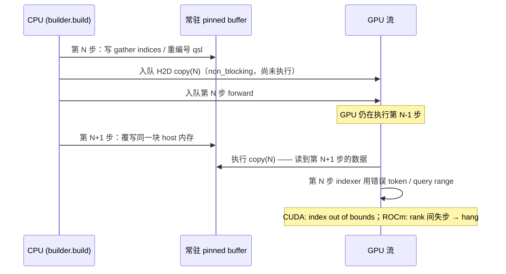
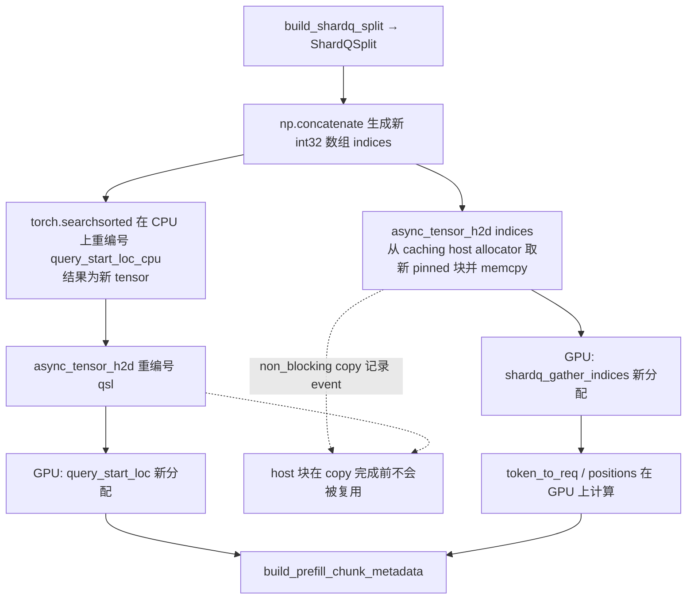

# PR #66052: [Bugfix][DSA] Stage ShardQ indexer indices in fresh host memory each step

> **Author**: @AMD-yanfeiwang | **State**: OPEN | **Date**: 2026-11-06（最后一次推送 2026-11-24）
> **Branch**: `AMD-yanfeiwang:fix-shardq-indexer-h2d-race` → `main` | **Labels**: bug
> **Changes**: +74 -30 lines across 2 files | **ROCm 相关性**: 部分相关（CUDA/ROCm 共享的 DSA indexer builder；ROCm 在 main 上该路径尚未激活，由 #65555 激活）
> 本报告分两部分：§1–6 为 PR 详细总结，§7–8 为 ROCm review 意见。

---

## 1. 总结 (Summary)

`DeepseekV32IndexerMetadataBuilder` 的 ShardQ 路径每步把 gather indices 和重编号后的 query ranges 写进两块**常驻 pinned host buffer**（`CpuGpuBuffer`），再 `non_blocking=True` 上传到 GPU。Model Runner V2 的 async scheduling 会在第 N 步的 H2D 拷贝真正执行前就构建第 N+1 步，覆写同一块 host 内存，导致第 N 步读到第 N+1 步的索引——CUDA 上表现为 `IndexKernel.cu:111 index out of bounds` + `EngineDeadError`，MI355X 上表现为某个 rank 卡在 indexer kernel、其余 rank 卡在下一个 collective 的无报错 hang。本 PR 删除这两块常驻 buffer，改为每步用新的 NumPy 数组构造索引，并经 `async_tensor_h2d`（由 PyTorch caching host allocator 提供的新 pinned 暂存块）上传，同时补了一个能在 main 上复现失败的单测。

## 2. 背景与动机 (Background & Motivation)

- ShardQ（#63956 引入）在 TP>1 时把 sparse-MLA（DSA）prefill 按 token 而非按 head 切分：每个 TP rank 只为自己的一段 token 跑 indexer 与 sparse attention，用 all-to-all 交换 q 与输出。indexer builder 需要每步构造"本 rank 负责哪些 token"的 `shardq_gather_indices`，并把 request 的 `query_start_loc` 重编号到这些 token 上。
- #63956 为此在 builder `__init__` 里分配了两块 `CpuGpuBuffer`（`max_num_batched_tokens` 与 `max_num_seqs + 1` 大小）。`CpuGpuBuffer.copy_to_gpu` 是 `gpu.copy_(cpu.pin_memory(), non_blocking=True)`；host 侧已经 pinned 时 `pin_memory()` 直接返回同一 storage，DMA 只在 GPU 流执行到这次 copy 时才读 host 内存。
- 作者在 MI355X（DeepSeek-V4.1-Flash、TP4、FP8 indexer cache、1M token prompt，叠加 #65555 让 ROCm indexer 走 ShardQ）上复现 10 次中 9 次 hang；`--no-async-scheduling` 与本 PR 方案均无 hang。
- 评论区三位 CUDA 用户（4×B300，GLM-5.3-Flash NVFP4/FP8，async scheduling + MTP）独立确认同一 race：生产环境约 30 小时 6 次 engine death；回移植本方案后 54+ engine-hours 零崩溃。即该 bug 在 **CUDA main 上已是生产级崩溃**，ROCm 侧则在 #65555 合入后才会暴露。

## 3. 代码修改分析 (Code Change Analysis)

### 3.1 修改的模块

| 文件 | 改动 |
|------|------|
| `vllm/v1/attention/backends/mla/indexer.py` (+22/-30) | 新增模块级 helper `upload_shardq_indices(split, query_start_loc_cpu, device)`；删除 `__init__` 中两块 ShardQ `CpuGpuBuffer` 及 `CpuGpuBuffer` import；`build()` 的 ShardQ 分支改为调用 helper，`query_start_loc` 改为 `async_tensor_h2d` 上传 |
| `tests/v1/attention/test_shardq.py` (+52) | 新增 `test_indexer_build_survives_next_build`：用 `torch.cuda._sleep` 堵住流，连续 build 两步，检查第一步排队中的上传结果（gather indices、chunk 的 `cu_seqlen_ks/ke`）未被第二步改写 |

提交历史：`122c86d15a`（修复本体）→ 两次 merge main → `b6eb97eb6e`（把测试从只测 helper 改为经 builder 的 `build()` 测试，回应 reviewer 的"future-proof"建议）。当前 head 与 upstream/main 三方合并无冲突。

### 3.2 架构 / 流程图

修复前的竞态（async scheduling 下 CPU 领先 GPU 一步）：



修复后的数据流：



### 3.3 关键实现细节

- `upload_shardq_indices`：`indices = concat(arange(num_decode_tokens), split.local_token_ids + num_decode_tokens).astype(int32)`，与旧代码语义逐项一致（旧代码 `np.concatenate(..., out=indices_cpu.numpy())` 写入 int32 buffer）；`renumbered = torch.searchsorted(torch.from_numpy(indices), query_start_loc_cpu, out_int32=True)` 与旧代码一致，只是不再写入常驻 `out=`。
- `async_tensor_h2d`（`vllm/utils/torch_utils.py`）：输入非 pinned 时先 `torch.empty(..., pin_memory=True).copy_(t)` 暂存，再 `non_blocking` 上传。暂存块来自 PyTorch caching host allocator，non_blocking copy 会在当前流上记录 event，块在 event 完成前不会被分配给别人——这正是修复成立的关键。`PIN_MEMORY=False` 时退化为 pageable 同步拷贝，同样安全。
- GPU 侧由常驻 `.gpu` buffer 改为每步新分配：同一流内由 caching allocator 保证顺序复用，原本常驻 buffer 在同一流上也是按序覆写，安全性不变。
- `use_shardq` 的前提之一是 `cudagraph_mode.mixed_mode() != FULL`（`sparse_mla_attention.py`），ShardQ prefill metadata 不会被 CUDA graph 捕获，因此设备地址每步变化不影响 graph replay。
- 删除常驻 buffer 后，同一 builder 内**不再有任何常驻 pinned host buffer**：`build_pcp_global_chunk_plan` 每次调用新 `pin_memory` 分配；decode 路径的 `decode_lens_buffer` 等全部是 GPU→GPU。各子类（`CandidateIndexerMetadataBuilder`、Ampere/Hopper decode builder、CPU builder、kimi_k3 `dsa_cache`）也没有 `CpuGpuBuffer`/pinned buffer，也没有引用被删除的 `self.shardq_gather_indices` / `self.shardq_query_start_loc` 属性。

## 4. 涉及的技术原理 (Technical Principles)

- **pinned memory 上的异步 H2D 语义**：`cudaMemcpyAsync` / `hipMemcpyAsync` 从 page-locked 内存拷贝时立即返回，DMA 在流执行到该操作时才读 host 内存；在这之前 CPU 对源地址的任何写入都会被"拷走"。CUDA 与 HIP 语义相同，因此该 race 与后端无关。
- **PyTorch caching host allocator**：`torch.empty(pin_memory=True)` 从缓存池取块；非阻塞拷贝调用 `CachingHostAllocator_recordEvent`，Python 引用释放后块回到池中但须等 event 完成才会再分配。ROCm 版 PyTorch 经 hipify 使用同一实现，所以"每步新的 pinned 暂存"在 CUDA 和 HIP 上都能关闭这个 race，且不会泄漏（池大小受最大在途需求约束，这里最多 `max_num_batched_tokens × 4 B`）。
- **Model Runner V2 async scheduling**：V2 runner（V1 `gpu_model_runner.py` 已不存在）没有 V1 那种 `prepare_inputs_event` 输入准备同步，CPU 侧 metadata 构建会领先 GPU 执行；V2 自己的 host 暂存用 `UvaBufferPool` 等环形池或每步新分配来规避这类问题。本 PR 选的是"每步新分配"。
- **同类问题的仓内先例**：`rocm_aiter_mla.py` 的 FP8 PS metadata 用"两槽 pinned staging + `torch.cuda.Event` 守护"解决同一种 host 覆写 race；本 PR 数据量小（每 token 一个 int32），作者选择更简单的每步新分配，而非 ring buffer。
- **ShardQ 在 ROCm 上的激活状态**：`supports_shardq=True` 目前只有 `flashinfer_mla_sparse.py`、`flashmla_sparse.py`、`hy_v4/nvidia/flashmla_sparse.py`，没有 ROCm impl，因此 ROCm main 上 `self.use_shardq` 恒为 False，本 PR 修改的分支对 ROCm 是休眠代码；#65555 让 ROCm sparse indexer 走 ShardQ 后才会走到这里。

## 5. 评论区讨论亮点 (Discussion Highlights)

- **@Orien-Xu**（CUDA 4×B300，GLM-5.3-Flash NVFP4）：在 main 上用公开的 agentic trace 2/2 复现 `IndexKernel.cu:111 index out of bounds`，失败步中 2,620 token 的 prefill chunk 收到最大到 3,466 的索引；`CUDA_LAUNCH_BLOCKING=1` 不复现；等价修复后 24/24 两次通过，16/32/64 并发 30 分钟无问题。`sparse_mla_shard_q: false` 可绕过。
- **@blancsw**：确认生产环境同一 race，给出具体机理：第 N+1 步写入的 token id ≥ 第 N 步 token 总数，`searchsorted(..., right=True)` 得到 `token_to_req == num_reqs`，在 `seq_lens[token_to_req]` 越界。
- **@Priananda620**：3 个 TP4 B300 engine、约 110 万请求/天的生产数据：未修复 30 小时 6 次 engine death 外加 1–4.5 分钟的 stall；回移植后 54+ engine-hours 零崩溃，对照组 engine 再次崩溃。
- **@cjackal**：在 NVIDIA 上也撞到该 race，确认本 PR 修复 hang，并提了一个让测试防回归的 nit（已 resolved；最后一次提交 `b6eb97eb6e` 把测试改为走 builder 的 `build()`）。
- 作者 PR 描述中有一个有价值的负面结果："只换新的 GPU 目标、host 源仍复用同一 pinned buffer"**不能**消除 hang，与 host 侧覆写的根因吻合。
- 尚无 code owner（@pavanimajety，已请求 review）的意见；CI 未运行（见 §7）。

## 6. 风险与潜在问题 (Risk Analysis)

| 风险 | 严重程度 | 说明 |
|------|---------|------|
| 修复不完整（同 builder 内残留常驻 pinned 上传） | Low | 已逐一排查 builder 及所有子类：无残留 |
| 每步额外开销 | Low | 仅 ShardQ prefill 步：两次缓存池 pinned 分配 + 一次 ≤`max_num_batched_tokens×4 B` 的 CPU memcpy + 两次小 GPU 分配，微秒级；与之相比 prefill 步本身在 ms 量级 |
| pinned 内存泄漏 / 增长 | Low | caching host allocator 复用块，峰值受单步最大需求约束 |
| ROCm 回归 | Low | ROCm main 上 ShardQ 不激活，零行为变化；#65555 激活后正是该修复的受益者 |
| 测试覆盖 | Medium | 新测试只在 nightly/可选任务里跑，见 §7【测试】两条 |
| 与 #65555 的重复提交 / 合并顺序 | Low | 见 §7【设计】 |
| CI 未运行 | Medium | pre-run-check 失败（无 `ready` label），pre-commit 与 Buildkite 都被跳过；合入前需要跑一遍 |

---

## 7. Review 意见 (Findings)

**核心结论（先说重点）**：

1. **race 是真实的** `[已验证]`。旧路径 `CpuGpuBuffer.copy_to_gpu` 对已经 pinned 的 host buffer 做 `non_blocking` 拷贝，V2 runner 在构建下一步前没有任何输入准备同步，下一步的 `np.concatenate(..., out=...)` / `searchsorted(..., out=...)` 会覆写还在排队的源数据。评论区的独立生产数据和作者在 MI355X 上的复现与该机理一致。
2. **修复在 CUDA 与 ROCm/HIP 上都能关闭这个 race** `[已验证]`。两个上传的源现在都是每步新的 pinned 暂存块，由 caching host allocator 的 event 记录保护，HIP 版 PyTorch 走同一实现；不泄漏，每步开销可以忽略。
3. **同一 builder 内没有其他同类 race** `[已验证]`（见 §3.3 末条）。
4. **测试不是"为通过而校准"的** `[已验证]`。在 main 上，第二次 build step 0 的两次 H2D 拷贝排在 `_sleep` 之后，随后 build step 1（1600 个 prefill token ≥ 默认 `sparse_mla_shard_q_min_tokens=1024`，seq 8192 > topk 2048，两个 rank 都有 token，所以 ShardQ split 必然生效）覆写同一 host buffer，排队的拷贝会读到 step 1 的数据；build 路径在 DCP=1 时只有 CPU 侧 `.item()`，不会把 GPU 队列排空。但它依赖两个隐式前提，见下面两条 📝。
5. **跨后端影响**：只改了 `use_shardq` 分支，非 ShardQ 路径（CUDA 和 ROCm 的所有默认 DSA 路径）字节级不变；ROCm main 上该分支是休眠代码。

| 类型 | 🔴 | ⚠️ | 📝 |
|------|----|----|----|
| 测试 | — | — | 2 |
| 设计 | — | — | 1 |
| 可维护性 | — | — | 1 |

非阻塞问题：CI 未运行（pre-run-check 因缺 `ready` label 失败，pre-commit / Buildkite 均被跳过），本报告不对测试结果做任何声明。

---

**📝【测试】新回归测试不在任何每 PR 都跑的 CI 任务里** `[已验证]`

- **问题**: `tests/v1/attention/test_shardq.py` 在 `.buildkite/test_areas/attention.yaml` 的 `:nvidia: (B200) ShardQ Metadata` 任务里只跑 `-k builder_selects_mqa_after_shardq_split`；整个文件只出现在 `distributed.yaml` 的 `(H100) [Nightly] Distributed Features`（`optional: true`）及其 `:amd: (MI355) Distributed Features` 镜像任务里。新增的 `test_indexer_build_survives_next_build` 只需要 1 张 GPU，却只会在 nightly/可选任务中跑。
- **影响**: 将来如果有人把常驻 pinned buffer 加回 builder（这是很自然的"优化"），每 PR CI 发现不了，只能等 nightly 或生产崩溃才暴露——而这个 bug 本身就是生产崩溃级别的。
- **行动**: 建议作者把该测试加进 B200 ShardQ Metadata 任务的 `-k` 过滤（例如 `-k "builder_selects_mqa_after_shardq_split or indexer_build_survives_next_build"`）；MI355 镜像任务已经覆盖整个文件，ROCm 侧不用额外改动。

**📝【测试】测试的两个前提是隐式的：失败时有效，但将来可能静默变成空测** `[已验证]`

- **问题**: 该测试能在 main 上失败，依赖两点：(a) `builder.build(0, steps[1])` 确实走 ShardQ 分支，这取决于默认 `sparse_mla_shard_q_min_tokens=1024` 和 `build_shardq_split` 的其他条件；(b) `build()` 内部不触发 host 同步，否则 `_sleep` 排的队会被排空。测试对 step 1 的返回值没做任何断言，也没检查第二次 build 后队列是否仍被堵着。
- **影响**: 只要以后默认阈值调高（如 >1600）、split 条件收紧，或 `build()` 里加了一个 GPU `.item()`，这个测试在一个**已经回归**的 builder 上也会继续通过（"为通过而校准"的典型退化形式）。
- **行动**: 建议作者补两个廉价的自检：对 `builder.build(0, steps[1]).prefill.shardq_gather_indices` 断言 `is not None`；在 `builder.build(0, steps[1])` 前后各 `record` 一个 event，并断言 `not event.query()`（队列仍未排空），以证明场景确实被构造出来了。

**📝【设计】与 #65555 内容重复，合并顺序建议本 PR 先合** `[已验证]`

- **问题**: 本 PR 的修复提交 `122c86d15a` 与 #65555（`[ROCm][DSv4.1] Score the sparse-indexer prefill on ShardQ token slices`）的第一个提交 `4a1c8a826f` patch-id 相同（`33aa4964…`）。#65555 里还带着一个旧版测试 `test_indexer_upload_survives_next_build`，只测 `upload_shardq_indices` 这个 helper——这个 helper 在 main 上不存在，所以那个测试无法证明 main 上的 builder 有 bug，比本 PR 当前经由 `build()` 的测试弱。两个测试插在 `test_shardq.py` 同一个位置（`test_shard_q_round_trip` 之后）。另外，作者在 MI355X 上的复现本身就需要 #65555 才能让 ROCm 走到这条路径。
- **影响**: 如果 #65555 先合，就会把修复连同较弱的测试一起带进来，本 PR 随后需要 rebase 并在 `test_shardq.py` 处理冲突；如果本 PR 先合，#65555 rebase 时修复提交自动变成空提交，只需要删掉重复的测试。CUDA 用户已经在生产环境崩溃，修复越早独立合入越好，不应被一个更大的 ROCm 特性 PR 卡住。
- **行动**: 建议本 PR 先合入；建议 #65555 作者 rebase 后去掉重复的修复提交和 `test_indexer_upload_survives_next_build`（或改成复用本 PR 的测试），并在 #65555 描述里说明它依赖本 PR。

**📝【可维护性】builder 之外仍有相同的"常驻 pinned buffer + non_blocking"模式，可另开 PR 排查** `[推测]`

- **问题**: 本 PR 已经清理了 DSA indexer builder；但 `vllm/v1/attention/backends/flashinfer.py` 仍用 `CpuGpuBuffer.copy_to_gpu` 上传 `paged_kv_indptr`、`paged_kv_last_page_len`、`mm_prefix_query_ranges`，是同一种结构。本次没有核实它们是否有其他同步（例如 FlashInfer plan 的 `_plan_copied.synchronize()`）作保护。仓内已有两种安全写法可以参考：`rocm_aiter_mla.py` 的两槽 + event，以及 V2 runner 的 `UvaBufferPool`。
- **影响**: 如果其中某个上传没有保护，在 V2 async scheduling 下会出现同类间歇性错结果或越界，且不在本 PR 范围内。
- **行动**: 建议 review 时追问作者或 maintainer：是否要另开 issue，对 V2 runner 下所有 `CpuGpuBuffer.copy_to_gpu` 调用点做一次审计；本 PR 不需要改动。

## 8. 结论 (Verdict)

**✅ LGTM**

根因分析准确，三方独立的生产数据（CUDA B300 崩溃、MI355X hang）都支持这个结论；修复是最小改动，在 CUDA 和 HIP 上都由 PyTorch caching host allocator 的 event 语义保证正确，不泄漏，每步开销可以忽略，非 ShardQ 路径与 ROCm main 路径零行为变化。剩下的都是 📝 级建议（把测试纳入每 PR CI、给测试加防空测自检、和 #65555 协调合并顺序）。合入前需要拿到 `ready` label，让 pre-commit 与 Buildkite 真正跑一遍。

## 9. 英文 Review 评论 (Copy-Paste English Comments)

**C1** `tests/v1/attention/test_shardq.py:216-218` — ⚠️ comment

```text
Nice test: on main the second build of step 0 queues its uploads behind the sleep, and step 1 (1600 tokens, above the default 1024 ShardQ threshold) rewrites the same pinned buffer. Two cheap self-checks would stop it from silently going vacuous later: assert that builder.build(0, steps[1]).prefill.shardq_gather_indices is not None, so a future threshold or split change can't make step 1 skip ShardQ; and record an event before and after the step-1 build and assert `not event.query()`, so a host sync added to build() shows up as a test error instead of a silent pass.
```

**C2** `tests/v1/attention/test_shardq.py:173` — ⚠️ comment

```text
This regression test only runs in the optional nightly H100 job and its MI355 mirror. The per-PR B200 "ShardQ Metadata" job filters test_shardq.py with `-k builder_selects_mqa_after_shardq_split`. The test needs a single GPU, and the bug it guards against crashes production engines, so could you add it to that job's `-k` expression (e.g. `-k "builder_selects_mqa_after_shardq_split or indexer_build_survives_next_build"`)?
```

**C3** `vllm/v1/attention/backends/mla/indexer.py:975-990` — ⚠️ comment

```text
This commit is patch-identical to the first commit of #65555, which also carries an older helper-only test (test_indexer_upload_survives_next_build) at the same spot in test_shardq.py. That older test can't fail on main, because upload_shardq_indices doesn't exist there yet. Since CUDA users are already hitting this race in production, I'd suggest merging this PR first and then rebasing #65555 to drop the duplicate commit and the older test.
```

## 10. 英文总结评论 (Overall Review Summary)

```text
The root cause is right: CpuGpuBuffer.copy_to_gpu issues a non_blocking copy from an already-pinned buffer, and the V2 runner can build the next step before that copy runs. Staging both ShardQ uploads through async_tensor_h2d closes the race on CUDA and HIP alike, because the caching host allocator holds each staging block until its copy completes. No other persistent pinned uploads remain in this builder, and non-ShardQ paths are unchanged. Optional asks: run the new test in per-PR CI, add guards so it can't silently become vacuous, and merge before #65555. Approve once CI runs.
```
