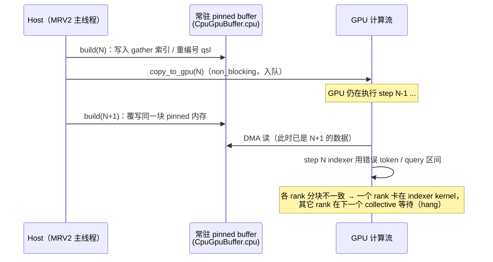
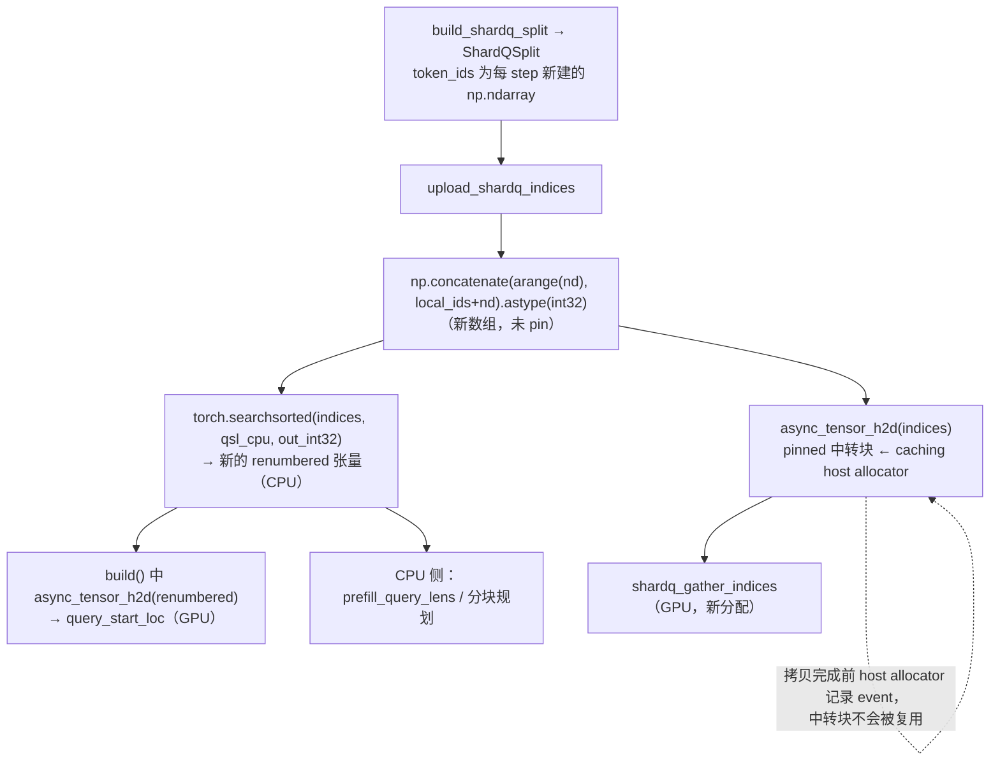

# PR #66052: [Bugfix][DSA] Stage ShardQ indexer indices in fresh host memory each step

> **Author**: @AMD-yanfeiwang | **State**: OPEN | **Date**: 2026-11-06
> **Branch**: `AMD-yanfeiwang:fix-shardq-indexer-h2d-race` → `main` | **Labels**: bug
> **Changes**: +43 -30 lines across 2 files | **ROCm 相关性**: 部分相关（CUDA/ROCm 共享的 DSA indexer metadata builder；ROCm 的 `RocmMxfp4IndexerMetadataBuilder` 通过 `super().build()` 继承该路径，但在 main 上 ROCm 只有叠加 #65555 之后才会走到 ShardQ 分支；复现环境为 MI355X）
> **CI**: 未获取（本次 review 未拉取 checks，CI 状态未知）
> 本报告分两部分：§1–6 为 PR 详细总结，§7–8 为 ROCm review 意见。

---

## 1. 总结 (Summary)

`DeepseekV32IndexerMetadataBuilder.build()` 在 ShardQ（按 token 切分 prefill 的 sparse-MLA 模式）路径上，用两个常驻的 `CpuGpuBuffer`（`shardq_gather_indices`、`shardq_query_start_loc`）的 pinned host 端写入本 step 的 gather 索引和重编号后的 query 区间，然后 `copy_to_gpu()` 发起 `non_blocking` H2D 拷贝。在 Model Runner V2 的异步调度下，CPU 可能在 step N 的 DMA 真正执行前就开始构建 step N+1，并覆写同一块 pinned 内存，导致 step N 用错 token 与 query 区间，最终表现为某个 TP rank 卡在 indexer kernel、其它 rank 在下一个 collective 等待的 GPU hang。本 PR 改为每 step 用全新的 NumPy 数组构建索引，并通过 `async_tensor_h2d` 上传（由 PyTorch caching host allocator 提供 pinned 中转块，并在拷贝完成前保持其不被复用），同时删掉两个常驻 buffer，新增一个单测。

## 2. 背景与动机 (Background & Motivation)

- ShardQ 由 #63956（`[Perf][DSA] Token-sharded sparse-MLA prefill under TP`）引入：TP>1 时把 prefill token 按 zigzag 切给各 rank，每个 rank 用全部 head 计算自己那份 token 的 indexer + sparse attention，再用 all-to-all 交换 q 和输出。`AttentionConfig.sparse_mla_shard_q` **默认 True**，`sparse_mla_shard_q_min_tokens` 默认 1024。
- 在 main 上，声明 `supports_shardq = True` 的只有 CUDA 侧的 `flashmla_sparse.py`（FP8 DS KV cache）和 `flashinfer_mla_sparse.py`；ROCm 的 DSv4.1 只有在 #65555（"Score the sparse-indexer prefill on ShardQ token slices"）中通过 `k_cache.use_shardq = True` 显式开启 indexer ShardQ。所以**这个 race 在 main 上默认就能在 CUDA 触发**（TP>1 + 异步调度 + ≥1024 prefill token），在 ROCm 上要等 #65555 合入后才会触发。
- 作者在 DeepSeek-V4.1-Flash、MI355X TP4、FP8 indexer cache、1M token prompt（32K chunk）上，基于 #65555 的分支复现：main builder 10 次中 9 次 hang；关掉异步调度 8/8 通过；本 PR 的方案 16/16 通过。这些数字没有附日志或脚本，**无法溯源**。
- 自 merge-base 以来 main 已合入 `[Core] Remove Model Runner V1 (#63373)`，现在 MRV2 是唯一 runner，异步调度下的暴露面覆盖所有 ShardQ 用户。

## 3. 代码修改分析 (Code Change Analysis)

### 3.1 修改的模块

| 文件 | 改动 |
|------|------|
| `vllm/v1/attention/backends/mla/indexer.py` (+22 -30) | 新增模块级函数 `upload_shardq_indices(split, query_start_loc_cpu, device)`；删除 `__init__` 中两个 `CpuGpuBuffer` 和 `CpuGpuBuffer` import；`build()` 的 ShardQ 分支改为调用新函数，并用 `async_tensor_h2d` 上传重编号后的 `query_start_loc` |
| `tests/v1/attention/test_shardq.py` (+21) | 新增 `test_indexer_upload_survives_next_build`：用 `torch.cuda._sleep` 把拷贝压在流后面，连续上传两次，检查第一次上传的结果没有被第二次改掉 |

### 3.2 架构 / 流程图

修复前，异步调度下的竞争：



修复后的数据流：



### 3.3 关键实现细节

- `upload_shardq_indices`（`indexer.py:972-987`）：返回 `(GPU gather indices, CPU renumbered qsl)`。索引语义与旧实现完全一致：先放 `num_decode_tokens` 个 decode token 的原位下标，再放本 rank 的 ShardQ token（加上 decode 偏移）。
- `build()` 中（`indexer.py:1569-1582`）：`query_start_loc_cpu` 被重新绑定为新的 renumbered 张量，GPU 端 `query_start_loc` 由 `async_tensor_h2d` 新建。`token_to_req` / `positions` 的设备端计算不变。
- `async_tensor_h2d`（`vllm/utils/torch_utils.py:722-748`）：输入是 ndarray/未 pin 的张量时，会先 `torch.empty(..., pin_memory=True).copy_(t)` 中转，再 `t.to(device, non_blocking=True)`。中转块来自 PyTorch 的 caching host allocator；non_blocking 拷贝会在该块上记录 stream event，块释放后要等 event 完成才会被复用。这正是修复所依赖的不变式。
- 删除常驻 buffer 后，该 builder 中已没有任何 `CpuGpuBuffer` 或常驻 pinned 张量（删掉的 import 也说明没有别的使用点）。PR 描述中"只有这两次上传有暴露"的说法与代码一致。
- attention 侧的对应实现 `build_shardq_metadata`（`sparse_mla_attention.py:177-205`）本来就用 `async_tensor_h2d(split.token_ids, ...)`，本 PR 让 indexer 侧与它的模式一致。

## 4. 涉及的技术原理 (Technical Principles)

- **Pinned 内存 + non_blocking H2D 的语义**：`gpu.copy_(pinned_cpu, non_blocking=True)` 只是把 DMA 放进流里排队，host 立即返回。DMA 要等流执行到这一步时才去读 host 内存，所以在那之前改写源内存是数据竞争。`CpuGpuBuffer.copy_to_gpu()` 里的 `cpu.pin_memory()` 对已经 pinned 的张量会直接返回同一块存储，不提供任何保护。
- **CachingHostAllocator**：`torch.empty(pin_memory=True)` 从缓存分配器取块；在 non_blocking 拷贝时（CUDA 与 HIP 的 `Copy.cu` 路径相同）对该块 `recordEvent`，块被释放后只有 event 完成才回到空闲池。因此"每 step 新 pinned 中转块 + 让张量自然离开作用域"是安全的。大小按 2 的幂分桶，预热后不再调用 `cudaHostAlloc`/`hipHostMalloc`。
- **MRV2 异步调度**：CPU 准备 step N+1 时，GPU 可能仍在执行 step N（或更早的 step）。MRV2 自己的输入 buffer 用 `UvaBufferPool`（按 `max_concurrency` ≥ in-flight step 数做轮转）来规避同样的问题（`vllm/v1/worker/gpu/buffer_utils.py:20-22, 70-124`），说明"单个常驻 pinned buffer 在 builder 中跨 step 复用"本身就不符合 MRV2 的约定。
- **ShardQ**：prefill token 按 zigzag 切分（每个请求切成 2·TP 段，rank i 拿第 i 段和第 2·TP-1-i 段），indexer 只对 decode token 和本 rank 的 token 打分，top-k 结果再通过 all-to-all 交换。任何一个 rank 的分块和其它 rank 不一致，都会让后续 collective 失配，表现为 hang 而不是报错。
- **CUDA graph**：ShardQ 要求 `cudagraph_mode.mixed_mode() != FULL`（`sparse_mla_attention.py:772-780`），而且旧实现里 `positions`、`token_to_req` 本来就是每 step 新分配的 GPU 张量，所以把 gather indices 和 qsl 改为新分配不会引入新的地址稳定性问题。

## 5. 评论区讨论亮点 (Discussion Highlights)

- 目前唯一的 review 是 `claude[bot]` 的自动提示（fork PR 不会自动 review），**没有实质性的人工讨论**。
- 关联 PR（同批次）：
  - **#65555** 直接叠在本 PR 上（其父提交就是 `be5437ab2f`），并在 indexer prefill metadata 中新增 `shardq_query_start_loc_cpu=query_start_loc_cpu` 字段，而这个张量正是本 PR 改成每 step 新建的 renumbered 张量。**合入顺序必须是 #66052 在前**。两者三方合并无冲突。
  - **#66047**（decode 行跨 TP 切分）只改 `rocm_paged_mxfp4_indexer` 的 backend/op/测试，不涉及 `indexer.py` 的 ShardQ 分支，与本 PR 合并无冲突，也没有依赖关系。
- 与当前 `upstream/main` 合并无冲突。merge-base 之后 main 只对 `indexer.py` 做过 docstring 反引号风格的调整（#65158）；新代码的 docstring 不含反引号，不受新 pre-commit hook 影响。

## 6. 风险与潜在问题 (Risk Analysis)

| 风险 | 严重程度 | 说明 |
|------|---------|------|
| 正确性：修复是否完全消除 race | Low | 两路上传都改为新内存；builder 内没有残留的常驻 pinned 源；新旧计算结果逐位一致（见 §7 已核对项） |
| 测试覆盖：回归保护只覆盖一半 | Medium | 见 §7 ⚠️【测试】单测未覆盖 `query_start_loc` 上传与 `build()` |
| 验证范围：CUDA 默认路径未在 CUDA 上验证 | Medium | 见 §7 ⚠️【测试】验证只在 ROCm + #65555 叠加分支上做过 |
| 性能：每 step 的 pinned 分配 | Low | 只在 ShardQ prefill step 上发生（≥1024 prefill token），每次 ≤ 4·max_num_batched_tokens 字节，见 §7 📝【性能】 |
| 可维护性：依赖 `async_tensor_h2d` 的隐式中转 | Low | 见 §7 📝【可维护性】 |
| 兼容性：合入顺序 | Low | #65555 依赖本 PR，需先合本 PR |

---

## 7. Review 意见 (Findings)

| 类型 | 🔴 | ⚠️ | 📝 |
|------|----|----|----|
| 测试 | — | 2 | — |
| 性能 | — | — | 1 |
| 可维护性 | — | — | 1 |
| 注释/文档 | — | — | 1 |

**已核对、无问题的项**（不单列 finding）：

- 新旧 gather 索引与重编号 `query_start_loc` 的数值等价：用 CPU 脚本随机生成 200 组（decode 数 0–7、1–5 个 prefill 请求、TP∈{2,4,8}、随机 rank），旧写法（`np.concatenate(out=int32 视图)` + `searchsorted(out=...)`）与新写法逐位相同，dtype 都是 int32。`[已验证]`
- 修复确实覆盖了 race：`indices` 是新的未 pin ndarray，`renumbered` 是 `searchsorted` 新建的未 pin 张量，二者在 `async_tensor_h2d` 中都会走 pinned 中转；builder 中不再有 `CpuGpuBuffer` 或常驻 pinned 源。ROCm 子类 `RocmMxfp4IndexerMetadataBuilder.build()` 和 `DeepseekV41SparseIndexerMetadataBuilder.build()` 都先调 `super().build()`，自动继承修复。`[已验证]`
- CUDA graph：ShardQ 要求 mixed 模式不是 FULL，而且旧代码中 `positions` / `token_to_req` 本来就是每 step 新分配的，所以 GPU 地址变化不是新风险。`[已验证]`

---

**⚠️【测试】新单测只验证了 helper 的 gather indices 上传，没有覆盖 `build()` 中第二次上传的 `query_start_loc`，而且所在的 CI job 是可选的 nightly** `[已验证]`

- **问题**: `tests/v1/attention/test_shardq.py:165-183` 直接调用 `upload_shardq_indices(...)[0]`，只断言 gather indices。重编号后的 `query_start_loc` 是在 `indexer.py:1582` 的 `build()` 中单独 `async_tensor_h2d` 上传的，测试没有经过 `DeepseekV32IndexerMetadataBuilder.build()`，也没有检查 `[1]`（renumbered）或它的 GPU 拷贝。此外，`test_shardq.py` 只出现在 `.buildkite/test_areas/distributed.yaml` 的 `:nvidia: (H100) [Nightly] Distributed Features`（`optional: true`，带 `:amd: (MI355)` mirror）中，不会拦截 PR。
- **影响**: 如果以后有人为了"省分配"把 `query_start_loc` 的上传改回常驻 `CpuGpuBuffer`（MRV2 中这是很自然的写法），这个测试仍然会通过，同样的 hang 会再次出现。实际上这个测试更多是在验证 PyTorch caching host allocator 的语义，而不是 builder 的契约。
- **行动**: 建议作者把测试改为对 builder 层面做断言：至少让 helper 同时返回或由测试自行上传 renumbered qsl，并检查它在第二次 build 之后保持不变；更好的做法是在 `torch.cuda._sleep` 之后连续调用两次 `build()`（可复用 `create_common_attn_metadata`），然后检查第一次的 `prefill.shardq_gather_indices` 和 chunk 的 `query_start_loc` 相关 GPU 张量。同时建议在 PR 中说明该测试由哪条 CI 覆盖。

**⚠️【测试】受影响的默认路径在 CUDA 上，但验证只在 MI355X + #65555 叠加分支上做过** `[已验证]`

- **问题**: 在 main 上，只有 `flashmla_sparse.py:717`（FP8 DS KV cache）和 `flashinfer_mla_sparse.py:451` 声明 `supports_shardq = True`，`sparse_mla_shard_q` 默认 True。所以 TP>1、异步调度、≥1024 prefill token 的 DeepSeek V3.2/V4 在 CUDA 上**默认**就会走这条有 race 的分支。而 ROCm 在 main 上没有任何 impl 开启 ShardQ，DSv4.1 AMD 要到 #65555（`deepseek_v41/amd/rocm.py` 的 `_indexer_shardq_enabled`）才会进入这条分支。PR 描述中的复现和 16/16 通过都基于 #65555 栈，"Not reproduced on CUDA"。另外，表格中的 9/10、8/8、16/16 没有附日志或命令输出，无法溯源。
- **影响**: 本 PR 单独合入时，真正生效的用户是 CUDA ShardQ 用户，但 CUDA 上既没有复现也没有回归验证（精度或长 prompt 稳定性）。虽然改动在数值上与旧代码等价（已核对），但"修复了 hang"这一点在 CUDA 上仍是推断。
- **行动**: 建议作者补一次 CUDA 侧的 ShardQ 运行（例如 DeepSeek-V3.2 FP8 KV，TP≥2，异步调度，长 prompt；或者至少在 H100 上跑一遍 `test_shardq.py`），并在 PR 描述中写清楚：在 main 上 ROCm 只有通过 #65555 才会触发，本 PR 必须先于 #65555 合入。同时附上 hang 统计对应的日志或命令。

**📝【性能】每个 ShardQ prefill step 新增两次 pinned 中转 + 两次 GPU 分配，开销可以忽略，但可以写明** `[已验证]`

- **问题**: `upload_shardq_indices` 和 `indexer.py:1582` 每 step 各做一次 `async_tensor_h2d`：一次 CPU→pinned 的 memcpy（≤ 4·`max_num_batched_tokens` 字节，例如 32K token 是 128 KB）、一次 caching host allocator 取块、一次 GPU caching allocator 分配。只在 `build_shardq_split` 返回非 None 时触发，即 prefill token ≥ `sparse_mla_shard_q_min_tokens`（默认 1024）。
- **影响**: 相对于 ≥1024 token 的 prefill step，这点开销可以忽略；pinned 块按 2 的幂分桶，预热后不再调用 `hipHostMalloc`/`cudaHostAlloc`。另一种做法是 MRV2 现成的 `UvaBufferPool`（零分配，轮转深度 = `max_concurrency`），但它依赖"轮转深度 ≥ in-flight step 数"这个外部约束；每 step 新分配则不依赖任何深度假设，作者的选择更稳妥。
- **行动**: 无需修改。建议作者在 PR 的 Details 中补一句开销量级（例如每 step 额外 ~2 次小分配，≤128 KB），说明为什么没有用 ring buffer / `UvaBufferPool`。

**📝【可维护性】"新 host 内存"这个保证依赖 `async_tensor_h2d` 只对未 pin 输入做中转的隐式行为** `[已验证]`

- **问题**: `async_tensor_h2d`（`torch_utils.py:735`）只在 `PIN_MEMORY and not t.is_pinned()` 时才中转；如果输入已经 pinned，它会直接从调用方的内存做 `non_blocking` 拷贝。`upload_shardq_indices` 的 docstring（`indexer.py:975-979`）只说了"Fresh host memory each step"，没说明它依赖输入**未 pin**。
- **影响**: 现在两个输入都是新建且未 pin 的，所以是安全的。但如果以后有人把 `indices` 改成写入一个常驻 pinned 数组（例如 `np_to_pinned_tensor` 或 `CpuGpuBuffer.np` 视图），`async_tensor_h2d` 会静默跳过中转，race 原样回来，而且新单测也拦不住（见上一条 ⚠️）。
- **行动**: 建议作者在 docstring 里补一句："inputs must be freshly allocated, non-pinned host memory; `async_tensor_h2d` copies pinned inputs in place without staging"。

**📝【注释/文档】hang 机制的描述是合理推断，但没有直接证据** `[推测]`

- **问题**: PR 将根因描述为"step N 用错误的 token/query 区间分块和打分 → 一个 rank 停在 indexer kernel，其它 rank 在下一个 collective 等待"。代码层面可以确认 race 存在（单个常驻 pinned 源 + non_blocking + MRV2 允许 CPU 超前），但"错误数据 → 某个 rank 卡住"这一段只有 A/B 实验（关异步调度、加 host sync、换新 host 内存都能消除 hang）作为间接支持。
- **影响**: 不影响修复本身。但如果还有其它原因导致同类 hang（例如 #65555 中的 top-k exchange），只看本 PR 的描述可能会误以为问题已经全部解决。
- **行动**: 建议 review 时追问：是否在 hang 现场 dump 过 step N 的 `shardq_gather_indices` / GPU `query_start_loc`，并与 CPU 侧的值对比过？如果有，附在 PR 中会更有说服力。

## 8. 结论 (Verdict)

⚠️ **NEEDS WORK**：修复本身是正确的。两路 H2D 上传都改为每 step 新建的 host 内存，并依赖 caching host allocator 的 event 保活，builder 中不再有可被覆写的常驻 pinned 源，数值上与旧实现逐位等价，CUDA graph 也不受影响。需要补的是回归保护和验证范围：单测没有覆盖 `query_start_loc` 那一路，也没有经过 `build()`；在 main 上，真正受益的是 CUDA 默认的 ShardQ 路径，而验证只在 ROCm + #65555 栈上做过。补上这两点之后可以 LGTM。注意本 PR 必须先于 #65555 合入；与 #66047 及当前 main 均无冲突。

## 9. 英文 Review 评论 (Copy-Paste English Comments)

**C1** `tests/v1/attention/test_shardq.py:165-183` — ⚠️ comment

```text
This test only checks the gather indices returned by `upload_shardq_indices(...)[0]`. The second exposed upload, the renumbered `query_start_loc` that `build()` uploads at indexer.py:1582, is not covered, and the test never goes through `DeepseekV32IndexerMetadataBuilder.build()`. As written, it mostly confirms PyTorch's caching host allocator semantics, so someone could later move the qsl upload back onto a persistent `CpuGpuBuffer` and this test would still pass. Could you extend it to cover both uploads, ideally by calling `build()` twice behind `torch.cuda._sleep` and checking that the first step's `shardq_gather_indices` and renumbered `query_start_loc` on the device are unchanged? It would also help to mention which CI job runs this. `test_shardq.py` currently only runs in the optional nightly H100 / MI355 "Distributed Features" step.
```

**C2** `vllm/v1/attention/backends/mla/indexer.py:1569-1582` — ⚠️ comment

```text
On current main, this ShardQ branch is reached by default only on CUDA: FlashMLA sparse with an FP8 DS cache and FlashInfer sparse MLA set `supports_shardq = True`, and `sparse_mla_shard_q` defaults to True. On ROCm it is only reached once #65555 enables indexer ShardQ for DSv4.1, which is the stack the MI355X repro was run on. So the users who benefit when this PR lands alone are the CUDA ShardQ users, and the fix has not been exercised there. Could you add a CUDA run, for example DeepSeek-V3.2 with an FP8 KV cache, TP>=2, async scheduling and long prompts, or at least run tests/v1/attention/test_shardq.py on H100? Please also note in the description that this PR has to land before #65555, and attach the logs or commands behind the 9/10 vs 16/16 hang counts.
```

**C3** `vllm/v1/attention/backends/mla/indexer.py:972-987` — ⚠️ comment

```text
The fix is correct, but the "fresh host memory" guarantee here depends on an implicit property of `async_tensor_h2d`: it only stages through a new pinned block when the input is not already pinned (`PIN_MEMORY and not t.is_pinned()`). Both `indices` and `renumbered` are freshly allocated, unpinned tensors today, so the copies are safe. If someone later writes them into a persistent pinned array, `async_tensor_h2d` will copy straight from it with `non_blocking=True` and the race comes back silently. Consider adding a sentence to the docstring, for example "inputs must be freshly allocated, non-pinned host memory; `async_tensor_h2d` copies pinned inputs without staging", so the invariant is stated where people will see it.
```
