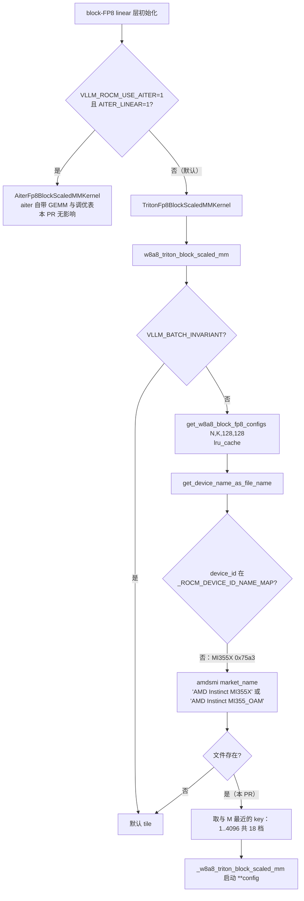

# PR #66068: [ROCm][Quantization] Add tuned W8A8 block-FP8 Triton GEMM configs for MI355X

> **Author**: @ZhengGong-amd | **State**: OPEN | **Date**: 2026-11-06
> **Branch**: `rocm-mi355x-block-fp8-configs` → `main` | **Labels**: rocm, ready, quantization
> **Changes**: +7300 -0 lines across 50 files（全部为新增 JSON） | **ROCm 相关性**: 完全相关（仅 MI355X / gfx950 的 Triton 调优表）
> 本报告分两部分：§1–6 为 PR 详细总结，§7–8 为 ROCm review 意见。

---

## 1. 总结 (Summary)

MI355X 上 vLLM 自带的 Triton W8A8 block-FP8 GEMM（`w8a8_triton_block_scaled_mm`）一直没有调优表，所有 block-FP8 linear 层都跑硬编码的默认 tile（`BLOCK_M=64, BLOCK_N=128, BLOCK_K=128, GROUP_M=32, warps=4, stages=2`）。本 PR 为 25 个 (N, K) 形状新增调优 JSON，覆盖 Qwen3-14B-FP8、DeepSeek-V4-Flash、Qwen3-Next-80B-A3B-FP8、Qwen3.5-122B-A10B-FP8 的 TP=1 形状，以及 DeepSeek-V4-Pro 的 TP=8 形状。每个形状同时以 `AMD_Instinct_MI355X` 和 `AMD_Instinct_MI355_OAM` 两个设备名各发一份（共 50 个文件）。只有 AITER linear 关闭时（vLLM 默认）才会读这些文件；`VLLM_ROCM_USE_AITER=1` 时不受影响。PR 不改任何 Python 代码。

## 2. 背景与动机 (Background & Motivation)

- 在 ROCm 上，block-FP8 linear 的 kernel 候选顺序是 `[AiterFp8BlockScaledMMKernel, TritonFp8BlockScaledMMKernel]`。AITER 版本仅在 `VLLM_ROCM_USE_AITER=1`（默认 `False`）且 `VLLM_ROCM_USE_AITER_LINEAR=1`（默认 `True`）时可用，所以**默认环境下 ROCm 上的 block-FP8 linear 都走 Triton kernel**。
- `main` 里这个目录已有 MI300X（28 个）、MI325X（24 个）、MI325_OAM（24 个）的调优表，但没有任何 MI350/MI355 文件。MI355X 每次调用都会打印 "Using default W8A8 Block FP8 kernel config. Performance might be sub-optimal!" 并回退到默认 tile。
- 作者给出的数据（来源见 §7）：micro 端在 M ≤ 128 时提速 +44%～+91%；serving 端 Qwen3-14B 吞吐提升 +13%～+50%，其他模型 +2.4%～+12%；DeepSeek-V4-Pro TP=8 提升 +6.2%；GSM8K / GPQA 精度不变。
- Reviewer @simondanielsson 先后要求补完整命令、扩大 workload sweep、补 GPQA，作者都补齐了。他还提出两个问题：这些表应该放在 vLLM 还是 aiter？MI350 是否也该覆盖？

## 3. 代码修改分析 (Code Change Analysis)

### 3.1 修改的模块

| 模块 | 改动 |
|------|------|
| `vllm/model_executor/layers/quantization/utils/configs/`（新增 50 个 JSON） | 25 个 `N=<N>,K=<K>,device_name=AMD_Instinct_MI355X,dtype=fp8_w8a8,block_shape=[128,128].json`，外加 25 个内容逐字节相同的 `..._MI355_OAM...` 副本 |
| Python 代码 | 无改动 |

按 (N, K) 推断出的形状与模型对应关系。DeepSeek-V4-Pro 已用本地 config.json 核对过，其余模型是根据 hidden size 推断的：

| 模型（并行度） | (N, K) 形状 |
|---|---|
| DeepSeek-V4-Pro（TP=8，已核对：hidden 7168, q_lora 1536, moe_inter 3072） | 8192×1536（wq_b）、2048×7168（wq_a+wkv）、7168×2048（wo_b）、768×7168（shared gate_up）、7168×384（shared down） |
| Qwen3-14B（TP=1，hidden 5120） | 7168×5120（qkv）、5120×5120（o）、34816×5120（gate_up）、5120×17408（down） |
| DeepSeek-V4-Flash（TP=1，hidden 4096） | 32768×1024、1536×4096、4096×8192、4096×4096、4096×2048、8192×1024 等 |
| Qwen3-Next-80B（TP=1，hidden 2048） | 12288×2048、9216×2048、2048×4096、1024×2048、2048×512 等 |
| Qwen3.5-122B（TP=1，hidden 3072） | 17408×3072、20480×3072、2048×3072、3072×8192、3072×1024 等 |

### 3.2 架构 / 流程图

配置查找与 kernel 选择路径：



### 3.3 关键实现细节

我用 `python3 -I` 脚本对 50 个文件做了静态解析：

- **结构统一**：每个文件的 M key 都是 `1,2,4,8,16,24,32,48,64,96,128,256,512,1024,1536,2048,3072,4096`（18 档，与 MI300X/MI325X 文件相同）。每档只有 `BLOCK_SIZE_M/N/K, GROUP_SIZE_M, num_warps, num_stages` 六个 key，没有 `matrix_instr_nonkdim` / `kpack` / `waves_per_eu`。
- **MI355X 与 MI355_OAM 逐字节相同**：50 个文件只有 25 种 SHA1，每对内容完全一致。
- **取值都落在 in-tree 搜索空间内**（`benchmarks/kernels/benchmark_w8a8_block_fp8.py`）：BLOCK_M ∈ {16,32,64,128,256}，BLOCK_N ∈ {32,64,128,256}，BLOCK_K ∈ {64(6 次),128(894 次)}，num_stages ∈ {2,3,4}，num_warps ∈ {4,8}。
- **与 128×128 block 量化兼容**：kernel 每次 K 迭代只按 `k_start // group_k` 读一组 scale，所以要求 BLOCK_K 整除 128。PR 中的 BLOCK_K 只有 64/128，满足条件。N 方向的 scale 按列 `offs_bn // group_n` 索引，所以 BLOCK_N=32/64（小于 128）也是正确的。顺带一提，main 上的 MI300X `N=7168,K=128` 文件里有 BLOCK_K=256 的条目，那是已有文件的问题，不在本 PR 范围内。
- **LDS 上界估算**：`stages × (BM+BN) × BK` 字节，最大约 120 KB（如 `N=1024,K=2048` M=4096：64/256/128, stages=3）。这低于 gfx950 每 CU 160 KB 的 LDS，但超过 gfx942 的 64 KB。文件名已限定为 MI355，不会被 gfx942 读到。
- **保留默认配置的条目**：450 个条目里有 14 个与默认 tile 完全相同，集中在 M=1536～4096。这与 PR 所说的"只有快 2% 以上才替换默认配置"相符。
- **打包**：`setup.py` 的 package_data 已包含 `model_executor/layers/quantization/utils/configs/*.json`，新文件会随 wheel 一起分发。

## 4. 涉及的技术原理 (Technical Principles)

- **Block-FP8（W8A8, 128×128）量化 GEMM**：权重按 128×128 块、激活按 1×128 token-group 量化。kernel 在 K 维每步做 `tl.dot(a, b) * a_s[:,None] * b_s[None,:]` 的 fp32 累加。tile 参数只影响调度与访存，不改变数学结果；BLOCK_K 固定为 128 时 K 方向的累加顺序也完全一致。所以这类 PR 的正确性风险主要在"配置能否编译/运行"，而不在数值。
- **Triton 调优表查找**：`get_w8a8_block_fp8_configs` 按 `N,K,device_name,dtype,block_shape` 拼文件名，用 `lru_cache` 缓存；运行时用 `min(keys, key=|x-M|)` 取最近的 M 档。M 超过最大档 4096 时一律使用 4096 档的配置。
- **ROCm 设备名解析**：`RocmPlatform.get_device_name` 先查 `_ROCM_DEVICE_ID_NAME_MAP`（只覆盖 MI300A/X、MI308X、MI325X 等），查不到就返回 amdsmi 的 `market_name`。MI355X（device id `0x75a3`）不在表中，所以文件名取决于 amdsmi/固件上报的 market name。本机 `amd-smi static --asic` 上报的是 `AMD Instinct MI355X`；也有环境上报 `MI355_OAM`，main 上的 fused_moe / mamba 配置同样两种名字都有。
- **gfx950 资源**：MI355X 有 256 CU，每 CU 160 KB LDS。小 M 的 decode 形状对 occupancy 和 wave 数敏感，所以小 M 档用 BLOCK_M=16 加较小 BLOCK_N 才带来 +45%～+90% 的 micro 收益（小 M 时默认 BLOCK_M=64 浪费了 3/4 的行）。

## 5. 评论区讨论亮点 (Discussion Highlights)

- **@simondanielsson（第一轮）**：要求补完整的 `vllm bench serve` 命令并扩大 workload sweep，以证明没有退化；建议精简 Purpose；建议补 GPQA。作者都已落实：8 个 workload × 每个 arm 3 个 fresh server，Llama-3.1-8B BF16 作对照组，GSM8K + GPQA Diamond。
- **作者主动修正结论**：作者在 11-11 编辑评论，承认原先"所有 delta 都在 base 漂移内"的说法不成立。两个超出漂移的 cell（Qwen3-Next GPQA CoT、Qwen3.5-122B GSM8K）各重跑 4 次并交替执行，Welch p 分别为 0.29 / 0.20，均落在 main 自身的波动范围内。这样的数据纪律是好的。
- **@simondanielsson（第二轮）**：问这些表应该放 vLLM 还是 aiter，以及 MI350 是否已有表。作者回复：这些 JSON 只被 vLLM 自己的 Triton kernel 读取，aiter 有独立的 GEMM 和调优表，迁不过去；main 上没有 MI350/MI355 的这类文件；MI350X 同为 gfx950，但作者没有硬件验证，也无法确认 MI350X 的 market name，提议放到 follow-up。
- **流程状态**：pre-commit 曾失败（mergify 11-10 提示），之后 Check format 通过。目前没有 maintainer approve，等待 mgoin 等人 review。

## 6. 风险与潜在问题 (Risk Analysis)

| 风险 | 严重程度 | 说明 |
|------|---------|------|
| 数值正确性 | Low | 只改 tile 参数；BLOCK_K 均整除 128，与 per-block scale 索引兼容；精度评测无显著变化 |
| 配置在 gfx950 上无法编译/越 LDS | Low | 估算最大约 120 KB < 160 KB；作者在 3 个 build 上实际跑过所有形状 |
| M > 4096 的 prefill chunk 未做 micro 测量 | Low | 见 §7 📝【性能】 |
| 性能数字可复现性 | Low | serving 有完整命令；micro 数字来自仓库外的 harness，见 §7 📝【可维护性】 |
| 双设备名副本 | Low | 逐字节相同，符合已有惯例；后续重调需同步改两份，见 §7 📝【兼容性】 |
| CI 覆盖 | Low | JSON-only，现有测试形状不会命中这些文件；PR 页面上看不到 AMD CI 记录 |
| 影响面 | Low | 只在 MI355 且 AITER linear 关闭时生效；任何 (N,K) 相同的模型都会命中（例如 DeepSeek-V3/R1 TP=8 的 o_proj 7168×2048） |

---

## 7. Review 意见 (Findings)

| 类型 | 🔴 | ⚠️ | 📝 |
|------|----|----|----|
| 性能 | — | — | 2 |
| 可维护性 | — | — | 1 |
| 兼容性 | — | — | 1 |
| 测试 | — | — | 1 |

本 PR 只新增调优 JSON，不涉及 dispatch、aiter/mori 调用、env var 或 cudagraph 路径，所以相关检查项都没有命中。我逐项核查了：BLOCK_K 与 128 block 的兼容性、LDS 预算、文件名与设备名解析、调优表中有无 hipblaslt 字样（没有）、MI355X/OAM 副本是否一致、package_data 是否收录。没有发现阻塞或需要修改的问题。

---

**📝【性能】调优表最大 M 档为 4096，而 MI355X 默认 `max_num_batched_tokens=16384`，4097～16384 的 prefill chunk 全部复用 4096 档配置** `[已验证]`

- **问题**：25 个文件的 M key 最大都是 4096。`w8a8_triton_block_scaled_mm` 用最近邻选档，M 超过 4096 时一律取 4096 档。`arg_utils.py` 对显存 ≥ 160 GiB 的设备（MI355X 288 GB）默认 `max_num_batched_tokens=16384`，所以长 prompt prefill 的 GEMM 通常落在 M=8192～16384，而 PR 的 micro 表只测到 M=4096。
- **影响**：这不是退化来源。4096 档多为大 tile，serving 的 3000/150 workload 也间接覆盖了大 M，结果为正。但 M=8192/16384 下 tuned 配置与默认配置谁更快没有直接数据，prefill-heavy 场景的收益不确定。
- **行动**：建议作者补 M=8192 / 16384 两档（或至少在描述里给出这两档的 micro 对比），与 MI355X 的默认 chunk 大小对齐。

**📝【可维护性】micro 数字来自仓库外的调优/计时 harness，部分统计口径无法追溯** `[已验证]`

- **问题**：commit message 说明搜索空间取自 in-tree 的 `benchmarks/kernels/benchmark_w8a8_block_fp8.py`。但选择准则（HIP-graph replay 计时、11 轮交错、快 2% 以上才替换默认）和 micro 计时脚本都不在仓库里，micro 表的数字 `[unverified]`。另外，描述里的"239 of 240 TP=1 (shape, M) cells"与 20 个 TP=1 形状 × 18 个 M 档 = 360 对不上。还有，serving 表中 c=253 的 +2.4%～+3.2% 已在对照组 Llama 的 spread（≤ 4.4%）以内，"Every measured cell is faster"的表述偏强。
- **影响**：今后 Triton/ROCm 升级需要重调时，其他人无法用同一准则复现这份表；在不同准则下重调，结果可能不一致。
- **行动**：建议作者说明 240 个 cell 的口径；可选地把 graph-replay 计时与 2% 门槛作为选项合入 `benchmark_w8a8_block_fp8.py`（可另开 PR），或在描述中贴出 harness 的 gist 链接。

**📝【兼容性】MI355X / MI355_OAM 两份逐字节相同的副本，以及 MI350X 未覆盖** `[已验证]`

- **问题**：MI355X 的 device id `0x75a3` 不在 `_ROCM_DEVICE_ID_NAME_MAP` 中，文件名取决于 amdsmi 上报的 `market_name`。本机（MI355X, gfx950）上报的是 `AMD Instinct MI355X`，部分固件/amdsmi 版本上报 `MI355_OAM`。PR 两个名字都发了一份，25 对已核验逐字节相同，与 main 上 MI325X/MI325_OAM、fused_moe 的 MI355X/MI355_OAM 惯例一致。注意：直接往 map 里加 `0x75a3` 并不是无副作用的简化，因为 main 上 `E=160,N=384` 的 fused_moe 配置只有 `MI355_OAM` 版本，加了映射会让它失效。
- **影响**：本 PR 中没有问题。后续重调时必须同步改两份，否则会出现同卡不同表的分歧。MI350X（同为 gfx950）在 AITER 关闭时仍走默认 tile。
- **行动**：维持现状即可。建议作者在 follow-up 中统一 MI35x 的设备名映射（同时迁移只有 OAM 名的现存配置），并在有 MI350X 硬件时补测或复制。

**📝【性能】调优搜索空间没有包含 AMD 专属的 Triton 选项** `[已验证]`

- **问题**：PR 的条目只有通用的 6 个 key，没有 `matrix_instr_nonkdim` / `kpack` / `waves_per_eu`。main 上 MI300X/MI325X 的同类文件大量使用 `matrix_instr_nonkdim=16, kpack=1`。kernel 以 `**config` 透传这些 key，可以直接使用。
- **影响**：没有正确性影响。小 M decode 档可能还有未挖掘的空间，例如 `matrix_instr_nonkdim=16` 与 BLOCK_M=16 搭配。
- **行动**：可选。建议作者在后续重调时把这几个 AMD 选项加入搜索空间。

**📝【测试】没有任何 CI 会加载这些文件** `[已验证]`

- **问题**：`tests/kernels/quantization/test_block_fp8.py` 的形状与这 25 个 (N,K) 不重合；PR 页面上看不到 `/amd-ci run` 的记录；mergeable_state 为 `unstable`。抓取的 checks 数据为空，具体是哪个 check 不绿无法确认。JSON 能否在 gfx950 上编译运行，完全依赖作者的手工验证。
- **影响**：风险低。作者在 3 个 build、5 个模型上跑过 serving 与 lm_eval，所有形状都实际被加载过。如果未来 Triton 版本对某个配置报 `OutOfResources`，CI 也发现不了。
- **行动**：建议 review 时追问作者是否跑过一次 `/amd-ci run`，并确认 `unstable` 来自哪个 check。

## 8. 结论 (Verdict)

**✅ LGTM**

这是一个纯调优表 PR：25 个形状、两个设备名各一份，内容逐字节一致；所有配置与 128×128 block 量化兼容，LDS 在 gfx950 预算内。它只在 MI355 且 AITER linear 关闭（vLLM 默认）时生效，不改动任何代码路径。证据充分：有完整的 serving 命令和对照组，精度做了重复测量与显著性检验。以上 📝 均为可选改进：补 M>4096 档、说明 micro 口径、后续统一设备名、扩大搜索空间。

## 9. 英文 Review 评论 (Copy-Paste English Comments)

**C1** `vllm/model_executor/layers/quantization/utils/configs/N=34816,K=5120,device_name=AMD_Instinct_MI355X,dtype=fp8_w8a8,block_shape=[128,128].json:138-145` — ⚠️ comment

```text
Non-blocking: the largest M bucket in all 25 tables is 4096, and the lookup picks the nearest key, so every GEMM with M > 4096 reuses this entry. On MI355X (288 GB) vLLM defaults to max_num_batched_tokens=16384, so long-prompt prefill chunks typically land at M=8192-16384, which the micro table does not cover. Could you add 8192 and 16384 buckets (or at least report tuned-vs-default at those M) so the prefill side is measured directly?
```

**C2** `vllm/model_executor/layers/quantization/utils/configs/N=7168,K=2048,device_name=AMD_Instinct_MI355X,dtype=fp8_w8a8,block_shape=[128,128].json:1-9` — ⚠️ comment

```text
Non-blocking, about reproducibility: the search space matches benchmarks/kernels/benchmark_w8a8_block_fp8.py, but the selection rule (HIP-graph replay timing, 11 interleaved rounds, keep the default unless >2% faster) and the micro harness are not in the tree. Whoever re-tunes after a Triton/ROCm bump can't reproduce these tables. Could you link the harness (a gist is fine), or consider upstreaming the graph-replay/threshold mode into the benchmark script in a follow-up? Also, what does "239 of 240 TP=1 (shape, M) cells" count? 20 TP=1 shapes x 18 buckets would be 360.
```

**C3** `vllm/model_executor/layers/quantization/utils/configs/N=7168,K=2048,device_name=AMD_Instinct_MI355_OAM,dtype=fp8_w8a8,block_shape=[128,128].json:1-146` — ⚠️ comment

```text
I checked that all 25 MI355_OAM files are byte-identical to their MI355X twins, which matches the existing MI325X/MI325_OAM and fused_moe MI355X/MI355_OAM convention (0x75a3 is not in _ROCM_DEVICE_ID_NAME_MAP, so the name comes from amdsmi's market_name). Fine for this PR. Note that a later re-tune has to update both copies. Mapping 0x75a3 in the device-ID table would not be a drop-in cleanup either, because some fused_moe configs exist only under the MI355_OAM name. That might be worth a follow-up together with MI350X coverage.
```

## 10. 英文总结评论 (Overall Review Summary)

```text
Thanks for this. The 25 tables (shipped as byte-identical MI355X/MI355_OAM pairs) only change Triton tile choices for w8a8_triton_block_scaled_mm on MI355 with AITER linear off. Every entry keeps BLOCK_K dividing the 128 block, LDS stays within gfx950 limits, and the serving and accuracy evidence is thorough. Optional follow-ups: add M=8192/16384 buckets, since MI355X defaults to 16384 batched tokens and larger M reuses the 4096 entry; share the tuning/timing harness or upstream it; and keep both device-name copies in sync on future re-tunes. Approve from the ROCm side.
```
