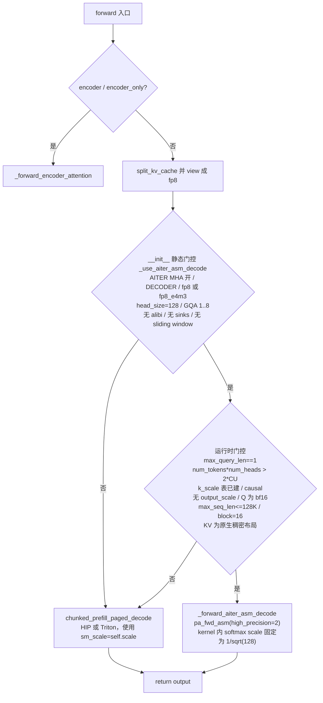
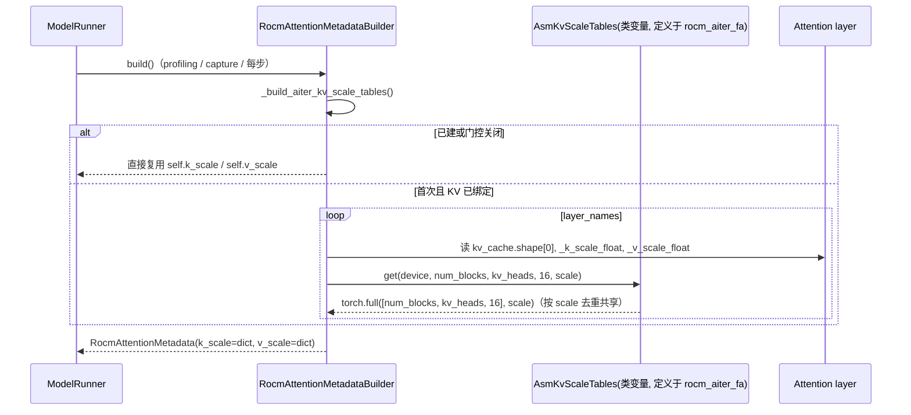

# PR #66082: [Perf][ROCm][ROCM_ATTN] Run large fp8 decode batches on the AITER asm paged attention

> **Author**: @lishuoshuo-amd | **State**: OPEN | **Date**: 2026-11-06
> **Branch**: `perf/rocm-attn-aiter-asm-decode` → `main` | **Labels**: rocm
> **Changes**: +385 -0 lines across 3 files | **ROCm 相关性**: 完全相关（ROCm 默认 MHA backend `ROCM_ATTN` 的 decode dispatch，Tier-1 文件）
> 本报告分两部分：§1–6 为 PR 详细总结，§7–8 为 ROCm review 意见。
> CI 状态：未获取（本次未拉取 checks），**CI 状态未知**。与 `upstream/main` 无合并冲突（PR base `8af2080e7` 落后 main 150 个 commit，期间 `rocm_attn.py` / `rocm_aiter_fa.py` 只有 docstring 与 V1 runner 删除相关改动）。

---

## 1. 总结 (Summary)

`ROCM_ATTN`（ROCm 上非 MLA 模型的默认 attention backend）此前所有 decode 都走 vLLM 自带的 HIP paged attention。本 PR 在 `VLLM_ROCM_USE_AITER=1`（且 `VLLM_ROCM_USE_AITER_MHA` 默认开）+ fp8 KV cache + block size 16 + head_size 128 + GQA ≤ 8 时，把**纯 decode 且 `num_tokens × num_heads > 2 × CU 数`** 的 batch 改走 AITER 汇编 kernel `pa_fwd_asm`（ultra-precision 变体 `high_precision=2`），利用 fp8 + 16-token block 下 vLLM 的 K/V 布局与 AITER asm 所需布局字节一致这一事实，无需重排 KV。其余情况保持 HIP。作者声称 MI355X 上 conc 64/128 输出吞吐 +2.7%～+8.8%。

## 2. 背景与动机 (Background & Motivation)

- AITER 的 `pa_fwd_asm` 在大 batch decode 上比 HIP paged attention 快（PR 给出的 kernel 级数据为 asm/HIP ≈ 0.70–0.89）。`ROCM_AITER_FA` 已经通过 `paged_attention_common` 使用该 kernel，但只在显式选择该 backend 且启用 shuffle KV layout 时生效；默认路径 `ROCM_ATTN` 用不上。
- 关键观察：fp8 时 `x = 16 // elem_size = 16`，vLLM 的 K 布局 `[B, H, hs/16, 16, 16]` 与 AITER 一致；V 布局 `[B, H, hs, 16]` 在 block_size=16 时就是 AITER shuffled V `[B, H, block/16=1, hs, 16]`，`unsqueeze(2)` 即可。因此无需任何 KV relayout 即可复用 asm kernel。
- 阈值 `2 × num_compute_units()` 照搬 AITER 自身 `_should_use_asm_kernel` 的 asm/HIP 切分（已核对 aiter 源码），MI355X = 512，MI300X = 608。
- 选 `high_precision=2` 的原因：PR 自测在 AITER 默认精度下 GSM8K 比 main 低 0.2–0.9 点，uhp kernel 则持平。
- 相关：#61332（open）拟在 AITER 开启时把 `ROCM_AITER_FA` 排到 `ROCM_ATTN` 之前，作者称两者不冲突。

## 3. 代码修改分析 (Code Change Analysis)

### 3.1 修改的模块

| 模块 | 改动 |
|------|------|
| `vllm/v1/attention/backends/rocm_attn.py` (+123) | Metadata 增加 per-layer `k_scale`/`v_scale` 表字典；Builder 新增 `use_aiter_asm_decode` 门控与 `_build_aiter_kv_scale_tables()`（复用 `rocm_aiter_fa.AsmKvScaleTables`）；Impl 新增 `_use_aiter_asm_decode` 静态门控、`_aiter_asm_min_heads` 阈值、`_forward_aiter_asm_decode()`，并在 `forward()` 中按运行时条件分派 |
| `vllm/_aiter_ops.py` (+5) | `rocm_aiter_ops.pa_fwd_asm` 新增 `high_precision: int = 1` 参数并透传（默认值保持 `ROCM_AITER_FA` 行为不变） |
| `tests/kernels/attention/test_rocm_attn_aiter_asm_decode.py` (+257，新) | 阈值上下切换、CUDA graph 重放、不适用场景回退 HIP、scale 表绑定等 15 个 kernel 级用例 |

### 3.2 架构 / 流程图

decode dispatch（`RocmAttentionImpl.forward`）：



scale 表的惰性构建（每个 KV cache group 一个 builder）：



### 3.3 关键实现细节

- **两级门控**：`__init__` 里的静态条件（dtype / head_size / GQA / alibi / sinks / sliding window）+ `forward()` 里的运行时条件（纯 decode、阈值、表就绪、causal、无 fused output quant、bf16 query、`max_seq_len ≤ 128K`、block=16、原生布局）。`128 * 1024` 上限与 `use_rocm_custom_paged_attention()` 一致。
- **静态门控未包含 `self.scale` 与 `logits_soft_cap`**：`pa_fwd_asm` 没有 softmax scale 参数，kernel 内部固定使用 `1/sqrt(head_size)`（见 §7 🔴）。
- **scale 表**：asm kernel 读 per-slot `[num_blocks, num_kv_heads, block_size]` fp32 scale；PR 用 per-tensor `_k_scale_float` 填满整表，由 `AsmKvScaleTables` 按 `(device, shape, scale)` 去重；表在 KV cache 绑定后的首次 `build()` 时分配，此后永久缓存。
- **CUDA graph**：分派判断在 Python 中完成。V2 runner 捕获时 `max_seq_len = max_model_len`、mixed graph 的 `max_query_len = num_tokens`，因此只有 uniform-decode full graph 会把 asm 固化进图，mixed graph 永远走 HIP；`pa_fwd_asm` 不在内部分配 workspace（输出由调用方提供），捕获安全。
- **`high_precision=2`**：aiter `pa_asm.csv`（gfx942、gfx950）仅提供 `pa_bf16_pertokenFp8_gqa8_2tg_4w_uhp`（block 16），heuristic 会把 GQA 1..8 上取整到 8，故 GQA ≤ 8 的约束是必要且充分的；GQA > 8 时 uhp 不存在，PR 正确地保留 HIP。

## 4. 涉及的技术原理 (Technical Principles)

- **Paged attention 的 KV 布局**：vLLM ROCm HIP kernel 使用 K `[B, H, hs/x, block, x]`、V `[B, H, hs, block]`（`x = 16 / elem_bytes`）。AITER asm 使用 K 同形、V 为 "shuffled" `[B, H, block/x, hs, x]`。fp8 下 x=16，block=16 时两种 V 布局逐字节相同，这是本 PR 零拷贝复用的前提；`has_native_kv_cache_layout` 确保每个 block 在 K/V 两侧都是稠密 page（asm 用 `K.stride(0)` 推算 page 地址且假定 V 与 K stride 相同）。
- **fp8 KV 的 scale**：vLLM 对 fp8 KV 使用 per-tensor `k_scale`/`v_scale`（gfx942 fnuz 时加载阶段已 `×2`）；HIP kernel 直接读标量，asm kernel 读 per-slot 表，所以要把标量广播成表。kernel 按 `tensor.dtype` 区分 fp8 类型，gfx942 上 `current_platform.fp8_dtype()` 为 fnuz、gfx950 为 OCP，`view` 后 dtype 正确。
- **asm 与 HIP 的选择阈值**：asm kernel 的网格为 `num_kv_heads × batch`，只有总 head 数显著超过 CU 数时才能填满 GPU；小 batch + 长上下文时 asm 反而更慢（PR 自己的数据：40/8、ctx 4096、1–4 条序列时 20 µs vs HIP 8–10.7 µs）。
- **CUDA graph 与 Python 分派**：在 full graph 中，Python `if` 只在 capture 时求值一次，结果被固化。因此任何依赖运行时数据的分派条件必须对"该 graph 可能重放的所有 batch"都成立；本 PR 的条件（max_query_len、padded batch 大小、max_model_len）在 capture 与 replay 间是一致的。
- **softmax scale**：attention 计算 `softmax(scale · QKᵀ)`。多数模型 `scale = head_dim^-0.5`，但 Granite（`attention_multiplier`）、Gemma-2/3（`query_pre_attn_scalar^-0.5`）等模型使用自定义值，vLLM 通过 `AttentionImpl.scale` 传入后端。

## 5. 评论区讨论亮点 (Discussion Highlights)

- 目前没有人工 review 或 inline 评论。唯一的 review 来自 `claude[bot]`，内容是"PR 来自 fork，自动 review 被禁用"，没有技术讨论。
- PR 描述本身信息量大：明确列出未验证范围（gfx942/MI300X 仅 CI、TP>2、GQA 9–16、其他模型、AITER 0.1.27 以外版本），也说明了 kernel 选择取决于同 batch 的其他请求（非 batch-invariant）。

## 6. 风险与潜在问题 (Risk Analysis)

| 风险 | 严重程度 | 说明 |
|------|---------|------|
| 自定义 softmax scale 的模型静默算错 | High | 见 §7 🔴「asm 路径丢弃 `self.scale`」 |
| 非 gfx942/gfx950 的 CDNA（gfx1250）运行时报错 | Medium | 见 §7 ⚠️「缺少 arch 门控」 |
| scale 表在 KV 预算之外分配 | Medium | 见 §7 ⚠️「scale 表不计入 KV 显存预算」 |
| 测试只覆盖默认 scale | Medium | 见 §7 ⚠️【测试】 |
| AITER + fp8 KV 用户默认数值变化、kernel 取决于同 batch 请求 | Low | 见 §7 📝【设计】；kill-switch 只有粒度很粗的 `VLLM_ROCM_USE_AITER_MHA=0` |
| gfx942 / MI308X / CPX 分区下阈值与收益未验证 | Low | 见 §7 📝【性能】 |
| `max_model_len > 128K` 时 decode full graph 永远不走 asm | Low | capture 用 `max_model_len` 求值，长上下文部署拿不到收益（不影响正确性） |
| CUDA graph 捕获兼容性 | Low | 已核对：分派条件在 capture/replay 间一致，kernel 无内部分配 |

---

## 7. Review 意见 (Findings)

| 类型 | 🔴 | ⚠️ | 📝 |
|------|----|----|----|
| 正确性 | 1 | — | — |
| 兼容性 | — | 1 | — |
| 性能 / 资源 | — | 1 | 1 |
| 测试 | — | 1 | — |
| 设计 | — | — | 1 |
| 可维护性 | — | — | 1 |

---

**🔴【正确性】asm 路径丢弃 `self.scale`：kernel 固定使用 1/sqrt(128)，自定义 softmax scale 的模型 decode 静默算错** `[已验证]`

- **问题**: `rocm_attn.py:371-380` 的静态门控只检查 dtype / head_size / GQA / alibi / sinks / sliding window，没有检查 `self.scale`；`_forward_aiter_asm_decode`（`rocm_attn.py:458-469`）调用 `pa_fwd_asm` 时也无法传入 scale，因为该 API 根本没有 scale 参数（已核对 Docker pin 的 aiter v0.1.28.post1：`pa_fwd_asm(Q, K, V, block_tables, context_lens, block_tables_stride0, max_qlen, K_QScale, V_QScale, out_, qo_indptr, high_precision, kernelName)`）。kernel 入口 `csrc/py_itfs_cu/asm_pa.cu::pa_fwd` 中写死了 `k_scalar = sqrt(dim); args.sclg2e = log2e / k_scalar`。而被替换的 HIP 路径通过 `sm_scale=self.scale` 使用模型真实的 scale（`rocm_attn.py:593`）。
- **具体触发输入**: `ibm-granite/granite-3.3-8b-instruct`（`GraniteForCausalLM`，bf16，hidden 4096 / 32 heads → head_dim 128，8 KV heads → GQA 4，`attention_multiplier = 0.0078125`，即 `self.scaling = 1/128`，见 `granite.py:186`）；`VLLM_ROCM_USE_AITER=1 vllm serve ... --kv-cache-dtype fp8`，MI355X TP1，并发 ≥ 17（17×32 = 544 > 512）。此时所有 decode step 走 asm，实际使用的 scale 为 0.0884，是正确值的 11.3 倍，logits 被严重放大，输出错误且无任何报错。同类模型还有 Gemma-2-27B（head_dim 128，`query_pre_attn_scalar=144` → 0.0833）和 Gemma-3-27B 的 global 层（`query_pre_attn_scalar=168` → 0.0772）`[推测：这两个模型的 config 数值凭记忆，未逐一核对]`。
- **影响**: 只有 `scale == head_dim^-0.5` 的模型（PR 测的 Qwen3 / Llama-3.1 恰好都是）结果正确；其他模型在高并发时静默算错，而低并发（低于阈值）时结果正确，问题很难被发现。注：`ROCM_AITER_FA` 的 shuffle 路径经 `paged_attention_common` 走 asm 时同样丢弃 scale（aiter 侧只把 `scale` 传给 HIP 分支），属既有问题，但那是 opt-in 路径；本 PR 把它带进了 AITER + fp8 KV 的默认路径。
- **行动**: 作者应当在 `_use_aiter_asm_decode` 中加入 `math.isclose(self.scale, head_size ** -0.5)`，同时为防御起见加入 `self.logits_soft_cap == 0`（HIP 路径本身也不支持 softcap，属既有问题，但不应再多一条忽略它的路径），并补一个非默认 scale 的用例，断言此时回退到 HIP。

**⚠️【兼容性】缺少 arch 门控：gfx1250 上 `is_mha_enabled()` 为真，但 asm PA 没有该 arch 的 kernel** `[已验证]`

- **问题**: 门控仅依赖 `rocm_aiter_ops.is_mha_enabled()`，即 `is_aiter_found_and_supported()` → `get_cdna_version() > 2`。`get_cdna_version()` 对 gfx1250 返回 5（`platforms/rocm.py:372-381`）。但 aiter v0.1.28.post1 只有 `hsa/gfx942/pa/` 和 `hsa/gfx950/pa/`，`hsa/gfx1250/` 下没有 `pa/` 目录；aiter 自己也提供了 `aiter.ops.attention.pa_fwd_asm_supports_arch()`（只包含 `("gfx942", "gfx950")`）。
- **影响**: 在 gfx1250 上使用 AITER + fp8 KV、并发超过阈值时，`get_heuristic_kernel` 会触发 `AITER_CHECK(false, "cannot get heuristic kernel!")`，服务在首次大 batch decode 或 decode graph 捕获时直接崩溃。这是显式报错而非静默错误，但从用户角度看是新引入的回归。
- **行动**: 建议作者在静态门控中加入 `on_gfx942() or on_gfx950()`（或调用 aiter 的 `pa_fwd_asm_supports_arch()`），并在注释中说明原因。

**⚠️【性能 / 资源】asm scale 表在 KV 显存预算之外分配，per-layer scale 不同时开销约为 KV cache 的 3.1%** `[已验证]`（OOM 后果 `[推测]`）

- **问题**: `_build_aiter_kv_scale_tables`（`rocm_attn.py:110-143`）在 KV cache 绑定后的首次 `build()` 中，为每个不同的 `(num_blocks, kv_heads, scale)` 用 `torch.full` 分配 fp32 `[num_blocks, kv_heads, 16]` 表，K、V 各一张。这块显存发生在 memory profiling 和 KV 块数确定之后，不计入 `gpu_memory_utilization`。每层 K+V 表为 `num_blocks × kv_heads × 128` 字节，而该层 fp8 KV 为 `num_blocks × kv_heads × 4096` 字节，比例为 1/32 ≈ 3.125%。PR 描述中的"约 0.08%"只在所有层共享同一个 scale 时成立（2×64 / (4096×40) ≈ 0.078%，已复算），比如 Qwen3-14B-FP8 没有校准 KV scale 而全部为 1.0 的情况。
- **影响**: 对于带逐层校准 KV scale 的 checkpoint（例如 Quark / ModelOpt 导出的 `*-FP8-KV` 模型），开启 AITER 后多出约 3% KV 大小的显存。在 `--gpu-memory-utilization 0.9+` 的大 KV 部署中，可能在 capture 阶段 OOM，或挤占 activation 余量。
- **行动**: 建议作者在 PR 描述中如实给出"逐层不同 scale"时的开销，并考虑在 KV 预算中预留这部分（或改用 per-tensor scale 的 kernel 变体 / 共享一张 1.0 表并把 scale 折进其他位置）；至少在 per-layer scale 不同时打印一次显存开销日志。

**⚠️【测试】测试与"默认 scale"耦合，无法暴露 scale 丢失；数值对照的是结构上的孪生实现** `[已验证]`

- **问题**: `test_rocm_attn_aiter_asm_decode.py:120-129` 构造 impl 时写死 `scale=HEAD_SIZE**-0.5`，恰好等于 kernel 的内置 scale。`test_decode_switches_to_asm_above_the_cut` 的严格断言是 `out == case.direct_asm(md)`（`:181`），也就是拿同一个 kernel、同样的参数再调用一遍，属于结构孪生，两边会带着同样的 bug 一致通过。与 HIP 的比较只用了较宽的 `max < 5e-2 / mean < 3e-3` 容差。`test_decode_unchanged_where_asm_does_not_apply` 覆盖了 GQA 16、sliding window、fp16、多 token query、KV 未绑定，但没有覆盖非默认 scale、softcap 和非 gfx942/gfx950 的情况。
- **影响**: 上面的 🔴 问题在现有测试和 PR 的 GSM8K / passkey 验证（三个模型都使用默认 scale）下都发现不了。
- **行动**: 建议作者在"不适用场景"参数化中加入 `scale != head_size**-0.5` 和 `logits_soft_cap > 0` 两个 variant，断言与 HIP 结果逐位一致；并考虑加一个带非默认 scale 的模型级 smoke 测试（例如 Granite 小模型 + fp8 KV + 高并发）。

**📝【设计】AITER + fp8 KV 用户的默认数值会变化，且 kill-switch 粒度过粗** `[已验证]`

- **问题**: `VLLM_ROCM_USE_AITER_MHA` 默认是 True（`envs.py:154`），因此所有已经设置 `VLLM_ROCM_USE_AITER=1` 并使用 fp8 KV 的用户，升级后默认就会走 asm。按 PR 自己的数据，uhp asm 相对 fp32 参考的 mean error 为 0.00044–0.00078，HIP 为 0.00013–0.00018，约 3–4 倍。而且同一请求用哪个 kernel 取决于同一个 batch 里有多少其他请求。唯一的关闭方式 `VLLM_ROCM_USE_AITER_MHA=0` 还会顺带把 `ROCM_AITER_FA` 从 backend 优先级里移除（`platforms/rocm.py:563-564`）。
- **影响**: GSM8K 等端到端指标在误差范围内持平，但对数值敏感、或要求跨并发可复现的用户没有一个专门的开关可用。
- **行动**: 建议 review 时追问是否值得提供一个专用的临时开关（验证一段时间后再移除），或者至少在 PR 描述 / 文档中写明 `VLLM_ROCM_USE_AITER_MHA=0` 的副作用。

**📝【性能】benchmark 数字只能追溯到 PR 描述中的表格；gfx942 的阈值与收益未验证** `[已验证]`（gfx942 收益 `[推测]`）

- **问题**: 表中各个百分比与原始 tok/s 一致（已复算，例如 Llama TP1 conc128 12661→13670 = +7.97%，Qwen3-8B conc128 = +8.84%），并发 16 是否越过阈值也与 `heads × conc > 512` 吻合（Qwen3-14B 40 头 ×16 = 640 越过；32 头模型 ×16 = 512 未越过）。但 PR 没有附原始 `vllm bench serve` 输出或日志，因此这些数字是 `[unverified]`。gfx942 一侧（阈值 608）完全没有实测；MI308X（80 CU → 阈值 160）或 CPX 分区模式下阈值会低很多，而 PR 自己的数据显示小 batch + 长上下文时 asm 比 HIP 慢约 2 倍。
- **行动**: 建议作者附上至少一组原始 benchmark 输出，并在合入前补一组 MI300X 的 conc 16/64 数据，或者在注释中说明低 CU 数设备上的预期表现。

**📝【可维护性】`rocm_attn` 依赖 `rocm_aiter_fa` 的类变量；scale 表永久缓存；与 FA 版本存在孪生分歧** `[已验证]`（scale 热更新场景 `[推测]`）

- **问题**: ① `rocm_attn.py:115-119` 通过 import `AiterFlashAttentionMetadataBuilder` 来拿到 `asm_kv_scale_tables` 这个 ClassVar，形成了两个 Tier-1 backend 文件之间的隐式耦合，`AsmKvScaleTables` 应该放到一个共享模块里。② builder 在第一次成功构建后，`self.k_scale` 就永远不再刷新；如果 RL / 在线权重更新改了 `_k_scale_float`，asm 路径会继续使用旧 scale，而 HIP 路径读的是 `layer._k_scale`。③ 本 PR 用的是 `kv_cache_spec.num_kv_heads`，并对未绑定的 KV 做了 early return；`rocm_aiter_fa._build_asm_kv_scale_tables` 用的是模型级 `num_heads_kv`，也没有这层保护。两份几乎相同的代码已经出现分歧（本 PR 这一份更正确）。
- **行动**: 建议作者把 `AsmKvScaleTables` 和构建函数抽成共享工具，供两个 backend 共同使用，并在注释中写明"scale 表只构建一次，不支持运行时更新 KV scale"的前提。

## 8. 结论 (Verdict)

**🔴 BLOCK**

这个 PR 的思路是成立的：fp8 + block 16 下 KV 布局零拷贝对齐、阈值沿用 AITER 自己的切分、uhp kernel 的 GQA 约束、CUDA graph 下的分派一致性，这几点我都逐项核实过。PR 描述的完整度也很高。但 asm kernel 在内部写死了 `1/sqrt(head_size)`，而门控没有检查 `self.scale`。像 Granite-3.x-8B 这类使用自定义 attention scale 的 head_dim=128 模型，在 AITER + fp8 KV + 高并发时会静默算出错误结果。至少要在门控中加入 scale（以及 softcap）条件并补上对应测试后才能合入。arch 门控和 scale 表显存开销也建议一并处理。CI 状态未知。

## 9. 英文 Review 评论 (Copy-Paste English Comments)

**C1** `vllm/v1/attention/backends/rocm_attn.py:371-380` — 🔴 blocking

```text
The asm path silently ignores `self.scale`. `pa_fwd_asm` has no softmax-scale argument, and aiter's `pa_fwd` (csrc/py_itfs_cu/asm_pa.cu) hard-codes `k_scalar = sqrt(dim)`, i.e. 1/sqrt(128). The HIP path it replaces uses `sm_scale=self.scale`. Models with head_dim 128 and a non-default scale therefore get wrong decode output above the cut with no error. A concrete case is ibm-granite/granite-3.3-8b-instruct (attention_multiplier = 1/128, GQA 4) with VLLM_ROCM_USE_AITER=1, --kv-cache-dtype fp8 and >= 17 concurrent requests on MI355X. Could you add `math.isclose(self.scale, head_size ** -0.5)` to this gate? Please also add `self.logits_soft_cap == 0` defensively, plus a test that asserts a non-default scale stays on the HIP kernel.
```

**C2** `vllm/v1/attention/backends/rocm_attn.py:372` — ⚠️ comment

```text
This gate relies only on `rocm_aiter_ops.is_mha_enabled()`, which is true on every CDNA > 2. That includes gfx1250, since `get_cdna_version()` returns 5 there. However, aiter only ships asm PA kernels for gfx942 and gfx950: there is no `hsa/gfx1250/pa/`, and `aiter.ops.attention.pa_fwd_asm_supports_arch()` lists only those two arches. On gfx1250, the first decode batch above the cut would hit `AITER_CHECK(... "cannot get heuristic kernel!")`. Could you also gate on `on_gfx942() or on_gfx950()` (or aiter's `pa_fwd_asm_supports_arch()`)?
```

**C3** `vllm/v1/attention/backends/rocm_attn.py:123-143` — ⚠️ comment

```text
These scale tables are allocated after the KV cache has been sized, so they are not covered by gpu_memory_utilization. The ~0.08% overhead in the description only applies when all layers share one scale. With per-layer calibrated KV scales (e.g. Quark/ModelOpt "*-FP8-KV" checkpoints), every layer gets its own K and V fp32 [num_blocks, kv_heads, 16] tables. That costs 128 B vs 4096 B of fp8 KV per block per KV head, so about 3.1% of the KV cache, which can squeeze the activation headroom at high utilization. Could you document this case and either reserve the memory or log the allocated size once?
```

**C4** `tests/kernels/attention/test_rocm_attn_aiter_asm_decode.py:120-129` — ⚠️ comment

```text
The impl is always built with `scale=HEAD_SIZE**-0.5`. That happens to equal the scale the asm kernel hard-codes, so the tests cannot catch a dropped scale. The exact-match assertion also compares against `direct_asm`, which calls the same kernel with the same arguments. Could you add `scale != head_size**-0.5` and `logits_soft_cap > 0` variants to `test_decode_unchanged_where_asm_does_not_apply`, asserting bit-exact equality with the HIP output?
```
