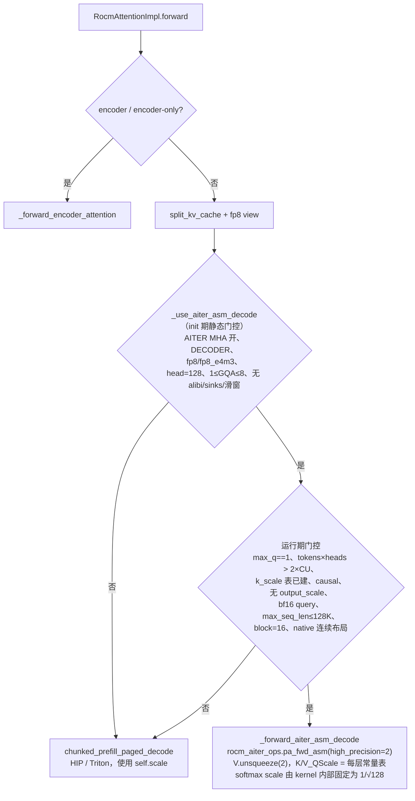
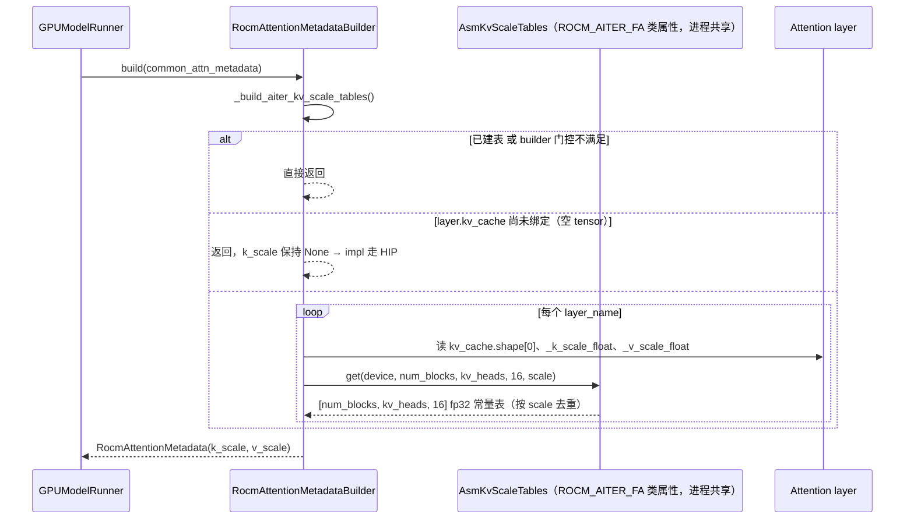

# PR #66082: [Perf][ROCm][ROCM_ATTN] Run large fp8 decode batches on the AITER asm paged attention

> **Author**: @lishuoshuo-amd | **State**: OPEN | **Date**: 2026-11-06
> **Branch**: `lishuoshuo-amd:perf/rocm-attn-aiter-asm-decode` → `main` | **Labels**: rocm
> **Changes**: +385 -0 lines across 3 files | **ROCm 相关性**: 完全相关（Tier-1：`vllm/v1/attention/backends/rocm_attn.py`；Tier-2：`vllm/_aiter_ops.py`）
> 本报告分两部分：§1–6 为 PR 详细总结，§7–8 为 ROCm review 意见。
>
> 数据来源说明：GitHub API 在 review 时被限流，diff 取自本地 `refs/remotes/pr/66082`（head `68843aeb29`，与 PR 页面一致，merge-base `8af2080e71`）；PR 描述与讨论取自 PR 网页。CI 状态未知（PR 尚无 `ready` label，作者称 CI 未启动）。

---

## 1. 总结 (Summary)

ROCM_ATTN 是 ROCm 上非 MLA 模型的默认 attention backend（即使 `VLLM_ROCM_USE_AITER=1` 也排在 ROCM_AITER_FA 之前），decode 一直走 vLLM 自带的 HIP paged attention。本 PR 观察到：fp8 KV cache + 16-token block 时，ROCM_ATTN 的 K/V cache 物理布局恰好就是 AITER asm paged attention（`pa_fwd_asm`）要求的布局（V 只需 `unsqueeze(2)`），因此对「纯 decode 且 `num_tokens × num_heads > 2 × CU 数`」的大 batch 改调 `pa_fwd_asm`（`high_precision=2`，ultra-precision kernel，GQA ≤ 8），小 batch 与其他情况保持 HIP kernel 不变。作者报告 MI355X 上 conc 64/128 输出吞吐 +4–9%。

## 2. 背景与动机 (Background & Motivation)

- ROCM_ATTN 的 decode 使用 `chunked_prefill_paged_decode` → vLLM HIP custom paged attention。AITER 自己的 `paged_attention_common` 在 `num_seqs × num_heads > 2 × CU` 时切到 asm kernel（`_should_use_asm_kernel`），说明 asm kernel 在大 batch 下更快；PR 的 kernel 微基准显示 asm 比 HIP 快 11–30%。
- ROCM_AITER_FA 的 shuffle-KV 路径已经经由 `paged_attention_common` 间接用到同一 asm kernel，但需要专门的 shuffle 布局；本 PR 的卖点是 **ROCM_ATTN 现有 fp8 布局无需重排**即可喂给 asm kernel。
- PR 描述最初写「ROCM_AITER_FA already uses this kernel」，经 @okorzh-amd 指出 `pa_fwd_asm` 在树内此前**零调用方**后作者已改正：这是 vLLM 第一次直接调用 `pa_fwd_asm`，也是第一次喂它原生（非 shuffle）布局。
- 性能声明（PR 描述，`[unverified]`，无原始日志）：MI355X、`VLLM_ROCM_USE_AITER=1`、`--kv-cache-dtype fp8`、random 1024/1024：Qwen3-14B-FP8 / Llama-3.1-8B-Instruct / Qwen3-8B TP1 在 conc 64 +4.2–6.3%、conc 128 +6.2–8.8%；TP2 +2.7–4.4%；conc ≤ 16 基本持平。GSM8K 三个模型与 main 在 run-to-run 波动内一致，另称 3K–32K passkey 一致。

## 3. 代码修改分析 (Code Change Analysis)

### 3.1 修改的模块

| 文件 | 改动 | 说明 |
|------|------|------|
| `vllm/_aiter_ops.py` | +5 | `rocm_aiter_ops.pa_fwd_asm` 新增 `high_precision: int = 1` 并透传给 `aiter.pa_fwd_asm` |
| `vllm/v1/attention/backends/rocm_attn.py` | +123 | metadata 新增 `k_scale/v_scale` 每层 scale 表；builder 构建 scale 表；impl 新增 asm decode 门控、`_forward_aiter_asm_decode` 与 forward 中的分支 |
| `tests/kernels/attention/test_rocm_attn_aiter_asm_decode.py` | +257（新） | 5 个测试函数 / 15 个 case：阈值上下切换、CUDA graph replay、不适用场景保持 HIP、scale 表随 KV 绑定 |

### 3.2 架构 / 流程图





### 3.3 关键实现细节

- **布局复用**：ROCM_ATTN 的 K cache 是 `[blocks, kv_heads, hs/x, 16, x]`（fp8 时 x=16），V cache 是 `[blocks, kv_heads, hs, 16]`；asm kernel 期望 V 为 `[blocks, kv_heads, block/X, hs, X]`，block=16、X=16 时恰好 `block/X = 1`，所以 `value_cache.unsqueeze(2)` 即可，零拷贝。
- **scale 表**：asm kernel 读稠密的 per-slot scale 表 `[num_blocks, kv_heads, block_size]`（per-token fp8 kernel）。PR 复用 ROCM_AITER_FA 的 `AsmKvScaleTables`（按 `(device, num_blocks, kv_heads, block_size, scale)` 去重的进程级缓存），在 KV cache 绑定后首次 `build()` 时惰性创建。
- **两层门控**：impl `__init__` 中的静态条件（`rocm_attn.py:371-380`）+ forward 中的运行期条件（`rocm_attn.py:556-567`）；builder 另有一套更宽的条件（`rocm_attn.py:101-106`）决定是否建表。
- **阈值**：`_aiter_asm_min_heads = 2 * num_compute_units()`（MI355X 256 CU → 512；MI300X 304 CU → 608），与 AITER `_should_use_asm_kernel` 相同。
- **精度档位**：`high_precision=2` 强制 ultra-precision（uhp）kernel；已核对 aiter 0.1.29 的 `hsa/gfx942/pa/pa_asm.csv` 与 `hsa/gfx950/pa/pa_asm.csv` 都只有 `Gqa=8, Hp=2, blkSz=16` 的 `pa_bf16_pertokenFp8_gqa8_2tg_4w_uhp` 一个 bf16×fp8 uhp kernel；`get_heuristic_kernel` 会把 GQA 1–8 向上取整到 8 匹配，与 PR 的 `1 <= GQA <= 8` 门控一致。
- **CUDA graph**：分支条件全部是 Python 侧标量（`max_query_len`、`num_actual_tokens`），在 FULL graph 捕获时按 graph 尺寸固化；scale 表是常量，replay 时不更新也正确。

## 4. 涉及的技术原理 (Technical Principles)

- **Paged attention decode 与 asm kernel**：decode 每个序列 1 个 query token，需遍历该序列的所有 KV block。HIP kernel 按 256-token partition 做 split-K + reduce；AITER asm kernel（2 thread-group × 4 wave）针对 head=128、block=16 手写，batch 足够大（总 head 数 > 2×CU）时占满 CU，减少 reduce 开销，因此更快；小 batch 时 HIP 的 split-K 并行度更好。
- **fp8 KV cache 的 scale 语义**：vLLM 写 cache 时 `stored = x / k_scale`，读时乘回 `k_scale`。HIP kernel 接收标量 `layer._k_scale`；asm kernel 是 per-token 量化 kernel，需要稠密 scale 表，所以 per-tensor scale 被展开为常量表。gfx942 上 fp8 为 e4m3fnuz、gfx950 为 OCP e4m3fn，aiter `dtypes.fp8` 与 vLLM `current_platform.fp8_dtype()` 的映射一致。
- **softmax scale**：标准 attention 为 `softmax(q·k × scale)`，大多数模型 `scale = head_size^-0.5`，但 Granite（`attention_multiplier`）、Gemma3（`query_pre_attn_scalar^-0.5`）等模型使用自定义值，由 `Attention(scale=...)` 传给 backend。`aiter.pa_fwd_asm` **没有 scale 参数**，`csrc/py_itfs_cu/asm_pa.cu` 里固定 `k_scalar = log2(e) / sqrt(head_size)`。
- **CUDA graph 下的 Python 分支**：V1 FULL graph 按 batch 尺寸捕获，Python 分支在捕获时决定、replay 时不再执行；所以门控只能依赖在同一 graph key 下恒定的量（这里是 `num_actual_tokens`、`max_query_len`），这一点 PR 做对了。

## 5. 评论区讨论亮点 (Discussion Highlights)

- **@okorzh-amd（11-10）**：指出描述中「ROCM_AITER_FA already uses this kernel」不实——`pa_fwd_asm` 在 merge-base 零调用方，ROCM_AITER_FA 走的是 `paged_attention_common`；因此正确性完全依赖本 PR 自己的 GSM8K/passkey 验证。作者（11-11）承认并改写描述，强调 `test_decode_switches_to_asm_above_the_cut` 用 HIP 结果做对照（mean err < 3e-3）可以证明布局正确。
- **@okorzh-amd**：新测试 module 级 skip，唯一会收集到它的非可选 job 是 NVIDIA 的 Kernels/Attention 步骤，全部 skip。作者回应：与 `test_rocm_aiter_fa.py` 等 AITER 测试相同，AMD 侧在可选的 MI300/MI355 Attention Kernels 步骤 + nightly 中覆盖，本地 MI355X 15 个 case 全过；请 maintainer 解锁 CI。
- **作者（11-12）**：@ 了 shen-shanshan / tjtanaa / AndreasKaratzas / dllehr-amd 请求加 `ready` label。目前无 approval。

## 6. 风险与潜在问题 (Risk Analysis)

| 风险 | 严重程度 | 说明 |
|------|---------|------|
| 正确性：自定义 softmax scale 被忽略 | High | 见 §7「asm 分支忽略 `self.scale`」 |
| 资源：scale 表不计入 KV 预算 | Medium | 见 §7「scale 表显存未计入预算」 |
| 测试覆盖：AMD CI 未跑、仅 MI355X 验证 | Medium | 见 §7「AMD CI 尚未运行，gfx942 未验证」 |
| 兼容性：默认路径行为改变 | Medium | `VLLM_ROCM_USE_AITER=1 + fp8 KV` 的用户默认切到新 kernel；唯一回退手段是 `VLLM_ROCM_USE_AITER_MHA=0`（同时会把 ROCM_AITER_FA 移出候选） |
| 精度：asm 比 HIP 舍入更多 | Low | 测试容差 max 5e-2 / mean 3e-3；GSM8K 持平；uhp kernel 已是最高档 |
| 性能证据 | Low | 吞吐数字来自 PR 描述，`[unverified]`；kernel 微基准用的是默认精度而非实际使用的 `high_precision=2` |
| 可维护性：跨 backend 耦合 | Low | ROCM_ATTN builder 从 `rocm_aiter_fa` 导入 `AiterFlashAttentionMetadataBuilder.asm_kv_scale_tables` |

---

## 7. Review 意见 (Findings)

| 意见类型 | 🔴 | ⚠️ | 📝 |
|---------|----|----|----|
| 正确性 | 1 | | |
| 性能 / 资源 | | 1 | 1 |
| 测试 | | 1 | |
| 可维护性 | | | 2 |

---

**🔴【正确性】asm 分支忽略 `self.scale`，自定义 softmax scale 的模型会算出错误 attention** `[已验证]`
- **问题**：`rocm_aiter_ops.pa_fwd_asm` / `aiter.pa_fwd_asm` 没有 softmax scale 参数，aiter `csrc/py_itfs_cu/asm_pa.cu::pa_fwd` 内部固定 `k_scalar = log2(e) / sqrt(head_size)`。而 HIP 路径传的是 `sm_scale=self.scale`。PR 的静态门控 `rocm_attn.py:371-380` 检查了 head_size、GQA、alibi、sinks、滑窗，但**没有检查 `self.scale == head_size**-0.5`**（`logits_soft_cap` 同样未检查）。
- **影响**：具体触发输入——`ibm-granite/granite-3.1-8b-instruct`（head 128，32/8 heads，GQA 4，`scale = attention_multiplier = 0.0078125`，而 kernel 用 `1/√128 ≈ 0.0884`，相差 11 倍）+ `VLLM_ROCM_USE_AITER=1 --kv-cache-dtype fp8`，MI355X TP1 上并发 ≥ 17（17×32 = 544 > 512）时 decode 输出静默错误；Gemma3-27B 的全局层（head 128，32/16 heads，`scale = 168^-0.5 ≈ 0.0772`）同理。小并发走 HIP、大并发走 asm，输出质量随负载变化，非常难排查。PR 测试全部用 `scale=HEAD_SIZE**-0.5`（`test_rocm_attn_aiter_asm_decode.py:123`），无法发现该问题；三个 benchmark 模型都是默认 scale。
- **行动**：作者应当在 `_use_aiter_asm_decode` 中加入 `math.isclose(self.scale, head_size**-0.5)`（以及 `self.logits_soft_cap == 0`）条件，并补一个非默认 scale（如 `scale=1/128`）在阈值之上仍与 HIP 一致的测试用例。

---

**⚠️【资源】scale 表显存未计入 KV cache 预算，且 builder 门控比 impl 门控宽** `[已验证]`
- **问题**：`_build_aiter_kv_scale_tables`（`rocm_attn.py:110-143`）在 KV cache 分配**之后**按 `[num_blocks, kv_heads, 16]` fp32 为每个不同的 scale 建表。checkpoint 带逐层校准的 kv scale 时（如 FP8-KV 量化的 Llama checkpoint），每层 K、V 各一张表，额外显存约为 fp8 KV cache 的 `2×16×4 / (2×16×128) = 3.1%`（例：Llama-3.1-8B、约 160 万 token 的 KV cache ≈ 104 GB → 约 3.3 GB），这部分不在 `gpu_memory_utilization` 的 profiling 预算中。另外 builder 门控（`rocm_attn.py:101-106`）只看 AITER MHA、fp8、block 16、head 128，不检查 GQA ≤ 8、滑窗、sinks、`causal` 等，所以 GQA 16 的模型（如 64/4 heads）或全部为滑窗层的组也会建表，但永远不会走 asm。
- **影响**：高 `gpu_memory_utilization`（0.9+）+ 逐层 kv scale 的部署可能在 warmup / CUDA graph 捕获阶段 OOM；不使用 asm 的模型白白多占显存。ROCM_AITER_FA 的 shuffle 路径有同样做法，但那是显式 opt-in，而这里是 AITER + fp8 KV 的默认路径。
- **行动**：建议作者 (1) 让 builder 只在至少一个 layer 的 impl 会走 asm 时建表（例如从 `static_forward_context` 读 impl 的 `_use_aiter_asm_decode`）；(2) 在 PR 描述中说明额外显存的量级，或把表显存计入 KV cache 规划；scale 全为 1.0 时只有一张共享表，可说明对常见 checkpoint 影响很小。

---

**⚠️【测试】AMD CI 尚未运行；只在 MI355X 上验证，gfx942 未验证** `[已验证]`
- **问题**：PR 无 `ready` label，CI 未启动；新测试只在可选的 MI300/MI355 Attention Kernels 步骤运行。作者所有吞吐 / GSM8K / passkey 数据均来自 MI355X（gfx950）。我核对了 aiter 0.1.29：gfx942 的 `pa_asm.csv` 中有同名 `pa_bf16_pertokenFp8_gqa8_2tg_4w_uhp`，fp8 dtype（e4m3fnuz）映射也与 vLLM 一致，所以 gfx942 上应能选到 kernel，但没有任何数值验证；MI300X 的阈值也不同（304 CU → 608 heads）。
- **影响**：这是 Tier-1 默认路径的 kernel 替换；MI300X/MI325X 用户在 `VLLM_ROCM_USE_AITER=1 + fp8 KV` 下会第一个用到它，若 gfx942 uhp kernel 有数值问题，合入前没有任何信号。
- **行动**：建议 maintainer 解锁 MI300 Attention Kernels 步骤跑一次新测试，并建议作者在 MI300X 上补一组 GSM8K（至少一个模型）结果贴到 PR。

---

**📝【性能】kernel 微基准测的不是实际使用的精度档位** `[已验证]`
- **问题**：PR 描述的 kernel 延迟表注明「asm at AITER's default precision」，即 `high_precision=1`，而 PR 实际调用 `high_precision=2`（uhp kernel，是不同的 `.co`）；作者仅以「serving runs show `high_precision=2` runs at the same speed」带过。吞吐表数字无原始日志，每点是否多次运行未说明，标为 `[unverified]`。
- **影响**：读者会把 11–30% 的 kernel 加速当作 uhp kernel 的数据。
- **行动**：建议作者用 `high_precision=2` 重跑 kernel 延迟表，或在描述中明确两者的关系。

---

**📝【可维护性】`max_seqlen_k <= 128 * 1024` 无出处，FULL graph 下与 eager 行为不一致** `[已验证]`
- **问题**：`rocm_attn.py:564` 的 128K 上限没有注释说明来源（kernel 限制？context_lens 编码？）。同时 `gpu_model_runner` 在 CUDA graph 捕获时把 `max_seq_len` 设为 `max_model_len`，因此 `max_model_len > 128K` 的部署中 FULL graph 永远走 HIP，而 piecewise / eager 下实际序列 ≤ 128K 时走 asm——同一部署两种 kernel，行为与数值不一致（安全但令人意外）。
- **行动**：建议作者注释这个上限的来源；若来自 kernel 的硬限制，请说明，否则考虑去掉。

---

**📝【可维护性】ROCM_ATTN 依赖 ROCM_AITER_FA builder 的类属性** `[已验证]`
- **问题**：`rocm_attn.py:115-119` 在函数内 `from vllm.v1.attention.backends.rocm_aiter_fa import AiterFlashAttentionMetadataBuilder` 只为拿 `asm_kv_scale_tables`。两个 backend 共享进程级缓存是有意为之（draft/target 去重），但依赖方向不自然：重构 ROCM_AITER_FA 时容易误伤 ROCM_ATTN。
- **行动**：建议作者把 `AsmKvScaleTables` 及其单例移到中立模块（如 `vllm/v1/attention/ops/` 下的 aiter 工具文件），两个 backend 都从那里导入。

## 8. 结论 (Verdict)

🔴 **BLOCK** — 布局复用、阈值、CUDA graph 处理和 GQA ≤ 8 门控都经得起核对，思路很好；但 asm kernel 固定使用 `1/√head_size` 作为 softmax scale，而门控没有排除自定义 scale 的模型，Granite-3.x-8B / Gemma3-27B 在 `VLLM_ROCM_USE_AITER=1 + fp8 KV` 且 decode batch 超过阈值时会静默得到错误输出。加上 scale 条件和对应测试后即可转为 ⚠️/✅；scale 表显存与 gfx942 验证建议一并处理。

## 9. 英文 Review 评论 (Copy-Paste English Comments)

**C1** `vllm/v1/attention/backends/rocm_attn.py:371-380` — 🔴 blocking

```text
The asm path ignores self.scale. aiter.pa_fwd_asm has no softmax-scale argument; asm_pa.cu hardcodes k_scalar = log2(e) / sqrt(head_size), while the HIP path passes sm_scale=self.scale. Models with a custom scale and head_size 128 pass this gate, e.g. granite-3.1-8b-instruct (scale = attention_multiplier = 1/128, GQA 4) or the global layers of Gemma3-27B (scale = 168**-0.5). With VLLM_ROCM_USE_AITER=1 and an fp8 KV cache, every decode batch above the cut (17+ sequences for Granite on MI355X) would silently produce wrong attention. Could you add math.isclose(self.scale, head_size**-0.5) and self.logits_soft_cap == 0 to _use_aiter_asm_decode?
```

**C2** `tests/kernels/attention/test_rocm_attn_aiter_asm_decode.py:166-184` — ⚠️ comment

```text
All cases build the impl with scale=HEAD_SIZE**-0.5, so the tests cannot catch a scale mismatch between the asm kernel and the HIP path. Could you add a case with a non-default scale (e.g. 1/128) above the cut and assert it still matches HIP within the existing tolerance (or stays on HIP once the gate is fixed)? Separately, since this replaces the default decode kernel on gfx942 too, could we get one run of the MI300 Attention Kernels step and a GSM8K number on MI300X?
```

**C3** `vllm/v1/attention/backends/rocm_attn.py:101-106` — ⚠️ comment

```text
The builder allocates the dense [num_blocks, kv_heads, 16] fp32 scale tables after the KV cache is sized, so they are outside the gpu_memory_utilization budget. With per-layer calibrated KV scales that is two tables per layer, about 3% of the fp8 KV cache (roughly 3 GB for Llama-3.1-8B at ~1.6M tokens). This gate is also broader than the impl gate (no GQA <= 8, sliding-window or sinks check), so models that never take the asm path still pay for it. Could the builder only build tables when some layer's impl actually uses the asm decode, and could the description note the memory cost?
```

**C4** `vllm/v1/attention/backends/rocm_attn.py:564` — 📝 comment

```text
Where does the 128 * 1024 limit come from? A short comment would help. Note that CUDA graph capture sets max_seq_len to max_model_len, so with max_model_len > 128K the FULL graphs always take HIP while piecewise/eager batches below 128K take asm, i.e. one deployment runs two kernels depending on the cudagraph mode.
```

## 10. 英文总结评论 (Overall Review Summary)

```text
Nice idea: the fp8 ROCM_ATTN cache already matches the asm paged-attention layout, the GQA <= 8 gate matches the only ultra-precision kernel in AITER, and the per-graph cut is CUDA-graph safe. One blocker: pa_fwd_asm hardcodes 1/sqrt(head_size) as the softmax scale, so models with a custom scale (Granite, Gemma3-27B global layers) get wrong decode output above the cut. Please gate on self.scale (and soft cap) and add a non-default-scale test. Also consider limiting the scale-table allocation to layers that use asm, and please run the MI300 attention step. Changes needed before merge.
```
