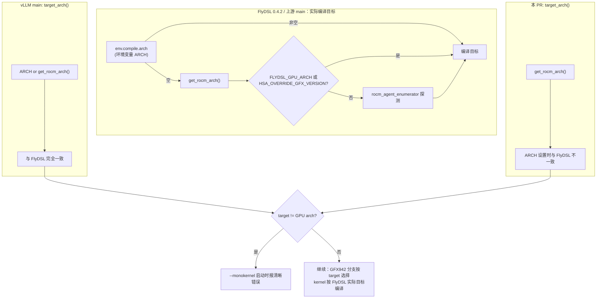

# PR #66215: [ROCm] Read the DSv4.1 mono target arch from FLYDSL_GPU_ARCH

> **Author**: @coderfeli | **State**: OPEN | **Date**: 2026-11-07
> **Branch**: `coderfeli:flydsl-gpu-arch-env` → `main` | **Labels**: rocm, deepseek, closed-as-slop, verified
> **Changes**: +12 -13 lines across 3 files | **ROCm 相关性**: 完全相关（只改 DSv4.1 AMD mono decode 的 FlyDSL 目标架构判定）
> **CI**: GitHub Actions 7 项：4 success、2 skipped、1 failure（`pre-commit`，失败点在 PR 未修改的 `benchmarks/kernels/benchmark_batched_moe.py` 的 docstring 规则，来自 main，不是本 PR 引入）；Buildkite 未触发
> 本报告分两部分：§1–6 为 PR 详细总结，§7–8 为 ROCm review 意见。

---

## 1. 总结 (Summary)

`vllm/models/deepseek_v41/amd/mono/common/arch.py::target_arch()` 用来推断 FlyDSL 为 mono decode kernel 编译的目标架构，`--monokernel` 的启动检查拿它和 GPU 实际架构比较，不一致就报错。main 上它的实现是 `os.environ.get("ARCH") or get_rocm_arch()`。本 PR 删掉对 `ARCH` 的读取，只用 `get_rocm_arch()`，并把 docstring、注释和报错信息里的 `ARCH` 改写成 `FLYDSL_GPU_ARCH`。

核心问题是：**FlyDSL 本身（本机安装的 0.4.2 和上游 main）仍然把 `ARCH` 作为编译目标的最高优先级覆盖**。main 的写法正好和 FlyDSL 的解析逻辑一致，而且 `get_rocm_arch()` 已经读取 `FLYDSL_GPU_ARCH`。所以本 PR 实际的功能效果只有一个：让 vLLM 的架构检查看不见仍然生效的 `ARCH`。

## 2. 背景与动机 (Background & Motivation)

- PR 描述的动机是"下游代码在统一使用 `FLYDSL_GPU_ARCH`"，并提到配套的 aiter 改动 ROCm/aiter#7598（去掉 AOT dry run 里的 `ARCH`）。**该 aiter PR 已于 2026-11-07 被关闭且未合并。**
- 作者在评论中说明："kernels used a deprecated env 'ARCH' of FlyDSL… Not a bug right now but in the future. No regression"。但 FlyDSL 里没有任何 `ARCH` 的弃用标记（见 §7）。
- 维护者 @AndreasKaratzas 因"未运行测试、无 issue、无复现步骤、AI 生成"加了 `closed-as-slop` 标签，并在 11-09 追问"why is it open right now then?"，作者尚未回复。
- 作者未在本地运行测试（PR 描述："environment is missing test dependencies (`tblib`)"）。

## 3. 代码修改分析 (Code Change Analysis)

### 3.1 修改的模块

| 文件 | 改动 |
|------|------|
| `vllm/models/deepseek_v41/amd/mono/common/arch.py` | 删除 `import os`；`target_arch()` 从 `os.environ.get("ARCH") or get_rocm_arch()` 改为只用 `get_rocm_arch()`；docstring 改名 |
| `vllm/models/deepseek_v41/amd/mono_decode.py` | `--monokernel` arch 不一致分支的注释和报错文本把 `ARCH` 换成 `FLYDSL_GPU_ARCH`（:375-384） |
| `tests/models/test_dsv41_mono_decode.py` | 只改 `test_opt_in_with_another_arch_for_flydsl_raises` 的 docstring；测试本身 stub 掉 `target_arch()`，与环境变量无关 |

### 3.2 架构 / 流程图



### 3.3 关键实现细节

- `arch.py:22` 的 `GFX942 = target_arch().startswith("gfx942")` 在 import 时求值，mono kernel 的 helper 用它选择 gfx942 / gfx950 的指令路径（scaled f8f6f4 MFMA、permlane swap、fnuz vs OCP fp8 等）。这个值必须和 FlyDSL 实际编译的目标一致。
- `mono_decode.py:371` `target, gpu = target_arch(), _gpu_arch()`，`_gpu_arch()` 读 `torch.cuda.get_device_properties().gcnArchName`。两者不同就 `raise ValueError("--monokernel needs FlyDSL to compile for the GPU's …")`。
- 本机 FlyDSL 0.4.2：
  - `flydsl/utils/env.py:238`：`arch = OptStr("", env_var="ARCH", description="Override target GPU architecture …")`
  - `flydsl/compiler/backends/rocm.py:32`：`arch = env.compile.arch or get_rocm_arch()`
  - `flydsl/runtime/device.py:46`：`get_rocm_arch()` 读 `FLYDSL_GPU_ARCH`，其次 `HSA_OVERRIDE_GFX_VERSION`，再探测硬件
- 上游 ROCm/FlyDSL main（`python/flydsl/utils/env.py:238`、`python/flydsl/compiler/backends/rocm.py:50`）与 0.4.2 相同，`ARCH` 依然优先。

## 4. 涉及的技术原理 (Technical Principles)

- **FlyDSL 编译目标解析**：FlyDSL 是 AMD 的 Python DSL，JIT 时需要确定 gfx 目标。它有两层：编译后端的 `detect_target()` 先看 `ARCH`，再调用 `get_rocm_arch()`；而 kernel 内部的分支（`expr/rocdl/universal.py` 等）直接调用 `get_rocm_arch()`。`FLYDSL_GPU_ARCH` 只在 `ARCH` 未设置时才决定编译目标。
- **DSv4.1 mono decode 的双架构路径**：mono kernel 为 gfx950 编写，gfx942 缺少若干指令，所以 helper 通过 `GFX942` 走替代路径，权重也有 gfx942 专用副本（按 GPU 实际架构选择）。编译目标、helper 分支、权重副本三者必须一致，否则会在 JIT 编译或 kernel 加载时失败。
- **启动期防御检查**：`--monokernel` 的 arch 检查的作用是把"环境变量把编译目标拉偏"这种配置错误在启动时以清晰的报错暴露，而不是在 JIT / HIP 加载阶段以难懂的错误出现。

## 5. 评论区讨论亮点 (Discussion Highlights)

- @AndreasKaratzas（维护者）：PR 未运行测试、没有关联 issue、没有复现步骤，且为 AI 生成，加 `closed-as-slop`；随后追问为何仍然开着。
- @coderfeli（作者）：称 `ARCH` 是 FlyDSL 的"deprecated env"，"未来才会成为 bug"，"No regression"。本报告核实了 FlyDSL 源码，`ARCH` 并未弃用，仍是最高优先级（见 §7 第一条）。
- 没有其他实质性代码 review。

## 6. 风险与潜在问题 (Risk Analysis)

| 风险 | 严重程度 | 说明 |
|------|---------|------|
| 正确性：设置 `ARCH` 时启动检查失效 | 中 | 见 §7 "`ARCH` 仍是 FlyDSL 的编译目标覆盖" |
| 动机：配套 aiter PR 已关闭 | 低 | ROCm/aiter#7598 未合并，"下游统一"的前提目前不成立 |
| 测试覆盖 | 低 | 现有测试 stub 掉 `target_arch()`，无论改不改都通过；没有测试覆盖环境变量解析 |
| 流程 | 低 | `closed-as-slop` 标签，维护者问题未回复；pre-commit 红是 main 的问题 |

---

## 7. Review 意见 (Findings)

| 意见类型 | 数量 |
|---------|------|
| 🔴 必须修复 | 0 |
| ⚠️ 建议修复 | 1 |
| 📝 建议/备注 | 2 |

**⚠️【正确性】`ARCH` 仍是 FlyDSL 的编译目标覆盖，删掉它会让 `--monokernel` 的架构检查失效** `[已验证]`
- **问题**：`arch.py:17-19` 现在只返回 `get_rocm_arch()`。但 FlyDSL 0.4.2（本机安装）和上游 main 的编译后端都是 `env.compile.arch or get_rocm_arch()`，`env.compile.arch` 读环境变量 `ARCH`。main 上的 `os.environ.get("ARCH") or get_rocm_arch()` 和 FlyDSL 的解析完全一致，并且已经通过 `get_rocm_arch()` 支持 `FLYDSL_GPU_ARCH`。所以本 PR 没有增加对 `FLYDSL_GPU_ARCH` 的支持，唯一的功能变化是不再看 `ARCH`。
- **影响**：触发输入：MI355X（gfx950）上带 `--monokernel` 启动，环境里残留 `ARCH=gfx942`（或者像构建环境里常见的 `ARCH=x86_64`）。
  - main：`target_arch()` 返回 `gfx942`，与 GPU 不一致，启动时报 "--monokernel needs FlyDSL to compile for the GPU's gfx950, but the ARCH environment variable makes it compile for gfx942"。
  - 本 PR：`target_arch()` 返回 `gfx950`，检查通过，`GFX942=False`，helper 走 gfx950 指令路径，而 FlyDSL 按 `ARCH` 为 gfx942 编译。结果是在 JIT 编译或 HIP 加载阶段失败，报错与环境变量无关，很难定位。具体报错文本未实测（未运行 PR 代码）。
  - 新的报错文本还会把不一致归因到 `FLYDSL_GPU_ARCH`，而实际原因可能是 `ARCH`。
- **行动**：建议作者保留 main 的解析逻辑（或者直接调用 FlyDSL 自己的 `env.compile.arch or get_rocm_arch()`，从源头保持一致），只更新 docstring 和报错文本，同时说明 `ARCH` 和 `FLYDSL_GPU_ARCH` 两个变量。等 FlyDSL 真正弃用 `ARCH` 后再删掉这一读取。

**📝【设计】PR 前提与实际状态不符** `[已验证]`
- **问题**：描述里的"下游在统一使用 `FLYDSL_GPU_ARCH`"所依赖的配套 aiter PR ROCm/aiter#7598 已于 11-07 关闭，未合并；FlyDSL 源码中 `ARCH` 没有弃用说明或警告。
- **影响**：本 PR 单独合入会让 vLLM 与 FlyDSL / aiter 的行为不一致。
- **行动**：建议作者先在 FlyDSL 侧确认 `ARCH` 的弃用计划（或提交弃用 PR），并回复维护者关于 PR 状态的问题。

**📝【注释/文档】docstring 文字** `[已验证]`
- **问题**：`arch.py:5` "in the FLYDSL_GPU_ARCH env" 语句不完整（缺少 "environment variable"），而且没有提到 `HSA_OVERRIDE_GFX_VERSION` 同样会影响 `get_rocm_arch()`。
- **影响**：仅可读性。
- **行动**：如果保留 docstring 改动，建议写全 FlyDSL 实际的优先级：`ARCH` > `FLYDSL_GPU_ARCH` > `HSA_OVERRIDE_GFX_VERSION` > 硬件探测。

## 8. 结论 (Verdict)

⚠️ **NEEDS WORK**：PR 的功能改动删除了 FlyDSL 仍然生效的 `ARCH` 覆盖，使 `--monokernel` 的启动检查在设置了 `ARCH` 时失效，而 `FLYDSL_GPU_ARCH` 在 main 上本来就已支持。建议只保留文档 / 报错文本的更新，不改解析逻辑。

## 9. 英文 Review 评论 (Copy-Paste English Comments)

**C1** `vllm/models/deepseek_v41/amd/mono/common/arch.py:17-19` — ⚠️ comment

```text
I don't think ARCH can be dropped here yet. FlyDSL still resolves its compile target as `env.compile.arch or get_rocm_arch()` (flydsl/compiler/backends/rocm.py, both 0.4.2 and current ROCm/FlyDSL main), and `env.compile.arch` is read from ARCH. So main's `os.environ.get("ARCH") or get_rocm_arch()` mirrors FlyDSL exactly, and it already honours FLYDSL_GPU_ARCH through get_rocm_arch(). With this change, on an MI355X with a stray ARCH=gfx942, target_arch() returns gfx950, the --monokernel check passes and GFX942 is False, while FlyDSL compiles for gfx942, so the failure moves from a clear startup error to the JIT/HIP load. Could you keep the ARCH read (or call FlyDSL's own `env.compile.arch or get_rocm_arch()`) and only update the docs until FlyDSL deprecates ARCH?
```

**C2** `vllm/models/deepseek_v41/amd/mono_decode.py:380-384` — ⚠️ comment

```text
Since ARCH still takes precedence over FLYDSL_GPU_ARCH in FlyDSL's compile backend, this message can point users at the wrong variable: a mismatch caused by ARCH would now be reported as FLYDSL_GPU_ARCH. I'd suggest naming both (and HSA_OVERRIDE_GFX_VERSION, which get_rocm_arch() also reads), e.g. "the ARCH / FLYDSL_GPU_ARCH environment variables make it compile for {target}". Also note that the companion aiter change (ROCm/aiter#7598) was closed without merging, so the "downstream is standardising on FLYDSL_GPU_ARCH" premise doesn't hold yet.
```

## 10. 英文总结评论 (Overall Review Summary)

```text
Thanks for the cleanup, but I don't think the ARCH read can be dropped yet. FlyDSL still resolves its compile target as ARCH first, then get_rocm_arch(), which already honours FLYDSL_GPU_ARCH, so main's target_arch() already matches FlyDSL. With this change, a stray ARCH=gfx942 on MI355X passes the --monokernel startup check and fails later in JIT/HIP load instead. The companion aiter PR (ROCm/aiter#7598) was also closed unmerged. I'd suggest keeping the resolution logic and only updating the docs and error message to name both variables. Changes requested.
```
