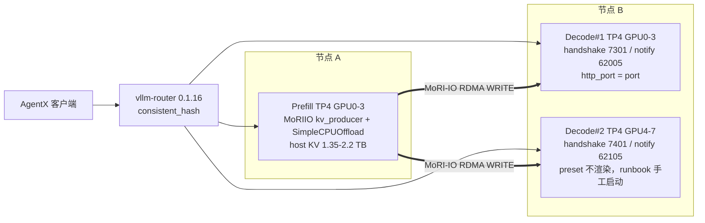
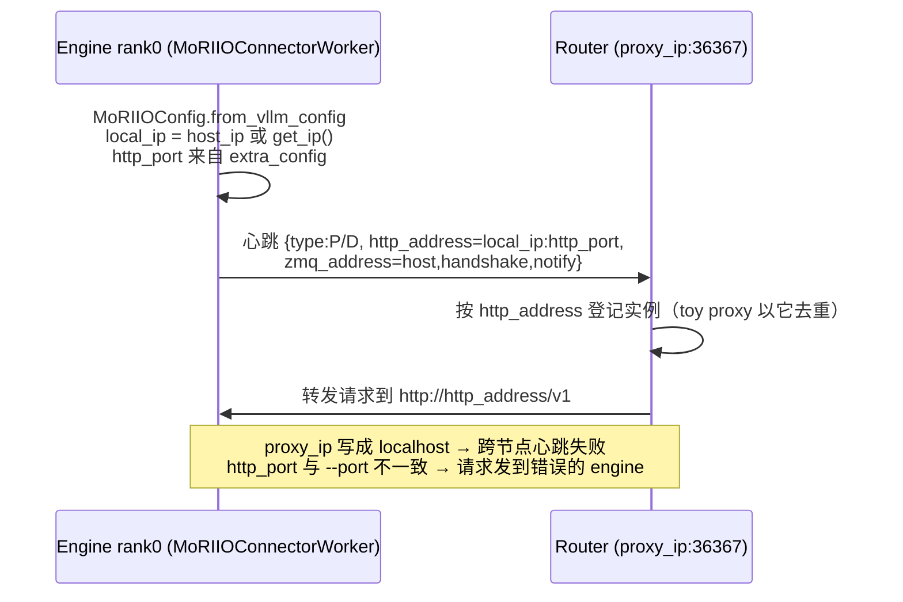

# PR #66268: [Recipe][ROCm] MiniMax-M3.1-Flash MI355X AgentX PD disaggregation over MoRI-IO

> **Author**: @whx-sjtu | **State**: OPEN | **Date**: 2026-11-07
> **Branch**: `whx/m31-mi355x-moriio-pd-recipe` → `main` | **Labels**: rocm, kv-connector, minimax, recipe
> **Changes**: +193 -0 lines across 1 file | **ROCm 相关性**: 完全相关（MI355X 专属 recipe，MoRI-IO PD 分离）
> **CI**: 未获取（CI 状态未知）
> 本报告分两部分：§1–6 为 PR 详细总结，§7–8 为 ROCm review 意见。

> 注：任务描述中的标题 "...mi355x_agentx_pd: set ROUTER_HOST for cross-node discovery" 是 head commit（e28b017b）的提交信息，PR 实际标题如上。diff 并不是新增文件，而是在已有的 `recipes/models/MiniMaxAI/MiniMax-M3.1-Flash.yaml` 的 `presets:` 末尾追加一个 193 行的新 preset `mi355x_agentx_pd`。PR 共 3 个 commit（699d5c85 新增 preset → 4307173c 改为渲染命令的实测结果 → e28b017b 在 runbook 里补充 ROUTER_HOST 说明），全部出自作者本人，直接基于 merge-base `a8dacd72`，**不是 stacked PR**。upstream/main 自 merge-base 以来有 71 个 commit，没有一个改动该文件；`git merge-tree` 三方合并结果无冲突。运行时依赖未合入的 #65822（见 §7）。

---

## 1. 总结 (Summary)

本 PR 为 MiniMax-M3.1-Flash recipe 新增 opt-in preset `mi355x_agentx_pd`：在 MI355X 上做 1P2D 的 PD 分离，共 12 卡。一个 TP4 prefill engine（带 host-DRAM KV offload 层）通过 MoRI-IO RDMA WRITE 把 KV 推给两个 TP4 decode engine，前面由 vllm-router 按 consistent-hash 路由。preset 沿用 `mi355x_agentx`（#66188）的 nightly 镜像和 ROCm opt-in 开关，提供 c40–c128 六个并发点，每个点单独设置 decode batch 上限、CUDA graph 尺寸和 prefill host KV 容量。PR 只改 YAML，不改 vLLM 代码。

## 2. 背景与动机 (Background & Motivation)

- 主线上 MiniMax-M3.1-Flash 的 MI355X 只有聚合式的 `mi355x_agentx`（TP4，对应 InferenceX #4866）。`strategy_overrides.pd_cluster` 里的 MI355X 1P1D 块写死了 NIXL 的 `--kv-transfer-config` 和 `VLLM_KV_CACHE_LAYOUT=BLHNC`，没有可直接用的 MoRI-IO preset。
- 作者在 ROCm/ATOM CI 上用 agentx-harness 1.0.12 每点跑 3600 s，得到 1P2D 结果：在 p90 interactivity 相同的条件下，每卡总吞吐比 #4866 的聚合 TP4 高 6–32%。
- 这些结果依赖 #65822（MoRI-IO WRITE 跳过 decoder 前缀缓存已有的 block，**尚未合入**），实测时把它的 Python 文件 overlay 到镜像上；c96 还额外 overlay 了 #63483（DBO），但 DBO 保持关闭。
- 最新 commit 在 runbook 里补充说明：engine 通过 `proxy_ip` 发现 router，跨节点部署时必须设置 `ROUTER_HOST`，否则默认值 `localhost` 只能让 router 所在节点的 engine 注册上。

## 3. 代码修改分析 (Code Change Analysis)

### 3.1 修改的模块

| 模块 | 改动 |
|------|------|
| `recipes/models/MiniMaxAI/MiniMax-M3.1-Flash.yaml` (+193) | 在 `presets:` 末尾（`mi355x_agentx` 之后、`guide:` 之前）新增 `mi355x_agentx_pd`：顶层 args/env/json_args、`roles.prefill/decode` 覆盖、6 个 `points`，以及 runbook（部署步骤、调参规则、结果表、已知故障） |

### 3.2 架构 / 流程图

部署拓扑（1P2D，12 × MI355X）：



engine 向 router 注册的过程（这就是 `ROUTER_HOST` 和 `http_port` 必须配对的原因）：



### 3.3 关键实现细节

- **选择器**：`strategy: pd_cluster`、`select.pd_connector: moriio`、`kv_offload: simple`、`features: {text_only, spec_decoding}`。这是 vLLM recipes 中第一个使用 `pd_connector: moriio` 的 preset（主线上其他 preset 只用过 `mooncake`）。
- **顶层 json_args** `--kv-transfer-config: {MoRIIOConnector: {backend: rdma, num_workers: 4, qp_per_transfer: 4, read_mode: false}}`。注释说明了 QP 数选 4 的原因：单个 QP 遇到约 230K token 的 prompt 时会撑爆 16384-WR 的发送队列。这几个 key 在 `moriio_common.py::MoRIIOConfig.from_vllm_config` 里都存在。
- **roles**：两个角色都把 `VLLM_KV_CACHE_LAYOUT` 改回 `LBHNC`，覆盖 pd_cluster 块为 NIXL 设置的 BLHNC。prefill 额外通过 json_args 打开 `indexer_decode_cp: true`。decode 在 raw `args` 里重写整条 MoRIIO consumer `--kv-transfer-config`（包含 `proxy_ip: $ROUTER_HOST`、`http_port: {port}`、handshake 7301、notify 62005），用来替换 pd_cluster 块写入的 NIXL 配置。
- **points**：prefill `--max-num-seqs` 取并发的 2 倍；decode 上限为 10/12/16/16/20/24，`cudagraph_capture_sizes` 是上限 ×(1+7) 范围内 8 的倍数（我逐点核对过，都对）；prefill `cpu_bytes_to_use` 为 1.349 TB（c40–c64）、1.9 TB（c96/c112）、2.2 TB（c128），并显式写 `cpu_hugepage_block_size: null`，覆盖 pd_cluster 块的 1 GB HugeTLB。
- **env**：继承 `mi355x_agentx` 的四个 ROCm opt-in 开关，另加 `PYTHONHASHSEED=42`（让 P/D 的前缀块哈希一致）、`HIP_FORCE_DEV_KERNARG`、`NCCL_DMABUF_ENABLE=0`、`HSA_ENABLE_IPC_MODE_LEGACY=1`、`DEBUG_HIP_DYNAMIC_QUEUES=0`，以及几个超时参数。
- **runbook**：说明第二个 decode engine 怎么手工启动、NUMA 绑定、vllm-router ≥0.1.15 和 consistent_hash 三项 policy、`ROUTER_HOST`/`VLLM_HOST_IP`，以及 mori `tcp.cpp` "Address already in use" 的启动竞态（`local_kv_port = get_open_port()` 先探测再释放，确实存在 TOCTOU）。

## 4. 涉及的技术原理 (Technical Principles)

- **MoRI-IO WRITE 模式**：默认 `read_mode=false`。decode 收到请求后把自己的 block table 发给 prefill，prefill 算完后逐层 RDMA 写入 decode 显存。控制面走 ZMQ：handshake/notify 端口按 `dp_rank*tp_size+tp_rank` 偏移，所以 TP4 的 decode#1 占 7301–7304 和 62005–62008，decode#2 占 7401–7404 和 62105–62108，两者不冲突。
- **Router 发现**：MoRIIO 的 rank0 worker 按 `proxy_ip:proxy_ping_port` 周期性发心跳，心跳 payload 里的 `http_address = local_ip:http_port` 就是 router 之后转发请求的目标地址。所以 `proxy_ip` 决定能不能注册上，`http_port` 决定请求最终落到哪个 engine。
- **前缀缓存 + PD**：agentic 多轮对话的前缀命中率很高。prefill 侧靠 SimpleCPUOffload 把前缀留在 host DRAM（runbook 里给的命中率是 95–97%），decode 侧开 prefix caching，配合 #65822 可以避免重复写入已命中的 block。前提是 P/D 的块哈希种子一致（`PYTHONHASHSEED`）。
- **DSpark 7-token 投机解码**：decode 的每个请求每步处理 1+7 个 token，所以 graph 尺寸取 8 的倍数，最大值为 batch 上限 ×8。
- **合成拒绝采样**：吞吐测试用固定接受长度 4.04 代替真实的 block 验证，好处是各点的接受率一致、方便比较；代价是看不到接受率的变化，而接受率变化往往是 KV 数据出错的第一个信号。

## 5. 评论区讨论亮点 (Discussion Highlights)

- 目前没有实质性的人工 review。只有 mergify 发布的 recipe 预览链接，以及 claude[bot] 说明 fork PR 自动 review 已禁用。
- 预览站 JSON 中 decode 的 `--kv-transfer-config` 原样保留了 `$ROUTER_HOST` 和 `{port}` 占位符，说明替换发生在前端 builder 渲染时。本次 review 拿不到 builder 的渲染结果。

## 6. 风险与潜在问题 (Risk Analysis)

| 风险 | 严重程度 | 说明 |
|------|---------|------|
| 按 runbook 手工启动的第二个 decode 沿用第一个 decode 的 `http_port` | Medium | 见 §7「runbook 漏写 http_port」 |
| 固定的镜像不包含 #65822，按 preset 跑复现不出表中数字 | Medium | 见 §7「镜像与依赖」 |
| 该配置没有做任何精度验证，吞吐测试又用合成拒绝采样 | Medium | 见 §7「精度验证缺失」 |
| builder 对 decode `--kv-transfer-config` 两种来源的合并语义不明 | Low | 见 §7 📝 |
| host DRAM 需要 1.35–2.2 TB，环境变量没有逐项说明 | Low | 见 §7 📝 |
| 对 vLLM 代码 / CUDA 用户的影响 | Low | 纯 YAML，只新增一个 opt-in preset，不改变已有 preset |

---

## 7. Review 意见 (Findings)

本 PR 只改 YAML，kernel、dispatch、多流同步这类规则不适用。本次检查了 mori 集成清单中的配置面和端口项、卫生检查、性能证据溯源，以及与同文件兄弟 preset（`mi355x_agentx`、pd_cluster MI355X 块、`gb300_agentx_pd`）和 Kimi-K3 MoRIIO 指南的一致性。

| 类型 | 🔴 | ⚠️ | 📝 |
|------|----|----|----|
| 正确性 | — | 1 | — |
| 兼容性 | — | 1 | — |
| 测试 | — | 1 | — |
| 设计 | — | — | 2 |
| 注释/文档 | — | — | 2 |
| 可维护性 | — | — | 1 |

---

**⚠️【正确性】runbook 启动第二个 decode 时只改 `--port`，没改 `http_port`，两个 decode 会向 router 登记同一个 HTTP 地址** `[已验证]`（vllm-router 内部的去重行为为 `[推测]`）

- **问题**：`MiniMax-M3.1-Flash.yaml:1688-1691` 让用户"用同样的命令和环境"启动 decode#2，只列出要改的 `CUDA_VISIBLE_DEVICES=4,5,6,7`、`--port 8003`、`handshake_port 7401`、`notify_port 62105`。decode 的 kv 配置（L1593）里 `http_port` 是 `{port}`，builder 会把它替换成 decode#1 的端口。`MoRIIOConfig.from_vllm_config` 直接读 `extra_config["http_port"]`，`_start_heartbeat` 用它组成 `http_address = local_ip:http_port` 上报给 router，与 `--port` 无关。
- **影响**：decode#2 会以 decode#1 的 HTTP 地址注册，但上报的是自己的 zmq/handshake 地址。仓库内的 `moriio_toy_proxy_server.py` 按 `http_address` 去重，后注册的会覆盖先注册的，结果是一个 decode 从路由中消失，或者请求发到 decode#1、KV 却写进 decode#2，最后超时或在 `kv_load_failure_policy=fail` 下失败。vllm-router 是否同样按 http_address 去重我没有验证。表中的实测数据显然是在正确配置下得到的，所以这个问题只会坑到照着文档复现的用户。
- **行动**：作者应当在 runbook 里明确写出 decode#2 的 `http_port` 必须等于 8003（与 `--port` 一致），最好直接给出 decode#2 完整的 `--kv-transfer-config` 字符串。

**⚠️【兼容性】固定的镜像不包含实测所依赖的 #65822，按 preset 跑复现不出表中数字** `[已验证]`

- **问题**：preset 的 `image`（L1550）固定为 `nightly-4fab5a07…`。我核对过，`4fab5a0747` 是 upstream/main 的祖先，但 #65822（`pr/65822`，"MoRIIO WRITE: skip blocks the decoder prefix cache already holds"）不在 upstream/main 上，也就不在这个镜像里。runbook（L1681-1686）承认实测时 overlay 了 #65822 的 Python 文件，又让用户"use a nightly that contains it"，但这样的 nightly 目前还不存在。c96 还额外 overlay 了 #63483。
- **影响**：用户照着 preset 渲染的命令拉镜像，跑的是不带 #65822 的代码。有前缀命中时 prefill 会把整段 prompt 重新写一遍，表中的吞吐和 TTFT 都复现不出来。PR 描述中"each point's rendered command matches its run's launch argv"只说明命令行一致，代码其实不一致。另外 #65822 的 commit message 写明它只对单 group 的 WRITE 生效，MiniMax-M3.1 的 KV group 结构下它是否真的生效，也需要合入后再确认。
- **行动**：建议作者等 #65822 合入、出了包含它的 nightly 后再更新 `image` 并合这个 preset；或者在 description/runbook 显眼的位置标注当前镜像缺少 #65822，表中数字不能直接复现。建议 review 时追问是否打算把本 PR 的合入顺序放在 #65822 之后。

**⚠️【测试】新的 PD 路径没有任何精度验证，吞吐测试又用合成拒绝采样，KV 出错可能完全看不出来** `[已验证]`

- **问题**：PR 描述明确写了 "no accuracy evaluation on this configuration"。runbook（L1677-1679）说明吞吐测试用的是接受长度固定为 4.04 的合成拒绝。对比同文件的 `mi355x_agentx`，它在 c8/c32/c64 都报告了 GSM8K（约 0.96）。本 preset 是一条新的数据路径：MoRI-IO WRITE、LBHNC 布局（不是 pd_cluster 块里的 BLHNC）、NVFP4 KV 和 indexer K cache、decode 侧前缀缓存叠加 #65822 的跳过 block 逻辑、prefill 侧 host KV 层。
- **影响**：KV 写错位、跳错 block、布局不匹配这类问题，在 PD 场景下通常只表现为输出质量下降或接受率下降，不会报错。合成拒绝采样恰好把接受率这个信号屏蔽了，因此吞吐表无法证明输出是正确的。
- **行动**：建议作者至少在一个点（例如默认的 c96）用 block 验证跑一次 GSM8K 或同等精度测试并贴出结果，同时报告真实的 DSpark 接受长度，并与聚合 TP4 lane 的 0.96 对比。

**📝【设计】decode 的 `--kv-transfer-config` 有两个来源，RDMA 调优参数能否到达 decode 取决于 builder 的合并语义** `[推测]`

- **问题**：顶层 json_args（L1579）为两个角色提供 `backend/num_workers/qp_per_transfer/read_mode`，但 decode 又在 raw `args`（L1592-1593）里写了一整条不含这些 key 的 MoRIIO 配置。prefill 则只靠 json_args 加上 builder 的 moriio 模板。两个角色的写法不对称。如果 raw args 覆盖 json_args（last-wins），decode 会退回 `qp_per_transfer=1`、`num_workers=1`。
- **行动**：建议作者贴出 builder 渲染后的 decode 命令，确认最终 JSON 包含这四个 key。如果确实包含，建议在 L1588 的注释里说明 raw args 和 json_args 是怎样合并的；如果不包含，就把这四个 key 写进 raw 字符串。

**📝【设计】prefill 重新打开 `indexer_decode_cp`，与同文件里"prefill 不做 decode 所以关闭"的说明相矛盾** `[已验证]`

- **问题**：L1584-1585 给 prefill 设置了 `--attention-config: {indexer_decode_cp: true}`。主线同文件 pd_cluster 块的注释（main L296-297："the prefill node drops indexer_decode_cp (it never decodes)"）和 guide（main L1732）都明确说 prefill 应当关闭它，preset 里也没有解释为什么要重新打开。
- **影响**：功能上大概率无害（该开关只作用于 decode 步）。但 preset 和 guide 互相矛盾，会让读者无所适从；如果它其实与 prefill 端的 drafter 步有关，就应该写出原因。
- **行动**：建议作者说明这样设置的原因（例如 drafter 或首 token 步会走到 decode 路径），或者删掉这个 json_args，与 pd_cluster 块保持一致。

**📝【注释/文档】`$ROUTER_HOST` 放在单引号 JSON 里；跨节点 IP 建议用 `host_ip`** `[推测]`

- **问题**：L1593 的 `$ROUTER_HOST` 写在单引号字符串里。如果 builder 把它原样输出到 shell 命令中，shell 不会展开，`proxy_ip` 就会变成字面量 `"$ROUTER_HOST"`，心跳连不上 router。我无法拿到 builder 的输出来确认这一点。另外，runbook（L1700-1702）建议用 `VLLM_HOST_IP` 指定可路由地址，但 `resolve_host_ip()` 支持优先读取 `kv_connector_extra_config.host_ip`，其 docstring 特别指出 `VLLM_HOST_IP` 在某些场景下传不到 worker 进程。主线 Kimi-K3 的 MoRIIO 指南就是显式传 `host_ip`，并用转义的双引号让 shell 展开 `$ROUTER_IP`。
- **行动**：建议作者确认 builder 渲染出的 `proxy_ip` 已经被展开；同时建议在 runbook 里把 `host_ip` 列为首选做法。

**📝【注释/文档】"相同 p90 下对比 #4866"的基线数字是插值得到的，不是实测值；ATOM run 无法独立核对** `[已验证]`

- **问题**：PR 描述表格中"#4866 at same p90"一列（23,463 / 25,054 / 30,424 …）在 #4866 的结果里没有对应的实测点。我用同文件 `mi355x_agentx` 表格（c8: 16,104@292.2，c16: 28,686@204.6，c32: 58,024@133.7）做线性插值，复算结果吻合到个位数，说明这一列是线性插值。各 ATOM CI run 的日志本次无法访问，表中所有吞吐数字只能标为 `[unverified]`。
- **行动**：建议作者在描述中注明基线是对相邻两个并发点做线性插值得到的（c16–c32 之间的跨度很大，曲线并非线性），并附上 ATOM run 的原始指标文件或链接到具体的 artifact。

**📝【可维护性】新增的 ROCm 环境变量没有说明用途，host DRAM 门槛也没写在显眼位置** `[已验证]`

- **问题**：L1562-1575 新增了 `HIP_FORCE_DEV_KERNARG`、`NCCL_DMABUF_ENABLE=0`、`HSA_ENABLE_IPC_MODE_LEGACY=1`、`DEBUG_HIP_DYNAMIC_QUEUES=0`、`VLLM_EXECUTE_MODEL_TIMEOUT_SECONDS=1200`、`VLLM_HTTP_TIMEOUT_KEEP_ALIVE=3600`（`mi355x_agentx` 中为 900），都没有注释。兄弟 preset `mi355x_agentx` 对每个开关都写了原因。此外 prefill 节点的 host DRAM 至少需要 1.35 TB，c128 需要 2.2 TB，这个门槛只在 runbook 的调参部分提到。
- **行动**：建议作者为这些环境变量各补一行注释（它们来自 ATOM CI 环境还是性能必需），并在 description 或 runbook 开头写明 prefill 节点所需的 host 内存。

## 8. 结论 (Verdict)

**⚠️ NEEDS WORK**

这是一个纯 YAML、opt-in 的 preset，不影响已有 preset 和 vLLM 代码，与 main 无冲突，也不是 stacked PR。MoRIIO 配置 key、端口偏移、graph 尺寸都与代码一致，做得比较细致。合入前建议处理三点：（1）runbook 补上 decode#2 的 `http_port`，否则照着文档部署会得到错误的路由；（2）固定的镜像缺少实测依赖的未合入 PR #65822，应当等它合入后再合，或者明确标注；（3）补一次 block 验证下的精度测试，用来证明这条新的 KV 路径输出正确。

## 9. 英文 Review 评论 (Copy-Paste English Comments)

**C1** `recipes/models/MiniMaxAI/MiniMax-M3.1-Flash.yaml:1688-1691` — ⚠️ comment

```text
The second-decode instructions change `--port` to 8003 but not `http_port` in the `--kv-transfer-config`, which the rendered command fills with the first decode's port via `{port}`. MoRIIO advertises `http_address = local_ip:http_port` (from `kv_connector_extra_config["http_port"]`, not `--port`) in its heartbeat, so decode #2 would register with decode #1's HTTP address. The in-tree MoRIIO proxy keys instances by `http_address`, so one decode replaces the other, or requests reach decode #1 while the KV is written to decode #2. Could you add `http_port` 8003 to the list, or paste decode #2's full `--kv-transfer-config`?
```

**C2** `recipes/models/MiniMaxAI/MiniMax-M3.1-Flash.yaml:1681-1686` — ⚠️ comment

```text
The pinned image `nightly-4fab5a07...` does not contain #65822 (still open), but all reported points ran with that PR's Python files overlaid (c96 also with #63483). Users who run the preset as rendered get the code without the decoder-prefix-skip, so the table is not reproducible from this preset, and no nightly with #65822 exists yet. Would you consider landing this after #65822 merges and bumping `image` to a nightly that includes it? If not, please state clearly in the description that the pinned image lacks it.
```

**C3** `recipes/models/MiniMaxAI/MiniMax-M3.1-Flash.yaml:1677-1679` — ⚠️ comment

```text
This adds a new KV data path (MoRI-IO WRITE, LBHNC instead of the PD block's BLHNC, NVFP4 KV/indexer caches, decode-side prefix caching with #65822's block skipping, and a prefill host KV tier). However, the PR states there is no accuracy evaluation, and the throughput runs used synthetic rejection, which hides the acceptance-rate drop that usually is the first sign of corrupted KV. The aggregated `mi355x_agentx` lane reports GSM8K around 0.96. Could you run GSM8K (or equivalent) with block verification on at least the default c96 point and report the real DSpark acceptance length?
```

**C4** `recipes/models/MiniMaxAI/MiniMax-M3.1-Flash.yaml:1584-1585` — ⚠️ comment

```text
This re-enables `indexer_decode_cp` on the prefill role, while the pd_cluster block comment and the guide in this same file say the prefill node drops it because it never decodes. If it is needed (for example, for drafter or first-token steps on prefill), please add a one-line comment explaining why. Otherwise, consider removing it so the preset matches the documented PD setup.
```
