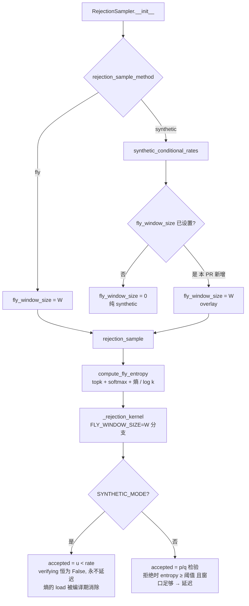
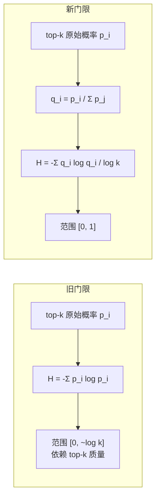

# PR #66593: [Spec Decode][FLy][ROCm] Normalize the top-k entropy gate and allow a FLy cost overlay with synthetic acceptance

> **Author**: @xiaoshingshing2 | **State**: OPEN | **Date**: 2026-11-09
> **Branch**: `xiaoshingshing2:feat/FLy_infx` → `main` | **Labels**: documentation, rocm, speculative-decoding, mrv2
> **Changes**: +70 -14 lines across 6 files | **ROCm 相关性**: 部分相关（改动全部在平台无关的 MRV2 spec-decode 代码里，没有 ROCm 专属分支；动机和全部验证来自 MI355X 上的 Kimi-K3 + DSpark，CUDA 上未验证）
> **CI**: 未获取（fetch 脚本没有拿到 check-run 详情；作者请求维护者加 `ready` 才能跑 pre-commit）
> 本报告分两部分：§1–6 为 PR 详细总结，§7–8 为 ROCm review 意见。

---

## 1. 总结 (Summary)

PR 做了两件独立的事。第一，把 FLy（一种有损、按熵放宽接受的 speculative decoding 验证方法）的熵门限从"top-k 未归一化概率的熵"改成"top-k 重新归一化后的熵 / log(k)"，使 `fly_entropy_threshold` 落在 `[0, 1]`，且对不同 `fly_entropy_top_k` 含义一致。第二，允许 `rejection_sample_method="synthetic"` 同时设置 `fly_window_size`：此时会计算 FLy 的熵（topk 等），但 kernel 里永不延迟拒绝，接受长度仍完全由 synthetic 决定。这样做 benchmark 时，把接受长度钉在 FLy 实测值的同时，也能付出 FLy 的验证开销（作者称为 "FLy cost overlay"）。

## 2. 背景与动机 (Background & Motivation)

- FLy 由 #53987 引入 MRV2。原实现的熵值上限随 k 增长（`log 3 = 1.10`、`log 40 = 3.69`），还依赖 top-k 占了多少概率质量，所以同一个阈值在不同 `fly_entropy_top_k` 下不可比。
- InferenceX/AgentX 类 benchmark 用 `synthetic` 接受来固定接受长度。此前 `synthetic` + `fly_window_size` 会被**静默忽略**，于是"钉住 FLy 的 AL"时测不到 FLy 本身的验证开销，吞吐偏乐观。
- 作者在 8×MI355X、TP8、Kimi-K3 + `Kimi-K3-speculator.dspark`、K=8、`fly_window_size=2`、`fly_entropy_top_k=3` 上测了：
  - SPEED-Bench coding（80 prompt，temperature 1.0）上，FLy AL 从 main 的 4.802（n=2）变为 4.878 ± 0.092（n=3），标准 SD 的 AL 不变。**两者用的是同一个数值阈值 0.3，但新旧门限含义不同**，因此这不是同一个配置的前后对比。
  - AgentX（900 s）上，overlay 对 e2e 时间的影响在并发 1/2/4 时为 0.06%–0.55%，测得的 AL 与钉住的值一致。
  - profiler 显示 overlay 多出 `aten::topk` 和 `aten::div` 等算子；直接调用 `rejection_sample` 的 200 个带种子的 case 与不开 overlay 时逐 token 相同；每次 verify 从 0.108 ms 增加到 0.217 ms。
- 作者在评论区 cc 了 @shen-shanshan 请求 review / 加 label。

## 3. 代码修改分析 (Code Change Analysis)

### 3.1 修改的模块

| 文件 | 改动 |
|------|------|
| `vllm/v1/worker/gpu/spec_decode/fly.py` | `compute_fly_entropy`：k≤1 直接返回 0；logits 路径改为对 top-k 做 softmax，概率路径按 top-k 质量归一化；返回值除以 `log(k)`（:14-49） |
| `vllm/config/speculative.py` | 新增 `synthetic` + `fly_window_size` 分支：要求 K≥2 且 window<K，打印 warning（:1777-1796） |
| `vllm/v1/worker/gpu/spec_decode/rejection_sampler.py` | `synthetic` 时如果配置了 `fly_window_size` 就把它传给 `rejection_sample`（:182-184） |
| `vllm/v1/worker/gpu/spec_decode/rejection_sampler_utils.py` | kernel 的延迟条件加 `(not SYNTHETIC_MODE)`（:741）；`rejection_sample` 的断言放宽为只排除 block verification（:1218） |
| `docs/features/speculative_decoding/{README.md,fly.md}` | 参数表和 FLy 文档更新为新门限定义，新增 "Measuring FLy Cost with Synthetic Acceptance" 一节，validated proposers 加上 DSpark |

### 3.2 架构 / 流程图





### 3.3 关键实现细节

- **门限数值的变化方向不是单调的**。以 k=3 为例（我手算）：top-3 概率 `[0.9, 0.05, 0.03]`，旧值 0.35、新值 0.31；`[0.3, 0.02, 0.01]`（大部分质量不在 top-3），旧值 0.49、新值 0.33；`[0.95, 0.02, 0.01]`，旧值 0.17、新值 0.14。同一个 0.3 阈值，在新定义下多数情况更严格，但具体取决于分布形状。所以**已有用户调好的阈值会在没有任何提示的情况下改变行为**。
- **overlay 的 kernel 路径**：`FLY_WINDOW_SIZE > 0` 时，kernel 走 FLy 的接受/存储分支（贪心请求先存 draft token，循环后再写 `rejected_argmax`），而不是纯 synthetic 的分支。我逐行对照过：`pending_rejection` 永远为 -1，`target_lse` 赋值条件不变，`accepted_length` 的更新方式等价，输出应与纯 synthetic 一致，和作者的 200 case 逐 token 比对结论相符。
- **overlay 只覆盖了 FLy 的一部分开销**：`verifying` 的条件在 `SYNTHETIC_MODE` 下是编译期 False，`entropy` 的 load 被消除（作者核对过 13 个 load 和纯 synthetic 一样，真正的 FLy 是 14 个）。真正 FLy 拒绝后的窗口确认、恢复位置的 lse 处理也都不会执行。overlay 付的主要是 `torch.topk` + 熵计算，对 163840 的词表这是大头，但并不是 FLy 的全部开销。
- 配置校验：新分支复用了 FLy 的 `K ≥ 2`、`window < K` 约束，但没有像 FLy 分支那样检查 `proposes_draft_tokens`（`extract_hidden_states`），不过 synthetic 本身也不支持该方法，影响不大。

## 4. 涉及的技术原理 (Technical Principles)

- **FLy（Loosely Speculative Decoding）**：标准 SD 的拒绝采样是无损的。FLy 在 target 自己也不确定（top-k 熵高）的位置，暂时不拒绝 draft token，而是看后面 W 个 draft token 是否都被原生接受；如果是，就把这次拒绝"放过"，从而提高接受长度。代价是输出分布不再严格等于 target，所以 FLy 需要靠准确率评测来证明质量损失可接受。
- **门限归一化**：归一化熵 `H(q)/log k` 衡量的是"在 top-k 候选内部有多犹豫"，与 top-k 外的长尾无关。旧定义同时混入了"top-k 占了多少质量"的信息。两者是不同的启发式，哪一个更适合 FLy 需要用质量和 AL 一起评估，而不是只看 AL。
- **Synthetic acceptance**：用预设的每位置接受率 `rate_i` 代替 p/q 检验，`u < rate_i` 即接受，用来在不同硬件/配置之间以固定 AL 做性能对比。`SYNTHETIC_MODE` 是 Triton constexpr，对应分支在编译期确定。
- **MRV2 only**：V1 runner 已在 #63373 中移除，FLy 只存在于 MRV2 的 GPU rejection sampler。

## 5. 评论区讨论亮点 (Discussion Highlights)

- 目前没有实质性 reviewer 评论。作者 cc 了 @shen-shanshan，请求 review 并加上 `ready`/`verified` 以触发 pre-commit 和文档预览。
- Claude bot 因 fork PR 未运行。github-actions bot 的欢迎语提醒 AI agent 按 AGENTS.md 重新评估 PR 价值。PR 声明了使用 AI 辅助移植和写文档。

## 6. 风险与潜在问题 (Risk Analysis)

| 风险 | 严重程度 | 说明 |
|------|---------|------|
| 正确性 / 质量 | Medium | 门限语义改变，同一默认值 0.3 下 FLy 的延迟决策改变，而 FLy 是有损的；PR 没有重做准确率评测，见 §7 |
| 兼容性 | Medium | 已有配置的阈值静默改变含义；`synthetic` + `fly_window_size` 从"忽略"变成"启用 overlay"，见 §7 |
| 测试覆盖 | Medium | 没有新增测试，现有测试在新旧定义下都通过，说明没有任何测试固定住门限数值，见 §7 |
| 性能 | Low | 只影响启用 FLy 或 overlay 的配置；overlay 每次 verify 约 +0.11 ms |
| 可维护性 | Low | 一个面向 benchmark 的模式挂在生产配置字段上；文档中旧定义下测得的验证表未更新 |

---

## 7. Review 意见 (Findings)

> 说明：本次执行 PR 代码被权限策略拒绝，所有结论均基于静态阅读、对 kernel 分支的逐行对照和手算示例，没有在本地跑测试。

| 意见类型 | 数量 |
|---------|------|
| ⚠️ 建议修复 | 3 |
| 📝 建议/备注 | 3 |

**⚠️【兼容性】门限语义改变，但默认值、阈值范围和已验证结果都沿用旧定义** `[已验证]`
- **问题**：`compute_fly_entropy` 的返回值从未归一化的 top-k 熵改成了 `[0, 1]` 的归一化熵（`fly.py:34-49`），但 `fly_entropy_threshold` 的默认值仍是 0.3、校验仍只有 `ge=0`（`speculative.py:726`）。`fly.md` 的 "Validated Configurations" 和 "ModelRunner V2" 两张表（`fly.md:53-86`，包括"`fly_entropy_threshold=0.3`"下的加速比和 96.3%/96.43% 的准确率保留率）都是在旧定义下测得的，本 PR 没有改动或标注。
- **影响**：已有用户（包括 InferenceX recipe）在不改配置的情况下，FLy 的延迟决策会改变。按 §3.3 的手算，同一个 0.3 在新定义下多数情况更严格，但取决于分布形状。文档会把旧定义下的质量和速度数字当作新定义的结果展示。
- **行动**：建议作者 (1) 在 PR 描述和文档中明确这是一个 breaking 的语义变化，给出旧阈值到新阈值的大致对应关系，或者重新选一个默认值；(2) 在 `fly.md` 的验证表上注明"measured with the pre-normalization gate"，或者用新门限重测；(3) 给 `fly_entropy_threshold` 加上 `le=1`，避免 >1 的值静默变成"永不延迟"。

**⚠️【正确性】FLy 是有损方法，门限改动后只测了 AL，没有测质量** `[已验证]`
- **问题**：PR 的验证只有 SPEED-Bench coding 上的 AL（以及 overlay 的性能）。新旧门限下 AL 分别为 4.802（n=2）和 4.878 ± 0.092（n=3），差异在噪声范围内。没有任何准确率评测（GSM8K/MATH-500/AIME 之类），而原 FLy 文档对质量的保证正是靠这些评测。
- **影响**：门限改变直接改变"哪些拒绝被放过"，也就是改变输出分布。AL 不变不等于质量不变，用户无法判断新门限在 0.3 下的质量损失是否仍在原文档承诺的约 96% 保留率以内。
- **行动**：作者应当至少补一组 target-only / 标准 SD / FLy（新门限）的准确率对比（例如 GSM8K 和 AIME25，在 MI355X 上即可），并写进 PR 的 Validation。

**⚠️【测试】没有新增测试；现有 FLy 测试在新旧定义下都通过** `[已验证]`
- **问题**：PR 明确写了 "No new tests are added. The existing FLy tests pass under both gate definitions."。我核对了 `tests/v1/spec_decode/test_rejection_sampler_utils.py:130-186`（`test_fly_requires_entropy_and_native_lookahead`）：它用的 `[1e-12, 0.5, 0.5]` 分布在旧定义下熵约 0.693，新定义下约 0.63，阈值 0.5 两边都会延迟，所以没有测出语义变化。`test_fly_entropy_from_logits_matches_probabilities` 只比较 logits 路径和概率路径是否一致。新的 `synthetic` + `fly_window_size` 配置分支和 kernel 里的 `(not SYNTHETIC_MODE)` 都没有任何测试。
- **影响**：门限的数值定义没有被任何测试固定，以后回退或再次修改都不会被发现；作者用来证明 overlay 不改变接受结果的 200 case 逐 token 比对没有进仓库，overlay 的"不改变输出"这一核心承诺没有回归保护。
- **行动**：建议作者补三类小测试：(1) `compute_fly_entropy` 的数值性质（确定分布→0、top-k 均匀→1、k=1→0、不同 k 下均匀分布结果相同）；(2) 带种子时 `synthetic` 与 `synthetic + fly_window_size` 的 `rejection_sample` 输出逐 token 相同；(3) `SpeculativeConfig` 在 `synthetic` + `fly_window_size >= K` 或 `K < 2` 时报错。

**📝【设计】overlay 改变了一个已有配置组合的行为，且只覆盖了 FLy 的部分开销** `[已验证]`
- **问题**：`synthetic` + `fly_window_size` 以前被静默忽略，现在会启用 overlay（`rejection_sampler.py:182-184`）。此外，overlay 下 kernel 里熵的 load 和窗口逻辑都被编译期消除（`rejection_sampler_utils.py:738-745`），实际付出的只是 `topk` + 熵计算。
- **影响**：已有带这种组合的 benchmark 配置会悄悄变慢（作者实测每次 verify 约 +0.11 ms）。文档里"pays FLy's verification cost"的说法略强于实际。
- **行动**：建议在文档里说明 overlay 只包含 host 侧的熵计算，不包含 kernel 内的延迟/窗口逻辑；也可以请维护者确认，是否更倾向用一个显式开关（例如 `synthetic_fly_overlay: bool`），而不是复用 `fly_window_size`。

**📝【注释/文档】AL 对比表把两个不同门限的结果并排展示** `[已验证]`
- **问题**：Golden AL 表里 "main" 和 "main + this PR" 都用 `fly_entropy_threshold=0.3`，但两个 0.3 的含义不同；"+17.3% → +18.9%" 的差异在 n=2/n=3 的标准差范围内。
- **影响**：读者容易把它理解为"新门限更好"，而数据只能支持"在这个负载上 AL 没有变差"。
- **行动**：建议在表下注明两列的阈值定义不同，结论改为"在 0.3 下 AL 没有明显变化"。

**📝【可维护性】提交历史是网页上传，需在合入时 squash** `[已验证]`
- **问题**：分支包含 "Add files via upload"、"Update fly.py"、"Update README.md" 等提交和一个 merge commit（均有 DCO sign-off）。
- **影响**：只影响历史可读性，vLLM 默认 squash merge，基本无影响。
- **行动**：无需作者处理，合入时 squash 即可。

## 8. 结论 (Verdict)

⚠️ **NEEDS WORK**。overlay 的 kernel 改动本身是正确的：我逐行对照后确认它不改变 synthetic 的接受结果。主要问题是门限语义的改变。FLy 是有损方法，它的默认阈值、文档里的验证结果和质量承诺都建立在旧定义上，而本 PR 既没有重做质量评测，也没有任何测试固定新定义。补上准确率对比、文档标注和几个小单测后就可以合入。

## 9. 英文 Review 评论 (Copy-Paste English Comments)

**C1** `vllm/v1/worker/gpu/spec_decode/fly.py:34-49` — ⚠️ comment

```text
The normalized gate makes sense to me, but it silently changes what an existing `fly_entropy_threshold` means while keeping the same default of 0.3. By hand, at k=3 the old and new values differ in a shape-dependent way (e.g. top-3 probs [0.3, 0.02, 0.01] give 0.49 under the old gate and 0.33 under the new one), so existing configs will defer a different set of rejections without any warning.
Since FLy is lossy, I think this needs a quality check, not only acceptance length: could you add a target-only / standard SD / FLy accuracy comparison (e.g. GSM8K and AIME25) with the new gate at 0.3, so the ~96% retention stated in fly.md still holds, or pick a new default if it does not?
```

**C2** `docs/features/speculative_decoding/fly.md:29` — ⚠️ comment

```text
The "Validated Configurations" and "ModelRunner V2" tables further down (including the `fly_entropy_threshold=0.3` speedups and the 96.3%/96.43% accuracy retention) were all measured with the pre-normalization gate, but they are left unchanged here. Could you either re-measure them or mark them as measured with the previous gate definition, and mention the semantic change and an approximate old-to-new threshold mapping in this paragraph? Separately, adding `le=1` to `fly_entropy_threshold` in SpeculativeConfig would stop values above 1 from silently disabling deferral now that the gate is bounded.
```

**C3** `vllm/config/speculative.py:1777-1796` — ⚠️ comment

```text
There are no tests for either change, and the PR notes the existing FLy tests pass under both gate definitions, so nothing pins the new semantics. Could you add a few small tests: compute_fly_entropy properties (certain -> 0, uniform top-k -> 1 for several k, k=1 -> 0); the 200-case seeded comparison you ran, showing `synthetic` and `synthetic` + `fly_window_size` produce token-identical rejection_sample output; and the config errors for this new branch (K < 2, fly_window_size >= K)? The token-identity test in particular protects the overlay's main promise.
```

**C4** `vllm/v1/worker/gpu/spec_decode/rejection_sampler.py:182-184` — 📝 comment

```text
Small note on the overlay: `synthetic` + `fly_window_size` used to be ignored and now adds ~0.11 ms per verify, so existing benchmark configs with that combination will change. Also, under SYNTHETIC_MODE the kernel's entropy load and window logic are compiled out, so the overlay covers the topk/entropy computation but not FLy's in-kernel work. Could the docs say that explicitly? A maintainer may also prefer an explicit flag over reusing `fly_window_size` for this benchmark-only mode.
```

## 10. 英文总结评论 (Overall Review Summary)

```text
The synthetic-acceptance cost overlay looks correct: it leaves synthetic rejection results token-identical. My main concern is the normalized entropy gate. It silently changes what an existing fly_entropy_threshold means while keeping the 0.3 default, and since FLy is lossy, the documented speedups and ~96% accuracy retention were measured with the old gate. Before merging, could you re-run a quality comparison (e.g. GSM8K/AIME25), update or annotate fly.md, and add small tests pinning the new gate and the overlay's token identity? Changes requested for now.
```
