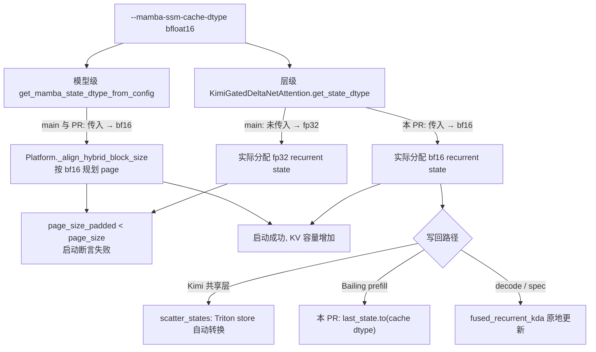
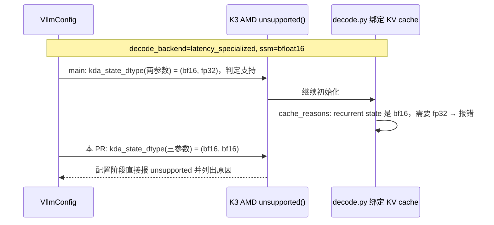

# PR #66686: [Bugfix][Mamba] Honor --mamba-ssm-cache-dtype for the shared KDA layers

> **Author**: @jiaqiang-dot-liu | **State**: OPEN | **Date**: 2026-11-10
> **Branch**: `jiaqiang-dot-liu:fix/kda-ssm-cache-dtype-upstream` → `main` | **Labels**: bug, kimi
> **Changes**: +78 -5 lines across 5 files | **ROCm 相关性**: 部分相关（主体是平台无关的共享 KDA 层；ROCm 专属部分是 Kimi-K3 AMD specialized decode 的配置守卫，以及 ROCm 上 Kimi-Linear 走 `kimi_k3/amd/linear.py` 并复用共享层；验证在 MI355X 上完成）
> **CI**: 未获取（fetch 脚本没有拿到 check-run 详情，CI 状态未知）
> 本报告分两部分：§1–6 为 PR 详细总结，§7–8 为 ROCm review 意见。

---

## 1. 总结 (Summary)

#55364 给 `MambaStateDtypeCalculator.kda_state_dtype()` 增加了第三个参数 `mamba_ssm_cache_dtype`，但只在 `vllm/models/{kimi_k3,glm5next}` 下的实现里传了它，`vllm/model_executor` 下的共享 KDA 层和几个模型类仍用两参数形式，于是它们的递归状态永远是 FP32。在 Kimi-Linear 上，模型级 classmethod 已经传了该参数（得到 BF16），而层级仍是 FP32，`Platform._align_hybrid_block_size()` 按 BF16 规划的 page 装不下 FP32 的实际分配，`--mamba-ssm-cache-dtype bfloat16` 直接在启动时触发 `assert self.page_size_padded >= page_size`。本 PR 在剩下的 5 个调用点补上该参数，给 Bailing 的 prefill 写回加上 dtype 转换，并新增一个 CPU-only 单测。

## 2. 背景与动机 (Background & Motivation)

- **根因链**：`KimiLinearForCausalLM`（CUDA 上是 `kimi_k3/nvidia/model.py`，ROCm/XPU 上是 `kimi_k3/amd/linear.py`）的模型级 `get_mamba_state_dtype_from_config` 已传三参数，而它们都用共享的 `KimiGatedDeltaNetAttention` 构建 KDA 层，后者的 `get_state_dtype()` 没传。page 规划和实际分配用的 dtype 不一致，导致启动断言失败。
- **收益**：作者在 1×MI355X 上测得，`bfloat16` 递归状态让 KV cache 容量增加 +88%（dummy 权重，`max_model_len=2048`）/ +48%（真实权重，`max_model_len=8192`），GSM8K（1319 题，5-shot，greedy）main `auto` 0.899、本 PR `auto` 0.898、本 PR `bfloat16` 0.899。默认 `auto` 下 state dtype、page 大小和 KV token 数与 main 完全一致。
- **未验证**：BailingMoeV3 / Ling 和 Alice AI 没有端到端验证（无 checkpoint），只有单测覆盖；Kimi-K3 specialized decode 在 BF16 状态下也没有跑，只改了守卫的输入。
- 由 AMD 的 Hyperloom 工具发现，作者声明人工复核并实测。新测试仿照已有的 `tests/models/glm5next/test_kda_state_dtype.py`。
- 与当前 main 三方合并无冲突。

## 3. 代码修改分析 (Code Change Analysis)

### 3.1 修改的模块

| 文件 | 改动 |
|------|------|
| `vllm/model_executor/layers/mamba/gdn/kimi_gdn_linear_attn.py` | `KimiGatedDeltaNetAttention.get_state_dtype()` 传入 `mamba_ssm_cache_dtype`（:163-167） |
| `vllm/model_executor/models/bailing_moe_v3.py` | 层级 `get_state_dtype()`（:647-651）和模型级 classmethod（:1491-1495）传入参数；prefill 写回 `last_state.to(recurrent_state_active.dtype)`（:1120-1122） |
| `vllm/model_executor/models/alice_ai.py` | 模型级 classmethod 传入参数（:685） |
| `vllm/models/kimi_k3/amd/specialized_decode/runtime/__init__.py` | `unsupported()` 里的 KDA dtype 守卫传入参数，提示文本加上 "mamba SSM cache dtype"（:212-219） |
| `tests/models/test_kda_state_dtype.py` | 新增，12 个参数化 case，用 `__new__` 构造层，CPU-only |

### 3.2 架构 / 流程图





### 3.3 关键实现细节

- `kda_state_dtype` 的第三参数默认值是 `"auto"`→FP32，只接受 `auto/float32/bfloat16`，其它值抛 `ValueError`（`mamba_utils.py:141-157`），所以 `auto` 路径的行为与 main 完全一致。
- PR 合入后，`vllm/` 下所有 `kda_state_dtype` 调用点都传了第三参数（我在 PR head 上 grep 过：glm5next、kimi_k3 nvidia/amd、model_executor 共享层、Bailing、Alice 都已一致）。
- **Bailing 写回需要转换的原因**：`chunk_kda` 的 final state 由 `chunk_gated_delta_rule_fwd_h` 以 `torch.float32` 分配（`third_party/flash_linear_attention/ops/chunk_delta_h.py:314-315`），而 index 赋值要求 dtype 一致；初始状态 h0 在 kernel 内 `.to(tl.float32)` 后再参与计算（同文件 :127-139），所以 bf16 的 `initial_state` 可以直接传入。
- **Kimi 共享层不需要转换**：写回走 `scatter_states()`，Triton store 会转换到 pool 的 dtype；作者在 MI355X 上用 Kimi-Linear 的状态形状重跑了 `test_gather_scatter_states.py` 的 scatter case（该测试在非 CUDA 平台默认 skip），结果逐位一致。
- **K3 AMD 守卫**：specialized decode 是 opt-in 的（`decode_backend=latency_specialized`）。main 上开 bf16 时，配置守卫误判为支持，之后在绑定 KV cache 时被 `guards.py:207-208` 的 `recurrent state ... needs fp32` 拦下。本 PR 把失败提前到配置阶段，错误信息更清楚，不涉及静默错误。

## 4. 涉及的技术原理 (Technical Principles)

- **KDA（Kimi Delta Attention）**：线性注意力的一种，每层维护一个 `(heads, head_dim, head_dim)` 的递归状态（Kimi-Linear 为 32×128×128）加一个短卷积状态。这个状态在 vLLM 里作为 "mamba" 类状态，和 attention KV cache 共用 hybrid KV cache 管理器。
- **Hybrid page 对齐**：hybrid 模型要求 mamba 层的 page 和 attention 层的 page 对齐，`_align_hybrid_block_size()` 根据模型级 classmethod 报告的 state dtype 和 shape 计算 padded page 大小。层级实际分配时如果 dtype 更大，就会超出规划。
- **BF16 递归状态的取舍**：递归状态在长序列上反复累积，FP32 更稳；BF16 让每层 state 减半，换来更多 KV 容量。kernel 内部仍以 FP32 累加，只在读写 cache 时转换，所以精度损失主要来自 step 之间的截断。作者的 GSM8K 结果显示在这个模型和任务上没有可测的差异。

## 5. 评论区讨论亮点 (Discussion Highlights)

- 目前没有人工 review 评论；Claude bot 因 fork PR 未运行。

## 6. 风险与潜在问题 (Risk Analysis)

| 风险 | 严重程度 | 说明 |
|------|---------|------|
| 正确性 | Low | `auto` 路径不变；bf16 路径的写回转换已核对；Kimi-Linear 有 GSM8K 验证 |
| 兼容性 | Low | 用户原先设置 `bfloat16` 时，Kimi-Linear 会崩溃，Bailing/Alice 会被静默忽略；现在会真的变成 BF16。Bailing/Alice 的精度没有验证 |
| 测试覆盖 | Medium | 新测试不在任何 CI 步骤里，见 §7 |
| 性能 | Low | 仅在用户显式选择 bf16 时生效，收益是 KV 容量 |
| 可维护性 | Low | 补齐了 #55364 遗漏的调用点，所有调用点现已一致 |

---

## 7. Review 意见 (Findings)

> 说明：本次执行 PR 代码被权限策略拒绝，所有结论均基于静态阅读和对 kernel 源码的核对，没有在本地跑测试。

| 意见类型 | 数量 |
|---------|------|
| ⚠️ 建议修复 | 1 |
| 📝 建议/备注 | 2 |

**⚠️【测试】新测试 `tests/models/test_kda_state_dtype.py` 没有被任何 CI 步骤运行** `[已验证]`
- **问题**：`tests/models/` 顶层的测试文件需要在 `.buildkite` 里逐个列出。例如同类的 `test_alice_ai.py`、`test_alice_ai_config.py` 被列在 `.buildkite/test_areas/models_basic.yaml` 的 ":computer: (CPU) Basic Models Other" 步骤里（`source_file_dependencies` 和 `pytest` 命令都有，:500-551）。我在 PR head 上 grep 了整个 `.buildkite`，没有任何地方引用 `test_kda_state_dtype.py`（仿照的 `glm5next` 测试是通过 `pytest -v -s models/glm5next` 整个目录跑的）。
- **影响**：这个回归测试只会在作者本地跑。#55364 漏掉调用点的问题，正是因为没有测试覆盖这些共享层；没进 CI 的话，同样的回退仍然发现不了。
- **行动**：作者应当把 `tests/models/test_kda_state_dtype.py` 加到 `models_basic.yaml` 的 "Basic Models Other" 步骤（它就是 `cpu-small`，与这个 CPU-only 测试匹配），`source_file_dependencies` 和 `pytest` 命令里各加一行。

**📝【测试】Kimi-K3 AMD specialized decode 的守卫变化没有测试** `[已验证]`
- **问题**：`runtime/__init__.py:212-219` 现在在 `mamba_ssm_cache_dtype=bfloat16` 时返回 unsupported。main 上同样的配置会在 KV cache 绑定时被 `guards.py:207-208` 拦下，所以这是把失败提前、改善报错，不是修复静默错误。但没有测试覆盖这个守卫。
- **影响**：影响较小；只是这个 ROCm 专属行为没有回归保护。
- **行动**：建议作者在新测试里加一个 case：构造 `cache_config.mamba_ssm_cache_dtype="bfloat16"` 的最小 vllm_config，断言 `unsupported()` 的返回值包含 KDA dtype 这一条（如果 `unsupported()` 依赖太多配置字段而不方便构造，可以跳过）。

**📝【兼容性】Bailing / Alice AI 开启 bf16 后的精度没有验证** `[推测]`
- **问题**：这两个模型此前会静默忽略 `bfloat16`，合入后会真的使用 BF16 递归状态。prefill 写回的转换我已核对，但 decode 和 spec 路径用的是 `fused_recurrent_kda` / `fused_recurrent_kda_fwd` 的原地更新，我没有逐行确认这些 kernel 在 bf16 state 上的 load/store 转换。按 Kimi 共享层在 GSM8K 上的结果推断，问题应该不大。
- **影响**：如果某条路径不支持 bf16 state，用户显式选 bf16 时才会受影响，默认配置不受影响。
- **行动**：建议 review 时追问作者，是否用小尺寸随机权重跑过一次 Bailing 的 prefill + decode（`load_format=dummy` 即可），确认 bf16 state 下 decode 能正常运行。

## 8. 结论 (Verdict)

⚠️ **NEEDS WORK**（改动很小）。修复本身正确且完整：所有 `kda_state_dtype` 调用点现已一致；`auto` 路径不变；Bailing 的写回转换是必要的；在 MI355X 上有启动复现、KV 容量和 GSM8K 证据。唯一需要修改的是把新测试注册进 CI，否则这个回归测试实际上不会运行。

## 9. 英文 Review 评论 (Copy-Paste English Comments)

**C1** `tests/models/test_kda_state_dtype.py:1-9` — ⚠️ comment

```text
The fix looks correct to me, but this new test is not referenced anywhere under .buildkite, so CI will never run it. Top-level files in tests/models/ have to be listed explicitly; the glm5next test you mirrored only runs because the whole models/glm5next directory is collected. Could you add tests/models/test_kda_state_dtype.py to the ":computer: (CPU) Basic Models Other" step in .buildkite/test_areas/models_basic.yaml (both source_file_dependencies and the pytest command, next to test_alice_ai.py)? That step is cpu-small, which fits this CPU-only test, and it keeps the regression from #55364 from coming back.
```

**C2** `vllm/models/kimi_k3/amd/specialized_decode/runtime/__init__.py:212-219` — 📝 comment

```text
Nice catch. On main this configuration does not corrupt anything: cache_reasons() rejects the bf16 recurrent state when the KV caches are bound. This change moves that failure to config time with a clearer message. If it's cheap to build a minimal vllm_config, a small case in the new test asserting that unsupported() reports the KDA dtype reason for mamba_ssm_cache_dtype="bfloat16" would cover this ROCm-only path; feel free to skip it if unsupported() needs too much config to construct.
```

## 10. 英文总结评论 (Overall Review Summary)

```text
The fix is correct and complete: every kda_state_dtype call site now honours --mamba-ssm-cache-dtype, the auto path is unchanged, the Bailing write-back cast is needed, and the MI355X startup, KV-capacity and GSM8K evidence is convincing. The one thing to fix is that the new tests/models/test_kda_state_dtype.py is not listed in any .buildkite step, so CI never runs this regression test; adding it to the CPU "Basic Models Other" step should be enough. A ROCm unsupported() case would be a nice optional extra. Approve once the test is wired into CI.
```
