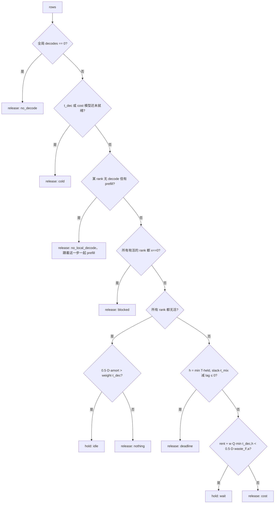

# PR #66927: [Core][DP] Add a cost-based cross-DP prefill hold

> **Author**: @Yiranwu | **State**: OPEN（Draft） | **Date**: 2026-11-11 开，最后一次提交 2026-11-20
> **Branch**: `yiran/dp-prefill-hold` → `main` | **Labels**: ci/build, documentation, scheduler
> **Changes**: +1557 −33 lines across 14 files | **ROCm 相关性**: 部分相关。代码全部是通用的 scheduler/DP 路径，没有任何 ROCm 专属分支；但动机、仿真建模和全部 GPU 数据都来自 8×MI355X 上的 DeepSeek-V4.1-Flash DP8+EP8，ROCm 的 DEP 部署是主要的受益方和受影响方
> **说明**: 本 PR 仍为 Draft、未关闭，时间线中没有被其他 PR 取代的记录；最后一次提交为 2026-11-20 的 `e90610c`。作者另开的 Draft #68899（"Prefill hold without data parallelism"）是非 DP 场景的延伸，不是本 PR 的替代。
> 本报告分两部分：§1–6 为 PR 详细总结，§7–8 为 review 意见。

---

## 1. 总结 (Summary)

在 DP attention + EP 的 MoE 部署里，各 DP rank 按 lockstep 推进。只要有一个 rank 在某一步做 prefill，这一步对所有 rank 都变成慢的 mixed step。本 PR 新增一个 opt-in 策略：设置 `--prefill-hold-ttft-target T` 即启用，默认关闭。启用后，每一步所有 rank 根据同一份信息，**一起决定 hold 还是 release** 本 rank 的 prefill。

决策依据有三部分：
- 一个在线拟合的非负 3 参数 step 代价模型 `ΔT = F + a·M + b·S`。M 是最忙 rank 的 prefill ktok 数，S 是所有 rank 的 ktok 总数。
- Online Ski-Rental：把"现在 release 造成的、可摊薄的浪费"和"继续 hold 累积的 TTFT 租金"相比较。
- 每个请求的 wall-clock TTFT 上界。

每个 rank 的状态是 8 个 float（`_RankRow`），搭在已有的 `ParallelConfig.sync_dp_state` CPU all-reduce 上一起交换。启用后这个 all-reduce 改为每步执行一次。

## 2. 背景与动机 (Background & Motivation)

- **问题**：DP+EP 部署中，prefill 会让所有 rank 的 decode 一起停顿。社区已经有好几条思路在解决同一个问题：
  - main 上的 `--prefill-schedule-interval`（PSI，按固定步数节拍放行 prefill）；
  - #51199（adaptive delayer）、#61834（已关闭）、#65655（cross-DP prefill delayer，`--prefill-schedule-policy delayer`）、#62901（已关闭）、#67089（逐 rank、不同步的 backlog interval）、#67689（capacity-bound 时全 rank 放行）。
- **本 PR 的定位**：作者认为，其他方案都靠固定条件停止 hold（K 个 rank 就绪、预算比例、N 步、max-wait 旋钮）。本 PR 想用在线代价拟合 + Ski-Rental + 按请求计算的 TTFT 上界，**替代所有固定阈值**，对外只暴露 2 个旋钮。
- **证据来源**：
  - 一个 out-of-tree、未公开的 trace 驱动仿真器（8×MI355X DSv4.1-Flash DP8+EP8，AgentX trace）。
  - 一组 MI355X 实机数据。但正文写明这组数据来自 "an earlier revision"，当前实现的 GPU benchmark 是 "pending"。
- **PR 状态**：Draft。正文明确写着 "Human submitter's line-by-line review and GPU validation are pending before marking ready"。整个 PR 由 Claude Code 和 Antigravity 辅助编写，最后一次算法重写（`affec9a`）的 co-author 是 Antigravity。

## 3. 代码修改分析 (Code Change Analysis)

### 3.1 修改的模块

| 模块 | 改动 |
|------|------|
| `vllm/v1/core/sched/dp_prefill_hold.py`（新增 633 行） | `_RankRow`（8 字段）、`_solve_3x3`、`_Cost3D`（在线加权 NNLS）、`PrefillQueueState`、`PrefillHold`（`local_row` / `update` / `_learn` / `_decide` / `_scan_queue`） |
| `vllm/v1/core/sched/scheduler.py`（+120 −13） | 持有 `PrefillHold`；`defer_prefills` 在 hold 存在时改为读 `hold.hold`；新增 `_prefill_queue_state` / `_startable_waiting` / `_can_start_waiting` / `_num_blocks_to_admit`；把 `long_prefill_token_threshold` 的计算抽成 `_effective_long_prefill_threshold`（与原逻辑等价，见 §7）；新增 `on_lookup` / `on_scheduled` / `on_step_finished` 三个钩子；新增 `dp_row()` / `update_from_dp_rows()` |
| `vllm/v1/core/sched/interface.py`（+13） | `SchedulerInterface.dp_row()`（默认返回 None）和 `update_from_dp_rows()` |
| `vllm/v1/engine/core.py`（+10 −2） | `DPEngineCoreProc._has_global_unfinished_reqs`：`dp_row()` 不为 None 时**每步**同步，并把收集到的 rows 回传给 scheduler |
| `vllm/config/parallel.py`（+35 −14） | `sync_dp_state` 新增 `row` 参数：传了 row 时改用 float64 张量 `[2 + dp_size × n]`，每个 rank 写自己的槽位，用 SUM 实现 all-gather；返回值从二元组改为三元组 |
| `vllm/config/scheduler.py`（+39） | `prefill_hold_ttft_target`（默认 None）、`prefill_hold_ttft_weight`（默认 1.0）；与 `prefill_schedule_interval > 1` 互斥；两者都加入 compile hash 的忽略列表 |
| `vllm/config/vllm.py`（+28） | `_verify_prefill_hold`：DP=1 或非 MoE 时报错；PP>1 和纯 P 或纯 D 的 PD 实例只给 warning |
| `vllm/engine/arg_utils.py`（+12） | CLI 参数 `--prefill-hold-ttft-target`、`--prefill-hold-ttft-weight` |
| `docs/serving/data_parallel_deployment.md`（+21） | 用户文档：用法与限制 |
| `tests/v1/core/test_dp_prefill_hold.py`（+606）、`tests/v1/engine/test_engine_core.py`、`tests/distributed/test_cpu_all_reduce.py`、`tests/v1/core/utils.py` | 23 个 CPU 单测、1 个 engine core 同步测试（MagicMock）、1 个真实 gloo 的 `sync_dp_state(row=...)` 测试 |
| `.buildkite/test_areas/distributed.yaml`（+1） | 把 `vllm/config/parallel.py` 加入 distributed 测试的 source deps |

### 3.2 架构 / 流程图

每步的数据流（以非 async 调度为例）：

```mermaid
sequenceDiagram
    participant L as DPEngineCoreProc 主循环
    participant S as Scheduler
    participant H as PrefillHold
    participant G as gloo CPU all-reduce（DP 组）

    L->>S: schedule()
    S->>S: defer_prefills = hold.hold 且本 rank 有非 chunk 的 running
    S->>H: on_lookup(req, hit) / on_scheduled(output)
    L->>L: 执行 step（GPU）
    L->>S: update_from_output()
    S->>H: on_step_finished(output) 记录 done_tokens
    L->>S: dp_row()
    S->>H: local_row() 扫描队列（最多 256 个），算出 x / queued / slack
    L->>G: sync_dp_state(row) 每步一次，float64 [2+8·dp]
    G-->>L: has_unfinished / pause / rows[dp][8]
    L->>S: update_from_dp_rows(rows, idle)
    S->>H: update(rows)：_learn 拟合 t_dec 与 F,a,b，然后 _decide
    Note over H: 只依赖 rows 和上一次的全局状态，各 rank 得到同一个 hold
```



`_decide` 的决策链：



### 3.3 关键实现细节

- **一致性设计**：`PrefillHold` 的状态分为"全局"和"本地"两类。全局状态（`_cost`、`_t_dec*`、`_clock`、`_hold_start`、`_rent`）只从 all-gather 得到的 rows 更新，`period` 取各 rank 的平均值，所以各 rank 计算出同一个 `hold`。本地状态只影响本 rank 上报的 row，例如 `_held(now)` 只进入 slack，而 slack 会在全局取 min。逐行核对 `update()` / `_learn()` / `_decide()` 后确认：它们只读 rows 和全局字段，`_log` 只在 rank 0 写统计，不参与决策。【已验证】
- **复用 main 的 deferral 机制**：hold 不改 `schedule()` 内部的 prefill 推迟逻辑，只替换 `defer_prefills` 的来源。原来是 PSI 节拍加 `prefill_capacity_bound`，启用后改为 `hold.hold`。running 的 prefill chunk 和 waiting 的准入都沿用 main 上 PSI 的两处 `defer_prefills` 判断。本 rank 没有 decode 时不 defer，这条豁免也照旧保留。
- **代价模型**：`_Cost3D` 的细节如下：
  - 指数遗忘窗口 200 个 mixed step；
  - Huber 3σ 降权；
  - 3×3 正则化求解，出现负解时退到对 1 变量和 2 变量子集的穷举 NNLS；
  - 当 S−M 方差太小（稳态满 batch 共线）时，按 mean_y 等比缩放已学到的参数；
  - 冷启动时从 1D 退到 2D。
  - `t_dec` 取前 3 个样本的中位数（第 2 个样本取 min，用来丢掉编译尖峰），之后改用 10 s 时间常数的 EWMA。
  - 超过预测值 3 倍的样本视为 stall，连续 5 个则判定为 regime shift 并重置。
- **Ski-Rental**：`waste = F·max(0, 1 − S/B_avail) + a·max(0, M − S/N_avail)`，`b·S` 被认为不可摊薄，不计入。`buy_cost = 0.5·D·waste`，正文说 0.5 是为了让默认 weight=1.0 对齐 E2E 最优。租金按 `weight·Q·period` 逐步累积。
- **TTFT 上界**：请求 i 的允许 hold 时间为 `(T − age − (k−1)·min(held, age)) / k`，k 是它前面（包括自己）需要的 release 次数。已经超过 T 的 waiting 请求把 age 截成 `min(age, held)`，也就是"每次最多 hold T"。进行中的 chunk 使用真实 age，过期后一定触发 deadline。
- **队列扫描**：按调度器的准入顺序扫描：先 `kv_holding_waiting`，然后把 `waiting` 和 `async_kv_waiting` 按 `heapq.merge` 合并。扫描会过滤掉不能启动的请求（KV 加载中、grammar 未编译、streaming 暂停、stale output），在空闲 running 槽位数和 256 中较小的值处截止。上一次 release 因 KV 不足而停止时，扫描还会在 KV 块不够处截止。
- **默认关闭的路径**：`prefill_hold is None` 时有三点保证：
  - `dp_row()` 返回 None，`_has_global_unfinished_reqs` 的节拍条件和 main 完全一样；
  - `sync_dp_state` 走原来的 int32 二元素张量；
  - `defer_prefills` 走原来的表达式。
  - 唯一的行为变化是 `long_prefill_token_threshold` 抽成了函数，见 §7 的等价性核对。

## 4. 涉及的技术原理 (Technical Principles)

- **DP attention + EP 的 lockstep**：attention 层按 DP 切分，MoE 层按 EP 跨 rank all-to-all，所以每一步所有 rank 都必须参与同一个 forward。没有请求的 rank 跑 dummy batch。一步的耗时由最慢的 rank 决定：一个 rank 做 8K token 的 prefill，其他 rank 的 decode 也要等它。
- **`sync_dp_state` 与 `dp_sync_interval`**：DP engine core 用一个 CPU gloo all-reduce 交换"是否还有未完成请求"和"pause 共识"，默认每 16 步做一次，以降低开销。要求所有 rank 以相同的步数节奏调用它，否则会 hang 到 `cpu_distributed_timeout`。本 PR 和 #65655 都把每 rank 的调度状态搭在这次 all-reduce 上，并且启用时都改为每步同步。
- **Ski-Rental（租或买）**：这是一个在线决策问题，每一步选择继续支付"租金"（hold 带来的 TTFT 增量），或者一次性"买断"（现在 release，承担 mixed step 的浪费）。经典结论是：当累计租金达到买断代价时转为买断，竞争比为 2。本 PR 用 `0.5·D·waste` 作为买断价。
- **chunked prefill / async scheduling / PP 的时序**：决策在 step k 之后的同步点做出，作用于下一次 `schedule()`。在 async scheduling 或 PP 下，下一次 schedule 实际落到 GPU 上还要再滞后 `max_concurrent_batches − 1` 步，所以 PR 引入了 `lag_steps`，在 deadline 判断里预留这段 lag。
- **spec decode**：每个 decode 请求占用 `1 + num_spec_tokens` 个 token 预算，外加 draft slot。这两项都计入了 `_prefill_budget`。

## 5. 评论区讨论亮点 (Discussion Highlights)

- **几乎没有实质性的 code review**：所有 CODEOWNERS（WoosukKwon、njhill、robertgshaw2-redhat 等）都处于 "will be requested when marked ready" 的状态，reviews 为空。
- **@functionstackx**：问仿真器是否开源。作者回答 "Not public yet … it only models single-node DEP, so it doesn't generalize much"，可以另开 Draft PR 公开。也就是说，**正文里主要的对比数据（包括与 #65655、#67089、PSI 32 的对比）目前无法被第三方复现**。
- **@njhill 推送了 "some rework (experimental, wip)" 提交**（`32d43c7`，在 2026-11-17 的 15 个提交之内）。之后作者把 `DPStateSync` 的注册方式改为"engine core 像拉 `has_unfinished` 那样拉 row"（`7f5a01c`）。这说明 maintainer 在接口形态上倾向于"复用 `sync_dp_state`，并尽量少动 scheduler interface"。
- **@benenzhu**（#61834 作者）在 11-20 触发了 `/ci run`（Buildkite #104559，针对提交 `b12aef0`）。之后作者又推了 4 个提交，包括整套算法的重写。**当前 head `e90610c` 没有跑过 CI**。
- **提交历史反映的成熟度**：
  - 11-14 到 11-20 之间有十余个行为修补提交，例如按整请求估算到达量、KV connector 命中的大小估计、KV 不足 / running 已满时截断扫描、stall 样本不参与学习、TTFT 改回从 arrival 计时等。每个都是在仿真器里发现一种工况失效后打的补丁。
  - 11-20 的 `affec9a` 又把"4 特征 WLS + `_T975` 置信门 + 30 s 到达率预测（每 rank 14 个 float）"整体替换为"3 参数 NNLS + Ski-Rental（8 个 float）"，同时删掉了此前专门为降低关键路径开销加的 `prepare_dp_row()`（`feee9ca`）。
- **关闭或取代**：时间线里没有关闭事件，也没有 maintainer 的结论，见报告头部说明。PR 自己列出的同题 PR：#65655、#62901、#51199、#67089，以及已关闭的 #61834、#48106。#68899 是作者开的非 DP 版本延伸。

## 6. 风险与潜在问题 (Risk Analysis)

| 风险 | 严重程度 | 说明 |
|------|---------|------|
| 当前实现没有 GPU 验证，对比数据不可复现 | High | 见 §7 ⚠️【测试】 |
| 与同题 PR（尤其是 #65655）在相同代码点上重叠，互不兼容 | High | 见 §7 ⚠️【设计】重叠；两个分支互相合并时有 7 个文件冲突 |
| 在线学习器加十余个内部常量，难以审阅和调试 | Medium | 见 §7 ⚠️【可维护性】 |
| 启用后每步一次 gloo all-reduce，队列扫描位于同步路径上 | Medium | 见 §7 ⚠️【性能】；默认关闭不受影响 |
| 额外 collective 的 hang 风险 | Low | 复用已有 `sync_dp_state`，各 rank 的调用节奏仍由 lockstep 主循环保证；row 形状由全局 config 决定，各 rank 一致。没有引入新的 hang 类别，失败模式与 main 上的 int32 同步相同（超时） |
| 各 rank 决策不一致 | Low | `update()` 只依赖 rows 和全局状态，已逐行核对；但缺少"多实例同 rows 得到同决策"的单测 |
| 默认关闭的保证 | Low | 已验证：flag 为 None 时调度、同步和 dtype 都与 main 一致 |
| async scheduling / PP | Medium | 用 `lag_steps` 补偿；PP>1 只给 warning（周期测量含流水线重叠的噪声），没有 PP 下的验证数据 |
| spec decode | Low | 预算计入了 `1+num_spec` 和 draft slot；GSM8K 只在旧版本上测过 |
| ROCm 专属风险 | Low | 无 ROCm 分支，不涉及 aiter/mori/kernel；gloo CPU collective 与平台无关 |

---

## 7. Review 意见 (Findings)

本 PR 是通用的 scheduler / DP engine core 代码，没有 ROCm 专属文件。aiter、mori、kernel、dtype、cudagraph 等 ROCm 专项规则不适用，已跳过。只检查跨后端的共享路径、通用正确性、hang 风险、默认关闭保证和卫生项。

| 类型 | 🔴 | ⚠️ | 📝 |
|------|----|----|----|
| 测试 | — | 1 | 1 |
| 设计 | — | 1 | — |
| 性能 | — | 1 | — |
| 可维护性 | — | 1 | 1 |
| 注释/文档 | — | — | 1 |

---

**⚠️【测试】当前实现没有任何 GPU 端到端或精度验证；对比表来自不可复现的仿真器和旧版本算法** `[已验证]`

- **问题**：
  - Validation 中只有 "Simulation" 表来自当前算法，生成它的是作者自述 "Not public yet … only models single-node DEP" 的 out-of-tree 仿真器。
  - "GPU runs" 表和 GSM8K 结果都注明来自 "an earlier revision"。按提交历史，旧版本是 4 特征 WLS 加 `_T975` 置信门，与 head 的 3 参数 NNLS 加 Ski-Rental（`affec9a`）是两套不同的算法。
  - 正文写明 "GPU benchmarks for the current implementation are pending"。
  - head `e90610c` 没有 CI：pre-run-check 失败，pre-commit 被跳过；`/ci run` 触发的 Buildkite #104559 针对的是更早的 `b12aef0`。
- **影响**：
  - 表中所有吞吐、interactivity、TTFT 数字，包括对 #65655 / #67089 / PSI 32 的优劣判断，对当前代码都是 `[unverified]`。
  - async scheduling 与 spec decode 组合下的真实时序没有在 head 上验证过，而 lag 补偿和 `t_dec` 冷启动这类逻辑在仿真器里最难建模。
- **行动**：建议作者在标记 ready 之前：
  1. 在 head 上重跑 MI355X DP8+EP8 的 AgentX 对比，给出 seed 数和方差，覆盖 c64–c512，并附完整的 `vllm serve` / benchmark 命令；
  2. 在 head 上用真实 spec decode 重跑 GSM8K；
  3. 补一组低并发或低到达率的数据（这是 Ski-Rental "probe" 等待最明显的区间）；
  4. 公开仿真器，或者把仿真数据移到附录、标明不可复现。

**⚠️【设计】与 #65655 等同题 PR 改动同一组代码点、语义互斥，需要社区先定方向** `[已验证]`

- **问题**：
  - 本 PR 与 #65655（分支 `dp-prefill-delayer`）都做了这几件事：
    - 给 `ParallelConfig.sync_dp_state` 增加可选的 payload。本 PR 是 `row: Sequence[float]`，改用 float64 张量、返回三元组；#65655 是 `extra: int32 Tensor`，原地写回、返回值不变。
    - 改写 `DPEngineCoreProc._has_global_unfinished_reqs` 的节拍条件，启用时每步同步。
    - 替换 `schedule()` 中 `defer_prefills` 的来源。
    - 在 `SchedulerConfig` 增加互斥的新字段。
  - `git merge-tree` 显示两个分支在 `parallel.py`、`scheduler.py`（config 和 sched 各一个）、`core.py`、`arg_utils.py`、`data_parallel_deployment.md`、`tests/v1/core/utils.py` 这 7 个文件上冲突。
  - 两者对 PSI 的关系相反：本 PR 禁止与 `prefill_schedule_interval > 1` 同时使用；#65655 把 PSI 复用为最小 prefill 间隔。
  - 两者都回应了 #61834 时期社区的诉求：少旋钮、时间维度的 TTFT 上界、和 PSI 对比、collective 不引入 hang。各自的覆盖情况客观上是：
    - 本 PR 的 TTFT 上界更强，是按请求、带 lag 补偿的；对外旋钮也更少（2 个）。代价是内部的启发式和常量显著更多，证据不可复现。
    - #65655 的逻辑更短（约 175 行），常量可数，有 MI355X 实机对比。但仍保留步数类的边界，`prefill_max_wait_ms` 是可选的时间上界。
  - 两者都复用已有的 all-reduce，都没有新增 collective。
- **影响**：maintainer 无法同时合入两套语义互斥、改同一处代码的机制。分头 review 会重复消耗 reviewer 的时间，这正是 #51199 / #61834 卡住的原因之一。#67089、#67689、#68899 还在继续增加同题分支。
- **行动**：建议作者（以及同题 PR 的作者）先在一个 issue 或 RFC 里对齐：`sync_dp_state` 的 payload 采用哪种扩展方式（float row 还是 int32 extra），以及社区要哪一种决策模型。之后再合并成一条可 review 的 PR，或拆成"payload 通道"和"策略"两个 PR。

**⚠️【可维护性】633 行的在线学习器带十余个无推导依据的内部常量，行为难以审阅** `[已验证]`

- **问题**：`dp_prefill_hold.py` 对外只有 2 个旋钮，但内部有大量写死的常量：
  - `_DEC_TAU_S=10`、`_FIT_WINDOW=200`、`_STALL_FACTOR=3`、`_MAX_STALL_REJECTS=5`、`_DEC_INIT_SAMPLES=3`、`_MAX_QUEUE_SCAN=256`（第 31–44 行）；
  - Huber 的 `3σ` 和 `0.95/0.05` 平滑（第 122–127 行）；
  - 共线判定阈值 `1e-3`（第 140 行），以及 `1e-6`、`1e-4` 的正则和主元阈值（第 70、79 行）；
  - 冷启动方差阈值 `1e-4`（第 166 行）；
  - `buy_cost` 的 `0.5` 系数（第 610 行，注释只说 "aligns default ttft_weight=1.0 with the E2E optimum"）。

  这些值都只在仿真器上调过。提交历史显示，至少 10 个提交在修补仿真器里发现的工况失效，而且最后一次提交把整个模型换掉了。
- **影响**：线上出现异常时（例如 `F` 拟合成负的大值、hold 长时间不放行），运维只能看到 30 s 一次的 rank 0 汇总日志，很难判断是哪一个启发式失效。`42baa78` 记录的 "F at −1164 ms，约 7 分钟不 hold" 就是这类问题。这也正是 #51199 上 maintainer 批评的 "additional complexity to the scheduler"。
- **行动**：建议作者：
  1. 给每个常量写出推导依据或敏感性数据；
  2. 考虑先合入一个更小的核心版本（例如只保留 TTFT 上界加简单的代价门），把自适应拟合作为后续 PR；
  3. 在 debug 日志里输出每次决策的 reason 和关键量，便于线上诊断。

**⚠️【性能】启用后每步一次 gloo all-reduce，队列扫描也重新回到同步关键路径，当前版本没有开销实测** `[已验证]`（开销量级 `[推测]`）

- **问题**：
  - `core.py:2871-2887`：只要 `dp_row()` 不为 None，就跳过 `dp_sync_interval`（默认 16），每步执行一次 float64 `[2+8·dp]` 的 CPU all-reduce。
  - `dp_row()` 内部的 `local_row()` 会在同步前同步地扫描最多 256 个 waiting 请求，对新请求还要调用 `get_num_cached_tokens` 探测前缀命中；PRIORITY 策略下每次迭代还会拷贝整个 heap。
  - `feee9ca` 曾把扫描移到 GPU 执行期间（`prepare_dp_row()`）。`affec9a` 删掉了它，理由是"不改非 DP 的 EngineCore"。
  - 正文的 "~32 µs" 只是仿真器里测得的扫描耗时，没有当前版本 all-reduce 加扫描的端到端实测。
- **影响**：
  - 单机 DP8 下 gloo all-reduce 通常在百微秒以内，并且在 async scheduling 下部分被 GPU 执行掩盖。
  - 多机 DP、decode step 很短（spec decode 下 ITL 可到十几毫秒）或 PRIORITY 策略长队列时，这部分 CPU 时间可能直接增加 ITL。这个开销抵消了原本通过 `dp_sync_interval` 省下的同步开销。
  - #65655 同样每步同步，这一点两者没有差别。
- **行动**：建议作者在 head 上给出启用和关闭时每步 CPU 时间的对比（同步加扫描，单机 DP8 与多机各一组）。如果开销不可忽略，建议恢复"在 GPU 执行期间准备 row"的做法。

**📝【测试】缺少"多实例喂同一组 rows 得到同一决策"的确定性测试，collective 不变量只靠注释** `[已验证]`

- **问题**：lockstep 的正确性依赖两个不变量：`update()` 只读 rows 和全局状态；row 长度在所有 rank 上相同。我逐行核对了现有代码，这两条目前都成立。但测试里 engine core 一侧用的是 `MagicMock`，`test_cpu_all_reduce.py` 只验证了 row 能被 all-gather，没有一个测试构造两个本地状态不同的 `PrefillHold`，并断言它们在同一序列 rows 下的 `hold` 完全一致。
- **行动**：建议作者补一个参数化测试：两个实例的本地状态不同（队列和 `_cached_tokens` 不同），喂入随机的 rows 序列（包括冷启动、stall、rank 数变化），逐步断言 `hold` 和 reason 相同。这样以后有人给 `update()` 引入本地状态时，测试会直接失败，而不是线上出现 rank 间行为分叉。

**📝【可维护性】若干配置组合会静默失效** `[已验证]`

- **问题**：
  1. 只设置 `--prefill-hold-ttft-weight`、不设置 target 时，参数被静默忽略。对比之下，#65655 对 `prefill_max_wait_ms` 不搭配 delayer 的情况会直接报错。
  2. 使用自定义 `scheduler_cls` 且不继承 `Scheduler` 时，`dp_row()` 返回 None，hold 静默不生效（提交 `1e6b419` 有意删掉了这项检查）。
  3. 纯 P 或纯 D 的 PD 实例只给 warning。
- **行动**：建议作者对第 1 种情况在 `SchedulerConfig` 的校验里报错，对第 2 种情况至少给出 warning，以免用户误以为策略在生效。

**📝【注释/文档】"TTFT is bounded by construction" 的表述强于代码实际给出的保证** `[已验证]`

- **问题**：
  - `_scan_queue`（第 436–439 行）对已经超过 T 的 waiting 请求，把 age 截成 `min(age, held)`。这意味着保证的是"每一次 hold 不超过 T"，而不是"请求的 TTFT 不超过 T"。
  - 排在 KV 不足或 running 已满之后的请求，以及超出 256 扫描上限的请求，不参与 slack 计算。
  - priority 被忽略。这一点 docstring 已经说明。
- **行动**：建议作者把 PR 正文和文档中的 "bounded by construction" 改成准确的表述（例如 "each hold is bounded by T; requests that already missed T are held at most T at a time"），并把被排除在扫描之外的情况列进 Limitations。

**默认关闭与等价性核对（不构成 finding，供 reviewer 参考）** `[已验证]`

- `_effective_long_prefill_threshold` 用 `max_num_batched_tokens // n` 替换了原来的 `input_budget // n`。在 head 的 `schedule()` 中，`input_budget = self.scheduler_config.max_num_batched_tokens` 在第 774 行赋值，早于第 806 行的阈值计算，中间没有修改，所以两者等价。
- flag 为 None 时：
  - `sync_dp_state(row=None)` 仍是原来的 int32 二元素张量；
  - `pause_count` 加了 `int()`，不改变语义；
  - `_has_global_unfinished_reqs` 的节拍条件不变；
  - `stopped_on_kv` 和 `prefill_kv_stopped` 虽然无条件赋值，但只被 hold 读取。
- `sync_dp_state` 的返回值从二元组改为三元组，仓库内唯一的调用点（`core.py`）已经同步修改。
- 直接合入 main 不冲突（`git merge-tree` 显示 0 个冲突）。

## 8. 结论 (Verdict)

**⚠️ NEEDS WORK**

这个设计解决的是真实存在的 DP+EP prefill 对齐问题。默认关闭的保证经核对成立。复用 `sync_dp_state`、没有引入新的 collective，也是正确的方向。但还有三个问题需要先解决：

1. PR 仍是 Draft，当前算法没有 GPU 或精度验证，所有对比数据目前都不可复现；
2. 在线学习器的复杂度和大量内部常量，与社区对"少旋钮、低复杂度"的要求存在张力；
3. 与 #65655 等同题 PR 在同一组代码点上语义互斥，需要先在 issue 或 RFC 里定下方向。

本 PR 目前为 Draft、未关闭。

## 9. 英文 Review 评论 (Copy-Paste English Comments)

**C1** `vllm/v1/core/sched/dp_prefill_hold.py:31-44` — ⚠️ comment

```text
The policy exposes only two user knobs, but its behaviour is driven by many hard-coded constants (_DEC_TAU_S, _FIT_WINDOW, _STALL_FACTOR, _MAX_STALL_REJECTS, _DEC_INIT_SAMPLES, _MAX_QUEUE_SCAN here, plus the Huber 3-sigma weighting, the 1e-3/1e-4/1e-6 thresholds in _Cost3D, and the 0.5 factor in buy_cost). Per the commit history these were tuned on an out-of-tree simulator, and the whole model was replaced in the last algorithm commit. Could you document where each value comes from, or show sensitivity data? Consider also landing a smaller core first (TTFT bound plus a simple cost gate) and adding the online fit later.
```

**C2** `vllm/v1/engine/core.py:2871-2887` — ⚠️ comment

```text
With the hold enabled, this bypasses dp_sync_interval and runs a float64 [2 + 8*dp] gloo all-reduce every step. dp_row() also scans up to 256 waiting requests synchronously before the sync, probing prefix hits for new ones. An earlier revision moved that scan off the critical path (prepare_dp_row), but it was removed again. Could you post measured per-step CPU time for this path with the hold on vs off on the current head, both single-node DP8 and multi-node? If it is not negligible relative to short decode steps, consider preparing the row while the GPU step runs.
```

**C3** `vllm/v1/core/sched/dp_prefill_hold.py:436-439` — 📝 suggestion

```text
For a waiting request that already passed the target, its age is clamped to min(age, held). So the guarantee is that each hold lasts at most T, not that TTFT is at most T. Requests behind a full KV cache or running set, or past _MAX_QUEUE_SCAN, also do not contribute to slack. I think "TTFT is bounded by construction" in the description and docs overstates this. Could you reword it to describe the per-hold bound and list the excluded cases under limitations?
```

**C4** `vllm/config/scheduler.py:423-430` — 📝 suggestion

```text
Two configurations silently do nothing. Setting --prefill-hold-ttft-weight without --prefill-hold-ttft-target is ignored. A custom scheduler_cls that does not subclass Scheduler returns dp_row() == None, so the hold never runs. Could you raise in this validation block when the weight is set without a target, and at least warn when the configured scheduler class cannot provide a DP row? Users would otherwise assume the policy is active.
```

## 10. 英文总结评论 (Overall Review Summary)

```text
Thanks for the detailed write-up. The hold reuses the existing sync_dp_state all-reduce, adds no new collective, and with the flag unset the scheduling and sync paths match main. Before this is ready: the current algorithm has no GPU or accuracy runs (the MI355X and GSM8K numbers predate it, and the simulator is not public); the online fit adds many undocumented constants to a core path; and per-step sync plus queue-scan cost is unmeasured. Several open PRs change the same sync and deferral points, so agreeing on a direction in an issue first may help. Changes needed before merge.
```
