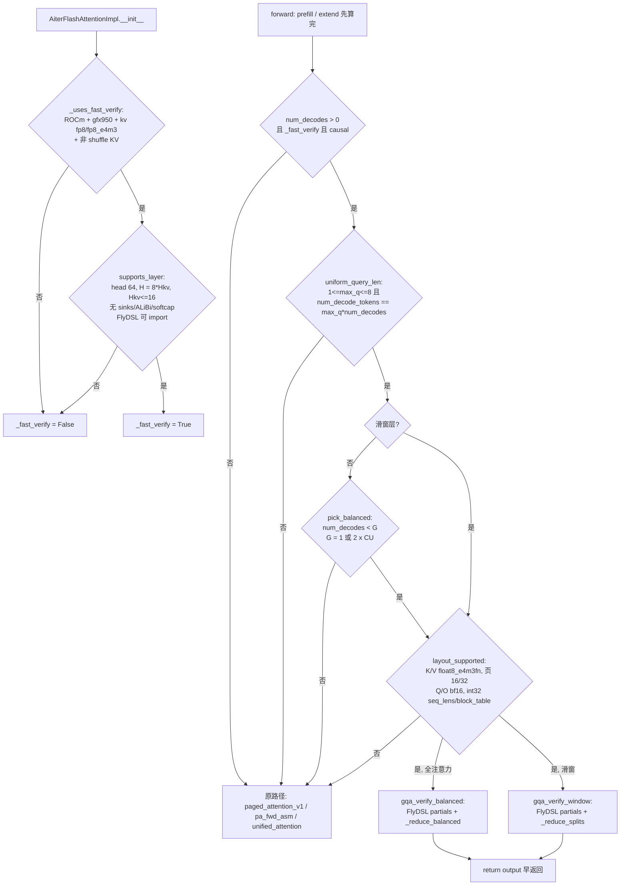
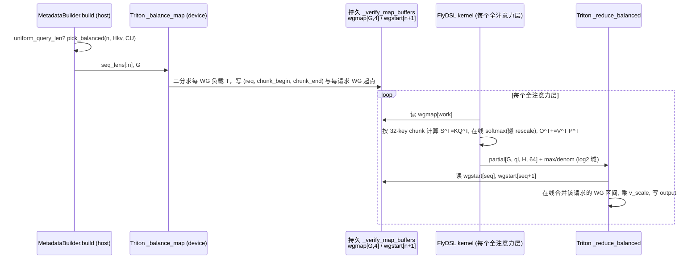

# PR #67133: [ROCm][Attention] AITER FA: dedicated split-KV kernels for decode and speculative-decode verify (GQA 8, head 64, FP8 KV)

> **Author**: @mawong-amd | **State**: OPEN | **Date**: 2026-11-12
> **Branch**: `ROCm:mawong/muse-fast-verify` → `main` | **Labels**: documentation, performance, rocm
> **Changes**: +2058 -4 lines across 7 files | **ROCm 相关性**: 完全相关（gfx950 专属 FlyDSL kernel，改动 Tier-1 文件 `rocm_aiter_fa.py`）
> **Approvals**: @sawsa307、@Fangzhou-Ai（均无评论正文）
> 本报告分两部分：§1–6 为 PR 详细总结，§7–8 为 ROCm review 意见。静态 review，未执行 PR 代码。

---

## 1. 总结 (Summary)

本 PR 为 `ROCM_AITER_FA` 后端在 gfx950（MI355X）上新增一条专用的 decode / 投机解码 verify attention 路径：当层满足 head size 64、GQA 8、每 rank ≤16 个 KV head、FP8 e4m3 KV cache（非 shuffle 布局）、无 sinks/softcap/ALiBi，且本 step 所有 decode 请求 query 长度相同（1–8）时，用一个从 sglang#47371 移植的 FlyDSL split-KV kernel 替代 AITER `paged_attention_v1` / `unified_attention`。全注意力层使用"按总 KV 长度均衡"的固定网格（每 step 由 metadata builder 在 device 上建一次 work map），滑窗层使用"每请求等分 split + 窗口 mask"。其余层/批次保持原路径。作者报告单层 3–9x、decode step p50 最多 2.2x、AgentX 吞吐最高 +99%。

## 2. 背景与动机 (Background & Motivation)

- 投机解码下，每个 decode 请求要 verify k+1 个 query token。在 `ROCM_AITER_FA` 上这类 batch 走 AITER `unified_attention`，长上下文时它主导 decode step 时间；普通 decode 走 `paged_attention_v1`，同样要等最长的请求（split 数按最长请求定，短请求的 workgroup 空转）。
- 目标模型是 Muse Spark（128 q head / 16 kv head，head 64，带滑窗层与 DSpark 草稿层），TEP4 部署，长上下文 agentic 负载（AgentX）。
- 方案选择 FlyDSL（vLLM 已有 `flydsl_kernels/` 目录与 `_run_compiled` / `buffer_utils` 基础设施，FlyDSL 随 aiter 一起安装），kernel 改编自 sglang#47371；作者说明与 @sawsa307 的 #66741/#66743（依赖未发布的 AITER）互补，并给出同输入下快 1.2–1.6x 的对比。
- 设计取舍：只覆盖"uniform q_len"批次，ragged q_len（部分请求草稿数较少）回退原路径；全注意力层"每 CU 少于 2 个请求"才走均衡网格。

## 3. 代码修改分析 (Code Change Analysis)

### 3.1 修改的模块

| 文件 | 改动 |
|------|------|
| `vllm/v1/attention/ops/flydsl_kernels/gqa_verify.py`（新增 1014 行） | FlyDSL kernel 本体（`_launcher`，lru_cache 编译变体）、Triton `_balance_map`（均衡网格 work map）、Triton `_reduce_balanced` / `_reduce_splits`（log2 域 LSE 合并）、`pick_balanced` / `pick_window_splits` 网格选择 |
| `vllm/v1/attention/ops/rocm_gqa_verify.py`（新增 263 行） | 入口：`supports_layer`（层级 gate + FlyDSL import 探测）、`uniform_query_len`、`layout_supported`（host 侧 dtype/stride 检查）、`map_buffers` / `verify_map`、`fast_verify` |
| `vllm/v1/attention/backends/rocm_aiter_fa.py`（+88 -3，Tier-1） | `_uses_fast_verify`（ROCm + gfx950 + fp8/fp8_e4m3 + 非 shuffle）；impl `__init__` 计算 `self._fast_verify`；builder 记录 `_verify_kv_heads`、分配持久 `_verify_map_buffers`、每 step 构建 `verify_map`；若所有 SWA 层都走新 kernel 则不再分配 SWA trimmed block table；`forward` decode 分支开头插入 `fast_verify` 早返回 |
| `tests/v1/attention/test_rocm_gqa_verify.py`（新增 458 行） | 与 float32 参考对比（q_len 1–8、16/32 页、1–16 KV head、窗口边界、零长度 padding、stale NaN、>2^31 字节池、CUDA graph replay）、不支持批次的回退、经 backend 的端到端单层测试 |
| `tests/models/test_muse_spark_rocm_loading.py`（+2 -1） | 适配 builder 现在读取 `impl._fast_verify` 与 `impl.sliding_window[0]` |
| `benchmarks/kernels/benchmark_rocm_gqa_verify.py`（新增 214 行） | 新 kernel vs AITER `unified_attention` 单层 HIP graph replay 计时 |
| `docs/design/attention_backends.md`（+19） | 说明启用条件 |

### 3.2 架构 / 流程图

**Dispatch 流程（每层、每 step）**：



**全注意力层的均衡网格数据流（每 step）**：



### 3.3 关键实现细节

- **Kernel 结构**（`gqa_verify.py`）：一个 workgroup = 一个 (请求, split/均衡 WG)，一个 wave 对应一个 KV head（block = Hkv×64 线程，Hkv≤16 → ≤1024 线程）。8 个 verify token × GQA 8 = 64 个 query 列；ql<8 时多余列复制最后一个 token，只计算 `NT = ceil(ql/2)` 个列 tile。转置形式 S^T = K·Q^T、O^T = V^T·P^T，均为 16x16x32 BF16 MFMA；K/V 通过 `cvt_scalef32_pk_bf16_fp8`（scale=1）从 FP8 精确上转为 BF16，k_scale 折进 softmax 系数 `c = k_scale·scale·log2e`，v_scale 在 reduce 里乘。
- **数值**：log2 域在线 softmax；懒 rescale（只有某分数超过当前 max 2^8 时才 rescale，P≤256，FP32 累加精确）；running max 初值 `M_INIT=-1e30`（有限值，避免 `-inf - (-inf)` 产生 NaN）；masked 分数置 `-inf`；masked chunk 中 key≥kvlen 或低于窗口的 V 行清零，防止 stale FP8 NaN 编码进入 P·V。
- **Mask**：`ctx = kvlen - ql`，query 列 t 的位置 `qpos = ctx + t`；可见条件 `key <= qpos`（causal）且滑窗时 `key + window > qpos`（与 vLLM `(W-1, 0)` 语义一致）。`interior` 之前的 chunk 对所有 query 全可见，跳过 mask；滑窗 `whole` 之前的 chunk 走 masked 头循环。
- **Split-KV 合并**：`_reduce_splits`（等分 split，SPLITS 为 2 的幂）与 `_reduce_balanced`（按 `wgstart` 区间在线合并）都只合并 `denom > 0` 的 split，全空时输出 0（零长度 padding 请求输出 0）。
- **均衡网格**（`_balance_map`）：每请求 `units = ceil(chunks/NS)`，二分最小 T 使 `Σ ceil(units/T) ≤ G`（上界 `ceil(total/(G-n))` 恒可行），每请求占 `w = ceil(units/T)` 个连续 WG，请求不共享 WG；空闲 WG 得到 `begin == end` 并写一个没人读的 slot。
- **地址**：K/V 默认 32 位 buffer 偏移；单层池 span ≥ 2^31 字节时切换为 64 位 global load（`addr64`）。注意 `buffer_utils.buffer_view` 的 descriptor `num_records = 0xFFFFFFFF`，即**无硬件越界检查**，安全性全靠索引计算。
- **编译**：`_launcher` 以 (Hkv, K strides, scale, waves_per_eu, wg_per_cu, addr64, balanced, ql, window, page) 为 key 做 `lru_cache(maxsize=64)`，`_run_compiled` 首次调用时 `flyc.compile` 并缓存；Triton map/reduce 按请求数的 2 的幂桶和 split 数特化。
- **Builder 改动**：`_verify_kv_heads` 取组内（任一）全注意力 fast 层的 Hkv；`_verify_map_buffers` 按 `2×CU` 与 `max_num_seqs+1` 预分配；只有 host 侧 `uniform_query_len` 为真时才在 `build()` 中刷新 map；若组内所有 SWA 层都是 fast 层，不再分配 SWA trimmed block table。
- **Gate 位置**：`forward` 中 decode 分支位于 prefill/extend 之后，早返回不会跳过混合批次中的 prefill/extend 计算（已核对完整 `forward`）。

## 4. 涉及的技术原理 (Technical Principles)

- **Split-KV（flash-decoding）与 LSE 合并**：decode 时每请求 query 很少，单 workgroup 串行扫长 KV 会让 GPU 吃不满；把 KV 切成 split 并行算局部 (m_i, l_i, O_i)，再用 `O = Σ 2^{m_i-M} O_i / Σ 2^{m_i-M} l_i` 合并。空 split（l_i=0）必须从合并中剔除，否则 `-inf`/`0/0` 污染结果——本 PR 用 `denom > 0` 作为有效标志。
- **长度均衡 vs 等分 split**：等分 split 的耗时由最长请求决定；均衡网格把"总 KV chunk 数"平均摊给固定 G 个 WG，耗时追踪总 KV 字节数，混合长度批次收益最大（作者 40 请求 200k..3k 混合：1945→212 µs）。代价是每 step 需要一次 device 侧 map（约 5 µs，所有全注意力层共享），且每请求至少占一个 WG，因此要求 n < G。
- **CUDA/HIP graph 约束**：graph 捕获时 kernel 网格、参数指针、Python 分支结果都被固化。本 PR 的网格由 host 侧 `num_decodes` 决定（同一 capture size 固定），map 写入持久 buffer，kernel 从 device 读 `seq_lens`/`block_table`，partials 在 graph 私有池分配——满足 replay 时随 `seq_lens` 变化。前提是"replay 时 builder 的 host 决策与 capture 时一致"（见 §7 第一条）。
- **gfx950 特性**：LDS 160 KB/CU（kernel 用 LDS padding 把占用钉在每 CU 1 或 2 个 WG）、`ds_read_b64_tr_b8` 转置读、`permlane16/32_swap` 跨 lane 组归约、`cvt_scalef32_pk_bf16_fp8` 硬件 FP8→BF16 转换；KV dtype 为 OCP `float8_e4m3fn`（`layout_supported` 按 tensor dtype 判断，而非 arch 名）。
- **精度**：QK 与 PV 都在 BF16 MFMA 上算（K/V 精确上转），相对 FP32 参考 L2 误差 2.3e-3；而 `paged_attention_v1` 在 FP8 cache 下用 FP8 MFMA，误差 2.7–3.2e-2——新路径精度反而更高。

## 5. 评论区讨论亮点 (Discussion Highlights)

- 无实质性 inline review 评论。两位 approver（@sawsa307——竞品 PR #66741/#66743 的作者，以及 @Fangzhou-Ai）直接 APPROVE，无评论正文。
- 作者多次 `/ci run --allow-stale`；最后一次由 @Fangzhou-Ai 在 head `e7c098beff02` 上触发 Buildkite #104132。
- PR 描述中作者主动交代了：与 #66741/#66743 的关系与对比数据、FlyDSL/aiter 版本（flydsl 0.4.2、aiter 0.1.28.post1）、编译变体数量与 capture 时预编译、AI 辅助（Claude Code）声明。

## 6. 风险与潜在问题 (Risk Analysis)

| 风险 | 严重程度 | 说明 |
|------|---------|------|
| kernel 的请求→行布局完全信任 host 侧 uniform 判定，backend 仍宣称支持 device/CPU query 长度不一致 | Medium | 当前被启动期检查挡住，属潜伏陷阱；见 §7 ⚠️【正确性】 |
| Tier-1 默认路径自动切换，无临时关闭开关 | Medium | 见 §7 ⚠️【设计】 |
| 生产路径（builder 建 map + FULL graph replay）无测试覆盖；无 e2e 精度 CI | Medium | 见 §7 ⚠️【测试】 |
| 性能数字部分无法溯源 | Medium | 见 §7 ⚠️【性能】 |
| eager/PIECEWISE 下每层 host 开销、per-call workspace 未计入显存 profiling | Low | 见 §7 📝 |
| FlyDSL 版本漂移/运行期 JIT 编译 | Low | 见 §7 📝 |
| Kernel 数值正确性（mask、LSE 合并、空 split、NaN 隔离、64 位寻址） | Low | 静态核对未发现问题，MI355 CI 725 例通过 |
| 兼容性：gfx942 / 非 FP8 KV / 其他 head 形状 | Low | gate 精确，均回退原路径 |

---

## 7. Review 意见 (Findings)

| 类型 | 🔴 | ⚠️ | 📝 |
|------|----|----|----|
| 正确性 | — | 1 | — |
| 设计 | — | 1 | — |
| 测试 | — | 1 | — |
| 性能 | — | 1 | 1 |
| 资源 | — | — | 1 |
| 兼容性 | — | — | 1 |

**先说已核对且没有问题的部分**：

- **Dispatch gate 精确**：架构只认 `on_gfx950()`（gfx942 永不进入）；KV dtype 用字符串 `fp8/fp8_e4m3` 加 tensor dtype `float8_e4m3fn` 双重检查（不按 arch 推断 fnuz/OCP）；shuffle KV 布局、sinks、ALiBi、softcap、非 causal、非 bf16 Q/O、非 16/32 页（AITER FA 的 kernel block 只有 16/32）、q_len>8、ragged q_len、全注意力 n≥G 都回退原路径且不写 output（有 CPU 测试覆盖）。FlyDSL import 失败时 `warning_once` 后回退。
- **Mask / LSE 数值**：逐项核对了 `ctx = kvlen - ql` 的 causal 位置、滑窗 `key + window > qpos` 与参考实现 `qpos - pos >= window` 等价、`interior`/`whole` 边界、NS 取整导致的越界 chunk 被 `chunk < end` 屏蔽、空 split（`denom == 0`）在两个 reduce 中都被剔除、全空行输出 0、`M_INIT` 有限值防 NaN、masked V 行清零防 stale NaN。`_balance_map` 的二分上界 `ceil(total/(G-n))` 可行性证明成立，WG 区间覆盖完整且互不重叠，空闲 WG 写入无人读取的 slot。
- **FULL CUDA graph padding**：V2 runner 在 FULL 模式下用 padded `num_reqs`/`num_tokens`，padded 请求 q_len=0、seq_len=0、block table 行被清零；`split_decodes_prefills_and_extends` 返回 `num_decode_tokens = padded tokens`，`uniform_query_len` 在 capture 与 replay 时一致为真，网格只取决于 padded `num_decodes`，map 每 step 在 graph 外刷新到持久 buffer——当前 runner 下 replay 安全。草稿模型 `_build_attn_metadata` 的 padding 规则相同。
- **越界**：block table 读取被 clamp 到 `last_page`；padded 行 page id 为 0（有效）；K/V 池 ≥2^31 字节切 64 位寻址并有 >2^31 池测试。
- **符号存在性**：`cvt_scalef32_pk_bf16_fp8`、`ds_read_tr8_b64`、`permlane16/32_swap`、`mfma_f32_16x16x32_bf16`、`s_buffer_load`、`sched_barrier`、rocdl `exp2`/`ballot` 在 flydsl 0.4.2 中均存在；`on_gfx950`、`num_compute_units`、`_run_compiled`、`buffer_view/load_vec/store_vec`、`get_current_vllm_config_or_none` 在 main 上均存在。
- **CI**：Buildkite #104132（head `e7c098beff02`，base 仅落后 main 10 个 commit，相关文件无冲突）211/213 job 通过；`:amd: (MI355 DPX) V1 Attention Shard 4/6` 日志显示 `v1/attention/test_rocm_gqa_verify.py` **725 passed、1 skipped**（FlyDSL 已安装时跳过的回退用例），与 PR 描述一致。唯一失败的 `(MI355 DPX) Unlimited-OCR-2` 首次失败、重试通过，与本 PR 无关；1 个 blocked 为 "Upload the picked jobs" 选择性 job 闸门。GitHub 侧 pre-commit、DCO、readthedocs 均成功。

---

**⚠️【正确性】kernel 的请求→query 行映射只信任 host 侧 uniform 判定，而 `ROCM_AITER_FA` 仍宣称支持 device/CPU query 长度不一致** `[已验证]`（当前可达性：被启动期检查挡住）

- **问题**: 新 kernel 把第 `seq` 个请求的 query 行固定为 `seq*ql .. seq*ql+ql-1`、causal 起点固定为 `ctx = kvlen - ql`（`gqa_verify.py:231, 280`），完全不读 device 侧 `query_start_loc`；是否进入新路径、以及 builder 是否刷新持久 work map，都只看 host 侧 `uniform_query_len(num_decodes, num_decode_tokens, decode_max_query_len)`（`rocm_gqa_verify.py:82-90`、`rocm_aiter_fa.py:726-738`）。但 `AiterFlashAttentionBackend` 继承了默认的 `supports_device_cpu_query_lens_mismatch() == True`——即向框架承诺"device 上的 query 长度可以与 CPU metadata 不同"。自适应 verify（`enable_adaptive_verification`）正是这样工作的：`compact_batch` 在 CPU 上把草稿预算平均分配（预算能整除请求数时 CPU 侧恰好 uniform），`reallocate_drafts` 在 GPU 上不均匀重分配。我核对了当前 main：`maybe_create_adaptive_verification_manager` 还会要求后端给出 `get_varlen_cudagraph_max_query_len`，`ROCM_AITER_FA`（UNIFORM_BATCH、未覆写）返回 None，因此该组合**目前会在启动时被 ValueError 拒绝**，没有实际触发路径。
- **影响**: 这是 Tier-1 文件里的潜伏陷阱：一旦有人按 flashinfer/gdn 的做法给 AITER FA builder 加上 varlen graph 上界（或放宽启动期检查），例如 Muse Spark + DSpark `enable_adaptive_verification=true`，在 CPU 预算可整除的 step 上新 kernel 会把请求 0 的 8 个 token 中只取前 ql 行、把其余行算成其他请求的 query，且 causal 位置错位——静默错误输出，`unified_attention` 原路径（读 device `cu_seqlens_q`）则不受影响。同理，若某次 replay 时 host 判定为非 uniform 而 graph 里固化的是新 kernel，builder 不会刷新 map，kernel 会读到上一 step 的 stale `wgmap/wgstart`。
- **行动**: 建议作者 (1) 在 `_uses_fast_verify` 中显式排除 `speculative_config.enable_adaptive_verification`，或在存在 fast 层时让 builder/backend 对 `supports_device_cpu_query_lens_mismatch` 返回 False，使框架层面的契约与 kernel 的假设一致；(2) 只要 `_verify_kv_heads` 存在且网格放得下，就无条件刷新 map（只依赖 `seq_lens`，~5 µs），消除 stale map 的可能；(3) 在 `fast_verify` docstring 里写明"query 行布局来自 host、要求 device 与 host 一致"。

**⚠️【设计】Tier-1 后端默认路径自动切换，没有临时关闭开关** `[已验证]`

- **问题**: `_uses_fast_verify`（`rocm_aiter_fa.py:53-67`）+ `supports_layer` 只要条件满足就自动替换 AITER `paged_attention_v1`/`unified_attention`，覆盖所有 head 64 / GQA 8 / FP8 KV 模型在 gfx950 上的 decode 与 verify（包括草稿层，作者也提到 TinyLlama-1.1B 命中）。用户想关闭它只能改 KV dtype、开 shuffle KV 或卸载 flydsl。
- **影响**: 端到端只在 Muse Spark 一个模型上做了精度与性能验证；若生产中出现模型特定的回归（数值、性能悬崖——例如 DPX/CPX 分区下 CU 数减半时网格阈值未重新调优、`n ≥ 2×CU` 时全注意力层回退造成的阶跃），没有不改代码的规避手段。
- **行动**: 建议作者加一个临时 kill-switch（在 `vllm/envs.py` 注册的 env var，或 attention config 字段，默认开启），在 PR 描述里写明计划在更多模型验证后移除；或者至少在文档中给出关闭方式。

**⚠️【测试】生产实际使用的"builder 建 map + FULL graph replay"组合没有测试，也没有 e2e 精度 CI** `[已验证]`

- **问题**: `test_fast_verify_cudagraph_replay_follows_new_lengths`（`test_rocm_gqa_verify.py:311-340`）调用 `fast_verify(..., maps=None)`，map 是在 graph **内部**由 `balance_map` 新分配的；而 backend 实际路径是 builder 在 graph **外部**把 map 写进持久 `_verify_map_buffers`、captured kernel 读取这块存储。`test_backend_runs_uniform_decode_batches_on_the_kernels` 覆盖了 builder→forward，但只跑一次 eager、无 capture/replay、无 padding 请求。仓库内也没有任何 CI 任务对 head 64 / GQA 8 / FP8 KV 模型（TinyLlama 或 Muse Spark）+ 投机解码做 e2e 精度检查；MATH-500/needle 结果仅来自作者手工运行。
- **影响**: 上一条描述的"host 决策与 capture 不一致 → stale map"这类问题恰好落在未被测试的组合上；kernel 级测试再全面（725 例），也无法证明 runner padding、草稿模型 metadata、混合批次与新 gate 的交互正确。
- **行动**: 建议作者补一个 backend 级 graph 测试：用 builder 构建含 padding 请求的 metadata → capture `impl.forward` → 修改 `seq_lens` 后重新 `builder.build` → replay → 与 float32 参考对比；并考虑把一个小模型（如 TinyLlama-1.1B + `--kv-cache-dtype fp8` + ngram 投机解码）的 greedy 一致性/lm-eval 加入 MI355 队列。

**⚠️【性能】部分性能数字无法溯源** `[已验证]`（溯源结论；数字本身 `[unverified]`）

- **问题**: 能追溯的：单层 verify 表（24×100k、40×100k、40 混合）与新脚本 `benchmark_rocm_gqa_verify.py` 的 `BATCHES` 一致，且说明了不含 map 时间。无法追溯的：(1) "plain decode 单层 vs `paged_attention_v1` 1.1–1.5x / 1.7–3.2x / 滑窗 1.2–1.4x"——脚本只有 `unified_attention` 基线，没有 `paged_attention_v1`；(2) decode step p50 两张表——未给出测量方法/命令/日志；(3) serving 表每臂只跑 1 次；(4) AgentX（c40 +99%，"两次均值"）无配置文件、日志或 InferenceX 版本。另外 AgentX c40 的 ITL p50 从 41.48 ms 降到 11.28 ms（3.7x），明显大于 step 级表中最接近的 D32×100k（68.9→46.2 ms，1.5x），需要解释（例如 AgentX 上下文长度高度不均，正是均衡网格的最佳场景）。
- **影响**: 这些是 PR 最亮眼的数字，reviewer 无法复现或判断是否存在测量偏差（如两臂同节点两半同时跑带来的干扰、单次 run 的方差）。
- **行动**: 建议作者补充：paged_attention_v1 基线（可加到 benchmark 脚本的 `--query-len 1` 分支）、step p50 的测量命令、serving/AgentX 原始输出或日志链接，以及 AgentX ITL 降幅远大于 step 降幅的解释。

**📝【性能】eager / PIECEWISE 路径下每层每 step 的 host 开销** `[已验证]`（影响幅度 `[推测]`）

- **问题**: AITER FA 是 UNIFORM_BATCH，纯 decode 批次走 FULL graph 不受影响；但混合（prefill+decode）批次中 attention 以 eager 运行，`fast_verify` 每层都会重复：`uniform_query_len`、`_balanced_grid`（含模块 import 查找）、`layout_supported`（构造 stride tuple + ~15 个比较）、两次 `_span`（遍历 shape×stride 求和）、12 参数的 `lru_cache` 哈希、3 次 `torch.empty`、FlyDSL launch + Triton reduce launch。`forward` 开头的注释明确要求"Minimize the PyTorch ops in this method"。
- **行动**: 建议作者把 `layout_supported` 与 `addr64` 结果按 kv_cache 缓存（仿照 `_kv_view_cache`），把 partials 改为按 `max_num_seqs` 预分配的持久 workspace（同时解决下一条），并在混合批次场景给出一组 step 时间对比。

**📝【资源】partials workspace 随 batch 线性增长，未计入显存 profiling，且使用无越界检查的 32 位 buffer 偏移** `[已验证]`（OOM 风险 `[推测]`）

- **问题**: `_partials`（`gqa_verify.py:669-673`）每次调用 `torch.empty` 分配 `tokens × heads × splits × 64 × 4 B`（滑窗）或 `G × ql × heads × 64 × 4 B`（全注意力）。例：Muse Spark TP4（32 q head/rank）256 请求 × ql 8 → 滑窗 64 MiB；TP1（128 q head/rank）1024 请求 × ql 8 × 4 split → 1 GiB；4096 请求时达到 4 GiB。profile run 是 prefill 形状的 batch，不会走到这条 decode 路径，因此 eager 混合批次中的这块瞬时分配不在 profiling 峰值内。另外 `buffer_utils` 的 view 不做越界检查、单 view 偏移上限 4 GiB（其模块注释已说明），partials 索引没有 K/V 那样的 `addr64` 回退或断言。
- **行动**: 建议作者为 partials 使用按 `max_num_seqs × QUERY_LEN` 上界预分配的持久 buffer（或在 host 侧对 partials 字节数加 `< 2**32` 的断言，超限回退原路径），并在描述中说明大 batch 下的显存占用。

**📝【兼容性】FlyDSL 可用性只做 import 探测；未 capture 的变体在 serving 中 JIT 编译** `[推测]`

- **问题**: `supports_layer` 只捕获 `ImportError`；若环境里的 flydsl 与 0.4.2 API 不一致（import 成功但 `rocdl` 某个 op 签名变化），失败会发生在首次 `flyc.compile`（通常是 graph capture 时），表现为启动崩溃而不是回退。另外作者也说明 eager 批次超过最大 capture size（或 `--enforce-eager`）时会在 serving 中首次编译新变体（有磁盘缓存），`_launcher` 的 `lru_cache(maxsize=64)` 被淘汰时也会重新走编译入口。
- **行动**: 建议作者在首次编译处捕获异常并以 `warning_once` 回退原路径（同时把 `_fast_verify` 置 False），或在文档中写明所需的 flydsl 版本与首次编译延迟。

## 8. 结论 (Verdict)

**⚠️ NEEDS WORK**

kernel 本身质量很高：dispatch gate 精确且全部回退安全，mask/LSE 合并/空 split/NaN 隔离/64 位寻址经静态逐项核对均正确，MI355 CI 上 725 个对 float32 参考的用例全部通过，精度还优于原 FP8 MFMA 路径。没有发现带具体触发输入的阻塞问题。合入前建议先处理：让 backend 契约与 kernel"信任 host 侧 uniform 布局"的假设一致（并无条件刷新 work map），提供临时关闭开关，补 builder-map + graph replay 的 backend 测试，以及补齐性能数字的出处。

## 9. 英文 Review 评论 (Copy-Paste English Comments)

**C1** `vllm/v1/attention/backends/rocm_aiter_fa.py:726-738` — ⚠️ comment

```text
The new kernel maps request `seq` to query rows `seq*ql .. seq*ql+ql-1` and uses `ctx = kvlen - ql`, i.e. it trusts the host-side `uniform_query_len` check and never reads the device `query_start_loc`. Meanwhile AiterFlashAttentionBackend still inherits `supports_device_cpu_query_lens_mismatch() == True`. Adaptive verification is rejected for this backend at startup today (no varlen cudagraph bound), so this is not reachable now, but if that bound is ever added, CPU-uniform/GPU-ragged steps would silently compute wrong attention here. Could you either exclude `enable_adaptive_verification` in `_uses_fast_verify` or report the mismatch as unsupported when fast layers exist? Also, consider refreshing the work map whenever `_verify_kv_heads` is set and the grid fits (it only depends on `seq_lens`), so a captured graph can never read a stale map.
```

**C2** `vllm/v1/attention/backends/rocm_aiter_fa.py:53-67` — ⚠️ comment

```text
This switches the default decode/verify path of ROCM_AITER_FA automatically for every head-64 / GQA-8 / FP8-KV layer on gfx950 (including draft layers and e.g. TinyLlama), but end-to-end accuracy and performance were only validated on Muse Spark. Right now the only ways to opt out are changing the KV dtype, enabling the shuffle layout, or uninstalling flydsl. Could you add a temporary opt-out (an env var registered in vllm/envs.py or an attention-config field, default on) and note in the description when you plan to remove it?
```

**C3** `tests/v1/attention/test_rocm_gqa_verify.py:311-340` — ⚠️ comment

```text
This graph-replay test calls `fast_verify(..., maps=None)`, so the balance map is allocated and computed inside the graph. In production the map is written by the metadata builder outside the graph into the persistent `_verify_map_buffers`, and the captured kernel reads that storage; the backend-level test only runs one eager step without padding. Could you add a backend test that builds metadata (with zero-length padded requests) via the builder, captures `impl.forward`, rebuilds with new `seq_lens`, replays and compares against the float32 reference? An e2e check on a small head-64/GQA-8 model with fp8 KV plus spec decode on MI355 would also help.
```

**C4** `benchmarks/kernels/benchmark_rocm_gqa_verify.py:3-21` — ⚠️ comment

```text
The one-layer verify table matches this script's batches, thanks. However the plain-decode numbers vs `paged_attention_v1` (1.1-1.5x, 1.7-3.2x, 1.2-1.4x) cannot be reproduced here because the script only has a `unified_attention` baseline, and the decode-step p50 tables, the single-run serving table and the AgentX results come without commands or logs. Could you add a `paged_attention_v1` baseline for `--query-len 1`, describe how step p50 was measured, and link raw outputs? It would also help to explain why AgentX ITL p50 at c40 drops 3.7x while the closest step-level row improves about 1.5x.
```

## 10. 英文总结评论 (Overall Review Summary)

```text
Nice work: the dispatch gate is precise and every unsupported case falls back cleanly, and the masking, split merge, empty-split and NaN handling all check out; the 725 kernel tests pass on MI355 CI. Before merging I'd like to see: the backend contract aligned with the kernel's assumption that host query lengths match the device layout (plus an unconditional work-map refresh), a temporary opt-out for this new default path, a backend test covering builder-built maps under graph replay, and sources for the plain-decode, step and AgentX numbers. Approve after these.
```
