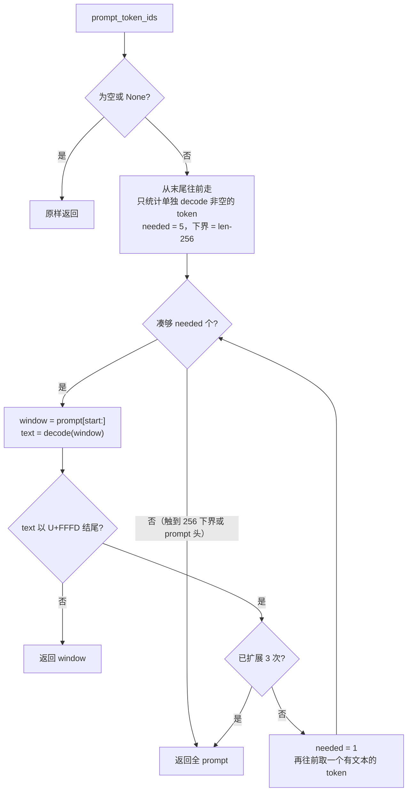
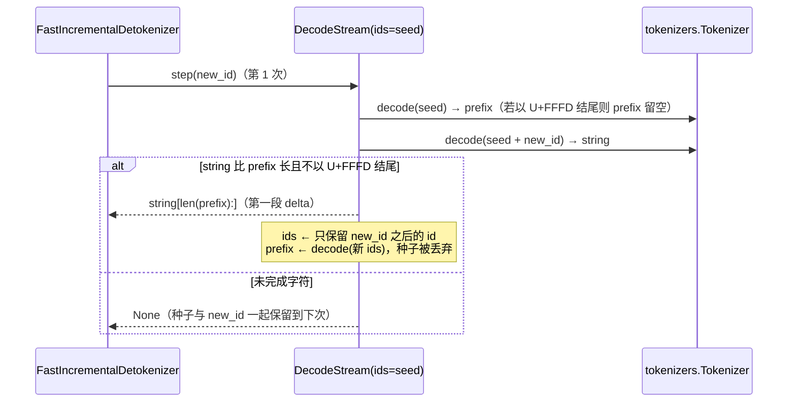

# PR #67153: [Perf][Frontend] Seed the fast detokenizer with a prompt tail, not the full prompt

> **Author**: @mawong-amd (Matthew Wong, AMD) | **State**: MERGED（GitHub API 显示 `closed`，但 `merged_at` 非空，见下） | **Date**: 2026-11-12 创建，2026-11-19 合并
> **Branch**: `mawong/detok-seed-window` → `main` | **Labels**: 无
> **Changes**: +348 -2 lines across 2 files | **ROCm 相关性**: 不相关（通用前端 detokenizer 改动；仅作者来自 AMD、serving 实测跑在 MI355X 上，且测试在 AMD CI 镜像步骤中也会运行）
> 本报告分两部分：§1–6 为 PR 详细总结，§7–8 为 review 意见（非 ROCm 路径：只做卫生检查与通用正确性检查）。

**关于 "CLOSED" 状态的核实**：该 PR 并非被放弃或被替代，而是**已合并**。证据：

- PR 数据中 `merged_at = 2026-11-19T03:09:10Z`，与 `closed_at` 完全相同（GitHub 对已合并 PR 的 `state` 字段同样返回 `closed`）。
- PR 页面显示由 @shen-shanshan 于 2026-11-19 合并，合并时 16 项检查全部通过。
- `upstream/main` 上存在 squash commit `da7acd6f42`（"[Perf][Frontend] Seed the fast detokenizer with a prompt tail, not the full prompt (#67153)"），`git diff pr/67153 da7acd6f42` 对两个文件的差异为空，即合入的内容与本次 review 的 head `c2f685aa` 逐字节一致。
- 反倒是本 PR 在描述中宣布**替代**了两个停滞的早期 PR #51281 和 #57330（固定 32 / 128 token 的尾部截断方案）。

因此本报告属于**追溯性 review**（代码已在 main 上）。

---

## 1. 总结 (Summary)

`FastIncrementalDetokenizer` 原本用**整个 prompt** 初始化 tokenizers 库的 `DecodeStream`，于是每个请求第一次 `step()` 时都要在输出处理循环里把整段 prompt 解码一遍（100k token 下 17–41 ms），期间会卡住同一循环中的其他所有流。本 PR 新增 `get_decode_stream_seed()`：只取 prompt 末尾"至少 5 个能单独解码出文本的 token"作为种子；如果窗口文本以 U+FFFD 结尾（窗口起点落在多字节字符或 byte-fallback 字节串中间），最多再往前扩 3 个 token；若 prompt 本身就以 U+FFFD 结尾，或者往回走超过 256 个 token 仍凑不够，就退回到全 prompt。作者给出的微基准显示首 token 解码从 17–41 ms 降到约 0.005 ms。

## 2. 背景与动机 (Background & Motivation)

- **问题来源**：V1 输出处理循环是单线程的，所有请求的 detokenize 在这里串行执行。长上下文（100k+ token）请求出第一个 token 时，`DecodeStream` 会把整段 prompt 交给 `tokenizer.decode`。这是一次 O(prompt) 的同步开销，并且会被**其他所有正在流式输出的请求**同时感受到（体现为它们 ITL 中的尖刺）。
- **为什么尾部就够了**：`DecodeStream` 第一次成功输出文本之后，`ids` 被截断为"新产生的那些 id"，之前的上下文全部丢弃。因此 prompt 种子只影响**第一段 delta**。只要尾部窗口能逐字节复现这段 delta，就可以安全地替换全 prompt。
- **前序尝试**：#51281 与 #57330 采用固定 32 / 128 token 的尾部截断。@njhill 在评审中指出固定尾部并不总是安全：如果 prompt 末尾有 ≥32 个被跳过的 special token，Metaspace / WordPiece / 首部 `Strip` 解码器会把第一个输出 token 的前导空格吃掉。本 PR 改为"只计数能单独解码出文本的 token"，以此解决这个问题，并接替这两个停滞的 PR。
- **相关 issue**：#48853（prompt 以 U+FFFD 结尾时，`DecodeStream` 会在第一段 delta 中把整段种子文本吐出来，属于已有 bug）。本 PR 在该情形下保持全 prompt 种子，不改变输出；#48854 另行把这类请求路由到 slow detokenizer。

## 3. 代码修改分析 (Code Change Analysis)

### 3.1 修改的模块

| 文件 | 改动 |
|------|------|
| `vllm/v1/engine/detokenizer.py` (+56 -2) | 新增常量 `_MAX_UTF8_SEED_EXTENSION = 3`、`_MAX_SEED_WINDOW = 256`，新增函数 `get_decode_stream_seed(tokenizer, prompt_token_ids, skip_special_tokens)`；`FastIncrementalDetokenizer.__init__` 中 `DecodeStream(ids=...)` 的种子由全 prompt 改为该函数的返回值；新增 import `INITIAL_INCREMENTAL_DETOKENIZATION_OFFSET`（=5，与 slow detokenizer 共用） |
| `tests/detokenizer/test_decode_stream_seed.py`（新增 290 行） | 等价性测试：同一段续写分别用"尾部种子"和"全 prompt 种子"（通过 monkeypatch 把种子函数替换成恒等函数）各流式解码一遍，要求逐步 delta 完全一致。覆盖 9 个进程内构造的 tokenizer（每种上下文相关解码器各一个）和 11 个 hub tokenizer，共 121 个用例 |

### 3.2 架构 / 流程图

种子选择逻辑（`get_decode_stream_seed`）：



`DecodeStream` 第一次 `step()` 的行为（tokenizers v0.23.3 `step_decode_stream`）。这正是"种子只影响第一段 delta"的依据：



### 3.3 关键实现细节

- **计数规则**：通过 `tokenizer.decode([id], skip_special_tokens=...)` 判断单个 token 是否"有文本"。被跳过的 special token，以及会被 Metaspace / `Strip` 吃掉的纯空白 token（如单独的 `▁`）都不计数。这样窗口首个 token 受到的"开头特殊处理"（删前导空格、WordPiece 首 token 不加空格等）不会传导到新 token 的 delta 上。
- **U+FFFD 扩展**：ByteFallback 解码器对一整段字节 token 的处理是"要么整段合法 UTF-8，要么每个字节都变成 U+FFFD"。所以窗口起点落在 prompt 末尾那段字节串的某个字符中间时，整段都会变成 U+FFFD，文本就以 U+FFFD 结尾。此时向前补一个有文本的 token，最多补 3 次（UTF-8 字符最多 4 字节，最多 3 个后续字节）。
- **兜底**：prompt 文本本身以 U+FFFD 结尾（#48853 场景）时，扩展 3 次后仍以 U+FFFD 结尾，于是返回全 prompt，输出与 main 一致。末尾有 ≥256 个无文本 token 时同样返回全 prompt。
- **无新配置 / 无新 env var**；`prompt_token_ids=None`（prompt embeds 请求）仍传 `None`，行为不变。
- `_protected_step` 中的 InvalidPrefix 重置路径保持不变（重置后无种子）。
- 测试通过把模块级 `detokenizer.get_decode_stream_seed` monkeypatch 为恒等函数来构造"旧行为"参照。由于 `__init__` 在运行时按模块全局名查找该函数，这个 patch 能生效。

## 4. 涉及的技术原理 (Technical Principles)

- **增量 detokenize 的 prefix/read 偏移**：slow detokenizer 用 `prefix_offset` / `read_offset` 维护"已输出文本"与"带上下文重新解码的窗口"，初始窗口就是 `INITIAL_INCREMENTAL_DETOKENIZATION_OFFSET = 5`。tokenizers 的 `DecodeStream` 用 `prefix` + `prefix_index` 实现同样的思路：`decode(ids)` 去掉已输出的 `prefix` 就是新文本。本 PR 实际上把 slow 路径"5 token 上下文足够"这一既有假设搬到了 fast 路径的初始化上。
- **上下文相关的解码器**：ByteLevel（字节到 UTF-8，lossy）、ByteFallback + Fuse（`<0xNN>` 字节串整段校验）、Metaspace（`▁` 转空格，首 token 去前导空格）、`Strip`（Fuse 之后对整段文本去前导字符）、WordPiece（`##` 拼接，首 token 不加空格，cleanup 规则如 ` .` 转 `.`）、BPEDecoder（`</w>` 后缀，最后一个 token 不加空格）、CTC（相邻重复去重、去 pad）。只要它们的"跨 token 改写"影响范围不超过窗口内 5 个有文本的 token，尾部种子与全 prompt 种子产生的第一段 delta 就相同。
- **U+FFFD 与 `DecodeStream` 的保留逻辑**：`DecodeStream` 在 `decode` 结果以 U+FFFD 结尾时不输出（等待字符补全）；如果种子本身就以 U+FFFD 结尾，`prefix` 不会被设置，于是第一段 delta 会把整个种子文本吐出来（#48853）。
- **输出处理循环的队头阻塞**：V1 的 output processor 在单线程中依次处理各请求的新 token。一次 20–40 ms 的全 prompt 解码会让同批次其他请求的 token 推迟送出，在并发场景下表现为 ITL p99 尖刺。

## 5. 评论区讨论亮点 (Discussion Highlights)

- 评论区几乎没有实质讨论：@sawsa307、@Fangzhou-Ai 两位 approve（无文字意见）。claude[bot] 因为 PR 来自 fork 而未执行自动 review。
- 作者请求了 CODEOWNER @njhill（`/vllm/v1/engine` 的 owner）review，但 @njhill 未在本 PR 上留下 review。本 PR 的设计直接回应了 @njhill 在 #51281 / #57330 中提出的"固定尾部不安全"意见。
- CI：作者用 `/ci run --allow-stale` 触发 Buildkite #103451，bot 提示 PR 落后 main 406 个 commit。我核实了从 merge-base `11ddd587eb` 到合并父提交 `253ff4e7cc` 之间，`vllm/v1/engine/detokenizer.py`、`vllm/tokenizers/detokenizer_utils.py`、`tests/detokenizer/` 都没有任何改动，所以"过期 CI"对这两个文件没有实际风险。PR 页面显示合并时 16 项检查全部通过。
- PR 描述把已知限制写得很清楚：Fuse 之后的多字符 `Replace` 理论上可能不等价（作者检查过的 tokenizer 中都不存在）；byte-fallback 字节串只在窗口之前非法时，尾部种子输出的是正确文本，而全 prompt 种子会泄漏整段 prompt（属于行为改进，不是回归）。

## 6. 风险与潜在问题 (Risk Analysis)

| 风险 | 严重程度 | 说明 |
|------|---------|------|
| 正确性：等价性依赖"解码器的跨 token 改写不超过 5 个有文本的 token"这一假设 | Low | 主流解码器均已覆盖测试，且与 slow detokenizer 的既有假设一致；未知 / 自定义解码器理论上可能不等价，且没有开关可以退回。见 §7 第一条 |
| 正确性：prompt 以 U+FFFD 结尾的泄漏（#48853） | Low（已有问题） | 本 PR 保持原行为不变，未恶化 |
| 性能：最坏情况多出最多 256 次单 token decode 和 4 次窗口 decode | Low | 只在末尾有大量无文本 token 或末尾为 U+FFFD 时发生，开销远小于全 prompt decode |
| 性能：ITL p50 在 100k 场景上升 2.5–4 ms | Low | 作者解释为统计口径（时间从 TTFT 挪到后续 chunk 之间），末 token 时间不变；serving 数字未经独立复现 |
| 测试覆盖：依赖从 HF Hub 下载 11 个 tokenizer | Low | 已用 `with_retry`；纯 CPU 测试跑在 GPU（H200 MIG / MI355）步骤中，见 §7 |
| 可维护性：评审覆盖 | Low | CODEOWNER 未 review；已核实合入期间相关文件无并发改动 |

---

## 7. Review 意见 (Findings)

非 ROCm 相关，已跳过 ROCm 专项规则（aiter / mori / 平台分发 / 硬件 dtype 等）。下面只列卫生检查和通用正确性 / 测试 / 性能证据方面的意见。我按 tokenizers v0.23.3 的 `step_decode_stream` 源码逐条推演了 prefix / U+FFFD / skip_special_tokens / Metaspace / Strip / WordPiece / ByteFallback 的边界情形，**没有发现会导致输出与全 prompt 种子不一致的具体输入**，所以没有阻塞级或"建议修复"级的意见。

| 类型 | 🔴 | ⚠️ | 📝 |
|------|----|----|----|
| 设计 | — | — | 1 |
| 测试 | — | — | 1 |
| 性能 | — | — | 1 |
| 可维护性 | — | — | 1 |

**📝【设计】等价性依赖解码器的局部性假设，但没有退回全 prompt 种子的开关** `[已验证]`（不等价的触发输入为 `[推测]`）

- **问题**: `vllm/v1/engine/detokenizer.py:36-78` 的正确性前提是"任何解码器的跨 token 改写都不超过窗口内 5 个有文本的 token"。PR 描述自己也承认 Fuse 之后的多字符 `Replace` 可能违反这一点。代码里没有任何运行时校验，也没有 env var 或参数可以退回全 prompt 种子（PR 明确写了 "No new config or env var"）。
- **影响**: 在目前检查过的主流 tokenizer（ByteLevel / ByteFallback+Fuse+Strip / Metaspace / WordPiece / BPEDecoder / CTC）上等价性成立。但如果遇到使用非常规解码器链的自定义 tokenizer，第一个输出 token 的文本可能静默出错（例如丢失或多出前导空格），用户也没有办法不改代码就退回旧行为。
- **行动**: 建议作者在 `get_decode_stream_seed` 的 docstring 中写明"适用的解码器类型"（或在遇到未知 decoder 类型时保守地返回全 prompt），并评估是否需要一个调试用的退回开关。当前做法可以接受，这条不阻塞。

**📝【测试】新测试依赖 HF Hub 网络，且是纯 CPU 测试却跑在 GPU 步骤里** `[已验证]`

- **问题**: `tests/detokenizer/test_decode_stream_seed.py:151-177` 参数化了 11 个 hub tokenizer，以 module 级 fixture 的方式下载。整个文件不需要 GPU，却通过 `pytest -v -s detokenizer` 跑在 `:nvidia: (H200 MIG 35GB) Async Engine, Inputs, Utils, Worker` 及其 AMD MI355 镜像步骤中。
- **影响**: Hub 不可用或限流时会出现与代码无关的红叉（已有 `with_retry` 缓解）；纯 CPU 用例占用 GPU 队列时间。测试本身质量很高：用旧行为做参照，覆盖每个切点 × special token 串 × 两种 `skip_special_tokens` × 随机 id，并且作者验证过把实现换成朴素的 `[-5:]` 会挂掉 35/121 个用例，说明测试具备区分能力。
- **行动**: 建议作者（或后续 PR）考虑给该文件加 `cpu_test` 标记，放进 CPU 测试步骤（目前 CPU 步骤被禁用，可以等它恢复），或者在 CI 镜像中预缓存这 11 个 tokenizer。

**📝【性能】serving 数据中 TTFT 的降幅大于实测的首 token 解码耗时，口径需要说明** `[推测]`

- **问题**: 微基准（PR 给出了可直接复现的脚本）显示 Muse Spark tokenizer 在 100k prompt 下首 token 解码约 18.6 ms，按线性外推 150k 约 28 ms。但单请求流式结果给出的 TTFT 是 153 → 90 ms，降了约 63 ms，是解码耗时的 2 倍以上；同时 ITL p50 上升 2.5–4 ms，末 token 时间不变（1159 → 1157 ms）。serving 表格中的数据只有作者本地运行结果，我无法独立复现，记为 `[unverified]`。
- **影响**: 不影响合入结论（末 token 时间不变、ITL p99 下降、吞吐不退化都与机制吻合），但 63 ms 这个数字如果被引用为"TTFT 提升"会夸大实际收益：其中一部分只是时间从 TTFT 挪到了后续 token 之间。
- **行动**: 建议 review 时追问作者：150k 单请求的 TTFT 降幅为什么明显大于首 token 解码耗时（例如 output processor 是否在同一轮还处理了别的工作，或 150k 下解码耗时并非线性增长），并在引用该数字时注明是统计口径的转移。

**📝【可维护性】`_MAX_SEED_WINDOW = 256` 没有推导依据** `[已验证]`

- **问题**: `vllm/v1/engine/detokenizer.py:31-33` 只说明它"限制向前遍历的长度"，没有解释为什么是 256（另一个常量 `_MAX_UTF8_SEED_EXTENSION = 3` 有完整推导）。
- **影响**: 无正确性影响（超出时退回全 prompt，结果正确，只是慢）。常见的 chat 模板末尾 special token 数量远小于 256，这个值应当足够；但后续维护者不知道调整它的依据是什么。
- **行动**: 建议作者补一句注释说明取值依据（例如"远大于常见 chat 模板末尾的 special token 数量，同时保证最坏情况下的遍历开销可以忽略"）。

## 8. 结论 (Verdict)

**✅ LGTM**（追溯性 review，PR 已于 2026-11-19 squash 合并为 `da7acd6f42`，内容与 review head 一致）

这是一次高质量、机制解释清楚的性能修复。我按 tokenizers v0.23.3 `DecodeStream` 的源码语义逐一推演了尾部种子的边界情形：前导空格类解码器、ByteFallback 整段 U+FFFD、`skip_special_tokens`、prompt 以 U+FFFD 结尾、末尾大量无文本 token。都能保证第一段 delta 与全 prompt 种子一致，或者在无法保证时退回全 prompt。测试以旧行为为参照，覆盖面广且具备区分能力。剩下只有几条备注级建议（缺少退回开关、测试的网络依赖、serving 口径说明、常量注释），都不阻塞。

## 9. 英文 Review 评论 (Copy-Paste English Comments)

PR 已合并，以下评论适合作为合并后的 follow-up 发到对应行（行号是 PR head 中新文件的行号，均位于 diff 新增 hunk 内）。

**C1** `vllm/v1/engine/detokenizer.py:36-78` — ⚠️ comment

```text
The tail seed is only equivalent to full-prompt seeding when the decoder's cross-token rewrites stay within the 5 text-bearing tokens of the window. That holds for ByteLevel, ByteFallback+Fuse+Strip, Metaspace, WordPiece, BPEDecoder and CTC, and the tests cover all of them nicely. However, nothing in the code enforces it, and there is no switch to fall back to full-prompt seeding. A tokenizer with an unusual decoder chain (e.g. a multi-character Replace after Fuse, which the PR description mentions) would silently change the first output chunk. Consider documenting the supported decoder types in the docstring, or returning the full prompt for decoder types outside that set.
```

**C2** `tests/detokenizer/test_decode_stream_seed.py:151-177` — ⚠️ comment

```text
This file is CPU-only, but it downloads 11 Hub tokenizers and runs in the GPU "Async Engine, Inputs, Utils, Worker" steps (NVIDIA and the MI355 mirror). with_retry helps, but a Hub outage would still turn these GPU steps red for reasons unrelated to the code. Could we mark it cpu_test and move it to a CPU step once that is re-enabled, or pre-cache these tokenizers in the CI image? The tests themselves are excellent: comparing against the old behaviour and showing that a naive [-5:] tail fails 35/121 cases is exactly the right oracle.
```

**C3** `vllm/v1/engine/detokenizer.py:31-33` — ⚠️ comment

```text
Nit: _MAX_UTF8_SEED_EXTENSION has a clear derivation in the comment above it, but _MAX_SEED_WINDOW = 256 does not. A short note on why 256 was chosen (e.g. well above the number of trailing special tokens in common chat templates, while keeping the worst-case walk negligible) would help future maintainers decide whether to tune it.
```

## 10. 英文总结评论 (Overall Review Summary)

```text
Nice fix: seeding DecodeStream with a short tail that counts only text-producing tokens, extending past a split UTF-8 or byte-fallback run and falling back to the full prompt when the prompt ends in U+FFFD, reproduces the first delta of full-prompt seeding for every decoder I traced. The tests use the old behaviour as the reference and clearly catch a naive tail. Optional follow-ups: document which decoder types the equivalence assumes (or fall back for unknown ones), justify the 256 walk bound, and consider moving the Hub-dependent CPU-only test out of the GPU steps. Approve.
```
