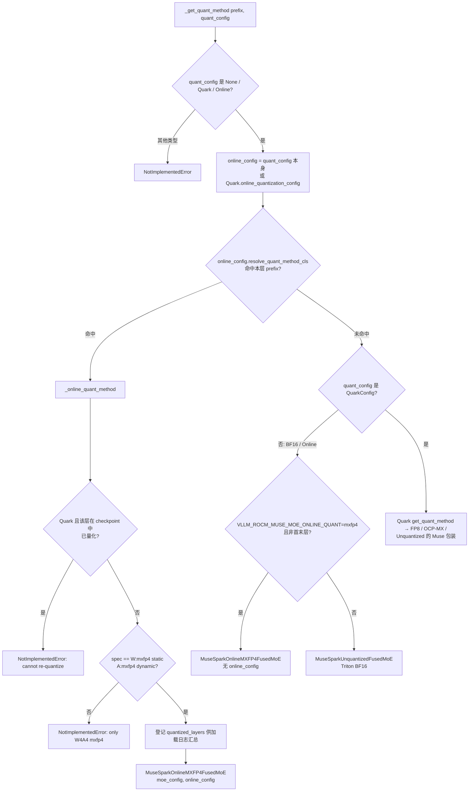
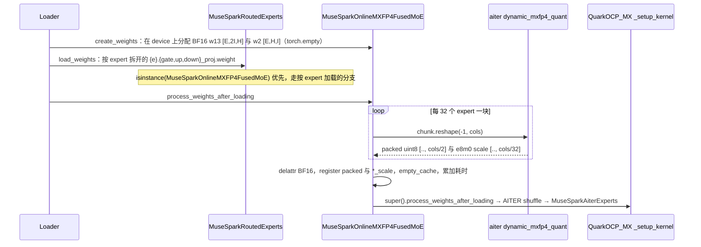

# PR #67191: [ROCm][Muse Spark] Online MXFP4 target for the BF16 first/last-layer experts

> **Author**: @mawong-amd | **State**: CLOSED（实为 **MERGED**，2026-11-19T03:10:28Z，squash 为 upstream/main 的 `78c938b840`）| **Date**: 2026-11-12
> **Branch**: `mawong/muse-mxfp4-edge-experts` → `main` | **Labels**: documentation, rocm, ci/build
> **Changes**: +295 -9 lines across 5 files | **ROCm 相关性**: 完全相关（`vllm/models/muse_spark/amd/` 下 ROCm 专属 MoE 路径，AITER W4A4，gfx950）
> **关闭原因**: 不是废弃也不是被取代——PR 经 @sawsa307、@Fangzhou-Ai 两人 approve 后**正常合入**。GitHub 将已合入 PR 的 `state` 记为 `closed`（`merged: true`，`merged_at == closed_at`）。`git diff 78c938b840~1 78c938b840` 与 `git diff <base>...pr/67191` 完全一致，说明合入的就是被 review 的 head `0f97fb5`。截至 review 时，main 上在它之后只有 4 个提交，且都没有再动 `vllm/models/muse_spark`。
> 本报告分两部分：§1–6 为 PR 详细总结，§7–8 为 ROCm review 意见。由于 PR 已合入，本报告为**追溯性 review**，§7 的结论可作为后续 follow-up 的输入。

---

## 1. 总结 (Summary)

Muse Spark Open 的 Quark MXFP4 checkpoint（`amd/Muse-Spark-Open-816B-A42B-Quark-MXFP4`）把第 0 层和第 61 层的 routed experts 留成了 BF16。decode 时这两层要走未融合的 BF16 Triton MoE 路径，读取的权重字节数约为 MXFP4 层的 3.8 倍。本 PR 让 Muse 的 ROCm `MuseSparkRoutedExperts` 接入 vLLM 通用的 online quantization `targets` 机制：用户通过 `--quantization-config '{"targets":{"*layers.0.feed_forward.experts*":"mxfp4",...}}'` 显式选中这两层，加载时用 AITER `dynamic_mxfp4_quant` 把它们 round 成 OCP MXFP4，之后与其余 60 层走同一条 AITER W4A4 + Muse 逐路 post-expert norm 路径。该行为**默认关闭（opt-in）**，不设 target 时行为与之前完全一致。

## 2. 背景与动机 (Background & Motivation)

- **数据面问题**：Quark 导出 Muse Spark MXFP4 checkpoint 时，`exclude` 把首尾两层的 experts 排除在外，所以这两层以 BF16 存储、按 expert 和 projection 拆开保存（`{e}.{gate,up,down}_proj.weight`）。作者测得：单个 EP4 rank 上第 0 层 MoE 在 8 tokens 时从 367 µs 降到 138 µs，384 tokens 时从 1428 µs 降到 550 µs。
- **机制复用**：NVIDIA 侧已有 #64552，用同一套 online `targets` 机制把这两层转成 NVFP4。本 PR 是它在 ROCm 上的对应实现。在此之前，ROCm Muse 模型只接受 `QuarkConfig` 或 BF16，`OnlineQuantizationConfig` 会被拒绝。
- **为什么不直接复用通用 online MoE method**：Muse 在 top-k 求和**之前**对每条 route 的输出做 RMSNorm（post-expert norm），通用的 `Mxfp4OnlineMoEMethod` 没有这一步。所以本 PR 把 online target 映射到 Muse 自己的 `MuseSparkOnlineMXFP4FusedMoE`（这个类之前已经存在，供 `VLLM_ROCM_MUSE_MOE_ONLINE_QUANT=mxfp4` 使用），对其他 spec 一律报错，不做回退。
- **相关 PR**：#64552（NVIDIA NVFP4，同一机制）；#66592（draft，用 AITER a16w16 跑这两层 BF16，不改变数值，作者认为二者互补，可作为默认路径）。

## 3. 代码修改分析 (Code Change Analysis)

### 3.1 修改的模块

| 文件 | 改动 |
|------|------|
| `vllm/models/muse_spark/amd/muse_moe_runner.py` (+75/-9) | `MuseSparkRoutedExperts._get_quant_method` 新增 online 分派：先 `resolve_quant_method_cls`，命中后进入新方法 `_online_quant_method`，在其中校验 spec 和来源并登记 `quantized_layers`；`MuseSparkOnlineMXFP4FusedMoE` 新增 `online_config` 参数，把 rounding 耗时累加进 `online_quantization_time` |
| `vllm/models/muse_spark/amd/model.py` (+28/-1) | `supported_quantization_configs` 加入 `OnlineQuantizationConfig`；新增 `_reject_online_quantized_linears`：对 BF16 checkpoint，如果 online 配置命中任何 `LinearBase`，就抛 `NotImplementedError` |
| `docs/features/quantization/online.md` (+7) | 在 "partially-quantized checkpoints" 一节追加 Muse Spark 示例 |
| `tests/kernels/moe/test_muse_spark_rocm_bf16_moe.py` (+147) | gfx950 数值测试：layer 0 经 target 后的输出与参考实现（AITER W4A4 + post norm）对齐，layer 61 保持 BF16；另含 3 个拒绝用例 |
| `tests/models/test_muse_spark_rocm_loading.py` (+37) | CPU 测试：`_reject_online_quantized_linears` 对 `*o_proj` target 和 `linear` 键报错，对只针对 expert 的 target 放行 |

### 3.2 架构 / 流程图

`MuseSparkRoutedExperts._get_quant_method` 合入后的分派逻辑：



加载与转换流程（被 target 命中的层）：



### 3.3 关键实现细节

- **层选择**：完全交给用户写的 `targets` glob（`find_matching_patterns(..., use_fnmatch=True)`），代码里**没有任何硬编码的层号逻辑**。层号逻辑只存在于原有的 env 路径 `_online_mxfp4_applies`，它对 BF16 checkpoint 排除第 0 层和第 `num_hidden_layers-1` 层，本 PR 没有改动这部分。`*layers.0.feed_forward.experts*` 不会误中 `layers.10`/`layers.60`，因为字面量 `layers.0.` 要求紧跟点号。
- **开关与默认行为**：没有新增 config 字段或 env var。只有传了 `--quantization-config` 的 `targets` / `moe` 才会触发；不传时，Quark checkpoint 的 0/61 层继续走 `MuseSparkUnquantizedFusedMoE`（Triton BF16）。
- **来源校验**：在 Quark checkpoint 上，如果 target 命中 checkpoint 中已经是 MXFP4 的层（例如 `*feed_forward.experts*` 命中第 5 层），通过 `get_quant_method_target(...)[2] is not UnquantizedFusedMoEMethod` 拒绝，防止对 MXFP4 再做一次量化。
- **spec 校验**：只接受 `weight == kMxfp4Static && activation == kMxfp4Dynamic`。`fp8_per_tensor` 或 `{"weight":"mxfp4","activation":null}`（W4A16）都会报错，原因是通用 online MoE method 没有逐路 post-norm。
- **scale 布局**：`_quantize_experts_to_mxfp4`（已有代码）输出 packed `[E, rows, cols/2]` uint8 和 scale `[E, rows, cols/32]` uint8(e8m0)，与 `QuarkOCP_MX_MoEMethod.create_weights` 为 checkpoint MXFP4 层分配的形状一致。之后统一由 `_setup_kernel → convert_weight_to_mxfp4_moe_kernel_format` 做 AITER shuffle，所以 online 层和 checkpoint 层在 kernel 侧看到的格式相同。
- **对齐 / padding**：`MuseSparkQuarkOCPMXFusedMoE` 继承 `maybe_roundup_sizes`。在 AITER_MXFP4_MXFP4 下，intermediate 按 128 对齐，hidden 按 256 对齐。Muse 的 `moe_hidden_size=4096`、`moe_intermediate_size=4096`，EP 或 TP≤32 时都不会触发 padding（另见 §7 关于 padding 区未清零的备注）。
- **架构范围**：`MuseSparkQuarkOCPMXFusedMoE.__init__` 强制要求 `Mxfp4MoeBackend.AITER_MXFP4_MXFP4`（CK W4A4，仅 gfx950）。在 gfx942 上会抛 `NotImplementedError` 并给出明确信息，不会静默回退。这与 Quark MXFP4 checkpoint 本身的硬件要求一致。
- **可观测性**：通过 `online_config.quantized_layers[prefix] = (...)` 让加载日志 `Quantizing N layers of types: ...` 能列出被转换的层。rounding 耗时累加到 `online_quantization_time`。通用的计时上下文只包裹 `OnlineLinearBase/OnlineMoEMethodBase`，不会重复计时。
- **BF16 checkpoint 上的 linear 拒绝**：`_reject_online_quantized_linears` 在 `super().__init__` 之后遍历 `LinearBase`，只要有 `quant_method` 不是 `UnquantizedLinearMethod`（含子类，如 `MuseSparkTorchLinearMethod`、`_GateLinearMethod`）就报错。该检查**只在 `vllm_config.quant_config` 本身是 `OnlineQuantizationConfig` 时运行**，即只针对 BF16 checkpoint。

## 4. 涉及的技术原理 (Technical Principles)

- **OCP MXFP4（W4A4）**：每 32 个元素共享一个 E8M0（纯指数）scale，元素为 FP4 E2M1，两个元素打包进一个 uint8。权重离线（这里是加载时）量化，激活在运行时动态按 32 元素块量化。gfx950（MI350/MI355）有原生 MXFP4 MFMA，gfx942 没有，所以 AITER CK W4A4 MoE 只能在 gfx950 上运行。
- **vLLM online quantization `targets`**：`QuantizationConfigArgs` 支持 `linear` / `moe` / `targets` / `ignore`。`targets` 用 fnmatch glob 把 prefix 映射到 spec，优先级高于 `linear`/`moe`，且两者互斥。如果 checkpoint 自带 quant config（如 Quark），online config 挂在 `quant_config.online_quantization_config` 上，只作用于 checkpoint 中未量化的层。
- **Muse 的 post-expert norm**：Muse MoE 对每条 route 的 expert 输出先做 RMSNorm，再乘 router 权重并做 top-k 求和。所以 expert kernel 必须输出逐 route 的未加权结果（`MuseSparkAiterExperts` 的 `(M, topk, K)` workspace），通用 fused MoE 那种在 kernel 内加权求和的方式不适用。
- **process_weights_after_loading 的内存峰值**：通用 online method 用 `uses_meta_device` 和 layerwise reload，权重一边加载一边量化，BF16 不会整模型驻留。Muse 的 online 类直接在 device 上分配完整 BF16 参数，所有层加载完毕后才逐层量化，因此峰值等于"所有被 target 命中层的 BF16 权重之和"，再加单层的 packed 输出和 32-expert chunk 的临时张量。

## 5. 评论区讨论亮点 (Discussion Highlights)

- 评论区**没有实质性的人类技术讨论**：两位 reviewer（@sawsa307、@Fangzhou-Ai）直接 approve，未留文字意见；claude[bot] 因为是 fork PR 而未运行；mergify 提示过一次 merge conflict。
- 作者三次 `/ci run`。最后一次 Buildkite #104134 在 bot 把落后 167 个 commit 的 main merge 进分支（产生 `0f97fb5`）之后触发，随后合入。PR 页面显示 9 个 GitHub checks 全部通过，但 JSON 中的 `checks` 字段抓取失败（只有键名），Buildkite 各 AMD step 的实际结果**无法从静态数据确认**。
- PR 描述自带了较完整的证据：单层 kernel 耗时、100k context 下的 decode step p50（两组同节点交换对照）、AgentX 3600 s serving（tok/s/GPU 提升约 2.8–3.0%，ITL p50 下降约 6–7%）、MATH-500 greedy 4 组配对（0.9630 → 0.9625，符号检验 p=1.0），以及接受长度 4.47 → 4.49。这些数字没有附脚本或日志链接，见 §7。
- PR 描述末尾有 "Generated with Claude Code" 署名，作者声明已人工审阅。按惯例，这意味着 dispatch 和测试覆盖需要审得更细一些（见 §7）。

## 6. 风险与潜在问题 (Risk Analysis)

| 风险 | 严重程度 | 说明 |
|------|---------|------|
| 新路径在 AMD CI 上的覆盖 | Medium | 唯一的 GPU 数值测试只在 gfx950 上跑，且位于 `optional: true` 的 MI355 MoE Kernels step，该 step 的依赖列表不含 `vllm/models/muse_spark/`，见 §7 ⚠️【测试】 |
| Quark checkpoint 上的 linear online target 没有被挡住 | Medium | 报错检查只覆盖 BF16 checkpoint，而文档上一个示例恰好是 Quark checkpoint 加 `linear: mxfp8`，见 §7 ⚠️【设计】 |
| 数值改变（opt-in） | Low | MATH-500 和接受长度基本持平；默认关闭 |
| BF16 checkpoint 使用宽 target 时的内存峰值 | Low | 不走 meta device，所有被命中层的 BF16 权重同时驻留，见 §7 📝 |
| env 路径与 online 路径叠加时日志失真 | Low | 见 §7 📝 |
| padding 区域未清零（潜伏） | Low | 当前 Muse 维度不会触发，见 §7 📝 |
| gfx942 兼容性 | Low | 显式报错，不会静默回退；文档没有写明仅支持 gfx950 |

---

## 7. Review 意见 (Findings)

| 类型 | 🔴 | ⚠️ | 📝 |
|------|----|----|----|
| 测试 | — | 1 | 1 |
| 设计 | — | 1 | — |
| 正确性 | — | — | 1 |
| 性能/内存 | — | — | 1 |
| 可维护性 | — | — | 1 |
| 注释/文档 | — | — | 1 |

---

**⚠️【测试】新的 online MXFP4 路径只在 optional 的 gfx950 step 上有 GPU 覆盖，且 Muse 代码改动不会触发该 step** `[已验证]`

- **问题**: 唯一验证数值正确性的测试 `test_mxfp4_target_rounds_a_bf16_edge_layer`（`tests/kernels/moe/test_muse_spark_rocm_bf16_moe.py:1170-1174`）标了 `skipif(not ROCM_GFX950)`。它所在的 `.buildkite/test-amd.yaml` 中 ":amd: (MI355) MoE Kernels Shard %N" step 是 `optional: true`，且 `source_file_dependencies` 只有 `tests/kernels/moe`、`vllm/model_executor/layers/fused_moe/` 等路径，**不含 `vllm/models/muse_spark/`**。作者在 PR 描述里也承认它 "runs nightly (or when unblocked)"。PR 页面显示 9 个 GitHub checks 通过，但这不代表这个 step 在 #104134 中真的跑过。
- **影响**: 以后有人只改 `muse_moe_runner.py`（例如调整 `_get_quant_method` 的分派顺序），不会触发任何 AMD GPU 测试，可能把首末层 experts 静默退回 BF16，或者走错 kernel。CUDA CI 全绿也挡不住，问题最早要到 nightly 才会暴露。
- **行动**: 建议作者在 follow-up 中把 `vllm/models/muse_spark/` 加进该 step（或 Muse 专属 step）的 `source_file_dependencies`，并在 PR 中贴出 #104134 里该 step 的运行链接。如果 MI355 资源不够，至少给 `_get_quant_method` 的分派矩阵补一个不依赖 GPU 的单测（只断言 method 类型）。

**⚠️【设计】"online target 只能作用于 routed experts"的限制只对 BF16 checkpoint 生效，Quark checkpoint 上的 linear target 不受检查** `[已验证]`（影响 `[推测]`）

- **问题**: `model.py:1210-1211` 只在 `isinstance(vllm_config.quant_config, OnlineQuantizationConfig)` 时调用 `_reject_online_quantized_linears`。当 checkpoint 是 Quark、online 配置挂在 `quant_config.online_quantization_config` 上时，这项检查不会执行，`linear: mxfp8` 或 `targets: {"*o_proj*": ...}` 会经通用路径作用到 Muse 中被 Quark 排除的 linear 上。`docs/features/quantization/online.md` 新段落以 "Similarly" 开头，紧接在 `amd/Qwen3.5-35B-A3B-MXFP4 --quantization-config.linear mxfp8` 示例之后，读者很容易把两者组合使用。
- **影响**: BF16 checkpoint 拒绝 linear target，说明作者认为通用 online linear method 在 Muse ROCm 上没有验证过（Muse 的 QKV+OG 融合、`MuseSparkTorchLinearMethod` 等特殊 linear 路径）。Quark checkpoint 上同样的组合却会被静默放行，可能得到未经验证的数值，或在 kernel 选择阶段才报错，错误信息远离根因。描述中 "online targets on linear layers raise" 的表述也只对 BF16 checkpoint 成立。
- **行动**: 建议作者让检查同样覆盖 `quant_config.online_quantization_config` 不为 None 的情况（只统计由 online 配置选中的 linear，而不是 Quark 自身量化的 linear）；如果 Quark checkpoint 上的 linear online 是有意支持的，请在文档和 PR 描述中写明，并补一个测试。

**📝【正确性】`create_weights` 用 `torch.empty` 分配 BF16，padding 区域没有清零（潜伏问题，当前维度不会触发）** `[已验证]`

- **问题**: `MuseSparkOnlineMXFP4FusedMoE.create_weights`（本 PR 未改动，但现在被 online target 新入口使用）按 `maybe_roundup_sizes` 返回的尺寸分配 `torch.empty` 的 BF16 张量。在 AITER W4A4 下 hidden 按 256、intermediate 按 128 对齐，checkpoint 只写入未 padding 的部分。通用的 `Mxfp4OnlineMoEMethod` 有专门的 `_zero_padding`；Quark 的 `create_weights` 用的是 `torch.zeros`。
- **影响**: Muse 的 4096/4096 维度在 EP 或 TP≤32 下不会 padding，目前不会触发。如果以后在 intermediate/TP 不是 128 倍数的变体（如更大 TP，或复用此类的其他模型）上使用，padding 行和列里的垃圾值会被量化进 w13/w2，污染 SiLU 输出和 down 投影，造成静默的数值错误。
- **行动**: 建议作者把这两处 `torch.empty` 改成 `torch.zeros`，或者在 `process_weights_after_loading` 中断言没有发生 padding。

**📝【可维护性】env 路径与 online `targets` 叠加时，被量化的层不会全部登记，加载日志失真** `[已验证]`

- **问题**: `muse_moe_runner.py:852-855`：BF16 checkpoint 加上 online 配置时，target 没命中的层会继续走 `_online_mxfp4_applies`（`VLLM_ROCM_MUSE_MOE_ONLINE_QUANT=mxfp4`），返回不带 `online_config` 的 `MuseSparkOnlineMXFP4FusedMoE`。这些层既不登记 `quantized_layers`，也不计入 `online_quantization_time`。
- **影响**: 例如 BF16 checkpoint 设置 `VLLM_ROCM_MUSE_MOE_ONLINE_QUANT=mxfp4`，同时 target 指定第 0 层和第 61 层，实际 62 层都会转成 MXFP4，但日志写 "Quantizing 2 layers"、耗时也只统计 2 层，排查数值问题时会误导。
- **行动**: 建议作者把 `online_config` 也传给 env 路径的实例并登记这些层，或者在两者同时设置时打一条 warning，说明 env 会作用到其余层。

**📝【性能/内存】Muse online 路径不使用 meta device 或逐层量化，BF16 checkpoint 加宽 target 时峰值为整模型 BF16 experts** `[已验证]`（数值为推算）

- **问题**: 通用 online method 通过 `uses_meta_device` 和 layerwise reload 边加载边量化；Muse 的类在 device 上分配完整 BF16，所有层加载完才逐层 round。对主要场景（Quark checkpoint，只有 0/61 两层）来说，这与原来就要驻留的 BF16 完全相同，不是回归。
- **影响**: PR 声称 "the same targets also work on a BF16 checkpoint"。如果用户在 BF16 checkpoint 上写 `{"moe":"mxfp4"}` 或 `*feed_forward.experts*`，峰值约为 256×3×4096×4096×62×2B ≈ 1.6 TB 的 BF16 experts 除以 EP 度：EP8 时每卡约 200 GB，勉强能放下；TEP4 时每卡约 400 GB，超过 MI355X 的 288 GB 而 OOM。走通用逐层路径的话，每卡只需约 1/4。这个限制与原有 env 路径相同。
- **行动**: 建议作者在文档或 PR 描述中注明：BF16 checkpoint 的宽 target 需要足够 HBM 容纳全部 BF16 experts；长期可考虑接入 layerwise 量化。

**📝【测试】数值测试的参考实现与被测实现用的是同一个量化函数，验证的是管线而不是量化本身；性能和精度数字无法溯源** `[已验证]`

- **问题**: 参考实现 `_mxfp4_weights` 和被测代码 `_quantize_experts_to_mxfp4` 都调用 aiter 的 `dynamic_mxfp4_quant`，测试实际验证的是加载→分派→shuffle→post-norm 这条管线（"bit-exact on MI355X" 也源于此），而不是 rounding 本身的正确性。这条管线的正确性依赖 aiter 量化函数，这一点可以接受。另外，PR 中的 decode p50、AgentX tok/s/GPU、MATH-500 等数字没有附命令、日志或脚本链接，`[unverified]`。
- **影响**: 精度结论只有一个 benchmark（MATH-500，4 组配对）支撑，量化误差对长上下文或其他任务的影响没有覆盖；数字无法复现核对。
- **行动**: 建议作者在 PR 或文档中补上 AgentX 与 MATH-500 的复现命令（模型、TP/EP、ROCm 和 aiter 版本），并补一个长上下文或其他类型任务的精度对照（如 GSM8K 或 MMLU-Pro 子集）。

**📝【注释/文档】文档没有写明硬件和后端前提** `[已验证]`

- **问题**: `online.md` 新段落只说 "On ROCm"，实际只支持 gfx950，而且要求 MXFP4 MoE backend 选中 `AITER_MXFP4_MXFP4`（gfx942 会抛 "requires the AITER_MXFP4_MXFP4 backend"）；也没有说明只接受 `mxfp4`（W4A4）这一种 spec，以及不能 target checkpoint 中已经量化的 expert 层。
- **行动**: 建议作者在该段落补一句 "requires gfx950 (MI350/MI355) with AITER; only the `mxfp4` (W4A4) spec on the BF16 expert layers is supported"。

非阻塞项已逐条核对：引用的符号都存在（`resolve_quant_method_cls` 返回 5 元组、`quantized_layers`、`online_quantization_time`、`get_quant_method_target`、`kMxfp4Static/kMxfp4Dynamic`）。`load_weights` 把 `MuseSparkOnlineMXFP4FusedMoE` 放在 `MuseSparkQuarkOCPMXFusedMoE` 子类判断之前，按 expert 加载 BF16 的分支是正确的。新代码不在 forward 或 CUDA graph 区域内，没有新增 env var，也没有新的 aiter 符号。

## 8. 结论 (Verdict)

**⚠️ NEEDS WORK**（追溯性 review，PR 已于 2026-11-19 合入 main，commit `78c938b840`）

核心设计是合理的：opt-in、不新增开关、复用通用 `targets`，对 Muse post-norm 以外的 spec 显式报错，不能对已量化层再量化，scale 布局与 checkpoint 一致，在 gfx942 上明确报错。PR 证据也比较充分（kernel、decode、serving、精度）。建议的 follow-up 有两项：一是把 `vllm/models/muse_spark/` 纳入 MI355 MoE 测试 step 的触发依赖，并确认它真的跑过；二是让 linear 拒绝检查同样覆盖 Quark 加 online 的组合（或者在文档中写明这是支持的）。其余为潜伏问题或文档类备注。

## 9. 英文 Review 评论 (Copy-Paste English Comments)

**C1** `tests/kernels/moe/test_muse_spark_rocm_bf16_moe.py:1170-1174` — ⚠️ comment

```text
This is the only GPU test that exercises the new online-target path, but it is gfx950-only and lives in the optional ":amd: (MI355) MoE Kernels" step, whose source_file_dependencies do not include vllm/models/muse_spark/. A future change that only touches muse_moe_runner.py would therefore not trigger it, and a dispatch regression (edge-layer experts silently falling back to BF16) would only show up nightly. Could you add vllm/models/muse_spark/ to that step's dependencies (or a Muse-specific AMD step), and link the Buildkite job where this test actually ran for this PR?
```

**C2** `vllm/models/muse_spark/amd/model.py:1210-1211` — ⚠️ comment

```text
The "online targets may only hit routed experts" guard only runs when quant_config itself is an OnlineQuantizationConfig (BF16 checkpoints). On the Quark MXFP4 checkpoint the online config sits in quant_config.online_quantization_config, so e.g. `--quantization-config.linear mxfp8` (the example right above the new docs paragraph) or a `*o_proj*` target is applied to Muse's Quark-excluded linears without this check. If generic online linear methods are not validated on Muse ROCm, I think the guard should also cover that case (only counting linears selected by the online config); if they are supported, could you document it and add a test?
```

**C3** `vllm/models/muse_spark/amd/muse_moe_runner.py:777` — ⚠️ comment (anchored on the nearest changed line; the allocation is in the unchanged create_weights above)

```text
create_weights allocates the BF16 w13/w2 with torch.empty using the sizes after maybe_roundup_sizes (AITER W4A4 rounds hidden to 256 and intermediate to 128), so any padded rows/columns hold garbage that gets rounded into the MXFP4 weights. Muse's 4096/4096 dims do not pad today, but the generic Mxfp4OnlineMoEMethod zeroes padding explicitly and the Quark path uses torch.zeros. Consider switching to torch.zeros (or asserting that no padding was applied) now that this class is reachable through generic online targets.
```

## 10. 英文总结评论 (Overall Review Summary)

```text
Nice, contained change: online mxfp4 targets on Muse's BF16 edge-layer experts reuse the existing AITER W4A4 + post-expert-norm path, other specs and re-quantizing checkpoint MXFP4 experts are rejected explicitly, and the rounded scales match the checkpoint layout. Two follow-ups: the only GPU test runs in an optional MI355 step that Muse code changes do not trigger, so please wire vllm/models/muse_spark/ into it; and the linear-target guard only covers BF16 checkpoints, not Quark plus online configs. Zeroing padding in create_weights would also be a cheap hardening. Approve with these as follow-ups.
```
