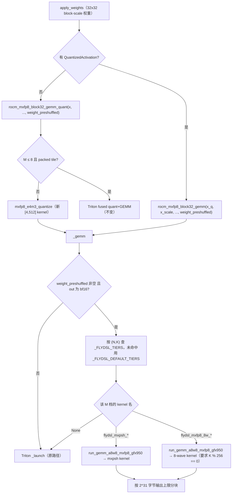
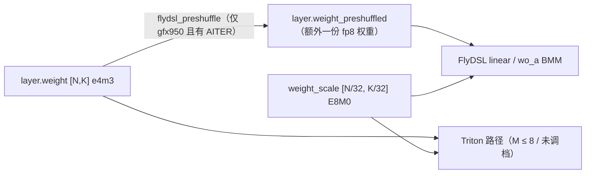

# PR #67377: [Perf][ROCm][DSv4.1] FlyDSL MXFP8 dense GEMM tiers and a faster MXFP8 activation quant for DeepSeek-V4.1-Flash DEP8 on MI355X

> **Author**: @limou102 | **State**: OPEN | **Date**: 2026-11-13
> **Branch**: `limou102:dev/limou/conc256_densegemm_opt` → `main` | **Labels**: deepseek, quantization, rocm, verified
> **Changes**: +306 -25 lines across 5 files | **ROCm 相关性**: 完全相关（Tier-1：`mxfp8/rocm_native.py`；`mxfp8_utils.py` 的 Triton quant 是所有 ROCm MXFP8 路径共用的）
> 本报告分两部分：§1–6 为 PR 详细总结，§7–8 为 ROCm review 意见。
>
> 说明：GitHub API 被限流，PR 元数据和讨论取自 PR 网页，CI 状态未知；代码取自 `refs/remotes/pr/67377`（与网页显示的最新 commit 一致）。本次为静态 review，未运行 PR 代码。

---

## 1. 总结 (Summary)

本 PR 针对 MI355X 上 DeepSeek-V4.1-Flash 的 dense（非 MoE）MXFP8 GEMM 做了三处优化：

1. `RocmDotScaledMxfp8LinearKernel` 在加载权重后额外保存一份 (16,16) preshuffle 的 fp8 权重 `layer.weight_preshuffled`。`rocm_mxfp8_block32_gemm(_quant)` 按 (N, K) 和 M 查分档表，命中时改走 AITER 的 FlyDSL MXFP8 GEMM。
2. wo_a 的分组 BMM 同样按 token 数分档走 FlyDSL batched GEMM。
3. MXFP8 激活量化 Triton kernel 从每个 program 处理一个 [64, 32] MX block，改为处理 [4, 512]，算术不变。

作者给出的端到端数据（DEP8, CONC=256）是吞吐 +11.1%，代价是每卡多占 6.96 GiB 显存、KV cache 少 4.1%。

## 2. 背景与动机 (Background & Motivation)

- 目标场景是 InferenceX aiperf agentic-coding benchmark：EP=True、DP attention、DP=8、TP=1、CONC=256。
- 在 profile 中，prefill step 的 dense GEMM 约占 192 ms。现有 Triton `tl.dot_scaled` kernel 在多数形状上不如 AITER 新增的 FlyDSL MXFP8 kernel。
- FlyDSL kernel 可以直接读取 checkpoint 中 32x32 的 E8M0 block scale，但要求权重做 (16,16) preshuffle。所以 PR 选择多保存一份权重，而不是替换原权重：M ≤ 8 的 fused-quant Triton kernel 仍然需要原始布局。
- 第二个 commit（`5808e437`）把 preshuffle 限制在 gfx950 上。原因是 `supports_mx()` 同时覆盖 gfx1250，而分档表里的 kernel 都是 gfx950 专用的。
- 评论区：@Fangzhou-Ai 质疑分档表为什么放在 vLLM 而不是 AITER，以及会不会影响其他模型的 kernel 选择。他还指出 main 的 GSM8K 基线应在 0.96 左右，而 PR 报告的是 0.895。

## 3. 代码修改分析 (Code Change Analysis)

### 3.1 修改的模块

| 文件 | 改动 |
|------|------|
| `vllm/model_executor/kernels/linear/mxfp8/rocm_block32_gemm.py` | 新增 `_FLYDSL_TIERS`（7 个 TP1 形状）、`_FLYDSL_DEFAULT_TIERS`（其余形状在 M ≥ 4096 时用 8-wave kernel）、`flydsl_kernel`、`flydsl_preshuffle`、`_gemm`（含 2 GiB 输出分块）。两个 custom op 新增可选参数 `weight_preshuffled` |
| `vllm/model_executor/kernels/linear/mxfp8/rocm_native.py` | `process_weights_after_loading` 对 32x32 block-scale 权重生成 `layer.weight_preshuffled`，`apply_weights` 把它传给两个 op |
| `vllm/model_executor/layers/quantization/utils/mxfp8_utils.py` | 激活量化 kernel 的 tile 从 [64,32] 改为 [4,512]（M==1 时为 [1,512]），`num_warps` 从 4 改为 2，删除 `_MXFP8_M1_BLOCK_M` 表 |
| `vllm/v1/attention/ops/rocm_aiter_mla_sparse.py` | 新增 `_FLYDSL_WO_A_TIERS`（只有 (8,1024,4096) 一档）和 `_flydsl_wo_a_bmm`，`rocm_dsv41_mxfp8_wo_a_bmm` op 新增 `weight_preshuffled` 参数 |
| `tests/kernels/quantization/test_rocm_mxfp8_linear.py` | 新增 FlyDSL 与 Triton 的对比测试：4 个线性形状 × 6 个 M（含 CUDA graph replay），以及 wo_a 的 5 个 M |

### 3.2 架构 / 流程图





### 3.3 关键实现细节

- **分档表**：每个形状对应一个 `[(max_M, kernel_name | None), ...]` 列表，按顺序找第一个 `max_M ≥ M` 的档位，最后一档用 `_ANY_M = 1<<62` 兜底。所有已调形状的 M ≤ 8 档都是 `None`，保留 Triton kernel。fused wq_a|wkv 和 indexer wq_b 中间还有一段 `None` 档，在那段 M 范围内 Triton 更快。
- **默认档**：未调档的 (N, K) 在 M ≤ 4095 时走 Triton，M ≥ 4096 时统一走 `flydsl_mxfp8_8w_256x256x128_F8_F8_B16_2x8`。
- **2 GiB 分块**：`rows = (2^31-1) // (2*N) // 256 * 256`，按行分块循环调用。例如 wq_b（N=32768）在 M=32768 时输出正好 2 GiB，会分成 2 块。
- **gfx950 门控**：`flydsl_preshuffle` 在 `on_gfx950()` 为假或没有 `aiter.ops.shuffle` 时返回 None，这时所有路径都与原来一致。`VLLM_BATCH_INVARIANT` 下不生成 block scale，也就不会 preshuffle，batch invariance 不受影响。
- **wo_a**：只有 (n_groups=8, o_lora_rank=1024, group_dim=4096)，也就是 TP1 有分档。调用前检查 `weight_scale.shape[0]*32 == weight_preshuffled.shape[0]` 和输入是否连续，不满足就回退 Triton。
- **激活量化 kernel**：每个 program 读取 [BLOCK_M, 512]，reshape 成 [BLOCK_M, 16, 32] 后按最后一维求 amax，计算 scale 和 rescale 的公式与原来一致。K 方向的尾部用 `offs_k < K` 遮罩，scale 写回用 `offs_b < K//32` 遮罩。
- **AITER 符号核对**：本机安装的 amd-aiter 0.1.29 与 `docker/Dockerfile.rocm_base` 固定的 `AITER_BRANCH=v0.1.29` 一致。其中 `aiter.ops.flydsl.mxscale_preshuffle_kernels.run_gemm_a8w8_mxfp8_gfx950`、`aiter.ops.flydsl.batched_gemm_a8w8_gfx950.run_bmm_a8w8_mxfp8_gfx950` 和 `aiter.ops.shuffle.shuffle_weight` 都存在，kernel 名中的 `_fsk/_pf/_nt` 后缀也都能被 `parse_kernel_name` 解析。split-K 使用独立的 workspace，不依赖 `out` 预先清零。

## 4. 涉及的技术原理 (Technical Principles)

- **MXFP8 与 32x32 block scale**：OCP MX 格式中每 32 个元素共享一个 E8M0（2 的幂）scale。DeepSeek-V4/V4.1 checkpoint 的 dense 权重是 32x32 二维 block scale，即每 32 行共享同一行 scale。`_as_block32_scale` 会把加载器按行展开的 scale 还原回 [N/32, K/32]。
- **激活量化的 scale 取法**：`sb = ceil(log2(amax / 448)) + 127`，把 block 的 amax 放到 e4m3 范围的顶端，避免小元素落进 subnormal。本 PR 只改变了 tile 形状，公式和舍入都没有变。
- **权重 preshuffle**：MFMA kernel 希望 B 矩阵按 16×16（K 方向 16 字节）的 tile 连续存放。`shuffle_weight(layout=(16,16))` 在加载时做这次 permute，运行时就不需要 LDS 重排，代价是多一份权重显存。
- **FlyDSL**：AITER 用 Python DSL 编写并 JIT 编译的 kernel 集合。`mxpsh` 是常规 MFMA tile 系列（可带 split-K、prefetch、non-temporal B），`8w` 是固定 256×256×128 tile 的 8-wave 大 GEMM kernel，要求 K 是 256 的倍数。
- **2^31 字节限制**：FlyDSL kernel 用 32 位 buffer descriptor 寻址，所以单个缓冲区不能超过 2 GiB。PR 只按输出大小分块，激活和权重在现有形状下都远小于这个上限。

## 5. 评论区讨论亮点 (Discussion Highlights)

- @Fangzhou-Ai 问 `_FLYDSL_TIERS` 和 `_FLYDSL_WO_A_TIERS` 能否交给 AITER 自动选择，也就是能否放进 AITER 的 tuned 配置，而不是在 vLLM 里硬编码 kernel 名。截至本次 review，作者还没有回复。
- @Fangzhou-Ai 问 kernel 选择的变化会不会影响其他模型。这与 §7 的阻塞问题和第一条建议直接相关：默认档会影响所有走 32x32 block-scale MXFP8 线性层、且在 TP1 分档表之外的形状。
- @Fangzhou-Ai 指出 main 上的 GSM8K 应在 0.96 左右，而 PR 报告的 main 0.895 / PR 0.906 说明评测设置可能有问题，所以这组精度对比不能作为证据。
- 还没有 approve。

## 6. 风险与潜在问题 (Risk Analysis)

| 风险 | 严重程度 | 说明 |
|------|---------|------|
| 未调档形状在 M ≥ 4096 时报错 | High | 见 §7 阻塞问题，TP>1 部署下 shared expert down_proj 会触发 |
| 默认档改变了所有 32x32 MXFP8 形状的大 M 路径 | Medium | 见 §7 第一条建议 |
| 显存 +6.96 GiB/卡，且无法关闭 | Medium | 见 §7 第二条建议 |
| 精度证据不足 | Medium | 见 §7 第三条建议 |
| 共用的激活量化 kernel 改了 tile | Low | 算术不变，`test_quant_activation_contract` 已通过，但缺少小 M 的性能数据 |
| 输出分块路径没被测到 | Low | 测试的最大 M 是 4096，wq_b 在 M=32768 时的分块路径未覆盖 |
| 与 main 的冲突 | Low | 与 main 的 #66598（调整了 gfx950 大 prefill 的 Triton tile）没有文本冲突，但性能基线已经变化 |

---

## 7. Review 意见 (Findings)

| 意见类型 | 🔴 | ⚠️ | 📝 |
|---------|----|----|----|
| 正确性 | 1 | 0 | 1 |
| 设计 / 兼容性 | 0 | 2 | 0 |
| 测试 | 0 | 1 | 0 |
| 性能 / 可维护性 | 0 | 0 | 2 |

**🔴【正确性】默认档会把 K 不是 256 倍数的形状交给 8-wave kernel，M ≥ 4096 时直接报错** `[已验证（静态）]`
- **问题**：
  - 32x32 block-scale 路径明确支持任意 `K % 32 == 0`（见 `rocm_native.py` 中 `process_weights_after_loading` 的注释），`flydsl_preshuffle` 也只要求 `N % 16 == 0`、`K % 32 == 0`。
  - 但 `_FLYDSL_DEFAULT_TIERS`（`rocm_block32_gemm.py:952-955`）对所有未调档的 (N, K) 在 M ≥ 4096 时都返回 `flydsl_mxfp8_8w_256x256x128_F8_F8_B16_2x8`。
  - AITER v0.1.29 中，`run_gemm_a8w8_mxfp8_gfx950` 遇到 `flydsl_mxfp8_8w` 前缀会直接进入 `flydsl_mxfp8_8wave_gemm`，后者的 `_validate` 要求 `K % K_ALIGN == 0`（`K_ALIGN = 256`），否则抛出 `ValueError`。
  - `_gemm` 在调用 FlyDSL 之前没有检查 K 对齐，也没有在失败时回退 Triton。
- **触发输入**：MI355X 上以 TP=2/4/8（不开 DP attention）部署 DeepSeek-V4.1-Flash，且使用默认 `VLLM_ROCM_USE_AITER_FUSION_SHARED_EXPERTS=False`。此时 shared expert 不做融合，是按 TP 切分的 `RowParallelLinear`。其 `down_proj` 的形状为 N=5120，K=2304/TP，即 1152、576 或 288，都不是 256 的倍数，也不在分档表内。只要 prefill 的 batch token 数 ≥ 4096，就会抛出 `ValueError`；启动时以 `max_num_batched_tokens` 做的 profile/dummy run 通常就会命中。DEP8（TP1）的 K=2304 已单独调档，所以作者的场景测不出这个问题。
- **影响**：在 TP>1 部署下，服务启动或第一次大 prefill 就会崩溃，而这些部署在本 PR 之前是正常的。
- **行动**：作者应当在 `_gemm` 中只在 kernel 的前置条件成立时使用 FlyDSL，例如 8-wave kernel 要求 `K % 256 == 0`，否则回退 Triton。更稳妥的做法是让默认档只覆盖已验证的形状。同时补充一个 K=288 或 1152、M=4096 的测试用例。

**⚠️【设计/兼容性】默认档和 (N, K) 键会改变 TP1 分档表以外所有 32x32 MXFP8 形状的大 M 路径** `[已验证]`
- **问题**：
  - 分档表只按 (N, K) 查找。DSv4.1-Flash 在 TP8 下 attention 的 wq_b 形状 (32768/8=4096, 1280) 恰好与 indexer wq_b 的键相同，会套用为另一个层调出来的档位。
  - 其余 TP2/4/8 的形状，以及其他使用 32x32 block-scale MXFP8 的 checkpoint，在 M ≥ 4096 时都会被默认档切换到 FlyDSL。PR 没有为这些情况提供性能或精度数据。
- **影响**：PR 声称「仅优化 DEP8」，实际影响范围是 gfx950 上所有 block-32 MXFP8 线性层的大 prefill。这正是 @Fangzhou-Ai 提的第三个问题。
- **行动**：建议作者要么把默认档改成 `None`（只启用已调档的形状），要么提供 TP8 和其他部署的对比数据。也可以考虑采纳 reviewer 的建议，把分档表放进 AITER 的 tuned 配置。

**⚠️【设计】额外的 6.96 GiB/卡权重副本无法关闭** `[已验证]`
- **问题**：在 gfx950 且有 AITER 时，`process_weights_after_loading`（`rocm_native.py:486-488`）总会为每个 32x32 block-scale 层生成 preshuffle 副本，没有环境变量可以关闭。同一文件中的 fused quant GEMM 已经有 `VLLM_DISABLE_FUSED_MXFP8_QUANT_GEMM` 这样的开关先例。
- **影响**：对于 KV 容量敏感的部署（长上下文、高并发 PD decode），KV 少 4.1% 可能比 dense GEMM 加速更重要；而 TP>1 部署只有默认档会用到这份副本，却要为它付出全部显存。
- **行动**：建议作者增加一个已注册到 `vllm/envs.py` 的开关（默认开或关都可以，在描述里说明），并考虑只为分档表中有 FlyDSL 档位的形状生成副本。

**⚠️【测试】精度证据和测试覆盖不足** `[已验证]`
- **问题**：
  - GSM8K 的 main 基线 0.895 明显低于 reviewer 给出的约 0.96，说明评测设置有问题，所以 0.906 不能证明精度无损。
  - 新测试只覆盖了 7 个已调形状中的 4 个，最大 M 为 4096，因此没有覆盖 wq_b 在 M=32768 时的 2 GiB 分块路径，也没有覆盖未调档或 K 不是 256 倍数的默认档形状（这个用例本可以发现上面的阻塞问题）。
  - wo_a 测试没有做 CUDA graph replay。
- **行动**：作者应当用正确的设置重跑 GSM8K（或 lm_eval），对比 main 和 PR，并在测试中加入：
  - M ≥ 32768 时 wq_b 的分块用例；
  - 一个默认档形状（含 K 不是 256 倍数的情况）；
  - shared down、engram 和 indexer wq_b 这三个已调形状。

**📝【正确性】线性层路径在调用 FlyDSL 前没有检查输入是否连续** `[推测]`
- **问题**：
  - `run_gemm_a8w8_mxfp8_gfx950` 要求 XQ 和 Out 连续，scale 也要求是行主序。不满足时它会直接抛 `RuntimeError`，而 Triton 的 `_launch` 可以接受任意 stride。
  - wo_a 路径会先检查 `a.is_contiguous()` 和 `a_scale.is_contiguous()`，`_gemm` 的 `qa` 路径（`QuantizedActivation.data.reshape(...)`、`qa.scale`）却没有做这个检查。
  - 目前的 producer 看起来都分配了连续的缓冲区，但一旦将来有 producer 传入 view，就会从静默回退变成崩溃。
- **行动**：建议作者在 `_gemm` 中补上与 wo_a 相同的连续性检查，不满足时回退 Triton。

**📝【性能】激活量化 kernel 的小 M 性能没有数据**
- **问题**：
  - 新 tile 固定为 BLOCK_M=4（M==1 时为 1）、BLOCK_K=512、`num_warps=2`，并删除了 M==1 按 K 调的表。作者只给出了 K=8192、M=32768 的数据（357→172 µs）。
  - decode 常见的 M=36–216 下，program 数会减少，例如 M=36、K=5120 时从 160 降到 90。
  - 这个 kernel 是所有 ROCm 平台上 MXFP8 量化共用的，包括 native MoE、online 量化和 gfx942 路径。算术不变，所以不存在正确性风险。
- **行动**：建议作者补一组 M=1、36、128、216 的 microbench 数据，确认 decode 侧没有退化。

**📝【可维护性】性能基线已经变化，kernel 名硬编码在 vLLM 中**
- **问题**：
  - main 上的 #66598 给 gfx950 的大 prefill Triton 路径换成了 256×256×128 tile。PR 的 1.37–2.03x 加速是以旧 Triton tile 为基线测的。PR 与 main 没有文本冲突。
  - 分档表依赖 AITER 内部的 kernel 名字符串。AITER 一旦改名，解析会失败：linear 路径抛 `ValueError`，BMM 路径则只给 warning 并自动选 kernel。
  - FlyDSL kernel 在首次遇到某个 (N, K, tile) 组合时才 JIT 编译。CUDA graph warmup 覆盖不到的大 prefill 档位，可能在线上第一次请求时才编译 `[推测]`。
- **行动**：建议作者 rebase 后对比当前 main 重测性能，并说明 FlyDSL 编译缓存和预热的情况。中长期可以按 reviewer 的建议，把分档表移到 AITER 的 tuned 配置。

## 8. 结论 (Verdict)

🔴 **BLOCK**。在 MI355X 上以 TP=2/4/8 运行 DeepSeek-V4.1-Flash 时，shared expert down_proj（K=1152/576/288）在 M ≥ 4096 时会被默认档交给要求 `K % 256 == 0` 的 8-wave kernel，导致启动或大 prefill 时抛出 `ValueError`。修好默认档的前置条件检查后，再处理显存开关、精度复测和测试覆盖，即可进入合入流程。DEP8 场景本身的实现是清晰的：只在 gfx950 生效、没有 preshuffle 时保持原路径、激活量化的算术不变。

## 9. 英文 Review 评论 (Copy-Paste English Comments)

**C1** `vllm/model_executor/kernels/linear/mxfp8/rocm_block32_gemm.py:952-955` — 🔴 blocking

```text
The default tiers send every untuned (N, K) to `flydsl_mxfp8_8w_256x256x128_...` once M >= 4096, but the 8-wave kernel requires K % 256 == 0 (`_validate` in aiter's gemm_a8w8_mxfp8_8wave.py raises ValueError otherwise), while the block-32 path accepts any K % 32 == 0. Concretely, DeepSeek-V4.1-Flash at TP=2/4/8 (no DP attention, default unfused shared expert) has shared_experts.down_proj with N=5120 and K=1152/576/288, so the profile run or any prefill batch >= 4096 tokens raises instead of falling back to Triton. DEP8 doesn't hit it because (5120, 2304) has its own tiers. Could you gate the FlyDSL call in `_gemm` on the kernel's preconditions (at least K % 256 for the 8-wave names) and fall back to `_launch` otherwise? A test with K=288 or 1152 at M=4096 would lock this in.
```

**C2** `vllm/model_executor/kernels/linear/mxfp8/rocm_native.py:486-488` — ⚠️ comment

```text
On gfx950 every 32x32 block-scaled layer now keeps a second preshuffled fp8 copy (+6.96 GiB per GPU, -4.1% KV cache for V4.1-Flash TP1), and there is no way to turn it off. For KV-bound deployments, and for TP>1 where only the M >= 4096 default tier ever reads the copy, that trade can go the other way. Could you add a registered env switch (like VLLM_DISABLE_FUSED_MXFP8_QUANT_GEMM next door) and consider only preshuffling shapes that have a FlyDSL tier?
```

**C3** `vllm/model_executor/kernels/linear/mxfp8/rocm_block32_gemm.py:983` — ⚠️ comment

```text
The tiers are keyed by (N, K) only, and the default list applies FlyDSL to every other block-32 MXFP8 shape at M >= 4096. So this changes kernel selection outside DEP8: e.g. at TP8 the attention wq_b becomes (4096, 1280) and silently picks up the indexer wq_b tiers, and all other TP>1 / other-checkpoint shapes switch to the 8-wave kernel for large prefill. I think either the default tier should be `None` until those shapes are measured, or the PR should include TP8 numbers. This is also @Fangzhou-Ai's question about other models' selection policy.
```

**C4** `tests/kernels/quantization/test_rocm_mxfp8_linear.py:817-823` — ⚠️ comment

```text
The new tests cover 4 of the 7 tuned shapes with M <= 4096, so the 2 GiB row-chunking in `_gemm` (wq_b at M=32768) and the default-tier path are never exercised, and wo_a isn't checked under graph replay. Could you add wq_b at M=32768, one untuned shape (including K % 256 != 0), and the shared down / engram / indexer shapes? Separately, the GSM8K baseline of 0.895 on main looks off (expected ~0.96), so please re-run the accuracy comparison with the standard settings.
```

## 10. 英文总结评论 (Overall Review Summary)

```text
Thanks for the solid DEP8 work: FlyDSL is gated to gfx950, every path is unchanged without the preshuffled weight, and the activation-quant rewrite keeps the same arithmetic. One blocker: the default tier sends untuned shapes to the 8-wave kernel at M >= 4096, but that kernel needs K % 256 == 0, so V4.1-Flash at TP=2/4/8 (shared-expert down_proj, K=1152/576/288) raises instead of falling back. Please gate on kernel preconditions, add an opt-out for the extra weight copy, broaden tests, and redo GSM8K with a correct baseline. Changes needed before merge.
```
