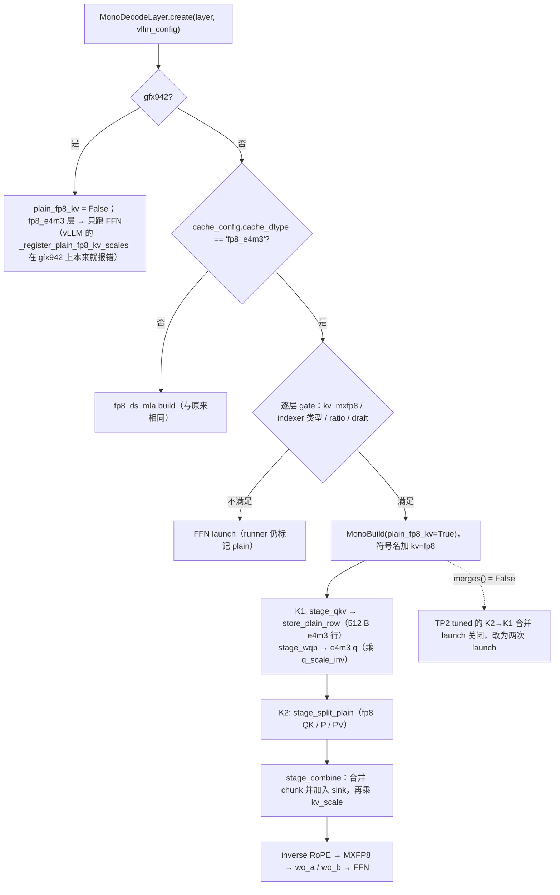
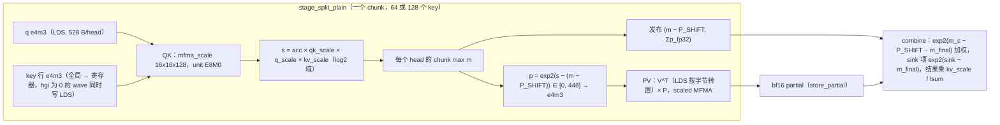

# PR #67560: [ROCm][DSv4.1] Enable Tensor scale FP8 KV Cache for Sparse MLA of Mono Kernel

> **Author**: @cagrikymk | **State**: OPEN（Draft） | **Date**: 2026-11-13
> **Branch**: `cagrikymk:cagri/dsv41_mono_plain_fp8_kv` → `main` | **Labels**: rocm, deepseek
> **Changes**: +697 -156 lines across 9 files | **ROCm 相关性**: 完全相关（只改 `vllm/models/deepseek_v41/amd/mono*`，即 MI355X 上 DSv4.1 decode 的 FlyDSL mono kernel；附带两个测试文件）
> 本报告分两部分：§1–6 为 PR 详细总结，§7–8 为 ROCm review 意见。
>
> 说明：PR JSON 里的 `checks` 字段只有键名，没有内容，所以 CI 状态未知（API 返回的 `mergeable_state` 是 `unstable`，说明有 check 未通过或还在跑，但无法归因）。代码来自本地 ref `pr/67560`（head `cf1e6bea94`，最后一个 commit 把 upstream/main 合了进来；与 merge-base `3d091b6f05` 比较，diff 正好是 PR 的 9 个文件）。本次是静态 review，没有运行 PR 代码或测试。

---

## 1. 总结 (Summary)

在此之前，DSv4.1 的 mono decode 遇到 `--kv-cache-dtype fp8_e4m3`（每个 token 一行 512 字节 e4m3，全局一个 per-tensor scale，下称“plain fp8”）时，只把 FFN 交给 mono kernel，attention 仍由 vLLM 自己跑。本 PR 让 gfx950 上的整层（K1 + K2）都能直接读写 plain fp8 cache，具体分三部分：

- **K1 写入**：K1 按 vLLM `fusedDeepseekV4FullCacheKernel` 的方式写 SWA 行和 e4m3 q。
- **K2 split**：新增 `stage_split_plain`，QK 和 PV 都改用 gfx950 的 16x16x128 scaled fp8 MFMA，方案与 aiter 的 Gluon `sparse_mla_fp8` 相同。
- **K2 combine**：在 combine 阶段乘上 value 的 per-tensor scale。

这条路径在构建期选择（`MonoBuild.plain_fp8_kv`）。作者在 commit 信息中声称，原有 `fp8_ds_mla` build 编译出的代码与之前逐位一致。

## 2. 背景与动机 (Background & Motivation)

- **背景**：
  - 在 ROCm 上，DSv4.1 的默认 KV 格式是 `fp8_ds_mla`：每行 584 B，前 448 维是 e4m3，每 64 维带一个 UE8M0 scale，RoPE 的 64 维保留 bf16。
  - `--kv-cache-dtype fp8_e4m3` 是另一种格式，每行 512 维全部是 e4m3，共用一个 per-tensor scale。这种格式由 aiter 的 Triton/Gluon sparse MLA 读取，用 `dot_precision="fp8"`，参见 `deepseek_v4/amd/rocm.py::_plain_fp8_sparse_mla`。
  - 选这种格式时，mono 原来会对每一层记录 "a fp8_e4m3 KV cache"，然后退回只跑 FFN 的 launch，attention 部分享受不到 mono 的融合收益。
- **PR 描述**：基本还是模板，只写了一句 "This PR brings plain fp8 kv cache support for dsv41 mono kernel. Details to be added."，Claims 和 Validation 两节都是空的，PR 仍是 Draft。
- **实际证据只在 commit 信息里**：
  - `823b659489`：在 MI355X TP2 上验证了 ratio 0/1/2、6–48 行、unit 和非 unit scale。结果是 SWA 行和 q 与 vLLM insert 逐字节相同；attention 与 float64 精确参考的相对 L2 误差为 2.2%（aiter kernel 为 2.3%）；`fp8_ds_mla` build 与旧代码逐位一致。
  - `2cf91bf4e8`："Passes at TP2 and TP4 for both formats. TP8 was not run"。
- **AI 辅助**：所有 commit 都带 `Co-Authored-By: Claude Opus 5.5`。

## 3. 代码修改分析 (Code Change Analysis)

### 3.1 修改的模块

| 文件 | 改动 |
|------|------|
| `mono/attention/back.py` (+289/-47) | 新增 `stage_split_plain`（fp8 QK、P 乘以 2^log2(448) 后量化成 e4m3、fp8 PV）；把 partial 写回逻辑抽成 `store_partial`，两条路径共用；`key_rec` 新增 plain 分支（行宽 512，没有 scale）；`stage_combine` 在 plain 模式下乘 `kv_scale`；`run_back` 在构建期二选一 |
| `mono/attention/front.py` (+92/-50) | `stage_qkv` 的 KV 写入拆出 `store_plain_row`（fp32 RoPE，乘 1/kv_scale，饱和到 ±448，写成 e4m3）；`stage_wqb` 在 plain 模式下把 q 写成 e4m3（乘 `q_scale_inv`，每个 token 占 H×512 B） |
| `mono/attention/plan.py` (+6) | 新常量 `PLAIN_ROW = 512`、`P_SHIFT = log2(448)` |
| `mono/layer.py` (+49/-3) | `MonoBuild.plain_fp8_kv`；K1 新增 `kv_scale` / `q_scale_inv` 参数，K2 新增 `kv_scale` / `q_scale` 参数；`K2K1_ARGS` 增加两个槽位；kernel 符号名加 `kv=fp8`；`build_mono_k2k1` 断言 plain 不走合并 launch |
| `mono/runner.py` (+45/-6) | `AttnWeights` 新增三个 [1] f32 scale 并做校验；`DSV41MonoLayer(plain_fp8_kv=...)` 断言不能是 gfx942；`merges()` 对 plain 返回 False；forward 按 512/584 校验行宽；`fp8_ds_mla` build 传入一个常量 1.0 的 `_unit` |
| `mono_decode.py` (+64/-18) | 在 `create` 中根据 `cache_config.cache_dtype == "fp8_e4m3" and not gfx942` 决定 plain；逐层 gate 放行 `fp8_e4m3`，但 gfx942 上回退；`_record_view` 按 plain 构造 [blocks, block, 512] 视图并校验 shape/stride；`_attn_weights` 读取 `_flashinfer_fp8_{kv,q}_scale(_inv)`；`_mono_runner` 断言 target 与 draft runner 的格式一致 |
| `mono/README.md` | 说明 plain fp8 行（gfx950）以及 fp8 MFMA 的 split 方案 |
| `tests/models/test_dsv41_mono_decode.py` (+40/-2) | gate 单测：5 种 plain 层在 gfx950 上走 whole 或 ffn，gfx942 上 plain 走 FFN；修了 fake config / factory |
| `tests/models/test_dsv41_mono_numerics.py` (+102/-28) | `test_mono_decode_layer_matches_vllm` 增加 `kv_cache_dtype` 参数化；plain 用例使用非 unit scale（KV 0.5、q 0.25），参考实现是 vLLM full-cache fp8 insert 加 aiter fp8 sparse MLA |

### 3.2 架构 / 流程图





### 3.3 关键实现细节

- **Writer 对齐（已核对）**：
  - `store_plain_row` 的输入是 bf16 的 normed kv（`kn`）。它在 fp32 中对 448 维之后的 pair（cos/sin 下标 `jj = tt − 224`）做 GPT-J RoPE，然后乘 `1/kv_scale`，`clamp_fp8` 到 ±448（gfx950 上 `FP8_MAX = 448`），最后用 `cvt_pk_fp8_f32` 转成 OCP e4m3（RNE）。
  - 这与 `csrc/fused_deepseek_v4_qnorm_rope_kv_insert_kernel.cu::fusedDeepseekV4FullCacheKernel` 的 `STORE_KV_FP8` 分支一致：输入 bf16，fp32 RoPE，`1.0f / scale` 后相乘，`kFp8Max = 448`，非 gfx942 用 `__hip_fp8_e4m3`。
  - q 一侧：wq_b 的 GEMV 结果先 bf16 舍入，再做 fp32 RoPE，乘 `q_scale_inv` 后饱和。这与同一 kernel 的 `STORE_Q_FP8` 分支一致。
- **Scale 只乘一次（已核对）**：
  - QK 的 MFMA 用 unit E8M0（127），再乘一次 `qk_scale × q_scale × kv_scale`（`back.py:651`）。
  - PV 用原始 V 字节，value scale 只在 combine 中乘一次（`back.py:855`）。
  - P 放大 2^P_SHIFT 后，chunk 发布 `m − P_SHIFT`。合并时 partial 与 l 都带同一个 2^P_SHIFT 因子，sink 项 `exp2(sink − m_final)` 与 `l·exp2(m_c − P_SHIFT − m_final)` 处在同一尺度，所以这个因子最终被抵消。
  - l 累加的是 fp32 的 p，而不是量化后的 e4m3 P。aiter `sparse_mla_fp8.py::softmax_to_lds` 也是这样做的（第 471 行在量化前累加），两者口径一致。
- **MFMA 操作数布局（已核对）**：
  - QK：A 是 key 行，lane g 读 `64c + 16g` 处的 16 B，第 i 个 128 维 step 用 chunk 2i 和 2i+1；B 是 q（`32i + 16h + 4g` words）。这与 `mfma_scaled` docstring 的 K 字节顺序（`16(l//16)` 与 `64 + 16(l//16)`）一致。
  - PV：`byte_column` 把 4 个 key 的同一维拼成一个 word，C 行映射到 `16g + 4i + dt` 维，与 `store_partial` 的约定一致。64-key chunk 的高 64 个 K 补零。
- **LDS 预算（已核对）**：plain 复用 bf16 split 的 `SplitLds` 数组，每个数组用量都更小：q 行 132 words 对比 260，raw 行 528 B 对比 584 B，P 行 ck/4+4 对比 ck/2+2，`st`/`lst` 下标都小于 `2·heads_pad·nkt`，所以不会越界。
- **TP8 的 head padding**：`heads = 8 < heads_pad = 16`，q 的 LDS 第 8–15 行没有写入。设计上 MFMA 的每一列对应一个 head，padding 列的计算结果不会被存储（与 bf16 路径相同）。
- **K2K1 合并 launch**：`K2K1_ARGS` 和 `k1_own` 同步增加了两个槽位（`kv_scale`、`q_scale_inv` 在 `qr_out` 之后、`tl` 之前），对 `fp8_ds_mla` 路径也生效。plain 路径的 `merges()` 返回 False，`build_mono_k2k1` 断言不会进入。
- **编译缓存隔离**：`_symbol_params` 加了 `kv="fp8"`，plain 与 `fp8_ds_mla` 两种 build 的 kernel 符号名不同。

## 4. 涉及的技术原理 (Technical Principles)

- **两种 fp8 KV 布局**：
  - `fp8_ds_mla` 是 DeepSeek 的打包格式：448 维 e4m3，每 64 维一个 UE8M0，RoPE 维度保留 bf16，每行 576 B 数据加 8 B scale。
  - plain `fp8_e4m3` 是每行 512 维全 e4m3，整层共用一个 per-tensor scale，RoPE 维度也量化。
  - 在 ROCm 上，V4.1 由 `_uses_fp8_ds_mla_layout()` 决定格式：`cache_dtype != "fp8_e4m3"` 时用打包格式，`auto` 和 `fp8` 都会解析为 `fp8_ds_mla`。所以只有显式传 `fp8_e4m3` 才会得到 plain 格式。
  - vLLM 现在为 plain cache 注册的 `_flashinfer_fp8_{q,kv}_scale` 固定为 1.0（`_register_plain_fp8_kv_scales`），不从 checkpoint 加载。
- **fp8 attention 的 P 量化**：softmax 概率 p ∈ (0, 1] 直接转 e4m3 会损失精度（最小 normal 为 2^-6）。aiter 和本 PR 都先把 p 乘以 2^log2(448)，让 chunk 内最大的 p 正好等于 e4m3 的最大值 448，再做 PV。归一化项 l 用 fp32 累加。aiter 采用 lazy rescale，要预留 `LAZY_LOG2` 的余量；mono 的 split 在算指数前已经知道 chunk 的精确最大值，所以不需要这部分余量。
- **gfx950 scaled MFMA**：`v_mfma_scale_f32_16x16x128_f8f6f4` 每个 128 维的 K step 带一个 E8M0 block scale。这里用 unit scale（127），per-tensor scale 在标量阶段乘。gfx942 没有这条指令，而且 gfx942 的 KV 是 fnuz（最大 224）编码，所以 plain 路径只支持 gfx950。
- **mono 的 split/combine**：每个 token 的 key（SWA 128 个加上 top-k 512 个）被切成 64 或 128 个 key 的 chunk。每个 CTA 处理一个 chunk，发布 (max, sum, bf16 partial)，combine 阶段做 log-sum-exp 合并并加入 attention sink。

## 5. 评论区讨论亮点 (Discussion Highlights)

- 目前没有人工 review 评论。mergify 在 11-13 提示有 merge 冲突，作者在 11-16 合入 upstream/main 解决了冲突。
- 待 review 的 reviewer：tjtanaa、dllehr-amd、hongxiayang 等（来自 PR 网页）。
- commit `3056dc7dbe` 提到：第一个 commit 让 36 个 gate 单测失败（fake config 缺少 `cache_config`），已在该 commit 修复。

## 6. 风险与潜在问题 (Risk Analysis)

| 风险 | 严重程度 | 说明 |
|------|---------|------|
| TP8 和 DSpark draft 的 plain 路径没有被数值测试覆盖 | Medium | 见 §7「TP8 与 draft 层没有数值验证」 |
| 没有端到端精度和性能证据 | Medium | 见 §7「PR 描述为空，证据只在 commit 信息中」 |
| 新 kernel 路径（fp8 MFMA）出现静默数值错误 | Low | scale、布局、LDS 都已静态核对；TP2/TP4 对 vLLM 参考逐字节 / 容差比较，作者自述通过 |
| `fp8_ds_mla` 路径回归 | Low | `store_partial` 是纯抽取；K1/K2K1 多了两个参数，作者称逐位一致，现有 numerics 测试可覆盖 |
| dispatch 错配（用错 reader） | Low | 只有 `fp8_e4m3` 产生 plain 布局；runner 和 `_record_view` 对 512/584 行宽做断言，错配时会直接报错 |
| CUDA graph | Low | scale 以 device 指针传入，不读 host，没有新分配；测试中有 300 次 graph replay 的逐位比较 |
| 维护：scale 语义依赖 vLLM 当前 scale 恒为 1 | Low | 见 §7 备注 |

---

## 7. Review 意见 (Findings)

| 意见类型 | 🔴 | ⚠️ | 📝 |
|---------|----|----|----|
| 测试 | 0 | 1 | 1 |
| 注释/文档（证据） | 0 | 1 | 0 |
| 设计 / 性能 | 0 | 0 | 2 |

**⚠️【测试】TP8 与 DSpark draft 层的 plain fp8 路径没有数值验证，CI 也跑不到** `[已验证]`
- **问题**：
  - commit `2cf91bf4e8` 写明 "Passes at TP2 and TP4 … TP8 was not run"。
  - `.buildkite/test-amd.yaml` 中的 "(MI355) DeepSeek-V4.1 Mono Decode Numerics" 是 `optional: true`、`num_gpus: 4`，而 `test_mono_decode_layer_matches_vllm` 在 `device_count() < tp` 时会 skip（`test_dsv41_mono_numerics.py:707`），所以 CI 也不会跑 TP8。
  - TP8 恰好是唯一的 padded head tile 配置：`Dims.heads = 8`，`heads_pad = 16`。`stage_split_plain` 只把前 8 个 head 的 q 写入 LDS，第 8–15 行是未初始化的 LDS 字节，在 OCP e4m3 下可能被解释为 NaN。正确性依赖两点：MFMA 的每一列都对应各自的 head，且 `store_partial` 和 stats 只存 `hh < heads` 的结果。静态看这个隔离成立，与 bf16 路径的设计相同，但 plain 的新代码没有在这个形状上跑过。
  - 另外，`_mono_runner` 会把 `plain_fp8_kv` 传给 DSpark draft runner（`mono_decode.py` 中 `draft=...` 分支）。draft 层的 SWA 宽度不同，routed expert 也不同（128 / top-3），numerics 测试只覆盖了 target 层。
- **影响**：README 写明支持 "TP2 / TP4 / TP8 (gfx950) … or, on gfx950, plain fp8 rows"。TP8 和 MTP/DSpark 部署会直接启用这条未经验证的 kernel 路径。万一 padding 列或 draft 宽度下的布局有误，表现会是静默的精度下降，而不是报错。
- **行动**：作者应当在 8 卡 MI355X 上跑一次 `test_mono_decode_layer_matches_vllm[fp8_e4m3-8]` 并贴出结果，再补一个 draft 层（plain）对 vLLM 的数值用例。在此之前，可以考虑让 TP8 / draft 的 plain 层先走 FFN launch。

**⚠️【注释/文档】PR 描述为空，证据只在 commit 信息中；没有端到端精度和性能数据** `[已验证]`
- **问题**：
  - PR 正文只有 "Details to be added."，Claims 和 Validation 两节为空，checklist 也没勾选，PR 仍是 Draft。
  - 现有的数字都只出现在 commit 信息里："attention within 2.2% relative L2 of an exact float64 attention (aiter's kernel: 2.3%)"。仓库里没有对应的 float64 对比脚本，测试比较的对象是 aiter kernel，不是 float64，所以这个数字目前是 `[unverified]`。
  - 没有任何端到端精度结果，比如 `--kv-cache-dtype fp8_e4m3` 下开启和关闭 mono 时的 GSM8K / lm_eval 对比。
  - 也没有性能数据。这个功能的目的就是让 attention 进入 mono kernel，同时 plain 模式关掉了 TP2 tuned 的 K2→K1 合并 launch（`runner.py:310`），所以收益并不显而易见。
  - CI 状态未知。
- **影响**：reviewer 无法判断这条路径是否值得合入、是否有精度回退，也无法复现作者的数字。所有 commit 都带 Claude 共同署名，描述又只说做了什么、没说为什么，AI 代码风险偏高。
- **行动**：作者应当把 commit 信息里的验证内容（TP、ratio、行数、scale、逐字节 / 容差结论）整理进 PR 的 Validation 一节，并补充：
  - 2.2% / 2.3% 的生成脚本；
  - 一组 `fp8_e4m3` 下 mono 与 vLLM attention 的端到端精度对比；
  - TP2/TP4/TP8 的 decode TPOT 或吞吐对比（含 `fp8_ds_mla` 加 mono 作为参照）。

**📝【测试】测试只用了 2 的幂 scale，attention 输出也只通过残差间接比较** `[推测]`
- **问题**：
  - 测试用的 `KV_SCALE, Q_SCALE = 0.5, 0.25`（`test_dsv41_mono_numerics.py:42`）都是 2 的幂，`1/kv_scale` 和 `q_scale × kv_scale` 都是精确值。
  - `store_plain_row` 的 `fx.Float32(1.0) / ld_f32(kv_scale)`（`front.py:495`）与 vLLM 的 `1.0f / scale` 对非 2 的幂 scale 是否逐 ulp 相同，没有验证。同文件专门实现了 `div_rn`，说明 FlyDSL 的 `/` 不保证 IEEE 舍入。
  - attention 输出没有被直接比较，只通过 FFN seam 后的残差（`rel < 0.01`）间接比较，对「scale 乘两次」这类错误的敏感度取决于 attention 输出相对残差的幅度。不过写入侧的 SWA 行逐字节比较已经能抓住 KV scale 方向的错误。
- **影响**：目前生产中的 scale 恒为 1.0，不会触发。将来接入校准 scale 时，"byte-equal to vLLM's insert" 的说法可能不再成立（只会差最低位，不是正确性 bug）。
- **行动**：建议作者加一个非 2 的幂 scale（如 0.37）的用例，并说明 `kv_scale` 漏乘或乘两次时测试确实会失败（例如贴一次 mutation 结果），或者直接比较 attention 输出（如 K2 的 XO 反量化结果与 aiter 输出）。

**📝【设计/性能】plain 模式的语义依赖 vLLM 当前恒为 1 的 scale；TP2 的合并 launch 被关闭** `[已验证]`
- **问题**：
  - mono 对 SWA 行和压缩行都用当前层的 `_flashinfer_fp8_kv_scale`（`mono_decode.py:681`）。而压缩行是 kv-source 层的 compressor 按它自己的 scale 写入的（`deepseek_v41/compressor.py::insert_cache`）。这与 vLLM 的 `_plain_fp8_sparse_mla` 是同一个假设，而 `_register_plain_fp8_kv_scales` 目前恒为 1，所以现在没有问题。
  - plain 模式下 `merges()` 恒返回 False，TP2 tuned build 少了 K2→K1 合并。`K2K1_ARGS` / `k1_own` 还为 `fp8_ds_mla` 路径新增了两个不会被读取的参数（`_unit`）。
- **影响**：
  - 如果将来某一层加载了不同的校准 scale，非 source 层读压缩行时会用错 scale，造成静默错误。不过 vLLM 的 aiter 路径有同样的问题，不是本 PR 引入的。
  - TP2 plain 的 decode 每层多一次 launch，性能收益需要数据证明。
- **行动**：建议作者在 `_attn_weights` 或 README 中注明「SWA 与压缩 cache 共用同一个 per-tensor scale，且目前恒为 1」，并给出 TP2 plain 与 `fp8_ds_mla` 的 decode 耗时对比。如果差距明显，再考虑后续为 plain 支持合并 launch。

> 静态核对结论（无问题，列出供 reviewer 参考）：
> - **dispatch gate 没有静默选错 reader 的路径**：ROCm 上只有 `fp8_e4m3` 会得到 plain 布局，`auto` 和 `fp8` 都解析为 `fp8_ds_mla`。在 `create`、逐层 gate、`DSV41MonoLayer.__init__`、`_register_plain_fp8_kv_scales` 四处都排除了 gfx942。runner 的 `swa_cache.shape[-1] == rec`、`comp_cache.stride(1) == rec` 和 `_record_view` 的 shape/stride 断言保证错配时直接报错。
> - **数值方案与 aiter 一致**：fnuz/OCP 处理正确（只支持 gfx950，用 OCP 448），scale 只乘一次，P_SHIFT 能抵消，sink 合并正确，LDS 不越界。
> - **CUDA graph 兼容**：没有新增 host 同步或分配。

## 8. 结论 (Verdict)

⚠️ **NEEDS WORK**。没有发现有具体触发条件的阻塞问题：

- plain fp8 的写入与 vLLM 的 full-cache insert 对齐；
- scale 在 QK 和 combine 中各乘一次，P 的 2^log2(448) 放大能被抵消；
- dispatch gate 和行宽断言能防止选错 reader。

合入前需要补两类证据：

- TP8（padded head tile）和 DSpark draft 层的数值验证；
- 完整的 PR 描述，包括端到端精度、decode 性能，以及 2.2% 这个数字的来源。

## 9. 英文 Review 评论 (Copy-Paste English Comments)

**C1** `tests/models/test_dsv41_mono_numerics.py:702-707` — ⚠️ comment

```text
The plain fp8 numerics were run at TP2/TP4 only (per the commit message), and the MI355 "Mono Decode Numerics" CI step is optional with 4 GPUs, so the tp=8 case always skips. TP8 is the one config with a padded head tile (heads=8, heads_pad=16): stage_split_plain leaves q rows 8..15 in LDS unwritten and relies on per-head MFMA columns plus the hh < heads store guard. That holds statically, but the new fp8 MFMA path has never executed in that shape, and the README lists TP8 as supported. Could you run test_mono_decode_layer_matches_vllm[fp8_e4m3-8] on an 8-GPU MI355X and post the result? A plain-fp8 case for a DSpark draft layer (different SWA width and expert count) would also be good, since _mono_runner now builds the draft runner with plain_fp8_kv too.
```

**C2** `vllm/models/deepseek_v41/amd/mono/runner.py:310` — ⚠️ comment

```text
The PR description is still the template ("Details to be added"), and the only evidence lives in commit messages, e.g. "attention within 2.2% relative L2 of an exact float64 attention (aiter's kernel: 2.3%)", which the test in this PR does not reproduce (it compares against aiter, not float64). Could you move the validation into the description and add (1) the script behind the 2.2%/2.3% numbers, (2) an end-to-end accuracy comparison with --kv-cache-dtype fp8_e4m3, mono on vs off, and (3) decode TPOT at TP2/TP4/TP8? The perf side matters because plain mode also disables the TP2 K2->K1 merged launch here, so the gain over vLLM's aiter attention is not obvious.
```

**C3** `vllm/models/deepseek_v41/amd/mono_decode.py:681` — 📝 comment（非阻塞）

```text
Minor, for future-proofing: both the SWA rows and the compressed rows are read with this layer's _flashinfer_fp8_kv_scale, while the compressed rows are written by the kv-source layer's compressor with its own scale. That matches vLLM's _plain_fp8_sparse_mla and is fine today because _register_plain_fp8_kv_scales always registers 1.0, but it silently breaks if calibrated per-layer scales are ever loaded. Could you note the shared-scale assumption here (or assert the scales are 1 for now)?
```

## 10. 英文总结评论 (Overall Review Summary)

```text
Thanks, the plain fp8 path is carefully matched to vLLM: K1 writes the same e4m3 rows and q as the full-cache insert, each per-tensor scale is applied exactly once, the 2^log2(448) P shift cancels in the combine, and gfx942 or mismatched cache layouts fail loudly. Before merge, please run the numerics test at TP8 (the padded head tile the README advertises) and add a DSpark draft case, then fill in the description with the evidence now only in commit messages plus end-to-end accuracy and decode throughput against vLLM's fp8_e4m3 attention. Changes needed before merge.
```
