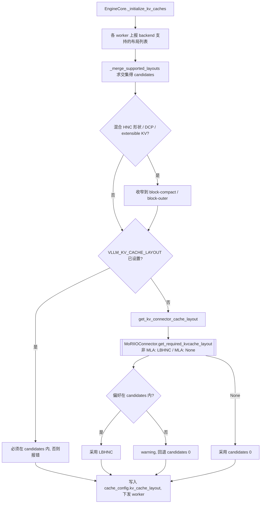
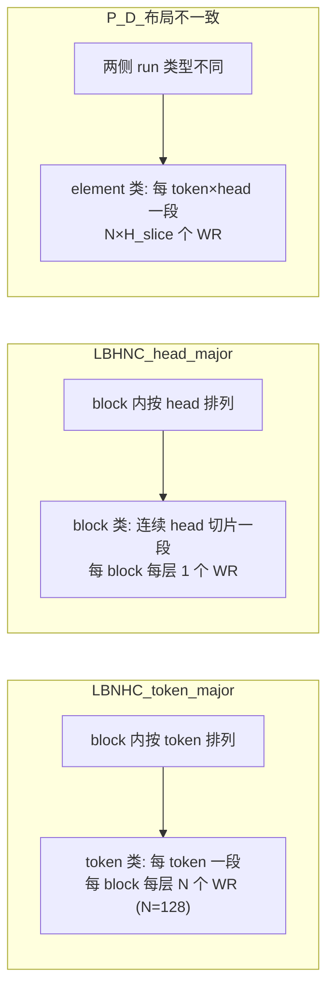

# PR #67863: [KV Connector][MoRIIO] Prefer the LBHNC KV cache layout for non-MLA models

> **Author**: @ChengYM5685 | **State**: OPEN | **Date**: 2026-11-16
> **Branch**: `moriio-kv-layout-lbhnc` → `main` | **Labels**: kv-connector
> **Changes**: +39 -0 lines across 2 files | **ROCm 相关性**: 完全相关（MoRIIOConnector 是 ROCm 专属的 PD 分离 KV 传输后端）
> 本报告分两部分：§1–6 为 PR 详细总结，§7–8 为 ROCm review 意见。

---

## 1. 总结 (Summary)

本 PR 给 `MoRIIOConnector` 增加 `get_required_kvcache_layout()` 类方法：非 MLA 模型返回 `"LBHNC"`（head-major block，即每个 block 内按 `[H, N, C]` 排列），MLA 模型与 `model_config is None` 时返回 `None`，规则与 `NixlConnector` / `MooncakeConnector` 一致。动机是异构 TP 的 WRITE 模式下，token-major 的 LBNHC 会把一个 head 切片拆成 `block_size` 个小 RDMA 写，长 prompt 下撑爆 QP 发送队列（`SQ full`），导致 decode 请求永远卡在 `WAITING_FOR_REMOTE_KVS`。改动本身只有 23 行 + 一个 16 行的单测。

## 2. 背景与动机 (Background & Motivation)

vLLM 的 KV cache 物理布局已统一为 RFC #42082 的 5 维 stride 置换描述 `KVCacheLayout`（`vllm/v1/kv_cache_layout.py`）：逻辑形状恒为 `[L, B, H, N, C]`，`LBHNC` 是恒等置换（block 内 head-major），`LBNHC` 是旧称 NHD（block 内 token-major），`LHBNC` 是 H 在 block 之外（K/V 两个 head slot 各成一个跨所有 block 的稠密平面）。布局在 engine core 中由 `resolve_kv_cache_layout()` 一次性决定：先取各 worker 上所有 attention backend 声明的 `supported_kv_cache_layouts()` 交集（`candidates`），然后按优先级 `VLLM_KV_CACHE_LAYOUT` > connector 偏好（`get_kv_connector_cache_layout()` → `get_required_kvcache_layout()`）> `candidates[0]` 选定；connector 偏好不在 candidates 里时打 warning 并回退。

MoRIIO 在 #61726（2026-10-19）中已经支持 WRITE 模式的异构 TP：通过握手交换每层的 `HeadLayout`（字节 stride 描述），用 `compute_head_slice_offsets()` 按布局计算每个 head 切片的 RDMA 段。作者在 MI355X 上用 MiniMax-M3.1 1P1D（prefill PP2×TP4 → decode DP8×TP1+EP8，WRITE 模式，AgentX trace，最长 256k token）复现：MiniMax-M3 的 Triton sparse 后端不声明布局，默认选 LBNHC，异构 TP 下每 block 每层 128 个 WR，长 prompt 时 `SQ full (batch): depth=32767`，请求永不结束；手动设 `VLLM_KV_CACHE_LAYOUT=LBHNC` 后 1 小时无错误。本 PR 让 MoRIIO 主动声明 LBHNC 偏好，免去用户手动设环境变量。

## 3. 代码修改分析 (Code Change Analysis)

### 3.1 修改的模块

| 模块 | 改动 |
|------|------|
| `vllm/distributed/kv_transfer/kv_connector/v1/moriio/moriio_connector.py` (+23) | `MoRIIOConnector` 新增 classmethod `get_required_kvcache_layout()`：`model_config is None` → `None`；`use_mla` → `None`；否则 `info_once` 日志并返回 `"LBHNC"` |
| `tests/distributed/test_kvlayout.py` (+16) | 新增 `test_get_kv_connector_cache_layout_with_moriio_connector`：默认 `ModelConfig()`（非 MLA）+ CPU device 下断言返回 `"LBHNC"` |

### 3.2 架构 / 流程图

布局决议流程（本 PR 只改变了虚线框中 MoRIIO 的返回值）：



异构 TP WRITE 中一个 head 切片在一个 block 内的 RDMA 段数（`_head_runs()` 的分类）：



### 3.3 关键实现细节

- 新方法与 `NixlConnector.get_required_kvcache_layout`（`nixl/connector.py:173`）、`MooncakeConnector`（`mooncake_connector.py:839`）逻辑几乎逐字相同，唯一差别：MoRIIO 在 `model_config is None` 时静默返回 `None`，另两者先 `warning_once`。
- 偏好通过 `resolve_kv_cache_layout()`（`vllm/v1/attention/backends/utils.py:312`）生效：`VLLM_KV_CACHE_LAYOUT` 仍优先；偏好不在 candidates 中则 warning 回退，不会硬失败。
- MoRIIO 传输侧早已与布局解耦：`get_layer_head_layout()`（`moriio_layout.py:638`）从 cache stride 生成 `HeadLayout`，`_block_copy_matches_peer()` 在两侧布局相同且稠密时走整块拷贝，否则走 head-slice；所以 LBHNC 不需要改传输代码。已核对 4D `[B, H, N, C]` 视图下 LBHNC 满足 `token_stride == head_bytes && head_stride == N*head_bytes`，`_head_runs()` 返回 "block" 类（单段），与 PR 描述一致。
- 同构 TP：LBNHC 与 LBHNC 都满足 `HeadLayout.is_dense`，两侧一致时都是整块拷贝，PR 中"同构 TP 不受影响"的说法成立。
- `MultiConnector.get_required_kvcache_layout` 要求所有子 connector 的布局一致，不一致直接 `ValueError`；MoRIIO 现在会参与这一检查。

## 4. 涉及的技术原理 (Technical Principles)

- **PD 分离与异构 TP**：prefill 与 decode 的 TP 不同时（如 P=TP4、D=TP1），每个 P rank 只持有部分 KV head，必须把自己那部分 head 写进 D 的 block 内对应位置。D 的 block 内 head 与 token 谁在外层，决定了一个 head 切片是连续的一段还是被 token 打散的多段。
- **RDMA 发送队列（SQ）深度**：每个 RDMA write 是一个 work request（WR），QP 的 SQ 深度有限（这里报 `depth=32767`）。WR 数 ≈ 层数 × block 数 × 每 block 段数；token-major 布局下"每 block 段数"等于 block_size（128），长 prompt 很快把 SQ 填满。MoRIIO 的 READ 路径对 `SQ full` 有退避重试（`_post_read_with_backoff`），WRITE 路径没有。
- **KV cache 布局决议（RFC #42082）**：`KVCacheLayout` 用 stride 置换描述物理排列，各 attention backend 声明自己的 kernel 能读哪些布局，connector 只能在交集中"表达偏好"。这意味着 connector 的偏好会覆盖 backend 自身的首选项——backend 列出但不首选的布局，必须在所有代码路径上都真的可用。
- **MLA 例外**：MLA 的 latent cache 只有一个 head，且在每个 TP rank 上复制，不存在按 head 切分的问题，因此 MLA 模型（含 DeepSeek-V3/V3.2/V4/V4.1）保持 `None`，行为不变。

## 5. 评论区讨论亮点 (Discussion Highlights)

- 目前没有人工 review。唯一的 review 来自 `claude[bot]`："This pull request is from a fork — automated review is disabled"。
- PR checklist 勾选了 "AI assistance was used"。PR 描述对根因的解释到位（说清了 token-major 下 WR 数的来源），不属于只讲 WHAT、不讲 WHY 的描述。
- 经公开 GitHub API 核对，head 上的 `pre-run-check` 在 "Check PR label and author merge count" 一步失败（PR 没有 `ready` label），pre-commit 与 Buildkite 均被跳过，CI 实际没有运行。

## 6. 风险与潜在问题 (Risk Analysis)

| 风险 | 严重程度 | 说明 |
|------|---------|------|
| connector 偏好覆盖 backend 首选：AITER FA shuffle KV 下 decode 断言失败 | Medium | 见 §7 ⚠️【兼容性】；opt-in 环境变量组合，报错是明确的断言，不是静默错误 |
| WRITE 路径 `SQ full` 根因未修，回退场景仍会卡死请求 | Medium | 见 §7 ⚠️【设计】 |
| 测试只断言返回值，不覆盖 MLA 分支与实际 WR 数 | Medium | 见 §7 ⚠️【测试】 |
| P/D 版本或环境变量不一致导致两侧布局不同 | Low | 传输正确（element 段）但 WR 更多；见 §7 📝【兼容性】 |
| 三个 connector 复制同一规则 | Low | 见 §7 📝【可维护性】 |
| 性能数字无可追溯来源 | Low | 见 §7 📝【性能】 |
| MLA 模型（DSv4 / DSv4.1 / Kimi）行为变化 | Low | `use_mla` → `None`，不变；已核对 `deepseek_v4`/`deepseek_v41` 都在 `is_deepseek_mla` 列表中 |

---

## 7. Review 意见 (Findings)

| 类型 | 🔴 | ⚠️ | 📝 |
|------|----|----|----|
| 兼容性 | — | 1 | 1 |
| 设计 | — | 1 | — |
| 测试 | — | 1 | — |
| 可维护性 | — | — | 1 |
| 性能 | — | — | 1 |
| 设计（跨 PR） | — | — | 1 |

---

**⚠️【兼容性】`ROCM_AITER_FA` + `VLLM_ROCM_SHUFFLE_KV_CACHE_LAYOUT=1` 时，MoRIIO 偏好会把布局从 LHBNC 换成 LBHNC，decode 路径断言失败** `[已验证]`（"此前这个组合能正常跑"为 `[推测]`）

- **问题**: `rocm_aiter_fa.py:933-941` 在 shuffle KV 模式下声明 `(LHBNC, LBHNC)`，注释写明 `pa_fwd_asm` 要求 K/V 各为跨所有 block 的稠密平面，"Under LBHNC the slots alternate block by block, doubling the stride the kernel assumes. LBHNC stays listed for models whose mixed HNC shapes need a block-compact layout"。在此之前，MoRIIO 不表达偏好，单一 FA 后端的 dense 模型会选 `candidates[0] = LHBNC`。本 PR 之后，LBHNC 在 candidates 中，`resolve_kv_cache_layout()` 会采纳 connector 的 LBHNC。decode 的 shuffle 分支（`rocm_aiter_fa.py:1498-1519`）有断言 `new_key_cache.stride(0) == num_kv_heads * head_size * block_size`。LBHNC 下 `_split_kv_cache` unbind 出的 K 视图 `stride(0) = 2 * N * H * hs`（block 内含 K、V 两个 slot），reshape 仍是 view，所以断言必然失败。
- **触发输入**: `VLLM_ROCM_USE_AITER=1` + `VLLM_ROCM_SHUFFLE_KV_CACHE_LAYOUT=1` + `ROCM_AITER_FA` 后端 + `MoRIIOConnector` + 不含 sinks/SWA 的非 MLA dense 模型（如 Llama-3.1-8B、Qwen3-8B），D 侧第一次 decode（或 cudagraph 捕获时的 decode dummy run）即 `AssertionError`。`ROCM_AITER_UNIFIED_ATTN`（connector 下已强制 LBHNC）和非 shuffle 的 `ROCM_AITER_FA`（本就首选 LBHNC）不受影响；`ROCM_ATTN` 的 `supports_kv_connector()` 返回 False，不会和 connector 同时出现。
- **影响**: 原本可用的 opt-in 组合在启动或首次 decode 时崩溃（报错明确，不是静默错误）。NixlConnector 在 ROCm 上已有同样问题，根因在 backend 声明的布局列表，但 MoRIIO 是 ROCm 上的主力 PD connector，本 PR 实际放大了暴露面。
- **行动**: 建议作者二选一：(a) 在 `get_required_kvcache_layout()` 中当 `rocm_aiter_ops.is_shuffle_kv_cache_enabled()` 时返回 `None`（并注释原因）；(b) 推动 `rocm_aiter_fa.supported_kv_cache_layouts()` 只在混合 HNC 形状时才列出 LBHNC，或让 shuffle decode 路径支持 LBHNC 的 stride。另外建议作者确认 MoRIIO + shuffle KV 在 LHBNC 下此前是否真的可用（`HeadLayout` 会走 head-slice 路径）。

**⚠️【设计】布局偏好只是缓解；WRITE 路径对 `SQ full` 仍无退避，回退场景下请求依旧永久卡住** `[已验证]`

- **问题**: READ 路径有 `_post_read_with_backoff()`（`moriio_connector.py:4105` 起，遇 `SQ full` 指数退避，超过 `transfer_timeout` 后标记失败并通知 prefill 释放），WRITE 路径的 `_do_layer_write()`（`moriio_engine.py:570`）直接 `batch_write`，没有 SQ 满判断、退避或失败通知。本 PR 只是让常见配置避开 token-major，下面这些场景仍会回到 PR 描述里的故障：① 用户显式 `VLLM_KV_CACHE_LAYOUT=LBNHC`；② 某侧 backend 不支持 LBHNC（如 `TURBOQUANT`、`FLEX_ATTENTION` 只声明 LBNHC），偏好被 warning 回退；③ P/D 两侧布局不一致，`_head_runs()` 两侧类型不同，退化为 "element" 段（N × H_slice 个 WR/block，比 LBNHC 还多）。
- **影响**: 上述配置下长 prompt 仍会 `SQ full`，请求永久停在 `WAITING_FOR_REMOTE_KVS`，没有超时，也没有可诊断的错误。
- **行动**: 建议作者在 WRITE 路径补上与 READ 对称的 `SQ full` 退避或失败上报（可以作为后续 PR）。至少在握手时，若异构 TP WRITE 的 head 切片段类型不是 "block"，打一条 warning，说明 WR 数会放大、建议两侧统一为 LBHNC。PR 描述也建议改写为"规避"而非"修复"。

**⚠️【测试】单测只断言返回值，没有覆盖 MLA 分支，也没有在 CPU 上锁定 PR 声称的 WR 数收益** `[已验证]`

- **问题**: 新测试 `test_kvlayout.py:58-71` 是 Nixl 测试的复制，只覆盖默认非 MLA `ModelConfig()` → `"LBHNC"`。没有 MLA → `None` 的用例，也没有 `resolve_kv_cache_layout()` 层面的用例（偏好被采纳 / 被回退）。PR 核心论点"LBHNC 下一个 head 切片一次写完，LBNHC 下要 block_size 次"可以用 `compute_head_slice_offsets()` 在 CPU 上直接断言段数，但没有测试。
- **影响**: 将来改动 `_head_runs()` 或布局决议时，这次修复的收益可能悄悄消失，CI 不会报警。端到端验证只在作者的 MI355X 环境上做过，PR 没有 AMD CI 记录。
- **行动**: 建议作者补充：① MLA 模型返回 `None` 的参数化用例；② 一个纯 CPU 的 `compute_head_slice_offsets()` 用例，TP4→TP1、block_size=128，分别断言 LBHNC 1 段、LBNHC 128 段；③ 可选：一个 `resolve_kv_cache_layout()` 用例，覆盖 backend 首选 LHBNC 时被 MoRIIO 偏好覆盖的情况（对应上面的 shuffle 问题）。

**📝【兼容性】默认布局变化后，P/D 两侧需要同时升级，或者显式设置相同的 `VLLM_KV_CACHE_LAYOUT`** `[已验证]`

- **问题**: 对于不声明布局的 backend（Triton、MiniMax-M3 Triton sparse 等），新版本默认用 LBHNC，旧版本默认用 LBNHC。滚动升级、只在一侧设 `VLLM_KV_CACHE_LAYOUT`，或 P/D 使用不同 backend 时，两侧布局可能不同。由于两侧都通告 `kv_head_layouts`（#61726 之后），传输依然正确，但会走 element 段，WR 数最多。`docs/features/moriio_connector_usage.md` 只写了"Use matching cache layouts on both instances"，没有说明默认值。
- **行动**: 建议作者在 `moriio_connector_usage.md` 的 "Different prefill and decode TP sizes" 一节补一句：非 MLA 模型默认 LBHNC，`VLLM_KV_CACHE_LAYOUT` 若要设置，必须两侧一致。

**📝【可维护性】同一条布局规则在 Nixl / Mooncake / MoRIIO 三处逐字复制，且 MoRIIO 版本缺少 `model_config is None` 的 warning** `[已验证]`

- **问题**: 三个 connector 的 `get_required_kvcache_layout()` 都是"`model_config` 为 None → None；MLA → None；否则 LBHNC"。Nixl 与 Mooncake 在 None 分支打 `warning_once`，MoRIIO 静默返回。
- **行动**: 建议作者（或后续 PR）抽一个共享 helper（例如 `head_major_layout_unless_mla(vllm_config, connector_name)`），保持诊断一致；最低限度补上 warning 以与 twin 对齐。

**📝【性能】PR 描述中的 TTFT / gsm8k / `SQ full` 计数无可追溯来源** `[已验证]`

- **问题**: 表格中的 TTFT p50（如 0.43 / 0.69 / 0.97 s vs 0.51 / 0.98 s）、"32/32 vs 5/32"、`SQ full` 计数 0 vs 1316、gsm8k 0.933 vs 0.937 都没有附命令、proxy 配置、ROCm/mori 版本或日志链接，本报告一律视为 `[unverified]`。单测输出（`1 failed, 4 passed` → `5 passed`）可以通过 diff 复现。
- **行动**: 建议作者附上 server/proxy 启动命令、benchmark 命令、mori 版本和日志片段（或 gist），使性能结论可复现。

**📝【设计（跨 PR）】与 #68072（MoRIIO 异构 TP WRITE NVFP4 页按 head 切片）的关系** `[推测]`

- **问题**: #68072 让 NVFP4 页也走按 head 切片的 WRITE。MiniMax-M3 的 AMD NVFP4 sparse 后端本就只声明 `(LBHNC, BLHNC)`，所以 NVFP4 路径已经是 head-major，本 PR 对它不改变布局；本 PR 主要影响的是 Triton sparse / 不声明布局的 bf16 路径。两者互补，但 #68072 的切片验证若只在 LBHNC 下做，LBNHC / BLHNC（block-outer，MoRIIO PP>1 会拒绝）的段计算未必被覆盖。
- **行动**: 建议 review 时追问作者：#68072 的 NVFP4 切片在 4D `[B, H, N, C]` 视图下是否走 "block" 段；两 PR 的合入顺序是否有依赖；#68072 的测试是否覆盖非 LBHNC 布局。

## 8. 结论 (Verdict)

**⚠️ NEEDS WORK**

改动小，方向正确：与 Nixl/Mooncake 的 MLA 规则一致，MoRIIO 传输侧本就按 stride 处理布局，LBHNC 下异构 TP 的 head 切片确实从 N 段降为 1 段，同构 TP 与 MLA（DSv4/DSv4.1）不受影响。但 connector 偏好会覆盖 `ROCM_AITER_FA` shuffle KV 模式的首选 LHBNC，导致 decode 断言失败，需要先处理。另外，WRITE 路径对 `SQ full` 仍无退避，测试也只覆盖返回值，建议补齐或在描述中明确留给后续 PR。

## 9. 英文 Review 评论 (Copy-Paste English Comments)

以下评论可直接复制到 GitHub PR review 的对应文件/行（行号为新文件行号，按 hunk 头 `@@ -287,6 +287,29 @@` 与 `@@ -55,6 +55,22 @@` 推算并已核对）：

**C1** `vllm/distributed/kv_transfer/kv_connector/v1/moriio/moriio_connector.py:303-311` — ⚠️ comment

```text
This preference overrides the attention backend's own first choice whenever LBHNC is in the candidate set. With ROCM_AITER_FA and VLLM_ROCM_SHUFFLE_KV_CACHE_LAYOUT=1, the backend lists (LHBNC, LBHNC) and its comment says LBHNC is only meant for models with mixed HNC shapes. For a plain dense non-MLA model (e.g. Llama-3.1-8B), the resolver now picks LBHNC instead of LHBNC, and the shuffle decode branch in rocm_aiter_fa.py asserts `new_key_cache.stride(0) == num_kv_heads * head_size * block_size`, which fails because K and V alternate inside each block. Could you return None when `rocm_aiter_ops.is_shuffle_kv_cache_enabled()` (with a short comment), or adjust the backend's declared layouts so LBHNC is only offered when it actually works?
```

**C2** `vllm/distributed/kv_transfer/kv_connector/v1/moriio/moriio_connector.py:291-302` — ⚠️ comment

```text
This avoids the SQ overflow for the common case, but the WRITE path still has no SQ-full handling: the READ path backs off in `_post_read_with_backoff`, while `_do_layer_write` posts `batch_write` once and never retries or fails the request. Several setups still produce many small writes per block: an explicit VLLM_KV_CACHE_LAYOUT=LBNHC, a backend that does not support LBHNC (so the preference is dropped with a warning), or prefill and decode resolving different layouts (element-wise runs). In those cases requests can still hang in WAITING_FOR_REMOTE_KVS. Could you add matching backoff or failure reporting to the WRITE path, or at least warn at handshake when a heterogeneous-TP WRITE layer does not get a single run per block? It would also help to describe this PR as a mitigation rather than the fix.
```

**C3** `tests/distributed/test_kvlayout.py:58-71` — ⚠️ comment

```text
This test only checks the return value for the default non-MLA config. Could you also add an MLA case that expects None? The main claim of the PR can also be checked on CPU: a small `compute_head_slice_offsets()` test with TP4 -> TP1 and block_size 128, asserting one run per block under LBHNC and 128 under LBNHC. That would keep the benefit from silently regressing if `_head_runs()` or layout resolution changes.
```

## 10. 英文总结评论 (Overall Review Summary)

```text
Thanks, this is a small, well-motivated change: it matches the Nixl/Mooncake MLA rule, and MoRIIO's stride-based HeadLayout already handles LBHNC, so a heterogeneous-TP head slice becomes one write per block while MLA models are unchanged. Before merging, please handle the ROCM_AITER_FA shuffle-KV case, where this preference replaces LHBNC and the decode stride assertion fails. Please also add MLA and run-count tests. The WRITE path still lacks SQ-full backoff, so this mitigates the hang rather than fixing it; a follow-up or at least a warning would help. Changes requested for now.
```
