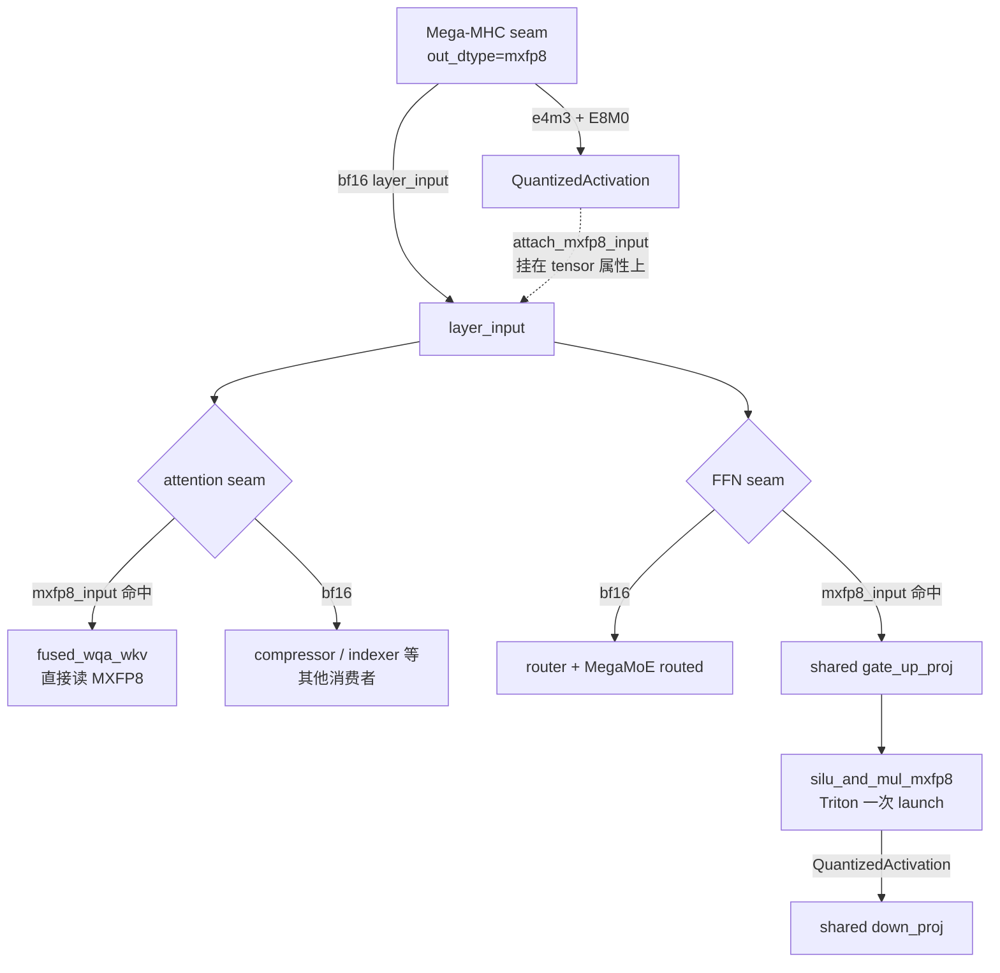
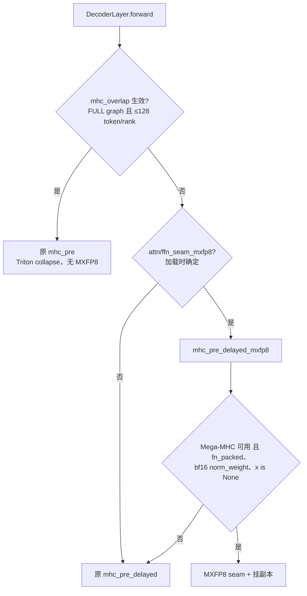

# PR #67906: [ROCm][Perf][DSv4.1] Fuse the MXFP8 input quant of fused_wqa_wkv and the shared expert into their producers

> **Author**: @shen-shanshan | **State**: OPEN | **Date**: 2026-11-16
> **Branch**: `shen-shanshan:rocm-dsv41-flash-kernel-fusion` → `main` | **Labels**: deepseek, quantization, rocm
> **Changes**: +538 -12 lines across 8 files | **ROCm 相关性**: 完全相关（只改 `_aiter_ops.py` 和 `models/deepseek_v4/amd/`、`models/deepseek_v41/amd/` 下的 ROCm 专用模块）
> 本报告分两部分：§1–6 为 PR 详细总结，§7–8 为 ROCm review 意见。
>
> 说明：
> - 代码来自本地 ref `pr/67906`（head `0230cd145d`）。merge-base 是 `2c1fc9b3d3`（2026-11-17），比当前 main 只落后 14 个 commit。
> - GitHub API 本次被限流，PR 描述和评论通过网页获取。CI：Buildkite #103706 已对当前 head 触发，结果未能确认；GitHub checks 页面上 DCO / CodeSync 仍为 pending。
> - 本次为静态 review，没有运行 PR 代码。数值等价性用 CPU 上的独立模拟（不含 PR 代码）核对；aiter 接口对照容器内 `amd-aiter 0.1.29`（与 `docker/Dockerfile.rocm_base` 的 `AITER_BRANCH=v0.1.29` 一致）。

---

## 1. 总结 (Summary)

在 gfx950 上，DeepSeek-V4.1 的 MXFP8 linear（`RocmDotScaledMxfp8LinearKernel` / `AiterFlyDSLMxfp8LinearKernel`）都要先单独 launch 一次 `mxfp8_e4m3_quantize`，把 bf16 输入量化成 e4m3 + E8M0。本 PR 把这一步挪进"产生该输入的 kernel"里，涉及三个 linear：

1. **`fused_wqa_wkv`**：AITER Mega-MHC 在 attention seam 处用 `out_dtype="mxfp8"` 额外输出 layer input 的 MXFP8 副本。
2. **shared expert `gate_up_proj`**：FFN seam 同理。
3. **shared expert `down_proj`**：新增 Triton kernel `silu_and_mul_mxfp8`，把 clamp + SiLU-and-mul 和 MXFP8 量化合成一次 launch。

MXFP8 副本以 `QuantizedActivation` 的形式挂在 bf16 tensor 的属性上（`attach_mxfp8_input`），消费方读到就用，读不到就回退到原路径。

## 2. 背景与动机 (Background & Motivation)

- 上游已经有 `QuantizedActivation` / `get_input_quant_key` 机制（`vllm/model_executor/layers/fusion/quant_activation.py`），两个 ROCm MXFP8 kernel 都已支持直接读预量化输入（`supports_quantized_input`）。本 PR 是在 DSv4.1 AMD 模型里把这条通路接上。
- AITER `mega_mhc` 在 v0.1.29 里已支持 `out_dtype="mxfp8"` 和 `scale_row_major`（已核对 `aiter/ops/mega_mhc.py`）。gfx950 默认就输出行主序 `[T, H/32]` 的 scale，正好是 `RocmDotScaledMxfp8LinearKernel` 期望的布局。
- PR 描述中的验证：
  - 单测：MI355X 上 22 passed（16 个 SiLU 用例 + 6 个 seam 用例）。
  - `vllm bench forward`（DSv4.1-Flash，2×MI355X DEP2）：prefill-16k −0.23%、prefill-8k −0.37%、decode-128 −0.38%。
  - GSM8K 8-shot：strict 0.9257 → 0.9265，flexible 0.9272 不变。
  - 端到端 AgentX："throughput and interactivity ... are on par"。
- Reviewer Fangzhou-Ai 已 approve，期间提了三点：gate 用 CDNA 版本、确认对 DSv4-Pro 无影响、改用 `set_random_seed`。作者已在 457ac1f 处理。

## 3. 代码修改分析 (Code Change Analysis)

### 3.1 修改的模块

| 文件 | 改动 |
|------|------|
| `vllm/_aiter_ops.py` | `mhc_mega_post_pre_delayed_rms_norm` 拆出共享实现 `_mega_mhc_seam(out_dtype=...)`，新增 `mhc_mega_post_pre_delayed_rms_norm_mxfp8`，多返回 `values` / `scales` |
| `vllm/models/deepseek_v4/amd/silu_and_mul_mxfp8.py`（新） | Triton kernel：clamp → SiLU×up → 舍入到 bf16 → MXFP8 量化，输出 e4m3 `[M, D]` + uint8 `[M, D/32]` |
| `vllm/models/deepseek_v4/amd/model.py` | 新增 `attach_mxfp8_input` / `mxfp8_input` / `takes_rocm_mxfp8_input`；`DeepseekV4MLP.forward` 读取 seam 副本，并在 `down_proj` 可直接读 MXFP8 时改走融合 kernel |
| `vllm/models/deepseek_v41/amd/mhc.py` | 新增 `mhc_pre_delayed_mxfp8`：满足条件时调用 MXFP8 版 Mega-MHC 并挂上副本，否则回退到原 `pre_delayed` |
| `vllm/models/deepseek_v41/amd/model.py` | 加载时确定 `attn_seam_mxfp8` / `ffn_seam_mxfp8`；`forward` 和 `write_kv` 按标志选择 seam 函数（mHC overlap 生效时不启用） |
| `vllm/models/deepseek_v41/amd/rocm.py` | `_fused_wqa_wkv_gemm` 先查 MXFP8 副本 |
| `tests/kernels/models/amd/test_dsv41_mxfp8_input_fusion.py`（新） | 两类生产者与非融合路径的逐位一致性测试 |
| `tests/kernels/mhc/test_mhc_kernels.py` | 给用 `__new__` 构造 decoder layer 的测试补上新增属性 |

### 3.2 架构 / 流程图





### 3.3 关键实现细节

- **启用条件**（`process_weights_after_loading`）：`use_mega_mhc` 为真、没有 sequence parallel，并且消费方 linear 的 `get_input_quant_key == kMxfp8Dynamic`、kernel 是两个 ROCm MXFP8 kernel 之一、`supports_quantized_input` 为真。FFN seam 还要求 `use_mega_moe` 并且 shared expert 没有被融合进 MoE。
- **`_down_takes_mxfp8`** 不在加载时确定，而是在第一次 forward 时惰性求值，并缓存在 `DeepseekV4MLP` 上。
- **融合 SiLU kernel**：
  - 在 fp32 中算 `silu(gate) * up`，一次舍入到 bf16，再按 `_mxfp8_quant_triton_kernel` 的公式（`ceil(log2(amax/448)) + 127`，FLT_MIN 下限）量化。
  - `_config` 按 token 数分三档（1×256 / 16×128 / 32×256），`block_n` 不断减半直到能整除 `d`。
- **Mega-MHC MXFP8**：aiter 返回 `(norm, q, e8m0)`。`_mega_mhc_seam` 把 norm 和 q reshape 回 `outer_shape`，scales 保持 `[T, H/32]` 不变。
- **write_kv（replay 层）**：同样按 `attn_seam_mxfp8` 选择 seam 函数，因为 `forward_kv` 也经过 `_fused_wqa_wkv_gemm`。

## 4. 涉及的技术原理 (Technical Principles)

- **MXFP8（OCP MX）**：每 32 个元素共享一个 E8M0（纯指数）scale，元素是 e4m3。gfx950 的 `tl.dot_scaled` / AITER FlyDSL GEMM 原生支持。量化本身是逐 32 元素组的 amax → 指数 → 缩放 → cast，计算量小，但要额外读写一遍 bf16 activation，并多一次 launch。
- **mHC（manifold-constrained hyper-connections）seam**：DSv4.1 每个子层前后有 hc_mult=4 路残差流的混合（Sinkhorn 归一化）。Mega-MHC 把"上一子层的 post-mix + 本子层的 pre-mix + RMSNorm"合成一个 kernel，它的输出正好是下一个 GEMM 的输入，所以在这里顺便量化能省掉一次 HBM 往返。
- **Producer-side quant fusion**：思路和 CUDA 侧的 `act_quant` / `norm_quant` 编译 pass 相同。区别在于 DSv4 AMD 模型没有被 torch.compile，所以只能在模型代码里手工接线。这也是本 PR 选择"tensor 属性旁路"而不是 FX pass 的原因。
- **舍入顺序与"逐位一致"**：非融合路径先把 activation 物化成 bf16，再量化。融合 kernel 要做到逐位一致，就必须复现参考路径在每一步的舍入。参考路径的舍入次数取决于 `SiluAndMul` 实际走哪个实现（见 §7 第二条）。

## 5. 评论区讨论亮点 (Discussion Highlights)

- **Fangzhou-Ai**：建议放弃 `on_gfx950()` 这类 flag，改用 CDNA 版本做 gate。作者在 457ac1f 改成 `get_cdna_version() == 4`。
- **Fangzhou-Ai**："Is it ok with dsv4 pro?" 作者回复：DSv4-Pro 调用 `mega_mhc` 时仍是 `out_dtype="bf16"`、`scale_row_major=False`，调用和返回的 view 都不变。已核对：bf16 分支只多了一个 `out_dtype` kwarg，`scale_row_major` 为 False，返回结构与原来一致。
- **Fangzhou-Ai**：测试改用 vLLM 的 `set_random_seed`，已处理。随后 approve。
- 其余为 `/ci run` 触发记录。

## 6. 风险与潜在问题 (Risk Analysis)

| 风险 | 严重程度 | 说明 |
|------|---------|------|
| 本地 bench 出现间歇性 hang | 中 | fused 版本在 decode128 卡住 3 次，base 没有，原因未定（见 §7 第一条） |
| "逐位一致"有前提 | 低 | 只在默认 compile 配置下成立；eager 模式下与 `_C` 参考有 1 ulp 级差异，数值上无害（见 §7 第二条） |
| 隐式旁路契约 | 低 | 副本挂在 tensor 属性上，view 或 reshape 会让它悄悄丢失，只损失性能；原地修改 layer input 则会导致副本过期（目前没有这样的写法） |
| 性能收益 | 低 | forward 快 0.2–0.4%，AgentX 持平；收益和新增的维护面相比偏小 |
| 跨后端影响 | 低 | 所有改动都在 ROCm 专用模块中，CUDA / XPU 不受影响；DSv4-Pro 的 bf16 seam 调用不变 |
| gfx942 / gfx1250 | 低 | 两个消费 kernel 都要求 `supports_mx()`；gfx1250 由 `scale_row_major=True` 保证布局；gfx942 不会进入新路径 |

---

## 7. Review 意见 (Findings)

| 意见类型 | 数量 |
|---------|------|
| ⚠️【正确性】 | 1 |
| 📝【注释/文档】 | 1 |
| 📝【设计】 | 1 |
| 📝【测试】 | 1 |
| 📝【性能】 | 1 |

**⚠️【正确性】本地 bench forward 中，fused 版本在 decode128 出现间歇性 hang，尚未定位** `[已验证]`（现象已验证，原因未定）
- **问题**：
  - 作者在 `vllm-dev-skills/docs/tasks/dsv41_flash_quant_fusion/forward/results/` 下的日志显示，`fused_r1.log`、`fused_r2.log`、`repro2.log` 都是跑完 prefill 后卡在 decode128，最后被 SIGTERM 杀掉。
  - 同一配置下 `base_r1.log`、`base_r2.log` 的 5 个 case 全部跑完。
  - PR 表格中的 decode-128 数字（71.54 ms）来自后来一次跑通的 `hang_catch_try1.log`。PR 描述没有提到 hang。
  - decode128 是每 rank 768 token，超过 `MHC_OVERLAP_MAX_TOKENS`，所以会走新的 MXFP8 seam；shared expert 也会走 `silu_and_mul_mxfp8`。目前无法排除这两者与 hang 有关。
- **影响**：如果 hang 确实与本 PR 有关（例如 Mega-MHC 的 mxfp8 变体与 split-K 计数器 / workspace 在图回放下的交互），线上会表现为 decode 卡死。这比 0.3% 的收益严重得多。
- **行动**：作者应当在合入前定性这个 hang，例如：
  - 分别只开启 ① ②（seam）或只开启 ③（SiLU），在相同的 prefill → decode128 序列下各跑若干次；
  - 卡住时抓 `rocgdb` / HIP 栈。
  - 如果确认与本 PR 无关（例如是 FlyDSL JIT 或环境问题），也应在 PR 描述里说明。

**📝【注释/文档】"bit-identical" 只在默认 compile 配置下成立，建议写明前提** `[已验证]`（代码阅读 + CPU 数值模拟）
- **问题**：
  - `silu_and_mul_mxfp8` 在 fp32 中算 `silu(gate) * up`，只舍入一次到 bf16（`silu_and_mul_mxfp8.py:46-47`）。
  - 测试的参考是在 `VllmConfig()` 下构造的 `SiluAndMul`。默认的 `VLLM_COMPILE` + inductor 会设置 `custom_ops=["none"]`，于是走 `forward_native`，并经 `maybe_compile` 由 Inductor 融合，中间不舍入，所以测试能逐位一致。
  - 在 `--enforce-eager` 或 compilation mode NONE 下，`custom_ops=["all"]`，`SiluAndMul` / `SiluAndMulWithClamp` 改走 `_C.silu_and_mul*`。`csrc/activation_kernels.cu` 的 `silu_kernel` / `packed_silu_kernel` 先把 `silu(gate)` 舍入成 bf16，再乘 `up`，等于舍入了两次。
  - CPU 模拟（5000×2304，randn×4）：两种舍入顺序下约 26% 的 bf16 元素相差 1 ulp，量化后约 1.8% 的 e4m3 码字和约 0.6‰ 的 scale 不同。
  - 另一个细节：Mega-MHC 的 amax 下限是 `1e-10`，`mxfp8_e4m3_quantize` 的下限是 `FLT_MIN`。全零组的 scale 字节因此是 86 和 0 的区别；反量化后都是 0，不影响 GEMM 结果。
- **影响**：数值上无害，融合版反而少一次舍入。但"bit-identical"这个说法在 eager 部署下不成立。今后如果有人用逐位比较去排查 eager 模式的精度问题，会被误导。
- **行动**：建议作者：
  - 把 docstring 和 PR 描述改成类似"bit-identical to the default (compiled-native) path; within one bf16 ulp of the `_C` eager path"；
  - 或者在测试里增加一个 eager（custom op 开启）参考，并相应放宽断言。

**📝【设计】tensor 属性旁路是隐式契约，建议写明不变量** `[已验证]`
- **问题**：
  - `attach_mxfp8_input`（`deepseek_v4/amd/model.py:113-140`）把 `QuantizedActivation` 用 `setattr` 挂在 bf16 tensor 上。消费方的正确性依赖两条没有写出来的前提：从挂上到被读之间，layer input 不会被原地修改；模型不会被 torch.compile（Dynamo 不会可靠地传递 tensor 上的自定义属性）。
  - 另外，`deepseek_v41/amd/mhc.py` 为了拿这几个小 helper，要 import 很重的 `deepseek_v4/amd/model.py`，还 import 了私有的 `_aiter_mhc_supported`。
- **影响**：
  - 目前两条前提都成立（模型注释写明不被 compile；seam 之后到 `fused_wqa_wkv` / `gate_up_proj` 之间没有原地写）。
  - 将来如果有人加了原地操作，量化副本会过期，导致数值静默错误。
  - 如果有人加了 view 或 reshape，副本会悄悄丢失，只损失性能。
- **行动**：建议作者：
  - 在 `attach_mxfp8_input` 的 docstring 里写明"调用方不得在消费前原地修改 x；不支持 torch.compile"；
  - 把这三个 helper 移到一个轻量模块（例如 `deepseek_v4/amd/mxfp8_input.py`）。

**📝【测试】只测了生产者，没有测试证明消费方真的走上了新路径** `[已验证]`
- **问题**：新测试验证了 seam 和 SiLU kernel 与参考逐位一致，但没有 decoder 级的测试断言 `fused_wqa_wkv`、`gate_up_proj`、`down_proj` 确实收到了 `QuantizedActivation`。`test_mhc_kernels.py` 的改动反而把两个 seam 标志都设成了 False。
- **影响**：今后的重构（多一个 reshape、换 attention 子类）可能让融合悄悄失效，CI 不会报错，只会慢 0.3%。
- **行动**：建议作者加一个轻量测试：构造启用 seam 标志的 decoder，monkeypatch `mxfp8_e4m3_quantize` 计数，断言三个 linear 的输入量化次数为 0。

**📝【性能】收益很小，且在 tiny-M 的 block32 路径上没有省下 launch** `[已验证]`
- **问题**：
  - forward 快 0.23–0.38%，AgentX 持平。
  - 对于 32×32 block-scaled 权重，bf16 输入在 M ≤ 8 时已经走 `rocm_mxfp8_block32_gemm_quant`，量化在 GEMM 内部完成，只有一次 launch。改走预量化输入后，变成 `rocm_mxfp8_block32_gemm` 加上 Mega-MHC 额外写出的 MXFP8，launch 数不变，还多写一份数据。
  - 不过这只影响 mhc overlap 不生效的小 batch（例如 piecewise graph 或 eager）。
- **影响**：收益集中在大 M（prefill、大 batch decode），量级在噪声附近。
- **行动**：建议 review 时让 maintainer 权衡新增约 400 行与 0.3% 收益。如果要合入，可在 PR 描述里注明收益来自哪些 M 区间。

## 8. 结论 (Verdict)

⚠️ **NEEDS WORK**。融合逻辑本身是正确的：对 DSv4-Pro 和其他后端零影响，回退路径完整，各个 gate 也齐全。但作者本地 bench 中出现的间歇性 decode hang（fused 3 次，base 0 次）还没定性，应先排除它与本 PR 的关联；另外"bit-identical"的表述需要写明前提。

## 9. 英文 Review 评论 (Copy-Paste English Comments)

**C1** `vllm/models/deepseek_v41/amd/model.py:430-436` — ⚠️ comment

```text
Anchoring here because this is where decode steps switch to the new MXFP8 seam. In local `vllm bench forward` runs (DEP2, DSv4.1-Flash), the fused build hung in decode-128 right after the prefill cases in 3 runs and had to be killed, while the base build completed all cases in both of its runs; the decode-128 number in the description comes from a later run that did complete. Decode-128 is 768 tokens per rank, above MHC_OVERLAP_MAX_TOKENS, so it does take the MXFP8 seam and the fused SiLU kernel. Could you bisect it by enabling only the seam (1/2) or only the SiLU fusion (3), or otherwise show the hang is unrelated, before this merges?
```

**C2** `vllm/models/deepseek_v4/amd/silu_and_mul_mxfp8.py:46-47` — 📝 comment

```text
The bit-identical claim holds against the compiled-native SiluAndMul that the test exercises (VllmConfig() defaults to custom_ops=["none"], and Inductor does not round intermediates). With --enforce-eager, custom ops are on and the _C silu_and_mul kernels round silu(gate) to bf16 before multiplying by up. That double rounding differs from this kernel's single rounding by 1 bf16 ulp in roughly a quarter of the elements, which flips around 2% of the e4m3 codes. This is numerically harmless, but could you qualify the claim in the docstring and the PR description, or add an eager reference case to the test?
```

**C3** `vllm/models/deepseek_v4/amd/model.py:116-122` — 📝 comment

```text
Carrying the QuantizedActivation as a tensor attribute works today, but it relies on two invariants that are not written down. Nothing may modify the layer input in place between the seam and its consumer, otherwise the quantized copy goes stale. And the model must not be torch.compiled, since Dynamo does not propagate custom tensor attributes. Consider stating both in this docstring. Consider also moving these helpers into a small module so that deepseek_v41/amd/mhc.py does not need to import the whole deepseek_v4 AMD model file.
```

## 10. 英文总结评论 (Overall Review Summary)

```text
The fusion is carefully gated: DSv4-Pro's bf16 Mega-MHC call is unchanged, every consumer falls back to the bf16 path when the quantized copy is absent, and both producers match the default compiled path bit for bit. One thing needs resolving before merge. Local forward benchmarks of this build hung intermittently in decode-128 after prefill while the base build did not, so please show the hang is unrelated or fix it. Please also qualify the bit-identical claim for eager mode, where the _C SiLU rounds twice. Happy to approve once the hang is explained.
```
