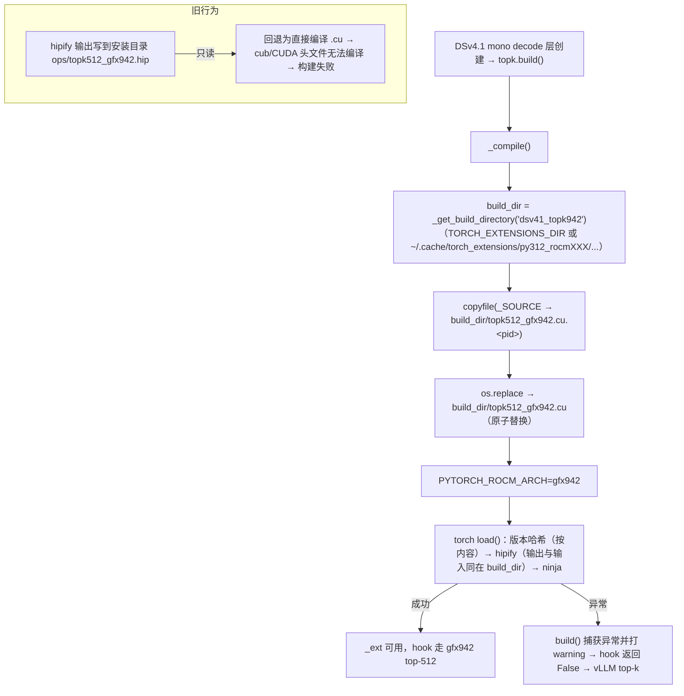

# PR #67936: [ROCm][Bugfix][DSv4.1] Build the gfx942 top-512 extension from a copy in its build directory

> **Author**: @ZhengGong-amd | **State**: OPEN | **Date**: 2026-11-16
> **Branch**: `ZhengGong-amd:rocm-dsv41-topk-writable-build` → `main` | **Labels**: bug, deepseek, rocm
> **Changes**: +23 -2 lines across 2 files | **ROCm 相关性**: 完全相关（只改 `vllm/models/deepseek_v41/amd/ops/topk.py`，即 gfx942 上 DSv4.1 decode 的 top-512 JIT 扩展，以及对应的 gfx942 测试）
> 本报告分两部分：§1–6 为 PR 详细总结，§7–8 为 ROCm review 意见。
>
> 说明：
> - GitHub API 匿名配额已耗尽，PR 描述和评论通过网页获取，CI 状态未知。
> - 代码来自本地 ref `pr/67936`（head `29036433b5`，基于 main 的单个 commit）。
> - 本次为静态 review，没有运行 PR 代码。torch JIT 和 hipify 的行为是对照本机安装的 torch 源码（`torch/utils/cpp_extension.py`、`hipify/hipify_python.py`）核对的。

---

## 1. 总结 (Summary)

DSv4.1 在 gfx942（MI300X/MI325X）上的 decode 使用一个 JIT 编译的 top-512 扩展 `topk512_gfx942.cu`。torch 在 ROCm 上编译时会先 hipify，把生成的 `.hip` 文件写在**输入源文件旁边**。当 vLLM 安装在只读目录（非 root 用户的 site-packages）时，这一步写不进去，扩展构建失败，`build()` 返回 False，于是退回 vLLM 自带的 top-k，性能下降。

本 PR 的做法分两步：
1. 先把 `.cu` 复制到 torch 的扩展构建目录：先写入带 pid 后缀的临时文件，再用 `os.replace` 原子替换。
2. 然后从这份副本编译，hipify 的产物就落在可写的构建目录里。

## 2. 背景与动机 (Background & Motivation)

- 该扩展由 #60731（Mono decode on MI300X/MI325X）引入。模型创建时调用 `build()`，以便在启动阶段完成编译。构建失败时，所有 hook 返回 False，退回 vLLM 的 `top_k_per_row_decode`。
- 问题场景：非 root 的 server，vLLM 安装树只读。
  - torch `_jit_compile` 调用 `hipify_python.hipify(..., extra_files=[源文件绝对路径])`，`.hip` 输出路径与输入同目录。
  - 写入失败时，hipify 打出 "Failed to save … leaving … unchanged"，然后改用原始 `.cu` 编译。
  - 这个 `.cu` 依赖 `<cub/cub.cuh>`、`ATen/cuda/CUDAContext.h`、`cudaStream_t` 等，不经 hipify 无法编译，所以构建失败。这一点已核对源文件，属实。
- PR 描述中的声明：
  - 非 root server 可以用上该扩展，median TPOT 降低 10–18%，interactivity 提升 10–19%（MI325X，DSv4.1-Flash）。
  - root server 的构建与之前相同。
  - GSM8K / GPQA Diamond 准确率无变化。
  - 新测试在 main 上失败，在本 PR 上通过。
- 作者标注 commit 为 "Generated-by: Hyperloom, Co-authored-by: Claude"。

## 3. 代码修改分析 (Code Change Analysis)

### 3.1 修改的模块

| 文件 | 改动 |
|------|------|
| `vllm/models/deepseek_v41/amd/ops/topk.py` (+13/-2) | 新增 `_NAME` 常量；`_compile` 先用 `torch.utils.cpp_extension._get_build_directory(_NAME)` 取构建目录，用 `copyfile` 写入 `<build_dir>/topk512_gfx942.cu.<pid>`，再 `os.replace` 成 `topk512_gfx942.cu`；然后 `load(name=_NAME, sources=[副本])` |
| `tests/kernels/models/amd/test_dsv41_gfx942_topk.py` (+10) | 新测试 `test_build_writes_nothing_beside_the_installed_source`：`build()` 成功后，安装目录下不应存在 `topk512_gfx942.hip` |

### 3.2 架构 / 流程图



### 3.3 关键实现细节

- **并发安全**：多个 TP rank 同时调用 `_compile`。每个 rank 写各自的 `<pid>` 临时文件后再 `os.replace`，rename 是原子操作，而且内容完全相同。之后 torch 的 `FileBaton(build_dir/lock)` 保证只有一个 rank 实际构建，其余 rank 等待。
- **增量构建不受影响**：
  - 每次启动都会复制一次，副本的 mtime 会更新，但 torch 的版本号按源文件**内容**哈希计算（`hash_source_files`）。
  - hipify 只在内容不同时才重写 `.hip`（`do_write = fout_old.read() != output_source`），ninja 依赖的是 `.hip` 的 mtime。
  - 因此不会每次启动都重新编译。已核对 torch 源码。
- **root 场景**：旧代码会在安装树写出 `.hip`，这个文件已被 `.gitignore` 的 `*.hip` 忽略；新代码不再写安装树。
- **私有 API**：`_get_build_directory` 是 torch 的私有函数（下划线开头）。

## 4. 涉及的技术原理 (Technical Principles)

- **torch.utils.cpp_extension JIT**：
  - `load()` 先用源文件内容和编译参数计算版本哈希。
  - 在 `build_directory` 下用 `FileBaton` 加锁，然后生成 ninja 文件并编译成 `.so`。
  - 构建目录默认是 `$TORCH_EXTENSIONS_DIR/<name>`，未设置时为 `~/.cache/torch_extensions/<py>_<rocm>/<name>`。
- **hipify**：ROCm 上 torch 会把 CUDA 源（`.cu`、`cub::`、`cudaStream_t` 等）翻译成 HIP。
  - `.cu` 文件的输出名是同目录的 `.hip`。
  - 如果内容无变化且输入输出同目录，直接复用输入文件。
  - 写失败时回退到原文件，并只打印 warning。
- **gfx942 top-512**：DSv4.1 sparse indexer 在 decode 时，每行要从最长 1M 宽的 logits 中选出前 512。专用 kernel 把一行切成最多 8 个 block，比 vLLM 默认 kernel 快一倍多（文件注释：128k 一步 222 µs vs 543 µs）。

## 5. 评论区讨论亮点 (Discussion Highlights)

目前只有机器人评论：fork PR 不触发自动 Claude review，没有维护者的实质讨论。

## 6. 风险与潜在问题 (Risk Analysis)

| 风险 | 严重程度 | 说明 |
|------|---------|------|
| 依赖 torch 私有 API | 低 | `_get_build_directory` 改名或改签名后，`ImportError` / `TypeError` 会被 `build()` 吞掉，静默退回慢路径（见 §7 第 1 条） |
| 新测试在旧 checkout 中误报 | 低 | 开发树中旧代码留下的 `.hip` 会让新测试失败（见 §7 第 2 条） |
| 正确性 | 低 | 编译的是同一份源码，只是路径不同，kernel 行为不变 |
| 性能数据来源 | 低 | 10–18% 是“扩展可用 vs 退回 vLLM top-k”的对比，并非新的优化（见 §7 第 3 条） |

---

## 7. Review 意见 (Findings)

| 意见类型 | 数量 |
|---------|------|
| 📝 建议/备注 | 3 |

**📝【可维护性】依赖 torch 私有函数 `_get_build_directory`，失效时会静默降速** `[已验证]`
- **问题**：`topk.py:41,44` 从 `torch.utils.cpp_extension` 导入 `_get_build_directory`。这是私有函数，torch 不保证跨版本稳定。
- **影响**：torch 升级后如果这个函数改名或改签名，`_compile` 会抛异常，被 `build()` 捕获，只打一条 warning，然后 decode 退回 vLLM 的 top-k。PR 自己给出的数据是 TPOT 变差 10–18%，而且没有任何报错。
- **行动**：建议作者在测试里加一个断言，例如 `build()` 必须成功（gfx942 测试已经在做），并在 docstring 注明依赖该私有 API。或者显式计算目录后传给 `load(build_directory=...)`，让依赖点集中在一处。

**📝【测试】新测试在跑过旧代码的可编辑 checkout 中会误报** `[已验证]`
- **问题**：`test_build_writes_nothing_beside_the_installed_source`（测试文件:335-341）断言源码目录下不存在 `topk512_gfx942.hip`。但旧代码在可写的开发树中正好会生成这个文件，而它被 `.gitignore` 的 `*.hip` 忽略，`git status` 看不到，`git clean` 不加 `-x` 也删不掉。
- **影响**：在 gfx942 开发机上切到本 PR 后跑测试会失败，看起来像回归。
- **行动**：建议作者在测试开头删除可能残留的旧 `.hip`，或者在 PR 描述中提醒一下。

**📝【注释/文档】性能数字的基线需要说明** `[已验证]`
- **问题**：PR 描述中的 “median TPOT −10–18%、interactivity +10–19%” 对比的是非 root server 上扩展可用与扩展构建失败两种情况。正文没有给出复现命令或原始输出，这些数字无法追溯来源 `[unverified]`。
- **影响**：读者可能误以为这是 kernel 本身的优化。
- **行动**：建议作者在描述中写明“baseline = 构建失败、退回 vLLM top-k”，并附上运行命令。

## 8. 结论 (Verdict)

✅ **LGTM**。修复针对的问题是真实存在的：hipify 在只读安装树中写不出 `.hip`，而该 `.cu` 依赖 cub/CUDA 头文件，必须经过 hipify。复制、原子替换、torch baton 锁的组合对多 rank 并发是安全的，增量构建也不会因为 mtime 变化而重新编译。上面三条只是可选的改进。

## 9. 英文 Review 评论 (Copy-Paste English Comments)

**C1** `vllm/models/deepseek_v41/amd/ops/topk.py:41-44` — ⚠️ comment

```text
`_get_build_directory` is a private torch helper. If a torch upgrade renames it or changes its signature, `_compile` raises, `build()` swallows the error with a warning, and gfx942 decode silently falls back to vLLM's top-k, which is the 10-18% TPOT loss this PR fixes. Could you note this dependency in a comment so the failure mode is easy to trace? Alternatively, compute the directory once and pass it to `load(build_directory=...)` so the private call lives in one place.
```

**C2** `tests/kernels/models/amd/test_dsv41_gfx942_topk.py:335-341` — ⚠️ comment

```text
In an editable checkout that ran the old build, `topk512_gfx942.hip` already sits next to the source. It is git-ignored (`*.hip`), so it survives branch switches, and this test fails even though the new code never writes it. Consider removing a leftover `.hip` at the start of the test, or mention this in the PR description, so the test does not look like a regression on dev machines.
```

## 10. 英文总结评论 (Overall Review Summary)

```text
The fix is correct: hipify writes its .hip next to the input, and this .cu needs hipify (cub, CUDA headers), so read-only installs could not build it. Copying into the extension build directory with a pid-suffixed temp file and os.replace is safe across TP ranks, and rebuilds stay incremental because torch versions by content and hipify skips identical output. Optional: note the private `_get_build_directory` dependency, and make the new test robust to a leftover git-ignored .hip in dev checkouts. Approve.
```
