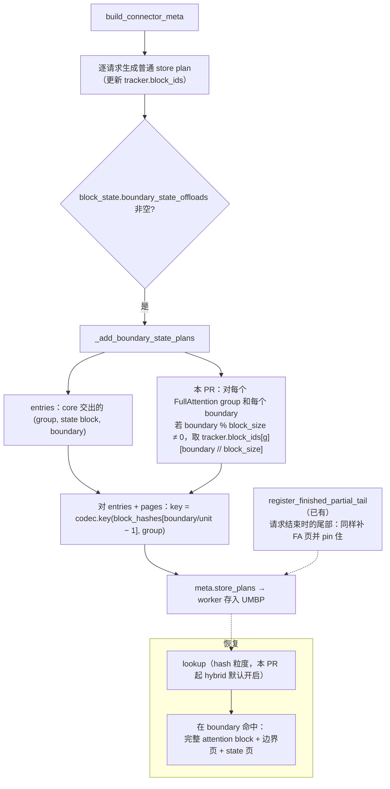

# PR #67942: [Bugfix][UMBP] Restore Mamba hybrid prefixes at boundaries inside attention blocks

> **Author**: @isytwu | **State**: OPEN | **Date**: 2026-11-16
> **Branch**: `isytwu:umbp-hybrid-boundary-page` → `main` | **Labels**: bug, documentation, kv-connector
> **Changes**: +145 -36 lines across 4 files | **ROCm 相关性**: 完全相关（UMBP connector 的后端是 AMD MORI；改动在 connector 的 scheduler 端，与 GPU 后端无关）
> 本报告分两部分：§1–6 为 PR 详细总结，§7–8 为 ROCm review 意见。
>
> 说明：
> - GitHub API 匿名配额已耗尽，PR 描述和评论通过网页获取，CI 状态未知。
> - 代码来自本地 ref `pr/67942`（head `b0d03d9e22`），包含 2 个 commit：
>   1. "Enable partial hash hits by default for Mamba hybrid models"
>   2. "Store the attention page of Mamba hybrid boundaries"
> - 本次为静态 review，没有运行 PR 代码。

---

## 1. 总结 (Summary)

Mamba "align" 模式的 hybrid 模型（Granite 4.0-H、Nemotron-H、Kimi K3 等）只在 prompt 尾部的 hash 边界处保存 Mamba state checkpoint。这些边界通常落在 attention block **内部**。要从这样的边界恢复，除了 state 页，还需要该 attention block 的页，因为边界之前的 token 的 KV 存在这一页里。

原先只有“请求结束时的尾部”路径（`register_finished_partial_tail`）会额外存这一页。运行中由 core 交出（handoff）的边界只存 state 页，所以 UMBP 无法从这些边界恢复，只能退回更早的边界或者整段重算。

本 PR 包含两部分：
1. **Bugfix**：在 `_add_boundary_state_plans` 中，为每个交出的边界补存所在 full-attention block 的页，key 用同一个边界的 hash，与尾部路径一致。
2. **默认值变更**：当 KV cache 包含 Mamba align group，且 `hash_block_size < block_size` 时，`enable_partial_hash_hits` 默认改为 true；用户显式设置时以用户为准。

## 2. 背景与动机 (Background & Motivation)

- 默认的 block 粒度 lookup 只能在 scheduler block 边界上命中，而 hybrid 模型的 state checkpoint 很少恰好落在 block 边界上，所以这类模型几乎拿不到外部命中。必须同时满足两点才能命中：
  - 按 `prefix_match_unit` 的粒度查询（第二部分改动）。
  - 边界处的 attention 页确实存进了池子（第一部分改动）。
- PR 描述中的数据 `[unverified]`（无复现命令或原始输出）：
  - Granite 4.0-H 350M：840 token 的 prompt，外部恢复从 0 提升到 832 token。
  - Nemotron-H-8B：开启 UMBP 恢复后 GSM8K 仍为 98.8%。
  - Kimi-K3.1-Pro：13,910 → 16,824 tok/s/GPU（+21%），前缀命中率从 90.7% 提升到 94.1%。
- 验证：MI355X 上 386 个单测、20 个集成测试通过，pre-commit 通过。
- commit 由 Cursor 协作完成。

## 3. 代码修改分析 (Code Change Analysis)

### 3.1 修改的模块

| 文件 | 改动 |
|------|------|
| `umbp/scheduler.py` (+26/-5) | `__init__`：`enable_partial_hash_hits` 的默认值改为 `bool(_boundary_handoff_groups) and hash_block_size < block_size`；`_add_boundary_state_plans`：对每个 full-attention 的 prefix-cacheable group，按 `boundary // block_size` 找到 `tracker.block_ids` 中对应的页，与 core 交出的 entries 合并后生成 store plan；debug 日志改为输出边界列表 |
| `docs/.../umbp_store_connector_usage.md` | `enable_partial_hash_hits` 的默认值说明改为“hybrid 模型默认 true” |
| `tests/.../test_umbp_hybrid.py` (+54/-11) | 默认值的参数化单测（4 种组合）；原 `test_finished_hybrid_tail_restores_every_byte` 改名为 `test_hybrid_boundary_restores_every_byte`，并对 `running` 和 `finished` 两种状态参数化，CPU 和 GPU 上逐字节比对恢复结果 |
| `tests/.../test_mori_token_e2e.py` (+64/-19) | `umbp_hybrid_llm` fixture 支持参数化（standalone、prefix_match_unit）；新 E2E：`2*block+40` token 的 prompt，清空 GPU 前缀缓存后从 UMBP 恢复 `2*block+32` 个 token，输出应与本地前缀命中一致，覆盖 embedded 和 standalone 两种模式 |

### 3.2 架构 / 流程图



### 3.3 关键实现细节

- **页的选择**：
  - 只处理 `FullAttentionManager` 类型的 group，只在边界不对齐 block（`boundary % block_size != 0`）时补页，下标越界时跳过。
  - 边界页里，边界之后的 token 在恢复后会被重算覆盖，所以存下整页是安全的。
  - 边界之前的 token 只会追加、不会被改写，所以与后续 step 的写入没有竞争。
- **key 不冲突**：
  - 边界页的 key 用边界处的 hash；完整 attention block 的 key 用 block 末尾的 hash。
  - 两者只在边界恰好对齐 block 时才相同，而这种情况已被过滤。
- **默认值**：
  - `resolve_kv_cache_block_sizes` 的规则：多个 group 时，未设置 `prefix_match_unit` 就取各 group block size 的 GCD；有非 align 模式的 Mamba group 时直接退回 block size。
  - 所以新默认只在两种情况下生效：用户显式设置了较小的 `prefix_match_unit`，或者各 group 的 block size 不同。
  - 这与 core 的 `partial_hash_hits_enabled` 行为一致。
- **与尾部路径重复**：页选择逻辑与 `register_finished_partial_tail`（`scheduler.py:1709-1764`）基本相同，但两边的检查条件不一样（见 §7）。

## 4. 涉及的技术原理 (Technical Principles)

- **Mamba "align" 前缀缓存**：
  - SSM 的 state 不能按 token 切片，只能在特定位置做快照。
  - align 模式让 state 快照与 hash 边界对齐，core 在算出这些快照后通过 `boundary_state_offloads` 把它们交给 connector。
  - 从边界 b 恢复，需要三样东西：b 处的 Mamba state、`[0, b)` 范围内所有 full-attention 的 KV（若干完整 block 加上 b 所在 block 的前半部分），以及 b 处的 hash。
- **partial hash hit**：core 把 `Request.block_hashes` 的粒度降到 `prefix_match_unit`，命中位置可以落在 block 内部。connector 需要按同样的粒度查询，才能在这些位置命中。
- **查询代价**：hash 粒度查询的 key 数是 block 粒度的 `block_size / unit` 倍，再乘以 rank 数。#67943 就是为了降低这部分开销。

## 5. 评论区讨论亮点 (Discussion Highlights)

目前只有机器人评论：贡献者须知、mergify 打标签和文档预览、fork PR 不触发自动 Claude review。没有维护者的实质讨论。

## 6. 风险与潜在问题 (Risk Analysis)

| 风险 | 严重程度 | 说明 |
|------|---------|------|
| 默认值变更与 bugfix 打包在一起 | 中 | 见 §7 第 1 条 |
| 两条路径的检查条件不同 | 低 | 见 §7 第 2 条 |
| 池子空间与带宽占用 | 低 | 每个交出的边界多存“FA group 数”个页，见 §7 第 3 条 |
| 正确性 | 低 | 页选择、key、恢复语义与已有的尾部路径一致；running 和 finished 两种状态都有逐字节测试和 E2E |

---

## 7. Review 意见 (Findings)

| 意见类型 | 数量 |
|---------|------|
| ⚠️ 设计 | 1 |
| 📝 可维护性 | 1 |
| 📝 性能 | 1 |

**⚠️【设计】Bugfix 中夹带了默认行为变更，而且新默认会显著增加 lookup 开销** `[已验证]`（机制已核实，影响大小未测）
- **问题**：
  - 第一个 commit 把 hybrid 模型的 `enable_partial_hash_hits` 默认改为 true（`scheduler.py:292-297`），但 PR 标题和描述都按 bugfix 来写。
  - 开启后，`get_num_new_matched_tokens` 的对齐粒度从 `block_size` 变为 `hash_block_size`（`scheduler.py:505-507`），lookup 时每个 `prefix_match_unit` 都要查询一次。key 数是原来的 `block_size / unit` 倍，再乘以 rank 数。
  - 同步 lookup 是默认配置，会直接阻塞调度循环。
  - 同作者的 #67943 明确把 “Kimi K3 上一次 lookup 有上万个 key” 列为要解决的问题，说明新默认的开销已经在实际场景中出现。
- **影响**：已经设置了 `prefix_match_unit`、但没有开启 partial hit 的 hybrid 部署，升级后 lookup 开销会成倍上涨。如果 #67943 还没合入，调度延迟可能上升，甚至抵消命中率的收益。描述中 Kimi +21% 的数字没有说明是否包含 #67943。
- **行动**：
  - 建议作者把默认值变更拆成单独的 PR（或者至少在标题和描述中写明），并给出单独打开它时的 lookup 延迟或 TTFT 数据。
  - 在描述中说明与 #67943 的合并顺序和依赖关系。

**📝【可维护性】运行中的边界和请求结束时的尾部各写一份补页逻辑，检查条件不一致** `[已验证]`
- **问题**：
  - 新增的补页循环（`scheduler.py:1274-1290`）与 `register_finished_partial_tail` 中的同类逻辑基本相同。但尾部路径额外检查了以下几点，运行中路径没有：
    - `boundary % hash_block_size == 0`
    - `pool.blocks[block_id].is_null`
    - 边界页下标越界时，整组放弃，而不是跳过单个 group
  - 两边取 block id 的来源也不同：运行中路径用 `tracker.block_ids`，尾部路径用 `request_finished` 传入的 `block_ids`。
- **影响**：
  - 目前 core 交出的边界都对齐 hash，所以不会触发问题。
  - 如果以后某个边界不对齐，`boundary // unit - 1` 会向下取整，这个页就会以较早边界的 key 存入。恢复时页中多出的 token 会被重算，结果仍然正确，但浪费了空间。
  - 更大的风险是以后只改了其中一份逻辑。
- **行动**：建议作者把“边界 → FA 页”的选择抽成一个公共 helper，两条路径共用同一套检查。

**📝【性能】每个交出的边界都额外存 FA 页，中间边界的页很快就没用了** `[推测]`
- **问题**：
  - chunked prefill 时，每个 chunk 结束都可能产生一个边界，每个边界都会多存一页（每个 FA group 一页）。
  - 等后面的 token 填满这个 block，完整 block 会以另一个 key 再存一次。之前那个边界页只在“恰好在该边界命中”时才有用，但会一直占着池子空间，直到被 LRU 淘汰。
- **影响**：多占用池子空间和 D2H 带宽。如果同时合入 #67944，池子长期处于 99% 高占用，这部分额外占用会挤掉更有价值的完整 block。
- **行动**：建议 review 时追问作者，在 Granite 或 Kimi 的测试中每个请求平均多存多少字节，以及有没有考虑只保留最后一个边界的页。

## 8. 结论 (Verdict)

⚠️ **NEEDS WORK**。Bugfix 部分是对的：为交出的边界补存所在 attention 页，页的选择、key 和恢复语义都与已有的尾部路径一致，并有 running/finished 两种状态的逐字节测试，以及 embedded 和 standalone 两种模式的 E2E。需要处理的是同一个 PR 里夹带的默认值变更：它会让 hybrid 模型的 lookup key 数成倍增加，而缓解措施在另一个尚未合入的 PR（#67943）里。建议拆开，或者补上单独的开销数据并说明依赖关系。

## 9. 英文 Review 评论 (Copy-Paste English Comments)

**C1** `vllm/distributed/kv_transfer/kv_connector/v1/umbp/scheduler.py:292-297` — ⚠️ comment

```text
This flips `enable_partial_hash_hits` on by default for Mamba "align" hybrids, which is a behavior change beyond the bugfix in the title. Once on, the lookup aligns to `hash_block_size`, so every lookup probes `block_size / prefix_match_unit` times more positions, times the rank count. The default lookup is synchronous and runs on the scheduler loop. #67943 describes exactly this cost on Kimi K3. Could you split the default change into its own PR, or at least call it out in the title and description with lookup latency or TTFT numbers measured without #67943, and state the intended merge order?
```

**C2** `vllm/distributed/kv_transfer/kv_connector/v1/umbp/scheduler.py:1274-1290` — ⚠️ comment

```text
This boundary-page selection duplicates the one in `register_finished_partial_tail`, but with weaker checks. The tail path also requires `boundary % hash_block_size == 0`, rejects null blocks, and drops the whole set when a page index is out of range. Here a misaligned boundary would silently key the page at an earlier hash. Consider extracting one helper, "attention pages for boundary b", used by both paths, so the two cannot drift.
```

## 10. 英文总结评论 (Overall Review Summary)

```text
The fix is right: a Mamba boundary inside an attention block needs that block's page, and storing it for every handed-off boundary, keyed like the finished-tail path, makes those prefixes restorable. The byte-exact running and finished tests and the embedded/standalone e2e cover it well. The PR also turns partial hash hits on by default for align hybrids. That multiplies lookup keys on a synchronous scheduler path, and the mitigation lives in #67943. Please split or clearly document that default with its own cost numbers, and consider sharing the page-selection helper with the tail path.
```
