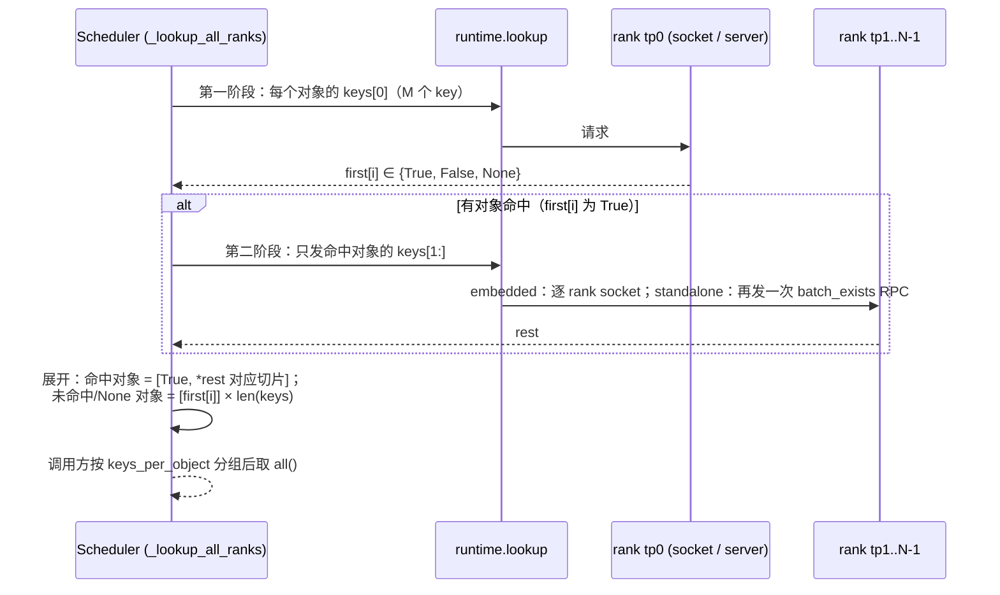

# PR #67943: [Perf][UMBP] Ask the other ranks only about objects the first rank holds

> **Author**: @isytwu | **State**: OPEN | **Date**: 2026-11-16
> **Branch**: `isytwu:umbp-lookup-other-ranks` → `main` | **Labels**: kv-connector
> **Changes**: +156 -18 lines across 3 files | **ROCm 相关性**: 完全相关（UMBP connector 的后端是 AMD MORI；改动在 connector 的 scheduler 端，与 GPU 后端无关）
> 本报告分两部分：§1–6 为 PR 详细总结，§7–8 为 ROCm review 意见。
>
> 说明：
> - GitHub API 匿名配额已耗尽，PR 描述和评论通过网页获取，CI 状态未知。PR 描述提到 CI 默认不跑，需要 `/ci run` 或 `/amd-ci run`。
> - 代码来自本地 ref `pr/67943`（head `92c994d1e0`，单 commit）。
> - 本次为静态 review，没有运行 PR 代码。

---

## 1. 总结 (Summary)

UMBP 在 TP/PP/PCP 多 rank 下，每个逻辑对象（一个 block hash × 一个 KV group）在每个 rank 上各存一份，key 中带有 `:tpX:pcpY:dcpZ:ppW:` 前缀；TP 复制的 group 只存 tp0 一份。scheduler 做 lookup 时原本把“所有对象 × 所有 rank”的 key 一次性发出去。开启 hash 粒度（partial hash hit）查询后，长 prompt 的每个 prefix-match 单元都要问一遍，TP8 下一次 lookup 就有上万个 key，而且其中绝大部分位置根本没有数据。

本 PR 新增 `_lookup_all_ranks`，分两阶段查询：
1. 只问第一个 rank 的 key（每个对象的 `keys[0]`）。
2. 只对第一个 rank 命中的对象，再问其余 rank。

第一个 rank 未命中或无法回答的对象，其余 key 直接复制第一个 rank 的结果（False 或 None），所以输出仍是与原来等长、顺序一致的扁平列表。改动覆盖三个调用点：请求 lookup（同步和异步）、restored block 的驻留检查、KV event 的对账。lazy offload 的驻留检查保持逐 rank 查询，以便检测 rank 不可用。

## 2. 背景与动机 (Background & Motivation)

- embedded 模式下，scheduler 通过各 rank 的 lookup socket **依次**发请求，所以一次同步 lookup 阻塞调度的时间是各 rank 耗时之和。异步 lookup 在高负载下也会互相排队。
- 调用方只关心“是否所有 rank 都持有该对象”（对每个对象做 `all()`），所以第一个 rank 未命中时，就没必要再问其他 rank。
- PR 描述中的数据 `[unverified]`（无复现命令或原始输出）：
  - 大部分位置未命中时，8 rank 下 key 数约降到 1/8。
  - Kimi K3.1-Pro：叠加相关改动吞吐 +2.7%；带上一个依赖 PR 后 +4.8%。
  - Kimi K3 1P1D：吞吐 +7.9%，TTFT p90 从 50.0 s 降到 24.0 s。
- 验证：383 个单测、18 个集成测试通过（2 个 skip），pre-commit 通过。
- commit 由 Cursor 协作完成。

## 3. 代码修改分析 (Code Change Analysis)

### 3.1 修改的模块

| 文件 | 改动 |
|------|------|
| `umbp/scheduler.py` (+52/-16) | `_LookupContext.object_keys` 属性，按对象给出 rank key 元组；新增 `_lookup_all_ranks`，两阶段查询并展开回原顺序；请求 lookup（同步和异步）、`_restored_store_blocks`、KV event 对账改为调用它；`_restored_store_blocks` 的长度检查移到 `_lookup_all_ranks` 内，改为抛 `ValueError` 并被外层 `except` 捕获 |
| `tests/.../test_umbp_core.py` (+93) | 三个测试：两阶段 query 内容与输出（含首 rank 返回 None）；TP 复制 group（每个对象 1 个 key）与普通 group 混合；端到端 `get_num_new_matched_tokens`，只在首 rank 存在的对象应判为未命中 |
| `tests/.../test_umbp_events.py` (+10/-3) | `_SchedulerHandle` 改成按 key 返回结果，以适配两次 lookup 调用 |

### 3.2 架构 / 流程图



### 3.3 关键实现细节

- **顺序一致性**：`object_keys` 按 `objects` 字典的插入顺序（group 顺序）展开，与构造 `context.keys` 时 `keys.extend(rank_keys)` 的顺序相同，因此调用方按 `keys_per_object` 切片时下标能对上。已核对。
- **对象宽度不同**：TP 复制的 group 每个对象只有一个 key（`keys[1:]` 为空），其他 group 每个对象有 `rank_count` 个 key。展开时按每个对象自己的 `len(keys)` 计算。
- **与原语义等价**：
  - 调用方都对 rank 结果取 `all()`；请求 lookup 还先做了 `bool(hit)`。
  - 第一个 rank 返回 False 或 None 时，`all()` 本来就为假，所以复制该结果不会改变最终判定。
  - 唯一的区别：当第一个 rank 未命中、其他 rank 不可用时，原来某些 key 的结果是 None，现在是 False。
    - `get_num_new_matched_tokens` 和 `_restored_store_blocks` 不区分 None 和 False。
    - KV event 对账（`scheduler.py:1925-1930`）会区分：只要有 None，就推迟到下次再判断。现在这种对象会立即发出 `BlockRemoved`。由于第一个 rank 已经确定没有这个对象，它无法被恢复，所以提前判定是合理的，只是行为与之前不同。
- **lazy 驻留检查保持不变**（`scheduler.py:1145` 仍是 `self.runtime.lookup(keys)`），与 PR 描述一致。

## 4. 涉及的技术原理 (Technical Principles)

- **UMBP 的 key 布局**：key 的形式是 `namespace:tpX:pcpY:dcpZ:ppW:gN:hash`。每个 rank 只存自己那一份 KV 分片，只有所有 rank 都在，一个逻辑 block 才能被恢复，这就是调用方取 `all()` 的原因。
- **hash 粒度 lookup**：`enable_partial_hash_hits` 打开后，查询粒度从 scheduler block 变成 `prefix_match_unit`。key 数随 `block_size / unit` 成倍增加，但实际存过数据的位置很稀疏，只有边界和尾部。
- **embedded 与 standalone 的 lookup 路径**：
  - embedded：`EmbeddedRuntime.lookup` 按 key 前缀把 key 分到各 rank，再对各 rank 的 Unix socket **串行**请求。
  - standalone：`StandaloneRuntime.lookup` 对 server 发**一次** `batch_exists` RPC，不区分 rank。

## 5. 评论区讨论亮点 (Discussion Highlights)

目前只有机器人评论：贡献者须知、fork PR 不触发自动 Claude review。没有维护者的实质讨论。

## 6. 风险与潜在问题 (Risk Analysis)

| 风险 | 严重程度 | 说明 |
|------|---------|------|
| standalone 模式命中时变成两次串行 RPC | 中 | 见 §7 第 1 条 |
| 正确性 | 低 | 对 `all()` 语义等价，并有单测覆盖（见 §3.3） |
| 两阶段之间状态变化 | 低 | 两次查询之间对象可能被写入或淘汰；lookup 本身只是提示，加载失败已有回退路径 |
| 性能数据来源 | 低 | 数字与其他 PR 叠加，无法单独归因 `[unverified]`（见 §7 第 2 条） |

---

## 7. Review 意见 (Findings)

| 意见类型 | 数量 |
|---------|------|
| ⚠️ 性能 | 1 |
| 📝 注释/文档 | 1 |
| 📝 可维护性 | 1 |

**⚠️【性能】standalone 模式下，只要有命中，一次 lookup 就变成两次串行 RPC** `[已验证]`（机制已核实，影响大小未测）
- **问题**：
  - `_lookup_all_ranks`（`scheduler.py:652-686`）对任何 runtime 都分两阶段调用 `self.runtime.lookup`。
  - embedded 模式原本就是逐 rank 串行，请求次数不变，只是 key 变少，PR 描述也只论证了这一点。
  - 但 `StandaloneRuntime.lookup` 原来是**一次** `batch_exists` RPC。现在只要第一阶段有命中，就要再发一次（`scheduler.py:674`），而且后一次依赖前一次的结果，只能串行。
  - agentic 这类前缀命中率 90% 以上的负载，正好几乎每次都会走第二阶段。key 总数基本不变，往返次数却翻倍。
- **影响**：
  - 同步 lookup（`lookup_async=false` 是默认值）直接阻塞调度循环，每个带命中的请求多一次到 server 的往返。
  - 异步 lookup 则在 `_lookup_executor` 上排队更久。
  - PR 的 E2E 数据都没有说明是哪种模式。
- **行动**：
  - 建议作者只在 embedded 模式使用两阶段查询（例如由 runtime 声明自己是否按 rank 分发），standalone 保持一次 RPC。
  - 或者补充 standalone 模式在高命中率下的 lookup 延迟和 TTFT 对比。

**📝【注释/文档】性能数字和依赖关系需要说明清楚** `[已验证]`
- **问题**：
  - PR 描述中的 “+2.7% with related changes; +4.8% with one dependency” 没有写明是哪些相关改动、哪个依赖 PR，也没有附复现命令或原始输出 `[unverified]`。
  - 从时间和内容看，很可能与 #67942 / #67944 一起测得。#67942 在 hybrid 模型上默认打开 partial hash hits，正是 key 数暴增的来源。
- **影响**：reviewer 无法判断本 PR 单独的收益，也无法确定合并顺序。
- **行动**：建议作者在描述中列出依赖的 PR 编号、各自的贡献，以及每组数据对应的运行配置（embedded 还是 standalone、TP、lookup_async）。

**📝【可维护性】“第一个 rank” 的含义靠 `keys_for_topology` 的生成顺序隐式保证** `[已验证]`
- **问题**：
  - `_lookup_all_ranks` 默认 `keys[0]` 就是“首 rank”。这取决于 `BlockIdentityCodec.keys_for_topology` 按 `topology.all_namespaces()` 的顺序生成 key。
  - 对 TP 复制的 group，`keys[0]` 是 tp0 加上第一个 pp/pcp 组合。
  - 这个约定只写在 docstring 里，`data.py` 那边没有任何说明。
- **影响**：以后如果有人调整 key 的生成顺序，例如按 group 排在外层，`keys[0]` 不再对应同一个 rank。结果仍然正确（`all()` 不受影响），但第一阶段会把请求分散到多个 rank，优化静默失效。
- **行动**：建议在 `keys_for_topology` 旁加一行注释说明这个顺序约定，或者在 `_lookup_all_ranks` 中显式按 rank namespace 分组。

## 8. 结论 (Verdict)

⚠️ **NEEDS WORK**。两阶段查询在 `all()` 语义下与原逻辑等价，结果顺序和宽度不同的对象也都处理正确，单测覆盖了 None、TP 复制 group 和端到端匹配。但这个改动对所有 runtime 都生效，standalone 模式在高命中率下会把一次 RPC 变成两次串行 RPC。合并前应限定为 embedded 模式，或者补上 standalone 模式的数据。

## 9. 英文 Review 评论 (Copy-Paste English Comments)

**C1** `vllm/distributed/kv_transfer/kv_connector/v1/umbp/scheduler.py:652-686` — ⚠️ comment

```text
The two-phase lookup helps embedded mode, which already asks each rank's socket in turn. In standalone mode, though, `StandaloneRuntime.lookup` is a single `batch_exists` RPC. With this change, any lookup with a first-rank hit becomes two dependent RPCs (line 674), and high-hit agentic workloads take that path almost every time. The synchronous lookup (the default) blocks the scheduler loop for both round trips. Could you either keep one call for runtimes that do not fan out per rank, for example a runtime capability flag, or share standalone lookup latency and TTFT numbers at a high hit rate?
```

**C2** `vllm/distributed/kv_transfer/kv_connector/v1/umbp/scheduler.py:665` — ⚠️ comment

```text
This relies on `keys[0]` of every object belonging to the same rank, which holds only because `BlockIdentityCodec.keys_for_topology` iterates namespaces in `topology.all_namespaces()` order. Correctness does not depend on it, since callers `all()` the keys, but the saving does. Could you note this ordering contract next to `keys_for_topology`, so a later reordering does not silently undo the optimization?
```

## 10. 英文总结评论 (Overall Review Summary)

```text
Asking the first rank first and the other ranks only about objects it holds is equivalent under the callers' all() check. Ordering, mixed per-object key counts (TP-replicated groups) and None answers are handled and tested. One concern: the two-phase path applies to every runtime. In standalone mode a lookup used to be one batch_exists RPC, and now any first-rank hit adds a second, dependent RPC, which high-hit workloads pay almost always. Please limit this to runtimes that fan out per rank, or show standalone numbers, and state which PRs the quoted gains depend on.
```
