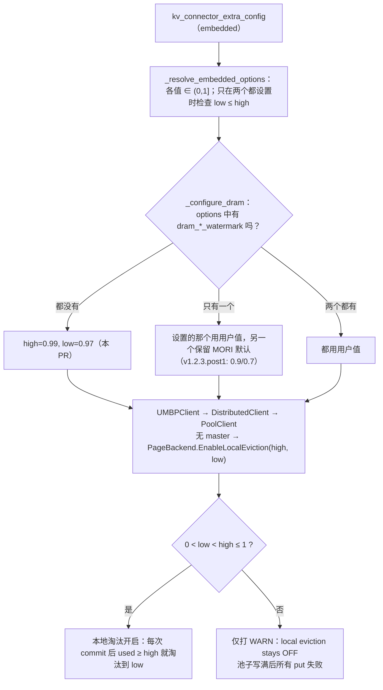

# PR #67944: [Perf][UMBP] Default the embedded DRAM pool to 0.99/0.97 eviction watermarks

> **Author**: @isytwu | **State**: OPEN | **Date**: 2026-11-16
> **Branch**: `isytwu:umbp-dram-watermark-defaults` → `main` | **Labels**: documentation, kv-connector
> **Changes**: +25 -2 lines across 3 files | **ROCm 相关性**: 完全相关（UMBP connector 的后端是 AMD MORI；改动只作用于 `UMBPStoreConnector` 的 embedded 模式）
> 本报告分两部分：§1–6 为 PR 详细总结，§7–8 为 ROCm review 意见。
>
> 说明：
> - GitHub API 匿名配额已耗尽，PR 描述和评论通过网页获取，CI 状态未知。
> - 代码来自本地 ref `pr/67944`（head `16f6fb51ad`，单 commit）。
> - MORI 行为已对照本地 `~/vllm/mori` 的 `v1.2.3.post1` tag 核对，即 vLLM ROCm 镜像使用的版本。
> - 本次为静态 review，没有运行 PR 代码。

---

## 1. 总结 (Summary)

UMBP embedded 模式下，每个 worker 自带一块 host DRAM 池，没有 master，由 MORI 在本地按水位淘汰。MORI v1.2.3.post1 的默认水位是 high 0.9 / low 0.7：占用达到 90% 时淘汰到 70%，平均占用约 80%，相当于池子有 20% 闲置。

本 PR 在用户**两个水位都没设置**时，改用 0.99 / 0.97，让池子保持接近满载。只要用户设置了其中任意一个，另一个仍沿用 MORI 默认值。文档同时建议 standalone server 设置 `UMBP_DRAM_HIGH_WM=0.99`、`UMBP_DRAM_LOW_WM=0.97`。

## 2. 背景与动机 (Background & Motivation)

- 把 UMBP 池当 KV cache 用时，容量就是命中率：池子多装约 20% 的 KV，长上下文 agentic 负载的外部命中就会更多。
- PR 描述中的数据 `[unverified]`（无复现命令或原始输出）：
  - 单个 MI355X 节点：吞吐 +1.3%，TTFT p90 从 2.92 s 降到 2.64 s。
  - Kimi K3 配置：吞吐 +6.2%，TTFT p90 降低 22%。
- commit 由 Cursor 协作完成。
- 同一作者同期还有两个 UMBP PR：#67942（hybrid 边界页）和 #67943（两阶段 lookup）。

## 3. 代码修改分析 (Code Change Analysis)

### 3.1 修改的模块

| 文件 | 改动 |
|------|------|
| `umbp/runtime/embedded.py` (+6) | 新常量 `_DEFAULT_DRAM_WATERMARKS = {high: 0.99, low: 0.97}`；`_configure_dram` 在两个 key 都不在 options 中时，把默认值并入 options |
| `docs/features/umbp_store_connector_usage.md` (+3/-2) | 参数表的默认值改为 `0.99`、`0.97`，并说明“设置其中一个，另一个保留 MORI 默认”；standalone 一节建议设置相同的环境变量 |
| `tests/v1/kv_connector/unit/test_umbp_embedded.py` (+16) | 需要 MORI 编译时开启 UMBP：两个都不设时得到 0.99/0.97；只设 high=0.95 时，low 等于 `UMBPConfig()` 的默认值 |

### 3.2 架构 / 流程图



### 3.3 关键实现细节

- 默认值只在**两个都没设**时生效（`if not _DEFAULT_DRAM_WATERMARKS.keys() & options.keys()`），以免与用户的单个设置拼成一对非法组合。
- MORI v1.2.3.post1 的淘汰机制：
  - 在 `PageBackend::Commit` 之后同步检查，或在分配失败（`kFailedNoSpace`）时检查。
  - 检查内容是 `used ≥ high × total`，满足就从 LRU 尾部淘汰到 `low × total`。
  - 没有后台线程；同一时刻只允许一轮淘汰（`try_lock`）。
- 水位合法性：MORI 要求 `0 < low < high ≤ 1`（严格小于），否则 `EnableLocalEviction` 只打 WARN，**本地淘汰保持关闭**。
- 版本差异：MORI 主线（本地 checkout）已把 DRAM 默认水位改为 0.95/0.9，与 v1.2.3.post1 不同。

## 4. 涉及的技术原理 (Technical Principles)

- **高低水位淘汰**：
  - 两个水位的差决定每轮淘汰释放多少空间，也就是平均闲置量。
  - high 与 1 的差决定突发写入的余量：在下一次 commit 触发淘汰之前，还能接收多少新分配。
  - 差值越小，淘汰越频繁，每轮工作量也越小；余量越小，突发写入失败的概率越高。
- **UMBP embedded 模式**：每个 worker 进程内嵌一个 MORI `UMBPClient`，池子是本地 host 内存，scheduler 通过 lookup socket 询问各 rank。没有 master，所以淘汰由 `PageBackend` 本地完成。
- **vLLM 侧的存储重试**：`_STORE_RETRIES = 2`、`_STORE_RETRY_BACKOFF_S = 0.01`。注释写明 “a put into a full pool can fail until eviction catches up”。

## 5. 评论区讨论亮点 (Discussion Highlights)

目前只有机器人评论：fork PR 不触发自动 Claude review，只有 mergify 的文档预览链接。没有维护者的实质讨论。

## 6. 风险与潜在问题 (Risk Analysis)

| 风险 | 严重程度 | 说明 |
|------|---------|------|
| 单独设置一个水位时可能静默关闭淘汰 | 中 | 见 §7 第 1 条 |
| 突发写入余量从 10% 缩到 1% | 中 | 见 §7 第 2 条 |
| 依赖 MORI 版本的默认值 | 低 | MORI 主线已改为 0.95/0.9，文档写死了 “v1.2.3 的默认值”（见 §7 第 3 条） |
| 性能数据来源 | 低 | 数字无法追溯 `[unverified]` |
| 测试覆盖 | 低 | 只覆盖默认值合并逻辑，没有覆盖非法组合 |

---

## 7. Review 意见 (Findings)

| 意见类型 | 数量 |
|---------|------|
| ⚠️ 正确性 | 1 |
| 📝 性能 | 1 |
| 📝 注释/文档 | 1 |

**⚠️【正确性】只设置一个水位时，组合出的水位对可能非法，MORI 会静默关闭淘汰** `[已验证]`
- **问题**：
  - `_resolve_embedded_options` 只在两个 key **都**设置时检查 `low > high`，而且不拒绝 `low == high`。
  - 本 PR 在文档中把“设置一个，另一个保留 MORI 默认”写成了正式语义（`docs/...usage.md:42`，代码 `embedded.py:775-776`）。
  - 但 MORI v1.2.3.post1 的 `PageBackend::EnableLocalEviction` 要求 `low < high`（严格小于），否则只打一条 `ignoring local eviction watermarks … local eviction stays OFF` 的 WARN。
  - 具体触发输入：`{"mode": "embedded", "dram_low_watermark": 0.95}` 组合出 high 0.9 / low 0.95；`{"dram_high_watermark": 0.6}` 组合出 high 0.6 / low 0.7；两个都设为 0.95 时 low 等于 high。
- **影响**：本地淘汰关闭后，池子写满就不再淘汰，之后所有 store 都失败，外部命中率停在池子写满时的状态。vLLM 侧既不报错也不告警，只有 MORI 日志里有一条 WARN。
- **行动**：
  - 建议作者在 vLLM 侧按**生效后的值**检查水位：未设置的一方取 `UMBPConfig().dram` 的默认值，然后要求 `0 < low < high ≤ 1`，不满足就抛 `ValueError`。
  - 或者在只设一个时，按比例补出另一个。
  - 并在 `test_runtime_config_rejects_invalid_embedded_dram_options` 中补上上面三种用例。

**📝【性能】高水位 0.99 只留 1% 余量，突发写入更容易失败** `[推测]`（机制已对照 MORI 源码核实，影响大小未验证）
- **问题**：MORI 只在 commit 之后，或分配失败且 `used ≥ high` 时淘汰。分配失败时如果 `used < high`，`MaybeEvictToLowWatermark` 直接返回 0；源码注释也承认，这种情况下这次分配不会重试。
  - 0.99 下余量是池子的 1%。例如 8 GiB/worker 只有约 80 MB。
  - 一次长 prompt 的批量 store（`BatchAllocate` 逐个分配），或者 hybrid 模型的大 state 页，都可能在两次 commit 之间超过这个余量。
- **影响**：超过余量的 put 会失败，vLLM 只重试 2 次、每次间隔 10 ms，之后放弃。对应的 KV 不会进入池子，命中率的收益会被部分抵消。PR 的 E2E 数据整体为正，但没有给出 store 失败计数。
- **行动**：建议 review 时追问作者，两组 E2E 中 store 失败或重试的次数各是多少；并说明 0.97/0.99 与 0.95/0.9（MORI 主线的新默认值）之间是否做过对比。

**📝【注释/文档】文档和注释写死了 “MORI v1.2.3 的默认值”** `[已验证]`
- **问题**：
  - `embedded.py:47-49` 的注释，以及文档参数表，都写的是 “MORI v1.2.3's defaults (0.9, 0.7)”。
  - 但 MORI 主线的 `UMBPDramConfig` 已改为 0.95/0.9。
  - 测试用 `UMBPConfig().dram.low_watermark` 比较，不受影响。
- **影响**：镜像升级 MORI 后，“设置一个、另一个取 MORI 默认”得到的组合会悄悄变化，文档也会过时。
- **行动**：建议作者把文档改成 “the other keeps MORI's default (0.9/0.7 in v1.2.3.post1)” 一类不绑定行为的写法，或者在 vLLM 侧把两个值都补全，彻底不依赖 MORI 的默认值。

## 8. 结论 (Verdict)

⚠️ **NEEDS WORK**。“两个都不设才用 0.99/0.97” 这个设计本身合理。但本 PR 把“只设一个，另一个取 MORI 默认”写进了文档，而这种设置可以组合出 `low ≥ high`，这时 MORI 会静默关闭淘汰，池子写满后所有 store 都失败。合并前应在 vLLM 侧按生效后的值检查水位。

## 9. 英文 Review 评论 (Copy-Paste English Comments)

**C1** `vllm/distributed/kv_transfer/kv_connector/v1/umbp/runtime/embedded.py:775-776` — ⚠️ comment

```text
Setting only one watermark can produce an invalid pair, and MORI then silently disables eviction. `_resolve_embedded_options` checks `low > high` only when both keys are set, and it accepts `low == high`. With this PR, `dram_low_watermark: 0.95` alone gives high 0.9 / low 0.95, and `dram_high_watermark: 0.6` alone gives 0.6 / 0.7. MORI v1.2.3.post1's `PageBackend::EnableLocalEviction` requires `0 < low < high <= 1`. Otherwise it logs a warning and keeps local eviction OFF, so once the pool fills, every store fails. Could you validate the effective pair, taking unset values from `UMBPConfig().dram`, require low < high, and add these cases to `test_runtime_config_rejects_invalid_embedded_dram_options`?
```

**C2** `docs/features/umbp_store_connector_usage.md:42` — ⚠️ comment

```text
This row documents "setting either option keeps MORI's default for the other" as supported behavior, but that is exactly the case that can produce low >= high (see the comment on `_configure_dram`). It also pins MORI v1.2.3's 0.9/0.7, while MORI main already defaults to 0.95/0.9. I'd either fill in the other value on the vLLM side so the pair never depends on MORI's defaults, or state the constraint low < high here.
```

## 10. 英文总结评论 (Overall Review Summary)

```text
Defaulting the embedded pool to 0.99/0.97 only when neither watermark is set is a sensible way to use the whole pool. One gap: setting just one watermark now documents "the other keeps MORI's default", which can produce low >= high (e.g. dram_low_watermark 0.95 alone). MORI v1.2.3.post1 then logs a warning and keeps local eviction off, so stores fail once the pool fills. Please validate the effective pair (strict low < high) and test it. Changes needed before merge.
```
