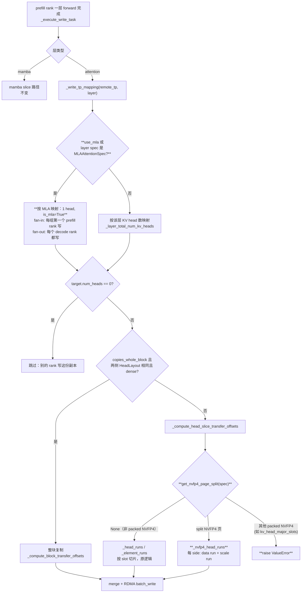
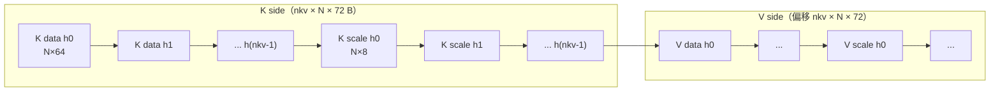

# PR #68072: [Bugfix][ROCm][MoRIIO] Fix heterogeneous-TP WRITE of NVFP4 KV pages and replicated indexer caches

> **Author**: @ChengYM5685 | **State**: OPEN | **Date**: 2026-11-17
> **Branch**: `moriio-nvfp4-head-slice` → `main` | **Labels**: bug, rocm, kv-connector
> **Changes**: +207 -19 lines across 3 files | **ROCm 相关性**: 完全相关（MoRIIO KV connector + MiniMax-M3 ROCm NVFP4 KV 页布局）
> 本报告分两部分：§1–6 为 PR 详细总结，§7–8 为 ROCm review 意见。

---

## 1. 总结 (Summary)

本 PR 修复 MoRIIO WRITE（PUSH）模式在 prefill TP ≠ decode TP（异构 TP）时服务 MiniMax-M3 的两个独立 bug：① ROCm 上 `--kv-cache-dtype nvfp4` 的 KV 页每个 K/V side 内是"所有 head 的 FP4 数据在前、所有 head 的 block scale 在后"，而 MoRIIO 把页当成 `2 * num_kv_heads` 个连续的 per-head slot 切片，导致 decode 收到错乱的 KV；② MiniMax-M3 的 lightning-indexer key cache 是 GQA 模型里的 `MLAAttentionSpec`（每 token 一个向量、各 TP rank 相同），但 per-layer WRITE mapping 按模型 KV head 数切它，在 prefill TP > decode TP 时直接抛 `MoRIIOError`。修复方式分别是新增 `get_nvfp4_page_split` + `_nvfp4_head_runs` 按真实布局切 NVFP4 页，以及让 `_write_tp_mapping` 对 MLA 型 cache 层走"整块复制"的 MLA 映射。

## 2. 背景与动机 (Background & Motivation)

- MoRIIO 是 ROCm 上 PD 分离的 KV 传输 connector。WRITE 模式下每个 prefill rank 在每层 forward 后把自己持有的 KV head 用 RDMA 写入 decode rank 的 block。异构 TP 时需要"按 head 切片"（fan-in：多个 prefill rank 各写 decode block 的一部分 head；fan-out：一个 prefill rank 把 head 子集分别写给多个 decode rank）。
- main 已有通用的 head-slice 机制（`HeadLayout` + `compute_head_slice_offsets`），以及近期引入的 per-layer WRITE mapping（`_write_tp_mapping(remote_tp_size, layer_name)`，按每层自己的 KV head 数映射）。
- MiniMax-M3 在 ROCm 上用 `MiniMaxM3SparseRocmNvfp4Backend`（FlyDSL kernel）读写 NVFP4 KV 页。该 backend 的 `customize_spec` 发布 `num_head_slots = 2 * num_kv_heads`、`state_content_bytes = head_size/2 + head_size/16`，但页内实际是 split 布局，不是 slot-per-head。NIXL 早已对这种页在异构 TP 下拒绝传输，MoRIIO 没有任何 NVFP4 处理。
- 作者的目标部署：MiniMax-M3.1-Flash，prefill PP2×TP4 → decode DP8×TP1+EP8（MoRIIO WRITE），以及 1P1D TP4 → DP4×TP1（xGMI）。不修的话 decode 输出全是乱码（`licliclic...`）。
- 同作者的相关 PR：#67863（MoRIIO 对非 MLA 模型默认要求 LBHNC 布局，解决 token-major 布局下 RDMA SQ 满的问题）、#68559 / #68560 / #68582（PP 相关）。本 PR 的 NVFP4 路径不依赖 #67863——NVFP4 backend 自身只支持 LBHNC/BLHNC（都是 block 内 `[H, N, C]` 连续），而 `_nvfp4_head_runs` 正是要求 head-major；非 NVFP4 dtype 的行为本 PR 不改。

## 3. 代码修改分析 (Code Change Analysis)

### 3.1 修改的模块

| 文件 | 改动 |
|------|------|
| `vllm/distributed/kv_transfer/kv_connector/v1/moriio/moriio_layout.py` (+88 -11) | 新增 `Nvfp4PageSplit`、`get_nvfp4_page_split(spec)`（识别 split NVFP4 页，其他 packed NVFP4 页抛 `ValueError`）、`_nvfp4_head_runs`（每个 side 一个 data run + 一个 scale run）；`compute_head_slice_offsets` 新增 `nvfp4_split` 参数，按 KV head（而非 slot）计数并改用 NVFP4 runs |
| `vllm/distributed/kv_transfer/kv_connector/v1/moriio/moriio_connector.py` (+11 -2) | `_write_tp_mapping`：模型是 MLA **或**该层 spec 是 `MLAAttentionSpec` 时按 MLA（1 head、`is_mla=True`）映射；`_compute_head_slice_transfer_offsets` 把 `get_nvfp4_page_split(spec)` 传给 `compute_head_slice_offsets` |
| `tests/v1/kv_connector/unit/moriio/test_moriio_hetero_tp_write.py` (+108 -6) | 新增 `gqa_indexer` / `nvfp4` / `nvfp4_by_head` 三个模型；`_shard` 按 ROCm 布局构造各 rank 的页；新增 NVFP4 字节级对比、按 head 布局页被拒、indexer 整块映射三组测试；把原测试体抽成 `_check_write` 并改进断言信息 |

### 3.2 架构 / 流程图

异构 TP WRITE 的每层 offset 计算路径（本 PR 改动处加粗）：



ROCm NVFP4 页内布局（每 block，rank 持有 `nkv` 个 KV head，`N` = block token 数，head_size=128 时 data 64 B/token、scale 8 B/token）：



旧逻辑把这段字节看作 `2·nkv` 个 `N×72` 的 slot，第 h 个 KV head 拷 slot h（及 V 侧对应 slot），于是混拷了不同 head 的 data/scale 甚至跨 K/V side。

### 3.3 关键实现细节

- **`get_nvfp4_page_split(spec)`**（`moriio_layout.py:742-770`）：仅当 `AttentionSpec` 且 `kv_quant_mode.is_nvfp4` 且 `state_content_bytes` 已设置时介入；尺寸从 spec 推导（`head_size // 2`、`head_size // 16`），不再像作者之前的 overlay 那样硬编码 64/8/72 B。`kv_head_major_slots`、`head_size_v != head_size`、`num_heads != 2*num_kv_heads`、`state_content_bytes != data+scale` 任一成立即抛 `ValueError`。
- **`_nvfp4_head_runs`**（`:773-798`）：要求 `plane_offsets == (0,)`、slot 数为偶数、`token_stride == head_bytes`、`head_stride == N * head_bytes`（即 head-major packed）；对 K/V 两个 side 各产出 `(side + first_head*N*D, num_heads*N*D)` 与 `(side + nkv*N*D + first_head*N*S, num_heads*N*S)` 两个 run。我已对照 writer kernel（`norm_rope_nvfp4_insert/kernel.py`：`SIDE = nkv * BLK * 72`、K data `h * (BLK*64)`、K scale `nkv*BLK*64 + h*(BLK*8)`）与 reader（`nvfp4_prefill/kernel.py` `kv_lane_loader`），run 级布局一致；kernel 在每个 head 的 data/scale run 内部有 token 级 swizzle，但 MoRIIO 始终整 run 复制，不受影响。
- **`compute_head_slice_offsets(..., nvfp4_split=...)`**：`slots_per_head = 2`，边界检查改为按 KV head；local/remote 各自用自己的 `num_heads`（slot 数）求 side 偏移，因此 fan-in（decode 持有更多 head）时 V side 起点正确。
- **只有异构 TP WRITE 的 head-slice 路径传 split**：整块复制、READ 路径（同 TP、每个 slot 原位搬运）不变。
- **`_write_tp_mapping`**（`moriio_connector.py:3651-3662`）：`is_mla = self.use_mla or (layer_name is not None and self._is_mla_cache_layer(layer_name))`。`compute_write_tp_mapping` 在 `is_mla=True` 时跳过 head 数校验，fan-in 非首 rank 返回空 targets（或 has_mamba 时 `num_heads=0`），writer 的 `if target is None or not target.num_heads: continue` 跳过。请求级 targets、`num_writers` / `write_done` 计数仍用模型级 mapping，不受影响（我核对了 `_execute_write_task` 与 `_resolve_notify_endpoints`）。
- MLA cache 层本就不进 `kv_head_layouts`（`_record_slice_layouts` 跳过），所以 `_block_copy_matches_peer` 对 indexer 返回 True → 必走整块复制，不会误入 NVFP4 split 判定（indexer 的 NVFP4 spec 是 `MLAAttentionSpec`，若进入会被 `get_nvfp4_page_split` 拒绝）。
- 测试：`_shard` 按 ROCm 布局从"未切分的 `[..., 2H, N, C]` 全局内容"构造每个 rank 的页，producer 页与 decode 期望页都由它生成，再跑真实 writer + offset 代码逐字节比对。

## 4. 涉及的技术原理 (Technical Principles)

- **PD 分离 + 异构 TP WRITE**：prefill 与 decode 用不同 TP 度时，KV head 在两侧分片不同。fan-in（P_TP > D_TP）时 decode block 由多个 prefill rank 各写自己 head 的那段拼成；fan-out（P_TP < D_TP）时一个 prefill rank 把自己 head 的子集分别写给多个 decode rank。KV head 数小于 TP 时会出现副本 head，"相同副本只由一个 rank 写"。
- **NVFP4 KV cache**：每 16 个 FP4 值共享一个 E4M3 block scale；head_size=128 时每 token 每 side 64 B 数据 + 8 B scale = 72 B。packed 页的字节组织由 backend kernel 决定：NVIDIA MSA backend 按 KV head 组织（`H2ND`，`kv_head_major_slots=True`），ROCm FlyDSL kernel 按 side 组织（所有 head data → 所有 head scale）。connector 只能从 spec 推断，spec 本身不描述 side 内顺序。
- **HeadLayout / KVCacheLayout**：MoRIIO 从 cache tensor 的 stride 推出 `HeadLayout`（block/head/token stride、head 字节数），用来生成 RDMA (offset, size) runs。LBHNC 与 BLHNC 的区别只在 block stride（是否跨层交错），block 内 `[H, N, C]` 都连续，所以 head-major 判定对两者都成立。
- **MLA 型 cache 的复制语义**：MLA latent / indexer key 每 token 一个向量、各 TP rank 完全相同，异构 TP 下应整块复制（fan-in 只需一个写者）。本 PR 把这一语义从"模型级 `use_mla`"下放到"层级 spec 类型"。
- **RDMA work request 粒度**：每个 (offset, size) run 对应一个 RDMA WR；`merge_contiguous_*` 合并两侧都相邻的 run。#67863 已经遇到过 token-major 布局下 WR 过多导致 send queue 满（`SQ full`）的问题。

## 5. 评论区讨论亮点 (Discussion Highlights)

- 目前没有实质性人工评论；唯一一条 review 是 claude[bot] 提示"fork PR，自动 review 已禁用"。
- GitHub 页面显示已请求 6 位 code owner（ApostaC、NickLucche、ivanium、orozery、wzhao18、xuechendi）review，尚无 approve；PR 没有 `ready` label。
- PR 描述自身较完整：给出了 kernel 侧 offset 公式、root cause，base vs PR 的单测失败/通过日志，以及承认 e2e 用的是旧 vLLM + 等效 overlay（见 §7 第一条 ⚠️）。

## 6. 风险与潜在问题 (Risk Analysis)

| 风险 | 严重程度 | 说明 |
|------|---------|------|
| e2e 精度证据不是在本 PR 代码上取得的 | Medium | 见 §7 ⚠️【测试】e2e 验证跑在旧 vLLM + 硬编码 overlay 上 |
| AMD CI 结果不可见 | Medium | 见 §7 ⚠️【测试】CI 没有运行 |
| NVFP4 页布局靠"未设置 `kv_head_major_slots`"推断 | Low | 见 §7 📝【设计】隐式布局契约；今天 ROCm 只有一个 NVFP4 backend |
| `MLAAttentionSpec` ⇒ 各 rank 相同的假设 | Low | 见 §7 📝【可维护性】；当前 in-tree 用法（MiniMax-M3 / Qwen4-exp / Mistral AMD indexer）都满足 |
| NVFP4 异构 TP 每 block 4 个 RDMA WR | Low | 见 §7 📝【性能】`[推测]`；超长上下文需确认不触发 SQ 满 |
| 兼容性：非 NVFP4、MLA 模型、同 TP | Low | 代码路径未变；新映射对原本能跑通的拓扑结果等价（已核对 fan-in/fan-out target 集合一致） |
| 测试覆盖 | Low | NVFP4 只测 LBHNC，没测 BLHNC 和副本 head 拓扑，见 §7 📝【测试】 |

---

## 7. Review 意见 (Findings)

| 类型 | 🔴 | ⚠️ | 📝 |
|------|----|----|----|
| 测试 | — | 2 | 1 |
| 设计 | — | — | 2 |
| 可维护性 | — | — | 1 |
| 性能 | — | — | 1 |

整体看：两处修复的核心逻辑我逐行核对过，结论是正确的。NVFP4 run 偏移与 writer/reader kernel 的 side/data/scale 偏移一致；MLA 映射与请求级 targets、`num_writers` 计数一致。没有发现需要阻塞的正确性问题。意见集中在验证证据和几处隐式契约上。

---

**⚠️【测试】e2e 精度验证跑在旧 vLLM + 硬编码 overlay 上，本 PR 的实际代码未经 e2e 验证** `[已验证]`

- **问题**: PR 描述里的两组 gsm8k 结果（9n 双节点 strict 0.9409 / flex 0.9401；Crusoe 单节点 strict 0.9583 / flex 0.9575）都附注"older vLLM builds (`a2bcb5657a` / `65de218`) with an overlay holding an equivalent fix"。overlay 用的是硬编码的 head_size 128 尺寸（64/8/72 B），indexer 整块复制也是在 writer 里写的特例；本 PR 则改为从 spec 推导尺寸（`moriio_layout.py:757`），并通过 per-layer mapping（`moriio_connector.py:3654-3662`）表达 indexer 语义。两者实现不同，也没有附 log 或脚本输出，所以这些精度数字对本 PR 代码来说是 `[unverified]`。
- **影响**: 单测是用测试自己的 `_shard` 模型同时生成 producer 页和期望页，只能证明"MoRIIO offset 与测试对 kernel 布局的建模一致"，证明不了"与真实 FlyDSL kernel 一致"。overlay 走的是另一条代码路径（writer 特例），per-layer mapping 路径在真实部署中（`_execute_write_task` 每层重算 mapping、target 匹配、`num_heads==0` 跳过）没有被 e2e 覆盖。
- **行动**: 建议作者在本分支（rebase 到当前 main）上至少重跑一次 1P1D prefill TP4 → decode TP1（NVFP4 路径）和 TP4 → TP2（indexer fan-in 路径）的 gsm8k，并附上命令与输出 log。

**⚠️【测试】CI 没有运行，AMD MoRIIO 单测 step 未在本 PR 上跑过** `[已验证]`

- **问题**: 经公开 GitHub API 核对，head 上的 `pre-run-check` 在 "Check PR label and author merge count" 一步失败（PR 没有 `ready` label），pre-commit 与 Buildkite 均被跳过，CI 实际没有运行。PR 描述声称改动"covered by the existing `:amd: (MI355 DPX) MoRIIO Connector Unit Tests` step"，但没有对应的运行记录。作者自己的全目录单测是在"GPU-less test host"上跑的，其中 25 个用例因环境原因失败、被判定为无关。
- **影响**: 新测试文件在模块级 import 了 `vllm.models.minimax_m3.amd.sparse_attention_nvfp4`（会触发 `vllm.models.minimax_m3` 包按平台 import nvidia/amd 模型），并且 `test_moriio_read_tp.py` 通过 `MODELS` 复用了新加的 nvfp4 模型。这些在 ROCm runner 上的 import/收集行为只有 AMD CI 能验证。
- **行动**: 建议作者请 maintainer 加 `ready` label 或手动触发 AMD MoRIIO 单测 step，在合并前确认 `v1/kv_connector/unit/moriio` 在 MI355 上全绿。

**📝【设计】NVFP4 split 布局是从"未设置 `kv_head_major_slots`"反推的隐式契约** `[已验证]`

- **问题**: `get_nvfp4_page_split`（`moriio_layout.py:751-770`）把所有满足"packed NVFP4 + 非 head-major slot + `2H` 个 slot + C = D/2 + D/16"的页都当作 ROCm side-split 布局。spec 中没有字段描述 side 内的 data/scale 顺序，`MiniMaxM3SparseRocmNvfp4Backend.customize_spec` 的 docstring 也没写这一点；这个布局只在 MoRIIO（以及 NIXL 的同类拒绝逻辑）的注释里出现。另外，`state_content_bytes is None` 的 NVFP4 spec 会直接返回 `None` 走旧的按 slot 切片路径；NIXL 的判断条件是 `is_nvfp4 and not kv_head_major_slots`，不看 `state_content_bytes`。
- **影响**: 今天 ROCm 上只有一个 NVFP4 KV backend，不会触发。但如果将来出现第三种 NVFP4 页组织（例如按 token 交错 data/scale 的 aiter kernel），只要尺寸吻合就会被静默切错，正是本 PR 修的这类 bug。
- **行动**: 建议作者在 `customize_spec` 的 docstring 里写明页内布局，并注明 MoRIIO/NIXL 依赖它；如果可行，让 backend 显式声明布局（spec 字段或 allow-list）。另外建议对非 packed 的 NVFP4 spec 也像 NIXL 一样在异构 TP 下拒绝，而不是回退到按 slot 切片。

**📝【可维护性】"`MLAAttentionSpec` 层 = 各 TP rank 相同" 只是隐含假设** `[已验证]`

- **问题**: `_write_tp_mapping`（`moriio_connector.py:3654-3656`）把任何 `MLAAttentionSpec` 层都按 MLA 整块复制。我检查了当前 in-tree 在 GQA 模型里使用 `MLAAttentionSpec` 的地方（MiniMax-M3 indexer、Qwen4-exp QSA indexer、Mistral AMD indexer），都是 `num_kv_heads=1` 的副本，假设目前成立；它也和 `_compute_block_transfer_offsets` 里已有的 `is_mla=self._is_mla_cache_layer(...)` 校验一致。不过 `AttentionSpec.max_tp_shards` 正是为表达"TP rank 之间是副本"而设计的字段：Mistral AMD indexer 设了 `max_tp_shards=1`，MiniMax-M3 indexer 没设。
- **影响**: 将来如果有 `MLAAttentionSpec` 层按 TP 分片（例如多 head 的压缩 cache），fan-in 时只有首个 rank 写，其余分片会静默丢失。
- **行动**: 建议作者至少加一条 `spec.num_kv_heads == 1` 的断言，或者改用/同时检查 `max_tp_shards == 1`（顺便让 MiniMax-M3 indexer 也设上这个字段）。

**📝【设计】不支持的 NVFP4 页在每个请求的写线程里才报错，而不是握手时报错** `[已验证]`

- **问题**: `get_nvfp4_page_split` 抛出的 `ValueError` 发生在 `_compute_head_slice_transfer_offsets` 中，即后台写线程处理每个请求的每一层时。`_write_worker_loop` 会捕获异常、记 `logger.exception`，然后 `_mark_request_done`（释放 producer block），但不会给 decode 发 `write_failed`。PR 描述说的 "fails with a clear ValueError" 实际只体现在 producer 日志里。
- **影响**: 遇到不支持的布局（今天只有 NVIDIA MSA backend，MoRIIO 在 ROCm 上碰不到）时，每个请求都会失败一次，decode 侧请求要等到自身超时才结束；这与 main 现有的 `MoRIIOError` 行为相同，所以不是本 PR 引入的回归。
- **行动**: 建议作者考虑在 `_record_slice_layouts` 或握手阶段（已知 remote TP ≠ local TP 时）就调用一次 `get_nvfp4_page_split` 做校验，做到启动时一次性失败。

**📝【测试】NVFP4 测试矩阵可再补两类拓扑/布局** `[已验证]`

- **问题**: ① `test_nvfp4_write_lands_every_shard_byte_exact` 只测 `LBHNC`，而 backend 同样支持 `BLHNC`（block 跨层交错，block_stride 不同）；② 没有 prefill TP > KV head 数的 NVFP4 用例（如 4 个 KV head 下的 (8, 4)、(8, 2)），这类拓扑下 prefill rank 只持有 1 个副本 head，要以 `remote_head` 偏移写进 decode 的多 head 页；③ `test_moriio_read_tp.py` 通过 `list(MODELS)` 把 `nvfp4` / `nvfp4_by_head` 带进了 token-major / mixed 布局的 READ 用例，而 WRITE 侧 `SCENARIOS` 以"NVFP4 kernels take head-major pages only"为由排除了它们，两边不一致。
- **行动**: 建议作者给 NVFP4 测试加上 `BLHNC` 参数和 (8, 4) / (8, 2) 拓扑，并在 READ 测试里同样排除 NVFP4 模型的非 head-major 布局（或注明为何保留）。

**📝【性能】NVFP4 异构 TP 每 block 每 target 4 个 RDMA WR，超长上下文下需留意 SQ 深度** `[推测]`

- **问题**: `_nvfp4_head_runs` 对每个 block 生成 K data / K scale / V data / V scale 4 个 run，相邻 block 之间两侧都不连续，`merge_contiguous_blocks` 基本合并不了。普通 head-major 页的 fan-in 每 block 只有 1 个 run。按 block_size 128 估算，单请求单层 ~1M token 时约 8192 block × 4 ≈ 32768 个 WR，接近 #67863 报过的 `SQ full (batch): depth=32767`。是否真会触发取决于 `post_batch_size` / QP 分配，我没有核实。
- **行动**: 建议 review 时追问作者：MiniMax-M3 最大上下文下单层单 target 的 WR 数，以及当前 `post_batch_size` 默认值是否能保证不超过 SQ 深度；必要时在长上下文 AgentX trace 上跑一次 NVFP4 异构 TP 验证。

## 8. 结论 (Verdict)

**⚠️ NEEDS WORK**

两处修复的根因分析准确，实现也干净：NVFP4 run 偏移与 FlyDSL writer/reader kernel 的布局在 run 级一致，尺寸从 spec 推导；indexer 走 MLA 整块映射，与请求级 targets 和 `write_done` 计数自洽。没有发现正确性 blocker。但 e2e 精度证据来自旧 vLLM 上的另一份 overlay 实现，本 PR 的代码路径没有在真机上验证过，而且看不到 AMD CI 结果。建议补上本分支的 e2e gsm8k log，并确认 MI355 MoRIIO 单测 step 全绿后合并；📝 项可以留作后续改进。

## 9. 英文 Review 评论 (Copy-Paste English Comments)

**C1** `vllm/distributed/kv_transfer/kv_connector/v1/moriio/moriio_layout.py:757` — ⚠️ comment

```text
The end-to-end gsm8k numbers in the description were measured on older vLLM builds with an overlay that hardcoded the 64/8/72-byte sizes and special-cased the indexer copy in the writer. This PR derives the sizes from the spec here and expresses the indexer behaviour through the per-layer WRITE mapping, so the code being merged has not run end to end. The unit tests build both the producer pages and the expected decode pages with the same `_shard` model of the kernel layout, so they cannot catch a mismatch with the real FlyDSL kernels. Could you rerun 1P1D prefill TP4 -> decode TP1 (NVFP4 path) and TP4 -> TP2 (indexer fan-in path) on this branch and attach the command and output log?
```

**C2** `tests/v1/kv_connector/unit/moriio/test_moriio_hetero_tp_write.py:501-519` — ⚠️ comment

```text
I can't see any CI results on this PR, and it has no `ready` label, so the `:amd: (MI355 DPX) MoRIIO Connector Unit Tests` step mentioned in the description doesn't seem to have run yet. This file now imports `vllm.models.minimax_m3.amd.sparse_attention_nvfp4` at module level, which pulls in the platform-specific MiniMax-M3 package, and `test_moriio_read_tp.py` reuses the new `nvfp4` models through `MODELS`. Import and collection on a ROCm runner are only checked by AMD CI. Could you get the AMD MoRIIO unit-test step triggered and confirm `v1/kv_connector/unit/moriio` is green on MI355 before merge?
```

**C3** `vllm/distributed/kv_transfer/kv_connector/v1/moriio/moriio_layout.py:751-770` — 📝 suggestion

```text
This treats any packed NVFP4 page that is not `kv_head_major_slots` and has 2*H slots of D/2 + D/16 bytes as the ROCm side-split layout. The spec carries nothing that describes the order of data and scales within a side, and `MiniMaxM3SparseRocmNvfp4Backend.customize_spec` doesn't document it either. A future NVFP4 backend with a third packing but the same sizes would be sliced wrongly without any error, which is the bug this PR fixes. Consider documenting the layout in `customize_spec` (noting that MoRIIO and NIXL depend on it), or having the backend declare it explicitly. Also, NIXL refuses any NVFP4 spec that is not head-major, whereas an NVFP4 spec with `state_content_bytes=None` falls back to slot slicing here. Should that case be refused as well?
```

**C4** `vllm/distributed/kv_transfer/kv_connector/v1/moriio/moriio_connector.py:3654-3656` — 📝 suggestion

```text
Copying every `MLAAttentionSpec` layer whole relies on such caches being identical on every TP rank. That holds for all current in-tree users in GQA models (MiniMax-M3, Qwen4-exp QSA and Mistral AMD indexers, all with `num_kv_heads=1`), but nothing enforces it. `AttentionSpec.max_tp_shards` already expresses replication: the Mistral AMD indexer sets it to 1, but the MiniMax-M3 indexer does not. Consider asserting `num_kv_heads == 1` here, or checking `max_tp_shards == 1`, so that a future TP-sharded MLA-type cache fails loudly instead of losing shards on fan-in.
```

## 10. 英文总结评论 (Overall Review Summary)

```text
Thanks for the clear root-cause write-up. The NVFP4 run offsets match the FlyDSL writer and reader layout, and mapping MLA-type caches as whole-block copies is consistent with the request-level targets and write_done counting. Before merging, I'd ask for two things: end-to-end gsm8k on this branch rather than the older overlay, since that overlay hardcoded sizes and special-cased the indexer in the writer; and a green AMD MoRIIO unit-test run, since no CI results are visible yet. Documenting the NVFP4 page layout on the backend would also help. Approve once validation is in.
```
