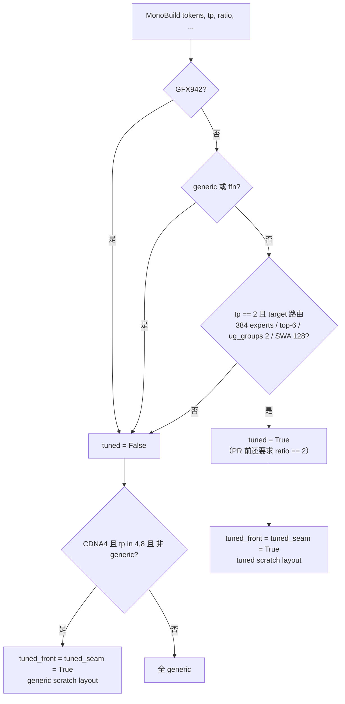
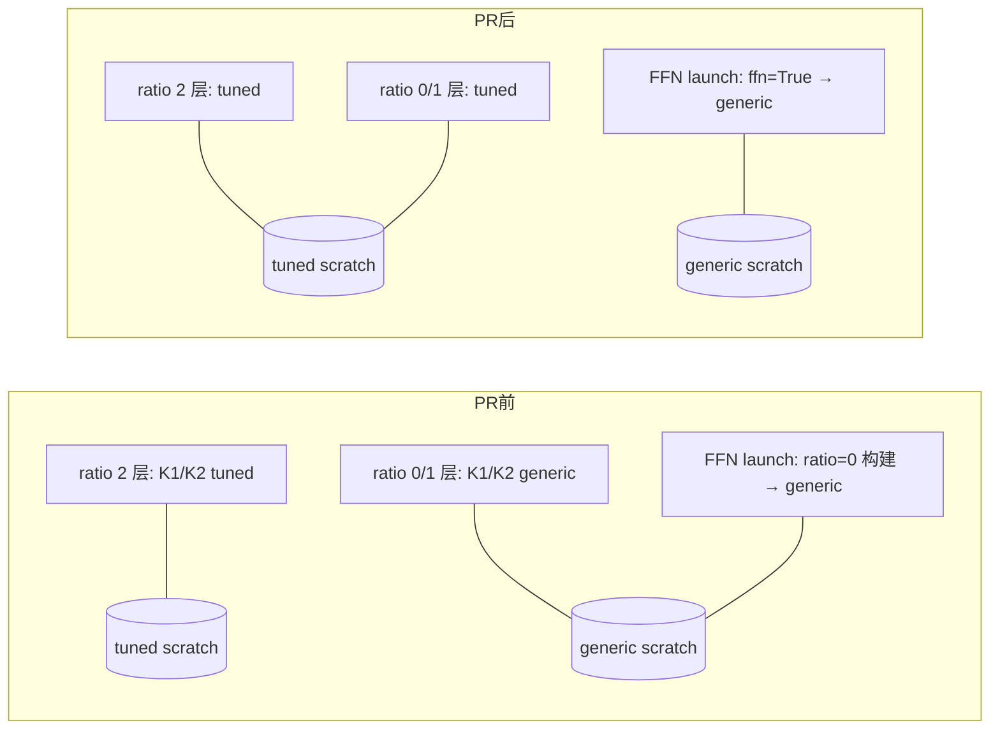

# PR #68124: [ROCm][Perf][DSv4.1] Mono: tuned K1/K2 for every compress ratio at TP2

> **Author**: @ZhengGong-amd | **State**: OPEN | **Date**: 2026-11-17
> **Branch**: `dsv41-mono-tuned-all-ratios` → `main` | **Labels**: rocm, deepseek
> **Changes**: +26 -17 lines across 4 files | **ROCm 相关性**: 完全相关（DSv4.1 mono decode，gfx950 / MI355X 专属 FlyDSL kernel）
> 本报告分两部分：§1–6 为 PR 详细总结，§7–8 为 ROCm review 意见。

---

## 1. 总结 (Summary)

DeepSeek-V4.1-Flash 的 mono decode（`--monokernel`）在 TP2 / gfx950 上，#63027 引入的 tuned K1/K2 只对 compress ratio 2 的层生效，ratio 0（纯 SWA）和 ratio 1 的 22 个层仍走 generic 代码。本 PR 从 `MonoBuild.tuned` 去掉 `ratio == 2` 条件，让 TP2 下所有 target 层都用 tuned build；FFN launch 以前靠"用 ratio 0 构建"保持 generic，现在加了 `MonoBuild.ffn` 字段显式排除。numerics 测试补上 ratio 0 / 1 的 bit-exact 对照用例。作者报告：ratio 0/1 层在 6–48 行快 7.6–11.8%，TP2 serving 吞吐在并发 1/8/32 下提升 2.5–5.8%，TP4 和 >48 行持平。

## 2. 背景与动机 (Background & Motivation)

- mono decode 把一个 decoder layer 的 decode step 合成两个常驻 FlyDSL launch：**K1** = attention seam（slice / gate / norm 后量化成 MXFP8）+ attention front（wqkv_a、q/kv norm、RoPE、KV insert、key table）；**K2** = attention back（sparse MLA、wo_a/wo_b，TP 归约在 kernel 内）+ FFN seam + MoE（all-reduce 也在 kernel 内）。attention 仍由 vLLM 跑的层用 **FFN launch**（K2 的 FFN 那一半）。
- tuned build 有自己的 scratch layout 和针对小 step 宽度（≤48 行）调过的路径，与 generic build 保持 bit-exact。#63027 只在 TP2 的 ratio-2 层打开；之后 #63893 / #64152 / #64883 在 TP4/TP8 打开了 `tuned_front` / `tuned_seam`（与 ratio 无关）。
- DSv4.1-Flash 的 `compress_ratios`（本地 checkpoint config 核对）：层 0–1 是 ratio 0，层 2–19 是 ratio 2（18 层），层 20–39 是 ratio 1（20 层）。因此 TP2 下以前有 22/40 层没吃到 tuned 收益。作者的论据是 tuned 的 front/back/seam/MoE 路径只按 `tuned*` 分支，ratio 只影响 key table 和 top-k 数，所以 ratio 条件可以去掉。

## 3. 代码修改分析 (Code Change Analysis)

### 3.1 修改的模块

| 文件 | 改动 |
|------|------|
| `vllm/models/deepseek_v41/amd/mono/layer.py` (+7 -4) | `MonoBuild` 新增 `ffn: bool = False`；`tuned` 删 `self.ratio == 2`，加 `not self.ffn`；docstring 同步 |
| `vllm/models/deepseek_v41/amd/mono/runner.py` (+1) | `ffn_kernel()` 构建 FFN launch 时传 `ffn=True` |
| `vllm/models/deepseek_v41/amd/mono/README.md` (+9 -8) | "Tuned builds" 段改为"TP2 下所有 compress ratio" |
| `tests/models/test_dsv41_mono_numerics.py` (+9 -5) | 新增 `(0,2,6)`、`(0,6,6)`、`(1,6,6)` 三个用例（12 / 36 / 36 行）；FFN launch 的对照条件改为 `MonoBuild(M, tp, 0, ffn=True).tuned_seam` |

### 3.2 架构 / 流程图

`MonoBuild` 的 tuned 判定（PR 之后）：



TP2 下各类 launch 的变化：



### 3.3 关键实现细节

- **选择逻辑**：唯一的语义变化是 `tuned` 去掉 ratio 条件。`tuned_front = tuned or (CDNA4 and not generic and tp in (4, 8))`、`tuned_seam = tuned_front` 没改，所以 TP4/TP8 不受影响（`tuned` 本来就要求 `tp == 2`）。gfx942 被 `not GFX942` 挡住，也不受影响。
- **ratio 在 kernel 中的读取点**（已核对）：`attention/front.py::stage_kt`（`ratio > 0` 时算 `ntopk = min((pos+1)//ratio, TOPK)` 并写 compressed key）、`attention/back.py::key_rec`（`ratio > 0` 时区分 comp/swa 页），其余只用于 kernel 符号名（`r=`）。tuned 分支（`c["tuned"]`、`key.tuned`、`ardy_tiles`、`flag_stride`、moe 的 `rs.tuned`）都不读 ratio，`scratch_layout` 也不收 ratio 参数。所以作者"no tuned path reads the ratio"的说法成立。
- **FFN launch**：`ffn_kernel()` 以前用 `MonoBuild(tokens, tp, 0, ...)` 构建，靠 ratio 0 在 TP2 上不 tuned 来保证 generic MoE key 和 generic scratch 一致（`runner.ffn` 写 `self.scratch(M)`，即 generic layout）。去掉 ratio 条件后，如果不加 `ffn`，FFN launch 会拿到 tuned MoE key + generic layout，trace 时报 `KeyError: 'sdx'`（作者描述），所以加了 `ffn=True` 来排除。TP4/TP8 下 `ffn` 不影响 `tuned_front`，FFN seam 仍然 tuned。
- **Scratch**：TP2 下标准 checkpoint 的所有 backbone 层都改用 `(M, True, True)` 这块 scratch。generic scratch 只有 FFN-only 层才会分配，显存略降。
- **JIT 缓存**：`key_tuple` 会遍历 dataclass 的全部字段，新增 `ffn` 字段会让所有 mono build 的缓存 key 变化，首次启动要重编（源码 digest 本来也会变，只发生一次）。

## 4. 涉及的技术原理 (Technical Principles)

- **DSv4.1 压缩稀疏注意力**：每层有 compress ratio。0 = 只看 128 宽 SWA 窗口；1 / 2 = 再加上 compressed KV 中由 indexer 选出的 top-k（≤512）个 key。mono K1 的 `stage_kt` 把两种 key 合并成一张 key table（最高位标记 compressed），K2 的 sparse MLA 按这张表取 key。ratio 只决定 table 内容，不决定 GEMV / MoE 的 tiling。
- **tuned vs generic build**：两者是同一套 FlyDSL 代码，用 `const_expr` 编译期分支。tuned build 会改变 flag 的多副本发布（`COPIES * flag_stride`）、wo_a tile 的提前就绪（`ardy_tiles`）、seam 的 reduce+slice 融合，以及 MoE 的 udiv/umod 快速路径和 shared offload（`DSH_RANKS`）。计算顺序保持不变，所以可以与 generic 版 bit-exact 对照，测试里的 `generic=True` runner 就是参考实现。
- **Epoch / mailbox 协议**：K1、K2 通过 scratch 中的 tag（`2e+1` / `2e+2`）交接数据。不同 layout 必须用不同 scratch，否则旧 tag 可能被当成数据读走。这个 PR 之后 TP2 的连续层共用 tuned scratch。在 checkpoint 中 ratio-2 层（2–19）本来就是连续的，所以"连续 tuned 层共用 tuned scratch"这种用法 main 上已经跑过。
- **性能机制**：每层的收益来自 K1+K2 的 launch 内时间（−8~−11%）。22/40 层 × 约 10% ≈ 5.5% 的层时间，与 c=1 的 median step 5.49→5.19 ms（−5.5%）对得上。

## 5. 评论区讨论亮点 (Discussion Highlights)

- 目前没有人工 review，也没有 inline 评论。`claude[bot]` 只说明这是 fork PR、自动 review 被禁用，需要 maintainer 评论 `@claude review` 触发。
- 作者在描述中主动说明与 #67560（新增 `MonoBuild.plain_fp8_kv`）有三处文本冲突，"keep both sides"。

## 6. 风险与潜在问题 (Risk Analysis)

| 风险 | 严重程度 | 说明 |
|------|---------|------|
| ratio 0/1 层新进入 tuned 路径的数值正确性 | Low | tuned 路径不读 ratio（已核对）；新增的 bit-exact 用例加上 `test_dsv41_mono_layers.py` 在 TP2 rows=8 的整模型对比可以兜底 |
| 新用例没覆盖 48 行和 hot routing 下的 ratio 0/1 | Medium | 见 §7 ⚠️【测试】 |
| AMD CI 状态未知，mono 数值 job 为 optional | Medium | 见 §7 ⚠️【兼容性】 |
| FFN launch 改为靠 `ffn` 标志保持 generic | Low | 字节级等价（作者用离线编译比对过，代码逻辑也核对过）；可维护性见 §7 📝 |
| `merges()` 在 TP2 的返回语义悄悄变了 | Low | 目前 `MERGE_WIDTHS` 没有 TP2 项，不会触发；见 §7 📝 |
| 与 #67560 的合并顺序 | Low | 见 §7 📝 |

---

## 7. Review 意见 (Findings)

| 类型 | 🔴 | ⚠️ | 📝 |
|------|----|----|----|
| 测试 | — | 1 | — |
| 兼容性 | — | 1 | 1 |
| 可维护性 | — | — | 2 |
| 性能 | — | — | 1 |

---

**⚠️【测试】ratio 0/1 的 bit-exact 用例只覆盖了 tuned 宽度空间的一部分** `[已验证]`

- **问题**: `tests/models/test_dsv41_mono_numerics.py:423-426` 给 ratio 0 补了 12 / 36 行，给 ratio 1 补了 36 行（原来已有 6 行）。最大宽度 48 行（`(2, 8, 6)`）和 `hot=True`（down round 溢出 LDS block 的路径，`moe.down_round_pipe` 中 `fits` 为 false）仍然只有 ratio 2 在测。PR 宣称收益覆盖 6–48 行，`ardy_tiles` 也依赖 `s`（`s >= ARDY_MIN_S and s % TILE != 0`）。另外，numerics 测试从不传 `select`（`index=True`）也不传 `fold=False`，而这个 PR 之后 ratio-1 的 index source 层（checkpoint 中的 20/24/28/32/36）和第一层、Engram 层（层 0/1，ratio 0，`fold=False`）会第一次在 TP2 上走 tuned K1。这些组合只由 `test_dsv41_mono_layers.py` 的 `(tp=2, rows=8)` 做容差对比，没有 bit-exact 对照。
- **影响**: 因为 tuned 分支确实不读 ratio，当前风险较低。但 bit-exact 不变式是这类 tuned 改动的唯一数值保证。ratio 0（`ntopk=0`，只用窗口 key）在 48 行 / hot routing 下与 ratio 2 的 key table 分布不同，以后有人改 tuned back 时这些组合不会报错。
- **行动**: 建议作者在 case 列表中加 `(0, 8, 6, False)` 和 `(1, 8, 6, False)`（48 行），这几乎不增加耗时。可以的话再加一个 ratio-1 的 `hot=True` 用例。另外建议在 PR 描述中写明 `test_dsv41_mono_layers.py[2-8]` 已在 TP2 上通过（描述中的 "layers `[2-8]`" 有歧义），因为它是 index / fold=False + tuned 组合目前唯一的覆盖。

**⚠️【兼容性】AMD CI 状态未知，覆盖这个改动的 MI355 数值 job 是 optional** `[已验证]`

- **问题**: 拉取到的 PR 数据里 checks 为空，PR checks 页只能看到 Mergify。PR 没有 `ready` 标签。`.buildkite/test-amd.yaml` 中的 ":amd: (MI355) DeepSeek-V4.1 Mono Decode Numerics"（`agent_pool: mi355_4`，跑 `test_dsv41_mono_numerics.py` 和 `test_dsv41_mono_layers.py`，`source_file_dependencies` 包含 `vllm/models/deepseek_v41/amd/`）标了 `optional: true`，不会自动阻塞合入。
- **影响**: 这个 PR 的正确性完全依赖 MI355X TP2 上的 bit-exact 测试，但 CUDA 主 CI 不会执行这些用例。如果 AMD job 没跑，合入时只有作者本地的 "100 passed" 作为证据（作者的环境是"main 的 Python 跑在一个较旧的编译版 vLLM 上"，与 CI 镜像不同）。
- **行动**: 建议 review 时请 maintainer 加 `ready` 标签，并手动触发上述 MI355 mono numerics job，在 PR 中贴出 job 链接后再合入。

**📝【可维护性】FFN launch 靠新增的 `ffn` 字段保持 generic，测试里又手写了一份同样的 key** `[已验证]`

- **问题**: 以前 FFN launch 靠"用 ratio 0 构建"隐式拿到 generic MoE 和 scratch，这个 PR 改成在 `MonoBuild` 上加 `ffn` 字段（`runner.py:403`），并让 `tuned` 判断 `not self.ffn`。测试 `test_dsv41_mono_numerics.py:585` 没有复用 runner 的 key，而是手写 `MonoBuild(M, tp, 0, ffn=True)`，省略了 `experts/topk/generic`，与 `runner.ffn_kernel()` 的构造是两份独立代码。
- **影响**: 目前两者等价（默认值就是 target 路由）。以后 `ffn_kernel` 的 key 改了（例如 #67560 的 `plain_fp8_kv`），测试的对照条件会悄悄和实际构建对不上，FFN 的 bit-exact 对照可能被跳过而不报错。
- **行动**: 建议作者在 runner 上提供 `ffn_build(tokens, experts, topk)`，供 `ffn_kernel()` 和测试共用，测试改为 `runner.ffn_build(M, ...).tuned_seam`。

**📝【兼容性】`DSV41MonoLayer.merges()` 在 TP2 上的返回值随这个 PR 改变（目前无影响）** `[已验证]`

- **问题**: `runner.py::merges()` 返回 `self.build(tokens, 0).tuned_front`。PR 前 TP2 下 ratio-0 的 build 不 tuned，所以 TP2 上恒为 False。PR 后变为 True，只是 `mono_decode.MERGE_WIDTHS` 目前只有 TP8 的项，`tokens not in self.merge_widths` 才使它仍返回 False。
- **影响**: K2(l)+K1(l+1) 合并 launch（`build_mono_k2k1`）在 TP2 tuned layout 上从未验证过。以前它被"ratio-0 build 不 tuned"间接挡住，现在只剩 `MERGE_WIDTHS` 一道门。
- **行动**: 建议作者在 `merges()` 旁或 `MERGE_WIDTHS` 处加一行注释，说明 TP2 合并依赖 tuned layout、尚未验证；或者显式判断 `self.tp != 2`。

**📝【兼容性】与 #67560（`plain_fp8_kv`）的合并顺序需要复核 tuned 判定** `[推测]`

- **问题**: 作者说明 #67560 在 `ffn` 旁边新增 `MonoBuild.plain_fp8_kv`，冲突解决方式是 "keep both sides"。#67560 的测试或 tuned 判定可能默认 TP2 的 ratio 0/1 层走 generic（基于当时的 main）。
- **影响**: 如果 plain FP8 KV 的 tuned 路径没有验证过 ratio 0/1，后合入的 PR 可能在 `--kv-cache-dtype fp8_e4m3` + TP2 下第一次组合 tuned 与 plain FP8。
- **行动**: 建议 review 时追问作者：两个 PR 谁先合入，后合入的一方是否需要在 `tuned` 中排除 `plain_fp8_kv`，或补上相应的 bit-exact 用例。

**📝【性能】性能数字方法学完整，但缺可复现的命令和原始日志** `[已验证]`

- **问题**: E2E 表格（例如 8k/1k c=1 时 5325→5604 tok/s，+5.2%）给出了 6 对 A/B、交换 GPU 组、丢掉首个 server、组间差异 ≤1.0% 等细节，内部也自洽（−5.5% step 时间 ≈ 55% 的层 × 约 10% 的单层收益）。但没有 `vllm bench serve` 的完整命令行和原始输出。另外，E2E 用 main `1895228ed8`，block rejection 和 lm_eval 用 `b5a2d209b4`，PR base 是 `fd99b402af`，而且"两棵树共用一个较旧的编译版 vLLM"。
- **影响**: 数字可以作为方向性证据，具体百分比在本报告中视为 `[unverified]`。gfx942、TP4/TP8 和 ratio 2 的"代码对象字节相同"这一说法来自离线编译比对，是很强的不回退证据，但同样没有附上脚本。
- **行动**: 建议作者在描述中附上 bench 命令（或 recipe preset 名 + 额外参数的完整展开）和对比 code object 的脚本或命令。

## 8. 结论 (Verdict)

**⚠️ NEEDS WORK**（改动本身可以合入，但建议先补齐验证）

改动很小，思路正确。逐个核对了 front/back/seam/MoE 的 tuned 分支，确认都不读 compress ratio；`ffn` 字段准确保住了 FFN launch 原来的 generic 行为；TP4/TP8 和 gfx942 的选择逻辑不变；每个 ratio 都能拿到合法的 build，不存在 KeyError 或静默回退。合入前建议：触发 optional 的 MI355 mono numerics CI job 并贴出结果；在 numerics 用例中补 ratio 0/1 的 48 行（可选 hot routing）。其余都是可选的可维护性建议。

## 9. 英文 Review 评论 (Copy-Paste English Comments)

**C1** `tests/models/test_dsv41_mono_numerics.py:423-426` — ⚠️ comment

```text
The new ratio-0/1 cases cover 12/36 and 6/36 rows, but the 48-row width and the hot-routing case (down-round LDS overflow) are still only exercised at ratio 2, while the PR claims gains across 6-48 rows and `ardy_tiles` depends on the step width. Since the bit-exact tuned-vs-generic check is the main correctness guarantee for tuned builds, could you add `(0, 8, 6, False)` and `(1, 8, 6, False)`, and ideally a ratio-1 `hot=True` case? Also, could you confirm in the description that `test_dsv41_mono_layers.py[2-8]` passed at TP2? It is currently the only coverage for index-source (ratio-1) and fold=False (layers 0/1) layers on the tuned path.
```

**C2** `vllm/models/deepseek_v41/amd/mono/layer.py:113-119` — ⚠️ comment

```text
This change only takes effect on MI355X at TP2, and its correctness evidence is the bit-exact numerics test, which CUDA CI never runs. The ":amd: (MI355) DeepSeek-V4.1 Mono Decode Numerics" job in test-amd.yaml matches this PR's paths but is `optional: true`, and I can't see any AMD results on this PR. Could a maintainer add `ready` and trigger that job, and could you link the passing run before merge?
```

**C3** `tests/models/test_dsv41_mono_numerics.py:585` — ⚠️ comment

```text
Nit: this condition rebuilds the FFN launch's key by hand (`MonoBuild(M, tp, 0, ffn=True)`), separately from `DSV41MonoLayer.ffn_kernel()`. If the runner's FFN key later gains a field (e.g. `plain_fp8_kv` from #67560), this gate can silently diverge and skip the FFN bit-exact comparison. Consider adding a small `runner.ffn_build(tokens, experts, topk)` helper used by both `ffn_kernel()` and this test.
```

**C4** `vllm/models/deepseek_v41/amd/mono/runner.py:403` — ⚠️ comment

```text
Side effect worth a comment: `merges()` returns `self.build(tokens, 0).tuned_front`, which was always False at TP2 before this PR (ratio-0 builds were generic) and is now True. Only `MERGE_WIDTHS` (TP8 entries only) still keeps the K2/K1 merged launch off at TP2, where it has never been validated on the tuned layout. Could you add a note next to `merges()`/`MERGE_WIDTHS`, or gate it on `tp != 2` explicitly? (Anchored here because `merges()` is outside the diff.)
```

## 10. 英文总结评论 (Overall Review Summary)

```text
Thanks, the change is small and the reasoning holds: none of the tuned front/back/seam/MoE paths reads the compress ratio, the new `ffn` flag keeps the FFN launch on its previous generic build, and TP4/TP8 and gfx942 selection is unchanged. Before merging, I'd like to see the optional MI355 mono numerics CI job triggered and passing, and the ratio-0/1 bit-exact cases extended to 48 rows (ideally with hot routing too). Sharing the FFN build key between the runner and the test would also be good. Approve once CI evidence is attached.
```
