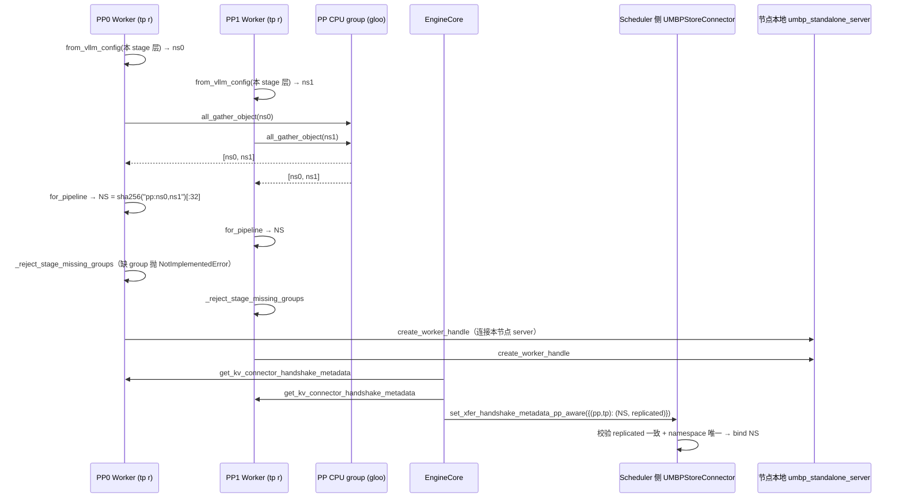
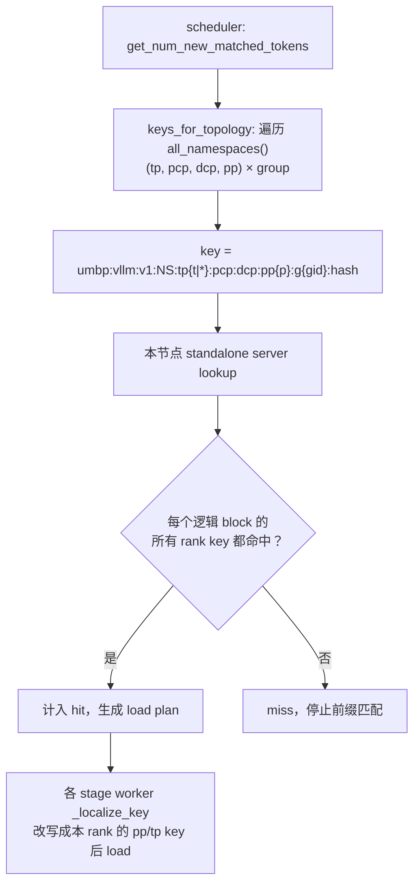

# PR #68559: [KV Connector][UMBP] Support pipeline-parallel prefill producers

> **Author**: @ChengYM5685 | **State**: OPEN | **Date**: 2026-11-19
> **Branch**: `umbp-pp-prefill` → `main` | **Labels**: documentation, kv-connector
> **Changes**: +307 -12 lines across 4 files | **ROCm 相关性**: 完全相关（UMBP 是 MORI 的一部分，standalone 模式依赖 `mori.cpp.UMBPClient`）
> 本报告分两部分：§1–6 为 PR 详细总结，§7–8 为 ROCm review 意见。

---

## 1. 总结 (Summary)

在 main 上，`UMBPStoreConnector` 只要 `pipeline_parallel_size > 1` 就抛 `NotImplementedError`，embedded 和 standalone 两种模式都一样。本 PR 只在 **standalone** 模式下放开 PP：PP 各 stage 的 worker 在构造 connector 时，通过 PP 组的 CPU group 做一次 `all_gather_object`，收集各 stage 自己推导出的 namespace，再用 `UMBPNamespace.for_pipeline` 合成一个全引擎统一的 namespace。scheduler 侧新增 `set_xfer_handshake_metadata_pp_aware` 覆盖，接收所有 stage 的握手上报。如果某个 stage 完全不持有某个 prefix-cacheable 的 cache group，启动时直接拒绝。TP 复制组（replicated group）的判定改为基于 group 的全局 `distinct_specs`，避免不同 stage 上报的复制组不一致，导致握手失败。embedded 模式仍然拒绝 PP。

## 2. 背景与动机 (Background & Motivation)

- 作者在 MI355X 上跑 P/D 分离：P 侧用 2 个 PP2×TP1 引擎，P→D 走 MoRIIO，prefix 池走 UMBP standalone，两者组合成 `MultiConnector(MoRIIO, UMBP)`。模型是 MiniMax-M3.1-Flash MXFP4。PP prefill producer 需要 UMBP 能在 PP 下工作。
- PR 描述把 main 上 PP 失败的原因分成两层：
  1. **Namespace**：`key_namespace: "auto"` 时，worker 根据自己的 per-layer spec 推导 namespace。PP 下每个 stage 只有本 stage 的层，推导出的 namespace 各不相同，scheduler 的"exactly one namespace"检查会失败。
  2. **握手**：engine core 调用 `set_xfer_handshake_metadata_pp_aware`，上报按 `(pp_rank, tp_rank)` 索引；基类实现在 `pp_rank > 0` 时直接抛错。
- 相关 PR：#61789（UMBP connector）、#61795（standalone 模式）、#43720（PP-aware 握手聚合）、#67174（MultiConnector 只把子 connector 自己的握手元数据交给它）。同一作者还有两个并行的 PR：#68560（PP 下单个长 prefill 的分块）和 #68582（MoRIIO PP 传输）。

## 3. 代码修改分析 (Code Change Analysis)

### 3.1 修改的模块

| 文件 | 改动 |
|------|------|
| `vllm/distributed/kv_transfer/kv_connector/v1/umbp/connector.py` (+48 -2) | 新增 `_reject_stage_missing_groups`、`_gather_pp_stage_namespaces`（`dist.all_gather_object` over `get_pp_group().cpu_group`）；PP 拒绝条件改为仅拒绝非 standalone 模式；worker 构造时在 PP>1 且 namespace 为 auto 时合成 PP 统一 namespace；新增 `set_xfer_handshake_metadata_pp_aware` 覆盖 |
| `vllm/distributed/kv_transfer/kv_connector/v1/umbp/data.py` (+17 -7) | `tp_replicated_group_ids` 改为遍历 `prefix_cacheable_group_ids` 并使用 `group.distinct_specs`；新增 `UMBPNamespace.for_pipeline` |
| `docs/features/umbp_store_connector_usage.md` (+7 -1) | Limitations 一节改为描述 PP 支持范围和多节点限制 |
| `tests/v1/kv_connector/unit/test_umbp_core.py` (+235 -2) | 新增 4 个测试函数（含一个 4 路参数化）：统一 namespace、显式 namespace 跳过 gather、缺 group 被拒、全局 spec 决定复制组 |

### 3.2 架构 / 流程图

worker 启动和 scheduler 握手的流程：



key 空间和查找路径：



### 3.3 关键实现细节

- **namespace 合成**：`for_pipeline(stage_namespaces)` 对 `"pp:" + ",".join(...)` 做 sha256。每个 stage 的 namespace 已经包含本 stage 的 layer 名、per-layer spec 指纹、`tp/pp/pcp/dcp` 大小、模型指纹和 draft 模型，所以合成后的值对同一模型 + 同一 stage 划分是确定的，stage 划分变化时会换 namespace。这是正确的：因为 pp_r 的对象只含 stage r 的层字节，布局变了必须换 key。
- **collective 位置**：只在 WORKER 角色、`pp_size > 1` 且 `key_namespace == "auto"` 时执行，在构造函数中执行一次。`_build_client`（连接 server）在 `create_worker_handle` 里，位于 collective 之后，所以一个 stage 连不上 server 不会让其他 stage 卡在 gather 里。gather 之前唯一可能抛错的检查是 `skipped_drafts`，它依赖的 `is_eagle_group` 和 `prefix_cacheable_group_ids` 是全局属性，各 stage 结果一致。
- **key 区分**：`BlockIdentityCodec.key_for_namespace` 已经把 `pp{rank}` 写进 key。scheduler 侧 `RankTopology.all_namespaces()` 枚举所有 pp，`keys_per_object` 等于 `rank_count`（复制组为 `rank_count // tp_size`），并且要求这些 key **全部**命中才算一个逻辑 block 命中。因此不会出现"stage0 命中、stage1 未命中"导致的部分加载。如果查找后、加载前发生驱逐，走既有的 load-error 路径。
- **握手**：`set_xfer_handshake_metadata_pp_aware` 用 `dict(enumerate(metadata.values()))` 丢弃 rank 键，只看上报值，后续仍要求 replicated 集合一致、namespace 唯一。
- **复制组判定**：从 "`enable_kv_transfer` + 本 stage `kv_cache_specs`" 改为 "`prefix_cacheable_group_ids` + 全局 `distinct_specs`"。`distinct_specs` 由 `_project_kv_cache_groups_to_worker` 在投影时通过 `unprojected_specs` 保留，这个字段由 #65336 引入，main 上已有。PP=1 时 `unprojected_specs` 为空，`distinct_specs` 等价于原来的本地 spec 集合。UMBP 只为 prefix-cacheable group 生成对象（scheduler 的所有 plan 都按 `prefix_cacheable_group_ids` 过滤），所以去掉非 cacheable 组不改变任何已存对象的 key。"PP=1 行为不变"这一声明成立。
- **缺 group 拒绝**：`_reject_stage_missing_groups` 检查投影后 `layer_names` 为空的 prefix-cacheable group。投影函数对空 group 也保留占位（`kv_cache_specs={}`），所以只要 stage 不持有某 group 的任何层，都能可靠检测到。
- **embedded 模式**：检查在 `UMBPRuntimeFactory.build` 之前、对两种角色都生效；默认 `mode` 是 `embedded`，条件为 `mode != "standalone"`，未来新增的模式也会被默认拒绝。

## 4. 涉及的技术原理 (Technical Principles)

- **PP 下的 KV cache 投影**：vLLM 先按全模型规划全局 cache group，再用 `_project_kv_cache_groups_to_worker` 投影到每个 stage。某个 stage 不含某 group 的任何层时，该 group 仍然保留，但层集合为空。因此 stage 本地 config 和全局 config 在"层集合"上不同，在 "group 列表" 上相同。
- **UMBP 的 rank-local 对象**：UMBP 把一个 block 在一个 rank 上的所有层字节拼成一个对象，key 中带 `tp/pcp/dcp/pp`。scheduler 查找时要求所有 rank 的 key 都存在，才认为这个 block 可以从外部恢复。TP 复制组（如 MLA latent）只由 tp0 存一份 `tp*` key，以节省 node-shared 池的容量。
- **standalone vs embedded**：standalone 模式下，节点本地的 `umbp_standalone_server` 持有 DRAM 池，scheduler 和 worker 都通过 Unix socket 连接**本节点**的 server。embedded 模式下，每个 rank 私有一个池，scheduler 通过每个 rank 的本地 socket 查询。
- **PP-aware 握手**：engine core 把所有 worker 的上报合并成 `{(pp_rank, tp_rank): meta}`，交给 `set_xfer_handshake_metadata_pp_aware`。基类只接受 `pp_rank == 0`，需要 PP 的 connector 必须自己覆盖这个方法（NIXL、MultiConnector 已经覆盖）。

## 5. 评论区讨论亮点 (Discussion Highlights)

- 目前没有实质性的人工 review 意见。`claude[bot]` 提示 fork PR 的自动 review 被禁用，`mergify[bot]` 只贴了文档预览链接。
- PR 描述本身记录了一次自我修正：第 3 个 commit `5146d5c125` 把复制组判定改为全局 spec。描述称修改前新回归测试为 1 passed / 3 failed，修改后 4 passed，与 `test_pp_handshake_uses_global_cacheable_group_specs` 的 4 路参数化相符。

## 6. 风险与潜在问题 (Risk Analysis)

| 风险 | 严重程度 | 说明 |
|------|---------|------|
| 跨节点 PP 被静默接受，复用率为零并持续浪费存储；交叉放置时可能误命中 | Medium | 见 §7 ⚠️【设计】跨节点 PP |
| 真实的 PP collective 没有单元测试覆盖，CI 未运行 | Medium | 见 §7 ⚠️【测试】 |
| 带 draft/MTP 独立组或层段绑定组的混合模型在 PP 下会被拒绝 | Low | 见 §7 📝【兼容性】；行为显式，不会静默出错 |
| PP 引擎与非 PP 引擎的池互不共享 | Low | 见 §7 📝【设计】 |
| 端到端数字不可追溯 | Low | 见 §7 📝【注释/文档】 |
| PP=1 回归 | Low | 已核对：PP=1 下 namespace、key、复制组对已存对象均不变 |

---

## 7. Review 意见 (Findings)

| 类型 | 🔴 | ⚠️ | 📝 |
|------|----|----|----|
| 设计 | — | 1 | 1 |
| 测试 | — | 1 | — |
| 兼容性 | — | — | 1 |
| 注释/文档 | — | — | 1 |

本次重点核对的问题和结论：

1. **跨 PP stage 的 key 冲突**：不存在。key 中带 `pp{rank}`，统一 namespace 指纹覆盖所有 stage 的层。
2. **scheduler 握手是否聚合所有 stage**：是，并且仍要求 namespace 和复制组一致。
3. **缺 group 检测**：对"stage 不持有某 prefix-cacheable group 的任何层"能可靠检测，并且检测放在 collective 之后，不会让其他 stage 卡住。
4. **跨 stage 命中一致性**：要求所有 rank key 全部命中，不会出现部分加载。
5. **embedded 模式是否仍拒绝 PP**：是，并且报错信息给出了改用 standalone 的提示。

以下 findings 主要集中在部署边界和测试覆盖。

---

**⚠️【设计】跨节点 PP 被静默接受：scheduler 只查本节点 server，远端 stage 的对象永远无法凑成完整命中** `[已验证]`（交叉放置下的误命中后果为 `[推测]`）

- **问题**: standalone 的 scheduler handle 和 worker handle 都由 `_build_client(self._options)` 连接 `endpoint` 指向的**本节点** Unix socket（`runtime/standalone.py` 的 `create_scheduler_handle` / `create_worker_handle`）。PP stage 分布在不同节点时，stage r 把 `pp{r}` 对象写进自己节点的 server，而 scheduler 查找时要求所有 `pp` 的 key 都在 scheduler 节点的 server 上。PR 只在 docs Limitations 里写了一句（`docs/features/umbp_store_connector_usage.md:148-154`），代码在 `connector.py:202-210` 已经做了一次 PP collective，但没有借这次 collective 检测各 stage 是否在同一节点。
- **影响**:
  1. 典型的跨节点放置（stage0 在 A、stage1 在 B，engine core 在 A）下，外部命中率恒为 0，但每个 stage 每步仍然提交 D2H 存储，白白占用 server 容量和 PCIe/内存带宽。没有任何日志提示，用户只能从 hit rate 为 0 反推原因。
  2. 如果多个相同配置的 PP 引擎交叉放置（引擎 X：stage0@A、stage1@B；引擎 Y：stage0@B、stage1@A），它们的 namespace 相同。X 的 scheduler 在 A 上能看到 X 自己的 `pp0` 对象和 Y 写入的 `pp1` 对象，于是判定命中。但 X 的 stage1 在 B 上加载 `pp1` 时，B 上可能没有该对象，于是 load 失败。`kv_load_failure_policy` 默认是 `"fail"`，请求会直接报错。这与 docs 中"cannot produce a complete prefix hit"的描述不符。
- **行动**: 建议作者在已有的 `_gather_pp_stage_namespaces` collective 里顺带 gather 每个 stage 的节点标识（hostname 或 server endpoint 的 inode 和 boot id），在 PP 组跨节点时直接 `NotImplementedError`（或至少 `logger.warning` 并关闭 store/lookup），把文档中的限制变成启动期可诊断的行为。

**⚠️【测试】真实的 PP collective 没有被任何测试执行，CI 未运行** `[已验证]`

- **问题**: 新增测试的覆盖情况如下：
  - `test_standalone_pp_stages_share_one_namespace`（`test_umbp_core.py:614-663`）和 `test_pp_stage_without_a_cache_group_is_rejected` 用 `monkeypatch.setattr(umbp_connector, "_gather_pp_stage_namespaces", ...)` 替换了 gather。
  - `test_pp_configured_namespace_skips_gather` 断言不调用 gather。
  - `test_pp_handshake_uses_global_cacheable_group_specs` 使用显式 `key_namespace: "pp"`，因此不走 gather。

  于是 `dist.all_gather_object(..., group=pp_group.cpu_group)` 这条真实路径只有作者的 E2E 覆盖：stage 顺序是否等于 `pp_rank`、`get_pp_group()` 在 connector 构造时是否已初始化、gloo 的 pickle 往返都没有测试。经公开 GitHub API 核对，head 上的 `pre-run-check` 在 "Check PR label and author merge count" 一步失败（PR 没有 `ready` label），pre-commit 与 Buildkite 均被跳过，CI 实际没有运行；Read the Docs 显示 failed 也是同一原因（前置检查未过而跳过构建），不是文档本身的问题。
- **影响**: 以后如果有人调整 connector 的构造时机（例如移到 PP 组初始化之前），或者调整 worker rank 布局，单元测试仍然会全部通过，问题要到真实 PP 部署时才暴露（启动 hang 或 namespace 不一致）。
- **行动**: 建议作者补一个最小的双进程 gloo 测试：用 `torch.multiprocessing` 或仓库已有的分布式测试工具起一个 PP=2 的 CPU group，直接调用 `_gather_pp_stage_namespaces`，断言两个 rank 都得到 `[ns0, ns1]` 且顺序一致。同时建议附上 CI 结果，或请 maintainer 打 `ready` 标签跑 kv-connector 单测。

**📝【兼容性】缺 group 的拒绝范围依赖模型的 cache group 划分，ROCm 目标模型的适用性未说明** `[已验证]`（具体模型是否会触发为 `[推测]`）

- **问题**: `_reject_stage_missing_groups` 会拒绝"本 stage 没有某个 prefix-cacheable group 任何层"的部署。开启 hybrid KV cache manager 时，如果 draft/MTP 层或者只出现在某一段层的 attention 类型（例如开头的 dense 层、只在最后一个 stage 的 MTP 层）单独成组，那么非末端 stage 会在启动时被拒绝。PR 只验证了 MiniMax-M3.1 + `--disable-hybrid-kv-cache-manager`（单 group），而 E2E 命令行用 `...` 省略了部分参数，看不到这个开关。
- **影响**: 行为是显式报错，不会静默出错。但 DSv4、Kimi 等 ROCm 重点模型在 PP + MTP + hybrid manager 下能否使用并不清楚，用户可能要在启动时才发现。
- **行动**: 建议作者在 PR 描述中给出 E2E 的完整参数（确认是否带了 `--disable-hybrid-kv-cache-manager`），并在 docs 中注明已验证的模型和"draft/MTP 独立 group 在 PP 下不支持"。

**📝【设计】PP 引擎与非 PP 引擎（或不同 stage 划分）的 UMBP 池互不共享** `[已验证]`

- **问题**: 统一 namespace 由各 stage 的层集合以及 `pp`、`tp` 大小推导，key 中还带 `pp{rank}`。所以 PP2×TP1 的 P 引擎和 TP4 的 P 引擎即使连在同一个 standalone server 上，也不会互相命中。修改 `VLLM_PP_LAYER_PARTITION` 也会换 namespace。这在正确性上是必需的，因为对象字节按 rank 切分。
- **行动**: 建议作者在 docs 的 PP 段落中补一句"PP 引擎只与相同 PP/TP 和相同 stage 划分的引擎共享对象"，方便混合部署的用户预期命中率。

**📝【注释/文档】端到端数字缺少来源，也没有 PP 相对 TP4 的对照** `[已验证]`

- **问题**: PR 描述中的数字都没有附日志、脚本输出或链接，本报告标为 `[unverified]`，包括：
  - AgentX c80 3.97 req/s、46.6k tok/s/GPU；c64 3.26 req/s、40.6k tok/s/GPU
  - UMBP 外部命中率 73% / 65%
  - gsm8k 0.939–0.943
  - "PP0 60 layers, PP1 65"

  另外只给出了"错误请求数与 TP4-prefill 基线相同"，没有给出 TP4 基线的吞吐，无法判断 PP prefill 的收益。描述还说 E2E 构建是 "our ROCm build of vLLM nightly 96710245e"，没有说明是否同时包含 #68560 和 #68582。
- **行动**: 建议作者附上 AgentX 汇总输出或日志片段，补充同硬件下 TP4 prefill 的对照数字，并注明 E2E 构建中包含了哪些兄弟 PR，避免本 PR 的验证结论依赖未合入的改动。

## 8. 结论 (Verdict)

**⚠️ NEEDS WORK**

核心设计正确：
- 统一 namespace 加上 key 中的 `pp` rank，保证各 stage 的 key 不冲突。
- scheduler 要求所有 rank key 全部命中，不会部分加载。
- 缺 group 检测放在 collective 之后，不会卡住其他 stage。
- embedded 模式仍然显式拒绝 PP。
- PP=1 行为经核对不变。

建议合入前修复两点：一是在已有的 PP collective 中检测跨节点放置，把文档中的限制变成启动期诊断，避免零复用和交叉放置下的误命中；二是补一个真正执行 gloo gather 的测试，并给出 CI 结果。

## 9. 英文 Review 评论 (Copy-Paste English Comments)

**C1** `vllm/distributed/kv_transfer/kv_connector/v1/umbp/connector.py:202-210` — ⚠️ comment

```text
Cross-node PP is accepted silently here, but in standalone mode the scheduler and every worker attach to the server on their own node (`_build_client` uses the node-local `endpoint`). If PP stages span nodes, the scheduler never sees the remote stages' `pp{r}` objects, so the external hit rate stays at 0 while every stage still pays for stores on every step, with nothing in the logs. Since this block already runs a PP-group collective, could you gather a node identity (e.g. hostname, or the server socket's identity) alongside the stage namespace and raise, or at least warn and disable store/lookup, when the PP group spans nodes? Same-config engines placed crosswise (X: stage0@A/stage1@B, Y: stage0@B/stage1@A) share the namespace too. X's scheduler on A can then see a full hit (its own pp0 plus Y's pp1), but X's stage 1 loads from B, which may not hold that object. Could you check what happens in that case? Under the default `kv_load_failure_policy="fail"` I'd expect the request to error out. Either way, the docs sentence saying remote-stage objects "cannot produce a complete prefix hit" should then say that PP stages must share the scheduler's node.
```

**C2** `tests/v1/kv_connector/unit/test_umbp_core.py:614-663` — ⚠️ comment

```text
All the new PP tests monkeypatch `_gather_pp_stage_namespaces` or use an explicit `key_namespace`, so the real `dist.all_gather_object` over `get_pp_group().cpu_group` never runs in tests. Stage ordering, group availability at connector construction time, and the gloo round-trip are only covered by your E2E runs. Could you add a small two-process gloo test (PP=2 CPU group) that calls `_gather_pp_stage_namespaces` directly and checks both ranks get `[ns0, ns1]` in stage order? It would also help to link a CI run for the kv-connector unit tests, since the check status isn't visible on the PR yet.
```

## 10. 英文总结评论 (Overall Review Summary)

```text
Thanks, the design holds up: the combined namespace plus the pp rank in every key keeps stages apart, lookups require every rank's key so partial loads cannot happen, the missing-group check runs after the collective, embedded mode still rejects PP, and PP=1 behaviour is unchanged. Two asks before merging: use the existing PP collective to detect stages spanning nodes and fail or warn at startup, because today that silently gives zero reuse (and crosswise placements can produce false hits); and add a test that actually runs the gloo gather, plus a visible CI run. Approve after these.
```
