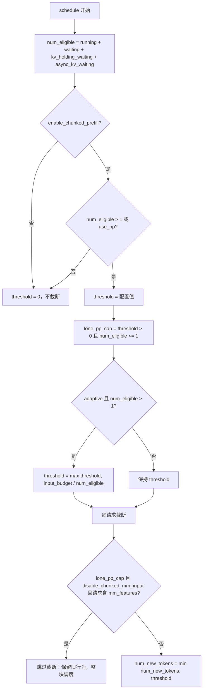
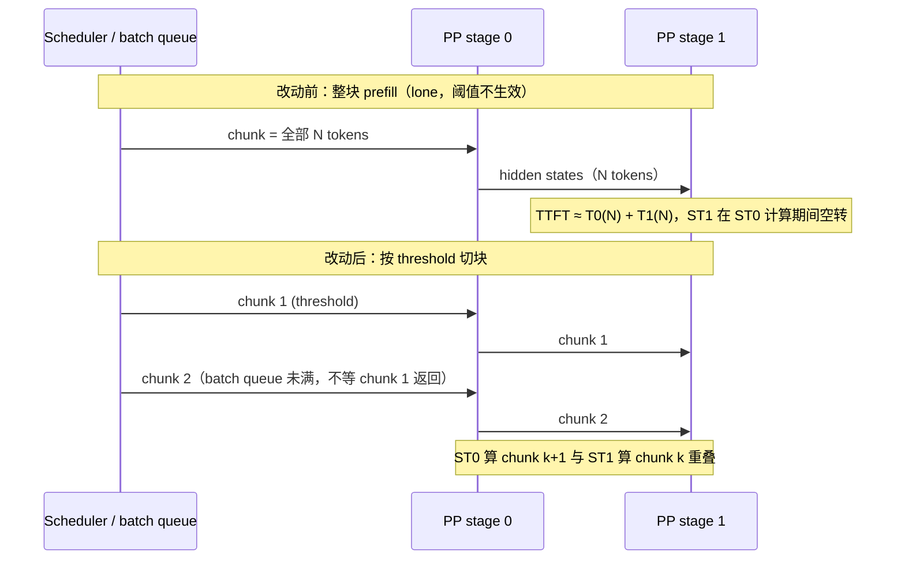

# PR #68560: [Core][PP] Chunk a lone long prefill under pipeline parallelism

> **Author**: @ChengYM5685 | **State**: OPEN | **Date**: 2026-11-19
> **Branch**: `pp-prefill-scheduling` → `main` | **Labels**: scheduler
> **Changes**: +94 -6 lines across 3 files | **ROCm 相关性**: 不相关（平台无关的 V1 调度器改动；PR 中的性能数据来自 MI355X，但代码路径对 CUDA / ROCm 完全一致）
> 本报告分两部分：§1–6 为 PR 详细总结，§7–8 为 review 意见（非 ROCm 路径：只做通用正确性与 housekeeping 检查）。

---

## 1. 总结 (Summary)

#57951 让 `long_prefill_token_threshold` 在「只有一个请求」时不生效（没有别的请求可被饿死，干脆用满整个 token budget）。本 PR 指出这在流水线并行（PP）下是错误的取舍：单个长 prompt 作为一个整块依次穿过所有 PP stage，TTFT 等于各 stage 之和，其余 stage 空转。PR 在 `pipeline_parallel_size > 1` 时对「孤立 prefill」继续按阈值切块，让各块在 stage 之间流水重叠；adaptive 模式的 fair-share 下限在该场景下也跳过；对 `disable_chunked_mm_input` 下带多模态 item 的请求保留旧行为，避免出现永远调度 0 个 token 的情况。

## 2. 背景与动机 (Background & Motivation)

- **#57951**（Robert Shaw，已合入 main，commit `c64b15cde5`）：把 `long_prefill_token_threshold` 改为仅在 `running + waiting > 1` 时生效，理由是该阈值的设计目的就是防止长 prefill 抢占其他请求的 token budget。
- **#58459**（已合入，`6697a7dd30`）：引入 `long_prefill_token_threshold_adaptive`，把阈值下限抬到 `max_num_batched_tokens / 请求数` 的 fair share。
- **本 PR 的场景**：作者在 P/D 分离部署中把 prefill 实例配置成 `2 x (PP2 x TP1)`（同作者的 #68559 UMBP PP prefill、#68582 MoRI-IO PP 传输在并行 review），prefill-only 实例在中低负载下经常只有一个请求在跑。此时 #57951 让这个请求整块走完 PP 流水，stage 1 等 stage 0 全部算完才开始，流水线没有任何重叠。
- **思路**：不新增配置项，直接复用用户已经设置的 `long_prefill_token_threshold`，作为 PP 下孤立 prefill 的切块大小。PR 认为用户设置阈值就等于「已经要求按这个大小切块」，而 `threshold=0`（默认值）时仍然关闭该特性。
- PR 描述中明确的「未纳入」项：batch queue 被空 batch 占满时允许接纳新请求。作者实测这对 PP4 有帮助，但在 2 x PP2 的 P/D 中更差，因此没有放进本 PR。

## 3. 代码修改分析 (Code Change Analysis)

### 3.1 修改的模块

| 文件 | 改动 |
|------|------|
| `vllm/v1/core/sched/scheduler.py` (+29 -4) | `schedule()` 中阈值启用条件加 `or self.use_pp`；adaptive 下限加 `num_eligible_reqs > 1`；新增 `lone_pp_cap` 标志，RUNNING / WAITING 两处截断点都加上多模态豁免；新增 `_keeps_mm_items_whole()` 辅助方法 |
| `vllm/config/scheduler.py` (+6 -2) | `long_prefill_token_threshold` 与 `long_prefill_token_threshold_adaptive` 的 docstring 补充 PP 例外说明 |
| `tests/v1/core/test_scheduler.py` (+59) | 新增 2 个参数化测试：PP=2 孤立 prefill 切块（2×2=4 个 case），以及 LLaVA 不可分割图像 item 豁免（2×2×2=8 个 case） |

### 3.2 架构 / 流程图

阈值决策逻辑（每个 `schedule()` 调用开头计算一次）：



孤立长 prefill 在 PP2 下的时序对比（示意，假设各 stage 等速）：



### 3.3 关键实现细节

- **PP 判定来源**：`self.use_pp = self.parallel_config.pipeline_parallel_size > 1`（`scheduler.py:403`，非本 PR 新增，main 已有）。`parallel_config` 是 `VllmConfig` 的必有字段，所以 LLM / AsyncLLM / serve 等所有入口都能拿到。另外 `VllmConfig.max_concurrent_batches` 在 PP 下至少为 `pp_size`（async 时为 `pp_size + 1`），`EngineCore` 据此一律走 `step_with_batch_queue`，后续 chunk 可以在前一块结果返回前被调度（V1 在调度时就推进 `num_computed_tokens`）。这是切块后能形成流水的前提，与 executor 类型无关。
- **生效条件**：同时满足 `enable_chunked_prefill`、`long_prefill_token_threshold > 0`、`pp > 1` 和 `num_eligible_reqs <= 1`。阈值默认 0，且 `SchedulerConfig.__post_init__` 对 encoder-decoder 模型、`models/config.py:1803` 对 prefix-LM 都会强制置 0，因此默认配置下行为不变。
- **adaptive**：多请求时按 `max(threshold, input_budget // n)` 抬下限的行为不变。孤立请求时 `n=1`，下限会变成整个 budget，等于撤销截断，所以 PR 只在 `num_eligible_reqs > 1` 时应用下限。
- **多模态豁免**：`_keeps_mm_items_whole(request)` = `disable_chunked_mm_input and not is_encoder_decoder and bool(request.mm_features)`，只在 `lone_pp_cap` 为真时参与判断。触发原因已核实：`_try_schedule_encoder_inputs` 在 `disable_chunked_mm_input` 下，若本块终点落在 item 内部，会把块回退到 item 起点之前；若块本身已从 item 起点开始，则直接置 0。阈值小于 item 长度时，请求会卡在 item 起点、每步都调度 0 个 token。
- **`lone_pp_cap` 的隐含前提**：表达式里没有 `use_pp`。它依赖「非 PP 下 lone 时 threshold 已经是 0」这一点，才隐含成立 `use_pp`（见 §7 📝）。
- **两个截断点**：RUNNING 循环（新文件第 845–848 行）与 WAITING 循环（第 1392–1395 行）都改成同一个条件。
- **其他读取阈值的代码**：`_mamba_block_aligned_split`（`scheduler.py:621`）与 DSv4.1 NVIDIA `model_state.py:204` 直接读取配置里的阈值来推断最大 chunk。它们本来就按「阈值可能生效」的保守方向设计，与本 PR 不冲突。

## 4. 涉及的技术原理 (Technical Principles)

- **流水线并行与 prefill 气泡**：PP 把层切到多个 stage，单个 batch 必须依次穿过所有 stage。只有一个大 batch 时，各 stage 串行执行，PP 的吞吐优势不存在，TTFT ≈ Σ stage 时间。把 prompt 切成 N 块后，stage 0 算第 k+1 块时 stage 1 可以同时算第 k 块，理想 TTFT ≈ (N + S − 1) × 单块单 stage 时间。代价是每块都有固定的调度 / launch / 通信开销，N 过大会抵消收益。
- **V1 调度器的 chunked prefill**：调度器不区分 prefill / decode 阶段，每步按 `num_tokens_with_spec − num_computed_tokens` 给每个请求分配 token，受 `token_budget`、`long_prefill_token_threshold`、encoder budget、Mamba 对齐、MTP lookahead 等约束截断。
- **batch queue**：`EngineCore.step_with_batch_queue` 在队列未满时优先继续调度新 batch，而不是等结果返回；PP 下队列深度 ≥ pp_size，所以同一请求的多个 prefill chunk 可以同时在流水中。
- **`disable_chunked_mm_input`**：要求一个多模态 item 的 placeholder token 必须在同一步内整体调度（mm prefix-LM 等双向注意力模型需要）。CUDA 与 ROCm 平台都会对 `is_mm_prefix_lm` 模型强制开启它（`platforms/cuda.py:386`、`platforms/rocm.py:1188`）。

## 5. 评论区讨论亮点 (Discussion Highlights)

- 目前只有 `claude[bot]` 的自动说明「fork PR，自动 review 已禁用」，还没有任何人工 review 或讨论。
- 经公开 GitHub API 核对，head 上的 `pre-run-check` 在 "Check PR label and author merge count" 一步失败（PR 没有 `ready` label），pre-commit 与 Buildkite 均被跳过，CI 实际没有运行。PR 描述中的测试结果都是作者本地运行（ROCm nightly 镜像 `96710245e` 与 CPU）。

## 6. 风险与潜在问题 (Risk Analysis)

| 风险 | 严重程度 | 说明 |
|------|---------|------|
| 已设置阈值的 PP 部署静默改变行为 | Medium | 见 §7 ⚠️【设计/性能】；阈值偏小时孤立 prompt 被切成很多小块，可能反而拉长 TTFT |
| 性能数据无法追溯 | Medium | 见 §7 ⚠️【测试】；所有 TTFT / 吞吐数字都没有命令或日志，P/D 数据比较的是 PP 与 TP，而不是本改动本身 |
| 多模态豁免粒度过粗 | Low | 见 §7 📝；任何含 mm item 的请求都整体放弃 PP 切块 |
| 多请求 + 不可分割大 mm item 的停滞（main 已存在） | Low（非本 PR 引入） | 见 §7 📝 |
| 默认配置下的兼容性 | Low | 阈值默认 0、非 PP 路径不变，现有 `test_long_prefill_threshold_ignored_when_alone` 仍覆盖 |
| 可维护性：`lone_pp_cap` 语义依赖隐含前提 | Low | 见 §7 📝 |

---

## 7. Review 意见 (Findings)

非 ROCm 相关，已跳过 ROCm 专项规则（aiter / mori / attention backend / 量化 / 平台分发等）。以下是通用正确性检查与 housekeeping 的结果。

| 类型 | 🔴 | ⚠️ | 📝 |
|------|----|----|----|
| 设计 / 性能 | — | 1 | 1 |
| 测试 | — | 1 | — |
| 正确性（main 已存在） | — | — | 1 |
| 可维护性 | — | — | 1 |

已核对、无问题的点（不计入 findings）：
- PP 规模取自 `parallel_config`，所有入口一致；PP 下 batch queue 深度恒 ≥ pp_size，与 executor 类型无关，所以切块后确实能形成流水，不存在 stage 不重叠导致的单请求退化（不考虑每块固定开销，见 ⚠️ 1）。
- 关闭 chunked prefill 时 threshold 恒为 0，行为不变。
- 远端 KV 加载（`load_kv_async`）期间 `num_new_tokens = 0`，不受阈值影响。`kv_holding_waiting` / `async_kv_waiting` 中的请求都计入 `num_eligible_reqs`，与 main 的计数口径一致。
- MTP `_reserve_prefill_lookahead` 只会减小块大小（`max(…, 0)`），只要阈值大于 lookahead 就不会卡死；Mamba 对齐逻辑本来就把阈值当作可能生效来处理。
- encoder-decoder 模型的 `__post_init__` 会把阈值强制置 0，所以 `_keeps_mm_items_whole` 中的 `not is_encoder_decoder` 只是防御性条件。
- docstring 已同步更新；没有新增 env var 或配置项；`docs/` 中没有关于该阈值、需要同步修改的文档。

---

**⚠️【设计/性能】复用公平性阈值作为 PP 切块大小，已设置阈值的 PP 部署会静默改变行为，且无下限、无单独开关** `[已验证]`（TTFT 回归幅度 `[推测]`）

- **问题**: `scheduler.py:773-778` 把 `long_prefill_token_threshold` 的语义从「多请求时防止饥饿的上限」扩展成「PP 下孤立 prefill 的流水切块大小」。在 #57951 之后，已经设置了阈值的 PP 用户（例如为了多请求公平设成 512 或 1024）在只有一个请求时获得的是整块 prefill；本 PR 合入后，同样的配置会把一个 32k–128k 的孤立 prompt 切成几十到上百块。唯一的退出方式是把阈值设为 0，但这样也会失去多请求时的公平性截断。
- **影响**: 设 PP 有 S 个 stage、切成 N 块、每块固定开销为 o（调度、kernel launch、PP send/recv、无 CUDA graph 的 prefill 开销），则 TTFT ≈ T·(1 + (S−1)/N) + (N + S − 1)·o。阈值相对 prompt 很小时，第二项可能超过节省下来的气泡，单请求 TTFT 反而变差。PR 只报告了阈值 4096 的数据，没有覆盖小阈值的情况。这是部署可见的行为变化，但不会出现在 release note 里。
- **行动**: 建议作者为孤立 PP prefill 的块大小设一个下限，例如 `max(threshold, ceil(remaining / pp_size))` 或类似的、与 pp_size 相关的最小块，让切块次数只够填满流水即可。如果坚持直接复用阈值，作者应当在 docstring / PR 描述中把它明确标为行为变化，说明对小阈值的影响，并补一组小阈值（例如 512）的单请求 TTFT 数据。

**⚠️【测试】性能数据无法追溯，CI 未运行** `[已验证]`

- **问题**: PR 描述中的 TTFT p50（478→417 ms 等）、3–7 req/s 下 −22%～−38%、饱和吞吐 7.97 / 8.13 / 7.91 req/s、PP4 单请求 433→268 ms、gsm8k 0.967 / 0.973，以及 P/D 的 1.11 / 0.82 s 对 2.31 / 2.29 s、46.6k / 45.9k tok/s/GPU，都没有给出命令、脚本或日志，本报告一律视为 `[unverified]`。其中 P/D 数据比较的是「PP prefill + 本 PR」与「TP4 prefill」，作者自己也注明这不是本改动的单独效果。此外 Validation 节先后写了 `321 passed`（ROCm 镜像）和 `331 passed`（CPU），对应的应是不同 commit 时的测试集，与最终 head 的对应关系不清楚。经公开 GitHub API 核对，head 上的 `pre-run-check` 在 "Check PR label and author merge count" 一步失败（PR 没有 `ready` label），pre-commit 与 Buildkite 均被跳过，CI 实际没有运行。
- **影响**: 本 PR 的收益完全依赖性能数据，单测只能证明块大小符合预期（`[400, 400, 200]`），无法证明 TTFT 改善，也无法发现上一条中的小阈值回归。
- **行动**: 建议作者在 PR 描述中附上 serve 参数与 benchmark 命令（至少覆盖 PP4 单请求与 2 x PP2 两组）、对应的 commit，并说明测试计数对应的是哪个 head；建议 review 时确认 CI 在最终 head 上是绿的。

**📝【设计】多模态豁免粒度过粗：含任何 mm item 的请求都整体放弃 PP 切块** `[已验证]`

- **问题**: `_keeps_mm_items_whole()`（`scheduler.py:2092-2099`）只检查 `bool(request.mm_features)`，不看截断点是否真的会落在某个 item 内部，也不看剩余部分是否还有未处理的 item。例如「576-token 图像 + 100k 文本」的请求，在图像处理完以后剩下的纯文本仍然整块调度。PR 自己的测试 `image_offset=800` 也表明，图像前的 800 个文本 token 同样没有按阈值截断。CUDA / ROCm 平台都会对 mm prefix-LM 模型强制开启 `disable_chunked_mm_input`，这些模型的多模态请求在 PP 下等于完全没有这个优化。
- **行动**: 建议作者改成只在「截断点落在不可分割 item 内部」时把块延伸到该 item 的末尾（受 token_budget 约束），而不是对整个请求关闭截断；也可以先在 docstring 中说明这一限制，留给后续 PR。

**📝【正确性】多请求 + 不可分割大 mm item 的停滞问题（main 已存在，非本 PR 引入）** `[已验证]`（静态分析，未运行）

- **问题**: PR 描述中「阈值小于 item 时每块都会被回退到 0」的推理同样适用于 `num_eligible_reqs > 1` 的情况。以两个请求、各自在 offset 0 处有一个 576-token 图像、阈值 400、`disable_chunked_mm_input=True`、未开 adaptive 为例：两者每一步都被 `_try_schedule_encoder_inputs` 置 0，然后被 `skip_request` 跳过，两个请求都不会完成，因此会一直停滞。本 PR 的豁免只覆盖孤立请求。
- **行动**: 不阻塞本 PR。建议作者或 maintainer 跟进：在 `disable_chunked_mm_input` 下把「块延伸到 item 末尾」的规则统一应用到所有请求，或在配置校验中对 `long_prefill_token_threshold < 最大 mm item 长度` 给出警告。

**📝【可维护性】`lone_pp_cap` 的 PP 语义是隐含的** `[已验证]`

- **问题**: `scheduler.py:782` 为 `long_prefill_token_threshold > 0 and num_eligible_reqs <= 1`，表达式里没有 `self.use_pp`。它之所以只在 PP 下为真，是因为非 PP 的孤立请求在上一行已经被置成 threshold=0。以后如果有人调整上面的启用条件（例如再加一种「孤立也截断」的场景），多模态豁免就会悄悄扩散到其他场景。
- **行动**: 建议作者把条件写成显式的 `self.use_pp and num_eligible_reqs <= 1 and long_prefill_token_threshold > 0`，与变量名一致。

## 8. 结论 (Verdict)

**⚠️ NEEDS WORK**

改动小，范围控制得当：只在 PP 且阈值非零时生效。流水重叠依赖的 batch queue 在所有 PP 入口都成立；多模态回退到 0 的停滞风险也被识别并加了测试，没有发现阻塞级的正确性问题。合入前建议处理两点：一是对复用公平性阈值带来的行为变化给出下限或明确的文档说明；二是补充可复现的性能数据，并确认 CI 状态。

## 9. 英文 Review 评论 (Copy-Paste English Comments)

**C1** `vllm/v1/core/sched/scheduler.py:773-778` — ⚠️ comment

```text
This reuses `long_prefill_token_threshold`, which users set for multi-request fairness, as the pipeline chunk size for a lone PP prefill. PP deployments that already set a small threshold (e.g. 512) will now see every lone 32k-128k prompt split into dozens of chunks. Each chunk pays fixed scheduling/launch/PP-transfer overhead, so lone-request TTFT can get worse instead of better. The only opt-out is threshold=0, which also drops the fairness cap. Could you floor the lone-PP chunk size (e.g. max(threshold, ceil(remaining / pp_size))), or at least call this out as a behavior change and share single-request TTFT for a small threshold?
```

**C2** `tests/v1/core/test_scheduler.py:1902-1922` — ⚠️ comment

```text
The unit tests confirm the chunk sizes ([400, 400, 200]), but the benefit of this PR rests entirely on the TTFT/throughput numbers in the description, and those come without serve args, benchmark commands, or logs. The P/D numbers also compare a PP prefill against a TP4 prefill rather than this change alone. Could you add the commands and the commit used for the PP4 single-request and 2 x PP2 runs? Could you also clarify which head the "321 passed" and "331 passed" counts refer to? CI checks do not appear to have run on the latest head yet.
```

**C3** `vllm/v1/core/sched/scheduler.py:2092-2099` — 📝 nit

```text
`_keeps_mm_items_whole()` turns off the lone-PP cap for any request that has mm_features. A request with one image and a long text tail loses pipelining for the whole prompt, even after the image has been processed. mm prefix-LM models (where the platform forces `disable_chunked_mm_input`) never get this optimization for multimodal requests. A narrower rule would only extend the chunk to the end of an unsplittable item when the cap would end inside it. Fine as a follow-up, but worth a note in the docstring.
```

**C4** `vllm/v1/core/sched/scheduler.py:782` — 📝 nit

```text
`lone_pp_cap` only implies PP because the non-PP lone case already forced the threshold to 0 a few lines above. Consider spelling it out as `self.use_pp and num_eligible_reqs <= 1 and long_prefill_token_threshold > 0`, so a future change to the enabling condition cannot silently widen the multimodal exemption.
```

## 10. 英文总结评论 (Overall Review Summary)

```text
This keeps long_prefill_token_threshold active for a lone prefill under pipeline parallelism so its chunks overlap across stages. The change is small, gated on PP plus a nonzero threshold, and the multimodal guard correctly avoids the rollback-to-zero stall. My main concern is that it silently repurposes a fairness knob: PP deployments with a small threshold will split every lone prompt into many chunks, which can hurt TTFT. Please floor the lone-PP chunk size or document the behavior change. Please also share reproducible benchmark commands and confirm CI. Approve after these.
```
