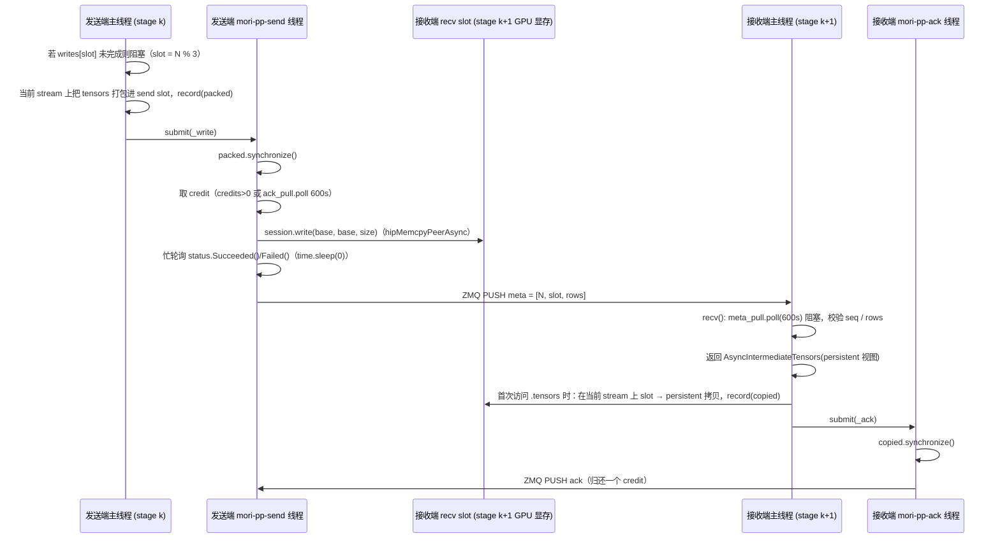
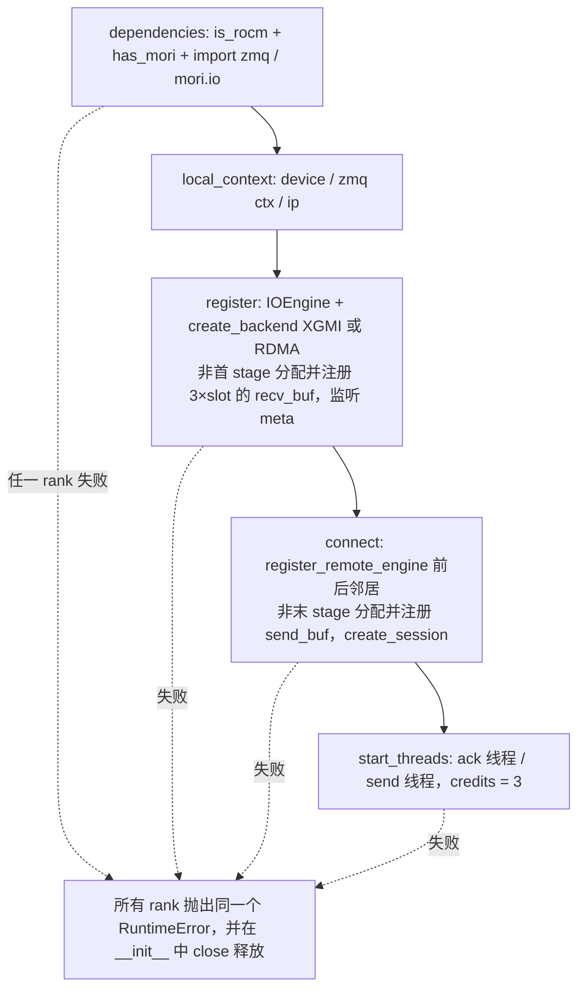

# PR #68582: [ROCm][PP] MoRI-IO pipeline-parallel transport backend

> **Author**: @ChengYM5685 | **State**: OPEN | **Date**: 2026-11-19
> **Branch**: `ChengYM5685:rocm-pp-mori-io-transport` → `main` | **Labels**: documentation, rocm, ci/build
> **Changes**: +799 -15 lines across 9 files | **ROCm 相关性**: 完全相关（新增 ROCm 专属 PP 传输后端，依赖 MoRI-IO）
> 本报告分两部分：§1–6 为 PR 详细总结，§7–8 为 ROCm review 意见。

---

## 1. 总结 (Summary)

本 PR 在 `vllm/distributed/pp_transport` 框架（#65896 / #66677 / #65658）中新增第三种 PP stage 交接方式 `VLLM_PP_TRANSPORT=mori_io`：每个非首 stage 预先向 MoRI `IOEngine` 注册 3 个接收 slot，上一 stage 把本步的 intermediate tensors 打包进本地发送 slot，由后台线程用一次 MoRI-IO write 写入下一 stage 的接收 slot，再经 ZMQ 发送 `(step, slot, rows)` 作为完成信号；接收端在 `.tensors` 首次被访问时把 slot 拷入 persistent intermediate tensors，拷贝完成后再经 ZMQ 回送 credit。单节点用 XGMI backend，跨节点用 RDMA backend（作者明确标注为未验证）。该后端纯 opt-in，`auto` 永不选择它。

## 2. 背景与动机 (Background & Motivation)

- 作者称在 MI355X 上 PP prefill 实例里 RCCL 的 stage 交接代价很高：PP2×DEP2 在 TTFT-p50 = 2 s 时 RCCL 比 MoRI-IO 低 16% 吞吐；PP4 下 RCCL 只有 2.3 req/s，而 MoRI-IO 有 7.78 req/s（这两组数字的来源见 §7，均为 `[unverified]`）。
- 已合入的 ROCm SDMA copy-engine 路径（#65658，`VLLM_PP_TRANSPORT=copy_engine`，仅 gfx950、单节点）已经解决了单节点问题。本 PR 定位为它的补充：(1) 与 MoRI EP AsyncLL 共存。作者在 PP2×DEP2 + MoRI EPv2 AsyncLL + DBO 下测得 SDMA 交接在 4.45 req/s 处饱和，MoRI-IO 为 7.89 req/s，并推测原因是两者争用 SDMA 引擎（作者自述“not proven”）；(2) 跨节点 PP（RDMA，未验证）；(3) 不依赖 gfx950。
- 本实现是作者 out-of-tree 补丁的移植。原补丁挂在 `GroupCoordinator.isend/irecv_tensor_dict` 上，用固定 2 GiB slot，并且 PP2 下还经 MoRI-IO 回传 sampled tokens。PP4 + DSpark 最后一个边界每步要传 2304 MiB，超出了固定 slot，所以本 PR 改为按接收端 persistent tensors 计算 slot 大小。
- 同作者并行提交了 #68559（UMBP PP prefill）和 #68560（PP 下单个长 prefill 的分块）。本 PR 是这组 PP prefill 优化的传输层。

## 3. 代码修改分析 (Code Change Analysis)

### 3.1 修改的模块

| 模块 | 改动 |
|------|------|
| `vllm/distributed/pp_transport/mori_io.py`（新增 454 行） | `MoriIOTransport`：slot 计算（`row_bytes`/`pack_offsets`/`slot_bytes`）、`check_available()`、`_DeviceJobThread` 后台线程、`_setup_on_all_ranks` 集体式 setup、`send`/`_write`/`recv`/`_ack`/`close` |
| `vllm/distributed/pp_transport/__init__.py` (+15/-2) | `PPTransport` 增加 `name: ClassVar[str]` 与默认空实现的 `close()`；`create_pp_transport` 在 `mori_io` 时直接构造 `MoriIOTransport` |
| `vllm/distributed/pp_transport/copy_engine.py` (+2) | `CopyEngineTransport.name = "copy_engine"` |
| `vllm/v1/worker/startup_plan.py` (+1/-1) | fingerprint 记录 `worker._pp_transport.name`，不再硬编码 `copy_engine` |
| `vllm/v1/worker/gpu_worker.py` (+9) | `Worker.shutdown()` 调用 `pp_transport.close()`，失败则记录日志并保留引用 |
| `vllm/envs.py` (+6/-4) | `VLLM_PP_TRANSPORT` 的 Literal 与 `env_with_choices` 增加 `mori_io`，注释同步 |
| `tests/distributed/test_pp_transport.py` (+274/-8) | `run_chain` 按 transport 类参数化；新增 setup 失败注入（4 个阶段）、行数上限、close 保留 pending buffer、slot 大小计算、无 MoRI 报错等用例 |
| `.buildkite/test_areas/misc.yaml` (+22) | 新 AMD step `:amd: (MI355) MoRI-IO Pipeline Transport`（`mi355_4`，`-k mori_io`） |
| `docs/serving/parallelism_scaling.md` (+16) | 新增 “Pipeline transport on ROCm” 一节 |

### 3.2 架构 / 流程图

单个 stage 边界上第 N 步的数据流（XGMI backend）：



Setup 阶段（每个阶段都在 PP 组内 all_gather 错误，再依次经 TP、PCP 组传播）：



### 3.3 关键实现细节

- **Slot 大小**：`slot_bytes(persistent)` 等于每个 key 的 `max_num_tokens × 每 token 字节数`，每个 tensor 向上对齐到 256 B 后求和，所以 EAGLE/DSpark 中转的 aux hidden states 和 MRoPE positions 自动计入。发送端用接收端在握手时上报的 `specs` 与 `row_limits` 做逐 tensor 行数检查，不只检查总大小。
- **顺序与流控**：发送端按 `num_sent % 3` 轮转 slot。复用发送 slot 前，主线程用 `previous.result()` 等待该 slot 上一次 write 完成。接收 slot 的复用由 credit 控制：初始 3 个，之后每个 ack 归还一个。ack 由 ack 线程在 `copied` event 完成后按 FIFO 发出，因此“写入时该接收 slot 已被读完”的不变式成立。
- **完成信号**：XGMI backend 没有接收端完成通知，所以 meta 消息在发送端观察到 `status.Succeeded()` 之后才发出，同时充当“数据已落地”的信号。接收端还用 `seq` 严格校验顺序。
- **线程模型**：每个方向一个 `_DeviceJobThread`（daemon，先 `set_device_index`），按提交顺序串行执行；每个 ZMQ socket 只在一个线程里使用。worker 主线程上的 `with_gpu_sync_check` 不检查其他线程，所以 `Event.synchronize()` 放在后台线程里是合理的。
- **Shutdown**：`close()` 可重入。它先停线程（join 5 s），再检查本地 `_transfers`，然后关 socket，按 session → engine → buffer 的顺序释放。线程仍存活或本地 transfer 未完成时抛异常并保留 buffer。`Worker.shutdown()` 捕获该异常、记录日志后继续关闭其余部分。
- **Backend 选择**：`in_the_same_node_as(pp_group.cpu_group)` 全为真时用 XGMI，否则用 RDMA（`enable_notification=False`）。
- **name/fingerprint**：`copy_engine` 的 fingerprint 字符串保持不变，旧的 startup plan 不失效；`mori_io` 会得到不同的 fingerprint，NCCL 下保存的显存预算不会被误用到要额外占用 slot 显存的 mori_io 上。

## 4. 涉及的技术原理 (Technical Principles)

- **PP stage 交接**：非末 stage 的 forward 输出 `IntermediateTensors`（hidden_states、residual，以及 EAGLE/DSpark 的 aux hidden states、MRoPE positions），下一 stage 接收后写入 persistent buffer 再继续 forward。vLLM 默认用 NCCL/RCCL 的 `isend/irecv_tensor_dict`：元数据在 CPU 侧立即发出，数据在 GPU stream 上异步传输，接收端 CPU 可以同时准备输入。
- **`max_concurrent_batches` 与 stage 领先量**：engine core 最多同时有 `PP + async_scheduling_depth - 1` 个 batch 在飞，所以一个 stage 最多领先下一 stage `max_concurrent_batches - 1` 步。slot 数决定发送端在不阻塞时最多能领先多少步。
- **MoRI-IO（ROCm/mori）**：`IOEngine` 管理 backend（XGMI / RDMA / FABRIC / OFI）、内存注册（`register_torch_tensor` → `MemoryDesc`）和 session。XGMI backend 用 IPC 打开对端显存，单次 write 是在**目标设备**的 stream 上执行 `hipMemcpyPeerAsync`，用 hipEvent 判断完成；`TransferStatus.Succeeded()` 每次调用都会做一次 `hipEventQuery`。`WaitFor(timeout_ms)` / `Wait()` 是释放 GIL 的阻塞等待。
- **SDMA 与 copy engine**：#65658 在 gfx950 上直接驱动 SDMA 引擎做 stage 拷贝，并用 stream memory op 写 flag，全程在 GPU 侧同步，不阻塞 CPU。MoRI EP AsyncLL 也使用 SDMA，所以作者推测两者存在争用。
- **RDMA 完成语义**：关闭 notification 后，只有发送端知道 RDMA WRITE 已完成，接收端通过带外 ZMQ 消息得知。这和 MoRIIO KV connector 的做法相同。

## 5. 评论区讨论亮点 (Discussion Highlights)

- 目前没有人类 reviewer 的实质性评论。仅有 mergify 的文档预览链接，以及 `claude[bot]` 提示“fork PR 不自动 review”。
- 经公开 GitHub API 核对，head 上的 `pre-run-check` 在 "Check PR label and author merge count" 一步失败（PR 没有 `ready` label），pre-commit 与 Buildkite 均被跳过，CI 实际没有运行；Read the Docs 显示 failed 也是同一原因（前置检查未过而跳过构建），不是文档本身的问题。新增的 AMD step 尚未在本 PR 上跑过。
- PR 描述末尾声明使用了 AI 辅助（Claude）移植和编写测试，作者称已逐行审阅并在 4×MI355X 上跑过 GPU 测试。

## 6. 风险与潜在问题 (Risk Analysis)

| 风险 | 严重程度 | 说明 |
|------|---------|------|
| 发送线程忙轮询 transfer 状态，占用 GIL 和一个 CPU 核 | Medium | 见 §7 ⚠️【性能】忙轮询 |
| 接收端 `recv()` 在 CPU 上等到数据落地，失去与上一 stage 计算的重叠 | Medium | 见 §7 ⚠️【性能】recv 阻塞 |
| 跨节点 RDMA 路径未验证，但文档写成已支持 | Medium | 见 §7 ⚠️【兼容性】RDMA |
| CI step 在 mori 缺失时会因用例全部 skip 而显示通过；mori 版本升级不触发该 step | Medium | 见 §7 ⚠️【测试】CI step |
| 关键性能数字来自 out-of-tree 实现，没有脚本或日志 | Medium | 见 §7 ⚠️【性能】数字溯源 |
| 显存：中间 stage 占用 6×slot（PP4 DSpark 约 13.5 GiB） | Low | 已在 PR 描述和文档中说明；slot 数固定为 3，见 §7 📝 |
| 与 copy_engine 的 setup 骨架重复实现 | Low | 见 §7 📝【可维护性】 |
| CUDA/XPU 回归 | Low | 纯 opt-in，`auto`/`copy_engine`/`nccl` 行为不变；mori 延迟导入 |

---

## 7. Review 意见 (Findings)

| 类型 | 🔴 | ⚠️ | 📝 |
|------|----|----|----|
| 性能 | — | 3 | — |
| 测试 | — | 1 | — |
| 兼容性 | — | 1 | — |
| 设计 | — | — | 2 |
| 正确性 | — | — | 1 |
| 可维护性 | — | — | 1 |

总体评价：mori.io 符号核对全部通过（见下文“已核对”）；slot 复用、credit、ack 三者的顺序不变式是正确的；setup 失败的跨 chain 传播有真实硬件测试覆盖。没有发现能写出具体触发输入的阻塞级问题，下列意见集中在性能实现、CI 覆盖的有效性、未验证路径的对外表述，以及数字溯源。

**⚠️【性能】`_write` 用 `time.sleep(0)` 忙轮询 `status.Succeeded()`，每步传输期间与模型主线程争用 GIL** `[已验证]`（影响幅度 `[推测]`）

- **问题**: `mori_io.py:386-390` 的 `while not (status.Succeeded() or status.Failed()): ... time.sleep(0)` 在整个 write 期间不停轮询。mori 的 pybind 中 `Succeeded()`/`Failed()` 不释放 GIL，每次调用都会执行一次 `hipEventQuery`（`src/io/xgmi/backend_impl.cpp` 的 `TransferCompletion::FinalizeNonBlocking`）。`time.sleep(0)` 只是让出一次，线程马上又来抢 GIL。pinned 的 mori v1.2.3.post1 已经提供 `TransferStatus.WaitFor(timeout_ms)`，它带 `py::gil_scoped_release`，并在内部用条件变量加轮询推进。
- **影响**: PP4 + DSpark 时最后一个边界每步要写 2304 MiB，写入时间达到毫秒级。这段时间里发送线程持续占用一个 CPU 核，并周期性抢 GIL，而模型主线程此时正在下发下一步的 eager prefill kernel（大 prefill 不走 cudagraph），kernel 下发可能出现间隙。TP=8 时每个 rank 都有这样一个自旋线程。
- **行动**: 建议作者改为 `status.WaitFor(_TIMEOUT_S * 1000)`，返回后检查 `Failed()` 或是否仍在进行中，这样也省掉手写的 deadline 逻辑；如需保留轮询，至少应释放 GIL 并加一个微秒级的 sleep。

**⚠️【性能】接收端 `recv()` 在 CPU 上阻塞到上一 stage 的 GPU 计算和 write 都完成，失去 NCCL / copy_engine 保留的 CPU 与 GPU 重叠** `[已验证]`（影响幅度 `[推测]`）

- **问题**: 发送端要等 `packed.synchronize()`（上一 stage 本步 forward 跑完）和 write 完成之后才发 meta（`mori_io.py:375-394`），而接收端在 `Worker.execute_model` 一开始、也就是 `model_runner.execute_model` 之前，就在 `meta_pull.poll()` 上同步等待（`mori_io.py:403-407`）。相比之下，NCCL 路径的元数据在发送端 CPU 下发时就发出；copy_engine 的 `recv_object` 也只等元数据，数据等待放在 GPU stream 上（`wait_flag`）。
- **影响**: mori_io 下，接收 stage 的输入准备（scheduler output 处理、attention metadata 构建等 CPU 工作）要等上一 stage 的 GPU 计算加传输全部结束后才开始，每个边界每步都会多出一段“接收端 GPU 空闲、CPU 在准备”的气泡。prefill 场景下 CPU 准备时间不可忽略。PR 的端到端数字测的是 out-of-tree 实现，无法说明这里有多少损失。
- **行动**: 建议作者把 meta（rows、slot）改为在 `send()` 中由主线程尽早发出，“数据已落地”的完成信号单独发送，并把等待完成移到 `copy_in`（即 `.tensors` 首次访问时）里，让接收端的输入准备与传输重叠。如果暂时不改，建议在 PR 中量化这段气泡（例如对比 recv 等待时间与输入准备时间）。

**⚠️【测试】新 MI355 CI step 在 mori 缺失时会“全绿”，且不随 mori 版本升级触发；PR 对现有 AMD 覆盖的描述也不准确** `[已验证]`

- **问题**: ① `misc.yaml:244` 运行的 `check-kv-connectors.sh` 在 ROCm 上只检查 `tblib`、`lm-eval`，不检查 mori。而 `_run_scenario` 在 `has_mori()` 为假时会把所有 mori_io GPU 用例 `pytest.skip`，`test_mori_io_unavailable_is_a_clear_error` 在 mori 缺失时反而通过，所以镜像里丢了 mori 时这个 step 仍是绿的。同文件的 UMBP step 专门加了 `python3 -c "import mori"` 来防止这种情况。② `source_file_dependencies`（`misc.yaml:237-242`）没有包含 `docker/Dockerfile.rocm_base`（mori pin `v1.2.3.post1` 在这里），也没有包含 PP 运行时的 `vllm/v1/worker/gpu/`（如 `pp_utils.py`），mori 升级或 model runner 改动都不会触发这个 step。③ PR 描述说 `test_pp_transport.py` “currently runs only in the NVIDIA L4 CI steps”，但 `distributed.yaml` 中 `:amd: (MI355) Distributed Compile + RPC`（`mi355_2`）的 AMD mirror 已经在跑整份文件，所以 2-GPU 的 mori_io 用例会在两个 step 中各跑一遍。
- **影响**: 这个 step 的作用是证明 mori_io 在 MI355 上能工作，但 mori 缺失或 API 漂移时它不会报警，一个绿色的 check 会给人错误的信心。
- **行动**: 建议作者在 step 中加 `python3 -c "import mori.io"`（或把 skip 改为在 CI 环境变量下失败），把 `docker/Dockerfile.rocm_base` 和 `vllm/v1/worker/gpu/` 加进触发依赖，修正 PR 描述，并考虑在 mi355_2 的 mirror 中用 `-k "not mori_io"` 去掉重复运行。

**⚠️【兼容性】跨节点 RDMA 路径未经验证，但代码没有任何拦截或警告，文档把它写成已支持的能力** `[已验证]`（RDMA 可见性问题 `[推测]`）

- **问题**: `mori_io.py:256-259` 只要 PP 组跨节点就自动走 RDMA backend，只有一条 info 日志写着 “RDMA backend”。`docs/serving/parallelism_scaling.md:63-64` 写的是 “a chain spanning nodes uses RDMA”，没有说明 experimental 或 untested；`envs.py` 的注释也写 “over RDMA across nodes, for any PP size”。但 PR 描述明确说这条路径 “experimental, untested”，并把 2 节点验证列为 follow-up。另外，关闭 notification 后，接收端只凭发送端 CQE 加 ZMQ 消息就开始读 GPU 显存，GPUDirect RDMA 写入对接收端 kernel 的可见性是否有保证没有论证（MoRIIO KV connector 也是这样做的）。
- **影响**: 用户按文档在多节点上开启 mori_io，进入的是从未跑过的路径，可能出现 hang、超时或静默读到旧数据，而且只有在用户的生产集群上才会暴露。
- **行动**: 建议作者在验证前对跨节点情况要么直接报错（例如要求额外设置 `VLLM_PP_TRANSPORT_MORI_IO_ALLOW_RDMA` 之类的显式开关，或者干脆只支持单节点），要么至少打印 `logger.warning` 说明 experimental，并在文档和 envs 注释中注明 “experimental, not yet validated”。

**⚠️【性能】PR 中的关键性能数字不可追溯：来自 out-of-tree 实现、单次运行、没有命令和日志** `[已验证]`

- **问题**: 数字溯源结果：① “PP2×DEP2: RCCL −16%” 与 PR 正文表格一致（72.2k / 86.4k tok/s/GPU = −16.4%，2.63 / 3.14 req/s = −16.2%），内部自洽，但正文说明这些数据由挂在 `GroupCoordinator.isend/irecv_tensor_dict` 上、固定 2 GiB slot、PP2 还经 MoRI-IO 回传 sampled tokens 的 **out-of-tree 补丁**测得，不是本 PR 的代码，也没有负载脚本、命令、镜像版本或原始日志 → `[unverified]`。② “PP4: RCCL 2.3 req/s vs MoRI-IO 7.78 req/s” 在 PR 中只出现在汇总表，没有对应的配置表、TTFT 条件或日志 → `[unverified]`。③ SDMA 4.45 vs MoRI-IO 7.89 req/s 的饱和吞吐同样来自 out-of-tree 实现、单次运行。④ 唯一用本 PR 代码测得的是一致性检查（gsm8k 0.9409 / 0.9401；AgentX c16 0.56 req/s 对 0.54 req/s），而且两次运行的 vLLM 镜像不同，作者自己也说明“shows parity, not a speedup”。
- **影响**: reviewer 无法判断本 PR 代码（自动 slot 大小、sampled tokens 仍走 `pp_broadcast`、忙轮询、recv 阻塞）在 PP4 和 PP2×DEP2 下是否还能复现相对 RCCL 的收益，而这些收益正是合入的主要理由。
- **行动**: 建议作者用本 PR 的 head 至少重跑一个关键配置（PP4 或 PP2×DEP2，与 RCCL 对比），并附上 `vllm serve` / benchmark 命令、镜像 tag、模型和 `--max-num-batched-tokens` 等参数以及原始输出；在此之前，描述中应把这些数字标注为 out-of-tree 测量。

**📝【设计】“不与 SDMA 争用”这一定位缺少依据：MoRI XGMI write 本身就是 `hipMemcpyPeerAsync`** `[推测]`

- **问题**: PR 把 “Coexistence with MoRI EP AsyncLL” 作为相对 copy_engine 的首要卖点。但 MoRI XGMI backend 的单次 `Write` 在目标设备的 stream 上执行 `hipMemcpyPeerAsync`（`src/io/xgmi/backend_impl.cpp` 的 `ReadWrite`，v1.2.3.post1 同样如此）。ROCm 上 P2P 的 `hipMemcpyPeerAsync` 默认很可能也走 SDMA 引擎。作者自己也注明 SDMA 争用只是推测。
- **行动**: 建议作者用 rocprof 或 trace 确认 MoRI-IO write 实际用的是 SDMA 还是 blit kernel（或者用 `HSA_ENABLE_SDMA=0` 做对照），再据此调整 PR 描述中的定位。

**📝【设计】`NUM_SLOTS = 3` 固定，没有与 `max_concurrent_batches` 关联** `[已验证]`（推导）

- **问题**: `send(M)` 主线程只在复用 slot 时阻塞，要等 write `M-3` 完成，而 write `M-3` 需要 step `M-6` 的 ack。step `M` 能被调度，说明 step `M - max_concurrent_batches` 已经全部完成，所以当 `max_concurrent_batches = PP + async_depth - 1 ≤ 6` 时主线程不会阻塞，也不存在死锁；超过 6 时会形成反压，主线程在 `send()` 中等待。反过来，同步调度的 PP2（`max_concurrent_batches = 2`）理论上 2 个 slot 就够，第 3 个 slot 在收发两端各白占一份 slot 显存。代码注释 “enough to keep a PP2 / PP4 prefill pipeline busy” 没有给出这个推导。
- **行动**: 建议作者在注释中写明上述上界，或者把 slot 数取为 `min(3, max_concurrent_batches)` 之类的派生值，以节省显存。

**📝【正确性】`close()` 只能保护本地发起的 transfer，接收端无法得知对端正在写入它的 `recv_buf`** `[推测]`

- **问题**: XGMI write 由发送进程通过 IPC 发起，执行在接收设备的 stream 上。接收端 `close()`（`mori_io.py:433-454`）只检查自己的 `_transfers`（接收端恒为空），之后把 `recv_buf` 还给 torch caching allocator。各 stage 的 shutdown 顺序没有协调；如果此时发送端还有一个 write 在途，这块显存可能已被重新分配。
- **影响**: 正常进程退出时风险很低。对于在同一进程内反复创建、销毁 LLM 的场景（测试、RL 训练框架），存在小概率写坏新分配显存的可能。
- **行动**: 建议作者在 `close()` 前加一次 PP 组内的 barrier 或握手（例如先停发送端，再让接收端确认最后一个 seq），或在注释中写明这个前提。

**📝【可维护性】setup 骨架与 copy_engine 重复；错误延迟暴露；超时硬编码** `[已验证]`

- **问题**: ① `_setup_on_all_ranks`（`mori_io.py:148-177`）与 `CopyEngineTransport.__init__` 内的 `step()` 几乎逐行相同（PP all_gather，再依次经 TP、PCP 传播错误），两份实现以后容易分叉。② `_write` 抛出的异常只存在 `self.writes[slot]` 这个 future 里，要等到该 slot 3 步后被复用才在发送端暴露；接收端则要在 600 s 超时或 seq 不匹配时才报错。③ `_TIMEOUT_S = 600` 是硬编码的；若上一 stage 首次遇到新 shape 时触发很长的 JIT 编译（如 aiter），可能被误判为 hang。
- **行动**: 建议作者把集体 setup 辅助函数提到 `pp_transport/__init__.py` 中与 copy_engine 共用；在 `send()` 开头顺带检查所有已完成的 write future，让错误尽早暴露；超时时间可以复用已有配置项或给出推导依据。

**已核对（无问题）**：
- mori.io 符号逐一对照 pinned `v1.2.3.post1` 的 pybind 与 `python/mori/io/engine.py`：`IOEngine(key, IOEngineConfig(host, port))`、`BackendType.XGMI/RDMA`、`XgmiBackendConfig()`、`RdmaBackendConfig(enable_notification=False)`、`create_backend`、`get_engine_desc().pack()`、`register_torch_tensor` → `MemoryDesc.pack/unpack`、`EngineDesc.unpack`、`register_remote_engine`、`create_session`（失败返回 None）、`session.allocate_transfer_uid()`、`session.write(local_off, remote_off, size, uid)`、`TransferStatus.Succeeded/Failed/Message`，全部存在且签名一致。
- 发送端在 `send()` 返回后可以安全覆写输入：打包拷贝是 stream 有序的。发送 slot 复用前会等待上一次 write，接收 slot 复用前要拿到 credit，而 credit 来自接收端拷贝完成后的 ack，三者顺序正确。`run_chain` 用 40 步、变化的行数、交替延迟和逐值比对验证了这一点。
- 新 env 值已在 `envs.py` 注册（Literal 与 choices），并已在 `compile_factors` 的忽略列表里；没有新增 env var。非 ROCm 平台或缺少 MoRI 时，所有 rank 抛出同一个清晰的错误；CUDA 路径和 `auto` 行为不变。
- 传输不在 cudagraph 捕获区域内：send/recv 在 worker 层执行，`copy_in` 在 `.tensors` 访问时执行，与 copy_engine 相同。
- copy_engine（#65658）的 fingerprint 字符串保持 `copy_engine`，没有回归。

## 8. 结论 (Verdict)

**⚠️ NEEDS WORK**

实现结构清晰：纯 opt-in，mori.io API 用法核对无误，slot、credit、ack 的顺序不变式正确，setup 失败的跨 chain 传播有真实硬件测试覆盖。合入前建议解决以下几点：发送线程的忙轮询（改用释放 GIL 的 `WaitFor`）；CI step 在 mori 缺失时不应显示通过，并应随 mori 版本触发；未验证的 RDMA 路径应加 experimental 警告或拦截，并修正文档；用本 PR 代码重测关键性能数字，或至少注明这些数字来自 out-of-tree 实现。`recv()` 的 CPU 阻塞建议至少量化。

## 9. 英文 Review 评论 (Copy-Paste English Comments)

**C1** `vllm/distributed/pp_transport/mori_io.py:386-390` — ⚠️ comment

```text
This loop busy-polls `status.Succeeded()` with `time.sleep(0)` for the whole write. In MoRI's pybind, `Succeeded()`/`Failed()` hold the GIL and each call runs a `hipEventQuery`, so for large prefill payloads (2304 MiB per step at the PP4 DSpark boundary) the send thread keeps a core busy and keeps taking the GIL from the model thread while it launches the next step's kernels. The pinned MoRI (v1.2.3.post1) already exposes `TransferStatus.WaitFor(timeout_ms)`, which releases the GIL. Could you use `status.WaitFor(_TIMEOUT_S * 1000)` and then check `Failed()` / still-in-progress? That would also replace the hand-rolled deadline.
```

**C2** `.buildkite/test_areas/misc.yaml:236-245` — ⚠️ comment

```text
This step can pass without exercising MoRI. `check-kv-connectors.sh` only checks tblib/lm-eval on ROCm, and `_run_scenario` skips every mori_io GPU case when `has_mori()` is false, so an image without mori shows a green step. The UMBP step below adds `python3 -c "import mori"` to catch exactly this. Could you add that check, and add `docker/Dockerfile.rocm_base` (where the mori pin lives) and `vllm/v1/worker/gpu/` to `source_file_dependencies`? Also note that the MI355 mirror of "Distributed Compile + RPC" already runs the whole `test_pp_transport.py` on mi355_2, so the PR description's "runs only in the NVIDIA L4 CI steps" is not accurate, and the 2-GPU mori_io cases will run twice.
```

**C3** `vllm/distributed/pp_transport/mori_io.py:256-259` — ⚠️ comment

```text
A chain that spans nodes silently switches to the RDMA backend, but the PR description says this path is experimental and untested, while the new docs section ("a chain spanning nodes uses RDMA") and the envs.py comment present it as supported. With notifications disabled, the receiver also relies only on the sender's completion plus a ZMQ message before reading GPU memory, and that has not been validated here. Until the 2-node run is done, could you either reject multi-node chains or log a clear warning that RDMA is experimental, and say so in parallelism_scaling.md and the VLLM_PP_TRANSPORT comment?
```

**C4** `vllm/distributed/pp_transport/mori_io.py:403-407` — ⚠️ comment

```text
`recv()` blocks the worker thread until the previous stage has finished its forward (`packed.synchronize()`) and the write has completed, because the meta message doubles as the completion signal. With NCCL and copy_engine, the receiver only waits for metadata on the CPU and waits for the data on the GPU stream, so its input preparation overlaps the transfer. Here that overlap is lost at every boundary on every step. Could you send the meta (slot/rows) from `send()` on the main thread and move the completion wait into `copy_in`? If not, could you quantify this bubble (recv wait vs. input-prep time) in the PR?
```

**C5** `docs/serving/parallelism_scaling.md:59-64` — ⚠️ comment

```text
On the performance case: the RCCL comparison numbers (PP2xDEP2 -16%, PP4 2.3 vs 7.78 req/s, SDMA 4.45 vs 7.89 req/s) were measured with the out-of-tree channel (GroupCoordinator hook, fixed 2 GiB slots, sampled tokens relayed over MoRI-IO). They are single runs, and the PR has no commands or logs for them. The PP4 figure has no table at all. The only run on this PR's code shows parity on a different image. Could you rerun at least one of PP4 or PP2xDEP2 against RCCL on this head and attach the serve/bench commands, image tag and raw output? Anchored on the docs section because the description has no diff lines.
```

## 10. 英文总结评论 (Overall Review Summary)

```text
Thanks for the MoRI-IO PP transport. It is opt-in, every mori.io call matches the pinned MoRI API, the slot/credit/ack ordering is sound, and setup failures reach every chain with real-hardware tests. Before merging, I'd ask for four changes: wait on writes with TransferStatus.WaitFor instead of a GIL-holding busy-poll; make the MI355 CI step fail when mori is missing and trigger on mori bumps; mark the cross-node RDMA path experimental in code and docs; and rerun the RCCL comparison on this code with commands and logs. Approve after these changes.
```
