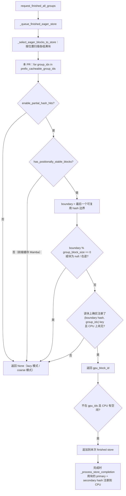
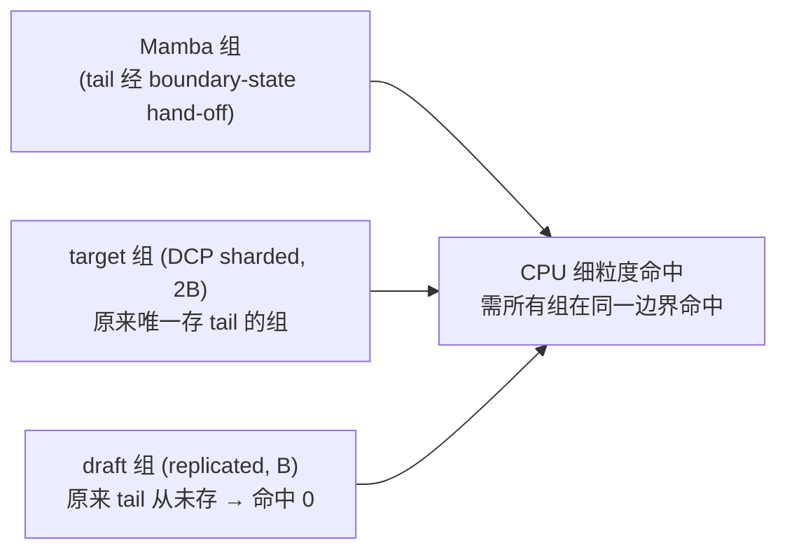

# PR #68836: [Bugfix][KV Offload] Offload the prompt tail of every attention group

> **Author**: @ChengYao-amd | **State**: OPEN | **Date**: 2026-11-20（2026-11-23 转为 ready for review）
> **Branch**: `k31/simple-cache-fix-a` → `main` | **Labels**: bug, kv-connector, nixl
> **Changes**: +182 -26 lines across 3 files | **ROCm 相关性**: 部分相关（平台无关的 SimpleCPU offload 调度器代码，无 ROCm 专属分支；动机与端到端验证来自 8x MI355X）
> 本报告分两部分：§1–6 为 PR 详细总结，§7–8 为 ROCm review 意见。

---

## 1. 总结 (Summary)

在细粒度前缀命中模式（fine-grained hit mode）下，CPU tier 要给出一个落在 attention block 内部的命中，需要**每个**可缓存 attention 组的 prompt-tail 块都已存到 CPU。`SimpleCPUOffloadScheduler._queue_finished_eager_store` 在请求结束时只为第一个 `FullAttentionManager` 组（`fa_gidx`）补存 tail 块，所以有两个及以上 attention 组的混合模型（典型如 DCP 下 sharded target 组 + replicated draft 组）CPU 命中恒为 0。本 PR 把 `_find_fa_partial_tail_source` 改为按组参数化的 `_find_partial_tail_source(request, block_ids, group_idx)`，并对 `prefix_cacheable_group_ids` 逐组调用。

## 2. 背景与动机 (Background & Motivation)

- 场景：Kimi-K3.1-Pro（KDA + MLA 混合）在 8x MI355X 上 TP8 + DCP8，带全注意力 DSpark draft，`--prefix-match-unit 64`，SimpleCPU eager offload。target attention 组块大小 = `1152 * 8 = 9216`，replicated draft 组块大小 = 1152，prompt 末尾通常同时落在两组的块内部。
- 现象：丢弃 GPU 前缀缓存后 host 命中为 0；本 PR 后 8k 请求 89.1%、100k 请求 90.0% `[unverified]`（PR 描述中的硬件实测/调度器级复现，无日志或脚本附件可溯源）。
- 关系：与 #68837（同作者，coarse 模式下的另一独立根因）互补；与 #67547（滑窗组细粒度命中）配合时，作者称 #67547 单独为 0%，加上本 PR 为 89.1%/90.0% `[unverified]`；#66234（已合入）重写了边界计算，本 PR 基于其上，保留 `get_reusable_prefix_length`。

## 3. 代码修改分析 (Code Change Analysis)

### 3.1 修改的模块

| 文件 | 改动 |
|------|------|
| `vllm/v1/simple_kv_offload/manager.py` (+39 -24) | `_queue_finished_eager_store` 对每个可缓存组找 tail；`_find_fa_partial_tail_source` → `_find_partial_tail_source(..., group_idx)`，用组自身块大小与组 id 生成 key，并跳过 `has_positionally_stable_blocks=False` 的组（前缀缓存 Mamba） |
| `tests/v1/simple_kv_offload/test_scheduler.py` (+136) | 新增 `_make_dcp_hybrid_engine` / `_run_engine_request`（真实 Scheduler + SimpleCPU）与 `test_dcp_hybrid_offloads_prompt_tail_of_every_attention_group` |
| `tests/v1/kv_connector/unit/utils.py` (+7 -2) | `create_scheduler` 新增 `scheduler_block_size` 参数（默认不变） |

### 3.2 架构 / 流程图





### 3.3 关键实现细节

- 每组 tail 定位：`block_idx = boundary // group_block_sizes[g]`，key = `make_block_hash_with_group_id(request.block_hashes[boundary/hash - 1], g)`，与 `BlockPool._get_partial_block_hash` 的定义一致（同样取 `block_hashes[num_hash_blocks - 1]`）`[已验证]`。
- "只在 key 真正注册在该块上时才复制"：检查 `gpu_block.block_hash` 或 `cached_block_hashes_by_block`。`BlockPool._insert_block_hash` 保证只有在已有 primary hash 时才会有 secondary hash，所以 `_process_store_completion` 中 `assert primary_hash is not None` 不会因 tail 只挂了 secondary key 而触发 `[已验证]`。
- GPU block pool 跨组共享、block id 全局唯一，所以 `partial_tail not in gpu_ids` 的去重在多组下仍成立 `[已验证]`。
- `fa_gidx` / `fa_block_size` 保留（构造断言 + 现有测试引用），但已不再被该路径使用。

## 4. 涉及的技术原理 (Technical Principles)

- **细粒度前缀命中**：`partial_hash_hits_enabled` 只有在存在 Mamba 前缀缓存组、且其余可缓存组都支持细粒度查找（或块大小等于 hash 块）时才开启。命中可停在 attention block 内部的 hash 边界，此时 attention 组需要一个带 "partial key" 的 tail 块，Mamba 组需要该边界处的状态。
- **组合命中的 fixed-point 查找**：`HybridKVCacheCoordinator.find_longest_cache_hit` 在各组间迭代收缩命中长度；只要有一个组在该边界缺块，组合命中就会退到更短的边界，最终可能为 0。
- **SimpleCPU eager offload**：运行中按位置扫描满块存到 CPU；prompt-tail（块内边界）只在请求结束时一次性补存（`_queue_finished_eager_store`），前缀缓存 Mamba 组的状态走 boundary-state hand-off。
- **DCP 块大小**：sharded 组的有效块大小乘以 DCP 度，replicated draft 组不缩放，因此同一 prompt 末尾在两组里的块内偏移不同，两组都需要各自的 tail。

## 5. 评论区讨论亮点 (Discussion Highlights)

- 截至抓取时没有人工 review；Claude Code Review bot 因 fork PR 被禁用；已请求 ApostaC、ivanium、orozery、wzhao18 review。
- mergify 曾加 `needs-rebase`，作者 force-push 后移除；本次 `git merge-tree` 对当前 `upstream/main`（eff4de9be3）验证：无冲突（main 在此期间只改了 `manager.py` 的 CPU 块数推导，与本 PR 的 hunk 不重叠）。
- 作者描述完整：根因、改动、与 #68837/#67547/#66234 的关系、查重过程、输出一致性检查（logprob 偏差、GSM8K）。PR 声明使用了 AI 辅助（Claude Code）。

## 6. 风险与潜在问题 (Risk Analysis)

| 风险 | 严重程度 | 说明 |
|------|---------|------|
| 非混合模型行为变化 | Low | 无：细粒度模式要求 Mamba 前缀缓存组；纯 attention 模型 `enable_partial_hash_hits=False`，函数首行返回 `[已验证]` |
| 单 attention 组的混合模型 | Low | 逐组循环中非 FA 组都被过滤，结果与原 `fa_gidx` 路径一致 |
| CPU 预算紧张时只存部分组的 tail | Low | 见 §7 📝【设计】 |
| 与 #67547 合用时滑窗 tail 已出窗 | Low | 见 §7 📝【兼容性】（推测） |
| 跨 connector 影响 | 无 | 只改 SimpleCPU；NIXL / Mooncake / MoRIIO / UMBP / OffloadingConnector 不经过此代码 |
| 测试/CI | Medium | CI 未运行；端到端数字无法溯源 |

---

## 7. Review 意见 (Findings)

| 类型 | 🔴 | ⚠️ | 📝 |
|------|----|----|----|
| 设计 | — | — | 1 |
| 兼容性 | — | — | 1 |
| 可维护性 | — | — | 1 |
| 测试 | — | — | 1 |

ROCm 专项规则（aiter / mori / arch / dtype 等）对本 PR 不适用：改动是纯 Python 的 SimpleCPU offload 调度器逻辑，CUDA 与 ROCm 执行路径相同；以下按共享路径正确性、跨模型影响与卫生项检查。

---

**📝【设计】CPU 预算逐块检查，可能只存下部分组的 tail** `[已验证]`

- **问题**: `manager.py:1306-1321` 在循环里对每个组单独检查 `len(gpu_ids) < self.cpu_block_pool.get_num_free_blocks()`。CPU 空闲块不足时，可能存下 target 组的 tail 而存不下 draft 组的 tail。
- **影响**: 细粒度命中要求所有组在同一边界都有 tail，只存一部分时这些 CPU 块不会产生组合命中，却占用 CPU 块并发出 `BlockStored` 事件，直到被 LRU 驱逐。只在 CPU 池几乎满时出现，不影响正确性。
- **行动**: 建议作者先收集所有组的候选 tail，只有在 `len(gpu_ids) + len(candidates) <= free` 时才整体追加（CPU 上已有的组会被 `get_one_block` 预先过滤，不计入候选）；或者至少在注释里说明这是有意接受的取舍。

**📝【兼容性】与 #67547 合用时，已出窗的滑窗 tail 不走"从 GPU 缓存恢复"的路径** `[推测]`

- **问题**: `_select_eager_blocks_to_store` 对滑窗组 null 掉的块会用 `_cached_gpu_block(resolved_hashes, i, g)` 从 GPU free queue 中按 hash 找回仍然缓存着的块；而 `_find_partial_tail_source`（`manager.py:1378`）遇到 `gpu_block.is_null` 直接返回 `None`。#67547 合入并启用后，如果请求在结束前 decode 超过了滑窗长度，draft 组的 prompt-tail 块在 block table 里已被置 null，但带 partial key 的块可能仍在 GPU 前缀缓存中。
- **影响**: 这类请求的前缀在 CPU tier 上仍拿不到命中（只是退回到本 PR 之前的行为，不会出错）。本 PR 单独合入时，滑窗组处于 coarse 模式，函数首行就返回，不会遇到这种情况。
- **行动**: 建议 review 时追问作者：在 #67547 的滑窗场景下，是否需要对 null tail 用 `get_cached_block((boundary hash, group_idx))` 兜底恢复；可在 #67547 落地后的跟进 PR 里处理。

**📝【可维护性】`fa_gidx` / `fa_block_size` 已无运行时用途** `[已验证]`

- **问题**: 改动后 `manager.py:192-197, 224-225` 的 `fa_gidx` / `fa_block_size` 只剩构造期断言和测试引用（`test_simple_cpu_offload_connector.py:192`，`test_scheduler.py:3239/3240/3319/3344`）。构造断言仍要求至少有一个 `FullAttentionManager` 组，这一约束在 tail 逻辑泛化后已没有直接理由。
- **行动**: 建议作者在后续清理中把测试改为使用 `group_block_sizes[...]`，并删除这两个字段或注明其仅为兼容保留；不阻塞本 PR。

**📝【测试】CI 未运行；数字无法溯源；与 #68837 的 helper 重复** `[已验证]`

- **问题**: CI 未运行（无 `ready` label，pre-run-check 失败，pre-commit 与 Buildkite 均被跳过）。描述中的 89.1%/90.0% 命中率、0.18 s/1.42 s TTFT、GSM8K 99.17%/98.75% 来自作者本地 MI355X 环境，PR 中无日志或脚本，属于 `[unverified]`。两个 PR 基于同一 merge-base `2b55f82b08`，互不堆叠，以逐字相同的文本新增 `_make_dcp_hybrid_engine` / `_run_engine_request` / `create_scheduler(scheduler_block_size=...)`；`git merge-tree` 显示两 PR 互相合并、与当前 main 合并均无冲突。在本 PR 中 `draft_sliding_window=True` 分支没有调用方（只有 #68837 使用）。
- **行动**: 建议 maintainer 加 `ready` 或 `/ci run` 跑 `tests/v1/simple_kv_offload`；建议作者附上调度器级复现脚本以便溯源。

## 8. 结论 (Verdict)

**✅ LGTM**

修复点精确：把"只存第一个全注意力组的 tail"泛化为逐组处理，沿用了原有的全部筛选条件（最后一个 hash 边界、块内边界、非 null、不在途、key 真实注册、CPU 上尚无），对纯 attention 模型、单 attention 组的混合模型、lazy 模式和 coarse 模式都没有行为变化，也不影响其他 connector。剩下的都是可选的改进建议（预算整体检查、字段清理、#67547 场景的兜底）。

## 9. 英文 Review 评论 (Copy-Paste English Comments)

**C1** `vllm/v1/simple_kv_offload/manager.py:1306-1321` — 📝 nit

```text
Non-blocking: the CPU budget is checked per appended tail, so when the CPU pool is nearly full this can store the target group's tail but not the draft group's. A fine-grained CPU hit needs every group's tail at the same boundary, so a partial set occupies CPU blocks (and emits BlockStored events) without ever producing a hit. Consider collecting the candidate tails first and appending them only if all of them fit, or adding a short comment that this trade-off is intended.
```

**C2** `vllm/v1/simple_kv_offload/manager.py:1331-1336` — 📝 nit

```text
After this change `fa_gidx` / `fa_block_size` are no longer used at runtime; they only back the constructor assert and a few existing tests. Not blocking, but a follow-up could move those tests to `group_block_sizes[...]` and drop the fields, along with the assert that requires a full-attention group, which no longer has a direct reason to exist.
```

## 10. 英文总结评论 (Overall Review Summary)

```text
Thanks, this is a clean generalisation: the finish-time flush now finds the prompt-tail block for every prefix-cacheable group with the same filters as before (last hash boundary, inside a block, non-null, not in flight, key actually registered, not already on CPU). Pure-attention models, single-attention hybrids, lazy mode and coarse mode keep their current behaviour, and no other connector is affected. Optional follow-ups: check the CPU budget for all tails together so a partial set is not stored, and drop the now unused fa_gidx and fa_block_size fields. Looks good to me once CI is green.
```
