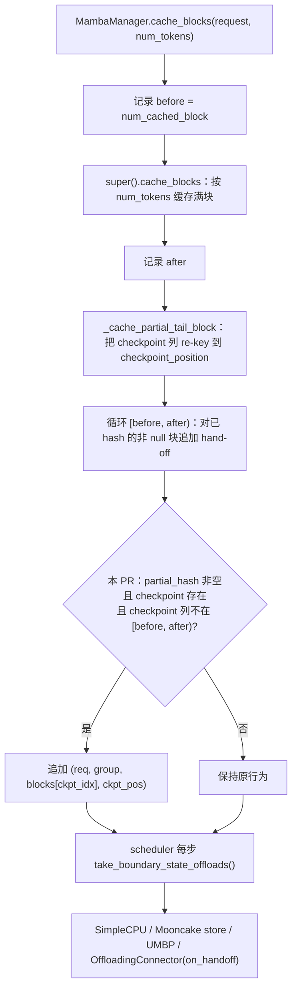
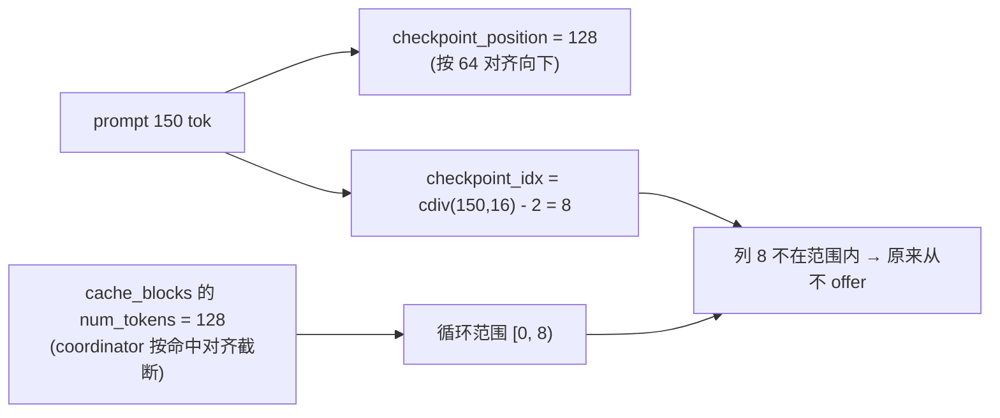

# PR #68837: [Bugfix][Mamba] Offer the coarse prompt-end checkpoint to KV connectors

> **Author**: @ChengYao-amd | **State**: OPEN | **Date**: 2026-11-20（2026-11-23 转为 ready for review）
> **Branch**: `k31/simple-cache-fix-b` → `main` | **Labels**: bug, kv-cache-manager, kv-connector, nixl
> **Changes**: +221 -2 lines across 4 files | **ROCm 相关性**: 部分相关（平台无关的调度器侧共享代码，无 ROCm 专属分支；动机与端到端验证来自 8x MI355X，且该 hand-off 的消费者之一是 AMD 的 UMBP connector）
> 本报告分两部分：§1–6 为 PR 详细总结，§7–8 为 ROCm review 意见。

---

## 1. 总结 (Summary)

当前缀缓存命中的对齐粒度（scheduler block）粗于 Mamba block 时（"coarse hit mode"），Mamba 在 prompt 末尾导出的 checkpoint 状态会被 GPU 前缀缓存 key 住，但不会通过 boundary-state hand-off 交给 KV connector —— 除非某个 prefill chunk 恰好结束在该边界上。结果是 offload 出去的前缀只有 attention block、没有 Mamba 状态，connector 侧查找返回 0。本 PR 在 `MambaManager.cache_blocks` 末尾加一个分支：若本步 `_cache_partial_tail_block` 刚 key 住了 checkpoint 列，且该列不在既有循环覆盖的 `[num_cached_blocks_before, num_cached_blocks_after)` 范围内，则把 `(req, group, checkpoint block, checkpoint position)` 追加到 `_pending_boundary_state_offloads`。

## 2. 背景与动机 (Background & Motivation)

- 场景：Kimi-K3.1-Pro（KDA 线性注意力 + MLA 全注意力的混合模型）在 8x MI355X 上 TP8 + DCP8，带 DSpark draft（滑窗版），`--prefix-match-unit 64`，SimpleCPUOffloadConnector eager offload。滑窗 draft 组不支持细粒度查找，于是整个 coordinator 退回 coarse 模式（命中对齐到 scheduler block = 9,216 token）。
- 现象：作者报告 100k 请求、90,112-token 共享前缀下 host 命中率 10.4%（16 个前缀中仅 2 个命中），而 GPU 前缀缓存可服务 11–12 个 `[unverified]`（数字来自 PR 描述中的硬件实测与调度器级复现，无日志/脚本附件可溯源）。
- 关系：与 #68836（同作者，细粒度模式下的另一个独立根因）互补；与 #67547（滑窗组细粒度命中，opt-in）合入并启用后，滑窗 draft 场景会切到细粒度模式，不再走本分支；与 #62479 改同一循环，作者称两者互补但会文本冲突。
- 相关 issue：#69024（lzbaclz 引用，"从 CPU tier 加载 prompt-tail checkpoint 后该 chunk 剩余部分不再被存储"）是另一个未解决的相邻问题，本 PR 不处理。

## 3. 代码修改分析 (Code Change Analysis)

### 3.1 修改的模块

| 文件 | 改动 |
|------|------|
| `vllm/v1/core/single_type_kv_cache_manager.py` (+18) | `MambaManager.cache_blocks`：`partial_hash` 先初始化为 `None`；循环后新增"checkpoint 列在范围外则补发 hand-off"分支 |
| `tests/v1/core/prefix_cache/test_partial_prefix_cache_hits.py` (+56) | 新增 coarse 模式 manager 构造器；正例（单 chunk 150 token，offer `(1, col8, 128)` 且只 offer 一次）、反例（sparse retention 下的瞬态 checkpoint 不 offer） |
| `tests/v1/simple_kv_offload/test_scheduler.py` (+140) | 新增 `_make_dcp_hybrid_engine` / `_run_engine_request`（真实 Scheduler + SimpleCPU，CPU 上跑）与 `test_dcp_hybrid_coarse_prompt_checkpoint_reaches_cpu[80/256]` |
| `tests/v1/kv_connector/unit/utils.py` (+7 -2) | `create_scheduler` 新增 `scheduler_block_size` 参数（默认仍为 `cache_config.block_size`） |

### 3.2 架构 / 流程图



coarse 模式下的几何关系（PR 单测参数：Mamba block 16，hash block 16，命中对齐 64，prompt 150 token 单 chunk）：



### 3.3 关键实现细节

- 新分支只在 `_cache_partial_tail_block` 返回非空 hash 时触发。该函数在 checkpoint 存在时：瞬态 checkpoint（既非 prompt 边界、也不被 retention 保留、也不是 shared-prefix 边界）会被 `_maybe_evict_cached_block` 驱逐并返回 `None`；若列已以相同 token 数 key 过也返回 `None`。因此"只 offer 一次、瞬态不 offer"由既有逻辑保证，新代码没有额外状态 `[已验证]`。
- checkpoint 列为 null 时 `cache_partial_block` 返回 `None`，所以新分支读到的 `req_to_blocks[...][checkpoint[1]]` 一定非 null `[已验证]`。
- 细粒度模式下 `num_tokens` 对齐到 hash block，`after = num_tokens // block_size` 会覆盖 `cdiv(query_end, bs) - 2`，checkpoint 列落在循环范围内，新分支不触发 —— 与作者 "fine-grained 模式行为不变" 的说法一致（推导自代码，未运行验证）。
- 非混合模型：`_pending_boundary_state_offloads` 只有 `MambaManager`（且 `prefix_caching=True`）会写入；纯 attention / SWA 模型完全不经过此路径 `[已验证]`。

## 4. 涉及的技术原理 (Technical Principles)

- **Mamba 前缀缓存与 checkpoint 列**：Mamba 每个 block 只保存一个"在该 block 末尾"的递归状态。为了在不对齐的 chunk 结尾也能留下可复用状态，调度器在 chunk 结尾预留一个 checkpoint 列（`cdiv(query_end, bs) - 2`），worker 把对齐边界处的状态导出到该列，随后 `_cache_partial_tail_block` 用 `replace_existing_hashes=True` 把它 re-key 到该边界的 hash。
- **coarse vs fine-grained 命中模式**：`partial_hash_hits_enabled` 要求存在 Mamba 前缀缓存组，且其他可缓存组都支持细粒度查找（或块大小等于 hash 块）。滑窗组、chunked local 等不支持时退回 coarse，命中对齐到 scheduler block（各组块大小的 LCM）。
- **boundary-state hand-off**：Mamba block table 不是 append-only（内部状态会被置 null、speculative 块原地搬迁），connector 不能按位置解析，所以核心以 `(group, block_id, boundary_tokens)` 精确交付，scheduler 每步 `take_boundary_state_offloads()` 全部取走，connector 需要自行 pin。
- **DCP（decode context parallel）**：target attention 组按 `block_size * dcp` 分片，replicated draft 组不缩放；两组块大小不同，是 Kimi-K3.1 场景下 LCM 很大（9,216）的直接原因。

## 5. 评论区讨论亮点 (Discussion Highlights)

- 截至抓取时没有人工 review；Claude Code Review bot 因 fork PR 被禁用。13 位 code owner 已被请求 review，均未回复。
- mergify 曾两次加 `needs-rebase`，作者 force-push 后已移除；本次用 `git merge-tree` 对当前 `upstream/main`（eff4de9be3）验证：无冲突。
- 作者在描述中主动列出了与 #68836、#67547、#62479 的关系和查重过程，描述质量高、根因解释充分（WHY 而非 WHAT）。PR 声明使用了 AI 辅助（Claude Code）。

## 6. 风险与潜在问题 (Risk Analysis)

| 风险 | 严重程度 | 说明 |
|------|---------|------|
| 新分支作用范围大于标题与注释 | Medium | 见 §7 ⚠️【测试】；dense retention 下 coarse 模式的中途 checkpoint 也会被 offer，无测试覆盖 |
| 读取 checkpoint 块的时序安全 | Low | 与循环内既有 offer 同一保证（keyed 列不会被后续 chunk 复写，connector 自行 pin），已核对代码 |
| 跨 connector 兼容 | Low | 四个消费者均按精确 block_id 处理；NIXL / MoRIIO 不消费该 hand-off，见 §7 📝 |
| 非混合模型行为变化 | Low | 无，路径仅限 Mamba + prefix caching |
| 测试/CI | Medium | CI 未运行（无 `ready` label）；端到端数字无法溯源 |
| 与 #62479 文本冲突 | Low | 作者自述，未单独验证 |

---

## 7. Review 意见 (Findings)

| 类型 | 🔴 | ⚠️ | 📝 |
|------|----|----|----|
| 测试 | — | 1 | 1 |
| 兼容性 | — | — | 1 |
| 可维护性 | — | — | 1 |

ROCm 专项规则（aiter / mori / arch / dtype 等）对本 PR 不适用：改动是纯 Python 的调度器侧 KV cache 管理逻辑，在 CUDA 与 ROCm 上执行路径完全相同；以下按共享路径的正确性与跨 connector 影响检查。

---

**⚠️【测试】新分支会 offer 任何"本步刚 key 住且在循环范围外"的 checkpoint，而不只是 prompt 末尾的那个；dense retention 的多 chunk 场景无测试** `[已验证]`

- **问题**: `single_type_kv_cache_manager.py:2527-2543` 的条件只有 `partial_hash is not None`、`checkpoint is not None`、列不在 `[before, after)`。而 `_cache_partial_tail_block` 在三种情况下都会 key 住 checkpoint 并返回 hash：prompt 末尾边界、被 retention 保留的中途边界（`retention_interval=None` 即 dense retention 时 `reachable_block_mask` 返回 `None` → 视为保留）、`request.shared_prefix_boundary`。coarse 模式下 `checkpoint_position` 按 scheduler block 对齐，必然是 Mamba block 的整数倍，所以 dense retention 下每个 prefill chunk 结尾的 checkpoint（例如 400-token prompt 的第一个 chunk `[0,150)`，checkpoint 128 落在列 8，而 `num_tokens=128` 只覆盖 `[0,8)`）现在都会被 offer。PR 标题、claims 和代码注释都只说 "prompt-end checkpoint"；单测正例只覆盖单 chunk 的最终 checkpoint，反例只覆盖 sparse retention（256）。
- **影响**: 行为本身与 hand-off 的既有约定一致（GPU 也 key 了这些块，循环本就 "offer every retained boundary"），不是数据错误；但它让 coarse 模式 + dense retention 的部署多出每个 chunk 一次的 connector 存储（SimpleCPU 的 CPU 块、Mooncake/UMBP 的远端 put），这部分新行为没有任何测试锁定，将来有人按注释理解为"只有 prompt-end"去收窄条件时也不会有测试报警。
- **行动**: 建议作者二选一：(a) 认可这一更宽的语义，把注释/描述改成"任何本步 key 住、但落在循环范围外的 checkpoint"，并补一个 `retention_interval=None`、两段 chunk 的 coarse 单测，断言中途 checkpoint 与末尾 checkpoint 各 offer 一次；(b) 若只想 offer prompt-end，则在条件里加上 `checkpoint[0] == get_reusable_prefix_length(request.num_prompt_tokens, ...)` 的判断。

**📝【兼容性】跨 connector 影响核对结果：无需额外适配** `[已验证]`

- **问题**: `KVCacheManager.take_boundary_state_offloads()` 的消费者只有四个：SimpleCPU（`simple_kv_offload/manager.py`，用块自身的 hash 注册，忽略 `boundary_tokens`）、Mooncake store（`_handle_boundary_state_offloads`，按 `block_id` 精确 put，用 `boundary_tokens` 做 `max_offload_tokens`/prefill-end 过滤）、UMBP（`_add_boundary_state_plans`，`hash_index = boundary_tokens // hash_block_size - 1`，对 128 正好对应 checkpoint 的 key）、OffloadingConnector 的 `on_handoff` 触发器（物理块用 `block_id`，`block_indices = boundary // tokens_per_block - 1` 只是逻辑偏移，且 coarse 边界满足 `tokens_per_chunk` 对齐）。NIXL 与 MoRIIO 不读取该 hand-off，不受影响。新条目的形状、key 推导与循环内条目完全一致。
- **行动**: 无需改动；建议作者在描述的 "Other consumers" 中补一句 NIXL / MoRIIO 不消费该 hand-off，方便 reviewer。

**📝【测试】CI 未运行；端到端数字无法溯源** `[已验证]`

- **问题**: CI 未运行（无 `ready` label，pre-run-check 失败，pre-commit 与 Buildkite 均被跳过）。描述中的 10.4% → 57.0%/62.2%、TTFT 2.4 s vs 13.4 s、GSM8K 97.35% 等数字来自作者本地 MI355X 实测与调度器级复现，PR 中没有日志或复现脚本，属于 `[unverified]`。单测"main 失败、本 PR 通过"的说法与新测试的断言一致，可由 CI 复核。
- **行动**: 建议 maintainer 加 `ready` 或 `/ci run` 跑 `tests/v1/core` 与 `tests/v1/simple_kv_offload`；建议作者附上调度器级复现脚本（或 gist）以便溯源表中数字。

**📝【可维护性】与 #68836 共享 ~120 行测试 helper；文本冲突检查** `[已验证]`

- **问题**: 两个 PR 都基于同一 merge-base `2b55f82b08`，互不堆叠（sibling），并以逐字相同的文本新增 `_make_dcp_hybrid_engine`、`_run_engine_request` 与 `create_scheduler(scheduler_block_size=...)`。`git merge-tree` 结果：本 PR 与当前 `upstream/main` 无冲突；本 PR 与 #68836 互相合并无冲突（相同 hunk 被 git 去重，只多出各自的测试函数）。`_make_dcp_hybrid_engine(draft_sliding_window=...)` 的 `True` 分支只有本 PR 使用。与 #62479 的冲突为作者自述，未验证。
- **行动**: 无需动作；建议 review 时按任意顺序合入，第二个 rebase 即可。

## 8. 结论 (Verdict)

**⚠️ NEEDS WORK**（轻度）

根因分析准确，修复点小而精确：只在既有循环漏掉 checkpoint 列时补发一条形状完全相同的 hand-off，复用了 GPU 前缀缓存已依赖的"keyed 列不被复写"保证，对非混合模型和细粒度模式没有影响，四个消费者都能正确处理。唯一需要补的是新分支的真实作用范围（dense retention 的中途 checkpoint、shared-prefix 边界）要么在注释与测试中写明并锁定，要么在条件里收窄到 prompt-end。

## 9. 英文 Review 评论 (Copy-Paste English Comments)

**C1** `vllm/v1/core/single_type_kv_cache_manager.py:2527-2543` — ⚠️ comment

```text
This branch offers any checkpoint that `_cache_partial_tail_block` keyed this step outside `[before, after)`, not only the prompt-end one. In coarse mode `checkpoint_position` is scheduler-block aligned, so under dense retention (`retention_interval=None`) every intermediate chunk's checkpoint is retained, keyed, and now offered too (e.g. chunk [0, 150) of a 400-token prompt offers state@128 from column 8). The shared-prefix junction checkpoint takes the same path. That matches the hand-off contract, but the title, comment and tests only describe the prompt-end case. Could you either update the comment and add a two-chunk dense-retention test that pins this behaviour, or restrict the condition to the prompt's reusable boundary if that is the intent?
```

**C2** `tests/v1/core/prefix_cache/test_partial_prefix_cache_hits.py:879-898` — ⚠️ comment

```text
The positive test covers one final chunk and the negative test covers sparse retention only. Consider adding a coarse-mode case with `retention_interval=None` and two prefill chunks, asserting that both the intermediate and the prompt-end checkpoints are offered exactly once. That is the path the new branch also opens, and today nothing fails if it regresses.
```

## 10. 英文总结评论 (Overall Review Summary)

```text
Thanks, the root cause is well explained and the fix is minimal: when hits align coarser than the Mamba block, the keyed checkpoint column falls outside the loop range and is now handed off with the same exact-block entry the loop uses. Non-hybrid models and fine-grained mode are unaffected, and the SimpleCPU, Mooncake store, UMBP and offloading consumers handle the new entry correctly. One ask: the branch also offers intermediate checkpoints under dense retention and the shared-prefix junction, so please document that and add a two-chunk test, or narrow the condition to the prompt end. Approve after that.
```
