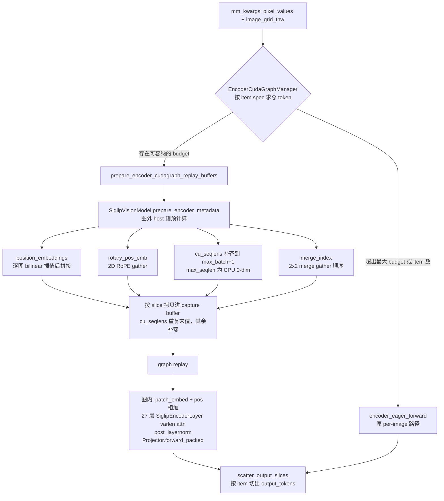
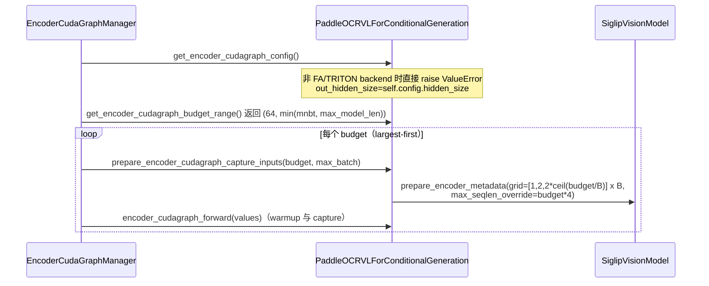

# PR #44394: [MM][Perf] Add PaddleOCR-VL encoder CUDA graph support

> **Author**: @harsha20032020 | **State**: OPEN | **Date**: 2026-06-03（最后一次 push：2026-10-14）
> **Branch**: `paddleocr-vl-encoder-cudagraph` → `main` | **Labels**: documentation, unstale, multi-modality, nvidia, verified
> **Changes**: +513 -62 lines across 5 files | **ViT CG 相关性**: 完全相关 | **类型**: 模型集成
> 本报告分两部分：§1–6 为 PR 详细总结，§7–8 为 ViT CUDA graph review 意见（对照 vllm main `632ba4f`）。

---

## 1. 总结 (Summary)

本 PR 让 `PaddleOCRVLForConditionalGeneration` 实现 `SupportsEncoderCudaGraph` 协议，把 SigLIP 视觉塔加 2×2 merge projector（`mlp_AR`）整体放进 encoder CUDA graph（仅图片）。做法是把四处依赖输入形状的计算挪到图外：位置编码插值、2D RoPE、`cu_seqlens`/`max_seqlen`，以及 projector 的 `rearrange`（改成预计算的 `merge_index` gather）。这些都由新增的 `SiglipVisionModel.prepare_encoder_metadata()` 在 host 侧预算好。图内实现与 eager 数值等价，有 tiny 随机塔的 parity 单测佐证。不过这版 PR 落后 main 约 6 周，rebase 后有一处必崩的配置读取；描述里的性能数字由 `vllm bench latency` 测得，这个命令不发送任何图片，所以数字没有测到 encoder。

## 2. 背景与动机 (Background & Motivation)

- 属于 [#38175](https://github.com/vllm-project/vllm/issues/38175)（ViT Full CUDA Graph tracker）的模型集成项，作者在 tracker 评论区认领了 PaddleOCR-VL。照抄的是 Qwen2-VL（#41736）、Kimi-VL（#41992）、Step3-VL（#42224）的集成模式。
- 动机：ViT 前向（27 层 SigLIP + projector）包含大量小 kernel，eager 时 host 端 launch 开销显著，capture 成 graph 后可以按 budget 整体 replay。
- 时间线：2026-06-03 开 PR → 冲突、stale → 2026-10-14 rebase 并按 #61458 等改动重写（squash 成单个 commit `94987a7`）→ 2026-10-16 @shen-shanshan 指出 TTFT 数字没有测到 encoder，请作者用 `vllm bench mm-processor` / `random-mm` 重测。**此后再没有新 push，这个意见尚未处理。**
- 描述声称的结果：A10G、batch=8、896×896、`output-len=1` 下 TTFT 降低约 6%（11.93→11.23 ms）。`[unverified]`，见 §7。

## 3. 代码修改分析 (Code Change Analysis)

### 3.1 修改的模块

| 文件 | 改动 |
|------|------|
| `vllm/model_executor/models/paddleocr_vl.py` (+315 −62) | `SiglipVisionEmbeddings` 抽出 `get_position_embeddings()`，eager 也改成向量化的一次相加。`SiglipEncoder` 抽出 `rot_pos_emb()` / `compute_max_seqlen()`，`forward` 新增可选参数 `rotary_pos_emb` / `max_seqlen`。`SiglipVisionTransformer`/`SiglipVisionModel.forward` 新增 `encoder_metadata`。新增 `SiglipVisionModel.prepare_encoder_metadata()`、`Projector.forward_packed()`、模块常量 `_MAX_SEQLEN_ATTN_BACKENDS`，以及协议的 8 个方法 |
| `tests/model_executor/test_paddleocr_vl_cudagraph.py`（新增 172 行） | tiny 随机塔（fp32）parity：① graph forward 对比 eager，3 组多图 batch；② 真实 `torch.cuda.graph` capture 一次后，用两组不同 batch replay 对比 eager（TRITON_ATTN） |
| `tests/models/multimodal/generation/test_vit_cudagraph.py` (+24) | 新增 `paddleocr_vl` case：dummy 权重 + `dummy_hf_overrides`，budget `[4096]`，`core_model` |
| `docs/design/cuda_graphs_multimodal.md` (+1) | 支持表新增一行：Image ✅︎ / Video ❌︎ / Multi-Path ❌︎ |
| `examples/generate/multimodal/vision_language_offline.py` (+1) | `MODELS_SUPPORT_VIT_CUDA_GRAPH` 加入 `paddleocr_vl` |

### 3.2 架构 / 流程图





### 3.3 关键实现细节

- **图内范围**：patch embedding、位置编码相加、全部 encoder 层、post_layernorm，以及 projector（`pre_norm` → `merge_index` gather → `linear_1` → GELU → `linear_2`）。`merge_index` 复用 `kimi_k25_vit.build_image_merge_gather_idx`，生成的 `(p1 p2)` 顺序与 eager 的 `rearrange("(t h p1 w p2) d -> (t h w) (p1 p2 d)")` 一致（已核对）。这个函数要求 `t == 1`，与本 PR 只支持图片相符。
- **capture 形状**：每个 item 的 dummy 网格为 `[1, m, ceil(budget/B)·m]`，总 patch 数不少于 `budget·m²`。`max_seqlen_override = budget·m²` 在 capture 时固化（attention wrapper 对 CPU 张量调用 `.item()`），覆盖"一张图吃满整个 budget"的情况。写法与 main 上的 `Qwen2VLEncoderCudaGraphMixin` 和 Kimi-VL 一致。
- **replay padding**：`cu_seqlens` 依赖 main 默认的 cumulative 补齐（#65453，重复末值），其余 buffer 补零。补零的 `merge_index` 尾部 gather 第 0 行，得到的 padded 输出会被丢弃。PR 描述提到的 `_pad_paddleocr_cu_seqlens_buffer` 在当前代码里已经不存在。
- **backend 门控**：`_MAX_SEQLEN_ATTN_BACKENDS = {FLASH_ATTN, ROCM_AITER_FA, TRITON_ATTN}`，其他 backend 在 `get_encoder_cudagraph_config()` 里直接 `raise ValueError`。
- **eager 路径**：位置编码从逐图循环相加改成先拼接再相加；`interpolate_pos_encoding` 的第一个参数改为传 `position_embedding.weight`。该参数只用于取 `dim`，两者的 `dim` 相同，所以数值等价。

## 4. 涉及的技术原理 (Technical Principles)

**PaddleOCR-VL 视觉塔**：NaViT 风格的 SigLIP。图片经 `smart_resize`（factor 28，预处理配置里 `min_pixels=147384`、`max_pixels=2822400`）切成 14×14 patch，所有图的 patch 拼成一条变长序列，用 varlen attention 按 `cu_seqlens` 隔开。位置编码由 27×27 的 learned table bilinear 插值到每张图的 (h, w)，再叠加按 (h, w) 索引的 2D RoPE。最后 projector 做 2×2 空间合并：一张图的输出 token 数为 `h·w/4`，最少约 188（min_pixels），最多约 3600（max_pixels）。

**Budget 式 encoder CUDA graph**：main 上的 `EncoderCudaGraphManager` 按 token budget 网格（四分之一倍频程到 1024、128 步长到 2560、再 1/8 倍频程，默认上限 5120）largest-first 捕获，各 budget 共享前缀 buffer。每个 batch 只 replay 能容纳它的最小 budget；超过最大 budget 或 item 数超过 `max_batch_size` 时整体走 eager。graph 只省掉 host launch 时间：只有 eager 处于 launch-bound（小图、少图）时 graph 才有收益，GPU-bound 时 padding 反而会拖慢。

**为什么要把形状相关的计算挪到图外**：capture 时 Python 层的循环、`.tolist()`、`pids.max()` 这类 host 同步会被固化或者直接导致失败。所以逐图插值、RoPE 索引、`cu_seqlens` 的构建都要在 `prepare_encoder_cudagraph_replay_buffers` 里先算好，再拷进固定地址的 buffer。图内只做形状固定的运算（相加、`index_select`、varlen attention）。

**max_seqlen 固化**：FA/TRITON varlen kernel 以 `max_seqlen` 决定 grid 规模。capture 时取 `budget·m²` 保证正确；代价是小 batch replay 时会有大量早退的 CTA，属于已知取舍，main 的 mixin 与 Kimi-VL 也这样做。

## 5. 评论区讨论亮点 (Discussion Highlights)

- **@shen-shanshan（2026-09-17）**：请作者 rebase 到最新 main 并解决冲突。作者 10-14 rebase 过一次，但 main 此后又改了 `paddleocr_vl.py`、设计文档、`test_vit_cudagraph.py`，**当前又有 4 处冲突**（见 §7）。
- **@shen-shanshan（2026-10-16）**：`vllm bench latency` 只构造随机 token 的 `TokensPrompt`，不会发送图片；`--limit-mm-per-prompt` 只影响显存 profiling。所以约 6% 的差异是噪声或 capture 的副作用，与 ViT graph 无关。她请作者用 `vllm bench mm-processor --dataset-name random-mm`（896×896 bucket）重测 encoder 时间与 TTFT。**尚未处理**：作者 10-14 的评论说"didn't rerun the TTFT benchmarks"，之后没有新 push，描述里仍是旧数字。
- 作者希望有 FA2/FA3 GPU 的人帮忙验证（作者本人只有 T4）。@littlecircle0730 在 tracker 里答应帮忙，PR 内没有后续结果。

## 6. 风险与潜在问题 (Risk Analysis)

| 风险 | 严重程度 | 说明 |
|------|---------|------|
| rebase 后 `self.config.hidden_size` 不存在 | High | 开启 `cudagraph_mm_encoder` 时 manager 初始化直接 AttributeError，见「rebase 后 out_hidden_size 读取必然失败」 |
| 性能收益未经验证 | High | 唯一的数字没有测到 encoder；OCR 场景以大图为主，可能落在 GPU-bound 区间，graph 无收益甚至变慢 |
| 落后 main、4 处冲突 | Medium | 需要与 torch.compile encoder（#61838）、Transformers 文本后端迁移（#69087）、共享 buffer 和新 budget 网格（#65084/#65227）重新对齐 |
| 不支持的 backend 直接报错 | Medium | 在 pre-SM80（T4/V100，默认 TORCH_SDPA）上开启 CG 会启动失败，与描述"自动回退"不符 |
| parity 单测在 CUDA CI 不运行 | Medium | `tests/model_executor` 的 CUDA 步骤在 main 上被注释掉了 |
| min budget 低于真实最小图 | Low | 多捕获若干永远命中不了的 graph，`max_batch_size` 被放大 |
| 精度 | Low | parity 只在 fp32 tiny 随机塔上做过，缺 bf16 真实权重的输出对比 / OCR 精度 |

---

## 7. Review 意见 (Findings)

对照 `upstream/main` `632ba4f`（2026-11-26）。PR head `94987a7`，merge-base `3a5a6b1`（2026-10-14）。

**集成清单**

| 项 | 状态 | 说明 |
|---|---|---|
| 协议实现（与 main 签名一致） | ✅ | 8 个方法签名与 main 一致，`path`/`axis_keys` 齐全；没有使用已删除的接口 |
| capture / replay / eager 一致性 | ✅ | 插值、RoPE、merge 顺序均已核对等价；parity 单测覆盖真实 capture + 不同 batch replay |
| 文档支持表 | ⚠️ | 已加行，但与 main 冲突；按字母序应在 `Mistral3`/`Pixtral` 之间 |
| example 注册 | ✅ | 已加入 `MODELS_SUPPORT_VIT_CUDA_GRAPH` |
| `test_vit_cudagraph.py` | ⚠️ | 已加入（dummy 权重，满足 CI 资源要求），但与 main 冲突 |
| 单测 | ⚠️ | 有，但放在 CUDA CI 不跑的目录 |
| benchmark | ❌ | 数字没有测到 encoder |
| 精度 | ❌ | 无真实权重输出对比 / OCR 精度 |

**意见汇总**

| 意见类型 | 🔴 | ⚠️ | 📝 |
|---|---|---|---|
| 正确性 / 兼容性 | 1 | 1 | 0 |
| 性能 | 1 | 1 | 0 |
| 接口同步 | 0 | 1 | 0 |
| 测试 | 0 | 2 | 0 |
| 可维护性 | 0 | 0 | 1 |

### 🔴 必须修复

**🔴【兼容性】rebase 后 `out_hidden_size=self.config.hidden_size` 读取必然失败** `[已验证]`
- **问题**：`paddleocr_vl.py:1291` 用 `self.config.hidden_size` 作为 `out_hidden_size`。这在 PR 的 base 上能工作，因为当时 `__init__` 里有 `config.update(text_config)`，会把文本配置平铺到顶层。但 main 的 `d9bfe86`（#69087，ERNIE 4.5 迁移到 Transformers 后端）删掉了这段平铺，projector 也改成 `Projector(config.text_config, …)`。我用 transformers 5.24.1 的 `PaddleOCRVLConfig.from_dict()` 加载 hub 上的 `PaddlePaddle/PaddleOCR-VL/config.json`，结果是顶层**没有** `hidden_size`，只有 `text_config.hidden_size=1024`。这一行是 PR 新增的，rebase 时不会冲突，因此会悄悄保留下来。
- **影响**：rebase 到 main 后，只要设置 `--compilation-config '{"cudagraph_mm_encoder": true}'`，`EncoderCudaGraphManager.__init__` 调用 `get_encoder_cudagraph_config()` 就会抛 `AttributeError`，引擎启动失败。新增的 `test_vit_cudagraph[paddleocr_vl]` 也会挂。
- **行动**：作者应当改为 `self.config.text_config.hidden_size`（等于 `mlp_AR.linear_2` 的输出维度，与 main 上 LFM3-VL 的写法一致），rebase 后重跑 e2e case。

**🔴【性能】PR 以性能为卖点，但唯一的性能数字没有测到 encoder；maintainer 的意见尚未处理** `[已验证]`
- **问题**：描述中 TTFT 降低约 6% 的数字来自 `vllm bench latency`。查 main 的 `vllm/benchmarks/latency.py:104-109`，它只用 `np.random.randint` 构造 `TokensPrompt`，不会把任何图片送进 encoder。@shen-shanshan 在 10-16 指出了这一点并给了重测命令，PR 此后没有更新。另外，OCR 是 PaddleOCR-VL 的主场景，文档页通常接近 `max_pixels`（每张图约 3600 token），这类输入大概率是 GPU-bound，graph 无收益，padding 到下一档 budget 还可能变慢（#63074 dots.ocr 实测文档页只有 eager 的 0.56–0.61×）。
- **影响**：目前没有任何证据表明这个 PR 带来了收益，也不知道哪些输入尺寸下开启 graph 会变慢，无法给用户可信的使用建议。
- **行动**：作者应当用 `vllm bench mm-processor --dataset-name random-mm --random-mm-bucket-config '{(896, 896, 1): 1.0}' --random-mm-limit-mm-per-prompt '{"image": 1, "video": 0}'` 对比 graph on/off 的 encoder 延迟，至少覆盖三档：小图（接近 min_pixels）、896×896、接近 max_pixels 的文档页；最好再补一组多图 batch，并写明 GPU、attention backend、budget 配置。如果大图变慢，应在描述或文档里说明。

### ⚠️ 建议修复

**⚠️【接口同步】落后 main，有 4 处冲突，且 main 上该文件有需要重新对齐的语义变化** `[已验证]`
- **问题**：用 `git merge-tree` 对 `upstream/main` 做三方合并，冲突在 `docs/design/cuda_graphs_multimodal.md`（Mistral3/Pixtral 行）、`test_vit_cudagraph.py`（2 处，LFM3-VL 的 helper 与 case）、`paddleocr_vl.py`。merge-base 之后，main 上与本 PR 相关的改动有：#61838 给 `SiglipEncoderLayer` 加了 `@support_torch_compile`（`dynamic_arg_dims` 包含 `rotary_pos_emb`、`cu_seqlens`）；#69087 迁移了文本后端（即上面的 🔴）；#65084/#65227 引入共享前缀 buffer 和新的 budget 网格；#65453 让 `cu_seqlens` 默认重复末值；#60112 在 replay 超出 capture 时回退 eager；#65761 按 budget 限制帧槽数。描述里仍然写着已删除的 `_pad_paddleocr_cu_seqlens_buffer`，还称协议由 #42224 引入（实际来自 #35963）。
- **影响**：不 rebase 无法合入。torch.compile 编译过的 encoder layer 与 graph capture 的组合在本 PR 中从未测过（`compile_mm_encoder` 开启时）。
- **行动**：作者应当 rebase 到最新 main，在 `compile_mm_encoder` 开和关两种情况下重跑两个 parity 单测与 e2e case，并同步更新 PR 描述（删除已不存在的 helper，修正 backend 回退的说法）。

**⚠️【兼容性】不支持的 attention backend 直接 `raise ValueError`，与描述和 main 的先例不一致** `[已验证]`
- **问题**：`paddleocr_vl.py:1268-1280` 遇到非 `FLASH_ATTN/ROCM_AITER_FA/TRITON_ATTN` 的 backend 时直接抛错。PR 描述却写的是"returns empty `modalities` … falls back to eager transparently"。main 上 LFM3-VL 的 `get_encoder_cudagraph_config` 在 backend 不安全时返回 `modalities=[]`，manager 会记录日志并跳过 capture。此外，`_MAX_SEQLEN_ATTN_BACKENDS` 和 `SiglipEncoder.compute_max_seqlen` 重复实现了 main 已有的 `MMEncoderAttention.compute_max_seqlen(attn_backend, cu_seqlens)`。后者还支持 FLASHINFER，配合 `get_cu_seqlens_padding_logics` / `maybe_compute_seq_lens` 使用，Qwen 系与 LFM3 都借此支持了 FLASHINFER graph。
- **影响**：触发条件是 T4/V100 这类 pre-SM80 GPU（默认 TORCH_SDPA，也是作者自己的测试卡）加 `cudagraph_mm_encoder=true`，结果是引擎启动失败，而不是像描述说的那样回退到 eager。另外，模型里多了一套 backend 判断逻辑，以后会和 `MMEncoderAttention` 的实现脱节。
- **行动**：建议作者改为返回 `modalities=[]`（可加一条 warning），并复用 `MMEncoderAttention` 的 helper 计算 `max_seqlen`。如果暂不支持 FLASHINFER，在文档 note 里写明。

**⚠️【性能】`min_budget=64` 低于真实最小图，与默认值重复且没有推导依据** `[已验证]`
- **问题**：`paddleocr_vl.py:1294-1304` 返回 `(64, min(max_num_batched_tokens, max_model_len))`，与协议默认实现完全相同，注释只写了"64 is a safe floor"。hub 上 `preprocessor_config.json` 的 `min_pixels=147384`，对应每张图至少约 `147384 / 28² ≈ 188` 个输出 token。
- **影响**：64–176 之间的 budget 档位永远不会被命中，白白增加 capture 时间和 graph 数量。自动推断的 `max_batch_size = max_budget // min_budget` 也被放大约 3 倍，使 `cu_seqlens` 长度、capture 的 dummy item 数和每次 replay 的 varlen batch 规模都相应变大。
- **行动**：建议作者用处理器的 `min_pixels // (patch_size·merge_size)²` 推导 min budget 并写注释（参照 Step3-VL / DeepSeek-OCR 的做法）。如果坚持用 64，就删掉这个方法，直接用协议默认值。

**⚠️【测试】parity 单测放在 CUDA CI 不运行的目录** `[已验证]`
- **问题**：新单测放在 `tests/model_executor/test_paddleocr_vl_cudagraph.py`。main 的 `.buildkite/test_areas/model_executor.yaml` 中 CUDA 的 "Model Executor" 步骤当前被注释掉了，只剩 AMD MI300 镜像步骤在跑。main 上模型级的 encoder graph 单测（`TestDeepseekVL2CudaGraph`、`TestKimiVLCaptureMaxSeqlen`、`TestQwen2VLEncoderCudaGraphMixin`）都放在 `tests/v1/cudagraph/test_encoder_cudagraph.py`。另外，单测里的 `copy_replay_into_capture_buffers` 自己实现了一遍拷贝逻辑，没有走 manager 的 `_get_padding_logic`（cumulative 补齐），与真实 replay 路径有出入。
- **影响**：这是本 PR 唯一真正验证"capture 后用不同 batch replay 结果仍等于 eager"的测试，但在 NVIDIA CI 上不会运行，以后接口变化导致的回归会漏检。
- **行动**：建议作者把测试移到 `tests/v1/cudagraph/test_encoder_cudagraph.py`（或确认会被某个 CUDA 步骤收集到），并直接调用 manager 的 padding 逻辑，或构造一个真实的 `EncoderCudaGraphManager` 来驱动 replay。

**⚠️【测试】缺真实权重的精度证据** `[推测]`
- **问题**：数值等价只在 fp32、2 层、hidden=64 的随机塔上验证过（atol 1e-4）。e2e case 使用 dummy 权重，只能证明流程跑得通。bf16 真实权重下，图内的一次性向量化相加与 eager 的逐图相加在累加顺序上可能有差异，目前没有任何输出对比或 OCR 精度数据。
- **影响**：OCR 对逐字符输出很敏感，如果有微小的数值漂移，单测发现不了。
- **行动**：建议作者用真实 checkpoint 跑 `python examples/generate/multimodal/vision_language_offline.py -m paddleocr_vl --modality image`，开与不开 `--enable-vit-cuda-graph` 各跑一次并对比输出；可以的话再补一个 OCR 基准（如 OmniDocBench 子集）在 graph 开与不开下的对比。

### 📝 建议/备注

**📝【可维护性】`get_encoder_cudagraph_item_specs` / `select_encoder_cudagraph_items` 与 `Qwen2VLEncoderCudaGraphMixin` 重复** `[已验证]`
- **问题**：两个方法（`paddleocr_vl.py:1306-1335`）与 main 上 mixin 的实现逐行等价；capture 和 replay 的结构（ceil 网格、`max_seqlen_override=budget·m²`）也照抄了 mixin。区别只在于 PaddleOCR 的塔没有 `spatial_merge_size`/`patch_embed`/`input_norm` 属性，且 projector 在塔外。
- **影响**：以后 mixin 修了 bug（比如 #65761 的帧槽限制），这边不会自动跟上。
- **行动**：建议 review 时追问能否继承 mixin，只覆盖 capture、replay 和 forward；做不到的话可以作为 follow-up。另外，TP>1（attention 内部有 `all_gather_interleave`）未经验证，建议在描述中写明只测过 TP=1。

## 8. 结论 (Verdict)

🔴 BLOCK：实现本身是认真的。四处动态计算都正确地挪到了图外，merge 顺序和插值与 eager 等价，还有真实 capture/replay 的 parity 单测。但 rebase 到 main 后，`self.config.hidden_size` 会让开启 encoder CG 的启动直接失败；描述里唯一的性能数字也没有测到 encoder，maintainer 的重测请求尚未处理。这两点修好、rebase 并用 `mm-processor` 补齐分尺寸的 benchmark 后，即可进入合入流程。

## 9. 英文 Review 评论 (Copy-Paste English Comments)

**C1** `vllm/model_executor/models/paddleocr_vl.py:1291` — 🔴 blocking

```text
After rebasing onto the latest main this will raise AttributeError: #69087 removed the `config.update(text_config)` flattening in `__init__`, and with the native `PaddleOCRVLConfig` the top-level config has no `hidden_size` (only `text_config.hidden_size`). So enabling `cudagraph_mm_encoder` would fail when the manager is created, and the new `test_vit_cudagraph[paddleocr_vl]` case would fail too. Since this line won't show up as a conflict, it is easy to miss. Could you use `self.config.text_config.hidden_size` (the output dim of `mlp_AR.linear_2`), like LFM3-VL does?
```

**C2** `docs/design/cuda_graphs_multimodal.md:25` — 🔴 blocking（总体性意见，锚在支持表这一行）

```text
Following up on my earlier comment: the TTFT numbers in the description still come from `vllm bench latency`, which only sends random-token prompts, so no image reaches the ViT. Could you re-measure with `vllm bench mm-processor --dataset-name random-mm` (graph on/off) and report encoder latency for a few sizes: a near-`min_pixels` image, 896x896, and a near-`max_pixels` document page? OCR inputs are often large and GPU-bound, so it would be good to know where the graph stops helping or gets slower (dots.ocr in #63074 saw ~0.6x on document pages).
```

**C3** `vllm/model_executor/models/paddleocr_vl.py:1268-1280` — ⚠️ comment

```text
The PR description says the graph is disabled and falls back to eager on unsupported backends, but this raises instead, so e.g. a T4 (default TORCH_SDPA) with `cudagraph_mm_encoder=true` fails at startup. I suppose returning `modalities=[]` (maybe with a warning) is better here, as LFM3-VL does. Also, can we reuse `MMEncoderAttention.compute_max_seqlen()` instead of `_MAX_SEQLEN_ATTN_BACKENDS` + `SiglipEncoder.compute_max_seqlen`? It already covers FLASHINFER, and together with `get_cu_seqlens_padding_logics()` it would let this model support the FLASHINFER graph too.
```

**C4** `vllm/model_executor/models/paddleocr_vl.py:1294-1304` — ⚠️ comment

```text
This is identical to the protocol's default `get_encoder_cudagraph_budget_range()`, and 64 is below any real input: with `min_pixels=147384` the smallest image yields ~188 merged tokens. The budgets below that are never replayed, and the inferred `max_batch_size` (`max_budget // min_budget`) becomes ~3x larger than needed. Could you derive the minimum from the processor's `min_pixels` (with a short comment), or just drop this override?
```

**C5** `tests/model_executor/test_paddleocr_vl_cudagraph.py:1-30` — ⚠️ comment

```text
Nice parity test, especially the real capture + replay of two different batches. However, the CUDA "Model Executor" step that collects `tests/model_executor` is currently commented out in `.buildkite/test_areas/model_executor.yaml`, so this would only run on the AMD job. Could we move it to `tests/v1/cudagraph/test_encoder_cudagraph.py`, next to the DeepSeek-VL2 / Kimi-VL model tests? Also, `copy_replay_into_capture_buffers` re-implements the replay copy; using the manager's padding logic would keep the test aligned with the real path.
```

## 10. 英文总结评论 (Overall Review Summary)

```text
Careful work: moving the position-embedding interpolation, 2D RoPE, cu_seqlens and the 2x2 merge order out of the graph is done right. The merge gather matches the eager rearrange, and the capture-and-replay parity test is a good addition. Two things block merging. After rebasing, `out_hidden_size` must read `text_config.hidden_size`, otherwise enabling the encoder graph fails at startup. Also, the performance numbers come from `vllm bench latency`, which sends no images; please re-measure with `vllm bench mm-processor` across image sizes. Also consider falling back to eager on unsupported backends and moving the parity test into a directory that CUDA CI runs.
```
