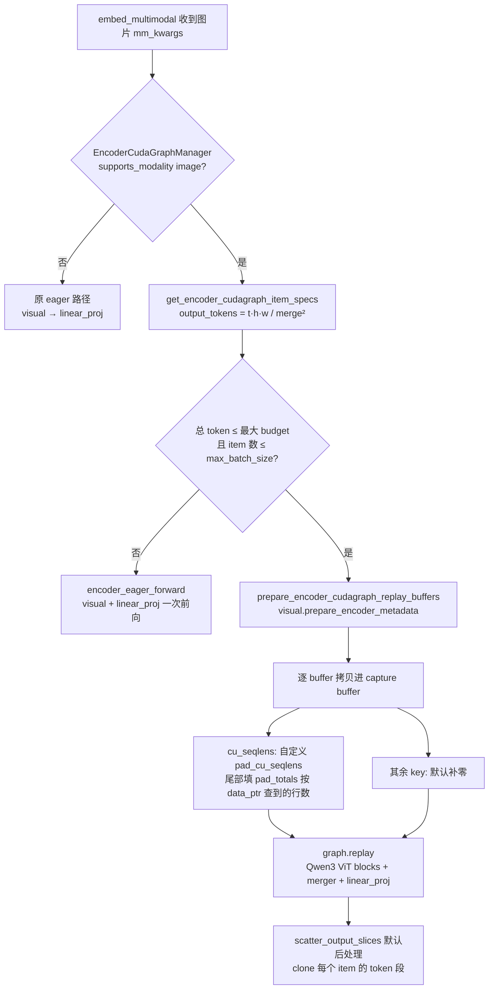
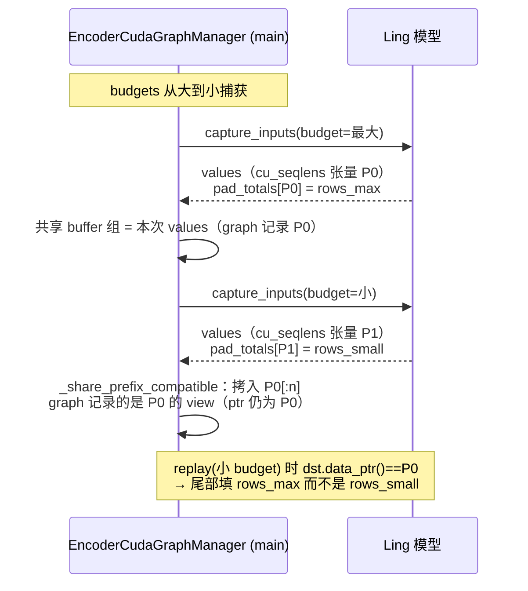

# PR #56820: [MM][CG] Support ViT full CUDA graph for Ling-3.0-flash-VL

> **Author**: @BruceLoveDecimal | **State**: OPEN（draft） | **Date**: 2026-09-14
> **Branch**: `feat/bailing_moe_v3_vl_encoder_cudagraph` → `main` | **Labels**: documentation, needs-rebase, multi-modality, nvidia
> **Changes**: +367 -1 lines across 4 files | **ViT CG 相关性**: 完全相关 | **类型**: 模型集成
> 本报告分两部分：§1–6 为 PR 详细总结，§7–8 为 ViT CUDA graph review 意见（对照 vllm main `632ba4f`）。

---

## 1. 总结 (Summary)

本 PR 为 Ling-3.0-flash-VL（`BailingMoeV3VLForConditionalGeneration`）实现 `SupportsEncoderCudaGraph`，把 Qwen3 ViT 与其后的 `linear_proj` 投影器一起放进 encoder CUDA graph，只支持图片。实现大体照搬 Qwen3-VL 的图片路径（复用 `visual.prepare_encoder_metadata()` 生成 `pos_embeds` / rotary cos/sin / `cu_seqlens` / `max_seqlen` / `sequence_lengths` 缓冲），另加了两处 Ling 专属逻辑：dummy grid 取"最接近正方形"的 h×w，避免 rotary cache（8192 位置）越界；以及一套按 `data_ptr` 记录行数的 `cu_seqlens` "尾序列"补齐逻辑。PR 仍是 draft，Test Result 写的是 WIP，并且落后 main 约 5000 个提交（带 `needs-rebase` 标签）。按 main 的共享前缀 buffer 机制，那套 `cu_seqlens` 补齐逻辑在 rebase 后会出错。

## 2. 背景与动机 (Background & Motivation)

本 PR 属于 tracker [#38175](https://github.com/vllm-project/vllm/issues/38175)（ViT Full CUDA Graph），是正文中仍未勾选的模型集成项之一。Ling-3.0-flash-VL 由 #55921 引入 vLLM，它的视觉塔 `BailingMoeV3VisionTransformer` 继承 `Qwen3_VisionTransformer`，所以作者以 Qwen3-VL（#35963 / #38061）为模板实现。

PR 描述列出与 Qwen3-VL 的三点差异：

- **只做图片**：理由是 "Ling-VL's vLLM implementation currently supports images only"。但 main 上 #65848（2026-11-11）已经给 Ling VL 加了 video、YaRN 和 vision DP，这个理由已经过时。
- **graph 覆盖 `linear_proj`**：输出宽度是 text hidden size（2560），做法与 Kimi-VL 相同。
- **min budget 按 patch 几何推导**（patch_size=16 → 224×224 得到 49 tokens）：但之后的提交 `a23c2fe` 把它改回了 64（"Use power-of-two encoder budgets"），描述与代码不一致。

PR 描述还给出了测试计划（CPU 协议单测、dummy 权重 e2e、H20 TP=4 下的 `vllm bench mm-processor --dataset-name random-mm`），但 Test Result 仍是 WIP，没有任何数字。

## 3. 代码修改分析 (Code Change Analysis)

### 3.1 修改的模块

| 模块 | 改动 |
|------|------|
| `vllm/model_executor/models/bailing_moe_v3_vl.py` (+191 -1) | 模型类加上 `SupportsEncoderCudaGraph`，实现 config / budget_range / item_specs / select_items / capture_inputs / replay_buffers / cudagraph_forward / eager_forward 共 8 个协议方法，另有 `_encoder_cudagraph_pad_totals`（按 `cu_seqlens.data_ptr()` 记录 capture 行数）和 `_encoder_cudagraph_tail_sequence`（非 FlashInfer 时启用自定义 `cu_seqlens` padding） |
| `tests/v1/cudagraph/test_encoder_cudagraph.py` (+138) | CPU 协议单测：用 `_FakeLingViT` 桩代替真实 ViT，覆盖 config 宽度、budget range、rotary 安全的 dummy grid、`cu_seqlens` 尾序列补齐、graph 与 eager 前向一致 |
| `tests/models/multimodal/generation/test_vit_cudagraph.py` (+36) | 新增 `bailing_moe_v3_vl` case：`core_model`、dummy 权重、6 层 hybrid（5 linear + 1 full attention）text 覆盖、`enable_chunked_prefill=True`，只测图片 |
| `docs/design/cuda_graphs_multimodal.md` (+2) | 支持表加一行（✅︎/❌︎/❌︎）；硬件兼容矩阵加一行（全 ❔）——该矩阵在 main 上已不存在 |

### 3.2 架构 / 流程图





### 3.3 关键实现细节

- **`get_encoder_cudagraph_config()`**（L411-440）：`modalities=["image"]`，buffer_keys 与 Qwen3-VL 一致（含 `pixel_values`），`out_hidden_size=text_config.hidden_size`；非 FlashInfer 时 `padding_logics={"cu_seqlens": pad_cu_seqlens}`，尾部填 `pad_totals.get(dst.data_ptr(), src[-1])`。
- **`get_encoder_cudagraph_budget_range()`**（L442-452）：返回 `(64, min(max_num_batched_tokens, max_model_len))`，与 main 协议默认实现完全相同。
- **`prepare_encoder_cudagraph_capture_inputs()`**（L484-533）：`per_item_output` 向上取整；取 `per_item_output` 不超过其平方根的最大因子作为 h，构造近似正方形的 dummy grid；`cu_seqlens` 多留一个槽（`max_batch_size + 1`）给尾序列；`max_seqlen_override = token_budget · merge²`；把 `total_patches` 记到 `pad_totals[cu_seqlens.data_ptr()]`。
- **`prepare_encoder_cudagraph_replay_buffers()`**（L535-552）：非 FlashInfer 时 `cu_seqlens` 不 pad（由 padding logic 补尾），FlashInfer 时 pad 到 `max_batch_size + 1`。
- **前向**：graph 与 eager 都是 `self.linear_proj(self.visual(...))`（L554-567）。main 上的 eager 路径已改为 `linear_proj(features[..., :vision_out_dim])`，并支持 vision DP。
- **测试**：单测用 fake ViT，e2e 用 dummy 权重的 6 层 hybrid text；example 中 Ling 没有 runner，所以 `MODELS_SUPPORT_VIT_CUDA_GRAPH` 没有更新。

## 4. 涉及的技术原理 (Technical Principles)

**Qwen3 ViT 与 Ling 的差异**：Ling 的视觉塔是 Qwen3 ViT（patch_size=16、spatial_merge_size=2、varlen attention，靠 `cu_seqlens` 区分每张图），可选一个无参数的 patch merger（LayerNorm 后把 2×2 patch 拼成一行）。之后接 `BailingMoeV3VLProjector`（Column/RowParallel 两层 MLP）映射到 text 宽度。main 上 rotary 改为 fp32、`max_position=8192` 的固定 cache（#65848），这正是 PR 要用"近似正方形 dummy grid"的原因：1×N 的长条 grid 在 `budget·merge > 8192` 时 rotary 位置越界。

**Budget 捕获 + 共享前缀 buffer（main #65084）**：manager 按 budget 从大到小捕获。每个 path 第一次捕获的 values 作为共享 buffer；之后每个 budget 的 probe buffer 只要"trailing dims、dtype 相同且行数不更多"，就拷进共享 buffer，graph 记录的是 `shared[:rows]` 这个 view。所以同一 key 在各 budget 的 graph 里指向同一块存储，view 与共享 buffer 起始地址相同。replay 时 manager 对每个 key 调 padding logic（默认：cumulative key 重复末值，其余补零；#65453 起 FA 默认就是重复末值）。

**varlen attention 与 padding 行**：FlashAttention varlen 只处理 `[0, cu_seqlens[-1])` 范围内的行；超过 `cu_seqlens[-1]` 的 padding 行不参与 attention，其输出未定义，但它们不会混入有效行（有效行的 token 段由 `scatter_output_slices` 截取）。如果某段 `cu_seqlens` 区间超出张量实际行数，FA 就会越界读写。

**投影器入图**：把 `linear_proj` 放进 graph 后，graph 输出直接是 text 宽度的 embedding，manager 的 DP gather buffer 也按 `out_hidden_size` 分配。TP 模式下投影器内含 all-reduce，与 ViT 自身的 TP 通信一样在 graph 中捕获。

## 5. 评论区讨论亮点 (Discussion Highlights)

- 目前没有人工 review，只有 mergify 的文档预览和"存在合并冲突、需要 rebase"提醒（2026-09-29）。
- CI：`pre-run-check` 失败（未加 ready label / 新贡献者门禁，与代码无关），pre-commit 被跳过；readthedocs、DCO 通过。没有任何 GPU CI 结果。
- PR 描述的"Duplicate-work check"说明作者确认过 tracker 中无人认领 Ling-VL。

## 6. 风险与潜在问题 (Risk Analysis)

| 风险 | 严重程度 | 说明 |
|------|---------|------|
| rebase 后 `cu_seqlens` 尾序列按错误行数填充 | High | 见 §7「按 data_ptr 记录 capture 行数与 main 的共享前缀 buffer 冲突」 |
| graph 路径与 main 的 eager 路径不一致（投影前切片、video、DP） | High | 见 §7「rebase 后 graph 前向需与 main 的 eager 路径对齐」 |
| 与 main 的 Qwen 系 mixin 重复实现 | Medium | 见 §7「应复用 Qwen2VLEncoderCudaGraphMixin」 |
| 无性能、精度数据 | Medium | Test Result 为 WIP |
| 单测对共享 buffer 场景无覆盖 | Medium | 单测直接把 probe 张量传给 padding logic，测不到 manager 的真实调用 |
| 文档冲突 | Low | 硬件矩阵在 main 已删除 |

---

## 7. Review 意见 (Findings)

对照 vllm main `632ba4f`。PR 的 merge-base 是 `58d45fd767`，当时 manager 还没有共享前缀 buffer（#65084）、`cu_seqlens` 也没有"重复末值"的默认 padding（#65453），Ling 也还没有 video / DP 支持（#65848）。以下意见按"rebase 到 main 之后"的状态评估。

**集成清单**

| 项 | 状态 | 说明 |
|----|------|------|
| 接口实现 | ⚠️ | 8 个方法都已实现，签名与 main 一致，但大部分可复用 mixin；`cu_seqlens` padding 逻辑与 main 冲突 |
| 文档支持表 | ⚠️ | 支持表的行和字母序正确；硬件矩阵在 main 已不存在 |
| example | 📝 | `vision_language_offline.py` 中没有 Ling runner，可不加 |
| `test_vit_cudagraph.py` | ✅ | 已加，用 dummy 权重 + `core_model` |
| 单测 | ⚠️ | 已加，但用 fake ViT 和 probe 张量，测不到共享 buffer 场景 |
| benchmark | ❌ | 命令正确（`mm-processor` + `random-mm`），但没有结果 |
| 精度 | ❌ | 没有 eager 与 graph 输出对比或 MMMU/MMStar 数据 |

| 意见类型 | 数量 |
|---------|------|
| 正确性 | 2 |
| 接口同步 / 设计 | 2 |
| 测试 | 2 |
| 注释/文档 | 2 |

### 🔴 必须修复

**🔴【正确性】按 `data_ptr` 记录 capture 行数，与 main 的共享前缀 buffer 冲突，rebase 后 FA 会越界** `[已验证]`
- **问题**：`prepare_encoder_cudagraph_capture_inputs()` 把 `total_patches` 记到 `pad_totals[metadata["cu_seqlens"].data_ptr()]`（`bailing_moe_v3_vl.py:528-530`），`pad_cu_seqlens` 在 replay 时用 `pad_totals.get(dst.data_ptr(), src[-1])` 填尾部（L414-420）。main 的 manager 从大到小捕获 budget；从第二个 budget 起，`_share_prefix_compatible()` 把 probe 张量拷进最大 budget 的共享 buffer，graph 记录的是 `shared[:n]`。`cu_seqlens` 在各 budget 长度相同（`max_batch_size + 2`），所以每个 budget 的 graph 都指向同一块存储，`dst.data_ptr()` 恒等于最大 budget 那个张量的地址。replay 任何较小的 budget 时，尾序列都会被填成**最大 budget 的** `total_patches`，而不是本 budget 的。
- **影响**：触发条件是默认的 `FLASH_ATTN` backend，且 batch 落在非最大 budget 上，例如单张 448×448 图（196 tokens，落到 224 budget）。此时 `cu_seqlens[-1]` 远大于本 graph 中 hidden states 的实际行数（`224 × 4` 行），varlen attention 会越界读写 graph 内存池里的其他激活，结果可能是 illegal memory access，也可能是静默的错误输出。这正好是最常见、收益最大的小图场景。另外，用 `data_ptr` 当 key 本身也很脆弱：张量释放后地址会被复用。
- **行动**：作者应当删除 `_encoder_cudagraph_pad_totals` 及尾序列逻辑，改用 main 上 Qwen3-VL / Kimi-K2.5 的做法：`padding_logics=MMEncoderAttention.get_cu_seqlens_padding_logics(self.visual.attn_backend, "cu_seqlens")`。非 FlashInfer 时，它会使用 #65453 的默认 padding（重复末值，使 padding 序列为空）。如果确有"FA 在 `cu_seqlens[-1]` 小于行数时让有效行变成 NaN"的问题，应先给出能在 main 上复现的最小例子（Qwen3-VL 用同一个 ViT 却没有这个问题），在框架层修复，而不是在模型里用 `data_ptr` 打补丁。

### ⚠️ 建议修复

**⚠️【正确性】rebase 后 graph 前向需与 main 的 eager 路径对齐：投影前切片、video、DP** `[已验证]`
- **问题**：main 上 #65848 把 eager 路径改为 `self.linear_proj(features[..., : self.vision_out_dim])`，并去掉了强制清空 `deepstack_visual_indexes` 的代码。Qwen3 ViT 有 deepstack 层时输出宽度是 `out_hidden_size × (1 + len(deepstack))`。PR 的 `encoder_cudagraph_forward` / `encoder_eager_forward`（L554-567）直接 `self.linear_proj(vision_features)`，没有切片。同一个提交还给 Ling 加了 video（`pixel_values_videos`）和 vision DP（`_BailingVisionEncoder` + `disable_tp`）。
- **影响**：如果 checkpoint 的 `vision_config.deepstack_visual_indexes` 非空，`linear_fc1` 的输入维度不匹配，capture 阶段就会崩溃；即使维度一致，graph 与 eager 也是两套写法，后续容易漂移。PR 描述中"只支持图片因为 vLLM 实现只支持图片"的理由在 main 上已不成立。
- **行动**：作者应当在 rebase 时让 graph 和 eager 前向都复用 `_BailingVisionEncoder` 的 `features[..., :vision_out_dim]` 切片逻辑，并说明 video 是在本 PR 一起支持（复用 mixin 后基本免费），还是作为 follow-up（文档表保持 ❌︎ 并在描述中写明）。

**⚠️【接口同步】应复用 `Qwen2VLEncoderCudaGraphMixin`，只覆盖 Ling 真正不同的方法** `[已验证]`
- **问题**：main 上 Qwen3-VL 已经通过 `Qwen2VLEncoderCudaGraphMixin`（`encoder_cudagraph_utils.py`）实现协议。Ling 的 ViT 继承 Qwen3 ViT，具备 mixin 需要的 `spatial_merge_size` / `prepare_encoder_metadata` / `patch_embed` / `input_norm`。PR 中 `_get_image_grid_thw_list`、`get_encoder_cudagraph_item_specs`、`select_encoder_cudagraph_items`、`prepare_encoder_cudagraph_replay_buffers` 与 mixin 逐行等价；`get_encoder_cudagraph_budget_range`（L442-452）与协议默认实现完全相同。
- **影响**：重复代码会错过框架后续修复（本 PR 已因落后 main 错过 #65084、#65453），维护者也需要重复 review。
- **行动**：建议作者继承 mixin，只实现 `get_encoder_cudagraph_config()`，并覆盖三个方法：`prepare_encoder_cudagraph_capture_inputs()`（保留"近似正方形 dummy grid"，这是 Ling 的 rotary cache 为 8192 带来的真实差异，并保留注释）、`encoder_cudagraph_forward()` / `encoder_eager_forward()`（加投影器和切片）。删除 `get_encoder_cudagraph_budget_range` 的覆盖。

**⚠️【测试】单测是"为通过而校准"的：直接把 probe 张量传给 padding logic，测不到共享 buffer** `[已验证]`
- **问题**：`test_replay_cu_seqlens_covers_padded_rows`（`test_encoder_cudagraph.py:1075-1093`）把 `prepare_encoder_cudagraph_capture_inputs()` 返回的 probe 张量直接作为 `dst` 传给 `pad`。这恰好是 `pad_totals` 记录过的地址，与 manager 实际传入的共享 buffer view 不同。`test_graph_and_eager_paths_apply_projector_and_agree` 用的 `_FakeLingViT` 只读 `pos_embeds`，忽略了 `cu_seqlens` 等 metadata，graph 与 eager 必然一致。
- **影响**：上面那个 🔴 问题在这些测试下全绿；e2e 测试只用一张图，且 dummy 权重不检查数值。
- **行动**：建议作者删掉针对自定义 padding 的单测（改用 main 的通用 padding 后已无必要），在 `test_vit_cudagraph.py` 之外补一个真实 manager + 多 budget 的回归点：至少让 e2e 跑两个会落在不同 budget 的图片尺寸，并比较 eager 与 graph 的输出。

**⚠️【测试】没有性能和精度数据（Test Result: WIP）** `[已验证]`
- **问题**：描述中的 benchmark 命令选得对（`vllm bench mm-processor --dataset-name random-mm`，确实会把图片送进 encoder），但没有任何结果；也没有 eager 与 graph 的输出对比或多模态精度。
- **影响**：无法判断收益区间。Ling 是 patch16 的大 ViT，又经过 TP=4 切分，大图很可能是 GPU-bound，graph 在那里可能比 eager 慢。
- **行动**：作者应当给出 graph on/off 下至少三档图片尺寸的 encoder latency（小图 / 典型 / 大图或多图）、GPU 型号与 attention backend；并按 `python examples/... -m <model> --modality image [--enable-vit-cuda-graph]` 的方式，或用 MMMU/MMStar，提供 eager 与 graph 的输出或精度对比。

### 📝 建议/备注

**📝【注释/文档】PR 描述与代码不一致：min budget** `[已验证]`
- **问题**：描述写"min budget 由 patch 几何推导为 `(224 // (patch_size * spatial_merge_size)) ** 2`（=49）"，代码（提交 `a23c2fe` 之后）是 64。
- **影响**：误导 reviewer。
- **行动**：建议作者更新描述，或者按上面的建议删除该覆盖、直接使用默认实现。

**📝【注释/文档】文档硬件兼容矩阵在 main 上已不存在** `[已验证]`
- **问题**：`docs/design/cuda_graphs_multimodal.md:46` 给硬件矩阵加了一行全 ❔，但 main 的文档已删除该矩阵，只保留 Supported Models 表。
- **影响**：rebase 冲突。
- **行动**：建议作者 rebase 时只保留 Supported Models 表的一行（当前按字母序排在首位，正确）；如果做了 video，同步改 "CG for Video" 列。

（其他：`_encoder_cudagraph_pad_totals` 通过 `self.__dict__` 绕开 `nn.Module.__setattr__` 的写法不必要，按 🔴 的建议删除后自然消失；`encoder_cudagraph_forward` 中的 `values.pop("pixel_values")` 是安全的，因为 manager 传入的是 `{**values}` 副本，与 mixin 写法一致。）

## 8. 结论 (Verdict)

🔴 **BLOCK**。PR 必须 rebase（已有 `needs-rebase` 标签，且与 #65848 冲突）。rebase 后，自定义的 `cu_seqlens` 尾序列补齐会因为 main 的共享前缀 buffer，在默认 FLASH_ATTN 下的小 budget replay（例如单张 448×448 图）中写入最大 budget 的行数，导致 attention 越界。建议改用 main 的通用 padding 并复用 Qwen 系 mixin，同时对齐 main 的投影前切片 / video / DP 路径，并补充性能与精度数据。

## 9. 英文 Review 评论 (Copy-Paste English Comments)

**C1** `vllm/model_executor/models/bailing_moe_v3_vl.py:528-530` — 🔴 blocking

```text
Keying the captured row count by `cu_seqlens.data_ptr()` breaks on current main. Since #65084 the manager captures budgets largest-first and records later budgets into prefix views of the first budget's buffers, so every graph's `cu_seqlens` has the same data_ptr and `pad_cu_seqlens` always writes the largest budget's total. With FLASH_ATTN, replaying a smaller budget (e.g. one 448x448 image) then makes the trailing sequence run past the graph's activations. Could you drop the pad_totals logic and use `MMEncoderAttention.get_cu_seqlens_padding_logics(self.visual.attn_backend, "cu_seqlens")` like Qwen3-VL? If FA really returns NaN without the tail sequence, a repro on main would help, since Qwen3-VL uses the same ViT.
```

**C2** `vllm/model_executor/models/bailing_moe_v3_vl.py:554-567` — ⚠️ comment

```text
After rebasing onto main, the eager path for Ling is `linear_proj(features[..., :vision_out_dim])` (#65848 removed the forced empty deepstack indexes and added video and vision DP). Both `encoder_cudagraph_forward` and `encoder_eager_forward` here project the full ViT output, which will not match eager and fails in capture if the checkpoint has deepstack layers. Can we reuse the same slicing (e.g. via `_BailingVisionEncoder`) in both paths? Also, the "images only" reason no longer holds on main, so please either enable video or keep ❌︎ and mention it as a follow-up.
```

**C3** `vllm/model_executor/models/bailing_moe_v3_vl.py:442-452` — ⚠️ comment

```text
I suppose most of this can come from `Qwen2VLEncoderCudaGraphMixin` (encoder_cudagraph_utils.py), which Qwen3-VL already uses on main: item specs, item selection and replay buffers are the same as here, and this budget range is identical to the protocol default. Maybe it's better to inherit the mixin and only override `get_encoder_cudagraph_config()`, the capture inputs (keeping the square-ish dummy grid for the 8192-position rotary cache, which is a real Ling difference) and the two forwards that add the projector. That way Ling picks up future framework fixes for free.
```

**C4** `tests/v1/cudagraph/test_encoder_cudagraph.py:1075-1093` — ⚠️ comment

```text
This test passes the probe tensor from `prepare_encoder_cudagraph_capture_inputs()` directly as `dst`, which is exactly the pointer stored in pad_totals, so it cannot catch the shared-buffer case the manager actually produces. The fake ViT also ignores `cu_seqlens`, so the graph/eager agreement test always holds. With main's generic padding these tests are not needed; could you instead make the e2e case cover two image sizes that land on different budgets, and share eager-vs-graph outputs plus encoder latency (the planned `vllm bench mm-processor --dataset-name random-mm` numbers) in the description?
```

## 10. 英文总结评论 (Overall Review Summary)

```text
Thanks for picking up Ling-VL. Including the projector in the graph and the square-ish dummy grid for the 8192-position rotary cache are good calls. However, after rebasing onto main the data_ptr-keyed cu_seqlens tail padding conflicts with the shared prefix capture buffers, so smaller-budget replays overrun attention under FLASH_ATTN. Please switch to the generic cu_seqlens padding, reuse Qwen2VLEncoderCudaGraphMixin, align both forwards with main's projector slicing (and video/DP), and add eager-vs-graph and encoder latency results. Changes needed before merge.
```
