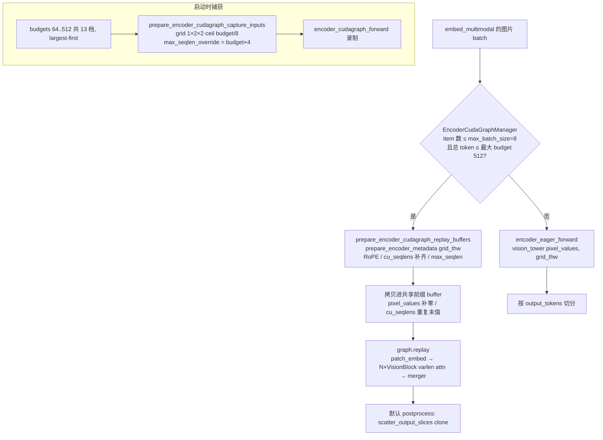
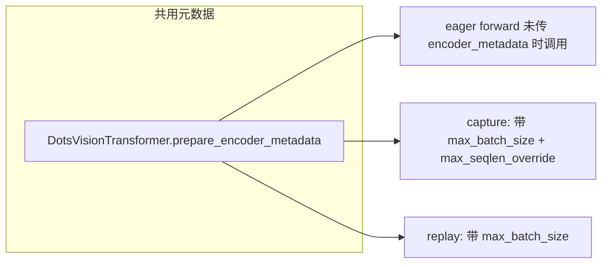

# PR #63074: [Model] dots.ocr: support encoder CUDA graph

> **Author**: @LLBeYourself | **State**: OPEN（非 draft，`verified` 标签，未触发上游 CI） | **Date**: 2026-10-22（最近更新 2026-11-15）
> **Branch**: `feat/dots-ocr-encoder-cudagraph` → `main` | **Labels**: documentation, multi-modality, nvidia, verified
> **Changes**: +292 -14 lines across 3 files | **ViT CG 相关性**: 完全相关 | **类型**: 模型集成
> 本报告分两部分：§1–6 为 PR 详细总结，§7–8 为 ViT CUDA graph review 意见（对照 vllm main `632ba4f`）。

---

## 1. 总结 (Summary)

本 PR 让 dots.ocr（`DotsOCRForCausalLM`）的视觉编码器接入 `SupportsEncoderCudaGraph`：把 RoPE、`cu_seqlens`、`max_seqlen` 等依赖 `grid_thw` 的元数据抽到 `DotsVisionTransformer.prepare_encoder_metadata()`，eager 与 graph 共用；整个 vision tower（patch embed + 全部 ViT block + merger）进入 CUDA graph，仅支持图片。默认 budget 上限被模型硬编码为 512 token，理由是旧版 manager 下文档页（~1000 token）被 pad 到 2048 后只有 eager 的 0.56–0.61×。接口实现正确、eager/graph 共用元数据，但需要 rebase 到已有的 Qwen2-VL 风格 mixin，并用当前 manager 重新论证 512 上限。

## 2. 背景与动机 (Background & Motivation)

属于 ViT Full CUDA Graph tracker [#38175](https://github.com/vllm-project/vllm/issues/38175) 的模型集成项（作者 2026-10-19 在 tracker 认领 dots.ocr，10-22 开 PR）。dots.ocr 的视觉塔与 Qwen2-VL 系同构：拼接后的 `pixel_values` + `image_grid_thw`、2D RoPE、varlen attention、2×2 patch merger，因此实现基本参照 Qwen2-VL/Qwen3-VL 的集成方式（#35963、#40830）。

作者在描述中给出的关键发现：在旧版 power-of-2 budget + 分批 replay 的 manager 上，默认 budget 上限（`max_num_batched_tokens`，4096）会让 1000×800 文档页（1044 token）被 pad 到 2048，三种 GPU 上都只有 eager 的 0.56–0.61×；513–1023 token 的图也只有 0.67–0.84×，因此把默认上限压到 512。11-15 的更新同步到 main `0431c0f7`（已包含共享前缀 buffer 与细粒度 budget 网格），但**明确说明历史 benchmark 没有重跑**，本次更新"不做新的性能声明"。验证在 RTX 3090 / BF16 / Model Runner V2 上完成：TP1/TP2 OCR 文本与 token ID 与 eager 一致、padded encoder 对照 max abs error 0.0、manager 单测 139 个通过。

## 3. 代码修改分析 (Code Change Analysis)

### 3.1 修改的模块

| 文件 | 改动 |
|------|------|
| `vllm/model_executor/models/dots_ocr.py` (+257 -13) | `DotsVisionTransformer.forward` 拆出 `prepare_encoder_metadata()`（RoPE、`cu_seqlens` 补齐到 `max_batch_size`、CPU 侧 `max_seqlen`，可用 override），`forward` 新增 `encoder_metadata` 关键字；`DotsOCRForCausalLM` 实现协议 9 个方法 |
| `tests/models/multimodal/generation/test_vit_cudagraph.py` (+34 -1) | 新增 `dots_ocr` 配置（真实 checkpoint、`core_model`、显式 budget `[4096]`、`max_vision_items_per_batch=2`）；在通用 `test_vit_cudagraph_image` 中为 dots_ocr 加分支：设置 `VLLM_ALLOW_INSECURE_SERIALIZATION`，用 `collective_rpc` 读取 hit/miss 统计并断言全部命中 |
| `docs/design/cuda_graphs_multimodal.md` (+1) | 支持表新增 `DotsOCRForCausalLM` 行（字母序正确，Image ✅︎ / Video ❌︎ / Multi-Path ❌︎） |

### 3.2 架构 / 流程图





### 3.3 关键实现细节

- **元数据外提**：`rot_pos_emb(grid_thw)`、`cu_seqlens`（CPU 上 `accumulate` 后按 `max_batch_size` 用末值补齐，再 `async_tensor_h2d`）、`max_seqlen`（留在 CPU，避免被录进 graph 的 D2H）。capture 时 `max_seqlen_override = token_budget * spatial_merge_size**2`，即单张图吃满 budget 时的 patch 数上界，attention wrapper 在捕获时 `.item()` 把它烘焙进 graph。
- **capture 布局**：`per_mm_item_output = ceil(budget / max_batch_size)`，每个 dummy item 的 grid 为 `[1, m, per_item*m]`，总容量 ≥ budget —— 与 main 上 `Qwen2VLEncoderCudaGraphMixin` 的图片分支一致。
- **budget 范围**：`min_budget=64`（与 Qwen 系一致；最小图其实只有 4 token，但更小的 min 会让 `max_batch_size = min(max//min, min(budgets))` 降到 4）；`max_budget = min(512, max_num_batched_tokens, max_model_len)`。在 main 的网格下生成 13 档：`64, 80, 96, 112, 128, 160, 192, 224, 256, 320, 384, 448, 512`，`max_batch_size = 8`。
- **eager 路径**：`forward(hidden_states, grid_thw)` 在 `encoder_metadata is None` 时调用同一个 `prepare_encoder_metadata()`，行为与改动前等价。
- **测试**：真实 3B checkpoint、显式 budget `[4096]`，断言两张测试图都命中 graph、无 fallback。

## 4. 涉及的技术原理 (Technical Principles)

**dots.ocr 视觉编码器**：NaViT 式动态分辨率 ViT。图片按 14×14 patch 切分后拼接成 `[num_patches, C·P·P]`，每张图对应 `image_grid_thw=[1, h, w]`；2D RoPE 由 `(h, w)` 位置生成；attention 是按 `cu_seqlens` 分段的 varlen attention（每张图一个序列）；最后 2×2 `PatchMerger` 把 4 个相邻 patch 合成 1 个 token，输出 token 数 `h·w/4`。结构与 Qwen2-VL 视觉塔相同，所以可以复用 Qwen 系的 budget/padding 方案。

**基于 token budget 的捕获与回放**：启动时为一组 token budget 各捕获一张 graph（largest-first，同一 path 的所有 budget 共享一组最大尺寸的输入/输出 buffer 前缀视图）；运行时每个 batch 只回放能装下它的最小 budget，超出最大 budget 或 item 数超过 `max_batch_size` 时整体 eager。padding 规则：`pixel_values`/RoPE 尾部补零，`cu_seqlens` 重复末值使 padded 序列长度为 0，因此 attention 不会把 padding 混进有效序列；merger 逐 token 计算，padding 只产生被丢弃的尾部输出。

**Graph 何时更快**：replay 只省 host 侧 kernel launch 时间，却要付整个 captured 形状（含 padding）的 GPU 时间。小图（launch-bound）收益最大；大图 GPU-bound 时 graph 不会更快，padding 比例高时还会变慢——这正是作者 0.56–0.61× 现象的来源（旧网格下 1044→2048 约 96% padding）。main 已改为 1024 以下四分之一倍频程、1024–2560 每 128 一档、之后 1/8 倍频程的细网格，并有全局上限 `encoder_cudagraph_max_token_budget`（默认 5120），1044 token 的文档页现在只会 pad 到 1152（约 10%）。

**`max_seqlen` 烘焙**：FA/Triton wrapper 在 Python 侧对 `max_seqlen` 做 `.item()`，捕获后该值固定在 graph 的 kernel 参数里。用"单图吃满 budget"的上界即可保证正确（varlen kernel 只按 `cu_seqlens` 读数据，较大的 `max_seqlen` 只多启动一些立即退出的 block）。

## 5. 评论区讨论亮点 (Discussion Highlights)

- 目前没有 maintainer 的 review；claude[bot] 因 fork PR 未运行；mergify 曾提示冲突，作者在 11-15 合入 @nulllt2 的冲突解决分支并同步 main `0431c0f7`，随后 @ 了 @shen-shanshan 请求 review 与触发 CI。
- 作者在 tracker 中主动分享的发现（"默认 power-of-two budget 下文档页被 pad 到 2048，只有 eager 的 0.56–0.61×"）对其它 OCR 模型有参考价值，但这一结论建立在旧 manager 上，见 §7 第 1 条。
- 描述披露 Codex 参与了 review、replay 覆盖修复、集成与验证，并注明"提交者需在发布前人工确认"；描述机制解释充分（WHY 充足），AI 代码风险未见明显升高。

## 6. 风险与潜在问题 (Risk Analysis)

| 风险 | 严重程度 | 说明 |
|------|---------|------|
| 正确性：graph 与 eager 数值 | 低 | 两条路径共用 `prepare_encoder_metadata()`，padding 语义与 Qwen 系一致；作者报告 3 种尺寸 TP1/TP2 token ID 一致、padded 对照误差 0.0 |
| 性能：默认 512 上限依据过时 | 中 | 见「512 上限基于旧 manager 的数据」；文档页在默认配置下永远走 eager，功能对主力 OCR 场景基本无收益 |
| 可维护性：与 main mixin 重复 | 中 | 见「应改为复用 `Qwen2VLEncoderCudaGraphMixin`」 |
| 测试覆盖：通用测试被模型分支污染、未测默认 budget | 中 | 见「测试中的模型特定分支」 |
| 兼容性：attention backend | 低 | 仅在 FA2（RTX 3090）上验证；`TORCH_SDPA` wrapper 会对 device 上的 `cu_seqlens` 做 `.tolist()`，在捕获中不可用——这是框架层面的通用限制（Qwen 系同样如此），非本 PR 引入；dots.ocr 的 `compute_attn_mask_seqlen` 对 FLASHINFER 返回 `None`，eager 本身就不支持 FLASHINFER |
| 兼容性：TP / DP | 低 | 作者测试了 TP2；`mm_encoder_tp_mode="data"` 下 manager 自己分片，模型 eager 路径的 `run_dp_sharded_mrope_vision_model` 不会被 graph 路径调用，未见二次分片 |

---

## 7. Review 意见 (Findings)

对照 vllm main `632ba4f`（PR 基于 `0431c0f7`，落后 main 905 个提交；其间 #66067 引入了 `Qwen2VLEncoderCudaGraphMixin` 与默认 budget range）。

**集成清单**

| 项 | 状态 |
|----|------|
| 协议实现（与 main 签名一致：`path` / `axis_keys` / `values`） | ✅ |
| eager / graph 共用元数据 | ✅ |
| 复用 main 已有实现（mixin） | ❌ 重复实现 |
| 文档支持表（字母序、✅︎/❌︎、列数） | ✅ |
| example `MODELS_SUPPORT_VIT_CUDA_GRAPH` | ❌ 未注册 |
| `test_vit_cudagraph.py` case | ⚠️ 已加，但带模型特定分支，且只测显式 `[4096]` budget |
| 单测（`test_encoder_cudagraph.py`） | — 无框架改动，不需要 |
| 当前 main 上的 benchmark | ❌ 历史数据未重跑（作者已声明） |
| 精度 | ⚠️ 有 token ID / 文本对比，无 OCR 基准 |

| 意见类型 | 数量 |
|---------|------|
| 【设计】/【性能】 | 1 |
| 【接口同步】 | 1 |
| 【测试】 | 2 |
| 【注释/文档】 | 1 |
| 【可维护性】 | 2 |

### ⚠️ 建议修复

**⚠️【设计】512 token 上限基于旧 manager 的数据，并且压住了全局 `encoder_cudagraph_max_token_budget`** `[已验证]`
- **问题**：`dots_ocr.py:845-849` 在 `get_encoder_cudagraph_budget_range()` 里把 `max_budget` 硬编码为 `min(512, …)`。依据是旧版 power-of-2 网格下 1044 token 的页被 pad 到 2048 的测量（描述中注明"not rerun after this rebase"）。main 的 `_generate_budgets()` 现在 1024–2560 每 128 一档，1044 token 会落到 1152 档（约 10% padding，而不是 96%）。另外，`_generate_budgets(min, max, cap)` 取 `min(max_budget, cap)`，模型返回的 512 会把用户调高的 `encoder_cudagraph_max_token_budget` 静默压回 512，只有显式写 `encoder_cudagraph_token_budgets` 才能绕开。
- **影响**：dots.ocr 的主力负载（文档页，~1000 token）在默认配置下永远走 eager，功能实际只覆盖 ≤512 token 的小图；测试本身也只能通过显式 `[4096]` 才让两张测试图命中 graph。基于过时数据的性能取舍被写死在模型里，与全局旋钮"类似 LLM 最大捕获尺寸"的设计相冲突。
- **行动**：建议作者在当前 main 上用默认网格（不加 512 上限）对小图 / 1000×800 页 / 多图 batch 重测 graph on/off；若页面仍然变慢，在描述中给出新数据并改用文档说明或 `encoder_cudagraph_max_token_budget` 调整，而不是在模型的 budget range 中硬编码；若不再变慢，则删除该上限，直接用 main 的默认 range。

**⚠️【接口同步】应改为复用 main 上的 `Qwen2VLEncoderCudaGraphMixin`** `[已验证]`
- **问题**：`dots_ocr.py:804-985` 新增的 `_get_image_grid_thw`、`get_encoder_cudagraph_item_specs`、`select_encoder_cudagraph_items`、`prepare_encoder_cudagraph_capture_inputs`、`prepare_encoder_cudagraph_replay_buffers`、`encoder_cudagraph_forward`、`encoder_eager_forward` 与 main `vllm/model_executor/models/encoder_cudagraph_utils.py` 中 mixin 的图片分支几乎逐行相同（ceil 容量、`[1, m, per_item*m]` grid、`max_seqlen_override = budget*m**2`、`values.pop("pixel_values")`）。该 mixin 由 #66067 在 11-18 合入，晚于本 PR 的基线 `0431c0f7`（11-14）；Qwen2-VL / Qwen2.5-VL / Qwen3-VL / GLM-4.1V / Cohere Compass 都已迁移。差异只有三处：属性名是 `vision_tower` 而不是 `visual`，patch 参数在 `patch_embed.patchifier` 上，没有 `input_norm`。
- **影响**：同一套 capture/replay 约定出现第 N 份拷贝；以后 manager 再改约定（例如 #65084 的共享 buffer），dots.ocr 需要单独跟进，容易漏改。
- **行动**：建议作者 rebase 到最新 main，继承 `Qwen2VLEncoderCudaGraphMixin`，只实现 `get_encoder_cudagraph_config()`（以及保留的 budget range），通过 `visual` 别名属性或覆盖 `prepare_encoder_cudagraph_capture_inputs()` 处理 patchifier / 无 `input_norm` 的差异；默认 budget range 若不再需要 512 上限，可直接使用协议默认实现。

**⚠️【测试】在通用 `test_vit_cudagraph_image` 中加入 dots_ocr 专属分支，且未测试默认 budget** `[已验证]`
- **问题**：`test_vit_cudagraph.py:527-591` 给所有模型共用的测试加了三处 `if model_id == "dots_ocr":`（设置环境变量、读取初始/最终统计、断言 hit 数）。main 已有专门做"graph vs eager 输出 + 回退 + 输出所有权"检查的 `test_eonly_vit_cudagraph_outputs`（按 model 参数化，目前覆盖 qwen3_vl / qwen3_5 / glm4_1v，含多尺寸、`assert_close` 和 hit/miss 断言）。另外 dots_ocr 配置固定 `encoder_cudagraph_token_budgets=[4096]`，CI 从未覆盖实际默认的 64–512 网格。
- **影响**：通用测试里的模型分支不可扩展（每个想断言命中的模型都要再加一个 `if`）；hit 断言本可适用于所有模型，却只对 dots_ocr 生效；默认配置的捕获/回放路径没有 CI 覆盖。
- **行动**：建议作者把 dots_ocr 加进 `test_eonly_vit_cudagraph_outputs` 的模型列表（它就是 Qwen2-VL 风格的处理器），或者把"断言全部命中"做成 `VitCudagraphTestConfig` 字段，供所有模型使用，并删除 `if model_id == "dots_ocr"` 分支；同时至少加一个不覆盖 budget 的小图 case，覆盖默认网格。

### 📝 建议 / 备注

**📝【注释/文档】example 未注册** `[已验证]`
- **问题**：`examples/generate/multimodal/vision_language_offline.py` 已有 `run_dots_ocr`，但 `MODELS_SUPPORT_VIT_CUDA_GRAPH`（:2194）没有 `dots_ocr`。
- **影响**：`--enable-vit-cuda-graph` 对 dots_ocr 静默无效，用户和 reviewer 无法用 example 做 eager vs graph 对比。
- **行动**：建议作者把 `"dots_ocr"` 加入该列表，并贴一次 `-m dots_ocr --modality image` 加/不加 `--enable-vit-cuda-graph` 的输出对比。

**📝【测试】CI 使用完整真实 checkpoint** `[推测]`
- **问题**：新 case 用 `rednote-hilab/dots.ocr`（约 3B）加 `core_model` 标记，且以 4096 budget 捕获。
- **影响**：该测试只检查 ViT CG 能否正常运行，LLM 部分的权重和显存都是不必要的开销；L4 上的余量未经验证。
- **行动**：建议 review 时追问能否参照 #43082 / kimi_vl 的做法，用 `hf_overrides=dummy_hf_overrides` 缩减语言模型层数并降低 budget。

**📝【可维护性】小问题汇总** `[已验证]`
- **问题**：① `dots_ocr.py:64` 已在模块顶部从 `encoder_cudagraph_defs` 导入 `EncoderCudaGraphReplayBuffers`，`get_encoder_cudagraph_config` / `get_encoder_cudagraph_item_specs` / `prepare_encoder_cudagraph_capture_inputs` 却又在函数体内从同一模块导入，可统一到顶部；这三个方法也没有返回类型注解。② eager `_process_image_input`（:773）对 tower 输出做了 `[:, : self.config.hidden_size]` 切片，graph 路径没有对应操作（当前 checkpoint 两者维度都是 1536，切片是 no-op，但两条路径不对称）。③ `encoder_cudagraph_forward` 用 `values.pop(...)` 修改了传入的 dict，目前依赖 manager 传入 `{**values}` 副本才安全。
- **影响**：可读性差；若未来 checkpoint 的视觉输出宽度不等于 LLM hidden size，graph 与 eager 的输出宽度会不同。
- **行动**：建议作者统一导入并补注解；在 eager 路径删掉无效切片，或在 graph 路径做同样处理；改用 `values["pixel_values"]` 加剩余键的新 dict，不修改入参（迁移到 mixin 后这些问题会一并消失）。

## 8. 结论 (Verdict)

⚠️ **NEEDS WORK** — 实现正确：eager 与 graph 共用元数据，padding、`max_seqlen` 上界和容量计算都与 main 的 Qwen 系实现一致，没有发现会导致错误输出的问题。但需要 rebase 到 main 并复用 `Qwen2VLEncoderCudaGraphMixin`；512 上限需要在当前 manager 上重新测量论证（或删除）；测试应去掉模型特定分支并覆盖默认 budget。

## 9. 英文 Review 评论 (Copy-Paste English Comments)

**C1** `vllm/model_executor/models/dots_ocr.py:845-850` — ⚠️ comment

```text
I suppose the 512-token cap is based on the old power-of-two manager: on current main, `_generate_budgets()` steps by 128 between 1024 and 2560, so a 1044-token page now pads to 1152 instead of 2048. Since the model's max budget is also passed through `min(max_budget, cap)`, this hardcoded value silently overrides a user-raised `encoder_cudagraph_max_token_budget`, and document pages (the main dots.ocr workload) never hit a graph by default. Could you re-measure on latest main without the cap (small images, a 1000x800 page and a multi-image batch, graph on/off)? If pages are still slower we can document it; otherwise let's drop the cap and use the default range.
```

**C2** `vllm/model_executor/models/dots_ocr.py:804-815` — ⚠️ comment

```text
These protocol methods are almost identical to `Qwen2VLEncoderCudaGraphMixin` in `vllm/model_executor/models/encoder_cudagraph_utils.py`, which landed in #66067 after this PR's base, and Qwen2-VL/Qwen2.5-VL/Qwen3-VL/GLM-4.1V already use it. Could you rebase on latest main and inherit the mixin instead? The only differences I see are `vision_tower` vs `visual`, the patch params living on `patch_embed.patchifier`, and no `input_norm`, which can be handled with an alias property or by overriding `prepare_encoder_cudagraph_capture_inputs()` only. That way future interface changes do not need a separate dots.ocr update.
```

**C3** `tests/models/multimodal/generation/test_vit_cudagraph.py:527-531` — ⚠️ comment

```text
I suppose it's better not to add `if model_id == "dots_ocr"` branches to the shared image test. Main already has `test_eonly_vit_cudagraph_outputs`, which checks graph vs eager outputs at several sizes, fallback and output ownership with hit/miss assertions; dots.ocr uses a Qwen2-VL style processor, so could you add it to that test's model list? If you want the "all items hit" assertion for every model, it could be a field on `VitCudagraphTestConfig` instead. Also, the config only tests an explicit `[4096]` budget, so the default 64-512 budgets are never exercised in CI.
```

**C4** `docs/design/cuda_graphs_multimodal.md:17` — 📝 comment（锚定在本 PR 新增的文档行；example 文件不在 diff 中）

```text
Thanks for keeping the table in alphabetical order. Please also add `dots_ocr` to `MODELS_SUPPORT_VIT_CUDA_GRAPH` in `examples/generate/multimodal/vision_language_offline.py`, so `--enable-vit-cuda-graph` works for it. Could you then run `python examples/generate/multimodal/vision_language_offline.py -m dots_ocr --modality image` with and without `--enable-vit-cuda-graph` and paste the outputs?
```

## 10. 英文总结评论 (Overall Review Summary)

```text
Thanks for the dots.ocr integration. Sharing prepare_encoder_metadata() between eager and graph paths is clean, and the padding and max_seqlen handling match the Qwen-style towers. Before merge: please rebase on latest main and reuse Qwen2VLEncoderCudaGraphMixin instead of duplicating it; re-measure the 512-token cap with the current fine-grained budgets, since it overrides encoder_cudagraph_max_token_budget and keeps document pages eager; and move the dots_ocr-specific assertions out of the shared image test (e.g. into test_eonly_vit_cudagraph_outputs). Also register dots_ocr in the example list. Changes needed before merge.
```
