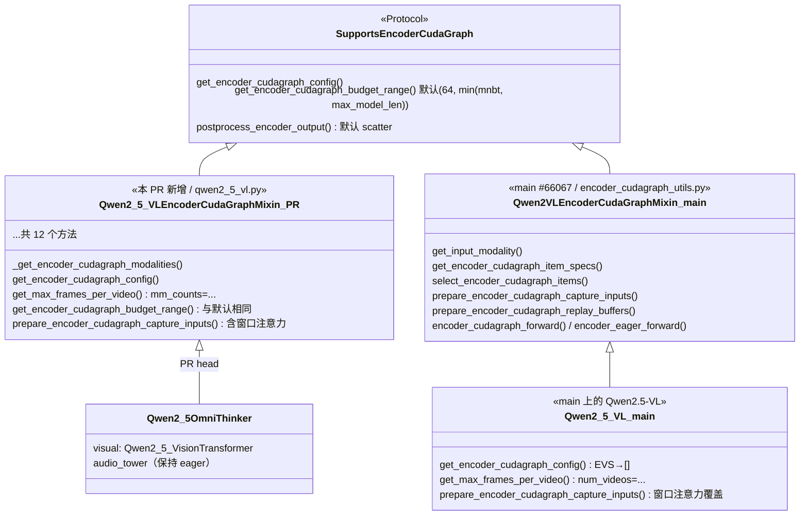
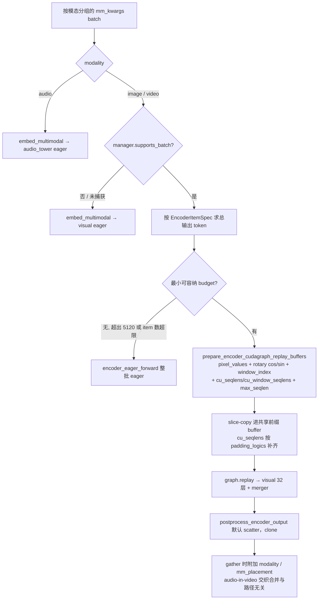

# PR #63374: [MM][CG] Support ViT full CUDA graph for Qwen2.5-Omni

> **Author**: @nlpkiddo-2001 | **State**: OPEN（非 draft，带 `needs-rebase` 标签） | **Date**: 2026-10-23
> **Branch**: `qwen2_5_omni_vit_cudagraph` → `main` | **Labels**: documentation, needs-rebase, multi-modality, qwen, nvidia
> **Changes**: +599 -571 lines across 4 files | **ViT CG 相关性**: 完全相关 | **类型**: 模型集成（附带 Qwen2.5-VL 重构）
> 本报告分两部分：§1–6 为 PR 详细总结，§7–8 为 ViT CUDA graph review 意见（对照 vllm main `632ba4f`）。

---

## 1. 总结 (Summary)

本 PR 为 Qwen2.5-Omni 的 thinker（`Qwen2_5OmniThinkerForConditionalGeneration`）开启 ViT 全 CUDA graph（图片 + 视频，音频塔保持 eager）。由于 Omni 与 Qwen2.5-VL 共用 `Qwen2_5_VisionTransformer`，作者把 Qwen2.5-VL 中 12 个 encoder CUDA graph 方法整体搬进新的 `Qwen2_5_VLEncoderCudaGraphMixin`，两个模型共同继承，EVS 差异通过 `_get_encoder_cudagraph_modalities()` 钩子覆盖。问题在于 PR 基于 10 月下旬的 main：之后 main 已合入 #66067（官方 `Qwen2VLEncoderCudaGraphMixin`）、#65084/#65227（共享前缀 buffer + 新 budget 网格）和 #66608（`get_num_frames_with_most_features` 改签名），这次搬移与 main 直接冲突，需要基于 main 的 mixin 重做，Omni 侧真正需要的改动只有十几行。

## 2. 背景与动机 (Background & Motivation)

- 属于 tracker [#38175](https://github.com/vllm-project/vllm/issues/38175) 的模型集成项；作者在 tracker 评论区认领 Qwen2.5-Omni，并说明将沿用 Qwen2.5-VL 的实现（[#40830](https://github.com/vllm-project/vllm/pull/40830)），同时关注接口简化 PR #49432。
- Omni thinker 的视觉塔与 Qwen2.5-VL 完全相同，因此主要工作是“复用而不是复制”：作者估计复制会多出约 300 行重复代码，于是选择抽 mixin。
- 声称结果（1×H200，BF16，TP=1，`Qwen/Qwen2.5-Omni-3B`）：
  - 图像 + 视频的 `test_vit_cudagraph.py` 用例通过（`VLLM_GPU_SYNC_CHECK=error`）；
  - 在“同一份 padded buffer + 同一 max_seqlen”条件下 graph replay 与 eager **bit-identical**（FA3 与 FlashInfer）；
  - encoder-only：小图最高 5.50×，大图/多图因 padding 到 budget 反而变慢（最差 0.61×）；
  - 端到端 TTFT：4 个 workload 中只有“并发 1 + 单张 1280×720 + 调优 budget”一项变快（113.9→110.8 ms），其余在默认 budget 下变慢。
- 作者坦诚列出未测范围：FA2、Blackwell、ROCm、Omni-7B、`use_audio_in_video=True` 的视频。

## 3. 代码修改分析 (Code Change Analysis)

### 3.1 修改的模块

| 文件 | 改动 |
|------|------|
| `vllm/model_executor/models/qwen2_5_vl.py` (+582 -570) | 新增 `Qwen2_5_VLEncoderCudaGraphMixin(SupportsEncoderCudaGraph)`，把 `get_encoder_cudagraph_config` / `get_input_modality` / `get_max_frames_per_video` / `get_encoder_cudagraph_budget_range` / `get_encoder_cudagraph_item_specs` / `select_encoder_cudagraph_items` / `prepare_encoder_cudagraph_capture_inputs` / `prepare_encoder_cudagraph_replay_buffers` / `encoder_cudagraph_forward` / `encoder_eager_forward` 等从 `Qwen2_5_VLForConditionalGeneration` 原样移入；Qwen2.5-VL 只保留 `_get_encoder_cudagraph_modalities()`（EVS 开启时返回 `[]`） |
| `vllm/model_executor/models/qwen2_5_omni_thinker.py` (+4 -1) | 继承 mixin；`self.model_config = vllm_config.model_config`（mixin 的两个方法需要）；`multimodal_config` 改用 `get_multimodal_config()`（非 Optional 类型） |
| `tests/models/multimodal/generation/test_vit_cudagraph.py` (+11) | 新增 `qwen2_5_omni` 用例：真实 `Qwen/Qwen2.5-Omni-3B`，image + video，`core_model` |
| `docs/design/cuda_graphs_multimodal.md` (+2) | 支持表新增一行（Image ✅︎ / Video ✅︎）；note 中注明只测过 FA3 与 FlashInfer（Hopper） |

### 3.2 架构 / 流程图

PR head 的继承关系，以及 main 上已经存在的结构（rebase 后两者冲突）：



Omni 一次 encoder 调用在 main 运行时（V2 runner 的 `EncoderRunner.execute_mm_encoder`）中的走向：



### 3.3 关键实现细节

- **mixin 的 EVS 钩子**：`Qwen2_5_VLEncoderCudaGraphMixin._get_encoder_cudagraph_modalities()` 默认 `["image", "video"]`；Qwen2.5-VL 覆盖为 EVS 开启时 `[]`（`qwen2_5_vl.py:2087`）。Omni 不支持 `SupportsMultiModalPruning`，直接用默认值。
- **Omni 侧只需三处改动**：继承 mixin（`qwen2_5_omni_thinker.py:1102`）、设置 `self.model_config`（`:1154`，`get_max_frames_per_video()` 与 budget range 用到）、`get_multimodal_config()`（`:1152`）。
- **padding**：PR 的 mixin 用文件内 `_pad_flashinfer_cu_seqlens_buffer` / `_pad_cumulative_seqlens_buffer`（`qwen2_5_vl.py:1308`）；main 已改为 `MMEncoderAttention.get_cu_seqlens_padding_logics(...)`（#65453 之后）。
- **帧数上限**：PR 的 `get_max_frames_per_video()` 调用 `info.get_num_frames_with_most_features(seq_len=..., mm_counts={"video": ...})`（`qwen2_5_vl.py:1351`）；main 在 #66608 后签名变为 `num_videos=`，且 Omni 的 processing info 在 main 上有自己的覆盖 `(seq_len, num_videos, max_frames_per_video=None)`。
- **测试**：`test_vit_cudagraph.py` 是冒烟测试（能生成非空文本即通过），不比较 eager/graph 输出；作者解释了为何没有加入 `test_eonly_vit_cudagraph_outputs`（Qwen2.5 系 ViT 在 BF16 下非 batch-invariant，单图 vs 多图 eager 本身就有 4–8% 相对误差）。

## 4. 涉及的技术原理 (Technical Principles)

**Qwen2.5 视觉塔**：14×14 patch、temporal patch 2、2×2 spatial merge；32 层 ViT 中大部分是 **窗口注意力**（112 px 窗口，merge 后 4×4 token），少数层是全注意力。因此 graph 需要记录的元数据比 Qwen2-VL / Qwen3-VL 多：`window_index` / `reverse_indices`（窗口重排及其逆）、`cu_window_seqlens` 与 `max_seqlen_window`、`sequence_lengths_window`。这也是 main 让 Qwen2.5-VL 在继承通用 `Qwen2VLEncoderCudaGraphMixin` 的同时，自己覆盖 `get_encoder_cudagraph_config` 与 `prepare_encoder_cudagraph_capture_inputs`（窗口序列数上界 `get_encoder_cudagraph_max_window_seqs`）的原因。

**Budget 捕获 + 共享前缀 buffer（main #65084/#65227）**：默认 budget 在 `[min, max]` 上按“1024 以下四分之一倍频程、2560 以下 128 步长、再 1/8 倍频程”生成，上限 `encoder_cudagraph_max_token_budget=5120`；按从大到小捕获，同一 path 的所有 budget 共享最大 budget 的输入/输出 buffer 前缀。每个 batch 只 replay 一次能容纳它的最小 budget，否则整批 eager。PR 的 benchmark 是在这套机制落地之前、用旧的 2 的幂 budget 测的。

**何时 graph 有收益**：graph 只省 host 侧 kernel launch 时间；replay 的 GPU 时间按整个捕获形状（含 padding）计算。小图（launch-bound）收益大，大图/多图（GPU-bound）padding 浪费会让 graph 慢于 eager——PR 的 encoder-only 表格正好体现这一点（64 token 5.5×，4608 token 0.61×）。

**Omni 的音视频交织**：`use_audio_in_video=True` 时视频与音频 token 在 prompt 中交织，合并依赖 gather 阶段给每个 embedding 附加的 `modality` / `mm_placement`（`set_mm_embedding_modality`），与 encoder 走 graph 还是 eager 无关；视频像素仍按 `pixel_values_videos` + `video_grid_thw` 独立编码，因此 graph 路径原则上不受影响，但 PR 尚未实测。

## 5. 评论区讨论亮点 (Discussion Highlights)

- 目前没有人工 review；`claude[bot]` 因 fork PR 未运行；mergify 在 2026-11-12 标记合并冲突（`needs-rebase`）。
- 作者在 PR 描述中主动说明了几处取舍：只抽 mixin 不改行为、为何不进 `test_eonly_vit_cudagraph_outputs`、padding 导致大输入变慢、哪些配置未测——描述质量高，解释了 WHY。
- PR checklist 勾选了“使用了 AI 辅助 / `/pr-checklist` skill”。

## 6. 风险与潜在问题 (Risk Analysis)

| 风险 | 严重程度 | 说明 |
|------|---------|------|
| 与 main 的 `Qwen2VLEncoderCudaGraphMixin` 重复/冲突 | High | 见 §7「PR 落后于 main 的共享 mixin」 |
| `get_max_frames_per_video` 调用签名过时 | High（rebase 后） | 见 §7「`mm_counts=` 在 main 上会 TypeError」 |
| 性能数字基于旧 budget 网格 | Medium | 见 §7「benchmark 需在新 budget 网格下重测」 |
| 端到端 TTFT 多数场景变慢 | Medium | opt-in 特性，与 Qwen2.5-VL 表现一致，但需在文档中给出建议 |
| 正确性证据只覆盖“同一 padded 输入” | Low–Medium | 见 §7「补充单图 padded replay vs 原生 eager 对比」 |
| CI 冗余（与 Qwen2.5-VL 同一 ViT） | Low | 见 §7 测试相关条目 |
| `use_audio_in_video=True` 未测 | Low | 机制上与 graph 无关，但属声明支持的视频路径 |

---

## 7. Review 意见 (Findings)

对照 vllm main `632ba4f`。PR merge-base 为 `58cf73223e`，早于 #65084、#65227、#65453、#66067、#66608。

**集成清单**

| 项 | 状态 | 说明 |
|---|---|---|
| 接口实现 | ⚠️ | 功能完整，但基于旧接口，需迁移到 main 的 `Qwen2VLEncoderCudaGraphMixin` |
| 文档支持表 | ✅ | 已加行；字母序有小问题 |
| example 注册（`MODELS_SUPPORT_VIT_CUDA_GRAPH`） | ❌ | `qwen2_5_omni` runner 已存在但未加入列表 |
| `test_vit_cudagraph.py` | ✅ | 已加，使用真实 3B checkpoint |
| 单测 | — | 纯复用，无新 manager 行为 |
| benchmark | ⚠️ | 测法正确（random-mm + encoder-only），但基于旧 budget 网格 |
| 精度 | ⚠️ | 只有 padded 同输入的 bit-identical 对比，无端到端精度/输出对比 |

| 意见类型 | 数量 |
|---------|------|
| 【接口同步】 | 2 |
| 【设计】 | 1 |
| 【性能】 | 1 |
| 【测试】 | 2 |
| 【注释/文档】 | 2 |

### ⚠️ 建议修复

**⚠️【接口同步】PR 落后于 main 的共享 mixin：`Qwen2_5_VLEncoderCudaGraphMixin` 与 main 的 `Qwen2VLEncoderCudaGraphMixin` 重复且冲突** `[已验证]`
- **问题**: `qwen2_5_vl.py:1289` 新建的 mixin 把 Qwen2.5-VL 的 12 个协议方法整体移出（+582 -570）。main 已通过 #66067 在 `vllm/model_executor/models/encoder_cudagraph_utils.py` 提供 `Qwen2VLEncoderCudaGraphMixin`，Qwen2.5-VL 继承它，只在类内覆盖 `get_encoder_cudagraph_config`、`get_max_frames_per_video` 与窗口注意力版的 `prepare_encoder_cudagraph_capture_inputs`。该 mixin 的 docstring 明确要求“不要加 per-model 分支，差异由模型覆盖对应协议方法”。PR 的搬移与 main 在同一段代码上冲突（已有 `needs-rebase` 标签），而且 PR 版本还带着已被替换的实现：文件内 `_pad_*_cu_seqlens_buffer` 而非 `MMEncoderAttention.get_cu_seqlens_padding_logics`，自写 budget range 与协议默认值相同。
- **影响**: 按原样 rebase 会在 main 上出现第二套 Qwen 系 CG 实现，违背 #66067 的收敛方向，后续接口变更要同时改两处。
- **行动**: 建议作者丢弃对 `qwen2_5_vl.py` 的整体搬移，改为：在 main 现有结构上，把 Qwen2.5-VL 那三个窗口注意力相关的覆盖方法抽成一个薄子类（如 `Qwen2_5_VLEncoderCudaGraphMixin(Qwen2VLEncoderCudaGraphMixin)`，只含这三个方法和 EVS 钩子），Qwen2.5-VL 与 Omni 共同继承。这样 Omni 侧只需继承它并设置 `model_config`，diff 预计在 100 行以内。

**⚠️【接口同步】`get_max_frames_per_video()` 用 `mm_counts=` 调用，在 main 上会 TypeError** `[已验证]`
- **问题**: `qwen2_5_vl.py:1345-1353` 调用 `info.get_num_frames_with_most_features(seq_len=..., mm_counts={"video": ...})`。main 在 #66608 把该 API 改为 `num_videos=`；Omni 的 processing info 在 main 上有自己的覆盖 `get_num_frames_with_most_features(self, seq_len, num_videos, max_frames_per_video=None)`（`qwen2_5_omni_thinker.py:532`）。
- **影响**: 如果 rebase 时保留 PR 版本，任何开启 `cudagraph_mm_encoder`、且视频 limit > 0 的 Qwen2.5-VL / Qwen2.5-Omni 部署，都会在 `EncoderCudaGraphManager.__init__ → get_encoder_cudagraph_config()` 处报 `TypeError: unexpected keyword argument 'mm_counts'`，服务无法启动。
- **行动**: 作者应当在 rebase 时改用 main 的 `num_videos=` 调用。另外，Omni 覆盖版返回的是原始帧数（`num_steps * temporal_patch_size`），而 cu_seqlens 按时间 grid 步数计数，建议作者确认 `max_frames_per_batch` 不会因此翻倍而多 pad（不影响正确性，只影响 buffer 大小）。

**⚠️【性能】benchmark 需在 main 新的 budget 网格下重测，并给出默认配置是否推荐开启的结论** `[已验证]`
- **问题**: PR 描述里“default budgets”一列用的是旧的 2 的幂 budget（例如 1196-token 图被 pad 到 2048）。main 在 #65084/#65227 改为更密的网格（2560 以下 128 步长），并设上限 `encoder_cudagraph_max_token_budget=5120`。端到端 TTFT 在 4 个 workload 中有 3 个变慢（如 30 req/s、每请求 20×336² 图：14012.6 → 17826.6 ms；调优后仍为 15791.3 ms）。
- **影响**: 现有数字既不能代表 rebase 后的默认行为，也让用户难以判断 Omni 是否应该开启 encoder CG。
- **行动**: 建议作者 rebase 后用相同的 `vllm bench mm-processor` / `vllm bench serve --dataset-name random-mm` 命令重测 encoder-only 与 TTFT（graph on/off），并在 PR 描述中写明“在哪些输入规模下比 eager 快”；新网格下大图的 padding 损失预计会明显减小。

**⚠️【测试】正确性证据只覆盖“eager 跑同一份 padded buffer”，缺少单图 padded replay 与原生 eager 的对比** `[已验证]`
- **问题**: 描述中的 bit-identical 对比让 eager 跑的是 graph 实际 replay 的 padded buffer、并使用相同的 `max_seqlen`；未 padding 的满 budget 场景也与普通 eager 一致。但最常见的场景——单张图 replay 到更大 budget（例如 96 token 的图用 256 的 budget）与原生 eager `embed_multimodal` 的对比——没有报告。作者给出的 batch 不变性理由只适用于多图 batch，不适用于单图 + 空 padding 序列。`test_vit_cudagraph.py` 本身只是冒烟测试。
- **影响**: 如果 cu_seqlens / 窗口 padding 在 Omni 的输入上有偏差（例如 `max_seqlen_window` 覆盖值、窗口序列数上界），冒烟测试发现不了。
- **行动**: 建议作者补一组单图（224²、448×224、1280×720）graph vs 原生 eager 的 max-abs 对比；或按 @shen-shanshan 的习惯，贴出 `vision_language_offline.py -m qwen2_5_omni --modality image/video` 在开关 `--enable-vit-cuda-graph` 时的输出对比。若能加入 `test_eonly_vit_cudagraph_outputs`，它的输出所有权检查（retained snapshot）也值得保留，即使数值容差需要放宽。

### 📝 建议/备注

**📝【测试】CI 用例与 Qwen2.5-VL 是同一 ViT，建议只保留冒烟所需的最小配置** `[已验证]`
- **问题**: `test_vit_cudagraph.py:154-164` 新增的用例加载真实 `Qwen/Qwen2.5-Omni-3B`（下载包含 talker / token2wav 权重），image 与 video 都跑，`core_model`。ViT 与 `qwen2_5_vl` 用例完全相同，此前 @Isotr0py 在 #44720 也指出共用 ViT 的变体再加 CI 是浪费。
- **影响**: 在 CI 资源紧张时增加了下载和运行时间；不过 Omni 的宿主类（mixin 接入、`get_max_frames_per_video` 覆盖、多一个音频模态）确实与 Qwen2.5-VL 不同，保留一个冒烟用例有其价值。
- **行动**: 建议作者考虑使用 `hf_overrides=dummy_hf_overrides` + 小 budget（参照 #43082）或只保留 video 用例（Omni 独有的帧数逻辑在这里）；最终是否保留由 maintainer 决定。

**📝【注释/文档】文档表字母序与 example 注册** `[已验证]`
- **问题**: `docs/design/cuda_graphs_multimodal.md:28` 把 `Qwen2_5OmniThinkerForConditionalGeneration` 插在 `Qwen2_5_VLForConditionalGeneration` 之后；按 Architecture 字母序（`O` < `_`）应排在它之前。`examples/generate/multimodal/vision_language_offline.py` 已有 `run_qwen2_5_omni`，但 `MODELS_SUPPORT_VIT_CUDA_GRAPH` 没有加入 `qwen2_5_omni`，用户无法用 `--enable-vit-cuda-graph` 复现。
- **影响**: 集成工作流的“文档/example”步骤不完整。
- **行动**: 建议作者调整表格顺序，并把 `qwen2_5_omni` 加入 `MODELS_SUPPORT_VIT_CUDA_GRAPH`。

**📝【注释/文档】`use_audio_in_video=True` 与其他 attention backend 未测，应在文档中写清** `[推测]`
- **问题**: 描述的未测列表包括 `use_audio_in_video=True` 的视频与 FA2；文档 note（`:39`）只写了“测过 FA3 与 FlashInfer”。音视频交织合并依赖 gather 阶段的 `mm_placement`，原则上与 graph 无关，但没有实测。
- **影响**: 用户可能在交织场景下默认开启，出问题时难以定位。
- **行动**: 建议 review 时追问作者能否补跑一次 `use_audio_in_video=True` 的视频请求（graph on/off 输出一致即可），否则在文档 note 中注明该场景未验证。

## 8. 结论 (Verdict)

⚠️ **NEEDS WORK** — Omni 侧的集成思路正确，作者给出的证据也比较扎实（encoder-only 与端到端 benchmark 都送了真实图片，并说明了 padding 的代价）。但 PR 基于一个月前的 main，对 Qwen2.5-VL 的整体搬移与 main 已合入的 `Qwen2VLEncoderCudaGraphMixin` 冲突，并带着过时的 `mm_counts=` 调用。需要先在 main 上重做（预计 diff 会小很多），再按新的 budget 网格重测性能。

## 9. 英文 Review 评论 (Copy-Paste English Comments)

**C1** `vllm/model_executor/models/qwen2_5_vl.py:1289` — ⚠️ comment

```text
Since #66067, main already has a shared `Qwen2VLEncoderCudaGraphMixin` in `encoder_cudagraph_utils.py`, and Qwen2.5-VL now inherits it and only overrides `get_encoder_cudagraph_config`, `get_max_frames_per_video` and the window-attention `prepare_encoder_cudagraph_capture_inputs`. Moving the whole Qwen2.5-VL implementation into a second mixin here conflicts with that and brings back the old padding helpers and a budget range identical to the protocol default. Could you rebase and instead add a thin `Qwen2_5_VLEncoderCudaGraphMixin(Qwen2VLEncoderCudaGraphMixin)` holding only those Qwen2.5-specific overrides (plus the EVS hook), shared by Qwen2.5-VL and Omni? The Omni change should then be very small.
```

**C2** `vllm/model_executor/models/qwen2_5_vl.py:1345-1353` — ⚠️ comment

```text
FYI, #66608 changed `get_num_frames_with_most_features` to take `num_videos` instead of `mm_counts`, and Qwen2.5-Omni's processing info now overrides it with `(seq_len, num_videos, max_frames_per_video=None)`. If this call survives the rebase, enabling `cudagraph_mm_encoder` with video limit > 0 will raise a TypeError when the manager builds the config. Please switch to the `num_videos=` form used on main.
```

**C3** `vllm/model_executor/models/qwen2_5_omni_thinker.py:1102` — ⚠️ comment

```text
The benchmark numbers were measured with the old power-of-two budgets. Main now uses a denser default grid (#65084/#65227) with `encoder_cudagraph_max_token_budget=5120`, so the padding cost for large images should look quite different. After rebasing, could you re-run the same encoder-only and `vllm bench serve --dataset-name random-mm` comparisons (graph on/off) and say in the description for which input sizes enabling encoder CG on Omni is beneficial?
```

**C4** `tests/models/multimodal/generation/test_vit_cudagraph.py:154-164` — ⚠️ comment

```text
The bit-identical check runs eager on the same padded buffers, which validates capture but not padding. Could you also compare a single image replayed into a larger budget (e.g. 224x224, 448x224 and 1280x720) against plain eager `embed_multimodal`, or post the outputs of `vision_language_offline.py -m qwen2_5_omni --modality image/video` with and without `--enable-vit-cuda-graph`? Also, since the ViT is identical to Qwen2.5-VL, I suppose dummy weights (`dummy_hf_overrides`) and a small budget would be enough for this CI case.
```

## 10. 英文总结评论 (Overall Review Summary)

```text
Thanks for the Qwen2.5-Omni integration and the thorough description: the benchmarks really exercise the encoder, and the padding trade-off is explained honestly. However, the branch predates #66067, so moving the whole Qwen2.5-VL implementation into a new mixin now duplicates main's `Qwen2VLEncoderCudaGraphMixin`, and `get_max_frames_per_video` still uses the removed `mm_counts=` signature. Please rebase onto a thin Qwen2.5-specific subclass of that mixin, re-measure with the new budget grid, and add a single-image graph-vs-eager comparison. Changes are needed before merge.
```
