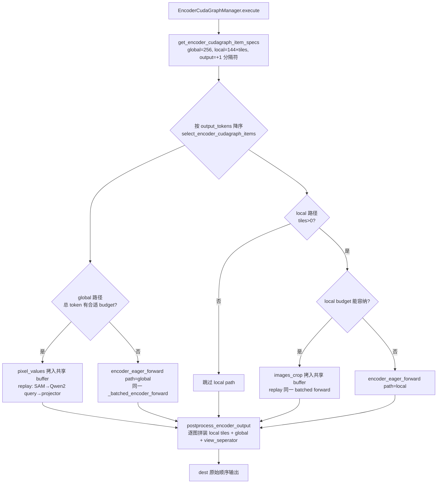
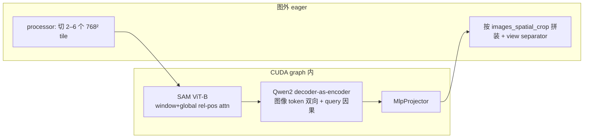

# PR #64311: [MM][CG] support ViT encoder cudagraph for DeepSeek-OCR2

> **Author**: @noone-zhhh | **State**: OPEN | **Date**: 2026-10-28
> **Branch**: `feats/deepseek_ocr2_cg` → `main` | **Labels**: documentation, multi-modality, deepseek, nvidia, verified
> **Changes**: +354 -2 lines across 5 files | **ViT CG 相关性**: 完全相关 | **类型**: 模型集成
> 本报告分两部分：§1–6 为 PR 详细总结，§7–8 为 ViT CUDA graph review 意见（对照 vllm main `632ba4f`）。

---

## 1. 总结 (Summary)

本 PR 为 DeepSeek-OCR-2（`DeepseekOCR2ForCausalLM`）实现 `SupportsEncoderCudaGraph`，沿用 DeepSeek-OCR（#43586/#49934）的双路径（multi-path）设计：`global` 路径把 1024² 全局图送入 SAM → Qwen2 decoder-as-encoder → projector 并按 256 token/图捕获，`local` 路径把 768² 局部 tile 按 144 token/tile 捕获（允许 0 token 跳过），图外由 `postprocess_encoder_output` 按 `[local tiles, global, view_separator]` 拼装（无 newline token）。PR 同时补了文档表、example 注册、`test_vit_cudagraph.py` 的 e2e case 与一个 E-only 的 graph-vs-eager 数值对比测试。实现整体规范、跟上了 main 的最新接口，主要缺口在**多图 batch 的覆盖**和**默认配置未验证**。

## 2. 背景与动机 (Background & Motivation)

[#38175](https://github.com/vllm-project/vllm/issues/38175) tracker 中 DeepSeek-OCR-2 一直没有 ViT CG 支持，作者在 2026-10-22 认领（"dual-path encoder CUDA graph support"），@shen-shanshan 回复 "Welcome, good to go"。DeepSeek-OCR-2 与 DeepSeek-OCR 结构相近（global 视图 + 动态数量的 local tile + view separator），但视觉塔从 SAM + CLIP 换成了 SAM + Qwen2 decoder-as-encoder（可学习 query：768 输入 144 个、1024 输入 256 个），local tile 从 640 改为 768，且不插入 newline token。

PR 声称的收益（RTX 5070 Ti 16GB，`vllm bench mm-processor` random-mm，单图，`encoder_cudagraph_token_budgets=[576]`、`max_vision_items_per_batch=1`，测的是 encoder forward 延迟）：

| 输入尺寸 | 是否切 tile | Mean | P99 |
|---|---|---|---|
| 224² / 448² | 否 | −9.2% | −20%~−24% |
| 896² / 1024² | 是 | −2.2%~−2.8% | −4.5%~−6.8% |

benchmark 方法正确（确实把图片送进了 encoder），但只覆盖了手选的单一配置。

## 3. 代码修改分析 (Code Change Analysis)

### 3.1 修改的模块

| 模块 | 改动 |
|------|------|
| `vllm/model_executor/models/deepseek_ocr2.py` (+193 -2) | 实现协议：`get_encoder_cudagraph_config`（`global`/`local` 两个 path）、`get_encoder_cudagraph_budget_range`、`get_encoder_cudagraph_item_specs`、`select_encoder_cudagraph_items`、`prepare_encoder_cudagraph_capture_inputs`/`replay_buffers`、`encoder_cudagraph_forward`、`encoder_eager_forward`、`postprocess_encoder_output`；新增 `global_image_output_tokens`(256) / `single_patch_output_tokens`(144) property；保存 `self.model_config` |
| `docs/design/cuda_graphs_multimodal.md` (+20) | 支持表新增一行（Multi-Path ✅︎）；Post-processing 段补 OCR-2 说明；Usage 段新增 OCR-2 推荐配置 `[288]` + `max_vision_items_per_batch=1` |
| `examples/.../vision_language_offline.py` (+1) | `MODELS_SUPPORT_VIT_CUDA_GRAPH` 加入 `deepseek_ocr2` |
| `tests/models/multimodal/generation/test_vit_cudagraph.py` (+103) | `MODEL_CONFIGS["deepseek_ocr2"]`（dummy 权重、budget `[288]`）；新增 `test_deepseek_ocr2_encoder_cudagraph_paths`：E-only 模式下 4 个单图 batch 对比 graph 与 eager，校验 path budget 与 hit 计数 |
| `tests/kernels/attention/test_deepencoder_rel_pos_attention.py`（新增 37） | 为 main 上已有的 DeepEncoder 相对位置 Triton attention（#55629）补 kernel 单测，与 ViT CG 无直接关系 |

### 3.2 架构 / 流程图





### 3.3 关键实现细节

- **两条 path 共用一个 batched forward**：`_batched_encoder_forward(images)` = `projector(qwen2_model(sam_model(images)))`，global 输入 `[N,3,1024,1024]`、local 输入 `[P,3,768,768]`；Qwen2 decoder 依据 token 数（256/144）选择 `query_1024`/`query_768`——这是基于静态 shape 的 Python 分支，在 capture 时确定，不影响 replay。
- **capture 容量**：global `count = min(max_batch_size, budget // 256)`，local `count = budget // 144`，与 DeepSeek-OCR main 实现一致；path 设了 `min_token_budget`，budget 由 manager 生成为 item 整数倍（`_item_multiple_budgets`），无冗余 graph。
- **`output_tokens = global + local + 1`**：把 view separator 计入，等于 `dest[i]` 的真实长度。DP 模式下 `_dp_gather` 依赖 `per_item_out_tokens` 切分，这一点比 main 上 DeepSeek-OCR 的计数更严谨。
- **eager 路径**：`encoder_eager_forward(path="default")` 走原 `_process_image_input`（逐图），`path="global"/"local"` 直接复用 graph forward 的 batched 实现，partial fallback 与 graph 同算子。
- **后处理**：`torch.cat` 产生新张量，不会别名 graph 输出 buffer（`clone=True` 语义满足）。

## 4. 涉及的技术原理 (Technical Principles)

**Budget-based encoder CUDA graph**：manager 在启动时按 token budget 捕获多张 graph（main 上 largest-first 捕获并共享前缀 buffer），运行时每个 path 只 replay 一次“能容纳整个 batch 的最小 budget”，放不下则整个 path eager。graph 只省 host 侧 kernel launch 时间：小图（launch-bound）收益大，大图/多 tile 时 GPU 时间占主导，padding 会吃掉收益——这正是 PR 数据里未切 tile 约 −9%、切 tile 仅约 −2.5% 的原因。

**Multi-path graph**：DeepSeek-OCR 系把一张图拆成 1 个 global 视图 + 0~N 个 local tile，两者 token 粒度不同。`EncoderCudaGraphConfig.paths` 为每条路径独立生成 budget 与 graph，`EncoderItemSpec.path_output_tokens` 描述每图在各路径的 token，`allow_zero_tokens=True` 使没有 tile 的 batch 直接跳过 local 路径；最后由 `postprocess_encoder_output` 拼回每图 embedding。

**DeepSeek-OCR-2 视觉塔**：SAM ViT-B（12 层，window 14 + 4 层 global attention，相对位置偏置由 #55629 的 Triton kernel 融合）把 1024²/768² 图编码为 16×16/12×12 的特征；Qwen2 decoder-as-encoder 把这些图像 token 与等量可学习 query 拼接，用“图像 token 全可见、query 因果”的 4D mask（`compute_mask_base`，与 batch 无关、按序列长度 lru_cache）做 SDPA，只取 query 输出（“causal flow query”）。tile 数由 `count_tiles` 在 `MIN_CROPS=2`～`MAX_CROPS=6` 之间按宽高比选取，因此一张切 tile 的图 local token 在 288～864 之间。

## 5. 评论区讨论亮点 (Discussion Highlights)

- 目前没有人工 review；claude[bot] 因 fork PR 未运行；mergify 只贴了文档预览。
- CI：仅 8 个轻量 check（pre-commit/DCO 等）通过，2 个 skipping；PR 未带 `ready` 标签，**Buildkite 多模态 CI 尚未运行**，新增的 `test_vit_cudagraph.py` case 与 E-only 测试还没有在 CI 上被验证。
- tracker 认领时作者承诺 "correctness tests and performance benchmarks"，PR 中给了 E-only 数值测试与 mm-processor 数据，但没有 OCR 精度数据。

## 6. 风险与潜在问题 (Risk Analysis)

| 风险 | 严重程度 | 说明 |
|------|---------|------|
| 多图 batch（global/local 跨图 batched）未被任何测试覆盖 | Medium | 见 §7「多图 batch 未测」 |
| 默认配置（只开 `cudagraph_mm_encoder`）未验证 | Medium | 见 §7「默认 budget 未验证」 |
| 推荐配置对真实文档页覆盖不足 | Low | `[288]` 只容纳 ≤2 tile，3–6 tile 的页面 local 路径全部 eager |
| 新增与 CG 无关的 kernel 测试 | Low | 见 §7「无关文件」 |
| 每 batch 多次 D2H 同步 | Low | 与 DeepSeek-OCR 现状一致，非回归 |
| Qwen2 decoder（HF `Qwen2Model`，默认 `use_cache`）在图内建 `DynamicCache` | Low | 既有行为，capture 一次即固定，不影响正确性 |

---

## 7. Review 意见 (Findings)

对照 vllm main `632ba4f` 审查。集成清单：

| 项目 | 状态 | 说明 |
|---|---|---|
| 协议实现（与 main 签名一致，无废弃方法） | ✅ | 未实现 `get_input_modality`/`get_max_frames_per_video`，`path`/`axis_keys` 签名正确 |
| 文档支持表 | ✅ | 行已加入，Multi-Path ✅︎ |
| example 注册 | ✅ | `deepseek_ocr2` 已加入 `MODELS_SUPPORT_VIT_CUDA_GRAPH` |
| `test_vit_cudagraph.py` e2e | ✅ | dummy 权重 + 小 budget |
| graph-vs-eager 数值测试 | ⚠️ | 有，但只覆盖单图 batch |
| benchmark | ⚠️ | 方法正确，但仅手选配置，默认配置无数据 |
| 精度 | ⚠️ | 无 OCR 精度或 eager/graph 文本对比 |

| 意见类型 | 数量 |
|---|---|
| 【测试】 | 2 |
| 【性能】 | 1 |
| 【可维护性】 | 1 |
| 【注释/文档】 | 1 |
| 【性能】（备注） | 1 |

### ⚠️ 建议修复

**⚠️【测试】多图 batch 的 batched global/local 路径没有任何测试覆盖** `[已验证]`
- **问题**: graph 路径把一个 batch 内所有图的 global 视图拼成 `[N,3,1024,1024]`、所有 tile 拼成 `[P,3,768,768]` 一次过 SAM + Qwen2 decoder（`deepseek_ocr2.py:578` `_batched_encoder_forward`），而 eager 原路径是逐图处理。新增的 E-only 测试（`test_vit_cudagraph.py:791`）固定 `encoder_cudagraph_max_vision_items_per_batch=1`（:831），4 个 batch 都只有 1 张图；e2e config 也是单图 prompt。默认配置下 `max_batch_size` 会被自动推断到 >1（`max_budget // 256`），多图 batch 才是线上常态。
- **影响**: 多图 batch 下的 postprocess 索引（按 output_tokens 降序重排后 `patch_counts[i]` 与 `global_features[i]` 的对应）、tile 跨图拼接顺序、Qwen2 decoder 4D mask 的 batch 广播都没有被验证；一旦有错会是静默的 embedding 错位，而不是崩溃。
- **行动**: 建议作者在 E-only 测试里加一个 `max_vision_items_per_batch=2`、同时包含“未切 tile + 切 tile”两张图（并且大图在后，触发重排）的 batch，和 `embed_multimodal` 逐图结果对比。

**⚠️【性能】默认配置（仅 `cudagraph_mm_encoder: true`）的捕获规模、显存与收益均未验证** `[已验证]`（显存/耗时影响为 `[推测]`）
- **问题**: PR 的 benchmark 用 `[576]`+单图，文档推荐 `[288]`+单图（`cuda_graphs_multimodal.md:212-218`），测试用 `[288]`。但用户只开开关时，manager 会按 item 整数倍自动生成：以 `max_num_batched_tokens=8192` 为例，最大 budget 被 `encoder_cudagraph_max_token_budget=5120` 截断，global 路径约 18 张 graph（最大一次 20 张 1024² 图），local 路径约 24 张 graph（最大一次 35 个 768² tile）。PR 没有给出这一默认配置下的启动 capture 时间、graph 占用显存和 mm-processor 数据（作者用的是 16GB 卡）。
- **影响**: 默认路径可能显著拉长启动时间并挤占 KV cache；同时推荐配置 `[288]` 只容纳 ≤2 个 tile，而 `count_tiles` 会产生 2–6 个 tile，真实文档页的 local 路径大多会走 eager，文档给出的配置与 benchmark 用的 `[576]` 也不一致。
- **行动**: 建议作者补充默认配置下的 capture 耗时/显存与 `vllm bench mm-processor` 结果（至少含 1 张与多张、未切 tile 与 4–6 tile 两档）；如果默认规模不划算，`get_encoder_cudagraph_budget_range` 的上限应反映模型真实的输入上界（例如单图最多 6 个 tile 时的 token 数 × 合理的图数），而不是为了规避变慢硬编码一个小上限（manager 取它与 `encoder_cudagraph_max_token_budget` 的最小值，硬编码会静默压住用户调高的全局旋钮）；变慢的区间写进文档，让用户通过全局旋钮调整，而不是手填 budget 列表；文档推荐配置与 benchmark 配置保持一致并说明覆盖范围。

**⚠️【可维护性】新增的 DeepEncoder rel-pos attention kernel 单测与本 PR 无关** `[已验证]`
- **问题**: `tests/kernels/attention/test_deepencoder_rel_pos_attention.py` 测试的是 #55629 引入的 `deepencoder_rel_pos_attention` Triton kernel，PR 没有改动该 kernel，也没有在描述中说明为何需要它。
- **影响**: 无关改动扩大 review 面并占用 kernel CI；若该测试在某些平台失败，会阻塞一个与之无关的 ViT CG PR。
- **行动**: 建议作者把该测试拆到单独 PR（可 cc #55629 作者），本 PR 只保留 ViT CG 相关改动。

**⚠️【测试】缺少精度/文本输出对比证据** `[已验证]`
- **问题**: 描述的 Functional Test 只贴了开启 `--enable-vit-cuda-graph` 时的 4 条输出，没有同一命令关闭 graph 的输出作对照，也没有 OCR 精度数据。E-only 测试用 `rtol=atol=0.016` 对比单图 embedding，能证明单图数值接近，但不能代替端到端结果。
- **影响**: OCR 输出对坐标/字符很敏感，bf16 微小差异可能改变 grounding 框（贴出的结果里坐标就有 375/400、599/608 的差别，无法判断是否来自 graph）。
- **行动**: 建议作者贴出 `vision_language_offline.py -m deepseek_ocr2 --modality image` 开/关 `--enable-vit-cuda-graph` 的并排输出（temperature=0），最好再补一个小规模 OCR 精度对比（如 OmniDocBench 子集）。

### 📝 建议/备注

**📝【注释/文档】测试与文档中的若干小问题** `[已验证]`
- **问题**: (1) `test_vit_cudagraph.py:455`、`:801` 用 `DEEPSEEK_OCR2_TEST_MODEL` 环境变量覆盖模型名，本文件其他 case 都没有这种约定；(2) `:818` `batches[1]["images_crop"].zero_()` 没有注释说明目的；(3) 设计文档的 Usage 一节新增了模型专属的推荐配置段落，而该文档其余部分保持模型无关。
- **影响**: 增加测试的隐式行为与文档维护负担。
- **行动**: 建议作者去掉环境变量覆盖、为 `zero_()` 加注释（或删除），并把模型专属的配置说明精简为支持表旁的一句 note。

**📝【性能】item specs / select / postprocess 中每个 batch 有多次 D2H 同步** `[已验证]`
- **问题**: `deepseek_ocr2.py:497` 对每张图 `crop.prod().item()`，`:529` 循环 `int(count)`，`:612` `.tolist()`；`images_spatial_crop` 在 device 上时每张图都触发一次同步。另外 `:268` 新增的 `self.model_config` 只为 `get_encoder_cudagraph_budget_range` 服务，而该方法本身就接收 `vllm_config`。
- **影响**: 与 main 上 DeepSeek-OCR 的写法一致，不是回归，但多图 batch 时同步次数随图数线性增长。
- **行动**: 建议作者在一个地方把 `images_spatial_crop` 一次性 `.tolist()` 后复用；`max_model_len` 直接取自参数 `vllm_config.model_config`，去掉多余的属性。

## 8. 结论 (Verdict)

⚠️ **NEEDS WORK** — 实现遵循 DeepSeek-OCR 的双路径模式、与 main 接口完全对齐，capture 内无 host 同步、输出无别名，`output_tokens` 计入分隔符也正确；但多图 batch 这一默认运行形态没有测试，默认配置的捕获规模与收益没有数据，还夹带了一个无关的 kernel 测试，补齐后即可合入。

## 9. 英文 Review 评论 (Copy-Paste English Comments)

**C1** `tests/models/multimodal/generation/test_vit_cudagraph.py:826-832` — ⚠️ comment

```text
The new E-only test only exercises single-image batches (`encoder_cudagraph_max_vision_items_per_batch=1`), but the graph path batches the global views and the local tiles of all images in one forward, while the eager path encodes image by image. With the default config `max_batch_size` is inferred to be > 1, so multi-image batches are the common case. Could you add a batch with two images (one untiled + one tiled, the larger one second so the manager reorders them) with `max_vision_items_per_batch=2`, and compare against `embed_multimodal`?
```

**C2** `docs/design/cuda_graphs_multimodal.md:212-218` — ⚠️ comment

```text
The benchmark uses budgets [576], this doc recommends [288], but users who only set `cudagraph_mm_encoder: true` get the auto-generated budgets: roughly 18 global graphs (up to 20 images of 1024x1024) and 24 local graphs (up to 35 tiles of 768x768). Could you report the capture time, graph memory and `vllm bench mm-processor` results for that default config? Also note that [288] only covers images with at most 2 tiles, while `count_tiles` produces 2-6, so most document pages will run the local path eagerly. If the default is too large, I suppose the max in `get_encoder_cudagraph_budget_range` should reflect the model's real input bound (e.g. the 6-tile maximum), rather than a smaller performance cap that would silently override a user-raised `encoder_cudagraph_max_token_budget`; any slower range can be documented so users tune that knob instead of passing budgets manually.
```

**C3** `tests/kernels/attention/test_deepencoder_rel_pos_attention.py:1-37` — ⚠️ comment

```text
This tests the DeepEncoder rel-pos attention kernel from #55629, which this PR does not touch, so I suppose it is irrelevant to ViT CG. Could you move it to a separate PR? That keeps this PR focused and avoids blocking it on an unrelated kernel test.
```

**C4** `vllm/model_executor/models/deepseek_ocr2.py:578-580` — ⚠️ comment

```text
Can you also post the outputs of `python examples/generate/multimodal/vision_language_offline.py -m deepseek_ocr2 --modality image` with and without `--enable-vit-cuda-graph` side by side? The description only shows the graph run, and OCR grounding boxes are sensitive to small numeric differences. A small OCR accuracy comparison (e.g. a subset of OmniDocBench) with ViT CG on and off would be even better.
```

## 10. 英文总结评论 (Overall Review Summary)

```text
Thanks for the DeepSeek-OCR-2 integration. It follows the DeepSeek-OCR dual-path design closely, matches the current interfaces on main, keeps host syncs out of the captured forward, and correctly counts the view separator in `output_tokens`. Before merging, please (1) test a multi-image batch, since the graph path batches global views and tiles across images; (2) report capture time, memory and benchmark results for the default config, and align the recommended budgets with real tile counts; (3) move the unrelated rel-pos kernel test to a separate PR. Changes needed before merge.
```
