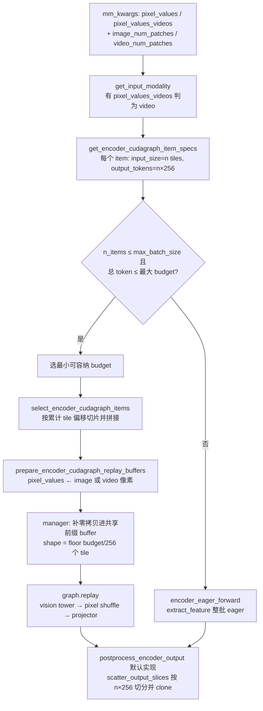
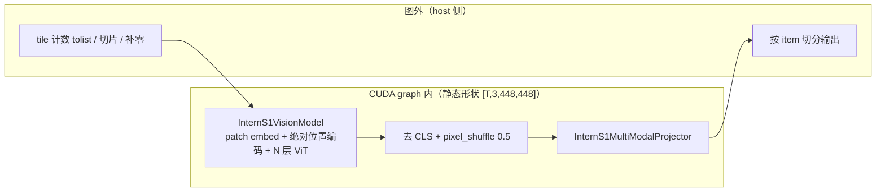

# PR #64634: [MM][CG] Support ViT full CUDA graph for Intern-S1

> **Author**: @Baiiiiiiiiii | **State**: OPEN | **Date**: 2026-10-30
> **Branch**: `interns1-vit-cudagraph` → `main` | **Labels**: documentation, multi-modality, nvidia
> **Changes**: +182 -4 lines across 4 files | **ViT CG 相关性**: 完全相关 | **类型**: 模型集成
> 本报告分两部分：§1–6 为 PR 详细总结，§7–8 为 ViT CUDA graph review 意见（对照 vllm main `632ba4f`）。

---

## 1. 总结 (Summary)

本 PR 让 `InternS1ForConditionalGeneration`（Intern-S1 / Intern-S1-mini，以及注册到同一个类的 HF 格式 InternVL3 `InternVLForConditionalGeneration`）实现 `SupportsEncoderCudaGraph`，使其图片与视频输入都能走 encoder CUDA graph。Intern-S1 的 vision tower 是固定 448×448 tile 的普通 ViT（绝对位置编码、无 RoPE、无 varlen 元数据），因此整个 `extract_feature()`（vision tower + pixel shuffle + projector）被捕获进图，唯一录制的 buffer 是 `pixel_values`，视频帧复用同一个 buffer。实现几乎逐行照搬已合入的 InternVL 集成（#41759），并补齐了文档表、example 注册和 `test_vit_cudagraph.py` 用例。作者给出了 bit-identical 对比、MMStar 精度和真正送图的 encoder/TTFT 测量：1–2 tile 时 encoder 1.24–1.68× 加速，≥4 tile 持平，tile 数落在两个 budget 之间时会被 pad 而变慢。

## 2. 背景与动机 (Background & Motivation)

这是 ViT full CUDA graph tracker [#38175](https://github.com/vllm-project/vllm/issues/38175) 中的一个模型集成任务，作者在 tracker 评论区认领了 Intern-S1。改动前，`InternS1ForConditionalGeneration` 没有实现协议，即使用户打开 `cudagraph_mm_encoder`，runner 也会因为 `supports_encoder_cudagraph(model)` 为假而静默不构建 manager，encoder 始终 eager 执行，也不报 warning。

Intern-S1 的 `extract_feature()` 与 InternVL 结构相同（vision tower → 去掉 CLS → pixel shuffle → projector），区别只在 mm_kwargs 的 key 名（`pixel_values` / `pixel_values_videos`，而 InternVL 是 `pixel_values_flat` / `pixel_values_flat_video`）以及 `vision_config.image_size` 是 `[h, w]` 列表。作者选择复制 InternVL 的协议方法，而不是抽成共享 mixin，并在描述里说明愿意按 reviewer 的意见改成 mixin。

PR 描述的 Validation 部分写得比较扎实：

- 在 L40S 上，6 个 synthetic case（含 padding、多图打包、超出 budget 的 eager 回退、8/5 帧视频）的 graph 输出都与同一 padded batch 上的 eager 输出 bit-identical。两个人为注入的 bug（视频 key 错、按 item 而非累计 tile 偏移切片）都能让对比测试失败。
- MMStar：graph 64.87% vs eager 64.00%，并用一个只改 `max_num_seqs` 的 eager 对照组说明差异属于噪声。
- encoder 延迟（`manager.execute` vs `embed_multimodal`）、`vllm bench mm-processor` random-mm、`vllm bench serve` TTFT 都真正送了图片。作者也如实报告了 padding 导致的 0.68–0.76× 退化，以及默认 budget 下离线 encoder 变慢 7–18%。

评论区里作者补充说，merge main（`ef687f6179`）之后 budget 网格变成了 #65227 的细分网格，捕获图数从 5 变成 26，所以描述中的性能数字来自旧网格。

## 3. 代码修改分析 (Code Change Analysis)

### 3.1 修改的模块

| 模块 | 改动 |
|------|------|
| `vllm/model_executor/models/interns1.py` (+161 -3) | 类继承 `SupportsEncoderCudaGraph`；新增 9 个协议方法和 2 个私有 helper（`_get_encoder_cudagraph_keys`、`_get_num_patches_list`） |
| `tests/models/multimodal/generation/test_vit_cudagraph.py` (+18) | 新增 `interns1` 配置：`internlm/Intern-S1-mini` + `load_format="dummy"` + `dummy_hf_overrides`，image + video（8 帧），`core_model` |
| `docs/design/cuda_graphs_multimodal.md` (+2) | 支持表新增 `InternS1ForConditionalGeneration` 与 `InternVLForConditionalGeneration`（HF 格式 InternVL3）两行 |
| `examples/generate/multimodal/vision_language_offline.py` (+1 -1) | `MODELS_SUPPORT_VIT_CUDA_GRAPH` 加入 `interns1`；`run_interns1` 删除 `enforce_eager=True` |

### 3.2 架构 / 流程图





### 3.3 关键实现细节

- **`get_encoder_cudagraph_config`**（interns1.py:867–877）：`modalities=["image","video"]`，`buffer_keys=["pixel_values"]`，`out_hidden_size=text_config.hidden_size`。没有设置 `paths`，所以走默认单路径与 manager 的细分 budget 网格。
- **`get_input_modality`**（:879–885）：以 `pixel_values_videos` 判视频，其余都当图片。因为支持视频，这里必须覆写，不属于冗余接口。判断方向与 InternVL 相反（InternVL 以 image key 判断），在单模态分组调用下结果等价。
- **budget range**（:896–906）：`min = num_image_token`（=256，一个 tile），`max = min(max_num_batched_tokens, max_model_len)`，与 InternVL 相同。
- **capture**（:957–981）：`total_tiles = max(token_budget // 256, 1)`。用 floor 是正确的，保证捕获的 tile 数不超过 budget。dummy 输入形状为 `[total_tiles, 3, h, w]`。
- **replay**（:983–999）：直接把当批像素放进 `values["pixel_values"]`，由 manager 补零拷进共享 buffer。图片和视频共用同一个 buffer 是安全的：两者每个 tile/帧的形状相同，manager 每次 replay 都会完整重写共享 key。
- **forward**（:1001–1017）：graph 路径与 eager 路径都直接调用同一个 `extract_feature()`，不存在两套实现漂移的问题。
- **测试**：用 dummy 权重，只检查输出非空（作者在描述中也承认了这一点）。parity / logprobs / hit 计数测试只存在于作者本地，没有进入 PR。

## 4. 涉及的技术原理 (Technical Principles)

**InternViT 的 tile 化输入。** InternVL 系把一张图切成若干 448×448 tile（动态分块时还会多一个缩略图 tile）。每个 tile 独立通过 ViT：patch14 → 32×32=1024 个 patch，加上 CLS。去掉 CLS 后做 pixel shuffle（downsample 0.5），每个 tile 得到 16×16=256 个输出 token。因为每个 tile 形状固定、tile 之间没有交互（batched 普通 attention，没有 varlen `cu_seqlens`），encoder 的动态性只体现在 tile 数（batch 维）上。这正是最容易做 CUDA graph 的一类 encoder：padding tile 是独立的 batch 元素，不会通过 attention 污染有效 tile，后处理只需取前 n×256 个 token。

**Budget-based capture/replay。** manager 在启动时按 token budget 捕获多张图，运行时为整批选最小可容纳的 budget，只 replay 一次。budget 太稀会让 pad 出来的计算吞掉收益（PR 中 3→4、5→8 tile 的 0.68–0.76×）；太密又会捕获很多永远选不到的图。main 当前的默认网格是：1024 以下按四分之一倍频程、1024–2560 每 128 一档、之后按 1/8 倍频程。对于每个 item 固定 256 token 的模型，这个网格会产生大量容量相同的冗余 budget，所以 main 提供了 `EncoderCudaGraphPathConfig(min_token_budget=...)`，让 budget 落在 item 整数倍上（#65084 讨论、#65227 实现，DeepSeek-OCR global path 已在使用）。

**共享前缀 buffer。** main 上捕获按 budget 从大到小进行，同一路径的所有 budget 共享一块最大尺寸的输入/输出 buffer，小 budget 录制的是它的前缀 view。replay 时必须提供每个共享 key，manager 先补零再拷贝。本 PR 只有一个 key 且每次都提供，满足约束。

**launch-bound 与 compute-bound。** graph 只省 host 侧 kernel launch 时间。1–2 个 tile 时 eager 被 launch 限制（两者都是约 11.7 ms），graph 有 1.24–1.68× 收益；从 4 个 tile 开始 ViT 已经 GPU-bound，graph 与 eager 持平，再加上 padding 就会变慢。作者的测量与设计文档的 "One Replay per Batch" 原理一致。

## 5. 评论区讨论亮点 (Discussion Highlights)

- **第三方复现**（@seansie0830）：在 RTX 5060 8GB 上用 `OpenGVLab/InternVL3-1B-hf` 跑作者的本地 parity 测试，padding case 都是 `bit_exact_vs_same_batch=True`。这佐证了 HF 格式 InternVL3 确实走同一个类，文档新增的那一行有依据。
- **作者更新**：merge main 后在 A100 上 `test_vit_cudagraph.py -k interns1` 通过；同时说明 #65227 的细分网格使捕获图数从 5 增加到 26，描述中的性能/parity 数字来自旧 main。
- maintainer（@DarkLight1337、@Isotr0py、@shen-shanshan）还没有给出实质意见；claude[bot] 因为 PR 来自 fork 没有运行。CI 尚未触发（`checks` 为空）。

## 6. 风险与潜在问题 (Risk Analysis)

| 风险 | 严重程度 | 说明 |
|------|---------|------|
| 正确性：graph 与 eager 不等价 | Low | 两条路径共用 `extract_feature()`；batched 普通 attention 下 padding tile 互相独立；作者用 bit-identical 测试和变异测试做了验证 |
| 性能：默认网格冗余 + 剩余 padding | Medium | 见「固定 tile 模型应使用 item 整数倍 budget」 |
| 性能数字过期 | Medium | 见「性能数字基于旧 budget 网格，需要在当前 main 上重测」 |
| 测试覆盖：CI 只测输出非空 | Medium | 见「CI 用例只验证非空输出」；parity 测试只在本地 |
| 兼容性：完整 Intern-S1（InternViT-6B + qk-norm）与 TP>1 未测 | Low | 文档表把 `Intern-S1` 一并列为支持；vision tower 用的是普通 `nn.Linear`，不切 TP，图内没有集合通信 |
| 可维护性：与 InternVL 约 150 行孪生代码 | Low | 见「与 InternVL 的协议实现几乎逐行重复」 |

---

## 7. Review 意见 (Findings)

对照 vllm main `632ba4f`（PR head `5aa1d76`，落后 main 267 个提交，协议签名与 main 一致）。

**集成清单**

| 项 | 状态 | 说明 |
|---|---|---|
| 协议实现（与 main 签名一致） | ✅ | 9 个方法签名、`path` / `axis_keys` 参数都对齐 main；没有使用已废弃接口 |
| 文档支持表 | ✅ | 按字母序插入，✅︎/❌︎ 符号和 5 列格式都正确 |
| example 注册 | ✅ | `interns1` 已加入；删除 `enforce_eager=True` 有依据（见 📝） |
| `test_vit_cudagraph.py` 用例 | ⚠️ | 已加入，但用 dummy 权重 + 只检查非空 |
| 单测 / parity | ⚠️ | parity、logprobs、hit 计数测试都只在本地 |
| benchmark（真正送图） | ⚠️ | 测法正确，但是在旧网格上测的 |
| 精度 | ✅ | MMStar 有噪声对照组 |

| 意见类型 | 数量 |
|---|---|
| 【性能】 | 2 |
| 【测试】 | 1 |
| 【可维护性】 | 1 |
| 【注释/文档】 | 1 |
| 【兼容性】 | 1 |

### ⚠️ 建议修复

**⚠️【性能】固定 256-token tile 模型应使用 item 整数倍 budget（`min_token_budget`），当前默认网格产生 11 张永远选不到的冗余图** `[已验证]`
- **问题**：`interns1.py:870-877` 的 `EncoderCudaGraphConfig` 没有设置 `paths`，所以 manager 对这个模型使用通用细分网格（`encoder_cudagraph.py::_generate_budgets`）。而 Intern-S1 的每个 item 都是 256 token 的整数倍，capture 时按 `token_budget // 256` 向下取整决定 tile 数（`interns1.py:972`）。我按 main 的算法模拟了 `min=256`、`max=4096`（测试用的 `max_model_len`）的情况：一共捕获 26 张图（与作者评论里的 "26 graphs" 一致），其中 320/384/448/640/896/1152/1408/1664/1920/2176/2432 这 11 个 budget 的 tile 容量与更小的那个 256 整数倍 budget 相同，按 token 数选 budget 时永远不会被选中；同时 14 个 tile 仍会被 pad 到 15 个 tile（3840）。默认上限为 5120 时，17、19 个 tile 也会被 pad。
- **影响**：多出约 40% 的捕获时间和 graph pool 占用，却没有任何收益；剩余的 padding 场景仍然会出现作者自己测到的 25–30% 退化。
- **行动**：建议作者在 config 中加上 `paths={"default": EncoderCudaGraphPathConfig(min_token_budget=self.num_image_token)}`。这样 manager 会改用 `_item_multiple_budgets`：1–16 个 tile 每个计数都有一张精确的图（max=4096 时共 16 张），既去掉冗余图，又消除 ≤16 tile 的 padding。这正是 DeepSeek-OCR global path 采用的做法（#65084 讨论、#65227）。InternVL 在 main 上也有同样的问题，可以在本 PR 或 follow-up 中一并处理。

**⚠️【性能】性能数字基于旧 budget 网格，需要在当前 main 上重测** `[已验证]`
- **问题**：描述里的 encoder 延迟表（budgets `[256, 512, 1024, 2048, 4096]`）、`mm-processor` 中 "默认 budget 慢 7–18%"、以及 padding 0.68–0.76× 都来自旧的 2 的幂网格；作者在评论区也确认 merge main 后网格变了。现在的默认网格已经不同，采纳上一条建议后又会再变。
- **影响**：reviewer 无法判断在当前默认配置下打开 `cudagraph_mm_encoder` 对 Intern-S1 是净收益还是净损失，尤其是 `mm-processor` 场景（1 图/请求）原来是变慢的。
- **行动**：建议作者在当前 main（最好在加上 `min_token_budget` 之后）用同一组命令重跑 `vllm bench mm-processor`（random-mm，448×448，1 和 4 图/请求，graph on/off）和按 tile 数的延迟表，并更新描述，标明哪些场景仍会比 eager 慢。

**⚠️【测试】CI 用例只验证非空输出，parity 测试留在本地** `[已验证]`
- **问题**：`test_vit_cudagraph.py:325-342` 的 `interns1` 用例使用 `load_format="dummy"`，而 `test_vit_cudagraph_image/video` 只断言输出非空。作者在描述中也承认 "it passes even if the graph stays off"。真正有价值的 graph-vs-eager bit-exact、hit/miss 计数和变异测试都在本地的 `test_interns1_vit_cg_local.py` 中。
- **影响**：以后如果 `extract_feature`、key 名或切片逻辑被改坏（作者的两个变异 bug 正是这类），CI 不会发现。
- **行动**：建议作者把 synthetic tile 的 graph-vs-eager 对比（至少覆盖 padding、多 item 打包、视频帧这几种情况）整理成小型 GPU 单测，放进 `tests/v1/cudagraph/test_encoder_cudagraph.py`，或者作为 `test_vit_cudagraph.py` 中该模型的额外用例。另外，由于 `InternVLForConditionalGeneration` 映射到同一个类，可以考虑在 CI 中改用更小的真实权重 `OpenGVLab/InternVL3-1B-hf`（评论区已在 8GB 显卡上验证可跑）。这样输出有意义，也符合 maintainer 以往"能用小的真实模型就不用 dummy"的倾向（#46837）。

### 📝 建议/备注

**📝【可维护性】与 InternVL 的协议实现几乎逐行重复** `[已验证]`
- **问题**：`interns1.py:867-1017` 与 main 上 `internvl.py:919-1077` 除了 key 名、`image_size` 的取法和 modality 判断方向之外完全一致（select、capture、replay、forward 的结构和注释都相同）。
- **影响**：后续接口调整（例如上面的 `min_token_budget`）需要在两处同步修改，容易出现孪生分歧。
- **行动**：作者已在描述中主动提出可以改成 mixin。建议 review 时请 maintainer 决定：参照 `encoder_cudagraph_utils.py` 中的 `Qwen2VLEncoderCudaGraphMixin`，增加一个以 key 名为参数、面向 InternVL 风格 tile 编码器的 mixin；如果决定合入初版再优化，也可以放到 follow-up。

**📝【注释/文档】文档把完整 `Intern-S1` 列为支持，但只验证了 mini；`image_embeds` 崩溃描述可能已过时** `[推测]`
- **问题**：`cuda_graphs_multimodal.md:21` 同时列出 `Intern-S1` 与 `Intern-S1-mini`，但描述中写明完整 Intern-S1（InternViT-6B + qk-norm）和 TP>1 都没有测过。此外，描述中提到 "`cudagraph_mm_encoder` + `--enable-mm-embeds` 时预计算 embeddings 会导致崩溃"；而 PR head 和 main 上 manager 已经有 `supports_batch()`，会把 `<modality>_embeds` 批次交给 `embed_multimodal`，这个问题可能已经被修复。
- **影响**：用户可能以为完整模型已经验证过；另外描述中可能保留了一个已经不存在的已知问题。
- **行动**：建议作者在当前 main 上复测 `image_embeds` 场景并更新描述。如果没有条件测完整 Intern-S1，可以在 PR 描述（或文档表的 note）中说明只验证了 mini。代码路径相同、vision tower 不切 TP，这一点风险较低。

**📝【兼容性】删除 example 中的 `enforce_eager=True` 是必要的，与其它 ViT CG 模型一致** `[已验证]`
- **问题**：maintainer 以前在 #40576 中曾质疑删除 `enforce_eager` 是否属于无关改动。但核对 main：V2 runner 在 `model_states/interface.py:72` 中要求 `not enforce_eager` 才会构建 `EncoderCudaGraphManager`，并且 `MODELS_SUPPORT_VIT_CUDA_GRAPH` 中除 `glm4_1v` 外的 runner 都没有设置 `enforce_eager=True`。
- **影响**：如果不删，`--enable-vit-cuda-graph` 对 Intern-S1 会静默无效。
- **行动**：本条不需要作者修改，只供 review 时参考。另外发现 `run_glm4_1v` 在 main 上仍是 `enforce_eager=True`，它的 `--enable-vit-cuda-graph` 实际不生效，属于范围外的问题，建议 maintainer 另开 PR 修复。

## 8. 结论 (Verdict)

⚠️ **NEEDS WORK**：实现正确且验证扎实（共用 `extract_feature`、bit-identical 对比、MMStar 噪声对照、真正送图的 benchmark），没有阻塞性问题。但对于这种固定 256-token tile 的模型，应改用 item 整数倍 budget，以消除 11 张冗余图和剩余的 padding 退化；性能数字需要在当前 main 上重测；graph-vs-eager 对比最好进入 CI。完成前两项后即可合入，测试和 mixin 可以视 maintainer 意见放到 follow-up。

## 9. 英文 Review 评论 (Copy-Paste English Comments)

**C1** `vllm/model_executor/models/interns1.py:870-877` — ⚠️ comment

```text
Since every Intern-S1 item is a multiple of 256 tokens (one 448x448 tile), I suppose we should declare that to the manager: `paths={"default": EncoderCudaGraphPathConfig(min_token_budget=self.num_image_token)}`. With the default subdivided grid, budgets like 320/384/448/640/896/1152/... hold the same floor(budget / 256) tiles as a smaller multiple of 256, so 11 of the 26 graphs (max_model_len=4096) can never be selected, and 14 tiles still pad to 15. With `min_token_budget` the manager uses exact item-multiple budgets (every count from 1 to 16 tiles), like the DeepSeek-OCR global path. FYI, #65084 / #65227.
```

**C2** `vllm/model_executor/models/interns1.py:971-977` — ⚠️ comment

```text
The capture sizing itself looks right (floor keeps the captured tiles within the budget). But the latency table, the mm-processor slowdown and the 0.68-0.76x padding cases in the description were measured with the old power-of-two budgets, and you mentioned main now captures 26 graphs. Could you re-run `vllm bench mm-processor` (random-mm, 448x448, 1 and 4 images per request, graph on/off) and the per-tile-count latency on current main, ideally after the `min_token_budget` change, and update the description with the cases that are still slower than eager?
```

**C3** `tests/models/multimodal/generation/test_vit_cudagraph.py:325-342` — ⚠️ comment

```text
This entry uses dummy weights and the test only checks for non-empty output, so it would still pass if the graph were never used, as you noted. Your local parity test (bit-exact vs eager on the same padded batch, packing, video frames, hit counts) is much more valuable. Can we move a small version of it into CI, e.g. into tests/v1/cudagraph/test_encoder_cudagraph.py? Also, since `InternVLForConditionalGeneration` maps to this class, maybe `OpenGVLab/InternVL3-1B-hf` with real weights is a smaller and more meaningful CI model than Intern-S1-mini with dummy weights.
```

**C4** `vllm/model_executor/models/interns1.py:865-867` — ⚠️ comment

```text
These protocol methods are almost line-for-line the same as InternVLChatModel's (only the kwarg names and the image_size lookup differ). As you offered, it may be worth sharing them in a small mixin in encoder_cudagraph_utils.py (similar to Qwen2VLEncoderCudaGraphMixin), parameterized by the pixel-value and num-patches keys, so future interface changes don't need to be made twice. Fine to do it in a follow-up if maintainers prefer to land this first.
```

## 10. 英文总结评论 (Overall Review Summary)

```text
Thanks for the thorough work. The integration is correct: graph and eager share extract_feature, padded tiles are independent batch entries, and the bit-exact, MMStar and real-image benchmarks are convincing. Two changes before merge: since every item is a multiple of 256 tokens, please set min_token_budget on the default path so the manager uses exact tile-count budgets instead of capturing redundant graphs and padding; then re-measure encoder latency on current main, as the numbers come from the old budget grid. Moving the parity test into CI would also help. LGTM once these are addressed.
```
