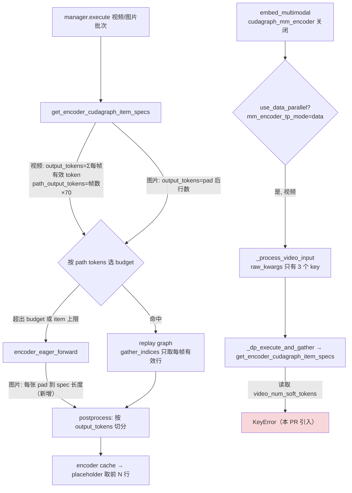

# PR #69016: [Bugfix][Multimodal] Align Gemma 4 encoder CUDA graph outputs with the placeholders

> **Author**: @Chr0mium24 | **State**: OPEN（非 draft，`needs-rebase`） | **Date**: 2026-11-20
> **Branch**: `gemma4-encoder-cg-padding` → `main` | **Labels**: bug, needs-rebase, multi-modality, nvidia
> **Changes**: +154 -25 lines across 3 files | **ViT CG 相关性**: 完全相关 | **类型**: Bugfix
> 本报告分两部分：§1–6 为 PR 详细总结，§7–8 为 ViT CUDA graph review 意见（对照 vllm main `e4ac319d20`）。

---

## 1. 总结 (Summary)

本 PR 修复 Gemma 4 开启 `cudagraph_mm_encoder` 后的两个输出对齐 bug。① 视频 graph replay：每帧被 pad 到 70 个 soft token，item spec 却按 pad 后的数量计数，graph 输出把帧间的 padding 一并返回，从第二帧起每个 placeholder 都拿到错位的 embedding（行余弦均值 0.263）。② 图片 eager 回退：超出 budget 或单批 item 上限的图片批次走 `encoder_eager_forward`，它返回未 pad 的拼接结果，manager 却按 pad 后的数量切分，后续图片全部错位并触发 `ValueError`。修法是：视频 item spec 的 `output_tokens` 改用宿主侧的 `video_num_soft_tokens`（budget 选择仍按 pad 数），replay gather 只取每帧的有效 token；图片 eager 回退把每张图 pad 到 item spec 的长度。修复本身对 graph 路径是正确的，但新增的 `video_num_soft_tokens` 依赖漏掉了 `mm_encoder_tp_mode="data"` 的 eager 视频路径，会让该配置下所有视频请求报 `KeyError`。

## 2. 背景与动机 (Background & Motivation)

Gemma 4 的 encoder CUDA graph 在 #46837 接入（[#38175](https://github.com/vllm-project/vllm/issues/38175) tracker），后续加入了按行宽（soft token 档位）区分的 capture 轴。Gemma 4 的处理器把每张图 pad 到 `max_soft_tokens * 9` 个 patch、把每个视频帧 pad 到 70 个 soft token，而 prompt 中的 placeholder 只包含有效 token。图片 graph replay 返回每张图 pad 后的整行，placeholder 只取前面的有效行，因此一直"碰巧"正确；视频的多帧在 placeholder 中首尾相接，pad 会把后一帧整体错位。

作者给出的证据：新 GPU 测试在 main 上失败（视频行余弦均值 0.263），本 PR 通过；离线 24 个 1–4 图请求的端到端运行在 main 上报 `Attempted to assign … 7896 multimodal tokens to 8116 placeholders`，本 PR 全部完成；CPU 单测 123 passed。作者也说明与 #65431（Gemma 4 native packed vision tower，仍 open）改动同一组函数，谁后合入谁 rebase。

## 3. 代码修改分析 (Code Change Analysis)

### 3.1 修改的模块

| 文件 | 改动 |
|------|------|
| `vllm/model_executor/models/gemma4_mm.py` (+32 -25) | 新增 `_video_frame_soft_tokens()`；视频 `EncoderItemSpec` 的 `output_tokens` 改为每帧有效 token 之和，`path_output_tokens["default"]` 保留 pad 后数量；`select_encoder_cudagraph_items` 携带 `video_num_soft_tokens`；视频 replay 的 `gather_indices` 只收集每帧有效行；图片 `encoder_eager_forward` 把每张图 pad 到 spec 长度 |
| `tests/models/multimodal/generation/test_vit_cudagraph.py` (+100) | 新 helper `_check_encoder_outputs_match_eager` 与 `test_gemma4_vit_cudagraph_outputs_match_eager`（`core_model`）：视频 replay、单图 replay、两图 eager 回退，逐 item 与 `embed_multimodal` 比较行余弦 |
| `tests/models/multimodal/processing/test_gemma4.py` (+22) | CPU 单测：两段视频（66+60、70 token）的 spec 与 `gather_indices` |

### 3.2 架构 / 流程图



### 3.3 关键实现细节

- **视频计数分离**：`output_tokens`（切分与 gather 长度）= 有效 token；`path_output_tokens["default"]`（budget 选择）= 帧数 × 行宽。graph 每帧仍占满一行，选 budget 时按 pad 数是对的；gather 长度不超过 budget。
- **宿主侧数据**：`video_num_soft_tokens` 在 main 上已声明为 `MultiModalFieldConfig.batched("video", keep_on_cpu=True)`，因此 `int(n)` 不会触发 device 同步——与描述一致。
- **图片 eager 回退**：选择"把 eager 输出 pad 成 graph 的布局"而不是"让 spec 计数改为有效 token"，理由是图片的有效 patch 数只在 device 上（`pixel_position_ids`），改计数会引入同步。
- **replay 简化**：视频分支删除了旧的 `frame_output_tokens`/`safe_frame_output_tokens` 计算，改为遍历每帧有效 token；`frame_idx * per_item_output` 的行起点不变。

## 4. 涉及的技术原理 (Technical Principles)

**Gemma 4 vision tower 的 padding 结构。** Gemma 4 没有独立视频塔，视频帧按 `max_soft_tokens=70` 的低分辨率当作图片编码。处理器把每帧 pad 到固定 patch 数，`pixel_position_ids == -1` 标出 pad patch；pooler 按 `output_length = patches // pool_ratio` 输出，再用 `valid_mask` 去掉 pad 行。eager 视频路径逐帧 `pooled_states[valid_mask]`，把各帧有效行首尾相接——这正是 placeholder 的布局。

**Budget + capture 轴。** Gemma 4 的 encoder graph 以 `row_widths`（受支持的 soft token 档位）为 capture 轴，每个 budget × 行宽捕获一张图；graph 内对 pooler 输出 `flat_pooled[gather_indices]` 做 gather 后投影。`gather_indices` 是 replay buffer，长度为 `sum(output_tokens)`，尾部由 manager 按默认逻辑补零。因此 `output_tokens` 决定 gather 取哪些行、manager 如何切分，`path_output_tokens` 决定选哪个 budget——两者含义不同时必须分开。

**manager 的切分契约。** `_execute_local` 用 `spec.output_tokens` 作为 `per_item_out_tokens` 交给 `postprocess_encoder_output`（默认 `scatter_output_slices`）切分，无论该批次走的是 graph 还是 `encoder_eager_forward`。所以 eager 回退的输出布局必须和 `output_tokens` 一致，这是本 PR 图片修复的依据。

**`mm_encoder_tp_mode="data"`。** Gemma 4 声明 `supports_encoder_tp_data = True`；`use_data_parallel` 只要求该模式开启。此时 `embed_multimodal` 的图片/视频 eager 路径通过 `_dp_execute_and_gather()` 做负载均衡，而它复用了 encoder CG 的 `get_encoder_cudagraph_item_specs()` 与 `select_encoder_cudagraph_items()`——这让 CG hook 的输入要求泄漏到了非 CG 路径。

## 5. 评论区讨论亮点 (Discussion Highlights)

- 目前没有人工 review；`claude[bot]` 因 fork PR 未运行。mergify 提示需 rebase（与 #67168 冲突）。
- 作者在描述中主动披露了与 #65431 的重叠，以及测试容差的依据（同一视频改变 eager 分块大小也会让单个值偏差 0.6，因此比较行方向而非逐元素）。这两点都有助于 review。

## 6. 风险与潜在问题 (Risk Analysis)

| 风险 | 严重程度 | 说明 |
|------|---------|------|
| 正确性：DP 模式视频回归 | High | 见 §7「`mm_encoder_tp_mode="data"` 下视频请求 KeyError」 |
| 兼容性：与 #67168 冲突、与 #65431 重叠 | Medium | 冲突只有一处；但 #67168 改了帧 token 的计算，rebase 后需重跑 GPU 测试 |
| 测试覆盖 | Medium | DP 路径与视频 eager 回退无测试；新 helper 与已有 E-only helper 并存 |
| 性能 / 内存 | Low | 图片 eager 回退多 pad 出的零行进入 encoder cache，但只在回退时发生 |
| 可维护性 | Low | 图片仍依赖"placeholder 只取前 N 行"的隐式约定 |

---

## 7. Review 意见 (Findings)

对照 vllm main `e4ac319d20`（PR base `664dfcd4f8`，落后 347 个提交）。读过 PR head 中 Gemma 4 的全部 encoder CG hook、`encoder_eager_forward`、`_process_{image,video}_input[_local]`、`_dp_execute_and_gather`，以及 main 上 manager 的 `_execute_local`。

| 意见类型 | 数量 |
|---------|------|
| 【正确性】 | 1 |
| 【兼容性】 | 1 |
| 【测试】 | 2 |
| 【可维护性】 | 1 |

### 🔴 必须修复

**🔴【正确性】`mm_encoder_tp_mode="data"` 下所有视频请求报 `KeyError: 'video_num_soft_tokens'`** `[已验证]`
- **问题**：`gemma4_mm.py:1946-1947` 的视频 item spec 和 `:2003` 的 `select_encoder_cudagraph_items` 现在无条件读取 `mm_kwargs["video_num_soft_tokens"]`。但这两个函数还被非 CG 的 DP 路径调用：`_process_video_input()`（`:1641-1656`，未改动）在 `use_data_parallel` 时只用 `pixel_values_videos` / `pixel_position_ids_videos` / `video_frame_counts` 三个 key 构造 `raw_kwargs`，交给 `_dp_execute_and_gather()`（`:1344` 调用 `get_encoder_cudagraph_item_specs`，之后调用 `select_encoder_cudagraph_items`）。`Gemma4VideoInputs` schema 也没有这个字段。
- **影响**：触发条件很具体——Gemma 4（如 `google/gemma-4-E2B-it`）+ `--mm-encoder-tp-mode data`（`use_data_parallel` 只检查模式，TP=1 也会进入）+ 任意视频请求，且 `cudagraph_mm_encoder` 为默认的关闭状态。main 上这条路径可用，本 PR 会让它在编码视频时直接失败。这是一个 bugfix 引入的、不依赖 encoder graph 的回归。
- **行动**：作者应当让 DP 视频路径也带上 `video_num_soft_tokens`（加入 `Gemma4VideoInputs` 并写入 `raw_kwargs`），或让 `_dp_execute_and_gather` 不再依赖 CG 专用字段（它只用了 `input_size` 做负载均衡）；并补一个 CPU 单测，用不含该 key 的 DP 风格 kwargs 调用 `get_encoder_cudagraph_item_specs` / `select_encoder_cudagraph_items`。

### ⚠️ 建议修复

**⚠️【兼容性】需 rebase 到 #67168 之后，并重跑 GPU 测试** `[已验证]`
- **问题**：`git merge-tree` 显示与 main 只有一处文本冲突（#67168 在同一位置新增 `_get_do_resize()`，本 PR 新增 `_video_frame_soft_tokens()`），容易解决。但 #67168 同时修改了视频帧 soft token 的计算（`_compute_num_soft_tokens(..., do_resize=video_do_resize, is_video_frame=True)`），而本 PR 的 graph gather 现在直接以 `video_num_soft_tokens` 为准。
- **影响**：本 PR 的验证都在旧 base 上完成；rebase 后若帧 token 计数与 pooler 的有效行数在 `do_resize=False` 等新配置下有差异，视频 gather 会再次与 eager 不一致，而现有测试只覆盖默认 resize。
- **行动**：建议作者 rebase 后重跑 `test_gemma4_vit_cudagraph_outputs_match_eager` 和 CPU 单测，并在描述中更新验证所基于的 commit；与 #65431 的合入顺序建议在 review 时与 #65431 作者对齐。

**⚠️【测试】DP 路径与视频 eager 回退没有覆盖** `[已验证]`
- **问题**：新 GPU 测试覆盖了视频 replay、图片 replay 和图片 eager 回退（`test_vit_cudagraph.py:784-795`），CPU 单测只覆盖 spec 与 gather。视频批次超出 budget 时走 `encoder_eager_forward` 的视频分支（按 `valid_mask` 去 pad，而 spec 现在按处理器的 `video_num_soft_tokens` 切分），以及上面的 DP 路径，都没有测试。
- **影响**：上面的 🔴 回归正是因为 DP 路径没有任何测试才没被发现；视频 eager 回退依赖"处理器计数 == pooler 有效行数"这一隐式等式。
- **行动**：建议作者补充：① CPU 单测覆盖 DP 风格 kwargs；② GPU 测试增加一个超出 `encoder_cudagraph_max_frames_per_batch` 或 budget 的视频批次，断言走 eager 且与 `embed_multimodal` 一致。

### 📝 建议 / 备注

**📝【测试】新 helper 与已有 E-only helper 并存** `[已验证]`
- **问题**：`test_vit_cudagraph.py:698-742` 新增的 `_check_encoder_outputs_match_eager` 与 main 上的 `_check_eonly_encoder_outputs` 做同一件事（真实 manager vs `embed_multimodal`，记录 hit/miss），差别在于输入构造（走 vLLM 处理器而非 HF processor）和比较方式（行余弦而非 `assert_close`）。
- **影响**：两个 helper 会分别演化；新 helper 其实更通用（支持 V1/V2 runner、走 vLLM 处理器），其他"有 padding 行"的模型也可能需要。
- **行动**：建议作者在 helper 的 docstring 中说明何时用它、何时用 E-only helper，或把比较方式做成参数后合并成一个；行余弦容差的理由（分块大小引起的数值差异）写得很清楚，可以保留。

**📝【可维护性】图片仍依赖"placeholder 只取前 N 行"的隐式约定** `[推测]`
- **问题**：图片的 `output_tokens` 仍是 pad 后数量，graph 与（现在的）eager 回退都返回比 placeholder 更长的输出，靠 runner 只取前 N 行来对齐；eager 回退为此额外 pad 了零行（`gemma4_mm.py:2261-2267`）。
- **影响**：功能正确，但 encoder cache 中存的张量比 placeholder 需要的大，与按 placeholder 数计算的 cache 预算不完全一致；这一约定也没有在代码中显式说明。
- **行动**：建议作者在 `get_encoder_cudagraph_item_specs` 的图片分支加一句注释说明该约定；长期看可参照视频的做法，由处理器在宿主侧记录每张图的有效 soft token 数（`keep_on_cpu`），或交给 #65431 的 packed tower 统一解决。

## 8. 结论 (Verdict)

🔴 **BLOCK**：视频 graph replay 与图片 eager 回退的修复思路正确，`output_tokens` / `path_output_tokens` 的拆分也符合 manager 的契约，宿主侧计数没有引入同步。但新依赖的 `video_num_soft_tokens` 没有传到 `mm_encoder_tp_mode="data"` 的 eager 视频路径，Gemma 4 + data 模式 + 任意视频请求会直接 `KeyError`（不需要开启 encoder graph）。修复这一点并补测试、rebase 重测后即可合入。

## 9. 英文 Review 评论 (Copy-Paste English Comments)

**C1** `vllm/model_executor/models/gemma4_mm.py:1946-1947` — 🔴 blocking

```text
This makes `get_encoder_cudagraph_item_specs()` (and `select_encoder_cudagraph_items()` at L2003) require `video_num_soft_tokens`, but they are also used by the non-graph data-parallel path: `_process_video_input()` builds `raw_kwargs` with only `pixel_values_videos`, `pixel_position_ids_videos` and `video_frame_counts` and passes it to `_dp_execute_and_gather()`, which calls both hooks. So with `--mm-encoder-tp-mode data` (even with `cudagraph_mm_encoder` off), every video request will now fail with `KeyError: 'video_num_soft_tokens'`. Could you pass `video_num_soft_tokens` through `Gemma4VideoInputs` / `raw_kwargs`, and add a CPU test that calls these hooks with DP-style kwargs?
```

**C2** `vllm/model_executor/models/gemma4_mm.py:156-158` — ⚠️ comment

```text
This conflicts with #67168, which adds `_get_do_resize()` at the same place and also changes how video frame soft tokens are computed (`do_resize` / `is_video_frame`). The conflict itself is trivial, but since the graph gather now trusts `video_num_soft_tokens` directly, could you rebase, re-run `test_gemma4_vit_cudagraph_outputs_match_eager` on the new base and update the validation section? It would also be good to agree on the merge order with #65431, since both touch these hooks.
```

**C3** `tests/models/multimodal/generation/test_vit_cudagraph.py:784-790` — ⚠️ comment

```text
The new test covers video replay, image replay and the image eager fallback, which is great. Could you also add a video batch that falls back to eager (e.g. more frames than `encoder_cudagraph_max_frames_per_batch`)? The eager video path drops padding with the pooler's `valid_mask`, while the specs now split by the processor's `video_num_soft_tokens`, so it would be good to have a test that checks the two agree.
```

## 10. 英文总结评论 (Overall Review Summary)

```text
Thanks for tracking this down. Splitting the video output tokens from the padded budget tokens and padding the image eager fallback to the spec layout both match how the manager splits outputs, and the host-side counts avoid any sync. However, the hooks now require video_num_soft_tokens, which the data-parallel eager video path never passes, so Gemma 4 with mm_encoder_tp_mode=data fails on every video request even without encoder graphs. Please fix that with a test, rebase onto #67168 and re-run the GPU test. Changes needed before merge.
```
