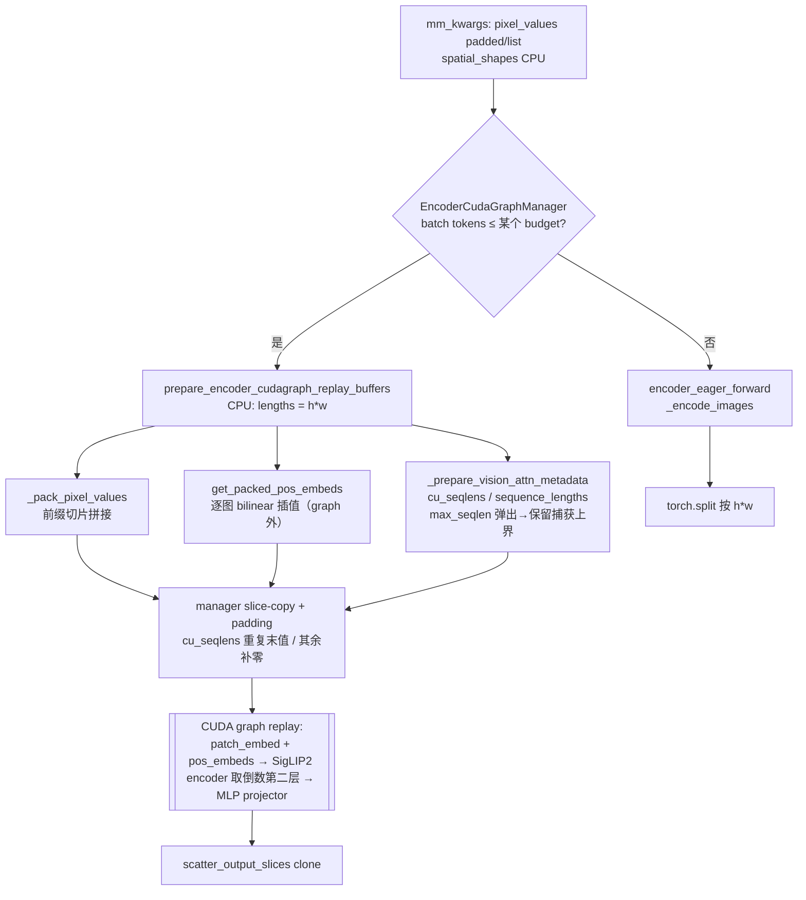
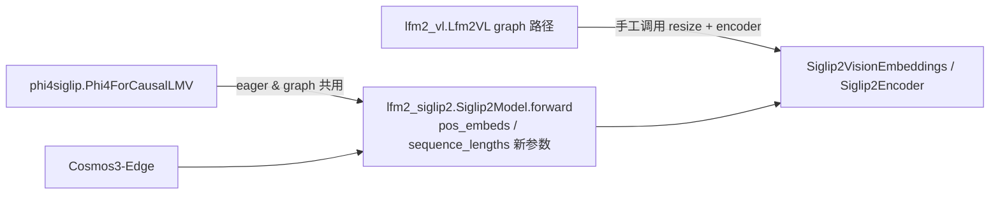

# PR #69223: [MM][CG] Add encoder CUDA graph support for Phi-4-reasoning-vision

> **Author**: @shuoyue21 | **State**: OPEN | **Date**: 2026-11-22
> **Branch**: `feat/phi4siglip-vit-cudagraph` → `main` | **Labels**: documentation, multi-modality, nvidia
> **Changes**: +771 -75 lines across 4 files | **ViT CG 相关性**: 完全相关 | **类型**: 模型集成
> 本报告分两部分：§1–6 为 PR 详细总结，§7–8 为 ViT CUDA graph review 意见（对照 vllm main `632ba4f`）。

---

## 1. 总结 (Summary)

本 PR 为 `Phi4ForCausalLMV`（`microsoft/Phi-4-reasoning-vision-15B`，NaFlex SigLIP2 vision tower + LLaVA MLP projector）实现 `SupportsEncoderCudaGraph`，把 `vision_tower`（取倒数第二层）+ `multi_modal_projector` 按 1D token budget 捕获进 CUDA graph，位置编码插值与 attention 元数据在 graph 外由 CPU 侧 `spatial_shapes` 预计算。顺带把 eager 路径的 mask 打包改为基于 `spatial_shapes` 的前缀切片，消除了 3 次 host-device 同步。实现与 main 当前接口一致、buffer 处理正确、测试扎实；主要欠缺在于性能证据只覆盖 256×256 这一最佳情形，而该模型的典型输入（最多 3600 patch）恰好是作者自述"graph 比 eager 慢约 5%"的区间。

## 2. 背景与动机 (Background & Motivation)

属于 ViT full CUDA graph tracker [#38175](https://github.com/vllm-project/vllm/issues/38175) 的模型集成任务（作者在 tracker 评论区自报）。SigLIP2 NaFlex tower 在 main 上已有一个 CG 集成先例：LFM2-VL（`lfm2_vl.py`，同样复用 `lfm2_siglip2.Siglip2Model`）。本 PR 的做法与之相近，但选择把"打包位置编码"抽成 `Siglip2VisionEmbeddings.get_packed_pos_embeds()` 并给 `Siglip2Model.forward` 增加 `pos_embeds` / `sequence_lengths` 关键字参数，使 graph 路径直接复用完整的 `Siglip2Model.forward`（含 `select_layers=[-2]`）。

作者给出的结果：`vllm bench mm-processor`（RTX 4090，256×256 图）单图 encoder 均值 14.05→5.03 ms（2.79×）、双图 1.89×；`vllm bench serve` E2E TTFT 基本持平（P99 最多 −5.7%）；MMStar 120 样本精度 61.67% 不变且 120/120 输出完全一致。

## 3. 代码修改分析 (Code Change Analysis)

### 3.1 修改的模块

| 模块 | 改动 |
|------|------|
| `vllm/model_executor/models/phi4siglip.py` (+461 −42) | 实现协议全部方法；新增 `_pack_pixel_values`（前缀切片打包）、`_prepare_vision_attn_metadata`（按 backend 生成 `cu_seqlens`/`max_seqlen`/`sequence_lengths`）、`_encode_images`（eager 共用）；`Phi4SiglipImagePixelInputs` 允许 `list[Tensor]`（异构 `d`） |
| `vllm/model_executor/models/lfm2_siglip2.py` (+96 −33) | 新增 `Siglip2VisionEmbeddings.get_packed_pos_embeds()`；`forward` 支持预计算 `pos_embeds`；`sequence_lengths` 一路透传到 `MMEncoderAttention`（FlashInfer）并加入 `support_torch_compile` 的 `dynamic_arg_dims` |
| `tests/models/multimodal/generation/test_vit_cudagraph.py` (+213) | `phi4siglip` e2e case（dummy 权重 + 2 层 vision）；一个 176 行的 GPU 单测：tiny config，SDPA eager 作参考，对每个可用 backend 做 capture+replay，并以 NaN 填充 padding 验证隔离，最后验证回退 |
| `docs/design/cuda_graphs_multimodal.md` (+1) | 支持表新增 `Phi4ForCausalLMV`（Image ✅︎ / Video ❌︎ / Multi-Path ❌︎），位置符合字母序 |

### 3.2 架构 / 流程图





### 3.3 关键实现细节

- **协议实现与 main 对齐**：签名含 `path` / `axis_keys`，`EncoderCudaGraphCaptureInputs(values=...)`，未使用已删除的 `input_key_by_modality` / 旧三件套；`get_input_modality` 沿用默认。
- **buffer 设计**：`buffer_keys = [pixel_values_packed, pos_embeds, cu_seqlens, max_seqlen] (+ sequence_lengths for FLASHINFER)`；capture 用单序列 `[token_budget]` 并把 `cu_seqlens` pad 到 `max_batch_size`；replay 时 `max_seqlen` 被 pop 掉，保留捕获时的上界（0-dim scalar 不参与共享前缀 buffer，正确）；FLASHINFER 的 `cu_seqlens` 用 `MMEncoderAttention.get_cu_seqlens_padding_logics` 填充。
- **budget range**：min = `min_num_patches`（默认 256，可被 `mm_processor_kwargs` 覆盖），max = `min(max_num_batched_tokens, max_model_len)`；`EncoderItemSpec.output_tokens == input_size == h*w`（projector 不做 merge）。
- **安全回退**：TORCH_SDPA（wrapper 内 `.tolist()`）、动态 FP8 vision attention、vision/projector 任一参数在 CPU（非 UVA offload）时返回 `modalities=[]`。
- **eager 路径改写（对所有用户生效）**：不再读 `pixel_attention_mask`，按 `spatial_shapes` 的 `h*w` 取每行前缀；TORCH_SDPA 下 `cu_seqlens` 保留在 CPU。

## 4. 涉及的技术原理 (Technical Principles)

**NaFlex SigLIP2**：图像按原始宽高比切成可变数量的 16×16 patch（`min_num_patches`~`max_num_patches`，Phi-4-reasoning-vision 默认 256~3600），每张图的 `(h, w)` 不同，位置编码需从固定网格（`position_embedding_size²`）双线性插值到 `(h, w)`。这是数据依赖的形状，因此必须在 graph 外（host 侧知道 `h, w`）完成，再作为固定大小 buffer 送入 graph。

**Budget-based encoder CUDA graph**：manager 以 token budget 预捕获若干 graph（main 默认网格：1024 以内 1/4 倍频程、2560 以内步长 128、再 1/8 倍频程，上限 `encoder_cudagraph_max_token_budget=5120`），每个 batch 只 replay 一次"能装下整个 batch 的最小 budget"。graph 只省 host launch 时间：小图 launch-bound 时收益大；大图 GPU-bound 时 padding 的额外计算会让 graph 反而更慢。

**变长 attention 的 padding**：packed 序列用 `cu_seqlens` 描述边界；padding 段通过重复 `cu_seqlens` 末值变成空序列，因而不参与任何真实序列的 attention；补零的 pixel/pos 行产生的输出被 `scatter_output_slices` 丢弃。

**共享前缀 buffer（main #65084）**：budgets 从大到小捕获，同一 path 的输入/输出 buffer 由最大 budget 分配、较小 budget 用其前缀视图；因此 replay 必须提供每个共享 buffer，0-dim scalar（如 `max_seqlen`）则各自独立。

## 5. 评论区讨论亮点 (Discussion Highlights)

- 作者补充说明了 `lfm2_siglip2.py` 的向后兼容：对另两个调用方 `Lfm2VLForConditionalGeneration`（eager + CG capture/replay 对齐，`rtol=atol=0.016`）和 `Cosmos3EdgeVisionEncoder`（`compile_mm_encoder=True`、动态帧数）做了 tiny config 的 GPU 验证。
- claude[bot] / copilot 因 fork 权限与配额未实际 review；目前没有 maintainer 评论，也没有 `ready` 标签，CI 未运行（`checks` 为空）。

## 6. 风险与潜在问题 (Risk Analysis)

| 风险 | 严重程度 | 说明 |
|------|---------|------|
| 典型分辨率下默认配置变慢 | Medium | 见 §7「性能证据只覆盖最佳情形」 |
| 共享 SigLIP2 代码改动影响 LFM2-VL / Cosmos3-Edge | Low | 签名保持位置参数兼容，作者已做 tiny 验证；CI 未跑 |
| eager 打包假设"有效 patch 是每行前缀" | Low | 对 HF Siglip2 processor 成立，见 §7 备注 |
| TP>1 未验证 | Low | FLASHINFER `cu_seqlens` 依赖 `_vision_tp_size` 缩放，只测了 TP=1 |
| CI 覆盖 | Low | 已加 e2e + 单测，但尚未在 CI 上运行 |

---

## 7. Review 意见 (Findings)

对照 vllm main `632ba4f`（PR base `cb85c4e9ef` 之后 main 上 encoder CG 框架只多了 audio 的 `eager_fallback_fast_path`，与本 PR 无冲突）。

**集成清单**

| 项 | 状态 |
|----|------|
| 协议实现（对齐 main 接口） | ✅ |
| 文档支持表（字母序、✅︎/❌︎） | ✅ |
| example `MODELS_SUPPORT_VIT_CUDA_GRAPH` | ❌ 未注册 `phi4_siglip` |
| `test_vit_cudagraph.py` e2e（小/dummy 模型） | ✅ dummy 权重 + 2 层 vision |
| graph vs eager 单测 | ✅ 多 backend + NaN padding 隔离 + 回退 |
| encoder benchmark（真正送图） | ⚠️ 只测 256×256 |
| 精度 | ✅ MMStar 120 样本 + 120/120 输出一致 |

| 意见类型 | 数量 |
|---------|------|
| 【性能】 | 2 |
| 【注释/文档】 | 1 |
| 【接口同步】 | 1 |
| 【兼容性】 | 1 |
| 【可维护性】 | 1 |
| 【测试】 | 1 |
| 【正确性】 | 1 |

### ⚠️ 建议修复

**⚠️【性能】性能证据只覆盖 256×256 最佳情形，典型输入可能在默认配置下变慢** `[已验证]`
- **问题**：encoder benchmark 全部使用 256×256 图（256 token = `min_budget`，恰好整除 budget、且最 launch-bound）。Phi-4-reasoning-vision 的 processor 会把一般照片缩放到接近 `max_num_patches=3600`；作者在 Details 中自述 "3600 patches padded into the 3840 bucket … ~5% encoder latency over sync-free eager"。`get_encoder_cudagraph_budget_range`（`phi4siglip.py:608-637`）的 max 取 `min(max_num_batched_tokens, max_model_len)`，main 默认网格在 5120 以内会捕获 3840 这一档，所以**默认配置下的典型单图请求会 replay 一个比 eager 更慢的 graph**。
- **影响**：用户按文档打开 `cudagraph_mm_encoder` 后，真实流量（非 256×256）可能无收益甚至轻微倒退；PR 的 2.79× 标题数字不代表典型负载。
- **行动**：建议作者补一张按分辨率分档的 encoder 延迟表（如 512×512、~1024×768≈3600 patch、2 张大图），graph on/off 对照；若大图确实更慢，在 PR 描述和设计文档里写明变慢的区间，并建议用户用全局的 `encoder_cudagraph_max_token_budget` 调低上限；不建议在 `get_encoder_cudagraph_budget_range` 里硬编码更小的模型上限（manager 取二者的最小值，模型写死的上限会静默压住用户调高的全局旋钮，#63074 的 review 中对 512 上限提出了同样的问题）。

**⚠️【性能】E2E TTFT 改善处于噪声范围，"Lower E2E TTFT" 的表述偏强** `[已验证]`
- **问题**：Claims 写 "Lower E2E TTFT"，但表中 conc=1 均值 −1.29%、2 RPS 均值 −0.15%（中位数 +0.38%）、4 RPS 均值 +1.42%；唯一较大的 P99 −5.7% 在三轮中并不一致（Round 3 graph on 的 P99 951.58 ms 反而高于 off 的 941.74 ms）。
- **影响**：读者会误以为 E2E 有稳定收益。
- **行动**：建议作者把 E2E 结论改为"E2E TTFT 基本持平（encoder 在该负载下不是瓶颈）"，或增加轮数/置信区间后再声明改善。

**⚠️【注释/文档】example 未注册 `phi4_siglip`** `[已验证]`
- **问题**：`examples/generate/multimodal/vision_language_offline.py` 已有 `run_phi4siglip`（key `phi4_siglip`），但 `MODELS_SUPPORT_VIT_CUDA_GRAPH` 未加入该 key（本 PR 未改此文件）。
- **影响**：`--enable-vit-cuda-graph` 对该模型静默无效，也无法用 maintainer 常用的 eager vs graph 输出对比命令复验。
- **行动**：建议作者把 `"phi4_siglip"` 加入 `MODELS_SUPPORT_VIT_CUDA_GRAPH`，并附 `python examples/generate/multimodal/vision_language_offline.py -m phi4_siglip --modality image [--enable-vit-cuda-graph]` 的输出对比。

### 📝 建议/备注

**📝【接口同步】`get_max_frames_per_video()` 返回 0 是冗余实现** `[已验证]`
- **问题**：`phi4siglip.py:605-606`。manager 只读 `EncoderCudaGraphConfig.max_frames_per_video`（默认 1），image-only 模型无需实现该方法；maintainer 在 #41759 / #43591 / #46005 都要求删除同类实现。
- **影响**：无运行时影响，但给后来者错误的"必需方法"印象。
- **行动**：建议作者删除该方法。

**📝【兼容性】不安全配置下静默回退，用户只看到 info 级日志** `[已验证]`
- **问题**：`phi4siglip.py:582-599` 在 TORCH_SDPA / 动态 FP8 / CPU offload 时返回 `modalities=[]`，manager 只打一条 `logger.info("Encoder CUDA graph capture skipped: no supported modalities.")`，不说明原因。
- **影响**：用户显式开启 `cudagraph_mm_encoder` 却不知道为什么没生效。
- **行动**：建议作者在返回空 modalities 时 `logger.warning_once` 具体原因（哪一个条件不满足）。

**📝【可维护性】与 LFM2-VL 的 SigLIP2 graph 路径形成孪生实现** `[已验证]`
- **问题**：本 PR 新增的 `Siglip2VisionEmbeddings.get_packed_pos_embeds()`（`lfm2_siglip2.py:50`）与 main 上 `lfm2_vl.py` 的 `_get_lfm2vl_pos_embeds()` 做的是同一件事，后者还手工拆开 embeddings/encoder 调用。
- **影响**：两套实现日后可能漂移（这正是 maintainer 在 #40830 提到的"消除冗余"问题）。
- **行动**：不阻塞本 PR；建议作者在 follow-up 中让 LFM2-VL 复用 `get_packed_pos_embeds` / `pos_embeds` 参数。

**📝【测试】模型专属单测放在 e2e 文件中；只验证了 TP=1** `[推测]`
- **问题**：176 行的 `test_phi4siglip_encoder_cudagraph` 放在 `test_vit_cudagraph.py` 并标 `core_model`（文件内已有 LFM3 的同类先例，可以接受）；所有验证均为 TP=1，而 FLASHINFER 的 `cu_seqlens` 缩放依赖 `_vision_tp_size`。
- **影响**：TP>1 + FLASHINFER 组合缺少覆盖。
- **行动**：建议 review 时追问是否测过 TP=2 + FLASHINFER；单测位置可保持现状。

**📝【正确性】eager 打包改为依赖"有效 patch 是每行前缀"** `[推测]`
- **问题**：`_pack_pixel_values`（`phi4siglip.py:371`）不再读 `pixel_attention_mask`，改用 `h*w` 前缀切片。对 HF Siglip2 processor（尾部 padding）成立，作者也给出了 `max_abs_diff=0` 的对比。
- **影响**：若未来 processor 改变 padding 布局，会静默取错 patch；该改动对未开启 CG 的用户同样生效。
- **行动**：建议作者在 `_pack_pixel_values` 的 docstring 中写明这一前提（或在 debug 模式下断言 mask 前缀等于 `h*w`）。

**亮点（无需修改）**：capture/replay buffer 键集合一致，`max_seqlen` 处理与共享前缀 buffer 规则吻合；`spatial_shapes` 用 `keep_on_cpu=True`，`VLLM_GPU_SYNC_CHECK=error` 下测试通过；单测用 NaN 填充 padding 验证隔离、并覆盖 list/stacked 两种输入与回退；`list[Tensor]` 异构 `d` 的 schema 修正顺带修复了跨请求 batch 的潜在问题。

## 8. 结论 (Verdict)

⚠️ NEEDS WORK — 实现正确且与 main 接口一致，没有阻塞性正确性问题；需要补充典型分辨率下的 encoder 性能数据（必要时下调该模型的默认 budget 上限）、收敛 E2E 表述，并注册 example 后即可合入。

## 9. 英文 Review 评论 (Copy-Paste English Comments)

**C1** `vllm/model_executor/models/phi4siglip.py:608-637` — ⚠️ comment

```text
The encoder benchmark only uses 256x256 images (256 tokens, exactly the min budget), which is the best case for graphs. This model's processor resizes typical photos to close to max_num_patches=3600, and the description itself says 3600 patches padded into the 3840 bucket are ~5% slower than eager. With this budget range and the default grid (up to 5120), that bucket is captured by default, so typical single-image traffic may get slower. Could you add encoder latency numbers for a few realistic sizes (e.g. 512x512, ~1024x768, two large images) with graph on/off? If large images regress, I suppose it's better to document the slower range and point users to `encoder_cudagraph_max_token_budget`, rather than hardcoding a smaller max budget here: the manager takes the minimum of the two, so a model-level cap would silently override a user-raised global limit.
```

**C2** `docs/design/cuda_graphs_multimodal.md:28` — ⚠️ comment（`vision_language_offline.py` 不在 diff 中，锚定到文档表新增行）

```text
Please also add "phi4_siglip" to MODELS_SUPPORT_VIT_CUDA_GRAPH in examples/generate/multimodal/vision_language_offline.py; otherwise --enable-vit-cuda-graph is silently ignored for this model. It would also be nice to post the outputs of `python examples/generate/multimodal/vision_language_offline.py -m phi4_siglip --modality image` with and without --enable-vit-cuda-graph.
```

**C3** `vllm/model_executor/models/phi4siglip.py:605-606` — ⚠️ comment

```text
This method is not needed: the manager reads EncoderCudaGraphConfig.max_frames_per_video (default 1), and this model is image-only. FYI, the same cleanup was requested in #41759 and #43591. Can we just remove it?
```

**C4** `vllm/model_executor/models/phi4siglip.py:582-599` — ⚠️ comment

```text
When graph_safe is False we return modalities=[], and the manager only logs "Encoder CUDA graph capture skipped: no supported modalities." at info level. Since the user explicitly enabled cudagraph_mm_encoder, could we log a warning_once with the actual reason (TORCH_SDPA backend, dynamic FP8 attention, or CPU-offloaded weights)?
```

## 10. 英文总结评论 (Overall Review Summary)

```text
Thanks for the clean integration. The protocol implementation matches the current main interfaces, the capture/replay buffers are handled correctly (max_seqlen keeps the captured bound, cu_seqlens padding reuses the shared helper), and the NaN-padding unit test plus the MMStar parity run are convincing. Before merging, please add encoder latency numbers for realistic image sizes, since ~3600-patch inputs may be slower than eager with the default budgets, and document any slower range instead of hardcoding a model-level budget cap; tone down the E2E TTFT claim, which is within noise; and register phi4_siglip in the offline example. Changes needed before merge, but close.
```
